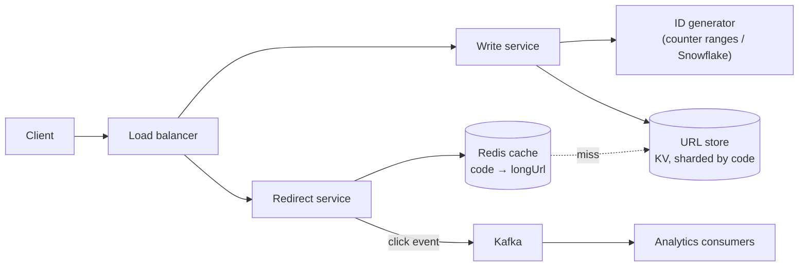
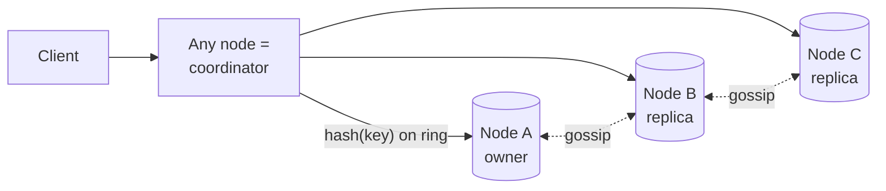
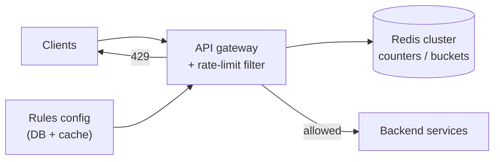
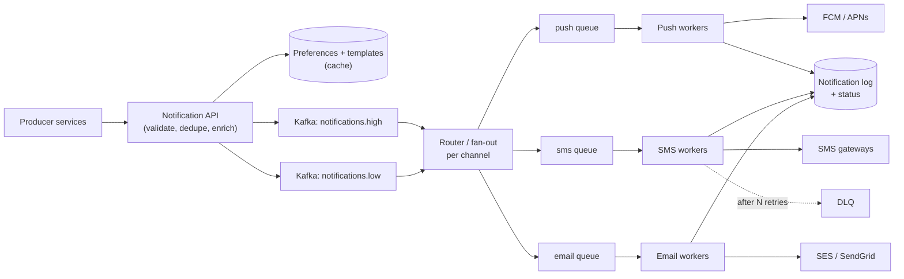

## 1 · Requirements

**Functional**
- Create a short URL from a long URL (optional **custom alias**, optional **expiry**).
- Redirect `short.ly/aZ3kQ9` to the long URL.
- (Nice to have) click count per link.

**Non-functional**
- **Very read-heavy** (~100:1). Redirect latency **p99 < 50 ms**.
- High availability for redirects (a broken short link is very visible).
- Codes must be **unique** and preferably **not guessable** in sequence.

**Out of scope:** user accounts and dashboards, link editing.

## 2 · Estimates

- 100M new URLs/month → ~40 writes/s (peak ~100/s).
- 100:1 reads → ~4,000 redirects/s (peak ~10K/s).
- Storage: 100M × 12 months × 5 years = 6B URLs × ~500 B ≈ **3 TB**. Fits a sharded KV store or even a big Postgres cluster.
- **Code length:** base62 (a–z, A–Z, 0–9). 62⁷ ≈ **3.5 trillion**, so **7 characters** is plenty.

## 3 · API

```http
POST /api/v1/urls        { "longUrl": "...", "alias": "diwali-sale"?, "expiresAt": "..."? }
→ 201 { "shortUrl": "https://short.ly/aZ3kQ9" }

GET /{code}              → 302 Found, Location: <longUrl>     (404 if missing/expired)
```

**301 vs 302:** a 301 (permanent) lets browsers cache the redirect, which means less load **but you lose click analytics**. A **302** (temporary) means every click hits you. Pick 302 if analytics matter.

## 4 · Data model

```
urls:  code (PK, 7 chars) | long_url | created_at | expires_at | owner_id?
```

Simple key-value access by `code`, so **DynamoDB / Cassandra** or sharded Postgres, partitioned by `code`.

## 5 · High-level design



## 6 · Deep dives

### Generating the short code (the main discussion)

| Approach | How | ✅ | ❌ |
|---|---|---|---|
| **Counter + base62** ⭐ | Unique number → base62 | No collisions, short | Sequential = guessable (fix: shuffle/encrypt the number, or use a large random offset); the counter must be distributed |
| **Hash (MD5/SHA) + take 7 chars** | `base62(md5(longUrl))[0:7]` | Same URL gives the same code (dedupe) | **Collisions**: must check the DB and retry with a salt |
| **Random 7 chars** | Random + check existence | Unguessable | Collision checks get more frequent as the space fills |
| **Pre-generated key service** | Offline job generates unused codes, and servers take batches | Fast, no runtime collisions | An extra service; must not hand out the same key twice |

**Distributed counter:** each write server **leases a range** (e.g. 1,000,000–1,999,999) from ZooKeeper or a DB row (`UPDATE ranges SET next = next + 1000000 RETURNING`). No coordination per request, and if a server dies only part of a range is wasted.

**Custom alias:** insert with a **unique constraint / conditional put**. On conflict, return 409.

### Redirect path performance

- The **cache** holds hot codes (an 80/20 distribution). Use LRU with a TTL capped at the link's expiry.
- At ~10K reads/s, one Redis node is enough. Add replicas for HA.
- Cache misses for nonexistent codes (scanners): **cache negative results** briefly, or use a **bloom filter**.
- Put the redirect service in multiple regions, possibly at the **CDN edge** (edge KV), for global users.

### Expiry

Check `expires_at` on read (lazy), and run a **background cleanup job** that deletes or archives expired rows. DynamoDB/Cassandra **TTL** can do this automatically.

### Analytics

Don't write to the DB synchronously on each redirect. **Emit an event to Kafka**, then aggregate by (code, minute) in a stream job into an analytics store (ClickHouse, or Cassandra counters).

## Trade-offs to state out loud

- 302 + analytics vs 301 + less load.
- Counter (no collisions, guessable unless obfuscated) vs hash (dedupe, collisions).
- KV store (simple, scales) vs SQL (familiar, needs sharding later).

## Self-check

<details>
<summary>How many characters do you need for 6 billion URLs with base62?</summary>

62⁶ ≈ 57 billion, so **6 characters** already suffice. 7 characters (3.5 trillion) gives a lot of headroom.
</details>

<details>
<summary>How do multiple servers generate unique codes without coordinating on every request?</summary>

Each server leases a large range of counter values (from ZooKeeper/etcd or a DB row) and encodes numbers from its range in base62. Alternatively, Snowflake-style IDs or a pre-generated key service.
</details>

<details>
<summary>Why might you choose 302 over 301?</summary>

A 301 is cached by browsers, so later clicks never reach your servers and you lose analytics and the ability to change or expire the link. A 302 keeps every click flowing through you.
</details>

<details>
<summary>How do you stop people enumerating all links by incrementing codes?</summary>

Don't expose raw sequential numbers: apply a reversible bijective shuffle or encryption (e.g. a Feistel cipher) to the counter before base62 encoding, or use random codes with collision checks. Also rate-limit the redirect endpoint.
</details>
---
id: key-value-store
title: Design a Distributed Key-Value Store (Dynamo-style)
tier: 1
day: 14
minutes: 45
tags: key value store, consistent hashing, quorum, replication, vector clock, gossip, lsm
summary: Ties together Module 02. Partitioning with consistent hashing, replication with tunable quorums, conflict handling, failure detection via gossip, and an LSM-based storage engine.
videos: ByteByteGo design a key value store | Gaurav Sen distributed key value store | Hussein Nasser Amazon Dynamo paper | Jordan has no life key value store
read: Amazon Dynamo paper => https://www.allthingsdistributed.com/files/amazon-dynamo-sosp2007.pdf | Cassandra — Dynamo architecture => https://cassandra.apache.org/doc/latest/cassandra/architecture/dynamo.html
---

## 1 · Requirements

- `put(key, value)`, `get(key)`, `delete(key)`. Values up to ~1 MB.
- **Highly available** and partition tolerant (AP by default), with **tunable consistency**.
- Horizontally scalable to petabytes. Low latency (single-digit ms).
- Automatic handling of node failures and additions.

## 2 · Estimates (example)

- 1M ops/s, 10 TB of data, replication factor 3 → 30 TB raw → ~30–60 nodes of 1 TB SSD each with headroom.

## 3 · API

```
PUT /kv/{key}   body=value   header: consistency=QUORUM
GET /kv/{key}               header: consistency=ONE|QUORUM|ALL
```

## 4 · Data model

Each value is stored with **metadata**: version (a vector clock or timestamp), plus a tombstone flag for deletes.

## 5 · High-level design



## 6 · Deep dives

### Partitioning
**Consistent hashing with virtual nodes** (Day 13). The key's owner is the first node clockwise, and its replicas are the next N−1 distinct physical nodes. Adding a node moves only ~1/N of the keys.

### Replication and quorum
N = 3. The client chooses **W** and **R** per request:
- `W=2, R=2` (QUORUM): reads see the latest write, and it tolerates 1 node down.
- `W=1, R=1`: lowest latency, eventual consistency.

### Conflicts
With leaderless writes, two clients can write the same key concurrently on different replicas.
- **Last-write-wins (timestamp):** simple, but can silently drop writes (clock skew).
- **Vector clocks:** detect concurrent versions and return both "siblings" to the client to merge (the Dynamo shopping cart merges carts).
- **CRDTs** for counters and sets that merge automatically.

### Handling failures
- **Gossip protocol:** each node periodically exchanges membership/heartbeat info with a few random peers, so failures are detected in O(log N) rounds without a central master.
- **Sloppy quorum + hinted handoff:** if a replica is down, write to the next healthy node with a "hint", and hand the data back when the replica recovers.
- **Read repair:** a read that sees stale replicas updates them.
- **Anti-entropy with Merkle trees:** background comparison and sync between replicas.

### Storage engine (per node)
An **LSM tree**: commit log → memtable → SSTables + **bloom filters** + compaction (Day 9). Deletes write **tombstones** that compaction later purges.

## Trade-offs

| Choice | Benefit | Cost |
|---|---|---|
| Leaderless | No failover, always writable | Conflicts, more complex reads |
| Quorum R+W>N | Read-your-writes | Latency, needs a majority up |
| LWW | Simple | Lost updates |
| Vector clocks | No silent loss | Client must merge siblings |

## Self-check

<details>
<summary>What does hinted handoff solve?</summary>

Keeping writes available when a replica is temporarily down: another node stores the write with a hint and forwards it when the replica comes back.
</details>

<details>
<summary>How do nodes learn about failures without a master?</summary>

The gossip protocol: each node periodically exchanges heartbeat/membership state with random peers, and the information spreads epidemically through the cluster.
</details>

<details>
<summary>Why might last-write-wins lose data?</summary>

Concurrent writes are ordered by timestamps from different machines' clocks, which can be skewed. The "losing" write is silently discarded even though it wasn't actually older.
</details>
---
id: rate-limiter
title: Design a Distributed Rate Limiter
tier: 1
day: 20
minutes: 40
tags: star, rate limiter, token bucket, sliding window, redis, lua, api gateway
summary: Protect APIs from abuse and overload. Where to place the limiter, choosing an algorithm, implementing it atomically in Redis with Lua, multi-tier limits, and failing open vs closed.
videos: Hello Interview distributed rate limiter | ByteByteGo design a rate limiter | Gaurav Sen rate limiting system design | codeKarle rate limiter
read: Hello Interview — Distributed rate limiter => https://www.hellointerview.com/learn/system-design/problem-breakdowns/distributed-rate-limiter | Stripe — Rate limiters => https://stripe.com/blog/rate-limiters
---

## 1 · Requirements

**Functional**
- Limit requests per **client** (user ID, API key, IP) per **rule**: e.g. 100 req/min per user, 10 login attempts/min per IP, 1,000 req/s per partner.
- Return **429 Too Many Requests** with `Retry-After` and `X-RateLimit-Remaining` headers.

**Non-functional**
- Adds **< 5 ms** latency. Highly available.
- **Accurate across many API servers**, so it needs a shared counter.
- Must not become a single point of failure.

## 2 · Estimates

- 1M requests/s across the fleet means 1M limiter checks/s. A Redis cluster with ~10–20 shards handles that.
- Memory: 10M active keys × ~100 B ≈ 1 GB. Small.

## 3 · Where does it live?



- **At the gateway / middleware**, shared by all services. Most common.
- Client-side limiting is only a courtesy (clients can lie).
- A **sidecar / service mesh** (Envoy has global rate limiting) is another option.

## 4 · Algorithm choice

| Algorithm | Accuracy | Memory/key | Bursts | Verdict |
|---|---|---|---|---|
| Fixed window counter | Edge bursts up to 2× | 1 counter | ❌ | Simple, ok for coarse limits |
| Sliding window log | Exact | 1 entry per request | ✅ smooth | Too much memory at scale |
| **Sliding window counter** | ~Accurate | 2 counters | ✅ | Good default |
| **Token bucket** | Exact average with controlled burst | 2 numbers | ✅ allows bursts | **Most popular** (Stripe, AWS) |
| Leaky bucket | Smooth output | queue | queues bursts | Traffic shaping |

## 5 · Implementation in Redis

**Fixed window (simplest):**
```
key = rl:{userId}:{epochMinute}
count = INCR key
if count == 1: EXPIRE key 60
allow = count <= limit
```

**Token bucket in a Lua script** (atomic, one round trip):
```lua
-- KEYS[1]=bucket key, ARGV: capacity, refill_per_sec, now_ms
local b = redis.call('HMGET', KEYS[1], 'tokens', 'ts')
local tokens = tonumber(b[1]) or tonumber(ARGV[1])
local ts = tonumber(b[2]) or tonumber(ARGV[3])
tokens = math.min(tonumber(ARGV[1]), tokens + (tonumber(ARGV[3]) - ts) / 1000 * tonumber(ARGV[2]))
local allowed = tokens >= 1
if allowed then tokens = tokens - 1 end
redis.call('HMSET', KEYS[1], 'tokens', tokens, 'ts', ARGV[3])
redis.call('PEXPIRE', KEYS[1], 60000)
return allowed and 1 or 0
```

Lua makes the read-modify-write **atomic**, so there's no race between gateway instances.

## 6 · Deep dives

- **Latency:** Redis in the same region/AZ. One round trip per check (~0.5 ms).
- **Hot keys:** a single abusive client hammering one key. Add a **local in-memory pre-limiter** that blocks the obvious excess before calling Redis.
- **Reducing Redis load:** each gateway takes **batches of tokens** locally (e.g. 10 at a time) and syncs periodically. Slightly less accurate, much cheaper.
- **Multi-tier rules:** per second + per minute + per day, plus a global limit. Check them all in one Lua call.
- **Failure mode, fail open or closed?** If Redis is down: **fail open** (allow) for normal APIs so you don't create an outage, but **fail closed** for sensitive endpoints (login, OTP, payments) to keep brute-force protection.
- **Multi-region:** limits per region (simple), or async replication of counters (approximate global).
- **Rules management:** stored in a DB, cached in gateways, hot-reloaded.

## Self-check

<details>
<summary>Why use a Lua script in Redis for a token bucket?</summary>

It makes the read-refill-decrement-write sequence atomic in one round trip. Without it, concurrent gateway instances could read the same token count and both allow requests (a race).
</details>

<details>
<summary>Redis is down. Should the rate limiter allow or deny traffic?</summary>

It depends on the endpoint: fail open for general APIs (availability first), fail closed for security-sensitive endpoints like login/OTP. Alert either way.
</details>

<details>
<summary>What's the problem with fixed-window counters?</summary>

Bursts at window boundaries: a client can send the full limit at 0:59 and again at 1:00, which is 2× the limit within a second or two.
</details>
---
id: notification-system
title: Design a Notification System (push, SMS, email)
tier: 1
day: 28
minutes: 45
tags: star, notification, kafka, push, sms, email, fan-out, retry, idempotency, priority
summary: A multi-channel notification platform. Kafka-based fan-out, per-channel workers with third-party providers, priorities, user preferences, retries with DLQ, dedupe, and rate limiting.
videos: ByteByteGo design a notification system | Gaurav Sen notification service | codeKarle notification service | Sudocode notification system design
read: ByteByteGo — System Design Interview Vol 1 (notification chapter) => https://bytebytego.com
---

## 1 · Requirements

**Functional**
- Services (payments, orders, marketing) send notifications via **push (FCM/APNs), SMS, email, in-app**.
- **Templates** with variables. **User preferences**: opt-out per channel/category, quiet hours.
- **Priorities:** OTP and transaction alerts are urgent. Marketing can wait.
- Scheduled and bulk campaigns.

**Non-functional**
- **At-least-once delivery, no duplicates visible to users** (dedupe).
- OTPs delivered in **seconds**. Marketing within hours.
- Scale: e.g. **100M notifications/day**, with campaign spikes of 10M within minutes.
- Third-party providers will fail or throttle, so the system must be resilient.

## 2 · Estimates

100M/day ≈ 1,200/s average. Campaigns peak at 50K/s, so we need **queues to absorb bursts**. Notification log: 100M × 1 KB = 100 GB/day (keep 30–90 days hot).

## 3 · API

```http
POST /v1/notifications
{ "idempotencyKey": "txn-789-debit-alert", "userId": 42, "category": "TRANSACTION",
  "priority": "HIGH", "channels": ["PUSH","SMS"], "template": "debit_alert",
  "params": { "amount": "₹2,000", "merchant": "Swiggy" } }
→ 202 Accepted { "notificationId": "..." }
```

## 4 · Data model

- `templates (id, channel, locale, body, version)`
- `user_preferences (user_id, category, channel, enabled, quiet_hours)`
- `devices (user_id, device_token, platform, last_seen)`
- `notifications (id, idempotency_key UNIQUE, user_id, status per channel, attempts, timestamps)` in Cassandra/DynamoDB (write-heavy, keyed by user + time).

## 5 · High-level design



## 6 · Deep dives

- **Priority isolation:** separate topics/queues and worker pools for HIGH (OTP, debit alerts) vs LOW (marketing), so a 10M campaign never delays an OTP.
- **Dedupe / idempotency:** a unique `idempotencyKey` at the API (reject duplicates), and workers check status before sending (`SENT` means skip). Providers can still duplicate rarely, which is acceptable for most categories.
- **Retries:** exponential backoff with jitter. After N failures go to the **DLQ**. **Failover between providers** (two SMS vendors: if one's error rate spikes, route to the other, behind a circuit breaker).
- **Rate limiting:** respect provider limits (per-second throughput caps) and protect users (max N marketing messages/day, quiet hours, and DND rules for SMS in India under TRAI).
- **Device tokens:** stale tokens make FCM return errors, so clean them up. Users have multiple devices, so fan out to all of them.
- **Templates and localisation:** rendered in workers, versioned.
- **Tracking:** delivery receipts and webhooks from providers (delivered, bounced, opened) update the log, and analytics run from Kafka.
- **Scheduled campaigns:** a scheduler service enqueues in batches, throttled.

## Self-check

<details>
<summary>How do you ensure a 10M-user marketing campaign doesn't delay OTPs?</summary>

Separate high- and low-priority topics/queues with dedicated worker pools and provider quotas, and throttle bulk campaigns. OTPs never queue behind marketing.
</details>

<details>
<summary>How do you avoid sending the same debit alert twice?</summary>

The producer passes an idempotency key (e.g. `txnId + type`). The API has a unique constraint and rejects or returns the duplicate. Workers check the per-channel status before sending, so retries skip already-sent messages.
</details>

<details>
<summary>Your SMS provider starts timing out. What happens?</summary>

The circuit breaker opens for that provider, traffic fails over to the secondary provider, and failed messages are retried with backoff. Those exceeding retries go to the DLQ, and alerts fire.
</details>
