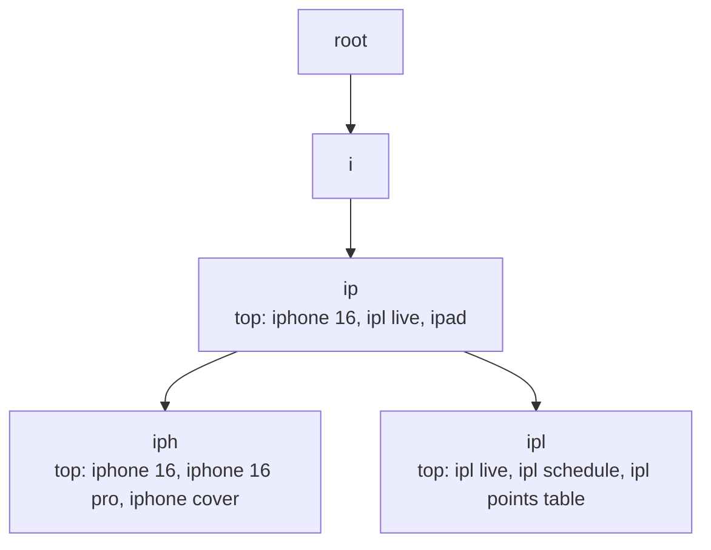
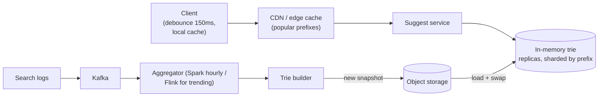
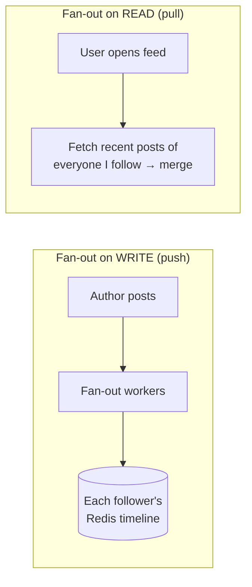
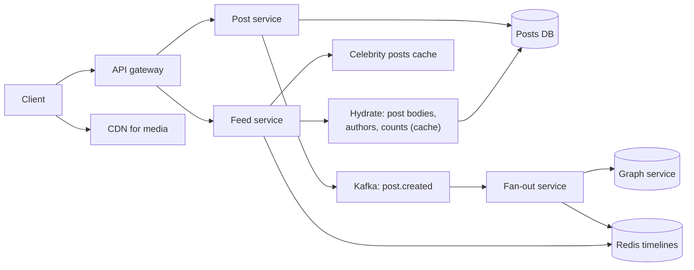
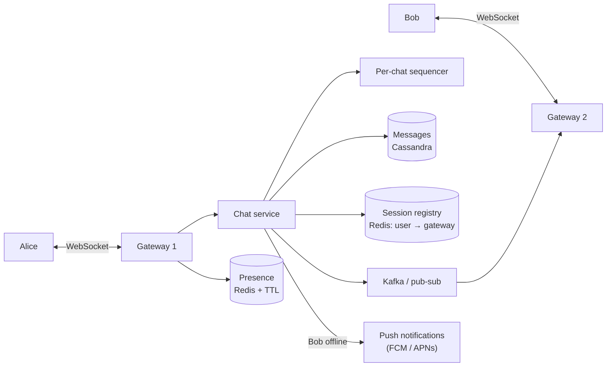
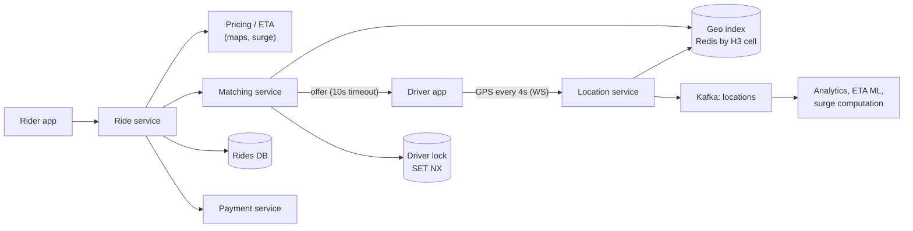

## 1 · Requirements

- As the user types, return the **top 5–10 suggestions** for the prefix, ranked by popularity (optionally personalised, localised or trending).
- **Latency < 100 ms** end to end (it must feel instant). Very high read QPS.
- Suggestions can be **slightly stale** (minutes to hours).
- Filter offensive terms.

## 2 · Estimates

- 100M DAU × 10 searches × ~6 keystrokes = 6B requests/day ≈ **70K QPS**, peak ~150K. Debouncing on the client cuts this a lot.
- Unique queries to index: ~100M terms × ~30 B ≈ a few GB, which **fits in memory**.

## 3 · API

`GET /suggest?q=ipho&limit=8&locale=en-IN` → `["iphone 16", "iphone 16 pro", "iphone cover", …]`

## 4 · Core data structure: a trie with top-K cached per node



- Walking down the prefix is O(length). Then **return the precomputed top-K list stored at that node**, with no subtree search at query time.
- Memory trade-off: storing K suggestions per node is more memory, but it makes queries O(prefix length).
- Alternative: in Redis or a KV store, `prefix → top-K list` for every prefix up to length ~10. Simple and very common.

## 5 · High-level design



## 6 · Deep dives

- **Data collection:** log every search query (not every keystroke) to Kafka. Aggregate counts with time decay (recent searches weigh more).
- **Building:** an offline job rebuilds the trie (hourly or daily), the snapshot goes to S3, and servers **load the new version and atomically swap**. No in-place updates under load.
- **Trending:** a separate fast path with a streaming job (Flink + Count-Min Sketch/top-K, Day 38) merges "hot right now" terms (e.g. a breaking cricket score) into results.
- **Sharding:** by first character(s) of the prefix, but distribution is uneven ('s' is much more popular than 'x'), so shard by **prefix ranges based on traffic**. Usually a full copy fits on each node, with replicas for QPS.
- **Caching:** browser cache + CDN for short popular prefixes (1–3 characters are the same for everyone). Personalised layers are merged after.
- **Client tricks:** **debounce** (wait ~150 ms after typing stops), cancel in-flight requests, and cache previous prefix results locally.
- **Filtering:** a blocklist applied at build time and at serve time.
- **Personalisation:** blend global top-K with the user's recent searches (stored per user in Redis) on the server.

## Self-check

<details>
<summary>Why store top-K suggestions at each trie node?</summary>

So a query only walks the prefix (O(length)) and returns a precomputed list, instead of traversing the whole subtree and sorting at request time. It trades memory for latency.
</details>

<details>
<summary>How do you update suggestions without slowing down reads?</summary>

Rebuild the trie offline from aggregated logs, publish a snapshot, and have servers load it and atomically swap their pointer. Handle trending terms through a separate streaming path.
</details>

<details>
<summary>Two client-side techniques that cut QPS?</summary>

Debouncing keystrokes (only request after a short pause) and caching previous prefix responses locally, plus cancelling stale in-flight requests.
</details>
---
id: news-feed
title: Design a News Feed (Twitter / Instagram / LinkedIn)
tier: 2
day: 35
minutes: 50
tags: star, news feed, fan-out, timeline, celebrity problem, redis, cassandra, ranking
summary: The most famous SDE-2 question. Fan-out on write vs read, the celebrity problem and hybrid fan-out, timeline caches in Redis, storage choices, cursor pagination, and ranking.
videos: Hello Interview Facebook news feed | ByteByteGo design a news feed system | Gaurav Sen Instagram system design | Jordan has no life twitter design
read: Hello Interview — FB news feed => https://www.hellointerview.com/learn/system-design/problem-breakdowns/fb-news-feed | System Design Primer — Twitter timeline => https://github.com/donnemartin/system-design-primer/blob/master/solutions/system_design/twitter/README.md
---

## 1 · Requirements

**Functional:** create a post (text + media), follow users, view a **home feed** of posts from people you follow (newest first, or ranked), paginated, plus like/comment counts.
**Non-functional:** feed loads in **< 200 ms**, **highly available**, **eventual consistency OK** (a post can take a few seconds to show up), very **read-heavy**.

## 2 · Estimates

200M DAU, 1 post/day each → ~2K writes/s. 20 feed loads/day → ~40K feed reads/s (peak 100K). Average 200 followers, but **celebrities have 50M+**.

## 3 · API

```http
POST /v1/posts                 { text, mediaIds[] }  → 201
POST /v1/users/{id}/follow
GET  /v1/feed?cursor=…&limit=20 → { posts[], nextCursor }
```

## 4 · Data model

| Store | Data | Why |
|---|---|---|
| Posts | `posts (post_id Snowflake, author_id, text, media_keys, created_at)` in **Cassandra/DynamoDB** (partition by author_id) or sharded MySQL | Huge write volume, accessed by author |
| Social graph | `follows (follower_id, followee_id)` with both directions, sharded | "Who follows X?" for fan-out, "whom do I follow?" for pull |
| Timeline cache | **Redis sorted set** `feed:{userId}` → post IDs scored by time, capped at ~800 | Precomputed home feed |
| Media | S3 + CDN | Big blobs |
| Counters | Redis + async flush | Likes are hot keys |

## 5 · The core decision: fan-out on write vs on read



| | Push (write-time) | Pull (read-time) |
|---|---|---|
| Read latency | ⚡ fast (precomputed) | slow (query N followees + merge) |
| Write cost | High: 1 post × followers writes | Cheap |
| Celebrity with 50M followers | 💥 50M writes per post | Fine |
| Inactive users | Wasted work | No waste |

**Hybrid (what real systems do):**
- Normal users → **push** to followers' timelines.
- **Celebrities (> ~100K followers) → don't fan out.** At read time, merge the user's precomputed timeline **plus** recent posts from the few celebrities they follow (cached heavily).
- Skip fan-out to **inactive users**, and build their feed on demand when they return.

## 6 · High-level design



## 7 · Deep dives

- **Feed read path:** get post IDs from `feed:{user}` (ZREVRANGE with cursor) → merge celebrity posts → **hydrate** (multi-get post objects and author profiles from cache) → return. Cursor = the last post's (timestamp, ID).
- **Fan-out workers:** consume `post.created`, page through followers in batches, `ZADD` + `ZREMRANGEBYRANK` to cap the size. Scale them horizontally by Kafka partitions.
- **Deletes and privacy:** a deleted post gets filtered at hydration (a tombstone check), so there's no need to purge from every timeline synchronously.
- **Ranking (if asked):** candidate generation (the timeline) → a ranking model scores each post (affinity, engagement, recency) → re-rank. Mention it, don't go deep.
- **Counters:** likes in Redis (sharded for viral posts), flushed asynchronously to the DB, shown approximately.
- **Cache misses / cold users:** rebuild the timeline on demand with pull, then cache it.
- **Media:** uploaded via presigned URL to S3 and served by the CDN (Day 18).

## Self-check

<details>
<summary>Why not push a celebrity's post into 50M timelines?</summary>

50M writes per post creates massive write amplification and delay (the last followers would see it minutes later), and it overloads Redis and the workers. Pull celebrity posts at read time and merge them instead.
</details>

<details>
<summary>Walk through what happens when a normal user posts.</summary>

The post service saves the post (Snowflake ID) and publishes `post.created` to Kafka. Fan-out workers fetch the author's followers in batches and ZADD the post ID into each active follower's Redis timeline, trimming to N. Followers' feed reads then return it.
</details>

<details>
<summary>How is the feed paginated?</summary>

Cursor-based: the cursor encodes the last seen score (timestamp/Snowflake ID), and the next page is a ZREVRANGEBYSCORE below that value. It's stable under new inserts and fast.
</details>
---
id: chat-system
title: Design a Chat System (WhatsApp / Slack)
tier: 2
day: 40
minutes: 50
tags: star, chat, whatsapp, websocket, message ordering, delivery receipts, presence, group chat, cassandra
summary: 1:1 and group messaging over WebSockets. Connection gateways and routing, message storage, per-chat ordering with sequence numbers, sent/delivered/read receipts, offline delivery, presence, and group fan-out.
videos: Hello Interview WhatsApp system design | ByteByteGo design a chat system | Gaurav Sen WhatsApp system design | codeKarle WhatsApp system design
read: Hello Interview — WhatsApp => https://www.hellointerview.com/learn/system-design/problem-breakdowns/whatsapp | Discord — How Discord stores trillions of messages => https://discord.com/blog/how-discord-stores-trillions-of-messages
---

## 1 · Requirements

**Functional:** 1:1 and **group chat** (up to ~500 members), **online/last-seen presence**, **sent ✓ / delivered ✓✓ / read (blue)** receipts, **offline delivery**, message history on multiple devices, media sharing.
**Non-functional:** real-time (**< 500 ms** delivery when online), **no message loss**, **per-chat ordering**, huge scale (billions of messages/day), highly available.

## 2 · Estimates

500M DAU × 40 messages = 20B messages/day ≈ **230K msgs/s** (peak ~500K). 100 bytes each → 2 TB/day of text. ~100M concurrent connections, at ~200K per gateway that's ~500 gateway servers.

## 3 · API / protocol

- `WebSocket wss://chat…/ws`: frames `{type: SEND, clientMsgId, chatId, body}`, `{type: ACK…}`, `{type: MSG…}`, `{type: RECEIPT…}`.
- REST for history: `GET /chats/{id}/messages?before=<msgId>&limit=50`.
- Media: upload to S3 via presigned URL, then send the message carrying the media key.

## 4 · Data model (Cassandra / ScyllaDB)

```
messages: PRIMARY KEY ((chat_id, bucket), message_id) WITH CLUSTERING ORDER BY (message_id DESC)
          columns: sender_id, body/media_key, created_at
chat_members: (chat_id) → user_ids              user_chats: (user_id) → chat_ids, last_read_msg_id
```

`bucket` (e.g. per month) prevents huge partitions for old, busy groups. `message_id` = Snowflake or a per-chat sequence, which **gives ordering**.

## 5 · High-level design



## 6 · Deep dives

### Sending a message (1:1)
1. Alice's app sends `SEND {clientMsgId}` over its socket. The gateway forwards it to the chat service.
2. The chat service assigns `message_id` (ordering), **persists it to Cassandra**, then **ACKs Alice** (single tick ✓). Durability comes before the ack.
3. It looks up Bob's gateway in the registry and publishes to that gateway's channel → push down Bob's socket.
4. Bob's app sends `DELIVERED` (✓✓). When he opens the chat, it sends `READ` (blue). Receipts flow back the same way and update `last_read_msg_id`.
5. **Bob offline:** the message is already stored. Send a **push notification**. When Bob reconnects, his app syncs with "give me everything after my last message ID per chat".

### Exactly-once feel with at-least-once delivery
- Clients retry `SEND` if no ack arrives, and the server **dedupes by `clientMsgId`**.
- Receivers dedupe by `message_id`. The client is the final dedupe layer.

### Ordering
- One **sequencer per chat**: route all of a chat's messages through one partition (Kafka key = `chat_id`) or a per-chat counter (Redis `INCR chat:{id}:seq`).
- Clients sort by sequence, never by device clock.

### Group chat
- Small groups (≤ 500): **fan-out on write**. Store the message once (by chat_id), then publish delivery to each online member's gateway, and push-notify offline members.
- Huge channels (Telegram/Slack-style, 100K+): members **pull** on open, and the server pushes only lightweight "new activity" signals.

### Presence
- A heartbeat every ~30 s updates `presence:{user}` in Redis with a TTL of ~60 s. Expiry means offline.
- Publish presence changes only to **contacts currently viewing** you (not all contacts), to avoid a fan-out storm.

### Multi-device
Each device has its own connection and its own sync cursor. Messages are delivered to all of the user's devices.

### End-to-end encryption (mention)
The Signal protocol: the server only stores ciphertext and public pre-keys. Group E2E uses sender keys. That limits server-side features like search.

## Self-check

<details>
<summary>When does Alice see the single tick?</summary>

When the server has durably persisted the message (written to the DB) and acknowledged it, not when Bob receives it. ✓✓ comes from Bob's device delivery ack.
</details>

<details>
<summary>How do you route a message to Bob, who is connected to a different gateway?</summary>

Look up `userId → gatewayId` in the Redis session registry and publish the message to that gateway's pub/sub channel (or Kafka partition). The gateway pushes it down Bob's WebSocket.
</details>

<details>
<summary>How do you guarantee message order in a group chat?</summary>

Assign a monotonically increasing sequence per chat through a single sequencer (a per-chat partition or counter) at the server. Clients order by that sequence, not by timestamps.
</details>

<details>
<summary>Why Cassandra/ScyllaDB for messages?</summary>

Enormous append-heavy write volume, access by chat sorted by time (partition key chat_id + bucket, clustering by message_id), linear horizontal scaling, and high availability. Discord famously runs on this model.
</details>
---
id: ride-sharing
title: Design a Ride-Sharing App (Uber / Ola / Rapido)
tier: 2
day: 41
minutes: 50
tags: uber, ola, geospatial, matching, location updates, h3, websocket, surge pricing, trip state
summary: Real-time driver locations at 250K writes/s, nearby-driver search with geo cells, rider-driver matching with offers and timeouts, the trip state machine, ETA and surge pricing, plus payments at trip end.
videos: Hello Interview Uber system design | ByteByteGo design Uber | codeKarle Uber system design | Gaurav Sen Uber system design
read: Hello Interview — Uber => https://www.hellointerview.com/learn/system-design/problem-breakdowns/uber | Uber H3 => https://h3geo.org/
---

## 1 · Requirements

**Functional:** rider requests a ride (pickup, drop) and sees the fare estimate → system **matches a nearby driver** → driver accepts → live tracking → trip completes → payment and rating.
**Non-functional:** matching in **< 10 s**, location freshness of a few seconds, **a driver must never get two trips at once** (consistency for matching), high availability, city-level scale.

## 2 · Estimates

1M active drivers sending GPS every 4 s → **250K location writes/s**. 20M rides/day → ~230 ride requests/s (peaks of several thousand/s at rush hour or after events).

## 3 · API

```http
POST /v1/rides/estimate     { pickup, drop }            → { fare, eta, surge }
POST /v1/rides              { pickup, drop, estimateId } → { rideId, status: MATCHING }
PATCH /v1/rides/{id}        { action: ACCEPT|ARRIVED|START|COMPLETE|CANCEL }
WS   driver: location pings, ride offers    |   WS rider: driver location, status updates
```

## 4 · Data model

- **Driver location (hot, ephemeral):** Redis GEO / an in-memory index by H3 cell → `{driverId, lat, lng, status, ts}`, with a TTL.
- **Rides (durable):** Postgres `rides (id, rider_id, driver_id, status, pickup, drop, fare, timestamps)`, sharded by city or rider.
- **Location history:** Kafka → S3/Cassandra for trip replay, analytics, ETA model training.

## 5 · High-level design



## 6 · Deep dives

### Location updates at 250K/s
Gateways hold the drivers' WebSockets. The location service updates the **in-memory geo index** (Redis GEOADD or an H3 cell → set of drivers), partitioned by **city/region**, and emits to Kafka. **No SQL writes per ping.**

### Finding nearby drivers
Compute the rider's H3 cell → query that cell plus its k-ring of neighbours → filter by `status=AVAILABLE` and vehicle type → rank by **ETA** (road distance from the routing engine, not straight-line distance).

### Matching without double-booking
1. Pick the best candidate and **lock the driver**: `SET driver_lock:{id} rideId NX EX 15`.
2. Send the offer to the driver. They accept within ~10 s, or the request times out and moves to the next candidate (release the lock).
3. On accept: a transaction sets `ride.driver_id`, `status=ACCEPTED` and the driver's status to `ON_TRIP` (a conditional update guarding against races).
4. Matching can be batched per cell every few seconds to optimise globally (Uber does batch matching), but sequential greedy is fine for the interview.

### Trip state machine
`REQUESTED → MATCHING → ACCEPTED → DRIVER_ARRIVED → IN_PROGRESS → COMPLETED → PAID` (plus `CANCELLED` from several states, with cancellation fee rules). Every transition is a conditional update, and the events go to Kafka.

### Surge pricing
A streaming job computes demand (requests) vs supply (available drivers) per H3 cell per minute and derives a multiplier, cached for the pricing service. The fare quote is locked for a few minutes with the `estimateId`.

### Payments
At completion, the payment service charges the stored method (an idempotency key = rideId), retries asynchronously, and records the driver payout in the ledger (see the [payment system case](#/item/payment-system)).

### Reliability
- Location data is soft state: if a Redis shard dies, it repopulates within 4 seconds from fresh pings.
- Ride state is in a durable DB.
- **Region/city isolation:** one city's issues don't affect others.

## Self-check

<details>
<summary>How do you prevent one driver getting two rides at the same moment?</summary>

Take an atomic lock per driver during the offer (`SET NX` with a TTL in Redis), and confirm with a conditional DB update (`WHERE driver_status='AVAILABLE'`) when they accept. Release the lock on timeout or decline.
</details>

<details>
<summary>Where do the 250K/s GPS pings go?</summary>

Into an in-memory geo index (Redis GEO or H3 cells), sharded by city, keeping only the latest position with a TTL, and onto Kafka for history and analytics. Not into a relational DB per ping.
</details>

<details>
<summary>Why rank candidates by ETA rather than straight-line distance?</summary>

A driver 500 m away across a river or a one-way road may take far longer than one 1.5 km away. Road-network ETA reflects real pickup time.
</details>
