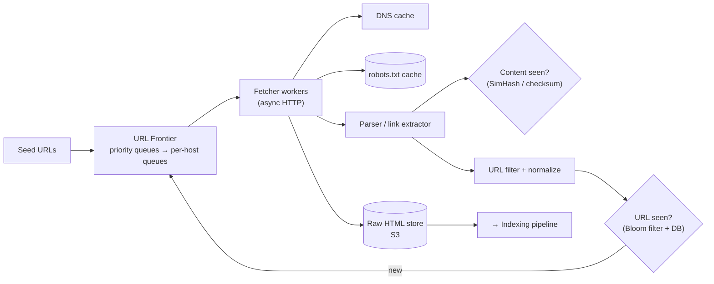
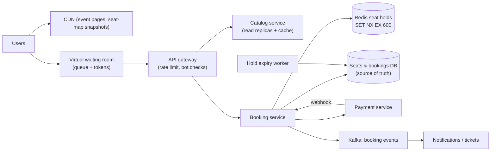
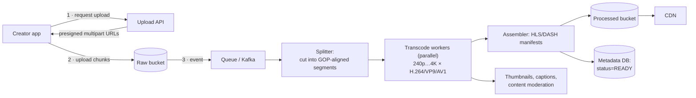
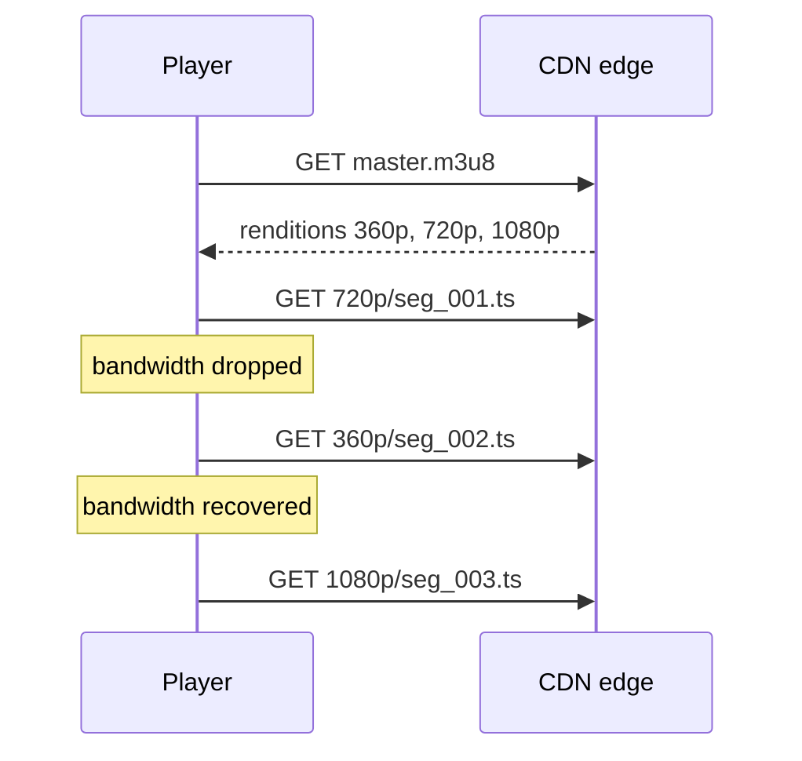
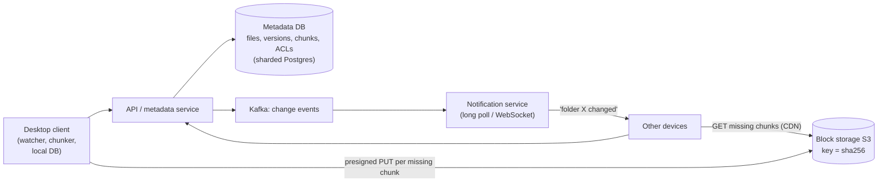

## 1 · Requirements

- Start from seed URLs, fetch pages, extract links, crawl recursively. Store the HTML for indexing.
- **Politeness:** obey `robots.txt` and don't overload any host (≤1 request/s per domain).
- **No duplicate fetching** of the same URL, and detect duplicate content.
- Scale: **1B pages/month**, with priority for important and fresh pages.
- Robust to traps (infinite calendars), slow servers and bad HTML.

## 2 · Estimates

1B pages / 30 days ≈ **400 pages/s** (peak 1K). 1B × 100 KB = **100 TB/month** of HTML → object storage, compressed.

## 3 · High-level design



## 4 · Deep dives

### URL frontier (the heart of the design)
- **Front queues by priority** (PageRank-ish importance, freshness, change frequency).
- **Back queues per host:** each host maps to exactly one queue, and a worker only takes from a host's queue once its **next-allowed time** has passed (a heap of host → next fetch time). That's how politeness is enforced.
- Persist the frontier (Kafka or a disk-backed queue), because it's far too big for memory.

### Dedupe
- **URL seen:** normalise the URL (lowercase host, remove fragments, sort query params), then check a **bloom filter** (fast, ~1% false positives means a few pages skipped, which is acceptable) backed by a KV store of seen URL hashes.
- **Content seen:** checksum for exact duplicates, **SimHash/MinHash** for near-duplicates (mirrors, boilerplate).

### Politeness and robots.txt
Cache `robots.txt` per host (with a TTL), respect `Crawl-delay` and disallow rules, and set a proper User-Agent.

### Distributed fetchers
Partition hosts across workers with **consistent hashing on hostname**, so one worker owns a host and politeness stays local. Use async I/O (thousands of concurrent fetches per machine) and a local DNS cache (DNS is a hidden bottleneck).

### Robustness
- Timeouts, max page size, max depth per site, URL length limits, and trap detection (too many similar URLs from one host).
- Recrawl scheduling based on how often a page changes.

## Self-check

<details>
<summary>How do you enforce "max 1 request per second per host" across many workers?</summary>

Assign each host to exactly one worker/back-queue (consistent hashing on hostname), and track the next-allowed fetch time per host in a min-heap. A worker only dequeues from a host whose time has passed.
</details>

<details>
<summary>Why is a Bloom filter OK for URL dedupe despite false positives?</summary>

A false positive only means you skip crawling a page you hadn't actually seen, which is a tiny loss of coverage. In exchange it saves huge memory and DB lookups. It never causes duplicate fetches (no false negatives).
</details>
---
id: ticket-booking
title: Design a Ticket Booking System (BookMyShow / IRCTC / Ticketmaster)
tier: 2
day: 48
minutes: 50
tags: star, booking, bookmyshow, irctc, concurrency, seat hold, redis, virtual waiting room, payments
summary: Booking under extreme contention. Seat maps, temporary holds with TTL, preventing double booking with DB constraints, payment integration, and surviving Tatkal-style spikes with a virtual waiting room.
videos: Hello Interview Ticketmaster system design | codeKarle BookMyShow system design | ByteByteGo hotel reservation system | Gaurav Sen IRCTC tatkal design
read: Hello Interview — Ticketmaster => https://www.hellointerview.com/learn/system-design/problem-breakdowns/ticketmaster
---

## 1 · Requirements

**Functional:** browse events/shows by city → view the **seat map** with availability → select seats → **hold for 10 minutes** → pay → confirmed ticket (QR). Cancel and refund.
**Non-functional:**
- **No double booking, ever** (strong consistency for seats).
- Browsing is read-heavy and can be slightly stale.
- **Massive spikes:** a Coldplay/IPL on-sale or IRCTC Tatkal at 10:00 sharp means millions of users in seconds.
- Fairness, plus bot protection.

## 2 · Estimates

Normal: ~1K bookings/s. Spike: **10M users** arriving within minutes for 50K seats. Most will fail, so we must **reject them cheaply**.

## 3 · API

```http
GET  /events?city=BLR                    GET /shows/{id}/seats        (cached, ~seconds stale)
POST /shows/{id}/holds   { seatIds[] }    → 201 { holdId, expiresAt }   | 409 seats taken
POST /bookings           { holdId, paymentMethod, idempotencyKey } → { bookingId, status }
```

## 4 · Data model (Postgres, sharded by show/event)

```sql
show_seats (show_id, seat_id, status ENUM('AVAILABLE','HELD','BOOKED'), hold_id, held_until, booking_id,
            PRIMARY KEY (show_id, seat_id))
bookings   (id, user_id, show_id, amount, status, idempotency_key UNIQUE, created_at)
```

## 5 · High-level design



## 6 · Deep dives

### Holding seats atomically
**Option A (DB only, simplest and correct):**
```sql
UPDATE show_seats SET status='HELD', hold_id=:h, held_until=now()+interval '10 min'
 WHERE show_id=:s AND seat_id = ANY(:seats)
   AND (status='AVAILABLE' OR (status='HELD' AND held_until < now()));
-- rows affected must equal the number of seats requested, otherwise ROLLBACK → 409
```

**Option B (Redis in front for spikes):** a Lua script that does `SET seat:{show}:{seat} holdId NX EX 600` for all seats atomically (all or nothing), then writes the hold to the DB asynchronously. Final confirmation is still checked in the DB.

### Confirming
After payment succeeds (webhook): in one transaction, `UPDATE … SET status='BOOKED' WHERE hold_id=:h AND status='HELD'`, insert the booking, and commit. If the hold expired and the seats were taken, **auto-refund**.

### Hold expiry
A lazy check (`held_until < now()` counts as available) plus a background sweeper that resets expired holds.

### Surviving the spike (Tatkal / big on-sale)
- **Virtual waiting room:** users get a queue position. Tokens are released at the rate the booking system can handle, and only token holders can call hold/book.
- **Static or edge-cached seat maps** refreshed every few seconds. Don't hit the DB for every view.
- **Rate limiting + CAPTCHA/bot detection** at the gateway.
- **Pre-scale** before a known on-sale time, and shard by event so one hot event doesn't affect others.
- **Inventory counter in Redis** (`DECR available`) to reject quickly once sold out.

### Payments
An idempotency key per booking, a timeout shorter than the hold, and reconciliation for "paid but not booked" cases (Day 44).

## Self-check

<details>
<summary>Two users try to hold the same seat at once. What guarantees only one succeeds?</summary>

An atomic conditional update (`WHERE status='AVAILABLE'` with a rows-affected check) in the DB, or Redis `SET NX` on the seat key. Only one write can win. The DB primary key or status check is the final authority at confirmation.
</details>

<details>
<summary>How do you handle 10M users arriving at 10:00 for 50K seats?</summary>

A virtual waiting room that admits users at a controlled rate, CDN-cached seat maps, aggressive rate limiting and bot protection, a fast sold-out rejection via a Redis counter, pre-scaling, and isolating the hot event's shard.
</details>

<details>
<summary>The user paid, but their hold expired and the seat was sold to someone else. What happens?</summary>

Confirmation fails the conditional update, so the booking is marked FAILED and an idempotent automatic refund is triggered and the user notified. Prevent it by making the payment timeout shorter than the hold, and extending the hold while payment is in progress.
</details>
---
id: video-streaming
title: Design YouTube / Netflix (video upload & streaming)
tier: 2
day: 59
minutes: 50
tags: youtube, netflix, video, transcoding, hls, dash, adaptive bitrate, cdn, view count
summary: Upload → transcode pipeline (chunked, parallel, DAG of tasks), adaptive bitrate streaming with HLS/DASH, CDN delivery, metadata storage, view counting at scale, and resumable uploads.
videos: Hello Interview YouTube system design | ByteByteGo design YouTube | Gaurav Sen Netflix system design | codeKarle Netflix system design
read: Hello Interview — YouTube => https://www.hellointerview.com/learn/system-design/problem-breakdowns/youtube | Netflix Tech Blog => https://netflixtechblog.com
---

## 1 · Requirements

**Functional:** upload videos (up to several GB), **watch** with smooth playback on any device and network, search and browse, view counts, likes and comments.
**Non-functional:** **playback starts in < 2 s** with minimal buffering, uploads are durable and resumable, massive read scale (watches ≫ uploads), global users.

## 2 · Estimates

500 hours of video uploaded per minute (YouTube-scale) → ~30K hours/hour. Each minute of video is stored in ~5 renditions (240p–4K) → petabytes per month. **Egress is the dominant cost**, so the CDN is everything.

## 3 · Upload and processing pipeline



- The pipeline is a **DAG of tasks** (split → transcode → thumbnails/subtitles → package), orchestrated by a workflow engine. Retry failed segments only.
- Splitting into segments allows **massive parallelism**, so a 1-hour video transcodes in minutes.

## 4 · Streaming: adaptive bitrate (ABR)

- Each rendition is cut into **2–10 s segments**. A **manifest** (`.m3u8` for HLS, `.mpd` for DASH) lists the renditions and segments.
- The player measures bandwidth and **switches quality per segment**. On a bad network it drops to 360p instead of buffering.
- Segments are static files, so they're **perfectly cacheable on the CDN**. Netflix even places caches inside ISPs (Open Connect).



## 5 · Data model

- **Video metadata** (title, owner, status, rendition paths, duration) in MySQL/Postgres (sharded, with **Vitess** being YouTube's own MySQL sharding).
- **Views/likes:** Redis counters + Kafka aggregation, flushed to the DB (Day 39).
- **Comments:** Cassandra (by video_id, time).
- **Search:** Elasticsearch fed by CDC.
- **Watch history and recommendations:** event stream → ML pipelines.

## 6 · Deep dives

- **Popular vs long-tail:** hot videos are pushed or pre-warmed to CDN edges, while long-tail videos are pulled from the origin on demand (and may be cached only regionally). Pull more aggressively at the edge as a video trends.
- **Storage cost:** older, rarely watched renditions move to cold storage. Keep fewer renditions for unpopular videos.
- **Resumable upload:** chunked multipart with per-chunk checksums (Day 18).
- **View counting:** dedupe (one view per user per window), bot filtering, approximate display, exact counts for monetisation (reconciled offline).
- **DRM** for paid content (Widevine/FairPlay) with signed URLs.

## Self-check

<details>
<summary>How does adaptive bitrate streaming avoid buffering?</summary>

The video is encoded at multiple bitrates and cut into short segments. The player measures throughput and requests each next segment at the bitrate the network can sustain, switching down instead of stalling.
</details>

<details>
<summary>Why split videos into segments before transcoding?</summary>

Segments can be transcoded in parallel across many workers (faster), failures retry only one segment, and the same segments become the units for HLS/DASH streaming and CDN caching.
</details>

<details>
<summary>What dominates cost in a video platform, and how do you reduce it?</summary>

Egress bandwidth. Reduce it with CDNs (including ISP-embedded caches), efficient codecs (VP9/AV1), ABR to avoid wasting bitrate, and caching popular content close to users.
</details>
---
id: file-storage
title: Design Dropbox / Google Drive (file sync & storage)
tier: 2
day: 60
minutes: 45
tags: dropbox, google drive, file sync, chunking, deduplication, metadata, conflict resolution, notification
summary: Chunked uploads with content-addressed deduplication, a metadata service as the source of truth, syncing changes across devices with long polling/WebSockets, delta sync, versioning, and conflict handling.
videos: Hello Interview Dropbox system design | ByteByteGo design Google Drive | Gaurav Sen Dropbox system design | codeKarle Google Drive design
read: Hello Interview — Dropbox => https://www.hellointerview.com/learn/system-design/problem-breakdowns/dropbox
---

## 1 · Requirements

**Functional:** upload/download files (up to 50 GB), **sync automatically** across devices, share with others, file **version history**, offline edits that sync later.
**Non-functional:** **never lose data**, efficient bandwidth (only send what changed), fast sync notifications (seconds), handle conflicts.

## 2 · Estimates

50M DAU, 10 files changed/day each → 500M file updates/day (~6K/s). Average file 1 MB, with heavy dedupe across users (same PDFs and videos).

## 3 · Key idea: chunking + content addressing

- Split files into **chunks** (~4 MB, or content-defined chunking so an insert near the start doesn't shift every chunk).
- Each chunk is identified by its **SHA-256 hash**, and stored in S3 under that hash.
- A file = an **ordered list of chunk hashes** (in the metadata DB).
- **Upload:** the client asks "which of these hashes do you already have?" and uploads **only the missing chunks**. That gives you dedupe across versions and users for free.
- **Edit a 1 GB file:** only the changed chunks are uploaded (**delta sync**).

## 4 · High-level design



## 5 · Data model

```sql
files     (file_id, owner_id, parent_folder_id, name, latest_version, is_deleted)
versions  (file_id, version, chunk_hashes[], size, modified_by, created_at, base_version)
chunks    (hash PK, size, ref_count)          -- for garbage collection
shares    (file_or_folder_id, user_id, role)
```

## 6 · Deep dives

### Sync flow
1. The client's file watcher detects a change → chunk + hash → `POST /files/{id}/commit {baseVersion, chunkHashes}`.
2. The server returns the missing hashes → the client uploads them to S3 via presigned URLs → the client commits.
3. The commit creates version N+1 **only if `baseVersion` == current latest** (optimistic concurrency).
4. A change event goes to Kafka → the notification service tells the user's other devices → they fetch the new metadata and download only the chunks they lack.

### Conflicts
Two devices edit offline from the same base version. The first commit wins. The second gets a **conflict** (base version is stale), so the client keeps both versions: `report (Work laptop's conflicted copy).docx`. Google Docs avoids this with real-time collaborative editing (OT/CRDT), which is a different design.

### Notifications
Long polling or a WebSocket per device. Send only "something changed in namespace X", and let the client pull the details (a small message, robust to missed notifications thanks to a cursor-based `GET /changes?since=cursor`).

### Durability and cost
S3 (11 nines). Garbage-collect chunks with `ref_count = 0` after the version-retention period. Move cold chunks to cheaper tiers.

## Self-check

<details>
<summary>How does chunking save bandwidth when a user edits a large file?</summary>

Only the chunks whose content hash changed are uploaded. The rest are already stored, and the new version's metadata references the existing chunk hashes.
</details>

<details>
<summary>How are conflicting offline edits detected?</summary>

Each commit includes the base version it was edited from. If the server's latest version differs, the commit is rejected as a conflict, and the client saves a "conflicted copy" for the user to resolve.
</details>

<details>
<summary>Why is the metadata DB the source of truth, not S3?</summary>

S3 only stores immutable content-addressed chunks. Which chunks make up which version of which file, the folder structure, and permissions all live in the transactional metadata DB, which needs strong consistency for commits.
</details>
