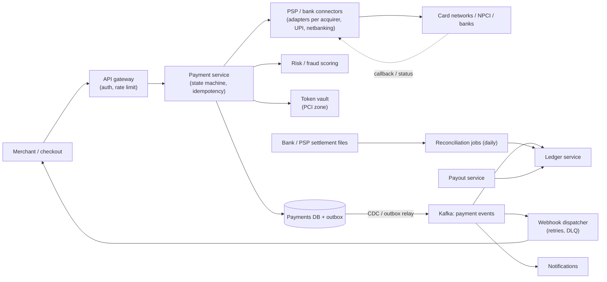
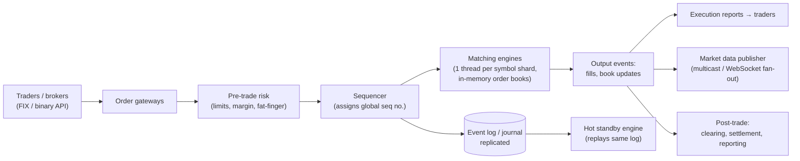
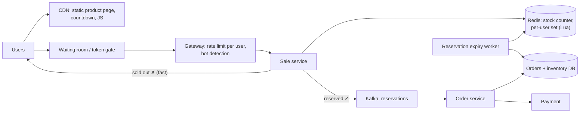
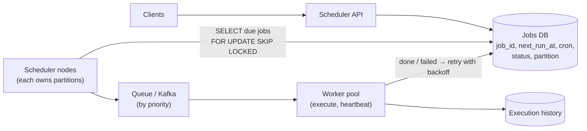

> **Before this page:** read [How payments work](#/item/payments-fundamentals) and [Ledgers & reconciliation](#/item/ledger-reconciliation).

## 1 · Requirements

**Functional** (an e-commerce checkout, or a payment gateway like Razorpay):
- Merchant creates a payment for an order. The customer pays by **card / UPI / netbanking / wallet**.
- Payment status via API and **webhooks** to the merchant.
- **Refunds** (full or partial). **Payouts/settlement** to merchants (T+1/T+2).
- **Ledger** of all money movement. **Reconciliation** with banks and networks.

**Non-functional**
- **Correctness above everything:** never double-charge, never lose a payment, and every paisa is accounted for.
- **Highly available** (lost payments = lost revenue). Payment API latency of a few hundred ms (the bank adds seconds).
- **Auditable, secure, PCI-DSS compliant.**
- Scale example: 1B payments/month → ~400 TPS average, **~5K TPS peak** (festival sales).

## 2 · API

```http
POST /v1/payments
Idempotency-Key: 7c9e…               ← required
{ "orderId": "ORD-991", "amount": 249900, "currency": "INR", "method": {"type":"card","token":"tok_…"} }
→ 201 { "paymentId": "pay_123", "status": "PROCESSING" | "REQUIRES_ACTION" (3-DS/OTP) | "SUCCEEDED" | "FAILED" }

GET  /v1/payments/{id}
POST /v1/payments/{id}/refunds   Idempotency-Key: …  { amount }
Webhook → merchant:  POST {merchant_url}  { event: "payment.succeeded", paymentId, … }  + HMAC signature header
```

Amounts are always **integers in minor units** (paise).

## 3 · Data model

```sql
payments        (id, merchant_id, order_id, amount, currency, status, method_type, psp, psp_ref,
                 idempotency_key, created_at, updated_at, UNIQUE(merchant_id, idempotency_key))
payment_events  (payment_id, from_status, to_status, payload, created_at)         -- audit trail
refunds         (id, payment_id, amount, status, idempotency_key UNIQUE, psp_ref)
ledger_transactions / ledger_entries / accounts                                   -- double-entry (Day 44)
outbox          (id, aggregate_id, event_type, payload, published_at)             -- reliable events
webhook_deliveries (id, merchant_id, event_id, attempt, status, next_retry_at)
```

Store: **PostgreSQL** (ACID), sharded by `merchant_id` at scale, with synchronous replicas for RPO ≈ 0.

## 4 · High-level design



## 5 · The happy path

1. Checkout calls `POST /payments` with an Idempotency-Key. The service **inserts** the payment (status `CREATED`) with a unique `(merchant_id, idempotency_key)` constraint. A duplicate request returns the existing payment.
2. Risk check → choose a route (which acquirer or PSP: by cost, success rate, method).
3. Set `PROCESSING` → call the connector with **our paymentId as the external idempotency/reference ID**.
4. The bank responds (or 3-DS/OTP is needed → `REQUIRES_ACTION` → the customer completes it → callback).
5. Set `SUCCEEDED` with a **conditional update** (`WHERE status='PROCESSING'`), write the **outbox event** in the same transaction.
6. The outbox goes to Kafka → the **ledger** posts double-entry (customer funds → merchant payable, fees → revenue) → the **webhook** goes to the merchant → the customer is notified.

## 6 · Deep dives (where the interview is decided)

### Idempotency at every hop
- Client → us: `Idempotency-Key` + unique constraint (and store the response to replay it).
- Us → PSP/bank: our `paymentId` as their idempotency key/reference, so **retries can't double-debit**.
- Kafka consumers (ledger, webhooks): dedupe by `event_id` (inbox table).
- Webhooks to the merchant: include an `event_id`, because merchants must dedupe.

### Timeouts and unknown states
A bank call times out → **don't mark it failed**. Keep it in `PROCESSING/UNKNOWN`. A **status poller** queries the PSP with exponential backoff, the PSP's own webhook also arrives, and the **reconciliation file** is the final arbiter. Expire it to FAILED (and reverse if the bank later confirms a debit) only per the rules.

### Exactly-once money movement
There's no magic exactly-once over a network. It's **at-least-once delivery + idempotent operations + state-machine guards + reconciliation**. Say it in exactly those words.

### Reliable events: the outbox
Payment status changes and their events are written in **one DB transaction** (outbox), and a relay or Debezium publishes them, so the ledger and webhooks never miss an event (Day 25).

### Webhook delivery to merchants
Sign with an **HMAC-SHA256** of the payload using the merchant's secret. Retry with exponential backoff for up to ~24–72 hours, then DLQ plus a merchant dashboard to replay. Never block the payment flow on merchant endpoints.

### Ledger and balances
Double-entry, append-only (Day 44). A merchant's balance = Σ ledger entries. Payouts debit the merchant payable and credit the bank, and they're idempotent too.

### Reconciliation
Daily: match `payments` and the ledger against acquirer/NPCI settlement files on (reference, amount, date). Mismatches go to an exceptions queue: auto-fix known patterns (late success → mark succeeded + webhook, debit without success → refund), and send the rest to ops.

### Availability and scaling
- Stateless payment service (horizontal), DB sharded by merchant, synchronous replicas plus automated failover.
- **Multiple PSP/acquirer routes** with **circuit breakers**: if HDFC's success rate drops, route to ICICI ("smart routing", a big theme at Razorpay and Juspay).
- Multi-AZ, plus DR in another region (RBI requires data to stay in India, so Mumbai + Hyderabad, for example).

### Security
Card data only in the **token vault** (a PCI-scoped, segregated network, HSM-backed encryption). Everything else sees tokens. mTLS to banks, audit logs, fraud scoring in the path.

## Trade-offs to say out loud

| Decision | Why |
|---|---|
| SQL over NoSQL for payments | ACID transitions, unique constraints, strong consistency |
| Async ledger posting via outbox | The payment API stays fast and the ledger can't miss events. The ledger lags by milliseconds to seconds |
| Unknown state instead of fail-fast on timeout | Avoids false failures and double charges, at the cost of a slower final status |
| Orchestrated saga for refunds/payouts | Auditability across many steps |

## Self-check

<details>
<summary>The client retries POST /payments after a network error. Walk through why the customer isn't charged twice.</summary>

The retry carries the same Idempotency-Key. The unique constraint finds the existing payment, and the API returns its current status/response without calling the bank again. Even if a bank call was in flight, our paymentId is the bank-side idempotency reference, so the bank won't debit twice.
</details>

<details>
<summary>How do you make sure the ledger never misses a successful payment?</summary>

The transactional outbox: the status change and its event are written in the same DB transaction, a relay/CDC publishes it to Kafka at least once, and the ledger consumer is idempotent (dedupes on event_id). Daily reconciliation also catches any drift.
</details>

<details>
<summary>What do you do with payments stuck in PROCESSING?</summary>

A status poller queries the PSP with backoff, PSP webhooks update them, and after a cutoff the reconciliation against settlement files decides. Late successes are marked succeeded (with a webhook to the merchant). Debits without a successful order are refunded automatically.
</details>

<details>
<summary>How do you secure webhooks you send to merchants?</summary>

Sign the payload with an HMAC using a per-merchant secret, include a timestamp (replay protection) and event_id (dedupe), send over HTTPS only, and let merchants verify the signature.
</details>
---
id: stock-exchange
title: Design a Stock Exchange / Trading Platform
tier: 3
day: 47
minutes: 50
tags: stock exchange, order book, matching engine, low latency, event sourcing, market data, zerodha, robinhood
summary: Order entry with pre-trade risk checks, a single-threaded in-memory matching engine with price-time priority, a sequenced event log for determinism and recovery, market data fan-out, and post-trade settlement. Asked at investment banks and brokerages.
videos: ByteByteGo design a stock exchange | Hello Interview Robinhood system design | Gaurav Sen stock exchange design | Jordan has no life stock exchange
read: Hello Interview — Robinhood => https://www.hellointerview.com/learn/system-design/problem-breakdowns/robinhood | Martin Fowler — LMAX architecture => https://martinfowler.com/articles/lmax.html
---

> Read [Low-latency & trading systems](#/item/low-latency-trading) first.

## 1 · Requirements

**Functional:** place **limit / market** orders and cancel them, match buy and sell orders, send **execution reports** (fills) to traders, publish **market data** (order book depth, last trade price), end-of-day settlement.
**Non-functional:**
- **Low, predictable latency** (sub-millisecond matching at an exchange, tens of ms acceptable at a retail broker).
- **Fairness:** strict price-time priority, deterministic.
- **No lost or duplicated orders**, full audit trail.
- Very high availability during market hours.

Clarify early: **"Am I designing the exchange (NSE) or a broker app (Zerodha/Robinhood) that routes to the exchange?"** A broker design focuses on accounts, risk, order routing and market data fan-out to millions of app users. An exchange design focuses on the matching engine.

## 2 · Estimates (exchange)

~10K symbols, peaks of ~1M orders/s across the market. Market data: millions of updates/s fanned out to thousands of subscribers.

## 3 · High-level design



## 4 · Deep dives

### The order book and matching

```java
class OrderBook {
    // bids: highest price first; asks: lowest price first. Each level is a FIFO queue (time priority)
    TreeMap<Long, ArrayDeque<Order>> bids = new TreeMap<>(Comparator.reverseOrder());
    TreeMap<Long, ArrayDeque<Order>> asks = new TreeMap<>();
    HashMap<Long, Order> byId = new HashMap<>();          // O(1) cancel lookup (mark cancelled / unlink)

    List<Fill> onLimitBuy(Order o) {
        List<Fill> fills = new ArrayList<>();
        while (o.remaining > 0 && !asks.isEmpty() && asks.firstKey() <= o.price) {
            ArrayDeque<Order> level = asks.firstEntry().getValue();
            Order best = level.peekFirst();
            long qty = Math.min(o.remaining, best.remaining);
            fills.add(new Fill(o.id, best.id, best.price, qty));     // trade at the resting order's price
            o.remaining -= qty; best.remaining -= qty;
            if (best.remaining == 0) { level.pollFirst(); byId.remove(best.id); }
            if (level.isEmpty()) asks.pollFirstEntry();
        }
        if (o.remaining > 0) { bids.computeIfAbsent(o.price, p -> new ArrayDeque<>()).addLast(o); byId.put(o.id, o); }
        return fills;
    }
}
```

- **Price-time priority:** the best price first, then the earliest order at that price.
- Prices are integers in **ticks** (no floating point).
- **One thread per symbol (or shard of symbols):** no locks, deterministic, and cache-friendly.

### Determinism, recovery and HA
- The **sequencer** gives every input a sequence number and writes it to the **replicated journal** before (or in parallel with) matching.
- The engine is a pure function of the input sequence, so a **hot standby** consuming the same journal has an identical state and can take over in milliseconds.
- Crash recovery = **snapshot + replay** of the journal (event sourcing, Day 29).

### Market data fan-out
- Exchange → members: UDP multicast, with incremental updates + periodic snapshots + sequence numbers so gaps can be detected and recovered.
- Broker → retail apps (millions of users): WebSocket gateways subscribed to symbol channels, **conflating** updates (send the latest price every 100–250 ms, not every tick) for slow mobile clients.

### Pre-trade risk
Must sit in the order path and be fast: max order value, position and margin limits, price bands (reject an order 20% away from the last trade price). Keep it in memory with per-account state.

### Broker-side specifics (Zerodha/Robinhood)
- An **account and holdings DB** (strong consistency) and **margin/funds blocking** before sending the order.
- An **order state machine** (NEW → SENT → PARTIALLY_FILLED → FILLED/CANCELLED/REJECTED), reconciled with the exchange's execution reports.
- **Market open spike:** 9:15 AM IST, when millions log in and place orders at once. Pre-scale, queue orders, and rate-limit per user.

## Self-check

<details>
<summary>What data structures make a matching engine efficient?</summary>

A sorted map of price levels per side (TreeMap/skip list, or arrays indexed by tick for dense books), each level a FIFO queue for time priority, plus a hash map from orderId to order for O(1) cancels.
</details>

<details>
<summary>How can a standby matching engine take over without losing state?</summary>

All inputs are sequenced and journaled. The standby consumes the same ordered log and runs the same deterministic logic, so its in-memory books match the primary's. On failover it continues from the last sequence number.
</details>

<details>
<summary>Why conflate market data for mobile clients?</summary>

Mobile networks and devices can't process thousands of ticks per second, and users only need the latest price. Sending periodic snapshots of the latest state saves bandwidth and avoids growing backlogs.
</details>
---
id: flash-sale
title: Design an E-commerce Flash Sale (Flipkart Big Billion Days / Amazon)
tier: 3
day: 49
minutes: 45
tags: flash sale, ecommerce, inventory, oversell, redis, queue, cart, checkout, high traffic
summary: Selling 10K units to 10M people in minutes without overselling or crashing. Inventory reservation in Redis with atomic decrements, async order processing via queues, waiting rooms, caching the catalogue, and reconciling inventory with the DB.
videos: ByteByteGo flash sale system design | codeKarle Amazon system design | Gaurav Sen flash sale design | Arpit Bhayani flash sale
read: Hello Interview — Online auction (related contention patterns) => https://www.hellointerview.com/learn/system-design/problem-breakdowns/online-auction
---

## 1 · Requirements

- A limited stock item (e.g. 10,000 phones at ₹9,999) goes live at 12:00:00. Users click **Buy** → reserve → pay within 10 minutes → order confirmed.
- **Never oversell.** Be fair (first come, first served, roughly). One unit per user.
- Survive **10M+ users** hitting it within seconds. The rest of the site (normal shopping) must stay up.

## 2 · Estimates

10M users × a few requests each in the first minute → **~500K–1M requests/s** at the spike, for only 10K successful orders. 99.9% of requests must be **rejected fast and cheaply**.

## 3 · High-level design



## 4 · Deep dives

### Atomic reservation in Redis (the core)

```lua
-- KEYS[1] = stock:sku123, KEYS[2] = buyers:sku123, ARGV[1] = userId
if redis.call('SISMEMBER', KEYS[2], ARGV[1]) == 1 then return -1 end  -- already bought
local left = tonumber(redis.call('GET', KEYS[1]))
if left <= 0 then return 0 end                                         -- sold out
redis.call('DECR', KEYS[1]); redis.call('SADD', KEYS[2], ARGV[1])
return 1                                                               -- reserved
```

- **Single-threaded Redis + Lua = atomic**, so overselling is impossible at this layer.
- Pre-load the stock into Redis before the sale. **Shard hot SKUs** (split 10K units into 10 keys of 1K each) if one key's throughput isn't enough.

### Async order creation
A successful reservation goes to **Kafka** → the order service creates the order in the DB (with a conditional decrement of DB inventory as a second guard) → the user is redirected to payment. The user sees "You got it! Complete payment in 10 min."

### Expiry and returning stock
If payment isn't completed in 10 minutes, the expiry worker increments the Redis counter back, removes the user from the buyer set, and cancels the order (idempotent). The stock then becomes available to others (or to a waitlist).

### Protecting everything else
- **Isolate** the sale service and its Redis from the main catalogue/checkout (a bulkhead), so a sale meltdown doesn't take down regular shopping.
- **Static content on the CDN**, countdown in client-side JS, and no DB reads on the product page during the sale.
- **Waiting room + rate limiting + CAPTCHA**, and enable the Buy button only at the start time (with a server-validated start time).
- **Load test** at 2–3× the expected peak beforehand, and pre-scale. Keep kill switches (feature flags) ready.

### Consistency between Redis and the DB
Redis is the fast gate, and the DB is the source of truth for orders. Reconcile after the sale (count of reservations vs orders vs stock) and fix any drift (e.g. a reservation event lost before reaching Kafka; mitigate with a Redis AOF + replica and an idempotent replay).

## Self-check

<details>
<summary>How do you guarantee no overselling with a million concurrent buyers?</summary>

An atomic check-and-decrement of the stock counter in a single-threaded Redis via a Lua script (plus a one-per-user check), with a conditional DB inventory update as a second guard when creating the order.
</details>

<details>
<summary>Why process orders asynchronously after reservation?</summary>

The reservation step is tiny and fast (Redis). The heavy work (DB writes, payment setup) is smoothed out by Kafka at a rate the order service can sustain, which protects the DB from the spike.
</details>

<details>
<summary>How do you stop the flash sale from crashing the whole site?</summary>

Isolate the sale's services and data stores (bulkheads), serve static pages from the CDN, gate traffic with a waiting room and rate limits, shed excess load early, and use feature-flag kill switches.
</details>
---
id: job-scheduler
title: Design a Distributed Job Scheduler (cron at scale)
tier: 3
day: 61
minutes: 45
tags: job scheduler, cron, distributed lock, queue, retries, exactly once, temporal, airflow
summary: Run millions of scheduled and delayed jobs reliably. Storing schedules, finding due jobs efficiently, dispatching via queues to workers, avoiding duplicate execution, retries, timeouts and visibility.
videos: Hello Interview job scheduler | ByteByteGo distributed job scheduler | Jordan has no life job scheduler | codeKarle task scheduler design
read: Hello Interview — Job scheduler => https://www.hellointerview.com/learn/system-design/problem-breakdowns/job-scheduler | Temporal docs => https://docs.temporal.io
---

## 1 · Requirements

- Users and services submit jobs: **one-off at time T**, **delayed** (in 30 min), or **recurring** (cron expression), with a payload and target (an HTTP endpoint, a queue, or a container).
- Jobs run **close to their scheduled time** (within seconds), and **at least once**, ideally **not twice concurrently**.
- Retries with backoff, timeouts, job status and history, cancellation.
- Scale: **10M jobs/day**, with spikes at round times (midnight, top of the hour).

Typical uses: EMI reminders and auto-debits on a due date, report generation, statement emails, subscription renewals, cleanup tasks.

## 2 · High-level design



## 3 · Data model

```sql
jobs (job_id PK, owner, type, payload JSONB, cron_expr NULL, next_run_at TIMESTAMPTZ, status,
      max_retries, attempt, timeout_sec, partition_id, version)
CREATE INDEX ON jobs (partition_id, next_run_at) WHERE status = 'SCHEDULED';
executions (job_id, run_id, scheduled_for, started_at, finished_at, status, worker_id, error)
```

## 4 · Deep dives

### Finding due jobs efficiently
- An index on `(partition_id, next_run_at)`. Each scheduler node polls its partitions every second: `SELECT … WHERE next_run_at <= now() AND status='SCHEDULED' ORDER BY next_run_at LIMIT 500 FOR UPDATE SKIP LOCKED`. **SKIP LOCKED** lets several pollers work without stepping on each other.
- Mark them `QUEUED` and push them to the queue in the same step (or use the outbox).
- For recurring jobs, compute the **next `next_run_at` from the cron expression** right away, so the schedule never drifts even if execution is slow.
- Alternatives: a **Redis sorted set** scored by run time (`ZRANGEBYSCORE now`) for the near-term window, or **time-bucketed tables** (all jobs due in minute M). A hierarchical **timing wheel** is the in-memory version (used by Kafka and Netty).

### Avoiding double execution
- Queue delivery is at least once, and a worker can die mid-job, so **the job itself must be idempotent** (pass `run_id` as an idempotency key to the target).
- **Leases:** a worker holds the job with a heartbeat. If the heartbeats stop past the timeout, the job becomes eligible for retry. Use a fencing token (`run_id` + attempt) so a zombie worker's result is ignored.
- Partition ownership for scheduler nodes via etcd/ZooKeeper leader election per partition, so two schedulers never enqueue the same partition.

### Retries and failure
Exponential backoff with jitter, a max attempts count, and a DLQ plus alerting. Per-job timeouts are enforced by the worker and by a reaper that detects stale leases.

### Thundering herd at 00:00
Millions of jobs due at midnight. Spread them with **jitter** where allowed (EMI reminders don't need to fire at exactly 00:00:00), use priority queues so critical jobs go first, and autoscale workers on queue depth.

### Build vs buy
Mention **Temporal** (durable workflows, retries, timers; used widely for payments), **Airflow** (data pipeline DAGs), **Quartz** (Java, JDBC-backed clustered mode), and AWS EventBridge Scheduler. Interviewers like hearing that you know when not to build.

## Self-check

<details>
<summary>How do multiple scheduler nodes pick up due jobs without duplicates?</summary>

Partition jobs and assign each partition to one node (via a lease/leader election), and/or use `SELECT … FOR UPDATE SKIP LOCKED` so concurrent pollers lock different rows. Mark the jobs queued in the same transaction.
</details>

<details>
<summary>A worker crashes halfway through a job. What happens?</summary>

Its lease/heartbeat expires and the job is re-queued for retry. Because the job may have partially run, it must be idempotent (using run_id as an idempotency key), and a fencing token prevents the old worker from committing a late result.
</details>

<details>
<summary>How do recurring jobs avoid drifting over time?</summary>

Compute the next run time from the cron schedule (based on the scheduled time, not the finish time) when the current run is dispatched, and store it as `next_run_at`.
</details>
