## Network models & core protocols

### OSI model — 7 layers and each layer's responsibility
The OSI (Open Systems Interconnection) model is a **reference model**: nobody ships "an OSI stack", but every engineer uses its layer numbers as shared vocabulary. Each layer offers a service to the layer above and relies on the layer below, so you can swap one layer (Wi-Fi for Ethernet) without touching the others.

#### Intuition
Think of posting a parcel: you write the letter (application), seal it in an envelope (presentation), the courier adds a tracking slip (transport), the sorting hub routes it by city (network), and the van drives it street by street (link/physical). Each step only cares about its own label.

#### Must know
- It's a **vocabulary**, not a real stack. You'll use the numbers: "L4 load balancer", "L7 routing", "L3 network ACL".
- **L4 = IP + port** (TCP/UDP). **L7 = understands HTTP** (paths, headers, cookies).
- Each layer adds a header on the way out (encapsulation) and strips it on the way in.
- Debug **bottom-up**: `ping` (L3) → `nc -vz host port` (L4) → `curl -v` (L7).

#### Numbers to quote
- 7 layers in OSI, 4 in TCP/IP.
- Typical Ethernet MTU 1,500 B.

#### Common mistakes
- Treating the layers as code boundaries. Real stacks (TCP/IP) merge 5–7, and TLS doesn't fit neatly anywhere.
- Saying "L7 firewall" when you mean a security group (L3/L4) or a WAF (L7).
- Claiming an L4 load balancer can route by URL path. It can't see the path.

#### How it works
On the way out, each layer wraps the data from the layer above with its own header (**encapsulation**). The receiver peels the headers off in reverse order.

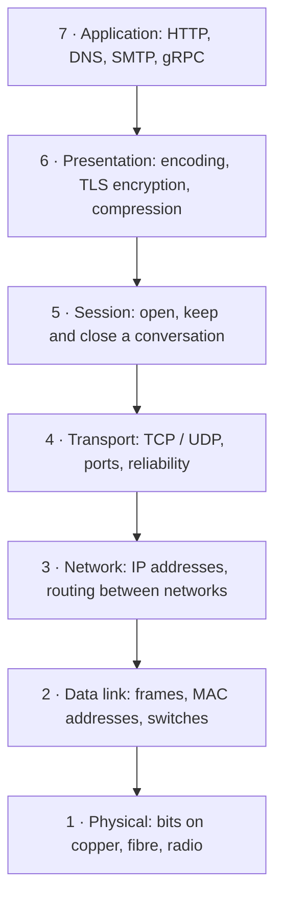

| Layer | Unit of data | Device that works here | Example |
|---|---|---|---|
| 7 Application | message | L7 load balancer, API gateway, WAF | `GET /orders/42` |
| 4 Transport | segment / datagram | L4 load balancer, firewall | TCP port 443 |
| 3 Network | packet | router | `10.0.1.15 → 52.95.110.1` |
| 2 Data link | frame | switch | MAC `3c:22:fb:…` |
| 1 Physical | bits | cable, NIC, radio | — |

#### Example
You open `https://shop.example.com/cart`:
1. **L7**: the browser builds an HTTP GET request.
2. **L6**: TLS encrypts it.
3. **L4**: TCP splits it into segments for port 443 and numbers them.
4. **L3**: IP puts each segment in a packet addressed to the server's IP.
5. **L2/L1**: Ethernet or Wi-Fi frames carry the packet to your router as signals.

When a load balancer "terminates TLS and routes on the URL path" it is working at L7. When it "forwards TCP connections by IP and port" it is working at L4.

#### Trade-offs
- **L4 devices** are fast and protocol-agnostic, but blind to URLs, headers and cookies.
- **L7 devices** can route by path, retry, cache and authenticate, but they must parse (and usually decrypt) every request, which costs CPU and latency.

#### Problems & fixes
| Symptom | Likely layer / cause | Fix |
|---|---|---|
| `ping` works but the site doesn't load | L4/L7: port blocked or app down | `telnet host 443` / `curl -v`, check security group and app health |
| Can't even ping | L3: routing, missing route table entry, NACL | check route tables, subnet NACLs, `traceroute` |
| TLS errors (`certificate unknown`) | L6/L7: cert chain or SNI | fix the chain, serve the right cert per hostname |
| Need routing by URL path | L4 balancer is blind to paths | move to an L7 balancer (ALB, NGINX, Envoy) |

#### Cheat sheet
- **Please Do Not Throw Sausage Pizza Away**: Physical, Data link, Network, Transport, Session, Presentation, Application (1 → 7).
- L4 = IP + port (NLB, security groups). L7 = HTTP-aware (ALB, API gateway, WAF).
- Debug bottom-up: link → `ping` (L3) → `nc -vz host port` (L4) → `curl -v` (L7).

#### Interview questions
<details><summary>Users can reach the load balancer's IP but every request times out. How do you debug it layer by layer?</summary>

Go bottom-up. **L3**: can you `ping` / `traceroute` the instances from inside the VPC? Check route tables and NACLs. **L4**: `nc -vz instance 8080`. Is the security group open from the LB's security group, and is the app actually listening on that port? **L7**: `curl -v` the instance directly. Does the health-check path return 200? A LB whose targets all fail health checks often times out or returns 503. Fix whatever layer fails first.
</details>

<details><summary>When would you choose an L4 load balancer over an L7 one?</summary>

L4 when you need raw throughput and very low latency, non-HTTP protocols (databases, MQTT, gRPC passthrough with end-to-end TLS), or static IPs. L7 when you need path- or host-based routing, TLS termination, header-based canaries, retries, WAF or auth at the edge. Common setup: L7 at the public edge, L4 for internal TCP services.
</details>

#### Interview angle
> "I'll put an L7 load balancer in front because I need path-based routing to the order and payment services, and TLS termination in one place. Between internal services an L4 balancer is enough and cheaper."

#### Sources
- [What is the OSI model?](https://www.cloudflare.com/learning/ddos/glossary/open-systems-interconnection-model-osi/) — Cloudflare Learning
- [Elastic Load Balancing: ALB (L7) vs NLB (L4)](https://aws.amazon.com/elasticloadbalancing/features/) — AWS

### TCP/IP model — 4 layers and mapping to OSI
The TCP/IP model is the stack the internet actually runs. It has four layers, and it's what Linux, your phone and every cloud VM implement.

#### Intuition
OSI is the textbook map; TCP/IP is the road you actually drive on. Four lanes: link (the wire), internet (IP addresses), transport (TCP/UDP ports) and application (HTTP, DNS, TLS).

#### Must know
- Layers: **Link → Internet (IP) → Transport (TCP/UDP/QUIC) → Application (HTTP, DNS, TLS)**.
- OSI 5–7 collapse into "application"; OSI 1–2 collapse into "link".
- TLS runs **on top of** TCP (or inside QUIC). It is not a transport.
- HTTP/3 swapped TCP for QUIC without touching IP or HTTP semantics, which shows why layering matters.

#### Numbers to quote
- Headers: Ethernet 14 B, IPv4 20 B, IPv6 40 B, TCP 20 B, UDP 8 B.
- MTU 1,500 B, so TCP payload (MSS) ≈ 1,460 B.

#### Common mistakes
- Thinking TLS is a transport. It runs **on top of** TCP (or inside QUIC).
- Forgetting that the 40+ bytes of headers matter for tiny messages, such as IoT telemetry or game ticks.

#### How it works
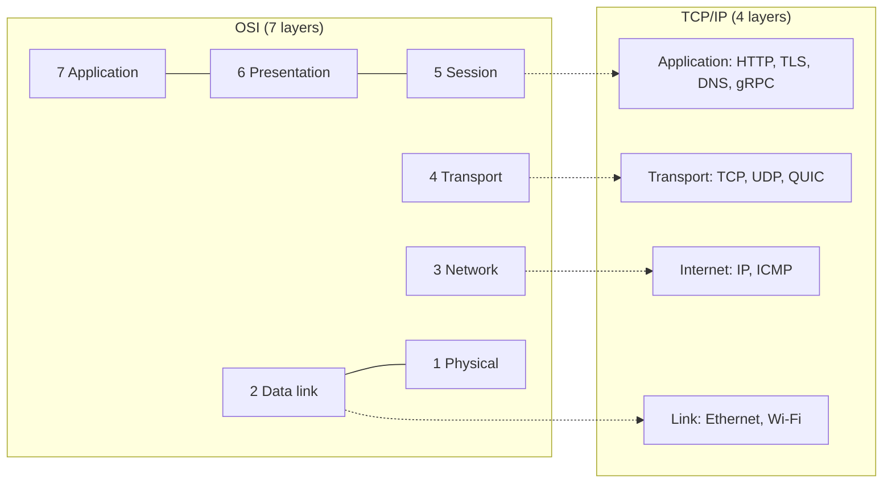

Each layer adds a header: an HTTP request becomes the payload of a TCP segment, which becomes the payload of an IP packet, which becomes the payload of an Ethernet frame.

```text
| Ethernet hdr | IP hdr (src/dst IP) | TCP hdr (ports, seq) | TLS record | HTTP request | Ethernet trailer |
     14 B            20 B                 20 B
```

#### Example
`curl https://api.example.com/users/7` uses:
- **Application**: DNS to find the IP, TLS for encryption, HTTP for the request.
- **Transport**: TCP to `:443`, which guarantees order and retransmits lost data.
- **Internet**: IP to route the packets hop by hop across ISPs.
- **Link**: Wi-Fi to your router, fibre beyond it.

#### Trade-offs
Layering makes the internet evolvable: HTTP/3 replaced TCP with QUIC without changing IP or HTTP semantics. The cost is header overhead and some duplicated work (both TCP and TLS track state).

#### Problems & fixes
| Symptom | Cause | Fix |
|---|---|---|
| Tiny IoT messages use way more bandwidth than expected | 40–60 B of TCP/IP headers per small payload, plus TLS | batch messages, use MQTT, compress, keep connections open |
| Large packets dropped on a VPN or tunnel, small ones fine | MTU mismatch, path MTU discovery blocked | allow ICMP "fragmentation needed", lower MTU / MSS clamping |
| HTTP/2 stalls on lossy mobile networks | TCP head-of-line blocking under all streams | HTTP/3 (QUIC) |

#### Cheat sheet
- Link (Ethernet/Wi-Fi) → Internet (IP) → Transport (TCP/UDP/QUIC) → Application (HTTP/DNS/TLS).
- Headers: Ethernet 14 B, IPv4 20 B, IPv6 40 B, TCP 20 B, UDP 8 B.
- Typical MTU 1,500 B, so TCP payload (MSS) ≈ 1,460 B.

#### Interview questions
<details><summary>Large API responses fail over the company VPN while small ones work. What is likely happening?</summary>

A classic **MTU / PMTUD black hole**: the tunnel adds headers, so full-size 1,500 B packets don't fit. Routers want to send ICMP "fragmentation needed", but a firewall drops ICMP, so the sender never learns and keeps sending packets that get dropped. Fix: allow ICMP type 3 code 4, or clamp TCP MSS on the tunnel (e.g. 1,360), or lower the interface MTU.
</details>

<details><summary>Why did HTTP/3 move off TCP instead of fixing TCP?</summary>

TCP lives in OS kernels and middleboxes. Changing it takes a decade, and middleboxes break unfamiliar TCP options. QUIC runs in user space over UDP, so it can ship quickly, encrypts its transport headers (so middleboxes can't ossify it), removes cross-stream head-of-line blocking, and merges the transport and TLS handshakes.
</details>

#### Interview angle
> "HTTP rides on TCP, which rides on IP. TCP's in-order delivery causes head-of-line blocking, which is exactly why HTTP/3 moved to QUIC over UDP."

#### Sources
- [RFC 1122: Requirements for Internet Hosts](https://datatracker.ietf.org/doc/html/rfc1122) — IETF
- [High Performance Browser Networking: Building blocks of TCP](https://hpbn.co/building-blocks-of-tcp/) — Ilya Grigorik

### IP addressing — IPv4, IPv6, CIDR, subnetting, NAT
Every host on a network needs an address. How addresses are grouped (CIDR, subnets) decides what can talk to what, which makes it the foundation of cloud network security.

#### Intuition
An IP address is a postal address; CIDR is how many houses share a street name. A `/24` street has 256 houses, a `/16` neighbourhood has 65,536. NAT is the office receptionist: everyone inside shares one public phone number, and the receptionist remembers who called whom.

#### Must know
- `/n` means the first n bits are the network: addresses = 2^(32 − n). Removing one bit doubles the size.
- Private ranges `10/8`, `172.16/12`, `192.168/16` aren't routable on the internet.
- **Public subnet** = route to an internet gateway. **Private subnet** = outbound via NAT only, or no internet route at all.
- Plan non-overlapping CIDRs per VPC and region up front; overlaps block peering forever.
- NAT gives you a **fixed egress IP** that partners can allow-list.

#### Numbers to quote
- `/24` = 256 addresses, `/20` = 4,096, `/16` = 65,536.
- AWS reserves 5 addresses per subnet (a `/24` leaves 251 usable); VPC and subnet sizes range from `/16` to `/28`.
- One NAT gateway IP handles ~55,000 simultaneous connections per destination; add IPs or gateways beyond that.
- IPv4 ≈ 4.3 billion addresses; IPv6 is 128-bit.

#### Common mistakes
- Overlapping CIDRs between VPCs or with the office network, which makes peering impossible later.
- Putting databases in public subnets "temporarily".
- Undersizing subnets for Kubernetes, where every pod takes an IP.

#### How it works
- **IPv4**: 32 bits written as 4 bytes, e.g. `192.168.1.10`. About 4.3 billion addresses, long since exhausted.
- **IPv6**: 128 bits, e.g. `2001:db8::1`, effectively unlimited, and no NAT needed.
- **CIDR**: `10.0.0.0/16` means the first 16 bits are the network part, so it holds 2^(32−16) = 65,536 addresses.
- **Subnetting** splits a range: `10.0.0.0/16` becomes `10.0.1.0/24`, `10.0.2.0/24`, … (256 addresses each).
- **Private ranges**: `10.0.0.0/8`, `172.16.0.0/12` and `192.168.0.0/16` are not routable on the public internet.
- **NAT** rewrites the private source address to one public IP on the way out and remembers the mapping so replies come back.

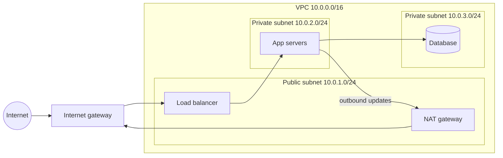

#### Example
A typical 3-tier VPC: the load balancer sits in a public subnet. App servers sit in a private subnet and reach the internet (for package updates or a payment provider's API) only through the NAT gateway. The database subnet has **no route to the internet at all**. Security groups then allow `LB → App :8080` and `App → DB :5432` only.

How many hosts fit in a `/24`? 256 addresses, minus the network and broadcast addresses (AWS reserves 5), which leaves 251 usable.

#### Trade-offs
- NAT saves public IPs and hides internal hosts, but it breaks inbound connections (hence port forwarding and the hole-punching tricks WebRTC needs) and is one more component that can bottleneck.
- Subnets that are too small leave you out of IPs when Kubernetes gives every pod an IP. Plan generously (`/16` per VPC, `/19`–`/20` per subnet).

#### Problems & fixes
| Symptom | Cause | Fix |
|---|---|---|
| New pods stuck Pending: "no IP addresses available" | subnet too small for one IP per pod (AWS VPC CNI) | larger or secondary CIDR, prefix delegation, bigger subnets |
| VPC peering refused | overlapping CIDRs | plan non-overlapping ranges per env/region, or use PrivateLink / NAT translation |
| Private instances can't reach external APIs | no NAT gateway or route | add NAT GW in a public subnet + route `0.0.0.0/0` |
| Huge NAT gateway bill | all traffic to S3/DynamoDB going through NAT | VPC gateway endpoints for S3/DynamoDB |
| Partner must allow-list your IP | outbound IP changes per instance | egress via NAT with an Elastic IP |

#### Cheat sheet
- `/32` = 1 address, `/24` = 256, `/20` = 4,096, `/16` = 65,536. Each bit you remove doubles it.
- Private: `10/8`, `172.16/12`, `192.168/16`. AWS reserves 5 IPs per subnet.
- Public subnet = route to an internet gateway. Private subnet = route to NAT only (or no internet route at all).

#### Interview questions
<details><summary>Your payment provider wants a fixed IP to allow-list, but your services autoscale. What do you do?</summary>

Send all outbound traffic from the private subnets through a **NAT gateway with an Elastic IP** (one per AZ for availability). Give the provider those 2–3 static IPs. Autoscaled instances can come and go because they all egress via NAT. Alternatively, use a dedicated egress proxy with static IPs.
</details>

<details><summary>Design the network layout for an app + Postgres + Redis in AWS. Where does each go and why?</summary>

One VPC (e.g. `10.0.0.0/16`) across 3 AZs. Public subnets hold only the ALB and the NAT gateways. Private app subnets hold the services. Private data subnets hold RDS and ElastiCache with no internet route. Security groups chain: ALB → app :8080, app → DB :5432 and Redis :6379. Add VPC endpoints for S3 so data never crosses NAT. This keeps the blast radius small and only the load balancer is exposed.
</details>

#### Interview angle
> "Databases and caches live in private subnets with no public IP. Only the app tier's security group can reach them, and egress goes through NAT."

#### Sources
- [RFC 1918: Address Allocation for Private Internets](https://datatracker.ietf.org/doc/html/rfc1918) — IETF
- [Subnet CIDR blocks (sizing and the 5 reserved addresses)](https://docs.aws.amazon.com/vpc/latest/userguide/subnet-sizing.html) — AWS docs
- [NAT gateways](https://docs.aws.amazon.com/vpc/latest/userguide/vpc-nat-gateway.html) — AWS docs

### TCP — 3-way handshake (SYN → SYN-ACK → ACK)
TCP is connection-oriented. Before any data flows, both sides agree on starting sequence numbers so they can detect lost, duplicate and reordered bytes. Agreeing costs one round trip.

#### Intuition
Before a phone call starts: "Can you hear me?" — "Yes, can you hear me?" — "Yes." Only then do you talk. That exchange costs one round trip before a single byte of real data.

#### Must know
- `SYN → SYN-ACK → ACK` exchanges random starting sequence numbers so loss, duplicates and reordering can be detected.
- It costs **1 RTT** before data; TLS 1.3 adds another; the request itself a third.
- **Reuse connections** (pools, keep-alive, gRPC channels) so you pay the handshake once.
- SYN floods exhaust half-open state; **SYN cookies** and edge DDoS protection defend.

#### Numbers to quote
- Cold HTTPS request ≈ 3 RTTs before the first response byte (TCP + TLS 1.3 + request).
- India ↔ us-east-1 RTT ≈ 200–250 ms, so a cold request costs ~0.7 s before any server work.

#### Common mistakes
- Opening a new connection per request between services. Use connection pools (HikariCP for databases, HTTP keep-alive or gRPC channels for services).
- Forgetting TLS adds its own round trip on top of TCP's.

#### How it works
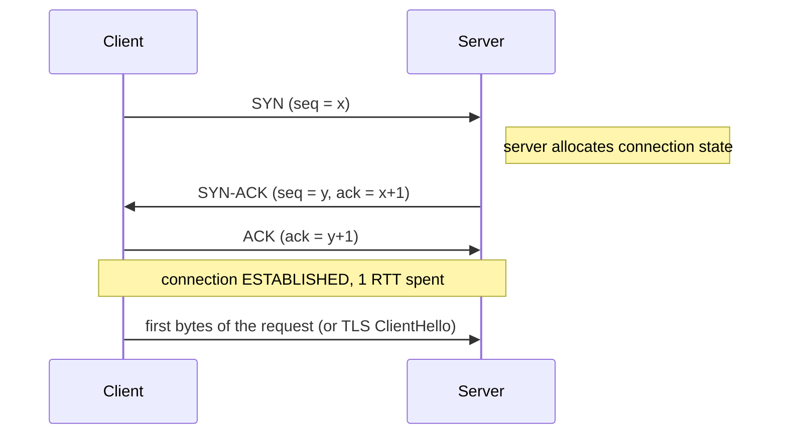

- **SYN** carries the client's random initial sequence number (ISN).
- **SYN-ACK** acknowledges it and carries the server's own ISN.
- **ACK** confirms. The client may send data in the same packet.

#### Example
Bangalore to a server in `us-east-1` has an RTT of about 230 ms. A fresh HTTPS request then costs:

| Step | Round trips | Time |
|---|---|---|
| TCP handshake | 1 | 230 ms |
| TLS 1.3 handshake | 1 | 230 ms |
| HTTP request/response | 1 | 230 ms |
| **Total before the first byte** | **3** | **≈ 690 ms** |

Reuse the connection and the next request costs 1 RTT (230 ms). Serve from a Mumbai CDN edge (RTT ≈ 20 ms) and a cold request drops to about 60 ms.

#### Trade-offs
The handshake buys reliability and protection against spoofed connections at the cost of latency. **SYN floods** abuse the server-side state allocation, and **SYN cookies** defend against them by encoding the state in the sequence number.

#### Problems & fixes
| Symptom | Cause | Fix |
|---|---|---|
| High p99 latency between services, low CPU | new connection (TCP + TLS) per request | connection pooling, HTTP keep-alive, gRPC channels |
| Server overwhelmed by half-open connections | SYN flood | SYN cookies, bigger backlog (`somaxconn`), DDoS protection (Shield, Cloudflare) |
| `connection refused` spikes during deploys | listen backlog full or the process restarting | graceful drain, readiness probes, larger backlog |
| Mobile app slow on first request | handshake round trips over a high-RTT network | edge termination (CDN), TLS 1.3, HTTP/3 0-RTT |

#### Cheat sheet
- Cold HTTPS request = DNS + 1 RTT (TCP) + 1 RTT (TLS 1.3) + 1 RTT (request).
- `SYN → SYN-ACK → ACK`. Data can ride on the third packet.
- Check with `ss -s`, `ss -tan state syn-recv`.

#### Interview questions
<details><summary>Service A calls service B and p99 is 300 ms while B itself reports 20 ms. What do you check first?</summary>

Check whether A opens a new connection per call (TCP + TLS handshakes, DNS lookups) or waits on a too-small connection pool. Look at client-side metrics: pool wait time, connection creation rate, `TIME_WAIT` count. Fix with a properly sized keep-alive pool, which usually brings p99 close to B's own latency plus one RTT.
</details>

<details><summary>How would you defend an API against a SYN flood?</summary>

Enable SYN cookies so the server keeps no state until the handshake completes, raise the SYN backlog, and put the service behind a provider that absorbs floods at the edge (AWS Shield, Cloudflare). L4 load balancers like NLB also absorb SYNs before they reach the instances.
</details>

#### Interview angle
> "Every new connection costs a round trip before data flows, plus one for TLS. That's why I pool connections between services and terminate user connections at an edge close to them."

#### Sources
- [RFC 9293: Transmission Control Protocol](https://datatracker.ietf.org/doc/html/rfc9293) — IETF (current TCP spec)
- [HPBN: Three-way handshake](https://hpbn.co/building-blocks-of-tcp/#three-way-handshake) — Ilya Grigorik

### TCP — 4-way teardown (FIN → FIN-ACK → FIN → ACK)
TCP is full-duplex, so each direction closes separately. That's four messages, followed by a waiting period that has real operational consequences.

#### Intuition
Two people hanging up a call politely: "I'm done talking" — "OK" — "I'm done too" — "OK, bye." Then the one who hung up first waits a moment in case a late "wait!" arrives. That waiting is TIME_WAIT.

#### Must know
- Each direction closes separately, so there are 4 messages.
- The side that **closes first** sits in **TIME_WAIT** (~60 s on Linux) holding its port.
- Piles of **CLOSE_WAIT** = your app isn't closing sockets. It's a bug, not a tuning issue.
- High request rates + new connection per request → **ephemeral port exhaustion**. The fix is connection pooling.
- Backend keep-alive timeout must be **longer** than the load balancer's idle timeout.

#### Numbers to quote
- TIME_WAIT ≈ 60 s on Linux.
- Default ephemeral ports ≈ 28,000 (32768–60999) per destination IP:port.
- ALB idle timeout defaults to 60 s.

#### Common mistakes
- Setting `tcp_tw_recycle` (removed from Linux because it broke clients behind NAT).
- Treating a pile of TIME_WAIT sockets as a leak. It's normal, until you run out of ports.
- Backend keep-alive shorter than the LB idle timeout, which causes random 502s/resets.

#### How it works
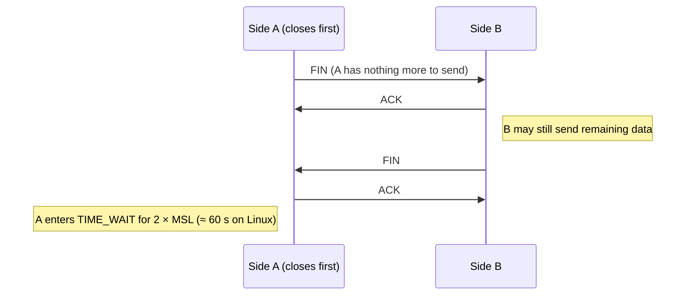

**TIME_WAIT** exists so delayed packets from the old connection aren't mistaken for a new connection on the same 4-tuple (src IP, src port, dst IP, dst port), and so the final ACK can be resent if it got lost.

#### Example
A proxy opens a new connection to one backend for every request at 2,000 requests/s. Each closed connection sits in TIME_WAIT for 60 s, so there are 2,000 × 60 = **120,000 sockets** in TIME_WAIT. The ephemeral port range is about 28,000 ports (32768–60999) per destination IP and port, so the proxy runs out of ports and new connections fail with `EADDRNOTAVAIL`.

Fixes: keep-alive or connection pooling (the real fix), widening `net.ipv4.ip_local_port_range`, `tcp_tw_reuse` for outgoing connections, or adding more backend IPs.

#### Trade-offs
TIME_WAIT protects correctness at the cost of ports and memory. The side that closes first pays it, which is why servers like to let clients close first.

#### Problems & fixes
| Symptom | Cause | Fix |
|---|---|---|
| `EADDRNOTAVAIL` / "cannot assign requested address" from a proxy | ephemeral ports exhausted by TIME_WAIT | connection pooling, `tcp_tw_reuse=1`, wider port range, more backend IPs |
| Thousands of `CLOSE_WAIT` sockets that never go away | **your app** doesn't close sockets after the peer closed | fix the code: close responses/streams, use try-with-resources |
| Intermittent "connection reset" through a load balancer | LB idle timeout shorter than the client's keep-alive | make the client's idle timeout shorter than the LB's (e.g. LB 60 s, client 50 s) |

#### Cheat sheet
- Closer-first side gets **TIME_WAIT** (≈ 60 s). The side that hasn't called close yet sits in **CLOSE_WAIT** (an app bug if it piles up).
- Ephemeral ports ≈ 28k per destination IP:port by default.
- `ss -tan state time-wait | wc -l`, `ss -tan state close-wait`.

#### Interview questions
<details><summary>Your service shows 20,000 sockets in CLOSE_WAIT and eventually hits "too many open files". What is the bug?</summary>

CLOSE_WAIT means the remote side closed but **our process never called close()**. That's a resource leak in our code, typically an HTTP client response body or a JDBC connection not closed on an error path. Fix it with try-with-resources / `finally`, and add a metric on open file descriptors. Raising ulimit only delays the crash.
</details>

<details><summary>Users get random "connection reset" errors calling your API through an AWS ALB. What could cause it?</summary>

A classic mismatch: the ALB idle timeout (60 s by default) is shorter than the backend's keep-alive timeout or vice versa. If the backend closes an idle connection the ALB is about to reuse, the request gets a reset/502. Rule: the **backend's keep-alive timeout must be longer than the LB's idle timeout** (e.g. Node `keepAliveTimeout` 65 s vs ALB 60 s).
</details>

#### Interview angle
> "Short-lived connections leave TIME_WAIT sockets behind. At high request rates that exhausts ports, so load balancers keep long-lived pooled connections to backends."

#### Sources
- [Coping with the TCP TIME-WAIT state on busy Linux servers](https://vincent.bernat.ch/en/blog/2014-tcp-time-wait-state-linux) — Vincent Bernat
- [ALB connection idle timeout](https://docs.aws.amazon.com/elasticloadbalancing/latest/application/application-load-balancers.html#connection-idle-timeout) — AWS docs

### TCP flow control — sliding window protocol
Flow control stops a fast sender from overwhelming a slow **receiver**. The receiver tells the sender how much buffer space it has left, and the sender never has more unacknowledged bytes in flight than that.

#### Intuition
A waiter bringing dishes to a small table: they only bring as many plates as there's room for. The table (receiver) keeps saying how much space is left, and the waiter (sender) never overfills it.

#### Must know
- The receiver advertises free buffer space (`rwnd`) in every ACK; the sender keeps at most `min(rwnd, cwnd)` bytes in flight.
- **Throughput per connection ≈ window ÷ RTT**, regardless of link speed.
- **Bandwidth-delay product** (bandwidth × RTT) is the window needed to fill a link.
- Flow control protects the **receiver**; congestion control protects the **network**.
- Long, fat links: use parallel streams or multipart transfers.

#### Numbers to quote
- 64 KB window at 200 ms RTT ≈ 2.6 Mbit/s max.
- Filling 1 Gbit/s at 200 ms needs a 25 MB window.

#### Common mistakes
- Confusing flow control (protects the receiver) with congestion control (protects the network).
- Blaming bandwidth when cross-region transfers are slow. Usually the window and RTT are the limit.

#### How it works
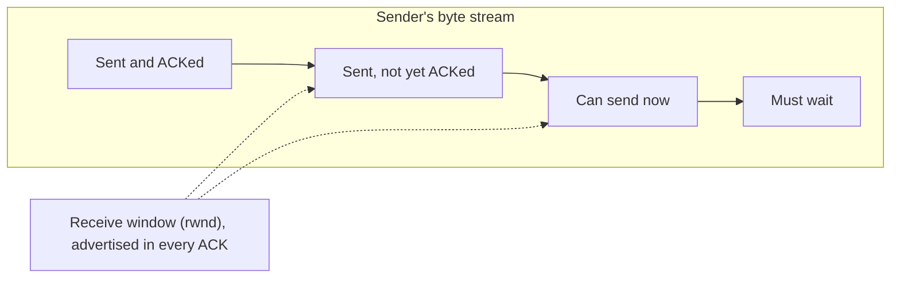

- Every ACK carries `rwnd`, the free space in the receiver's buffer.
- The sender keeps at most `min(rwnd, cwnd)` bytes in flight (`cwnd` is the congestion window, covered next).
- As ACKs arrive the window **slides** forward. If the receiver's app is slow to read, `rwnd` shrinks to 0 and the sender pauses and sends small "window probes".

**Throughput limit ≈ window ÷ RTT.**

#### Example
With a 64 KB window and an RTT of 200 ms (India to the US): 64 KB ÷ 0.2 s = **320 KB/s ≈ 2.6 Mbit/s**, even on a 1 Gbit link. To fill 1 Gbit/s at 200 ms you need a window of 1 Gbit/s × 0.2 s = 25 MB (the **bandwidth-delay product**). That's why TCP window scaling exists, and why bulk transfers across regions use parallel streams (as S3 multipart upload does).

#### Trade-offs
Bigger buffers mean higher throughput on long links, but more memory per connection. With 100k connections, 4 MB buffers each would need 400 GB. Kernels auto-tune buffers for this reason.

#### Problems & fixes
| Symptom | Cause | Fix |
|---|---|---|
| Cross-region copy stuck at a few MB/s on a fat link | window ÷ RTT limit | parallel streams, multipart upload, bigger buffers (`tcp_rmem`/`tcp_wmem`) |
| Sender stalls with "zero window" in packet captures | receiving app reads too slowly | speed up the consumer, read in a separate thread, backpressure upstream |
| Memory spikes on servers with many connections | oversized socket buffers | let the kernel auto-tune, cap buffer sizes |

#### Cheat sheet
- Max throughput per connection ≈ **window ÷ RTT**.
- Bandwidth-delay product = bandwidth × RTT = the window you need to fill the link.
- Zero window = receiver full. Look for it in Wireshark (`tcp.analysis.zero_window`).

#### Interview questions
<details><summary>Nightly DB backups from Mumbai to an S3 bucket in Virginia take 8 hours on a 1 Gbit link. How do you speed them up?</summary>

A single stream is window-limited (window ÷ ~200 ms RTT). Use **S3 multipart upload with many parallel parts** (or `aws s3 cp` with higher concurrency), compress before sending, and consider a same-region bucket with **cross-region replication** handled by AWS asynchronously. Also back up incrementally rather than the full DB each night.
</details>

<details><summary>Explain the difference between flow control and backpressure in a streaming system.</summary>

TCP flow control is backpressure at the transport level: a full receiver buffer slows the sender. Application backpressure does the same one level up. A slow Kafka consumer simply lags (the broker buffers), and reactive streams use `request(n)` so a producer never outruns its consumer. Without it, queues grow until memory runs out.
</details>

#### Interview angle
> "A single TCP stream is limited to window ÷ RTT. For cross-region replication or backups I'd use parallel streams or chunked multipart transfers instead of one big stream."

#### Sources
- [HPBN: Flow control](https://hpbn.co/building-blocks-of-tcp/#flow-control) — Ilya Grigorik
- [RFC 7323: TCP window scaling](https://datatracker.ietf.org/doc/html/rfc7323) — IETF

### TCP congestion control — slow start, AIMD, CUBIC
Congestion control protects the **network** (the routers in between) from collapse. The sender can't see the network, so it infers congestion from packet loss or rising delay and adjusts its congestion window (`cwnd`).

#### Intuition
Merging onto a highway you can't see: start slowly, speed up while traffic flows, and brake hard the moment you sense a jam (packet loss). BBR is the driver who watches the traffic itself instead of waiting to bump into the car ahead.

#### Must know
- **Slow start**: start at ~10 segments and **double every RTT**.
- **AIMD**: add 1 segment per RTT, **halve on loss** (the sawtooth).
- **CUBIC** is the Linux default; **BBR** paces to measured bandwidth and RTT and does far better on lossy mobile links.
- Cold connections are slow for several RTTs, so reuse connections and keep the first payload small (~14 KB).

#### Numbers to quote
- Initial congestion window = 10 segments ≈ 14 KB (RFC 6928).
- A 1 MB response on a cold connection needs ~7 RTTs of slow start.

#### Common mistakes
- Assuming a new connection gets full bandwidth immediately.
- Shipping huge first responses. Keep the critical first payload under about 14 KB so it fits the initial window.

#### How it works
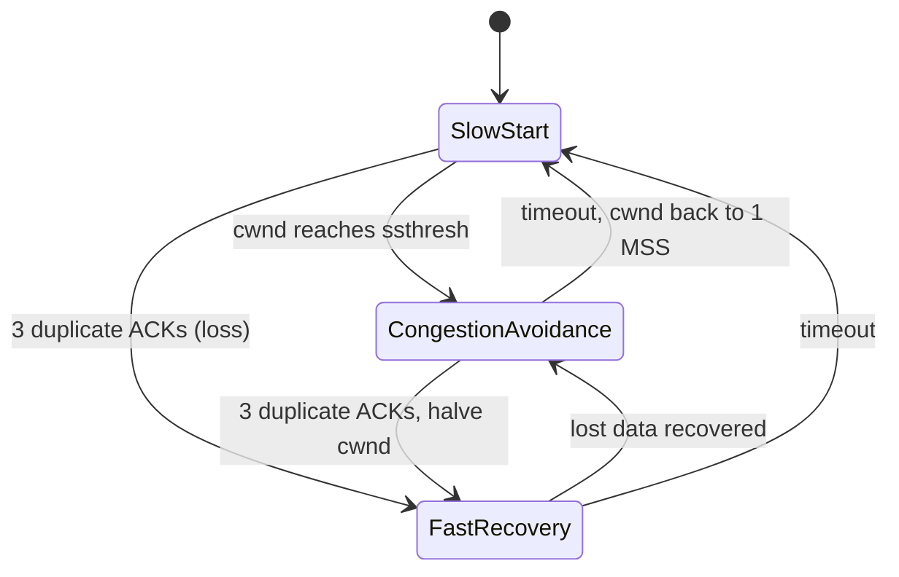

- **Slow start**: begin with about 10 segments (≈ 14 KB) and **double `cwnd` every RTT** (exponential growth).
- **Congestion avoidance (AIMD)**: past the threshold, add 1 segment per RTT (additive increase). On loss, **halve** (multiplicative decrease). This gives the classic sawtooth.
- **CUBIC** (Linux default): grows along a cubic curve, so it recovers bandwidth faster on fast, long links.
- **BBR** (Google): estimates bottleneck bandwidth and RTT and paces to them instead of waiting for loss. It does much better on lossy mobile networks.

#### Example
How long does it take a new connection to send a 1 MB page with an initial window of 10 segments (1,460 B each)?

| RTT # | cwnd (segments) | Sent so far |
|---|---|---|
| 1 | 10 | 14.6 KB |
| 2 | 20 | 43.8 KB |
| 3 | 40 | 102 KB |
| 4 | 80 | 219 KB |
| 5 | 160 | 453 KB |
| 6 | 320 | 920 KB |
| 7 | 640 | done |

That's **7 RTTs**. At a 100 ms RTT, 700 ms is spent just ramping up, no matter how fast the link is. A warm, reused connection skips the ramp.

#### Trade-offs
- Loss-based algorithms (Reno, CUBIC) fill router buffers and add queuing delay (bufferbloat).
- Delay-based algorithms (BBR) keep latency low but can be unfair to CUBIC flows sharing the link.

#### Problems & fixes
| Symptom | Cause | Fix |
|---|---|---|
| First page load slow even on fast networks | slow start on a cold connection | connection reuse, CDN with warm origin connections, keep first payload small |
| Throughput collapses on lossy mobile/Wi-Fi | loss-based CUBIC halves cwnd on every random loss | enable BBR on servers, HTTP/3 |
| High latency when a link is busy (bufferbloat) | deep buffers filled by loss-based TCP | BBR, active queue management (fq_codel) |

#### Cheat sheet
- Initial cwnd ≈ 10 segments ≈ 14 KB. Doubles every RTT in slow start.
- AIMD: +1 segment per RTT, halve on loss.
- Linux: `sysctl net.ipv4.tcp_congestion_control=bbr` (with `fq` qdisc).

#### Interview questions
<details><summary>Why does a CDN make even uncacheable API calls faster?</summary>

The user's TCP and TLS handshakes and slow start happen against a nearby edge (small RTT). The edge keeps **long-lived, warm connections** to the origin over a tuned backbone, so there's no handshake or slow start on the long leg. Fewer long round trips means lower latency even with no caching.
</details>

<details><summary>A video service sees poor throughput on Indian mobile networks with 1–2% packet loss. What would you change at the transport level?</summary>

Loss-based congestion control (CUBIC) treats random radio loss as congestion and keeps halving the window. Switching servers to **BBR** and serving over **QUIC/HTTP/3** typically improves throughput a lot on such networks. Adaptive bitrate streaming then picks the right quality for the throughput you get.
</details>

#### Interview angle
> "Slow start means cold connections are slow for several round trips, so connection reuse, HTTP/2 multiplexing and CDNs that keep warm connections to origin all pay off."

#### Sources
- [RFC 5681: TCP congestion control](https://datatracker.ietf.org/doc/html/rfc5681) — IETF
- [RFC 9438: CUBIC](https://datatracker.ietf.org/doc/html/rfc9438) — IETF
- [BBR: Congestion-based congestion control](https://research.google/pubs/pub45646/) — Cardwell et al., ACM Queue 2016

### UDP — connectionless, no ordering, no guarantee, use cases
UDP is "IP with ports": it sends independent datagrams with no handshake, no retransmission, no ordering and no congestion control. Its header is 8 bytes. Whatever reliability you need, you build yourself.

#### Intuition
TCP is a registered letter with tracking; UDP is a postcard. Postcards are fast and cheap, but if one is lost nobody tells you, and they can arrive out of order.

#### Must know
- No handshake, no retransmission, no ordering, no congestion control: an **8-byte header** and that's it.
- Use it where **old data is worthless**: live audio/video, games, DNS, metrics, and QUIC (which builds reliability per stream on top).
- Never for things that must not be lost: chat, orders, payments.
- Keep datagrams ≤ ~1,200 B to avoid fragmentation, and have a TCP fallback because firewalls block UDP.

#### Numbers to quote
- UDP header 8 B vs TCP 20+ B.
- Safe datagram size ≈ 1,200 B.

#### Common mistakes
- Using UDP for anything that must not be lost: chat messages, payments, orders.
- Sending datagrams bigger than the path MTU (~1,200 to 1,500 B), which get fragmented or dropped.
- Building your own reliability on UDP instead of using QUIC.

#### How it works
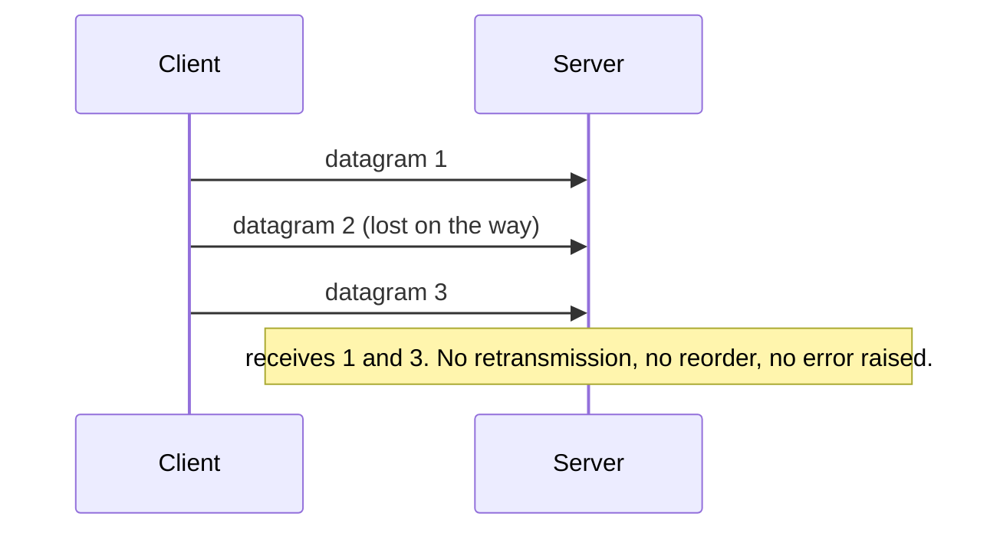

| | TCP | UDP |
|---|---|---|
| Connection setup | 3-way handshake | none |
| Delivery | reliable, retransmits | best effort |
| Ordering | in order | none |
| Head-of-line blocking | yes | no |
| Header | 20+ bytes | 8 bytes |
| Congestion control | built in | your job |

#### Example
**Live video call**: a lost 20 ms audio frame is better skipped than resent 200 ms late. WebRTC sends media over UDP (RTP) and conceals small losses.

**DNS**: a query and its answer fit in one packet each. Retrying after a timeout is cheaper than a TCP handshake.

**Game state**: the server broadcasts positions 30 times a second. Only the latest update matters, so old ones are useless once lost.

**QUIC (HTTP/3)**: builds reliable, ordered *per-stream* delivery on top of UDP, so one lost packet doesn't stall the other streams.

#### Trade-offs
UDP gives the lowest latency and full control, but you own reliability, ordering, congestion control and security. Some corporate firewalls block it too, so production systems (Zoom, QUIC) fall back to TCP.

#### Problems & fixes
| Symptom | Cause | Fix |
|---|---|---|
| Video call works on home Wi-Fi, fails in offices | corporate firewall blocks UDP | fall back to TCP/TLS 443 (TURN over TCP) |
| Packets silently dropped above a certain size | exceeds path MTU, fragments dropped | keep datagrams ≤ 1,200 B |
| App works in testing, loses data in production | no app-level ACK/retry on top of UDP | add sequence numbers + ACKs, or just use TCP/QUIC |
| DNS amplification abuse | open UDP services reflect spoofed requests | rate limiting, no open resolvers, response size limits |

#### Cheat sheet
- UDP = ports + checksum, 8 B header, nothing else.
- Use for: real-time media, games, DNS, metrics (StatsD), QUIC. Never for chat, orders or payments.
- Safe datagram size ≈ 1,200 B.

#### Interview questions
<details><summary>For a ride-sharing app, would you send driver location updates over UDP or TCP?</summary>

Updates every 3–5 s where only the latest one matters tolerate loss, so UDP-like semantics fit. In practice mobile apps use a persistent **WebSocket/MQTT over TCP** because UDP is often blocked and TCP is simpler. Either way the server keeps only the latest position, so a lost update is harmless. The trip state and payment go over reliable APIs.
</details>

<details><summary>How would you build reliable delivery on top of UDP if you had to?</summary>

Number every packet, have the receiver ACK (or NACK gaps), retransmit after a timeout computed from the measured RTT, reorder with a buffer, and add congestion control so you don't flood the network. At that point you've rebuilt most of TCP, which is why QUIC exists. Use it rather than rolling your own.
</details>

#### Interview angle
> "For the live location stream I'd tolerate loss, since the next update supersedes it. So UDP or WebRTC fits there, while chat messages and payments go over TCP with acknowledgements."

#### Sources
- [RFC 768: User Datagram Protocol](https://datatracker.ietf.org/doc/html/rfc768) — IETF
- [RFC 8085: UDP usage guidelines](https://datatracker.ietf.org/doc/html/rfc8085) — IETF

### DNS resolution — recursive vs iterative, root → TLD → authoritative
DNS turns names into IP addresses. It's a globally distributed, heavily cached, hierarchical database, and it's the first hop of almost every request your system serves.

#### Intuition
Asking for a shop's address: you ask your friend (the recursive resolver), who asks the city directory (root), which points to the street directory (.com), which points to the shop itself (authoritative). Your friend remembers the answer for a while (TTL), so next time it's instant.

#### Must know
- The client asks a **recursive resolver** for the final answer; the resolver walks **root → TLD → authoritative** iteratively.
- Answers are cached everywhere (browser, OS, resolver) for the record's TTL.
- **GeoDNS / latency-based routing** = global load balancing at the DNS layer.
- DNS is a dependency that can fail: consider a secondary provider and make apps re-resolve (JVM DNS cache!).

#### Numbers to quote
- 13 root server identities (hundreds of anycast instances).
- Failover via DNS takes TTL + client caching, typically minutes.

#### Common mistakes
- Forgetting that DNS is a dependency that can fail. The 2016 Dyn outage took down Twitter, GitHub and others. Use more than one DNS provider for critical domains.
- JVM services caching DNS forever (`networkaddress.cache.ttl`), which breaks failover.
- Kubernetes `ndots:5` multiplying lookups for external names.

#### How it works
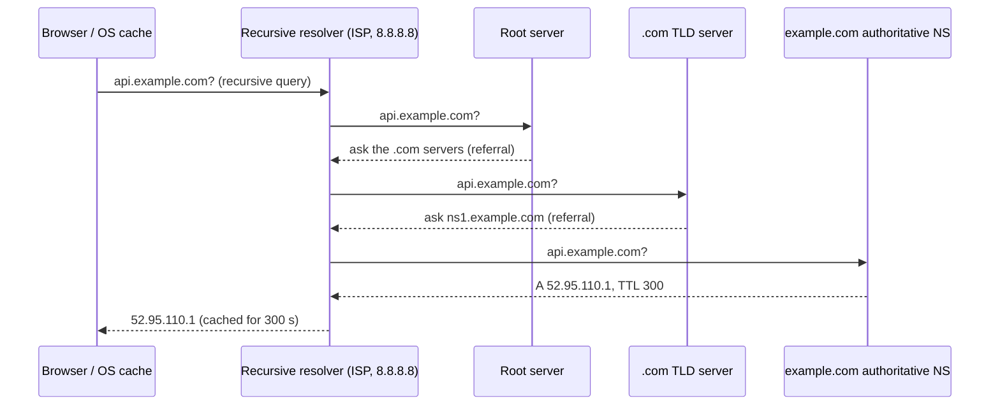

- **Recursive query**: the client says "give me the final answer" and the resolver does all the work.
- **Iterative queries**: the resolver asks each level, and each one replies with a referral to the next.
- Caches exist at every level: browser, OS, resolver, plus long-lived cached referrals for root and TLD servers. Most lookups never leave the resolver.

#### Example
Route 53 latency-based routing for `api.myapp.com`: a user in Chennai resolves to the Mumbai load balancer's IP and a user in Frankfurt gets the eu-central-1 IP. That's **global load balancing done at the DNS layer**. When the Mumbai health check fails, Route 53 starts answering with Singapore's IP, and clients move over as their cached records expire.

#### Trade-offs
- Caching makes DNS fast and resilient, but changes propagate only as TTLs expire.
- DNS-based load balancing is coarse: it sees the resolver's location, not the user's (EDNS Client Subnet helps), and clients may ignore the TTL.

#### Problems & fixes
| Symptom | Cause | Fix |
|---|---|---|
| After failover, Java services keep calling the dead IP | JVM caches DNS forever (with a security manager) or too long | set `networkaddress.cache.ttl=30`, re-resolve in the client |
| Random 5 s latency spikes in Kubernetes | DNS lookups timing out (conntrack race, ndots:5 search path) | NodeLocal DNSCache, use FQDNs with a trailing dot, lower `ndots` |
| Whole site down though servers are healthy | DNS provider outage or expired domain | secondary DNS provider, domain auto-renew + monitoring |
| Users routed to a far region | resolver location ≠ user location | EDNS Client Subnet, anycast instead of GeoDNS |

#### Cheat sheet
- Recursive resolver does the work. Root → TLD → authoritative are iterative referrals.
- `dig +trace example.com`, `dig @8.8.8.8 example.com`, `nslookup`.
- GeoDNS / latency routing = global load balancing at the DNS layer.

#### Interview questions
<details><summary>Your Kubernetes services show sporadic 5-second latency spikes on outbound calls. What would you check?</summary>

DNS. Kubernetes' default `ndots:5` makes a lookup for `api.partner.com` try several search-domain suffixes first, multiplying queries. A known conntrack race drops UDP DNS packets, which then hit the 5 s resolver timeout. Fixes: NodeLocal DNSCache, FQDNs with a trailing dot (`api.partner.com.`), lower `ndots`, and cache DNS in the app.
</details>

<details><summary>How does DNS help you build a multi-region active-active system, and what are its limits?</summary>

Latency- or geo-based records send each user to the nearest region, and health checks pull a failed region out of the answers. Limits: failover takes TTL plus client caching (often minutes), routing is based on the resolver's location, and there's no per-request control. For faster failover use anycast or a global LB (Cloudflare, AWS Global Accelerator).
</details>

#### Interview angle
> "The client resolves our domain through GeoDNS, which hands out the nearest healthy region's load balancer. A short TTL (60 s) on that record bounds how long failover takes."

#### Sources
- [What is DNS?](https://www.cloudflare.com/learning/dns/what-is-dns/) — Cloudflare Learning
- [Root servers](https://www.iana.org/domains/root/servers) — IANA
- [Debugging DNS resolution in Kubernetes](https://kubernetes.io/docs/tasks/administer-cluster/dns-debugging-resolution/) — Kubernetes docs

### DNS record types — A, AAAA, CNAME, MX, TXT, NS, PTR, SOA
A DNS zone is a set of typed records. Knowing what each type does is enough to wire up domains, CDNs, email and certificate validation, and to debug outages with `dig`.

#### Intuition
A DNS zone is a contact card for your domain: A/AAAA is the street address, CNAME says "see this other card", MX is where to deliver mail, TXT is the notes field used to prove ownership, NS says which office keeps the card.

#### Must know
- **A/AAAA** = IP, **CNAME** = alias, **MX** = mail, **TXT** = SPF/DKIM/verification, **NS** = delegation, **SOA** = zone metadata, **CAA** = which CAs may issue certs.
- A CNAME **can't sit at the apex** or next to other records on the same name; use ALIAS/ANAME/CNAME flattening.
- SPF + DKIM + DMARC TXT records keep transactional email out of spam.
- Delete DNS records when you delete resources, or you risk **subdomain takeover**.

#### Common mistakes
- A CNAME at the apex, or a CNAME next to other records on the same name.
- Missing SPF, DKIM or DMARC TXT records, which sends your transactional emails to spam.
- Leaving dangling CNAMEs to deleted buckets or apps.

#### How it works
| Record | Maps | Example |
|---|---|---|
| **A** | name → IPv4 | `api.shop.com → 52.95.110.1` |
| **AAAA** | name → IPv6 | `api.shop.com → 2600:1f18::1` |
| **CNAME** | name → another name (alias) | `www.shop.com → shop.cdn.cloudflare.net` |
| **MX** | domain → mail servers, with priority | `shop.com → 10 mx1.mail.com` |
| **TXT** | free text | SPF `v=spf1 include:_spf.google.com ~all`, domain verification tokens |
| **NS** | zone → its authoritative nameservers | `shop.com → ns-123.awsdns.com` |
| **PTR** | IP → name (reverse DNS) | `1.110.95.52.in-addr.arpa → api.shop.com` |
| **SOA** | zone metadata | primary NS, admin email, serial, refresh and negative-cache TTLs |
| **SRV / CAA** | service location / allowed certificate authorities | `_sip._tcp`, `0 issue "letsencrypt.org"` |

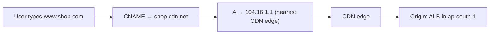

#### Example
Moving a site behind a CDN means pointing `www` with a **CNAME** at the CDN hostname. The CDN's own DNS then returns the nearest edge's **A** record. A CNAME can't sit at the zone apex (`shop.com`) alongside the SOA and NS records, so providers offer **ALIAS / ANAME / CNAME flattening** for the apex.

Debugging: `dig +trace api.shop.com` shows every referral from root to answer. `dig shop.com MX` checks mail routing.

#### Trade-offs
CNAMEs add indirection (move the CDN without touching the record) at the cost of an extra lookup.

#### Problems & fixes
| Symptom | Cause | Fix |
|---|---|---|
| Can't point `example.com` (apex) at the CDN/LB hostname | CNAME not allowed at apex | ALIAS / ANAME / CNAME flattening (Route 53 alias) |
| Transactional emails go to spam | missing SPF, DKIM, DMARC | add TXT records for all three |
| Let's Encrypt/ACM won't issue a cert | CAA record forbids that CA, or validation record missing | fix CAA, add the DNS validation CNAME |
| Subdomain takeover warning | dangling CNAME to a deleted resource (old S3 bucket, Heroku app) | delete stale records, audit DNS regularly |

#### Cheat sheet
- A/AAAA = IP, CNAME = alias, MX = mail, TXT = verification/SPF/DKIM, NS = delegation, SOA = zone metadata, PTR = reverse, CAA = allowed CAs.
- CNAME can't coexist with other records on the same name.
- `dig example.com ANY` is mostly blocked now. Query types one by one.

#### Interview questions
<details><summary>What is a subdomain takeover and how do you prevent it?</summary>

A CNAME like `promo.example.com → old-bucket.s3.amazonaws.com` still exists after the bucket was deleted. An attacker creates a bucket with that name and now serves content on your domain (phishing, cookie theft). Prevent it by removing DNS records when resources are deleted, managing DNS as code alongside the resources, and scanning for dangling records.
</details>

<details><summary>How do you put a website behind a CDN without downtime?</summary>

Configure the CDN with your current server as origin and test it via the CDN hostname. Lower the TTL of `www` a day ahead. Switch `www` to a CNAME pointing at the CDN (apex via ALIAS). Keep the origin reachable, then lock it down so it only accepts traffic from the CDN's IP ranges or with a secret header.
</details>

#### Interview angle
> "www is a CNAME to the CDN, and the apex uses an ALIAS record to the load balancer. TXT records handle SPF and DKIM so OTP emails don't land in spam."

#### Sources
- [DNS records overview](https://www.cloudflare.com/learning/dns/dns-records/) — Cloudflare Learning
- [Route 53 alias vs non-alias records](https://docs.aws.amazon.com/Route53/latest/DeveloperGuide/resource-record-sets-choosing-alias-non-alias.html) — AWS docs

### DNS TTL — caching behavior, propagation delay
Every DNS answer carries a **TTL** (time to live, in seconds) that says how long caches may keep it. TTL is the knob that trades lookup load and latency against how quickly changes take effect.

#### Intuition
TTL is the "best before" date stamped on every DNS answer. Until it expires, caches keep serving the old answer, so "propagation" is really just waiting for old answers to go stale.

#### Must know
- Changes take effect only as caches expire: there's no push.
- Before a migration: **lower TTL → wait one old TTL → switch → raise TTL**.
- Short TTL = fast failover but more queries; long TTL = fewer lookups but slow changes.
- Negative answers (NXDOMAIN) are cached too, for the SOA's negative TTL.
- Keep the old endpoint alive after switching; some clients ignore TTLs.

#### Numbers to quote
- 60 s for failover records, 300 s typical, 86,400 s for stable records.
- 99.99% allows ~4.3 min downtime a month, less than DNS failover usually takes.

#### Common mistakes
- Lowering the TTL *at the same time* as the change. Caches still hold the old long-TTL entry.
- Decommissioning the old server the moment you flip DNS.

#### How it works
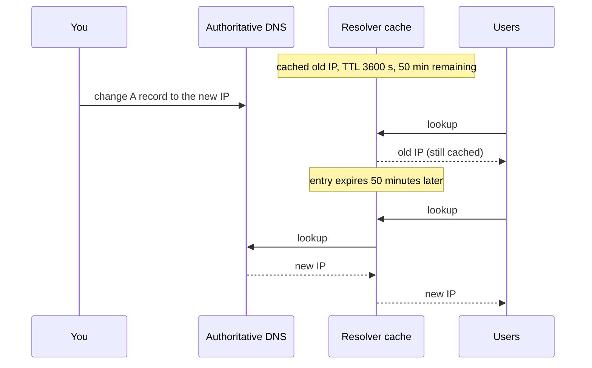

"DNS propagation" isn't pushing anything. It's waiting for caches around the world to expire the old answer. **Negative answers** (NXDOMAIN) are cached too, for the SOA's negative TTL.

#### Example
**Planned migration** from the old load balancer to the new one:
1. A day ahead, lower the TTL from 3600 s to 60 s, and wait at least the old TTL (1 hour) so every cache picks up the short TTL.
2. Switch the record. Within about 60 s most traffic moves.
3. Keep the old endpoint running for a while, because some clients and JVMs ignore TTLs.
4. Raise the TTL again once it's stable.

#### Trade-offs
| TTL | Upside | Downside |
|---|---|---|
| Short (30–60 s) | fast failover and migrations | more queries, a little extra latency, higher DNS bill |
| Long (1 h – 1 day) | fewer lookups, resilient if DNS is down | slow to change, slow failover |

#### Problems & fixes
| Symptom | Cause | Fix |
|---|---|---|
| Migration "done" but users still hit the old server for hours | TTL was long and lowered too late | lower the TTL ≥ 1 old-TTL before the change, keep old server up |
| New subdomain returns NXDOMAIN for some users after creation | negative caching of the earlier failed lookup | wait out the SOA negative TTL, keep it short |
| DNS bill and latency high | TTL of 5 s on a hot record | 60–300 s is plenty for most records |

#### Cheat sheet
- Propagation = waiting for caches to expire, not pushing.
- Before migrations: lower TTL → wait the old TTL → switch → raise TTL.
- Typical: 300 s default, 60 s for failover records, 86,400 s for stable ones.

#### Interview questions
<details><summary>You need to move your API to a new load balancer with near-zero downtime. Walk through the DNS plan.</summary>

1. Bring up the new LB and test it directly. 2. Lower the record's TTL to 60 s and wait at least the old TTL. 3. Switch the record (or use weighted records 10% → 50% → 100%). 4. Watch both LBs' traffic. Keep the old one serving until its traffic drops to near zero (some clients ignore TTLs). 5. Raise the TTL and decommission.
</details>

<details><summary>Why isn't DNS failover enough for a 99.99% availability target?</summary>

99.99% allows ~4.3 minutes of downtime a month. DNS failover takes health-check detection + TTL + clients that cache longer, easily several minutes per incident. You need failover below DNS: load balancers across AZs, anycast or global accelerators that reroute in seconds, and DNS only for region-level disasters.
</details>

#### Interview angle
> "Failover via DNS is bounded by the TTL plus misbehaving clients, so it takes minutes. For faster failover I'd use anycast or a global load balancer with health checks."

#### Sources
- [What is TTL?](https://www.cloudflare.com/learning/cdn/glossary/time-to-live-ttl/) — Cloudflare Learning
- [RFC 2308: Negative caching of DNS queries](https://datatracker.ietf.org/doc/html/rfc2308) — IETF

### Latency sources — propagation, transmission, queuing, processing
The time for a request to cross a network has four parts. Knowing which one dominates tells you which fix will actually help.

#### Intuition
A road trip's duration = driving distance (propagation) + how long the convoy takes to pass a point (transmission) + traffic jams (queuing) + toll booths (processing). You can't drive faster than light, but you can avoid jams and shorten the route.

#### Must know
- **Propagation** = distance ÷ speed of light in fibre: fix by moving closer (CDN, region near users).
- **Transmission** = size ÷ bandwidth: fix with smaller payloads and compression.
- **Queuing** explodes near saturation: keep utilisation ~60–70% and shed load.
- **Processing** = CPU per hop: fix with faster code, caching, fewer hops.
- Find which one dominates your p99 before optimising.

#### Numbers to quote
- Light in fibre ≈ 5 µs/km; 1,000 km ≈ 10 ms RTT.
- Same AZ ≈ 0.5 ms, cross-AZ ≈ 1–2 ms, India ↔ US ≈ 200–250 ms RTT.
- Queue length grows like ρ ÷ (1 − ρ): at 95% utilisation that's 19× the 50% case.

#### Common mistakes
- Optimising code (processing) when the user is 200 ms away (propagation).
- Running servers at 90%+ CPU "for efficiency", where queuing delay makes tail latency explode.

#### How it works
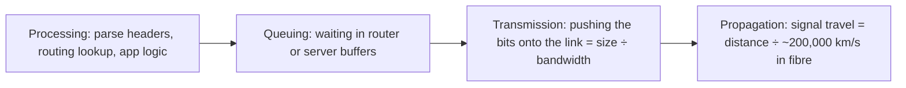

| Component | Formula / driver | Fixed by |
|---|---|---|
| Propagation | distance ÷ speed of light in fibre (≈ 5 µs per km) | move closer: CDN, edge, multi-region |
| Transmission | bytes ÷ link bandwidth | smaller payloads, compression, more bandwidth |
| Queuing | load vs capacity (grows sharply near 100% utilisation) | more capacity, rate limiting, load shedding |
| Processing | CPU work per hop and in the app | faster code, caching, fewer hops |

#### Example
Mumbai to Virginia is about 13,000 km of fibre, so one-way propagation is 13,000 × 5 µs = **65 ms** at best, and an RTT is 130 ms minimum (typically about 200 ms over real routes). No amount of server optimisation removes that, which is why you serve Indian users from `ap-south-1` and a CDN.

Transmission: a 2 MB image on a 10 Mbit/s mobile link takes 2 × 8 ÷ 10 = **1.6 s**. Compressing it to 200 KB WebP cuts that to 0.16 s.

Queuing: a server at 50% utilisation queues briefly. At 95% the queue (and the p99) blows up, because queue length grows like ρ ÷ (1 − ρ).

#### Trade-offs
Fighting propagation costs money (more regions, data replication). Fighting queuing costs capacity headroom. You pick based on which component dominates your p99.

#### Problems & fixes
| Symptom | Cause | Fix |
|---|---|---|
| p50 fine, p99 terrible at peak | queuing near saturation | add capacity (target ~60–70% utilisation), load shedding, autoscaling earlier |
| Users far away see high latency, local tests fast | propagation | region closer to users, CDN, edge caching |
| Slow on mobile, fast on office Wi-Fi | transmission of large payloads | compression (gzip/brotli), smaller images, pagination |
| Latency grows with each hop | processing at each proxy/service | fewer hops, collapse layers, cache |

#### Cheat sheet
- Light in fibre ≈ 200,000 km/s ≈ **5 µs per km**. 1,000 km ≈ 10 ms RTT.
- Same AZ ≈ 0.5 ms, cross-AZ ≈ 1–2 ms, India ↔ US ≈ 200–250 ms RTT.
- Queue delay explodes as utilisation approaches 100% (ρ ÷ (1 − ρ)).

#### Interview questions
<details><summary>Your API's p50 is 40 ms but p99 jumps to 2 s every evening at peak. What is going on and how do you fix it?</summary>

Classic queuing: at high utilisation, requests wait in thread pools, connection pools and DB queues. Confirm it with saturation metrics (CPU, pool wait times, queue depth). Fix: scale out earlier (target lower utilisation), add caching for hot reads, set timeouts and **load shedding** so the excess fails fast instead of queuing, and remove slow outliers (GC pauses, slow queries).
</details>

<details><summary>A user in Delhi complains the app is slow; your servers are in us-east-1. What can and can't you fix?</summary>

You can't beat ~200 ms RTT of propagation to Virginia. You can: serve static assets from a CDN edge in India, terminate TLS at the edge, cut round trips per screen, cache API responses at the edge where safe, and ultimately deploy the API (and a read replica or regional data) in ap-south-1.
</details>

#### Interview angle
> "Users are in India, so the origin goes in Mumbai and static assets on a CDN. That removes ~200 ms of propagation that no code change could. I'd also keep servers under ~70% utilisation so queuing doesn't hurt p99."

#### Sources
- [HPBN: Primer on latency and bandwidth](https://hpbn.co/primer-on-latency-and-bandwidth/) — Ilya Grigorik
- [Latency numbers every programmer should know](https://gist.github.com/jboner/2841832) — Jonas Bonér (after Jeff Dean)

### Bandwidth vs throughput — why they differ in practice
**Bandwidth** is the capacity of a link (the pipe's width). **Throughput** is what you actually achieve end to end, which is always lower and is set by the tightest constraint along the path.

#### Intuition
Bandwidth is how wide the highway is; throughput is how many cars actually get through per hour. A narrow bridge on the way, a slow driver at the front, or accidents (packet loss) all cut throughput no matter how wide the highway is.

#### Must know
- Throughput ≤ min(bottleneck link, **window ÷ RTT**, what packet loss allows).
- More bandwidth only helps if the link is the bottleneck.
- Long-distance bulk transfers need **parallel streams** or chunked multipart uploads.
- Plan capacity at ~70% of nominal bandwidth.
- Measure with `iperf3 -P 8`; don't assume.

#### Numbers to quote
- 512 KB window at 150 ms RTT ≈ 28 Mbit/s, even on a 1 Gbit link.
- 1M concurrent 720p streams ≈ 3 Tbit/s (3 Mbit/s each).

#### Common mistakes
- Using advertised bandwidth in capacity estimates. Budget about 60–70% of it.
- Ignoring the bandwidth-delay product for cross-region replication.

#### How it works
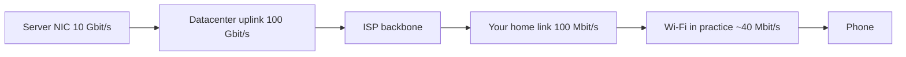

Throughput is limited by:
- the **bottleneck link** (here Wi-Fi at about 40 Mbit/s);
- the **TCP window ÷ RTT** limit (see flow control);
- **packet loss**, which makes TCP back off (throughput roughly ∝ 1 ÷ (RTT × √loss));
- **protocol overhead** (headers, TLS, retransmissions) and contention with other users;
- slow endpoints (disk, CPU, the app reading slowly).

#### Example
You pay for a 1 Gbit/s link between two regions with a 150 ms RTT, but a single `scp` gets 30 Mbit/s. The cause is a 512 KB window: 512 KB ÷ 0.15 s ≈ 28 Mbit/s. Running 16 parallel streams (or a tool like `rclone` with many transfers) reaches about 450 Mbit/s.

#### Trade-offs
Buying bandwidth only helps when the link is the bottleneck. Otherwise you need fewer round trips, parallelism or less loss.

#### Problems & fixes
| Symptom | Cause | Fix |
|---|---|---|
| Paid for a 10 Gbit link, replication gets 500 Mbit | single stream window-limited, or loss | parallel streams, tune buffers, check loss |
| Throughput drops during the day | contention / shared link saturated | QoS, schedule bulk jobs off-peak, more capacity |
| Upload speed far below download | asymmetric last-mile links | resumable chunked uploads, compress client-side |

#### Cheat sheet
- Throughput ≤ min(bottleneck bandwidth, window ÷ RTT, what loss allows).
- Plan capacity at ~70% of nominal bandwidth.
- Measure, don't assume: `iperf3 -c host -P 8`.

#### Interview questions
<details><summary>How would you design large file uploads (up to 5 GB) from mobile clients?</summary>

Chunk the file (e.g. 5–10 MB parts) and upload parts in parallel straight to object storage with **pre-signed URLs** (S3 multipart), so app servers stay out of the data path. Track completed parts so uploads resume after network drops. Verify checksums per part and complete the upload at the end. Throughput becomes the sum of parallel streams and failures retry only one chunk.
</details>

<details><summary>Estimate the bandwidth needed to serve 1 million concurrent 720p video streams.</summary>

720p ≈ 3 Mbit/s, so 1M × 3 Mbit/s = **3 Tbit/s**. No origin can serve that, so it must come from CDN edges close to users, with the origin only filling cache misses. At ~70% usable capacity you'd provision for about 4.3 Tbit/s across the edge.
</details>

#### Interview angle
> "For estimation I'll assume we sustain about 70% of link bandwidth. Cross-region copies are throughput-limited by RTT, so I'd chunk and parallelise them."

#### Sources
- [HPBN: Bandwidth-delay product](https://hpbn.co/building-blocks-of-tcp/#bandwidth-delay-product) — Ilya Grigorik
- [Uploading objects with multipart upload](https://docs.aws.amazon.com/AmazonS3/latest/userguide/mpuoverview.html) — AWS docs

### RTT (Round Trip Time) and its compounding effect on performance
RTT is the time for a packet to go to the other side and for the reply to come back. What matters is **how many round trips** a user-visible action needs: they add up linearly and dominate latency far more often than bandwidth does.

#### Intuition
Every round trip is a walk to the kitchen and back. Making ten separate trips for ten items is slow no matter how fast you walk; carrying everything in one trip (batching) or sending ten helpers at once (parallel calls) is what actually saves time.

#### Must know
- Latency ≈ **number of round trips × RTT** + server time.
- Sequential calls cost the **sum**; parallel calls cost the **max**.
- Cut round trips: connection reuse, batch/BFF endpoints, GraphQL, parallel fan-out.
- Shrink the RTT: edge/CDN termination, keep request paths in one region.
- N+1 patterns (services or DB) are round-trip bugs.

#### Numbers to quote
- Cold HTTPS = 3 RTTs before first byte; warm = 1.
- 12 sequential calls at 100 ms RTT = 1.2 s; one BFF call = 100 ms.

#### Common mistakes
- N+1 query patterns, both between services and against the database.
- Chatty protocols over high-RTT links (cross-region synchronous calls inside a request path).

#### How it works
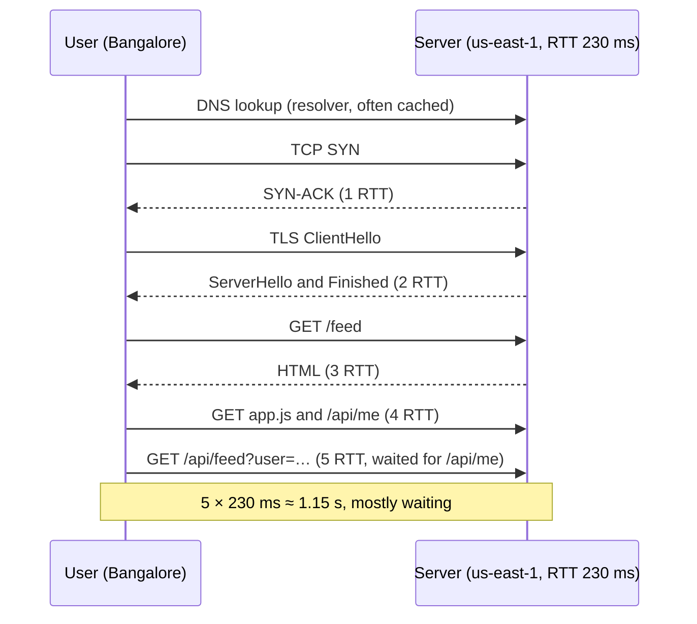

#### Example
A mobile screen calls `/me`, then `/feed` (which needs the user id), then `/posts/{id}/comments` for each of 10 posts in sequence. At a 100 ms RTT that's 1 + 1 + 10 = **12 RTTs = 1.2 s**.

Fixes and their effect:
- Fetch the comments in parallel: 3 RTTs = 300 ms.
- A single BFF / GraphQL endpoint returning everything: 1 RTT = 100 ms.
- Serve from a nearby edge with RTT 20 ms: 20 ms.

The same thing happens on the backend. A service that calls 5 downstream services **sequentially**, each 20 ms, adds 100 ms. Done in parallel it takes about 20 ms (the slowest call).

#### Trade-offs
Batching and aggregation endpoints cut round trips but create bigger, more coupled APIs. Parallel fan-out cuts latency but raises load and tail-latency risk (you wait for the slowest of N).

#### Problems & fixes
| Symptom | Cause | Fix |
|---|---|---|
| Screen needs 10+ API calls and loads slowly | chatty client, sequential calls | BFF / aggregation endpoint, GraphQL, parallel requests |
| Endpoint latency = sum of downstream calls | sequential fan-out | call independent dependencies in parallel (CompletableFuture), with timeouts |
| Page slow due to N+1 database queries | one query per row | joins, `IN (...)` batching, DataLoader |
| Cross-region call in the request path | synchronous dependency on another region | keep request path in-region, replicate data async |

#### Cheat sheet
- Latency ≈ number of round trips × RTT + server time.
- Cold HTTPS = 3 RTTs before the first byte. Warm = 1.
- Parallel fan-out costs max(latencies), sequential costs sum(latencies).

#### Interview questions
<details><summary>An order-details endpoint calls user, inventory, pricing and shipping services one after another, 50 ms each. How do you bring it under 100 ms?</summary>

Call them **in parallel** (they're independent once you have the order), so the latency becomes about the slowest call (~50 ms) instead of the sum (200 ms). Add per-call timeouts with fallbacks (e.g. omit the shipping estimate if it's slow), cache rarely-changing data such as product and pricing, and reuse pooled connections.
</details>

<details><summary>The mobile home screen makes 12 API calls. What would you propose?</summary>

A **Backend-for-Frontend** endpoint that aggregates what the screen needs in one round trip, executed with parallel internal calls close to the services (low internal RTT). Add HTTP/2 or HTTP/3 to multiplex what remains, cache static parts at the edge, and paginate below-the-fold content lazily.
</details>

#### Interview angle
> "Latency is round trips × RTT. I'd cut round trips (batch APIs, parallel fan-out, connection reuse) and shrink the RTT (edge, same-region dependencies) before tuning code."

#### Sources
- [Round Trip Time (RTT)](https://developer.mozilla.org/en-US/docs/Glossary/Round_Trip_Time) — MDN
- [HPBN: Primer on latency and bandwidth](https://hpbn.co/primer-on-latency-and-bandwidth/) — Ilya Grigorik

