## HTTP versions & HTTPS

### HTTP/1.0 — new connection per request
HTTP/1.0 (1996) opened a **new TCP connection for every request** and closed it after the response. A page with 30 images meant 30 TCP handshakes and 30 slow starts. Every later HTTP version is a reaction to that cost.

#### How it works
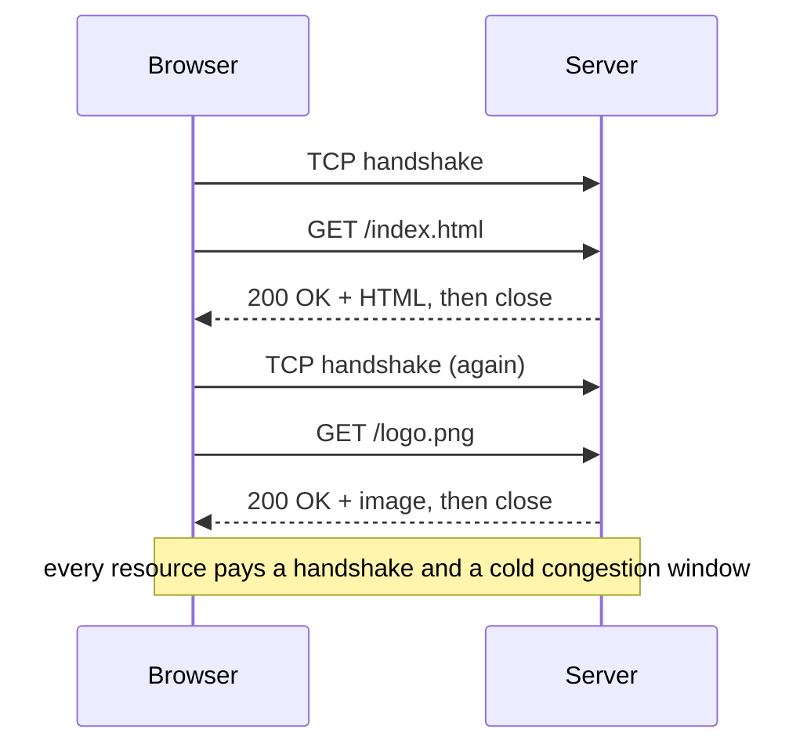

Browsers worked around it by opening ~4–6 connections in parallel per host, and sites used "domain sharding" (`img1.site.com`, `img2.site.com`) to get more.

#### Example
A page with 1 HTML file, 3 CSS/JS files and 20 images over a 100 ms RTT link, using 6 parallel connections:
- 24 requests ÷ 6 connections = 4 sequential waves.
- Each wave costs at least a handshake + request = 2 RTT = 200 ms.
- That's ≈ 800 ms of pure round-trip waiting, before any download time.

#### Trade-offs
Simple and stateless, easy to implement and debug with `telnet`. Terrible for latency and server resources (connection setup/teardown, TIME_WAIT sockets).

#### Problems & fixes
| Symptom | Cause | Fix |
|---|---|---|
| Legacy client or proxy is slow and floods the server with connections | speaks HTTP/1.0 without keep-alive | upgrade the client, or terminate at a proxy that pools upstream connections |
| Thousands of TIME_WAIT sockets on servers | connection per request | keep-alive / HTTP/1.1+ |

#### Cheat sheet
- One request per TCP connection. `Connection: keep-alive` was an optional extension.
- No `Host` header required, so one IP could serve only one site (virtual hosting came with 1.1).

#### Interview questions
<details><summary>Why is "a connection per request" bad for a microservice calling another service 5,000 times per second?</summary>

Every call pays a TCP (and TLS) handshake, so extra round trips are added to latency. Each closed connection leaves a TIME_WAIT socket, so you burn through ephemeral ports (5,000/s × 60 s = 300k sockets). CPU goes on handshakes, and every new connection starts in slow start. Use a persistent connection pool (HTTP/1.1 keep-alive, HTTP/2 or gRPC).
</details>

<details><summary>What is domain sharding and why is it an anti-pattern today?</summary>

Spreading assets across several hostnames to get around the browser's 6-connections-per-host limit in HTTP/1.x. With HTTP/2 a single connection multiplexes everything, so sharding only adds DNS lookups, TLS handshakes and worse congestion control. Remove it when you move to HTTP/2.
</details>

#### Interview angle
> "HTTP/1.0's connection-per-request is the baseline every later version optimises: 1.1 reuses connections, 2 multiplexes them, 3 removes TCP's head-of-line blocking."

### HTTP/1.1 — persistent connections, pipelining, keep-alive, Head-of-Line blocking
HTTP/1.1 (1997) made connections **persistent by default**: many requests reuse one TCP connection. It also made the `Host` header mandatory (virtual hosting) and added chunked transfer encoding. Its big remaining flaw is **head-of-line (HoL) blocking**: one connection handles one request at a time.

#### How it works
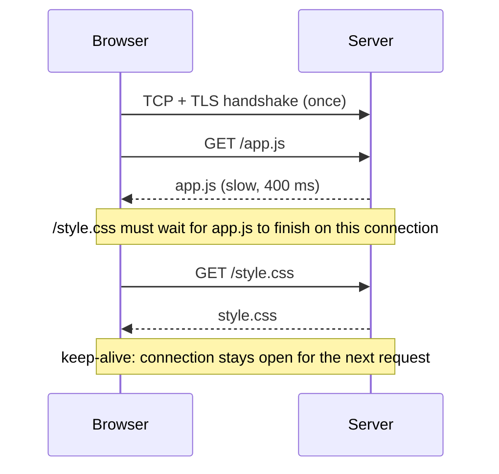

- **Keep-alive**: the connection stays open until an idle timeout.
- **Pipelining**: send several requests without waiting, but responses must come back **in order**, so one slow response blocks the rest. Proxies handled it badly, so browsers never enabled it.
- **Chunked encoding**: stream a response of unknown length (`Transfer-Encoding: chunked`).

#### Example
A reverse proxy (NGINX) in front of app servers: with `keepalive 64` in the upstream block, NGINX reuses 64 warm connections per worker to the backends instead of opening one per request. Under 10k req/s this removes 10k handshakes per second and the port exhaustion that comes with them.

#### Trade-offs
Keep-alive saves handshakes, but idle connections hold memory and file descriptors. Servers cap them (`keepalive_timeout`, max requests per connection). HoL blocking forces browsers back to ~6 parallel connections per host.

#### Problems & fixes
| Symptom | Cause | Fix |
|---|---|---|
| 502s through an ALB / proxy when traffic is light | backend closes idle keep-alive connection just as the proxy reuses it | backend keep-alive timeout **longer** than the proxy's idle timeout |
| One slow request delays others from the same client | HoL blocking on a single HTTP/1.1 connection | HTTP/2, or more parallel connections |
| Server out of file descriptors | too many idle keep-alive connections | lower `keepalive_timeout`, raise ulimit, put an LB in front |

#### Cheat sheet
- Persistent by default, `Connection: close` to end. `Host` header mandatory.
- Browsers: ~6 connections per host. Pipelining effectively unused.
- `Transfer-Encoding: chunked` for streaming responses.

#### Interview questions
<details><summary>Explain head-of-line blocking in HTTP/1.1 and how HTTP/2 and HTTP/3 address it.</summary>

In HTTP/1.1 a connection carries one request-response at a time (pipelined responses must also come back in order), so a slow response blocks everything behind it. HTTP/2 multiplexes many streams over one connection, fixing it at the HTTP layer, but a lost TCP packet still stalls all streams (TCP HoL). HTTP/3 uses QUIC, where streams are independent at the transport layer, so loss on one stream doesn't block the others.
</details>

<details><summary>You see intermittent 502 errors from your load balancer only during quiet periods. What is your hypothesis?</summary>

A keep-alive race. The backend closes an idle connection (e.g. Node's default 5 s keep-alive timeout) while the LB (60 s idle timeout) still thinks it's usable and sends a request on it, which gets a reset, so the LB returns 502. Fix: set the backend keep-alive timeout above the LB idle timeout (e.g. 65 s vs 60 s).
</details>

#### Interview angle
> "HTTP/1.1 reuses connections but serialises requests on each one, so browsers open ~6 per host. Between our proxy and services I'd keep pooled keep-alive connections with timeouts aligned to the load balancer's."

### HTTP/2 — multiplexing streams, header compression (HPACK), server push, binary framing
HTTP/2 (2015) keeps HTTP's semantics (methods, headers, status codes) but changes the wire format. Requests and responses are split into **binary frames** tagged with a **stream ID**, so many requests share **one TCP connection at the same time**.

#### How it works
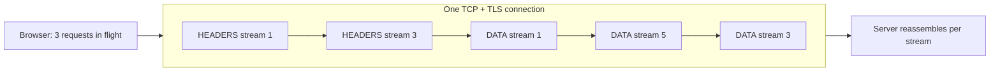

- **Binary framing + multiplexing**: frames from different streams interleave, so there's no HTTP-level HoL blocking.
- **HPACK** header compression: a shared table of previously sent headers. Repeated cookies and user-agents shrink to a few bytes.
- **Stream priorities and flow control** per stream.
- **Server push**: the server sends resources before they're requested. In practice it was rarely a win and Chrome removed it (use `103 Early Hints` / preload instead).
- **gRPC** is built on HTTP/2 streams.

#### Example
The same 24-resource page over a 100 ms RTT: HTTP/1.1 with 6 connections needs ~4 waves (≈ 800 ms of waiting). HTTP/2 sends all 24 requests at once on one connection: ≈ 1 handshake + 1 RTT ≈ 200–300 ms, and one warm congestion window instead of six cold ones.

Headers: an 800-byte cookie sent with 24 requests is 19 KB in HTTP/1.1, but under 1 KB with HPACK after the first request.

#### Trade-offs
- One connection means one TCP congestion window. On lossy networks a single lost packet stalls **all** streams (TCP-level HoL), which can make HTTP/2 worse than 6 HTTP/1.1 connections on bad mobile links.
- L7 load balancing gets harder: long-lived HTTP/2 (gRPC) connections stick to one backend, so you need per-request (L7) balancing rather than per-connection.

#### Problems & fixes
| Symptom | Cause | Fix |
|---|---|---|
| gRPC traffic all lands on one pod after scaling | L4 LB balances connections, and one HTTP/2 connection carries everything | L7 balancing (Envoy, Linkerd, gRPC client-side LB), or periodic connection recycling (`MAX_CONNECTION_AGE`) |
| HTTP/2 slower than HTTP/1.1 on mobile | TCP HoL under packet loss | HTTP/3 |
| Old domain sharding and sprite hacks still in place | HTTP/1-era optimisations | remove them, since they defeat multiplexing |

#### Cheat sheet
- Same semantics, binary frames, streams over one connection.
- HPACK compresses headers. Server push deprecated, use Early Hints.
- Needs TLS in browsers (h2 via ALPN). gRPC = HTTP/2 + protobuf.

#### Interview questions
<details><summary>After moving to gRPC, one backend pod is at 90% CPU and the others are idle. Why, and how do you fix it?</summary>

gRPC uses long-lived HTTP/2 connections, and a Kubernetes Service (L4, kube-proxy) balances **connections**, not requests. A client that opened one connection sends every request to the same pod, and new pods get nothing. Fix: request-level load balancing via a service mesh/Envoy, gRPC client-side load balancing with a headless service, or `MAX_CONNECTION_AGE` on the server so clients reconnect and rebalance.
</details>

<details><summary>Does HTTP/2 remove head-of-line blocking completely?</summary>

No. It removes HoL at the HTTP layer (requests no longer wait for each other), but all streams share one TCP connection, and TCP delivers bytes in order. A lost packet holds back data for every stream until it's retransmitted. HTTP/3 over QUIC fixes this at the transport layer.
</details>

#### Interview angle
> "HTTP/2 multiplexes all requests over one connection with compressed headers, which is ideal for API gateways and gRPC between services. But I'd use L7 request-level balancing, since connections are long-lived."

### HTTP/3 — QUIC over UDP, 0-RTT connection, built-in TLS 1.3, no TCP HoL blocking
HTTP/3 runs HTTP over **QUIC**, a transport built on UDP. QUIC does what TCP + TLS did (reliability, congestion control, encryption) but with **independent streams**, a **combined handshake** and **connection migration**.

#### How it works
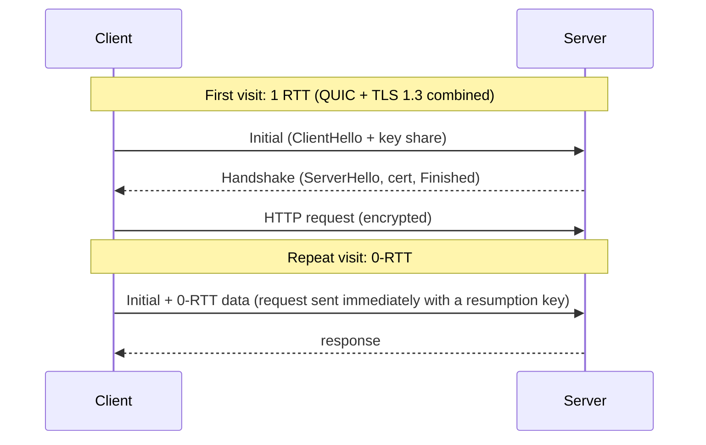

- **Streams are independent**: a lost packet only stalls its own stream.
- **1-RTT handshake** (vs TCP + TLS = 2 RTT), **0-RTT** on resumption.
- **Connection ID** instead of the IP:port 4-tuple, so a phone switching Wi-Fi → 4G keeps its connection.
- Runs in user space, so it evolves without OS upgrades. Transport headers are encrypted.

#### Example
A user on a train in a mobile app: with HTTP/2 over TCP, switching cell towers changes the IP, the TCP connection dies, and it reconnects (TCP + TLS = 2 RTT, about 400 ms on 4G) with in-flight requests failing. With HTTP/3 the connection migrates, and requests keep flowing with no new handshake. With 2% packet loss, video segments on other streams aren't stalled by one lost packet.

#### Trade-offs
- UDP is blocked or throttled on some networks, so clients fall back to HTTP/2 (servers advertise h3 via the `Alt-Svc` header).
- More CPU per byte than kernel TCP (user-space crypto and packet handling).
- **0-RTT data can be replayed** by an attacker, so allow it only for idempotent requests (GET), never for "pay" or "transfer".

#### Problems & fixes
| Symptom | Cause | Fix |
|---|---|---|
| HTTP/3 enabled but clients still use HTTP/2 | UDP 443 blocked by firewall/LB, or missing `Alt-Svc` | open UDP 443, advertise via `Alt-Svc`, use a CDN with h3 |
| Duplicate side effects from repeated requests on reconnect | 0-RTT replay | reject 0-RTT for non-idempotent methods (`425 Too Early`) |
| Higher CPU on edge servers | user-space QUIC | hardware offload, or let the CDN terminate h3 |

#### Cheat sheet
- HTTP/3 = HTTP over QUIC over UDP, TLS 1.3 built in.
- 1-RTT setup, 0-RTT resume (replayable, idempotent only).
- Per-stream loss recovery, connection migration via connection IDs.

#### Interview questions
<details><summary>Your app has many users on flaky mobile networks in tier-2 cities. Would HTTP/3 help, and what would you watch out for?</summary>

Yes. Independent streams avoid TCP HoL stalls under packet loss, the 1-RTT/0-RTT handshakes cut connection setup, and connection migration survives network switches. Watch for UDP being blocked (keep an HTTP/2 fallback), 0-RTT replay (only for idempotent GETs), and higher server CPU. Usually the easiest path is to let the CDN terminate HTTP/3.
</details>

<details><summary>Why is 0-RTT data dangerous for a payment API?</summary>

0-RTT data is sent before the handshake proves freshness, so an attacker who captured it can replay it to the server. A replayed "charge ₹5,000" would execute twice. Servers must accept 0-RTT only for safe, idempotent requests, and payment endpoints should require idempotency keys anyway.
</details>

#### Interview angle
> "HTTP/3 helps most on lossy mobile networks: independent streams, faster handshakes and connection migration. I'd enable it at the CDN edge with HTTP/2 fallback and keep 0-RTT for idempotent reads only."

### HTTPS — TLS handshake flow: ClientHello → ServerHello → Certificate → Key Exchange → Finished
HTTPS is HTTP inside a **TLS** session. The handshake achieves three things before any HTTP data flows: **authenticate the server** (certificate), **agree on a shared secret key** (key exchange), and **agree on algorithms** (cipher suite).

#### How it works
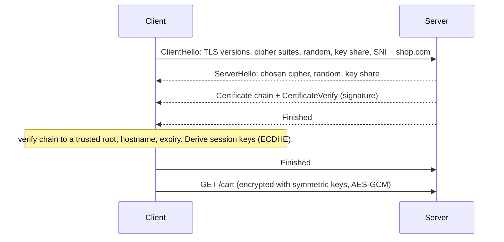

- **Asymmetric crypto** (ECDHE key exchange, RSA/ECDSA signatures) is used only during the handshake.
- **Symmetric crypto** (AES-GCM, ChaCha20) encrypts the actual data, because it's fast.
- **SNI** tells the server which hostname's certificate to present (many sites per IP).
- **Session resumption** (tickets / PSK) skips most of the handshake for returning clients.

#### Example
A user hits `https://shop.com` through an AWS ALB. The ALB holds the ACM certificate and **terminates TLS**: the handshake happens between browser and ALB. The ALB forwards to services over plain HTTP inside the VPC (or re-encrypts with mTLS in regulated setups like banks). Certificate renewal is automatic in ACM, so there's no expiry outage.

#### Trade-offs
- TLS termination at the edge offloads CPU and centralises certificates, but traffic inside the network is plaintext unless re-encrypted. Compliance (PCI DSS) often requires encryption in transit internally too.
- Handshakes cost CPU (asymmetric ops) and RTTs. Resumption and keep-alive amortise them.

#### Problems & fixes
| Symptom | Cause | Fix |
|---|---|---|
| Site down with "certificate expired" | manual renewal forgotten | ACM / Let's Encrypt auto-renewal + expiry alerts (30/14/7 days) |
| Works in browsers, fails from Java/Android clients | incomplete chain (missing intermediate) | serve the full chain, test with `openssl s_client -showcerts` |
| Wrong certificate served for some hostnames | SNI not configured, or an old client without SNI | per-host certs with SNI, or a SAN/wildcard cert |
| High CPU on TLS servers | full handshakes, no resumption | enable session tickets, keep-alive, ECDSA certs |

#### Cheat sheet
- Handshake = authenticate server + agree keys + agree ciphers. Data then uses symmetric encryption.
- TLS 1.3: 1 RTT (0-RTT on resume). TLS 1.2: 2 RTT.
- Debug: `openssl s_client -connect host:443 -servername host`, `curl -v`.

#### Interview questions
<details><summary>Where would you terminate TLS in a microservices architecture, and why?</summary>

At the edge (CDN/ALB/API gateway) for public traffic: one place for certificates, WAF inspection and L7 routing, plus CPU offload. Inside the cluster, either trust the private network (simplest) or, for compliance and zero-trust, use **mTLS between services** via a service mesh (Istio/Linkerd) so certificates are issued and rotated automatically. Banks and payment systems usually require the latter.
</details>

<details><summary>A partner's Java client fails with "PKIX path building failed" while browsers work fine. What is wrong?</summary>

The server isn't sending the intermediate certificate. Browsers often fill gaps from cache or AIA fetching, while Java's truststore validation doesn't. Fix the server to send the full chain (leaf + intermediates). Check with `openssl s_client -showcerts` or SSL Labs. Less commonly, the partner's truststore lacks the root CA.
</details>

#### Interview angle
> "TLS terminates at the load balancer with auto-renewed certificates. Internally I'd use mTLS through the mesh for payment services, and keep connections alive so handshakes are rare."

### TLS 1.2 vs TLS 1.3 — fewer round trips, no RSA key exchange (forward secrecy)
TLS 1.3 (2018) is faster and safer than 1.2: **one round-trip handshake instead of two**, **0-RTT resumption**, and removal of legacy, insecure options. Most importantly, every connection now has **forward secrecy**.

#### How it works
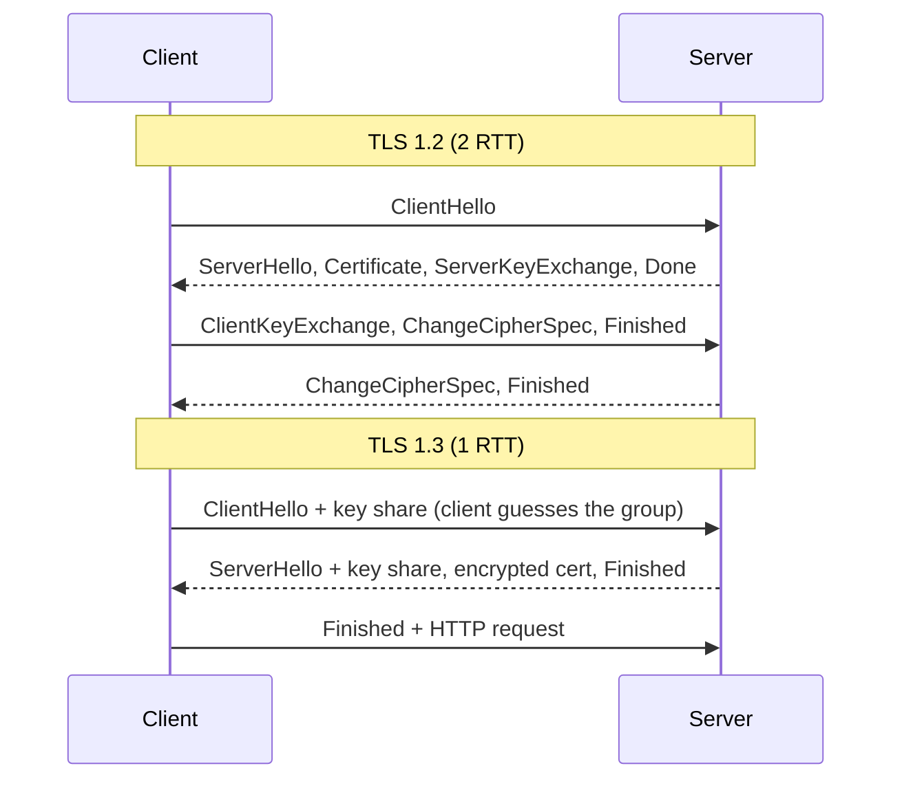

| | TLS 1.2 | TLS 1.3 |
|---|---|---|
| Handshake | 2 RTT | 1 RTT (0-RTT resume) |
| Key exchange | RSA or (EC)DHE | (EC)DHE only, so always forward secret |
| Ciphers | many, incl. CBC, RC4, SHA-1 | 5 AEAD suites (AES-GCM, ChaCha20-Poly1305) |
| Certificate | sent in clear | encrypted |

**Forward secrecy**: with RSA key exchange, the client encrypted the session secret with the server's RSA public key. Anyone who records traffic and later steals the server's private key can decrypt **all past sessions**. With ephemeral Diffie-Hellman (ECDHE), each session's key is thrown away, so stealing the long-term key doesn't reveal past traffic.

#### Example
A bank disables TLS 1.0/1.1 and RSA key exchange, enables TLS 1.2 (ECDHE-only suites) + TLS 1.3. Users get a 1-RTT handshake on modern devices (≈ 100–200 ms saved per new connection on mobile), and recorded traffic stays safe even if a private key leaks later.

#### Trade-offs
TLS 1.3 breaks passive "decrypt with the server key" monitoring that some enterprises relied on (they now need to terminate and re-encrypt). Very old clients (Android 4, Java 7) can't connect without 1.2.

#### Problems & fixes
| Symptom | Cause | Fix |
|---|---|---|
| Security scan flags weak ciphers / TLS 1.0 | legacy config | allow TLS 1.2 (ECDHE + AEAD) and 1.3 only, use Mozilla's "intermediate" config |
| Old Android/Java clients fail after hardening | no TLS 1.2/1.3 support | keep 1.2 for them, upgrade the client runtime |
| Network IDS can no longer read traffic | TLS 1.3 / forward secrecy | inspect at the termination point instead |

#### Cheat sheet
- 1.3 = 1 RTT, AEAD only, ECDHE only, encrypted certificate, 0-RTT resume.
- Forward secrecy = ephemeral keys, so a key stolen tomorrow can't decrypt today's traffic.
- Minimum today: TLS 1.2. Prefer 1.3.

#### Interview questions
<details><summary>What is forward secrecy and why does it matter for a payments company?</summary>

Each session uses ephemeral Diffie-Hellman keys that are discarded afterwards. If an attacker records encrypted traffic for years and later steals the server's private key, they still can't decrypt past sessions. For a payments company that limits the blast radius of a key compromise to future traffic only, and PCI DSS effectively requires strong cipher suites that provide it.
</details>

<details><summary>How much latency does TLS 1.3 save, and where does it matter most?</summary>

One full round trip per new connection (2 RTT → 1 RTT), and up to two with 0-RTT resumption. It matters most where RTT is high and connections are often new: mobile users, cross-region calls, cold starts of serverless functions making outbound calls. For long-lived pooled connections the saving is negligible.
</details>

#### Interview angle
> "I'd enforce TLS 1.2+ with ECDHE suites and prefer 1.3: one round trip less per connection, and forward secrecy, so a leaked key can't decrypt recorded traffic."

### Mutual TLS (mTLS) — both client and server authenticate with certificates
In normal TLS only the **server** proves its identity. In **mTLS** the client also presents a certificate, so both sides know exactly who they're talking to. It's the backbone of zero-trust service-to-service security and of many bank and partner integrations.

#### How it works
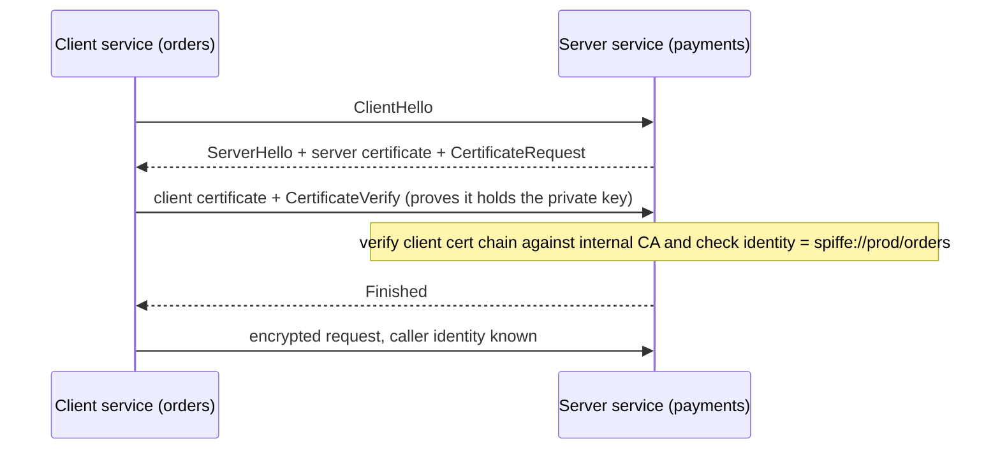

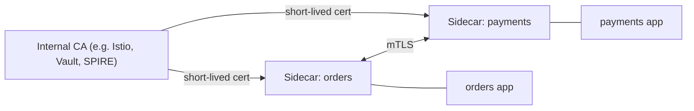

#### Example
- **Service mesh**: Istio gives every pod a certificate (SPIFFE identity), rotates it every ~24 h, and the sidecars do mTLS transparently. An authorization policy says "only `orders` may call `payments` POST /charges".
- **Bank / partner APIs**: NPCI, card networks and corporate banking APIs commonly require the partner to present a client certificate issued for them, in addition to API keys/OAuth.

#### Trade-offs
- Strong identity, no shared secrets in headers, encryption everywhere.
- Certificate lifecycle (issuance, rotation, revocation) is operational work, which is why meshes automate it. It also adds handshake CPU and debugging complexity.

#### Problems & fixes
| Symptom | Cause | Fix |
|---|---|---|
| Sudden handshake failures across services | expired client certs, or CA rotated without trust bundle update | automate rotation (mesh, cert-manager), overlap old and new CA during rotation |
| `bad certificate` from partner API | wrong cert or key, missing intermediate, cert not registered with partner | send the full chain, verify with `openssl s_client -cert -key` |
| A compromised service can call anything | mTLS without authorization policies | add per-identity allow policies (least privilege) |

#### Cheat sheet
- mTLS = TLS + client certificate = mutual authentication.
- Mesh (Istio/Linkerd) automates certs, rotation and policy. Identity format: SPIFFE.
- Authentication (who you are) ≠ authorization (what you may do). Add policies.

#### Interview questions
<details><summary>How would you secure service-to-service calls in a payments platform?</summary>

mTLS everywhere via a service mesh, with short-lived, auto-rotated workload certificates (SPIFFE identities), so every call is encrypted and the caller is cryptographically identified. On top, authorization policies (orders → payments allowed, analytics → payments denied), plus end-user context propagated as a signed JWT. Audit-log every call to sensitive services.
</details>

<details><summary>mTLS or API keys for a B2B partner integration?</summary>

API keys are simple but are bearer secrets that leak in logs and repos. mTLS proves possession of a private key that never leaves the partner, and is standard in banking. Common practice combines them: mTLS for transport identity, plus OAuth client credentials for fine-grained scopes, plus IP allow-listing.
</details>

#### Interview angle
> "Inside the cluster I'd rely on mesh-managed mTLS for identity and encryption, with authorization policies on top, so a compromised pod can't call the ledger service."

### Certificate chains — root CA → intermediate CA → leaf certificate
A browser trusts a site's certificate because it can follow a **chain of signatures** from that certificate up to a **root CA** already in its trust store. Roots are kept offline, and intermediates do the day-to-day signing.

#### How it works
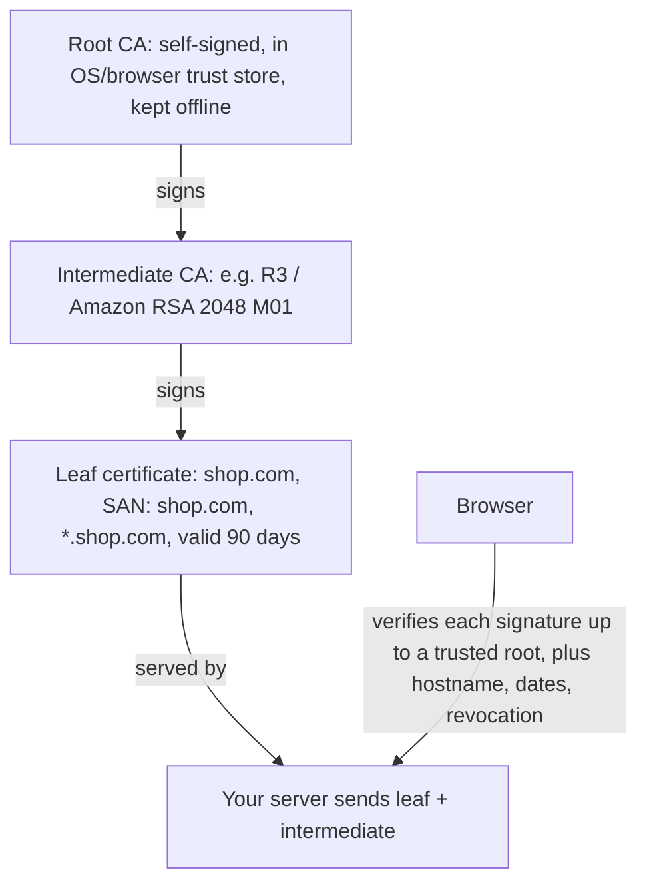

The client checks: every signature in the chain, that the hostname matches the **SAN**, the validity dates, and (sometimes) revocation via **OCSP** / CRL. The server must send the leaf **and the intermediates**. Never send the root.

#### Example
`openssl s_client -connect shop.com:443 -showcerts` shows:
```text
0 s:CN = shop.com              i:C = US, O = Let's Encrypt, CN = R3
1 s:C = US, O = Let's Encrypt, CN = R3   i:O = Internet Security Research Group, CN = ISRG Root X1
```
Depth 0 is the leaf, depth 1 the intermediate. The root (ISRG Root X1) comes from the client's trust store.

#### Trade-offs
Short-lived certificates (90 days, heading to 47) limit damage from key theft, but demand automated renewal. Wildcards (`*.shop.com`) are convenient, but one leaked key exposes every subdomain.

#### Problems & fixes
| Symptom | Cause | Fix |
|---|---|---|
| Works in Chrome, fails in curl/Java/Android | missing intermediate | serve the full chain (`fullchain.pem`) |
| `certificate has expired` though the leaf is valid | an expired intermediate or old root in the client store | update the chain, update the client's CA bundle |
| `hostname mismatch` | SAN doesn't include the requested name | reissue with the correct SANs |
| Certificate pinning breaks the app after renewal | app pinned the leaf | pin the intermediate/public key with a backup pin, or don't pin |

#### Cheat sheet
- Root (trust store) → intermediate → leaf. Server sends leaf + intermediates.
- Check the SAN, not the CN. Validity ≤ 398 days (Let's Encrypt 90).
- Tools: `openssl s_client -showcerts`, SSL Labs, `openssl x509 -text -noout`.

#### Interview questions
<details><summary>Your mobile app broke for all users right after the certificate was renewed. What likely happened and how do you prevent it?</summary>

The app **pinned** the old leaf certificate or its public key, and the renewed certificate has a new key. Prevent it by pinning the intermediate CA's or your own long-lived key, always shipping a backup pin, using remote-config-controlled pinning, or skipping pinning in favour of Certificate Transparency monitoring.
</details>

<details><summary>Why are root CA keys kept offline and intermediates used for signing?</summary>

A compromised root breaks trust for every certificate under it, and replacing a root means updating trust stores on billions of devices, which takes years. Keeping the root offline and signing with intermediates means a compromised intermediate can be revoked and replaced quickly while the root stays trusted.
</details>

#### Interview angle
> "Certificates are issued and rotated automatically (ACM or cert-manager), the server sends the full chain, and expiry is monitored with alerts weeks in advance. Expired certificates are a top cause of avoidable outages."

### HTTP methods — GET, POST, PUT, PATCH, DELETE, HEAD, OPTIONS and idempotency of each
HTTP methods carry meaning that the whole infrastructure relies on. Caches, proxies, retries and clients all behave differently depending on whether a method is **safe** (no side effects) and **idempotent** (repeating it has the same effect as doing it once).

#### How it works
| Method | Meaning | Safe | Idempotent | Typical response |
|---|---|---|---|---|
| GET | read a resource | ✅ | ✅ | 200, cacheable |
| HEAD | GET without the body | ✅ | ✅ | 200 (headers only) |
| OPTIONS | which methods are allowed (CORS preflight) | ✅ | ✅ | 204 |
| PUT | replace the resource at this URL with this body | ❌ | ✅ | 200 / 204 / 201 |
| DELETE | remove the resource | ❌ | ✅ | 204 (404 on repeat is fine) |
| PATCH | partial update | ❌ | ❌ (can be) | 200 |
| POST | create / process / trigger an action | ❌ | ❌ | 201 + Location, 202 |

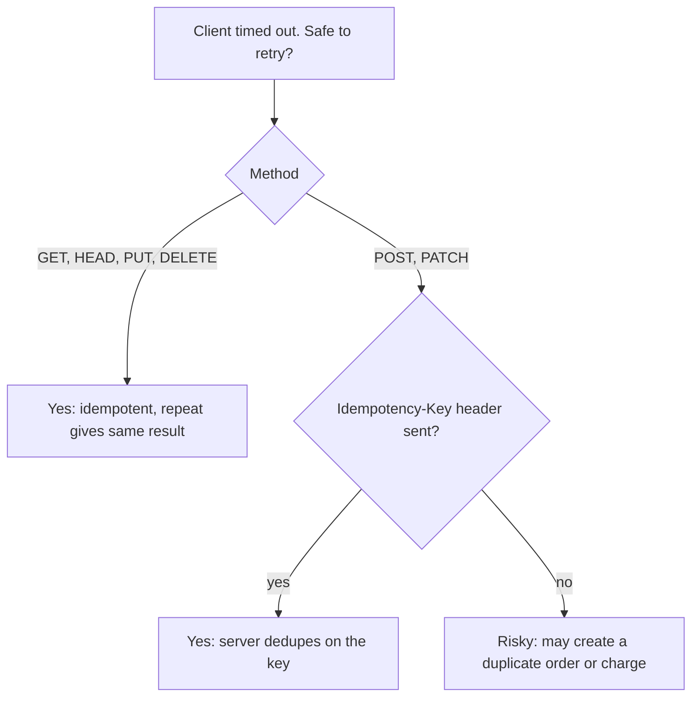

#### Example
- `PUT /users/42/address {city:"Pune"}` sent 3 times leaves the same final state, so it's safe to retry.
- `PATCH /accounts/42 {"op":"increment","balance":100}` sent twice adds ₹200, so it's **not** idempotent. `PATCH {balance: 600}` (set a value) would be.
- `POST /payments` with `Idempotency-Key: 7f3a…`: the server stores key → result, so a retry returns the first result instead of charging again (Stripe's approach).

#### Trade-offs
Strict REST semantics make retries, caching and tooling work automatically. Sometimes actions don't fit CRUD (`POST /orders/42/cancel`), which is fine as long as you document idempotency.

#### Problems & fixes
| Symptom | Cause | Fix |
|---|---|---|
| Duplicate orders/payments after client retries | non-idempotent POST retried on timeout | Idempotency-Key header + server-side dedupe table with a unique constraint |
| Crawlers or prefetchers deleting data | state change on GET (`GET /delete?id=5`) | never mutate on GET |
| Proxy retried a request and caused a double update | proxies/LBs retry idempotent methods | ensure PUT/DELETE really are idempotent |

#### Cheat sheet
- Safe: GET, HEAD, OPTIONS. Idempotent: those + PUT, DELETE. Not idempotent: POST, (PATCH).
- Retries are safe only for idempotent operations. Make POSTs idempotent with keys.
- POST create → 201 + `Location`. Async → 202.

#### Interview questions
<details><summary>A mobile client times out on "Place order" and the user taps again. How do you prevent duplicate orders?</summary>

The client generates a UUID idempotency key per checkout attempt and sends it with `POST /orders`. The server inserts the key into a table with a unique constraint in the same transaction as the order. If the key already exists, it returns the stored response (or 409 while the first request is still processing). Keys expire after ~24 h. Retries then become safe at every layer.
</details>

<details><summary>Is DELETE idempotent if the second call returns 404?</summary>

Yes. Idempotency is about the **server state**, not the response code. After one or ten DELETEs the resource is gone. Returning 204 on the first call and 404 (or 204) on later ones is fine.
</details>

#### Interview angle
> "All writes accept an Idempotency-Key. PUT and DELETE are naturally idempotent, and POSTs are deduplicated server-side, so the client, gateway and service mesh can all retry safely."

### HTTP status codes — 200, 201, 204, 301, 302, 304, 400, 401, 403, 404, 409, 422, 429, 500, 502, 503, 504
Status codes are a contract: clients, load balancers, caches and monitoring all act on them. The right code tells the caller **whose fault it is and whether to retry**.

#### How it works
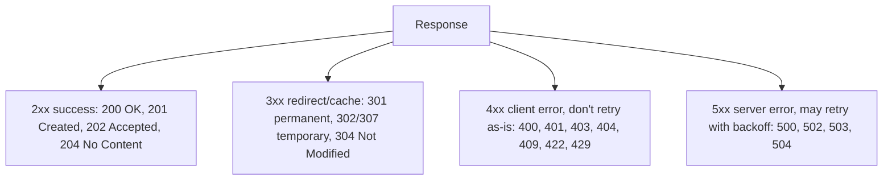

| Code | Meaning | Use when |
|---|---|---|
| 400 | malformed request | invalid JSON, missing field |
| 401 | not authenticated | missing/expired token |
| 403 | authenticated but not allowed | user A reading user B's order |
| 404 | not found | (also to hide existence from unauthorised users) |
| 409 | conflict with current state | version mismatch, duplicate username, seat already booked |
| 422 | well-formed but semantically invalid | amount < 0, end date before start |
| 429 | rate limited | include `Retry-After` |
| 500 | unhandled server bug | — |
| 502 | proxy got a bad response from upstream | backend crashed or reset the connection |
| 503 | temporarily unavailable / overloaded | maintenance, load shedding, include `Retry-After` |
| 504 | proxy timed out waiting for upstream | slow backend or DB |

#### Example
A ticket booking API:
- `POST /bookings` → **201** with `Location: /bookings/981`
- seat already taken → **409**
- payment gateway down → **503** with `Retry-After: 30`
- user exceeded 10 requests/s → **429**
- ALB returns **504** when the booking service takes longer than 60 s

#### Trade-offs
Fine-grained codes help clients and dashboards, but leaking too much (404 vs 403 for someone else's resource) can reveal existence. Some teams return 404 for both.

#### Problems & fixes
| Symptom | Cause | Fix |
|---|---|---|
| Spike of 502s from the LB | backend crashing, resetting connections, or keep-alive mismatch | check backend logs/restarts, align keep-alive timeouts |
| Spike of 504s | backend or DB too slow vs LB timeout | find the slow query/dependency, add timeouts below the LB's, scale |
| Clients retry hammering on 4xx | client treats every error as retryable | retry only on 5xx/429/timeouts, with exponential backoff and jitter |
| Errors returned as `200 {"error":...}` | anti-pattern | proper codes, so monitoring and retries work |

#### Cheat sheet
- 4xx = caller's fault (don't blindly retry), 5xx = server's fault (retry with backoff), 429/503 → honour `Retry-After`.
- 502 = upstream broke, 504 = upstream too slow.
- 401 = who are you? 403 = I know you, and no.

#### Interview questions
<details><summary>Your dashboard shows a jump in 504s at the ALB but the service's own p99 is 300 ms. What's going on?</summary>

Some requests never complete inside the service's measured window: maybe they wait in a thread/connection pool before being timed, hang on a downstream call with no timeout, or a subset of instances is stuck (GC pauses, deadlocked threads). Check the per-target 504 distribution, pool wait metrics and downstream timeouts. Set every downstream timeout below the LB timeout so the service fails fast with a clear error.
</details>

<details><summary>What status should an API return when the system is overloaded and shedding load, and why?</summary>

**503 Service Unavailable** with `Retry-After` (or **429** if it's per-client rate limiting). It tells clients and gateways the failure is temporary and when to retry, so well-behaved clients back off instead of retrying immediately, which would make the overload worse.
</details>

#### Interview angle
> "I'd use 409 for business conflicts like a seat already booked, 429 with Retry-After for rate limits, and 503 for load shedding. Clients retry only 5xx and 429, with exponential backoff and jitter."

### HTTP caching headers — Cache-Control, ETag, Last-Modified, If-None-Match, Vary
Caching headers tell browsers, CDNs and proxies **whether, for how long and for whom** a response may be reused, and how to cheaply check whether it changed. Getting them right is the cheapest performance win there is. Getting them wrong leaks private data.

#### How it works
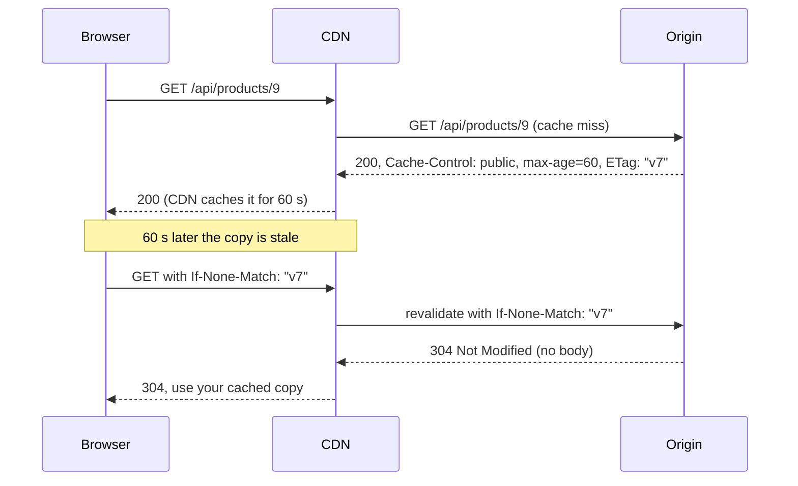

| Header | Purpose |
|---|---|
| `Cache-Control: max-age=N` | fresh for N seconds (`s-maxage` for shared caches/CDN only) |
| `public` / `private` | may a CDN store it, or only the user's browser? |
| `no-cache` | store, but **revalidate every time** before use |
| `no-store` | never store (banking pages, PII) |
| `immutable` | will never change (fingerprinted assets) |
| `stale-while-revalidate=N` | serve stale for N s while refreshing in the background |
| `ETag` / `If-None-Match` | version fingerprint, so revalidation returns 304 |
| `Last-Modified` / `If-Modified-Since` | date-based revalidation (coarser) |
| `Vary: Accept-Encoding, Accept-Language` | cache separate copies per header value |

#### Example
- **Static assets** `app.3f9a1c.js`: `Cache-Control: public, max-age=31536000, immutable`. A new deploy gets a new filename, so there's no invalidation needed.
- **HTML**: `Cache-Control: no-cache` + ETag, so it's always revalidated and users get new deploys immediately while paying only a small 304.
- **Product API**: `public, s-maxage=60, stale-while-revalidate=300`. The CDN absorbs most traffic and price changes show within about a minute.
- **/api/me, account pages**: `private, no-store`.

#### Trade-offs
Longer TTLs mean fewer origin hits but staler data. Revalidation (304) saves bandwidth but not the round trip. `Vary` on high-cardinality headers (`User-Agent`, `Cookie`) fragments the cache until the hit rate is near zero.

#### Problems & fixes
| Symptom | Cause | Fix |
|---|---|---|
| User sees another user's account page | personalised response cached by CDN as `public` | `Cache-Control: private, no-store` on personalised responses, never cache with `Set-Cookie` |
| Users stuck on old JS after deploy | long max-age on non-fingerprinted files | content-hash filenames + `immutable`, HTML `no-cache` |
| CDN hit ratio very low | `Vary: User-Agent`/`Cookie`, query-string noise | normalise cache keys, vary only on what matters |
| Origin overwhelmed when a cached item expires | synchronised expiry | `stale-while-revalidate`, request coalescing at the CDN |

#### Cheat sheet
- Fingerprinted assets: `max-age=31536000, immutable`. HTML: `no-cache` + ETag. Private: `private, no-store`.
- `no-cache` ≠ `no-store`.
- `s-maxage` for CDN only. `stale-while-revalidate` hides refresh latency.

#### Interview questions
<details><summary>After a CDN config change, some users saw other users' order history. What happened and how do you prevent it?</summary>

A personalised API response was cached by the CDN as shared, because the origin sent `public`/`max-age` (or no Cache-Control and the CDN defaulted to caching) and the cache key ignored the auth header/cookie. Fix immediately by purging the CDN and marking personalised endpoints `private, no-store`. Prevent it with CDN rules that never cache requests carrying `Authorization` or session cookies, plus tests on cache headers in CI.
</details>

<details><summary>How do you deploy a new frontend version so every user gets it immediately but assets are still cached for a year?</summary>

Put a content hash in every asset filename (`main.8c1f2.js`) and serve those with `max-age=1 year, immutable`. Serve `index.html` with `no-cache` (revalidated every time via ETag). The new HTML references new filenames, so users fetch only changed assets and old ones simply stop being referenced.
</details>

#### Interview angle
> "Static assets are fingerprinted and cached for a year at the CDN, HTML is revalidated with ETags, catalogue APIs get short s-maxage with stale-while-revalidate, and anything personalised is private, no-store."

### CORS — same-origin policy, preflight OPTIONS, Access-Control-Allow-* headers
Browsers enforce the **same-origin policy**: JavaScript on `https://app.shop.com` can't read responses from `https://api.shop.com` (a different origin) unless that server opts in with **CORS** headers. It protects users' cookies and data from malicious sites. It is enforced by the browser, not the server.

#### How it works
Origin = scheme + host + port. A "non-simple" request (JSON body, custom headers, PUT/DELETE) triggers a **preflight**:

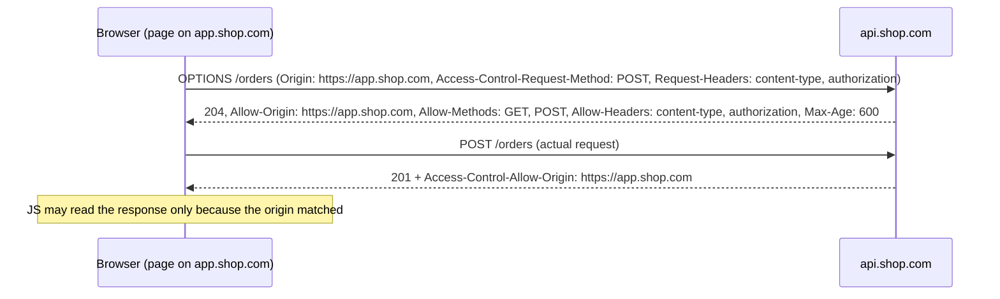

| Header | Meaning |
|---|---|
| `Access-Control-Allow-Origin` | which origin may read (exact origin, or `*` for public data) |
| `Access-Control-Allow-Credentials: true` | allow cookies/auth. Can't be combined with `*` |
| `Access-Control-Allow-Methods` / `-Headers` | what the actual request may use |
| `Access-Control-Max-Age` | cache the preflight result (fewer OPTIONS calls) |

#### Example
SPA on `app.shop.com`, API on `api.shop.com`, using cookies. The API must reply with `Access-Control-Allow-Origin: https://app.shop.com` (echoing an **allow-listed** origin, not any origin), plus `Access-Control-Allow-Credentials: true`, and `Vary: Origin` so caches don't mix responses. Alternatively, serve both under one origin (`shop.com/api` via the gateway) and CORS disappears entirely.

#### Trade-offs
CORS is not authentication. Curl, Postman and servers ignore it, so it protects browsers' users, not your API. Preflights add a round trip per new endpoint/method (mitigate with `Max-Age`).

#### Problems & fixes
| Symptom | Cause | Fix |
|---|---|---|
| "No 'Access-Control-Allow-Origin' header" in console | API didn't send CORS headers (often on error responses or the OPTIONS route) | handle OPTIONS, add headers on all responses including 4xx/5xx |
| Credentials request fails with `*` | `*` not allowed with credentials | echo the specific allow-listed origin + `Vary: Origin` |
| Every API call doubled by OPTIONS | no preflight caching | `Access-Control-Max-Age: 600` (or same-origin via gateway) |
| Security finding: any site can read user data | server reflects any `Origin` with credentials | strict allow-list of origins |

#### Cheat sheet
- Same origin = same scheme + host + port. Enforced by browsers only.
- Preflight for non-simple requests (JSON, custom headers, PUT/DELETE).
- Never reflect arbitrary origins with `Allow-Credentials: true`.

#### Interview questions
<details><summary>A developer "fixed" CORS by reflecting the request's Origin header with Allow-Credentials: true. Why is that dangerous?</summary>

Any website a logged-in user visits can now make credentialed requests to your API and **read the responses** (account data, tokens), because the browser sees its own origin echoed back. It's equivalent to turning off the same-origin policy for your API. Use a strict allow-list of trusted origins.
</details>

<details><summary>How would you eliminate CORS preflight latency for a SPA calling your API?</summary>

Serve the SPA and API from the same origin (e.g. `shop.com` with `/api/*` routed by the CDN or gateway to the backend), so no CORS is involved. If they must stay separate, set `Access-Control-Max-Age` so preflights are cached, and keep requests "simple" where possible.
</details>

#### Interview angle
> "CORS is a browser protection, not API security. I'd serve the SPA and API on one origin through the gateway where possible, otherwise use an explicit origin allow-list with credentials and cached preflights."

### Cookies — HttpOnly, Secure, SameSite (Strict/Lax/None), session vs persistent
Cookies are small key-value pairs the server sets (`Set-Cookie`) and the browser sends back automatically on every matching request. That automatic sending is what makes sessions work, and also what makes CSRF possible. Cookie attributes control the risk.

#### How it works
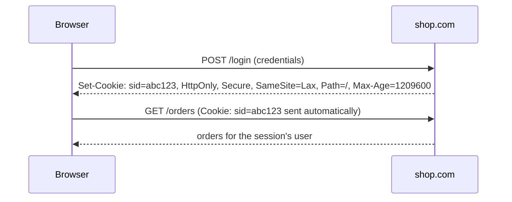

| Attribute | Effect |
|---|---|
| `HttpOnly` | JavaScript can't read it, which blocks session theft via XSS |
| `Secure` | only sent over HTTPS |
| `SameSite=Strict` | never sent on cross-site requests (even clicking a link from email) |
| `SameSite=Lax` (default) | sent on top-level GET navigations, not on cross-site POSTs/iframes/fetch, which blocks most CSRF |
| `SameSite=None; Secure` | sent cross-site (embedded widgets, third-party SSO) |
| `Domain` / `Path` | scope (`Domain=shop.com` also covers subdomains) |
| no `Max-Age`/`Expires` | **session cookie**, deleted when the browser closes |
| `Max-Age=…` | **persistent cookie** |

#### Example
A banking session cookie: `__Host-sid=…; HttpOnly; Secure; SameSite=Strict; Path=/` with a 15-minute idle timeout enforced **server-side**. The `__Host-` prefix forces Secure, no Domain and Path=/, so a compromised subdomain can't overwrite it. A "remember this device" cookie is a separate persistent cookie.

#### Trade-offs
- Cookies are sent automatically: convenient, but you need CSRF defence (SameSite + CSRF tokens for state changes).
- Each cookie adds bytes to **every** request to that domain. Large cookies slow everything, so serve static assets from a cookie-less domain/CDN.
- Session ID in a cookie + server-side store (Redis) → easy revocation. JWT in a cookie → stateless, but hard to revoke.

#### Problems & fixes
| Symptom | Cause | Fix |
|---|---|---|
| Session hijacked through an XSS bug | session cookie readable by JS | `HttpOnly`, CSP, fix the XSS |
| Login works locally but not in an embedded iframe/SSO flow | `SameSite=Lax` default blocks cross-site cookie | `SameSite=None; Secure` only for that cookie |
| CSRF finding on money transfer endpoint | cookie-auth + POST without protection | SameSite=Lax/Strict + CSRF token / double-submit |
| Requests slow, headers huge (431 errors) | too many/large cookies | trim cookies, move data server-side |

#### Cheat sheet
- Session cookie: `HttpOnly; Secure; SameSite=Lax|Strict; Path=/`, prefix `__Host-`.
- Session vs persistent = no expiry vs Max-Age/Expires.
- XSS → steals readable cookies (HttpOnly). CSRF → abuses auto-sent cookies (SameSite + token).

#### Interview questions
<details><summary>Where should a web app store its auth token: localStorage or a cookie?</summary>

Prefer an **HttpOnly, Secure, SameSite cookie**: JavaScript, and therefore an XSS payload, can't read it. localStorage is readable by any script on the page, so one XSS steals the token. With cookies you add CSRF protection (SameSite=Lax/Strict + CSRF tokens on state changes). Keep tokens short-lived either way, with server-side revocation.
</details>

<details><summary>Users of your partner portal get logged out when it's embedded in the partner's site. Why?</summary>

The portal runs in a cross-site iframe, and browsers now default cookies to `SameSite=Lax` and increasingly block third-party cookies, so the session cookie isn't sent. Options: set `SameSite=None; Secure` (still blocked where third-party cookies are disabled), use the Storage Access API / CHIPS (`Partitioned`), or avoid iframes with a redirect-based flow or a token passed to the embed.
</details>

#### Interview angle
> "Sessions use an opaque ID in an HttpOnly, Secure, SameSite cookie, backed by Redis so we can revoke them instantly. State-changing endpoints also check a CSRF token."

### Content negotiation — Accept, Content-Type, Accept-Encoding
Content negotiation lets one URL serve different representations (JSON vs XML, gzip vs brotli, English vs Hindi) based on what the client says it can handle. `Content-Type` describes what is actually in a body.

#### How it works
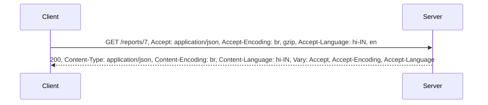

| Request header | Response header | Negotiates |
|---|---|---|
| `Accept` | `Content-Type` | media type (JSON, CSV, PDF, protobuf) |
| `Accept-Encoding` | `Content-Encoding` | compression (br, gzip, zstd) |
| `Accept-Language` | `Content-Language` | language |
| — | `Vary` | tells caches which request headers changed the response |

`Content-Type` on a **request** says what the client is sending (`application/json`, `multipart/form-data`). The server should reject what it doesn't support with **415 Unsupported Media Type**. If it can't produce anything acceptable it returns **406 Not Acceptable**.

#### Example
A reports API: `Accept: text/csv` returns a CSV download and `Accept: application/json` returns JSON, from the same handler, choosing a serializer. Compression: a 1.2 MB JSON product feed becomes ~150 KB with brotli. On a 10 Mbit/s mobile link that's ~0.1 s instead of ~1 s. The CDN caches separate variants because of `Vary: Accept-Encoding`.

API versioning via media type is also a form of negotiation: `Accept: application/vnd.shop.v2+json`.

#### Trade-offs
- Negotiation keeps URLs clean, but makes caching and debugging subtler (you must set `Vary`). Some teams prefer explicit URLs (`/reports/7.csv`).
- Compression costs CPU. Brotli level 11 is great for static files pre-compressed at build time, but too slow for dynamic responses (use level 4–5 or gzip).

#### Problems & fixes
| Symptom | Cause | Fix |
|---|---|---|
| Garbled responses for some users behind a CDN | compressed variant served to a client that didn't ask for it | `Vary: Accept-Encoding` |
| `415` errors from the API | client sent `text/plain` or forgot `Content-Type: application/json` | send the correct Content-Type, document it |
| Large JSON responses slow on mobile | compression disabled | enable gzip/brotli at gateway/CDN for text types |
| Compressing images/video wastes CPU | already-compressed formats | compress only text-like types |

#### Cheat sheet
- `Accept*` = what the client wants. `Content-*` = what the body is. `Vary` = cache key hint.
- 406 = can't produce an acceptable format. 415 = can't accept the sent format.
- Compress text (JSON/HTML/CSS/JS), not JPEG/MP4/ZIP.

#### Interview questions
<details><summary>Your API's JSON responses average 800 KB and mobile users complain. What do you do, in order?</summary>

1) Enable compression (gzip/brotli) at the gateway or CDN, which usually gives an 80–90% reduction for JSON. 2) Return less: pagination, field selection (`?fields=`), sparse responses. 3) Cache at the CDN with proper `Vary`. 4) For internal high-volume calls, consider protobuf (gRPC). Measure payload size and p95 latency before and after.
</details>

<details><summary>Why does `Vary` matter for CDNs?</summary>

A CDN caches by URL by default. If the response differs by `Accept-Encoding` or `Accept-Language` and you don't declare `Vary`, the CDN might serve a brotli body to a client that can't decode it, or Hindi content to an English user. `Vary` adds those headers to the cache key. Keep it to low-cardinality headers so the hit ratio stays high.
</details>

#### Interview angle
> "Responses are compressed at the edge (brotli for static files, gzip for dynamic responses), with `Vary` set so the CDN caches each variant correctly. Clients declare formats with Accept, and the server validates Content-Type with 415."
