## APIs & real-time communication

### REST — 6 constraints: stateless, uniform interface, cacheable, layered, client-server, code on demand
REST (Representational State Transfer, Roy Fielding, 2000) is an **architectural style**, not a protocol. An API is "RESTful" when it follows a set of constraints that make it scalable, cacheable and evolvable. Most real APIs follow some of them, and interviewers mostly care about **statelessness, resources, correct methods/status codes and cacheability**.

#### How it works
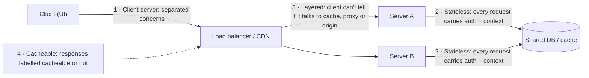

| Constraint | Meaning | Why it matters |
|---|---|---|
| Client-server | UI and data/storage are separated | evolve independently (web, iOS, Android share one API) |
| **Stateless** | each request has everything needed (token, ids). No server session memory | any server can handle any request, so horizontal scaling is trivial |
| **Cacheable** | responses say whether they can be cached | CDNs and browsers absorb load |
| Layered system | intermediaries (LB, CDN, gateway) are invisible | add caching/security without changing clients |
| **Uniform interface** | resources identified by URIs, manipulated via representations, standard methods, self-descriptive messages, hypermedia (HATEOAS) | generic tooling, predictable APIs |
| Code on demand (optional) | server can send executable code (JS) | rarely relevant to APIs |

#### Example
Resource design for an e-commerce API:
```http
GET    /users/42/orders?status=shipped&limit=20&cursor=abc   → list
POST   /orders                                               → 201 Created, Location: /orders/981
GET    /orders/981                                           → 200
PATCH  /orders/981            {"shippingAddressId": 7}       → 200
POST   /orders/981/cancellation                              → 202 Accepted (action modelled as a sub-resource)
DELETE /carts/42/items/5                                     → 204
```
Nouns in URLs, verbs as HTTP methods, plural collections, nesting only one level for ownership.

#### Trade-offs
- REST over HTTP/JSON is universal, cache-friendly and easy to debug, but chatty for complex screens (over/under-fetching) and lacks a strict schema unless you add OpenAPI.
- True HATEOAS is rarely implemented. Most "REST" APIs are really "HTTP + JSON with resource URLs".

#### Problems & fixes
| Symptom | Cause | Fix |
|---|---|---|
| Can't scale out: users get logged out when hitting another server | server-side in-memory sessions (stateful) | externalise session to Redis or use tokens, so servers become stateless |
| Mobile screen needs 8 calls | resources too granular for that client | BFF/aggregation endpoint, `?include=` / field selection, or GraphQL |
| URLs like `/getUserOrders`, `/createOrder` | RPC-style verbs in URLs | resource nouns + HTTP methods |
| Huge list responses time out | no pagination | cursor-based pagination with a limit cap |

#### Cheat sheet
- Stateless + cacheable + uniform interface is what you defend in interviews.
- Nouns + methods, plural collections, `201 + Location` on create, cursor pagination.
- Document with OpenAPI. Version deliberately.

#### Interview questions
<details><summary>Why does statelessness make a service easier to scale, and where does the state go instead?</summary>

If no request depends on memory from a previous request on the same server, the load balancer can send any request anywhere, you can add or remove instances freely, and a crashed instance loses nothing. State moves to the client (tokens, cursors) or to shared stores (Redis for sessions/carts, the DB for business data). The servers become interchangeable cattle.
</details>

<details><summary>Design the REST endpoints for "transfer money between two accounts".</summary>

Model the transfer as a resource: `POST /transfers` with `{fromAccountId, toAccountId, amount, currency}` and an `Idempotency-Key` header, which returns `201` (or `202` if async) with `Location: /transfers/{id}` and a status (`PENDING → COMPLETED/FAILED`). `GET /transfers/{id}` for status, `GET /accounts/{id}/transactions` for history. Never `POST /accounts/{id}/debit` + `/credit` as two client calls, because atomicity belongs on the server.
</details>

#### Interview angle
> "The API is stateless REST over HTTPS: resource URLs, proper methods and status codes, cursor pagination and idempotency keys on writes. That lets the service scale horizontally behind a load balancer and lets the CDN cache public reads."

### REST idempotency — GET/PUT/DELETE idempotent, POST not; why it matters for retries
In distributed systems, **timeouts are ambiguous**: the client doesn't know whether the server processed the request. Idempotency is what makes "just retry" safe, and retries happen everywhere: clients, SDKs, gateways, service meshes and message consumers.

#### How it works
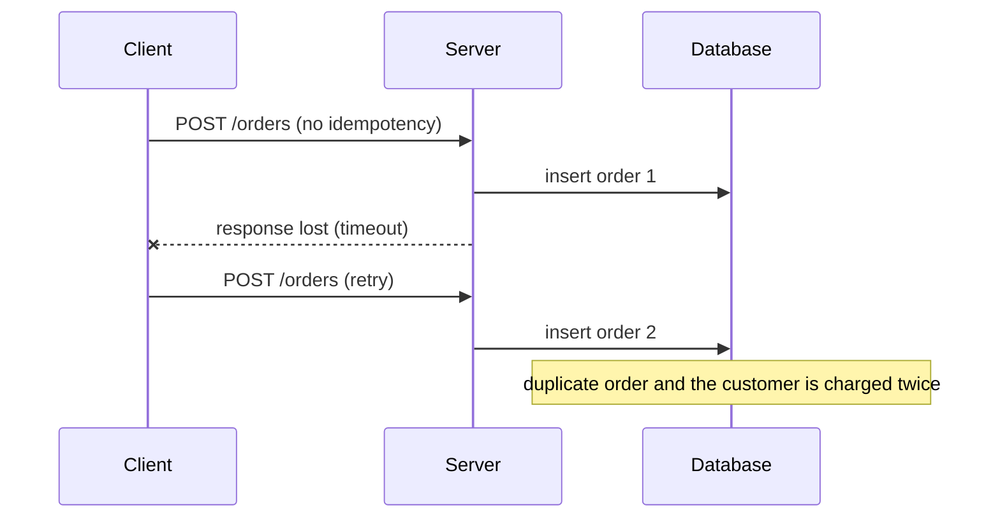

- **Naturally idempotent**: GET, HEAD, PUT (full replacement), DELETE. Doing them N times leaves the same state.
- **Not idempotent**: POST (creates a new thing each time), and PATCH when relative (`balance += 100`).
- Make non-idempotent operations safe with **idempotency keys**, **conditional requests** (`If-Match: "v7"`) or **natural unique keys** (one order per cart id).

#### Example
| Operation | Idempotent? | Retry-safe version |
|---|---|---|
| `POST /payments {amount:500}` | ❌ | add `Idempotency-Key: <uuid>` |
| `PATCH /wallets/9 {delta:+100}` | ❌ | `PUT /wallets/9/topups/{topupId}` (client-chosen id) |
| `PUT /users/9/email {email:a@b.com}` | ✅ | — |
| `POST /orders/981/cancel` | ✅ if cancelling a cancelled order is a no-op | make it a state transition that ignores repeats |

#### Trade-offs
Idempotency needs storage (key → result) and careful handling of concurrent duplicates, but it's far cheaper than reconciling duplicate payments afterwards.

#### Problems & fixes
| Symptom | Cause | Fix |
|---|---|---|
| Duplicate records during network blips | retries of POST | idempotency keys or client-generated ids with a unique constraint |
| Retries amplify an outage (retry storm) | every layer retries 3× → 27× load | retry at one layer, exponential backoff + jitter, retry budgets |
| Lost updates when two clients PUT at once | last-write-wins | optimistic concurrency: `ETag` + `If-Match`, 412 on mismatch |

#### Cheat sheet
- Timeout ≠ failure. Assume the request might have succeeded.
- Idempotent: GET, HEAD, PUT, DELETE (+ OPTIONS). Not: POST, relative PATCH.
- Retry only idempotent ops, with backoff + jitter, at one layer.

#### Interview questions
<details><summary>Your service mesh retries failed calls automatically. What could go wrong, and how do you configure it safely?</summary>

Mesh retries on a non-idempotent POST can create duplicates when the first attempt actually succeeded but timed out. Retries at several layers also multiply load during an outage. Configure retries only for idempotent methods or specific safe status codes (503, connect failures, not timeouts on POST), cap attempts (2), use backoff with jitter, set a retry budget (e.g. at most 20% extra load), and make write endpoints idempotent anyway.
</details>

<details><summary>Two admins edit the same product at the same time; one's change silently disappears. How do you fix it with HTTP semantics?</summary>

Optimistic concurrency control. `GET` returns `ETag: "v12"`. The update sends `PUT` with `If-Match: "v12"`. The server updates only if the current version is still 12 (`UPDATE … WHERE id=? AND version=12`), otherwise it returns **412 Precondition Failed** and the client reloads and merges.
</details>

#### Interview angle
> "Every write is safe to retry: PUT and DELETE by nature, and POSTs via idempotency keys. Updates use ETags with If-Match to avoid lost updates. Retries happen at one layer only, with backoff and jitter."

### GraphQL — schema, queries, mutations, subscriptions, N+1 problem, DataLoader batching solution
GraphQL is a query language for APIs. The server publishes a typed **schema**, and clients ask for **exactly the fields they need** in a single request, across related objects. It solves REST's over-fetching and under-fetching for complex UIs, but moves complexity to the server.

#### How it works
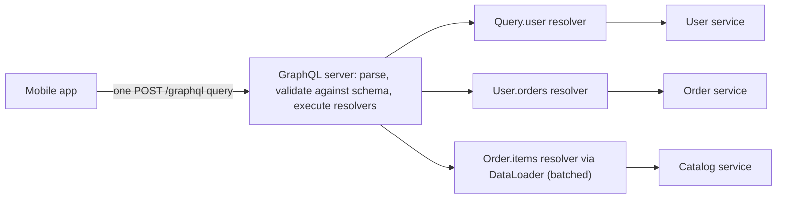

```graphql
type User   { id: ID!, name: String!, orders(first: Int): [Order!]! }
type Order  { id: ID!, total: Int!, items: [Item!]! }
type Query  { user(id: ID!): User }
type Mutation { placeOrder(cartId: ID!, idempotencyKey: String!): Order! }
type Subscription { orderStatusChanged(orderId: ID!): Order! }

query { user(id: "42") { name orders(first: 5) { id total items { name } } } }
```

**The N+1 problem**: resolving `orders` for 1 user, then `items` for each of 5 orders, fires 1 + 5 queries (or 1 + N service calls). **DataLoader** collects all keys requested in the same tick and issues **one batched call** (`WHERE order_id IN (…)`), and also caches per request.

#### Example
Without DataLoader, a feed of 50 posts showing author names makes 1 query for posts + 50 queries for authors = 51 DB calls. With DataLoader: 1 query for posts + 1 `SELECT * FROM users WHERE id IN (…50 ids)` = 2 calls. At 1,000 req/s that's 51k vs 2k DB queries per second.

#### Trade-offs
| Pro | Con |
|---|---|
| Client picks fields, so there's no over/under-fetching | HTTP caching is hard (everything is POST /graphql). Use persisted queries + GET |
| Strong typed schema, introspection, great tooling | expensive queries possible (deep nesting), so you need depth/complexity limits |
| One endpoint aggregates many services (BFF) | N+1 and resolver performance need care |
| Evolves without versions (deprecate fields) | errors come back as 200 + `errors[]`, so monitoring needs adapting |

#### Problems & fixes
| Symptom | Cause | Fix |
|---|---|---|
| DB load explodes after launching GraphQL | N+1 resolvers | DataLoader batching + per-request caching |
| A single query takes down the server | malicious/deeply nested query | depth limit, query cost analysis, timeouts, persisted (allow-listed) queries |
| CDN can't cache anything | POST requests with varying bodies | persisted queries via GET with a hash, cache at field level (Apollo) |
| Error rate dashboards look clean while users see errors | errors returned with HTTP 200 | parse `errors[]` in metrics, alert on resolver errors |

#### Cheat sheet
- Schema (types) + queries (read) + mutations (write) + subscriptions (push, usually over WebSocket).
- N+1 → DataLoader (batch + cache per request).
- Protect with depth/complexity limits and persisted queries.

#### Interview questions
<details><summary>When would you choose GraphQL over REST for a new product?</summary>

When many different clients (web, iOS, Android, partner) need different shapes of deeply related data, and the frontend changes quickly. GraphQL as a BFF lets each screen fetch exactly what it needs in one round trip. For simple CRUD, public cacheable APIs, file transfer or service-to-service calls, REST or gRPC is simpler and cheaper to operate.
</details>

<details><summary>Explain the N+1 problem in GraphQL and how DataLoader fixes it.</summary>

Resolvers run per field per object, so fetching N parent objects and then a child for each triggers N extra calls. DataLoader defers the child loads within one event-loop tick, collects all requested ids, and calls a batch function once (`IN (...)` query or batch API). It also dedupes repeated ids within the request. N+1 calls become 2.
</details>

#### Interview angle
> "I'd use GraphQL as a backend-for-frontend over our REST/gRPC services, with DataLoader to batch downstream calls, and depth limits plus persisted queries to protect it."

### gRPC — Protocol Buffers, unary/server-streaming/client-streaming/bidirectional streaming
gRPC is an RPC framework from Google: you define services and messages in a `.proto` file, generate client and server code in many languages, and calls travel as compact **Protocol Buffers** over **HTTP/2**. It's the standard for efficient, strongly typed service-to-service communication.

#### How it works
```protobuf
syntax = "proto3";
service PaymentService {
  rpc Charge (ChargeRequest) returns (ChargeResponse);                 // unary
  rpc WatchStatus (StatusRequest) returns (stream StatusUpdate);       // server streaming
  rpc UploadLedgerLines (stream LedgerLine) returns (UploadSummary);   // client streaming
  rpc Chat (stream ChatMessage) returns (stream ChatMessage);          // bidirectional
}
message ChargeRequest { string idempotency_key = 1; int64 amount_paise = 2; string currency = 3; }
```

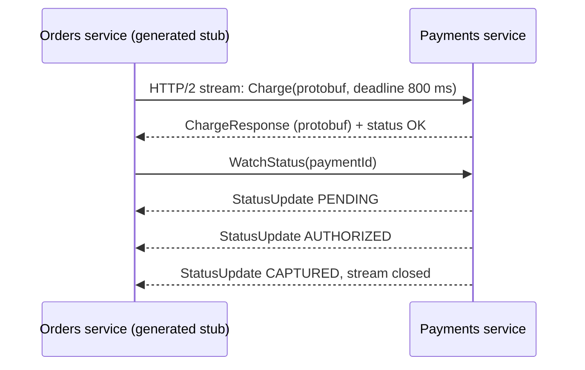

- **Protobuf**: binary, field numbers instead of names, so it's 3–10× smaller than JSON and faster to parse.
- **Four call types**: unary, server-streaming, client-streaming, bidi-streaming.
- **Deadlines** propagate across hops. **Status codes** (`DEADLINE_EXCEEDED`, `UNAVAILABLE`, …), interceptors for auth/metrics.

#### Example
An order service calls inventory, pricing and payments over gRPC with generated Java stubs. A breaking change shows up at **compile time**, not in production. Schema evolution rule: never reuse or renumber fields. Add new fields with new numbers, and old clients ignore unknown fields.

#### Trade-offs
- Fast, typed, streaming, polyglot code generation.
- Not human-readable (need `grpcurl`). Browsers can't call it directly (gRPC-Web + proxy needed). Long-lived HTTP/2 connections need L7 load balancing.

#### Problems & fixes
| Symptom | Cause | Fix |
|---|---|---|
| One pod gets all traffic | connection-level (L4) balancing of HTTP/2 | Envoy/mesh, client-side LB with headless service, `MAX_CONNECTION_AGE` |
| Old clients break after a deploy | field renumbered/type changed | only add fields, `reserved` removed numbers, run buf breaking-change checks in CI |
| Calls hang forever when a downstream is slow | no deadline set | always set deadlines, propagate them |
| Frontend can't call the service | browsers lack HTTP/2 trailers control | gRPC-Web via Envoy, or a REST gateway (grpc-gateway) |

#### Cheat sheet
- `.proto` → generated stubs. Protobuf over HTTP/2.
- Unary, server stream, client stream, bidi stream.
- Always set deadlines. Never reuse field numbers. Use L7 LB.

#### Interview questions
<details><summary>How do you evolve a protobuf message without breaking existing clients?</summary>

Add new fields with new field numbers (they're optional in proto3, and old readers ignore unknown fields). Never change a field's number or type. When removing a field, mark its number and name `reserved` so nobody reuses them. Prefer new RPC methods over changing semantics. Enforce it with `buf breaking` in CI.
</details>

<details><summary>Which gRPC streaming type would you use for live order tracking pushed to an internal dashboard?</summary>

**Server streaming**: the dashboard sends one request (order id or filter) and the server pushes status updates on the stream as they happen. Bidirectional streaming is only needed if the client also sends a continuous flow (changing subscriptions, chat). Add keepalives and reconnection with resume-from-last-event.
</details>

#### Interview angle
> "Internal calls use gRPC: protobuf contracts checked in CI, deadlines propagated on every hop, and request-level load balancing through the mesh. External clients get REST via a gateway."

### gRPC vs REST — binary vs text, schema contract, streaming, use cases for each
Both are ways for programs to call each other over HTTP. **REST** optimises for universality and simplicity (text JSON, any client, cacheable). **gRPC** optimises for performance and strict contracts (binary protobuf, generated code, streaming). Most companies use REST at the edge and gRPC inside.

#### How it works
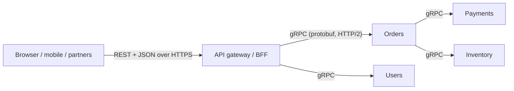

| | REST (JSON) | gRPC (protobuf) |
|---|---|---|
| Format | text, self-describing | binary, needs the schema |
| Contract | optional (OpenAPI) | mandatory `.proto`, code generated |
| Transport | HTTP/1.1 or 2 | HTTP/2 only |
| Streaming | no (use SSE/WebSockets) | 4 modes built in |
| Browser support | native | needs gRPC-Web proxy |
| HTTP caching | yes (GET + Cache-Control) | no |
| Payload / CPU | larger, slower parse | 3–10× smaller, faster |
| Debugging | curl, browser | grpcurl, reflection |

#### Example
A payments platform handles 20k internal calls/s between services. Switching from JSON/REST to gRPC cut payload size ~5× and serialization CPU noticeably, and deadlines and typed errors improved reliability. The public merchant API stays REST/JSON with OpenAPI docs because merchants integrate from PHP, Python and no-code tools.

#### Trade-offs
Pick REST for public/partner APIs, browser clients, cacheable reads and simple CRUD. Pick gRPC for high-volume internal calls, polyglot microservices, streaming, and when you want compile-time contracts.

#### Problems & fixes
| Symptom | Cause | Fix |
|---|---|---|
| Internal REST calls burn CPU on JSON | large JSON payloads at high QPS | gRPC/protobuf for hot internal paths |
| Partners struggle with your gRPC API | needs tooling, no browser support | expose REST via grpc-gateway/transcoding |
| Contract drift between teams on REST | no enforced schema | OpenAPI + contract tests (Pact), or gRPC |

#### Cheat sheet
- Edge: REST/JSON (universal, cacheable). Inside: gRPC (fast, typed, streaming).
- gRPC needs L7 load balancing and a gateway for browsers.
- Both can coexist: transcode gRPC ↔ REST at the gateway.

#### Interview questions
<details><summary>Would you use gRPC for your public merchant-facing API? Why or why not?</summary>

Usually not as the only option. Merchants use diverse stacks, test with curl/Postman, call from browsers and expect JSON docs. REST/JSON with OpenAPI minimises integration friction. I'd offer REST publicly (maybe transcoded from the same protobuf definitions), and use gRPC internally where performance and contracts matter more.
</details>

<details><summary>Your team wants to move all internal services to gRPC. What risks would you raise?</summary>

L4 load balancers won't balance HTTP/2 well (need a mesh or client-side LB). Debugging requires new tools. Proto governance is needed (a shared repo, breaking-change checks). Browsers and some legacy systems need gateways. Teams need training. Migrate incrementally: hottest paths first, with REST fallbacks until clients move.
</details>

#### Interview angle
> "REST/JSON at the edge for reach and cacheability, gRPC internally for speed, typed contracts and streaming, with the gateway translating between the two."

### WebSockets — full-duplex, ws:// upgrade from HTTP, heartbeat ping-pong, reconnection
A WebSocket is a **persistent, full-duplex connection** between client and server: after an HTTP handshake upgrades the connection, either side can send messages at any time with tiny framing overhead. It's the default for chat, live collaboration, trading screens and multiplayer features.

#### How it works
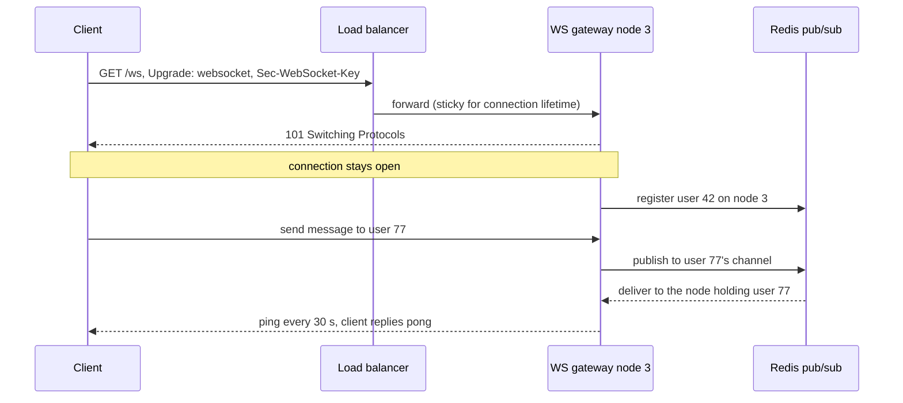

- **Upgrade handshake**: HTTP/1.1 `Upgrade: websocket` → `101`. Then frames (text/binary, ping/pong, close).
- **Heartbeats** detect dead connections (mobile networks drop silently) and keep NAT/LB idle timers alive.
- **Reconnection**: clients reconnect with exponential backoff + jitter and resume from the last message id.
- **Scaling**: connections are stateful and pinned to one server, so you need a **connection registry** (user → gateway node) and a pub/sub backplane to route messages between nodes.

#### Example
A chat system with 10M concurrent users: about 50k–100k connections per gateway node (tuned epoll servers in Netty/Go) gives 100–200 nodes. Presence and routing data in Redis: `user:77 → gw-node-12`. A message from user 42 goes to 42's gateway, is persisted to Cassandra, then routed via pub/sub (or a direct RPC) to gw-node-12, which pushes it to user 77. If 77 is offline it goes to push notifications instead.

#### Trade-offs
- Lowest latency and true bidirectional messaging, at the cost of stateful servers: deploys drop connections (drain gradually), LBs need long idle timeouts, and horizontal scaling needs a routing layer.
- No built-in delivery guarantees. You add message ids, acks and resend on reconnect.

#### Problems & fixes
| Symptom | Cause | Fix |
|---|---|---|
| Connections drop every 60 s | LB/proxy idle timeout | heartbeat ping every 20–30 s, raise LB idle timeout |
| Thundering herd of reconnects after a deploy kills all servers | all clients reconnect at once | jittered backoff, drain nodes gradually, connection rate limits |
| Message sent to user on another node never arrives | no cross-node routing | connection registry + pub/sub (Redis, Kafka) or consistent-hash routing |
| Lost messages during reconnect | no acks/resume | message ids, client sends last-seen id on reconnect, server replays |

#### Cheat sheet
- HTTP Upgrade → 101 → full-duplex frames. Use `wss://` (TLS).
- Ping/pong every ~30 s. Reconnect with backoff + jitter + resume token.
- Scale: sticky connection + registry (user → node) + pub/sub backplane.

#### Interview questions
<details><summary>How do you deploy a new version of a WebSocket gateway holding 2 million connections without an outage?</summary>

Roll out node by node: mark a node draining (LB stops sending new connections), send clients a "reconnect" control message in batches or close gradually over minutes, and let clients reconnect with jittered backoff to other nodes, resuming from their last message id. Keep enough spare capacity for the drained node's connections and rate-limit new handshakes per node.
</details>

<details><summary>WebSocket vs SSE vs long polling for a live cricket score widget?</summary>

Scores flow one way (server → client) and update every few seconds, so **SSE** fits: plain HTTP, automatic reconnect with `Last-Event-ID`, works through most proxies and CDNs. WebSockets are overkill unless users also send data (chat, predictions). Long polling only as a fallback for very old clients.
</details>

#### Interview angle
> "Clients hold a WebSocket to a stateless gateway tier. A Redis registry maps user to gateway node and pub/sub routes messages across nodes. Messages carry ids and acks, so reconnects resume without loss."

### Server-Sent Events (SSE) — one-way server push over HTTP, auto-reconnect, use cases
SSE lets a server **push a stream of text events** to the browser over a normal long-lived HTTP response (`Content-Type: text/event-stream`). It's one-way (server → client), works with plain HTTP infrastructure, and the browser's `EventSource` API reconnects automatically.

#### How it works
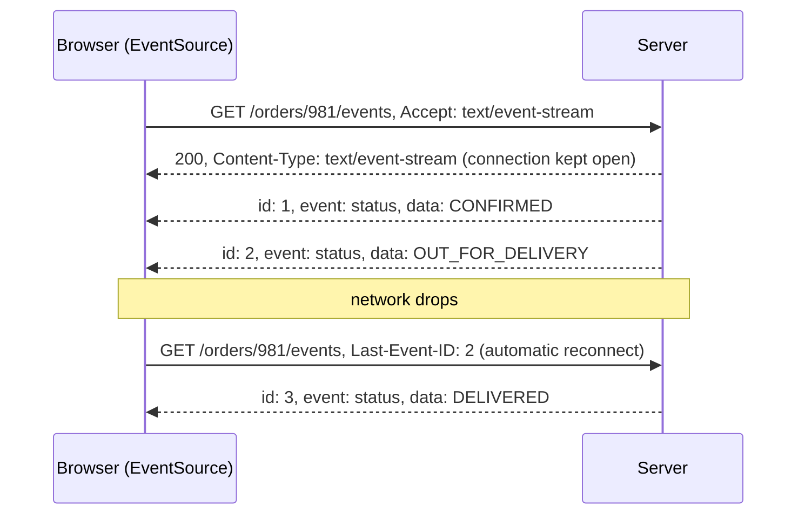

```text
id: 3
event: status
retry: 5000
data: {"orderId":981,"status":"DELIVERED"}

```

#### Example
- Food delivery order status, live sports scores, stock tickers on a dashboard, CI/CD build logs, notifications bell.
- **LLM token streaming**: ChatGPT-style APIs stream generated tokens as SSE.

With HTTP/2, many SSE streams share one connection, which removes the old 6-connections-per-domain limit.

#### Trade-offs
| SSE | WebSocket |
|---|---|
| server → client only | bidirectional |
| plain HTTP: works with proxies, auth headers/cookies, HTTP/2 | separate protocol after upgrade |
| auto-reconnect + `Last-Event-ID` built in | build it yourself |
| text only (UTF-8) | text and binary |

#### Problems & fixes
| Symptom | Cause | Fix |
|---|---|---|
| Events arrive in bursts, not live | proxy/CDN buffering the response | disable buffering (`X-Accel-Buffering: no`), flush after each event |
| Stream cut every 30–60 s | proxy idle timeouts | send comment heartbeats (`: ping`) every 15 s |
| Browser stuck at 6 SSE tabs | HTTP/1.1 per-domain connection limit | HTTP/2, or share one stream across tabs (BroadcastChannel) |
| Missed events after reconnect | server ignores `Last-Event-ID` | keep a short replay buffer keyed by event id |

#### Cheat sheet
- `text/event-stream`, fields `id`, `event`, `data`, `retry`. Blank line ends an event.
- Auto-reconnect sends `Last-Event-ID`.
- Best for one-way live updates. Use WebSockets when the client talks back often.

#### Interview questions
<details><summary>Design live order tracking for a food delivery app's web client. What transport do you use and why?</summary>

SSE from a tracking service: one-way updates (status changes, rider location every few seconds) over HTTPS, using the existing auth cookie/header, automatic reconnect with `Last-Event-ID` to resume. The service subscribes to order events (Kafka/Redis pub/sub) and fans them out to connected clients. Mobile apps can use the same stream or push notifications when backgrounded.
</details>

<details><summary>Users report SSE updates arrive in large delayed chunks. Where do you look?</summary>

Something between server and client is buffering: NGINX proxy buffering, gzip compression middleware, a CDN that doesn't stream, or the app framework not flushing. Disable buffering for that route, flush after each event, exclude `text/event-stream` from compression, and confirm the CDN supports streaming responses.
</details>

#### Interview angle
> "For one-way live updates like order status, I'd pick SSE over WebSockets: plain HTTP, built-in reconnect and resume, and it passes through existing proxies and auth."

### Long polling — client holds connection until server has data, fallback for older clients
Long polling simulates server push with ordinary requests: the client sends a request, the server **holds it open until there's new data (or a timeout ~30 s)**, responds, and the client immediately asks again. It works everywhere, but it's the least efficient real-time option.

#### How it works
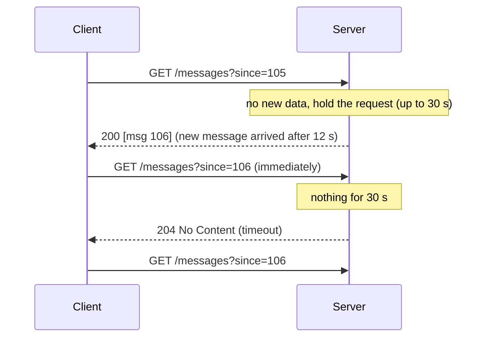

Compare with **short polling** (ask every N seconds regardless): long polling cuts empty responses and delivers updates almost immediately.

#### Example
A legacy enterprise network blocks WebSockets. The chat client falls back to long polling (libraries like Socket.IO do this automatically). Each user holds one pending request, and the server must handle many idle open requests cheaply, which needs async/non-blocking servers (Netty, Node, Spring WebFlux), not thread-per-request.

Payment status pages often long-poll `GET /payments/{id}/status?wait=20` while waiting for a bank callback.

#### Trade-offs
- Works through any proxy or firewall. Simple to implement.
- Each message costs a full HTTP request/response (headers, possibly a handshake). Ordering and duplicate handling need a cursor (`since=`). Thread-per-request servers run out of threads.

#### Problems & fixes
| Symptom | Cause | Fix |
|---|---|---|
| Server threads exhausted by idle requests | blocking thread-per-request model | async servlet / reactive server, or move to SSE/WebSocket |
| Messages missed between polls | no cursor | client sends last seen id/timestamp |
| Load spikes as all clients re-poll together | synchronised timeouts | randomise timeouts, add jitter |
| Proxy kills requests at 60 s | idle timeout below hold time | hold time below proxy timeout (25–30 s) |

#### Cheat sheet
- Hold request until data or ~30 s timeout, then re-request immediately.
- Always use a cursor (`since=`). Use async servers.
- Fallback when WebSockets/SSE are unavailable.

#### Interview questions
<details><summary>Compare short polling, long polling, SSE and WebSockets for a notification system with 5 million users.</summary>

Short polling every 10 s means 500k req/s of mostly empty responses, which is wasteful. Long polling cuts empty responses but still costs a request per message and holds 5M pending requests. SSE holds 5M lightweight streaming responses with auto-reconnect, which fits one-way notifications well. WebSockets are needed only if clients send frequently. Whatever the choice, use mobile push (FCM/APNs) when the app is in the background.
</details>

<details><summary>How do you implement long polling efficiently on the server?</summary>

Use non-blocking I/O (async servlets, WebFlux, Node, Go) so a held request costs memory, not a thread. Register the request as a waiter on the user's channel (in memory, plus Redis pub/sub across nodes). On new data, complete all waiters. On timeout, return 204. Always use a cursor so nothing is missed.
</details>

#### Interview angle
> "Long polling is my compatibility fallback. The primary channel is SSE or WebSocket, but clients degrade to long polling with a cursor when proxies block them."

### Webhooks — event-driven callbacks, retry policy, HMAC signature verification
A webhook is an **HTTP callback**: when an event happens in system A (payment captured, PR merged), A sends an HTTP POST to a URL that system B registered. It's how SaaS platforms push events to customers (Stripe, Razorpay, GitHub, Shopify) instead of making them poll.

#### How it works
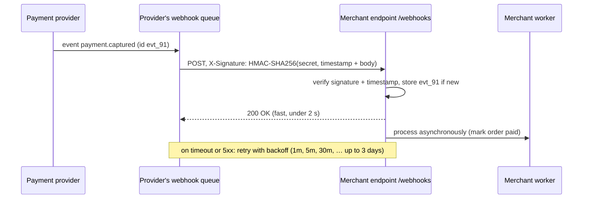

**Sender side**: durable queue, exponential retries, per-endpoint rate limits, event ids, delivery logs, manual replay, disabling endpoints that always fail.

**Receiver side**: verify the **HMAC signature** with the shared secret (constant-time compare), reject old timestamps (replay protection), **dedupe by event id** (deliveries are at-least-once), acknowledge fast and process async, and don't rely on ordering.

#### Example
Razorpay sends `payment.captured` to your `/webhooks/razorpay`. Your handler:
```java
String expected = hmacSha256Hex(secret, rawBody);              // raw bytes, before JSON parsing
if (!MessageDigest.isEqual(expected.getBytes(), sigHeader.getBytes())) return status(401);
if (!processedEvents.insertIfAbsent(event.id())) return ok();  // duplicate delivery
queue.publish(event);                                           // mark order PAID in a worker
return ok();
```
Also run a **reconciliation job** that polls the provider's API for payments in PENDING longer than N minutes, because webhooks can be delayed or lost.

#### Trade-offs
Webhooks are near-real-time and efficient compared with polling, but delivery is at-least-once, unordered, and depends on the receiver being up. You need idempotency and reconciliation as a safety net.

#### Problems & fixes
| Symptom | Cause | Fix |
|---|---|---|
| Orders marked paid twice / emails sent twice | duplicate deliveries | dedupe on event id (unique constraint) |
| Provider keeps retrying and then disables your endpoint | slow handler (> timeout) or 5xx | ack within ~1–2 s, process async via queue |
| Fake "payment success" calls | no signature verification | verify HMAC on the raw body + timestamp window |
| Order stuck "pending" forever | webhook lost/delayed | reconciliation poller against the provider API |
| `payment.failed` processed after `payment.captured` | out-of-order delivery | state machine that ignores invalid transitions, fetch latest state from the API |

#### Cheat sheet
- At-least-once + unordered: dedupe by event id, use a state machine.
- Verify HMAC over the raw body, constant-time compare, check timestamp.
- Ack fast (2xx), process async. Reconcile by polling as a backup.

#### Interview questions
<details><summary>Design the webhook delivery system for a payment gateway sending events to 100k merchants.</summary>

Events go into a durable log (Kafka). Delivery workers partitioned by merchant send signed POSTs with event id and timestamp. On failure, schedule retries with exponential backoff (delay queue / Redis sorted set) for up to ~3 days. Per-merchant concurrency limits and circuit breakers stop one slow merchant from hogging workers. Store delivery attempts for a dashboard with manual replay, rotate secrets with dual-signing, and auto-disable endpoints that keep failing (with notification).
</details>

<details><summary>Your webhook endpoint receives the same "refund.processed" event three times. Is something broken?</summary>

No. Webhooks are at-least-once by design (retries after timeouts, network errors, provider failover). The receiver must be idempotent: record processed event ids with a unique constraint and skip repeats, ideally inside the same transaction as the side effect.
</details>

#### Interview angle
> "Webhook consumers verify the HMAC signature, dedupe on event id, ack within a second and process via a queue. A reconciliation job polls the provider for anything stuck, because webhooks can arrive late, twice or out of order."

### API versioning strategies — URL path (/v1/), query param, header, content negotiation
APIs must evolve without breaking clients you don't control: mobile app versions that never update, partner integrations. Versioning gives breaking changes a new contract while old clients keep working. The best strategy is to **avoid breaking changes** most of the time and version rarely.

#### How it works
| Strategy | Example | Pros | Cons |
|---|---|---|---|
| **URL path** | `/v1/orders` → `/v2/orders` | obvious, easy routing and caching, easy to test | URL changes, whole-API granularity |
| Query param | `/orders?version=2` | easy to add | easy to forget, messy caching |
| Custom header | `Api-Version: 2024-06-01` | clean URLs, date-based (Stripe) | invisible in browser, needs `Vary` |
| Content negotiation | `Accept: application/vnd.shop.v2+json` | per-resource versioning, "pure REST" | complex for clients and tooling |

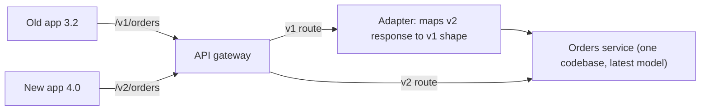

**Non-breaking (no new version needed)**: adding optional fields, new endpoints, new optional params, new enum values (if clients tolerate unknown ones).
**Breaking**: removing/renaming fields, changing types or meaning, new required params, changed error codes or auth.

#### Example
Stripe pins each account to the API version it signed up with (`2023-10-16`), and requests can override via header. Internally, a chain of "version change" transformers converts the latest response down to older shapes, so there's one codebase and many versions.

A mobile banking app: v1 must live as long as old app versions are in use. Track usage per version and force-upgrade below a minimum supported version.

#### Trade-offs
Every live version is maintenance cost. Fewer, longer-lived versions plus additive changes beat frequent versions.

#### Problems & fixes
| Symptom | Cause | Fix |
|---|---|---|
| Old mobile apps crash after backend deploy | breaking change shipped in place | additive changes only, new version for breaking ones, contract tests |
| Five versions to maintain | versioning every change | additive evolution, deprecate + sunset with `Deprecation`/`Sunset` headers |
| Don't know who still uses v1 | no per-version telemetry | log version per client/API key, contact or force-upgrade |
| Clients break on new enum value | strict deserialisation | tolerant readers (ignore unknown fields/values), document it |

#### Cheat sheet
- Default: URL path `/v1`. Date-based header versions for sophisticated APIs (Stripe).
- Additive changes don't need a version. Tolerant reader on clients.
- Deprecate → announce → measure usage → sunset date → remove.

#### Interview questions
<details><summary>You must rename a field `amount` to `amount_minor` in a widely used payments API. How do you roll it out?</summary>

Don't break v1. Add `amount_minor` alongside `amount` (both populated), document the new field and mark `amount` deprecated (`Deprecation` header, docs, changelog). Track which clients still read or send `amount`, notify them, set a sunset date, and only remove it in v2 (or after the sunset for clients pinned to the new version). Contract tests make sure v1 responses stay unchanged.
</details>

<details><summary>How do you handle API versioning for a mobile app where users don't update?</summary>

Keep old versions alive as long as meaningful traffic remains, ideally via adapters on one codebase. Report app version and API version in every request. Have a remote-config minimum supported version that triggers a soft prompt and then a hard force-upgrade screen. Make all changes additive where possible, and test old app builds against new backends in CI.
</details>

#### Interview angle
> "Changes are additive by default and clients are tolerant readers. Breaking changes get a new URL version, served through adapters on the same service, with usage tracked per version and a published sunset date."

### Idempotency keys — safe retries for payments and mutations
An idempotency key is a unique token the **client generates per logical operation** and sends with a write request. The server remembers the key and its result. Retries with the same key return the stored result instead of repeating the side effect, so a timeout never causes a double charge.

#### How it works
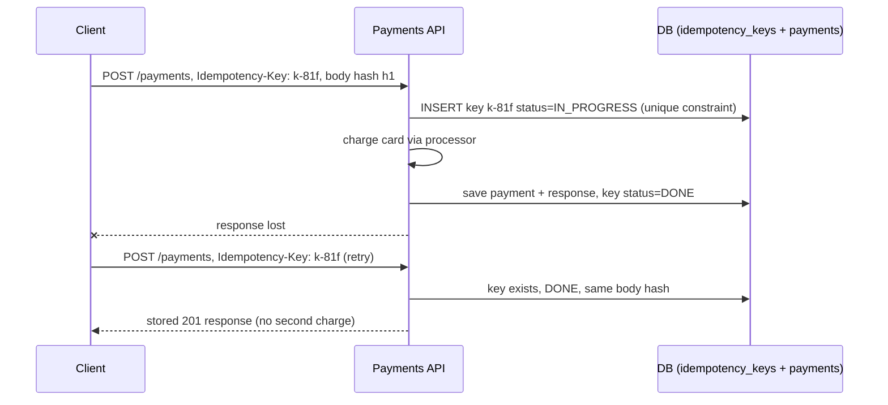

Rules:
- Unique constraint on `(merchant_id, idempotency_key)`, the atomic "first writer wins".
- Store a **request fingerprint** (hash of the body), so the same key with a different body gives **422**.
- A concurrent duplicate while the first is still IN_PROGRESS gives **409** (client retries later).
- Store the full response, keep keys ~24 h, then expire.
- Call downstream providers with **their own** idempotency keys derived from yours, so the whole chain is idempotent.

#### Example
```sql
CREATE TABLE idempotency_keys (
  merchant_id   BIGINT,
  idem_key      VARCHAR(64),
  request_hash  CHAR(64),
  status        VARCHAR(16),     -- IN_PROGRESS | DONE
  response_code INT,
  response_body JSONB,
  created_at    TIMESTAMPTZ DEFAULT now(),
  PRIMARY KEY (merchant_id, idem_key)
);
```
The UPI app retries "Pay ₹1,200" after a 10 s timeout with the same key, and the user is charged once.

#### Trade-offs
Extra write per request and storage for keys, plus careful recovery for keys stuck IN_PROGRESS after a crash (a timeout + reconciliation against the processor). Trivial cost compared with double charges.

#### Problems & fixes
| Symptom | Cause | Fix |
|---|---|---|
| Double charge despite keys | key checked with SELECT then INSERT (race) | rely on the unique constraint / atomic `SETNX`, not check-then-act |
| Key reused for a different payment | client bug | store body hash → 422 on mismatch |
| Key stuck IN_PROGRESS after a crash | process died mid-flight | lease timeout + reconcile with downstream (query processor by its idempotency key) |
| Double charge at the bank level | downstream call retried without key | pass a derived idempotency key to every downstream call |

#### Cheat sheet
- Client generates the key once per user action and reuses it for retries.
- Unique constraint + stored response + request hash + TTL (24 h).
- Same key + same body → same response. Same key + different body → 422. In progress → 409.

#### Interview questions
<details><summary>Implement idempotency for POST /payments in a horizontally scaled service.</summary>

The client sends `Idempotency-Key`. Server: `INSERT … (merchant, key, hash, IN_PROGRESS)`. On unique violation, read the row: DONE with same hash → return stored response; different hash → 422; IN_PROGRESS → 409. On success, perform the charge with a derived key to the processor, then store the response and mark DONE (same transaction as the payment row where possible). A sweeper resolves stale IN_PROGRESS keys by querying the processor. Keys expire after 24 h. Works across instances because the DB (or Redis SETNX + DB) is the single arbiter.
</details>

<details><summary>Why isn't "check if the payment exists, then insert" enough to prevent duplicates?</summary>

Two concurrent retries can both run the check before either inserts. Both see "not found" and both charge (a check-then-act race). You need an atomic operation: a unique constraint (INSERT fails for the second), `INSERT … ON CONFLICT DO NOTHING`, Redis `SET NX`, or a conditional write in DynamoDB.
</details>

#### Interview angle
> "Every mutating payment API takes an Idempotency-Key, enforced by a unique constraint with a stored response and request hash. Downstream calls carry derived keys, so retries are safe end to end."

### WebRTC — peer-to-peer video/audio, STUN (IP discovery), TURN (relay), ICE negotiation
WebRTC lets browsers and apps send **real-time audio, video and data directly to each other**, peer-to-peer, with built-in encryption (DTLS-SRTP). The hard part is connecting two devices that both sit behind NATs and firewalls, which is what **STUN, TURN and ICE** are for.

#### How it works
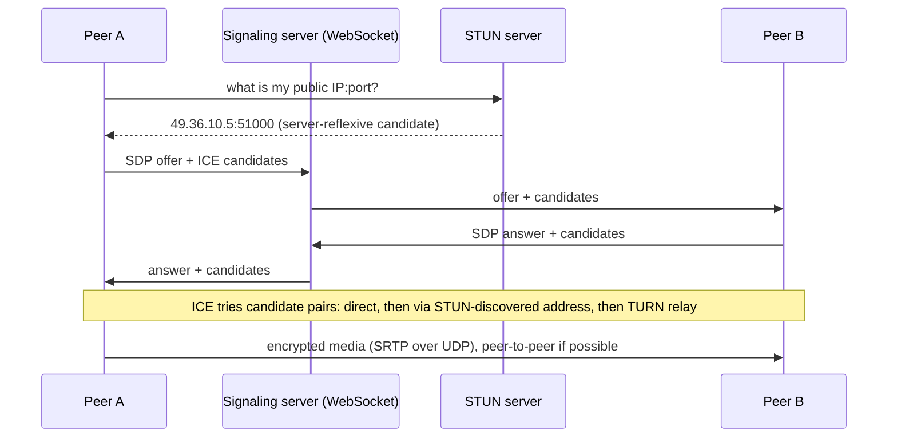

- **Signaling** (your server, any protocol, usually WebSocket): exchanges SDP offers/answers (codecs, keys) and candidates. WebRTC doesn't define it.
- **STUN**: tells a peer its public address as seen from outside the NAT. Cheap.
- **TURN**: a relay server for when direct connection fails (symmetric NATs, corporate firewalls). Expensive bandwidth, used by roughly 10–20% of calls.
- **ICE**: gathers all candidates and picks the best working pair.

#### Example
1:1 telemedicine video call: peers connect directly most of the time, and your servers carry only signaling. For **group calls** (10+ participants), full mesh doesn't scale: each peer would upload N−1 streams. Use an **SFU** (Selective Forwarding Unit: mediasoup, Janus, LiveKit). Each participant uploads once (often simulcast at 3 qualities) and the SFU forwards the right quality to each receiver.

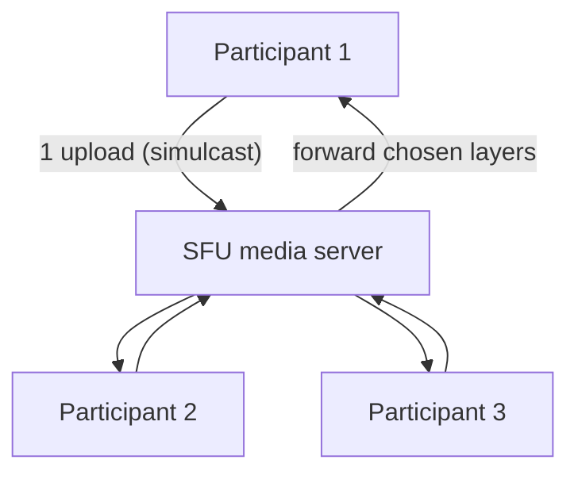

#### Trade-offs
- P2P: lowest latency and server cost, but doesn't scale beyond ~4 participants and fails behind strict NATs.
- SFU: scales to large rooms and enables recording, at server bandwidth cost.
- MCU (mixing into one stream): least client bandwidth, heavy server CPU.

#### Problems & fixes
| Symptom | Cause | Fix |
|---|---|---|
| Calls fail for users on office networks | UDP blocked / symmetric NAT | TURN server over TCP/TLS 443 |
| Group calls lag and drain phones | full-mesh P2P | SFU with simulcast |
| Huge bandwidth bill | many calls relayed via TURN | prefer direct/STUN, region-local TURN, monitor relay ratio |
| Choppy video on weak networks | fixed bitrate | congestion control, simulcast/SVC layer switching |

#### Cheat sheet
- Signaling (yours) + STUN (discover public IP) + TURN (relay fallback) + ICE (pick a path).
- Media: SRTP over UDP, encrypted by default.
- 1:1 → P2P. Groups → SFU. Broadcast to thousands → convert to HLS/LL-HLS.

#### Interview questions
<details><summary>Design the architecture for 1:1 and group video calls in a telehealth app.</summary>

Signaling over WebSocket (auth, room management, SDP/candidate exchange). Deploy STUN plus TURN servers (UDP and TCP/TLS 443) in each region. 1:1 calls go P2P with TURN fallback. Groups go through regional SFUs with simulcast, selecting layers per receiver bandwidth. Recording via the SFU into object storage. Monitor call quality metrics (RTT, packet loss, jitter) via `getStats`. Health data means encryption in transit, plus careful handling of recordings.
</details>

<details><summary>Why can't you just use WebSockets to send video?</summary>

WebSockets run over TCP: a lost packet stalls everything behind it (head-of-line blocking) and retransmission arrives too late to be useful for live media. WebRTC uses UDP with real-time congestion control, jitter buffers, loss concealment and codec adaptation, and it can go peer-to-peer, saving server bandwidth.
</details>

#### Interview angle
> "WebRTC for media, with a WebSocket signaling service and STUN plus TURN for NAT traversal. 1:1 calls go peer-to-peer, group calls go through an SFU with simulcast so each client uploads only once."
