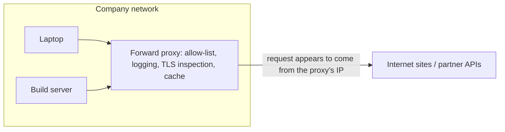
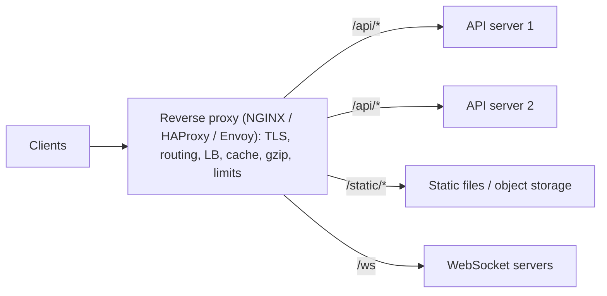
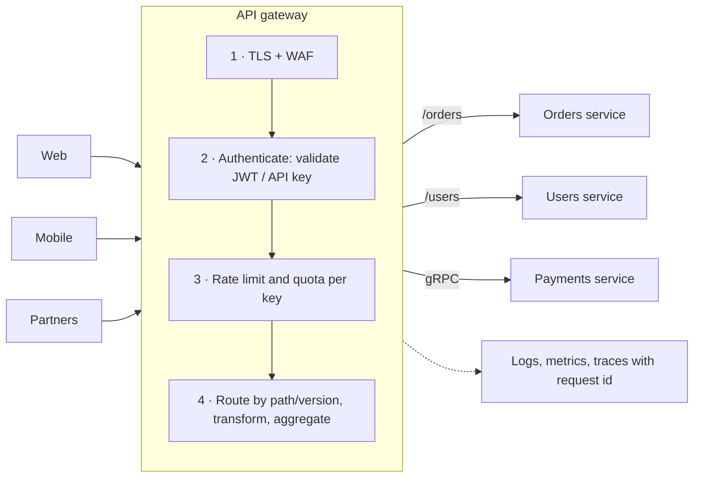
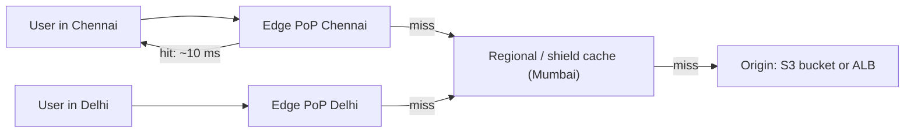
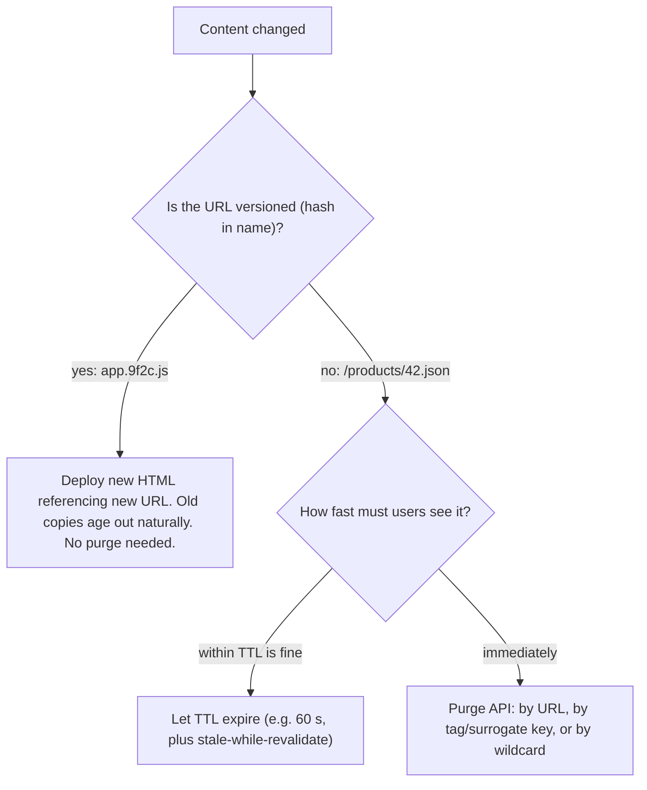
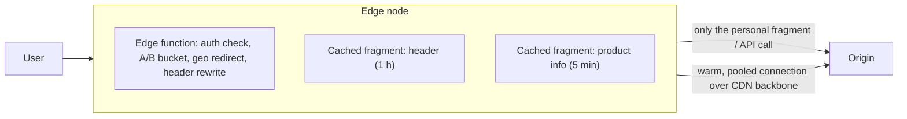
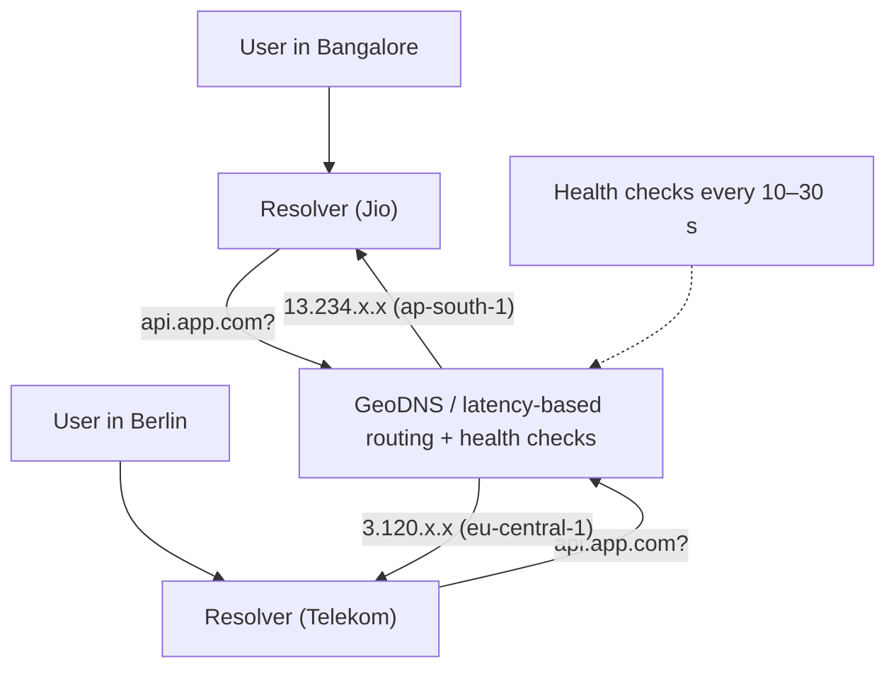
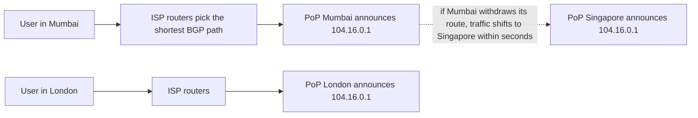

## Proxies, CDN & gateways

### Forward proxy — client-side, hides client identity, corporate firewalls
A forward proxy sits **in front of clients** and makes outbound requests on their behalf. The destination server sees the proxy's IP, not the client's. Companies use forward proxies to control and log what employees and servers can reach. Backend systems use them as **egress proxies** with fixed outbound IPs.

#### Intuition
A company's mailroom that sends all outgoing letters on your behalf: recipients only see the company's return address, and the mailroom can refuse to post letters to addresses not on its approved list.

#### Must know
- Sits in front of **clients** and makes outbound requests for them; destinations see the proxy's IP.
- HTTPS goes through as a `CONNECT` tunnel (or is decrypted by TLS inspection with a company CA).
- **Egress proxy** for servers: domain allow-list, audit logs, static outbound IPs.
- Run it redundantly across AZs; it's a choke point.

#### Common mistakes
- A single egress proxy instance, so all outbound traffic dies with it.
- Assuming every HTTP library honours `HTTPS_PROXY`/`NO_PROXY`.

#### How it works


- Clients are configured to use it (`HTTP_PROXY`, PAC files, transparent interception).
- For HTTPS the client sends `CONNECT host:443` and the proxy tunnels bytes (or performs TLS inspection with a company root cert).
- Uses: policy and filtering, auditing, caching downloads, egress control for servers, anonymity (VPNs, Tor).

#### Example
**Egress proxy in a fintech**: application servers in private subnets have no direct internet route. All outbound calls (to card networks, a KYC provider, SMS gateways) go through a Squid/Envoy egress proxy with an allow-list of domains and two static Elastic IPs that partners allow-list. If a server is compromised, it can't exfiltrate data to arbitrary hosts.

#### Trade-offs
Central control and visibility for outbound traffic, at the cost of a choke point (it must be highly available), added latency, and TLS-inspection privacy and complexity concerns.

#### Problems & fixes
| Symptom | Cause | Fix |
|---|---|---|
| Outbound calls fail with TLS errors behind the corporate proxy | TLS inspection with a company CA the app doesn't trust | add the corporate CA to the trust store, or bypass inspection for that domain |
| Service can't reach a new partner API | domain not on the egress allow-list | update allow-list via change process |
| All egress down at once | single proxy instance | multiple proxies across AZs behind an internal LB |
| Library ignores proxy settings | `NO_PROXY`/`HTTPS_PROXY` not honoured | configure the HTTP client explicitly |

#### Cheat sheet
- Forward proxy = acts for **clients** (outbound). Reverse proxy = acts for **servers** (inbound).
- HTTPS through a proxy uses `CONNECT` tunnelling.
- Egress proxy = allow-list + static IPs + audit for servers.

#### Interview questions
<details><summary>A bank requires that application servers can only talk to approved external endpoints. How do you enforce it?</summary>

No internet gateway route from the private subnets. All egress goes through an egress proxy layer (Envoy/Squid, or AWS Network Firewall) with a domain allow-list, logging and static IPs, deployed redundantly across AZs. VPC endpoints for AWS services so that traffic stays private. Security groups only allow outbound to the proxy. Alert on denied requests, since they may indicate compromise.
</details>

<details><summary>What's the difference between a forward proxy and a VPN?</summary>

A forward proxy works at the application level (usually HTTP/S) for configured applications and can filter by URL/domain. A VPN tunnels all IP traffic from the device into another network at the network layer, so every application's traffic goes through it, without app-level awareness.
</details>

#### Interview angle
> "Outbound traffic from private subnets goes through a redundant egress proxy with a domain allow-list and static IPs. That gives partners fixed IPs to allow-list and stops a compromised host from calling arbitrary servers."

#### Sources
- [Proxy servers and tunneling](https://developer.mozilla.org/en-US/docs/Web/HTTP/Guides/Proxy_servers_and_tunneling) — MDN
- [Forward vs reverse proxies explained](https://www.cloudflare.com/learning/cdn/glossary/reverse-proxy/) — Cloudflare Learning

### Reverse proxy — server-side, hides server topology (Nginx, HAProxy)
A reverse proxy sits **in front of servers** and receives client requests on their behalf. Clients see one address, and the proxy decides which backend serves each request. It's where you put TLS termination, load balancing, caching, compression, rate limiting and request routing.

#### Intuition
A hotel receptionist: guests talk only to the front desk, which knows which room or department handles each request. Guests never see the corridors behind it.

#### Must know
- Sits in front of **servers**: TLS termination, routing by host/path, load balancing, caching, compression, rate limits.
- Forward `X-Forwarded-For`, `X-Forwarded-Proto` and `Host`; trust only your own proxies' hops.
- Keep **pooled keep-alive connections** to backends.
- Align timeouts: client > proxy > app > downstream.

#### Numbers to quote
- An extra proxy hop costs about 1 ms inside a datacenter.

#### Common mistakes
- Trusting the leftmost `X-Forwarded-For` value, which the client controls.
- App unaware TLS ended at the proxy, causing redirect loops to `http://`.

#### How it works


```nginx
upstream api { least_conn; server 10.0.2.11:8080; server 10.0.2.12:8080; keepalive 64; }
server {
  listen 443 ssl http2;
  location /api/ { proxy_pass http://api; proxy_set_header X-Forwarded-For $proxy_add_x_forwarded_for;
                   proxy_read_timeout 30s; limit_req zone=perip burst=20; }
  location /static/ { root /var/www; expires 1y; }
}
```

#### Example
A Spring Boot app behind NGINX: NGINX terminates TLS, serves static files directly, gzips JSON, enforces 10 req/s per IP on `/login`, and spreads `/api` across 4 app instances with keep-alive connections. App servers sit in a private subnet. Only NGINX is public. The app reads the real client IP from `X-Forwarded-For`, but only trusting the proxy's own hop.

#### Trade-offs
One place for cross-cutting concerns and a hidden internal topology, but it's another hop (~1 ms), another component to scale and keep available, and timeouts/headers must be configured consistently.

#### Problems & fixes
| Symptom | Cause | Fix |
|---|---|---|
| App logs show the proxy's IP for every user | client IP not forwarded | `X-Forwarded-For` / `Forwarded`, configure trusted proxies in the app |
| Attackers spoof `X-Forwarded-For` to bypass IP limits | app trusts the whole header | take the IP added by your own proxy (rightmost trusted hop) |
| 504s for long reports | `proxy_read_timeout` too low | async job + polling, or raise timeout on that route only |
| Upload fails with 413 | `client_max_body_size` too small | raise for that route, or upload directly to S3 via pre-signed URL |
| Redirect loops to http:// | app unaware TLS ended at the proxy | pass `X-Forwarded-Proto`, configure app to trust it |

#### Cheat sheet
- Reverse proxy = TLS termination + LB + routing + caching + compression + limits.
- Forward `X-Forwarded-For`, `X-Forwarded-Proto`, `Host`. Trust only your own proxies.
- Align timeouts: client > proxy > app > downstream.

#### Interview questions
<details><summary>What do you put in a reverse proxy layer versus in the application?</summary>

In the proxy: TLS termination, routing by host/path, load balancing and health checks, compression, static file serving, coarse rate limiting, request size limits, and access logs. In the app: business logic, fine-grained authorization, validation, per-user quotas tied to business rules. Generic, stateless, cross-cutting concerns go to the proxy, and anything needing domain knowledge stays in services.
</details>

<details><summary>How do you get the real client IP when traffic passes through a CDN, then an ALB, then NGINX?</summary>

Each hop appends to `X-Forwarded-For`. Configure each layer to trust only the known upstream ranges (CDN IPs, ALB subnet) and take the rightmost untrusted address as the client IP (NGINX `real_ip_header` + `set_real_ip_from`, Spring `ForwardedHeaderFilter`). Never take the leftmost value blindly, because the client controls it.
</details>

#### Interview angle
> "Behind the load balancer, an NGINX/Envoy reverse proxy layer terminates TLS, routes by path and applies per-IP limits. Only that layer is public and the services sit in private subnets."

#### Sources
- [What is a reverse proxy?](https://www.cloudflare.com/learning/cdn/glossary/reverse-proxy/) — Cloudflare Learning
- [NGINX reverse proxy](https://docs.nginx.com/nginx/admin-guide/web-server/reverse-proxy/) — NGINX docs
- [X-Forwarded-For](https://developer.mozilla.org/en-US/docs/Web/HTTP/Reference/Headers/X-Forwarded-For) — MDN

### API gateway — routing, auth enforcement, rate limiting, request aggregation, protocol translation
An API gateway is a specialised reverse proxy that is the **single entry point for all external API traffic**. It routes requests to the right microservice and enforces cross-cutting policies: authentication, rate limits, quotas, request/response transformation, aggregation and observability.

#### Intuition
The security desk and switchboard of an office tower: it checks every visitor's badge, limits how often each company may send people up, and directs each visitor to the right floor. It doesn't do the work on any floor.

#### Must know
- Single entry point for **external (north-south)** traffic: authN, rate limits/quotas, routing, transformation, observability.
- Keep it **thin**: no business logic; client-specific aggregation belongs in a **BFF**.
- Highly available across AZs; services must not be reachable around it.
- LB spreads load for one service; gateway fronts many; mesh handles **east-west** traffic.
- Distributed rate limits need a shared store (Redis token bucket).

#### Common mistakes
- Business rules creeping into the gateway.
- Services still publicly reachable, bypassing gateway auth.
- Remote token introspection on every request instead of local JWT validation with cached keys.

#### How it works


Typical products: AWS API Gateway, Kong, Apigee, Spring Cloud Gateway, Envoy-based gateways, NGINX.

#### Example
A fintech's partner API: the gateway validates the partner's OAuth client-credentials token and mTLS certificate, applies a quota of 100 req/s per partner and 1M/day, routes `/v1/payouts` to the payouts service (translating REST/JSON to internal gRPC), adds a `X-Request-Id` for tracing, and strips internal headers from responses. Services then trust the identity header the gateway injects (`X-Partner-Id`), signed or over mTLS.

#### Trade-offs
- Centralised security and policy, a simpler client surface, and per-consumer analytics.
- Risk of a **single point of failure** and bottleneck, added latency, and a "smart gateway" accumulating business logic (anti-pattern). Keep it thin. Aggregation belongs in a BFF.

#### Problems & fixes
| Symptom | Cause | Fix |
|---|---|---|
| Gateway outage takes down everything | single gateway cluster/region | multiple instances across AZs, autoscaling, regional gateways |
| Gateway full of business rules, every team waits on gateway team | logic creep | keep policy-only, move aggregation to BFFs owned by product teams |
| Latency added at the gateway | heavy plugins, synchronous auth lookups | cache JWKS/introspection results, local JWT validation |
| Services callable directly bypassing auth | services exposed publicly | private networking, mTLS, services verify the gateway identity |

#### Cheat sheet
- Gateway = routing + authN + rate limits/quotas + transformation + observability.
- Thin gateway, smart services. BFF for client-specific aggregation.
- HA across AZs. Services must not be reachable around it.

#### Interview questions
<details><summary>API gateway vs load balancer vs service mesh: what does each do?</summary>

A **load balancer** spreads traffic across instances of one service (L4/L7). An **API gateway** handles north-south (external) traffic: it authenticates consumers, applies quotas, routes to many services and transforms protocols. A **service mesh** handles east-west (service-to-service) traffic with sidecars: mTLS, retries, timeouts, traffic shifting and telemetry. A typical setup uses all three: LB → gateway → services in a mesh.
</details>

<details><summary>How would you implement per-customer rate limits at the gateway across 20 gateway instances?</summary>

Use a shared counter store: Redis with a token bucket or sliding window per API key, done atomically in a Lua script, maybe with a small local cache/allowance to cut Redis round trips. Return 429 with `Retry-After` and `X-RateLimit-*` headers. Fall back to local per-instance limits if Redis is unavailable (fail open for most APIs, fail closed for abuse-prone ones like OTP).
</details>

#### Interview angle
> "All external traffic enters through the API gateway, which validates JWTs, applies per-client rate limits and routes to services. It stays thin, while client-specific aggregation lives in a BFF owned by each app team."

#### Sources
- [API gateway pattern](https://microservices.io/patterns/apigateway.html) — microservices.io (Chris Richardson)
- [Backends for Frontends pattern](https://learn.microsoft.com/en-us/azure/architecture/patterns/backends-for-frontends) — Azure Architecture Center

### CDN — PoPs (Points of Presence), edge nodes, origin server, pull vs push model
A CDN (Content Delivery Network) is a globally distributed set of caching servers (**edge nodes**, grouped in **PoPs**) that serve content from close to the user. It cuts latency (shorter distance), offloads the **origin** (most requests never reach it) and absorbs traffic spikes and DDoS attacks.

#### Intuition
Instead of everyone travelling to one central warehouse, a chain of local corner shops (edge PoPs) stocks the popular items. The warehouse (origin) only restocks the shops when they run out.

#### Must know
- Edges near users → optional **origin shield** (regional) → origin.
- **Pull** CDN caches on first miss (default); **push** uploads content ahead of time.
- Hit ratio drives everything: aim for 90%+ on static content.
- Lock the origin so only the CDN can reach it (origin access control, secret header, IP allow-list).
- Also absorbs traffic spikes and DDoS.

#### Numbers to quote
- At a 95% hit ratio the origin serves 5% of bytes: 200 TB/day of traffic becomes 10 TB/day at origin.

#### Common mistakes
- Cookies or random query strings in the cache key, which ruin the hit ratio.
- Leaving the origin publicly reachable, so attackers bypass the CDN.

#### How it works


- **Pull CDN** (most common): the edge fetches from origin on the first request (a cache miss) and caches per Cache-Control/TTL. Zero upload effort, but the first user pays the miss.
- **Push CDN**: you upload content to the CDN ahead of time. Good for large, predictable files (game patches, video libraries), but you manage the uploads.
- **Origin shield / tiered caching**: a middle cache layer so 200 edges don't all hit origin for the same object.

#### Example
A video platform in India: HLS segments (`/vod/123/720p/seg_42.ts`) cached at edges with `max-age=1y` (immutable). The manifest gets a short TTL. 95%+ cache hit ratio means origin serves only ~5% of the bytes. A 1 Tbit/s evening peak is mostly absorbed by the CDN, so origin bandwidth stays at ~50 Gbit/s.

Estimation: 10M daily users × 20 MB of images/JS each = 200 TB/day. At a 95% hit ratio, origin serves 10 TB/day.

#### Trade-offs
- Huge latency and cost benefits for static and cacheable content, plus DDoS absorption.
- Staleness and invalidation complexity, cost per GB (still cheaper than origin egress), and potential to leak private data if caching is misconfigured.

#### Problems & fixes
| Symptom | Cause | Fix |
|---|---|---|
| Low hit ratio | query strings/cookies in cache key, short TTLs, `Vary` noise | normalise cache key, longer TTLs for immutable assets, strip cookies |
| Origin overloaded after purge or deploy | every edge misses at once | origin shield, request collapsing, stagger purges, `stale-while-revalidate` |
| Users get stale content | long TTL on mutable URLs | versioned URLs, purge API on change |
| Attackers bypass CDN and hit origin | origin publicly reachable | restrict origin to CDN IPs / secret header / origin access control (OAC) |

#### Cheat sheet
- Edge (near user) → shield (regional) → origin.
- Pull = cache on miss (default). Push = upload ahead.
- Target hit ratio 90%+ for static. Lock the origin to CDN-only access.

#### Interview questions
<details><summary>Estimate the origin bandwidth for an image-heavy app and show how a CDN changes it.</summary>

E.g. 50M page views/day × 2 MB of images = 100 TB/day ≈ 9.3 Gbit/s average, ~3× that at peak (~28 Gbit/s). With a CDN at a 95% hit ratio, origin serves 5 TB/day (~0.5 Gbit/s average, ~1.4 Gbit/s peak). The rest is served from edges near users, with lower latency and lower egress cost.
</details>

<details><summary>Your origin goes down for 5 minutes. How can the CDN keep the site up?</summary>

Serve cached content even when stale: `stale-if-error` / CDN "serve stale on origin error" settings, long TTLs for static assets, and an origin shield that keeps a regional copy. Optionally fail over to a secondary origin (an S3 static fallback page, another region). Dynamic, uncacheable APIs will still fail, so pair this with multi-AZ origins.
</details>

#### Interview angle
> "Static assets and media are served from a pull CDN with an origin shield and immutable versioned URLs. That gives a 95%+ hit ratio, so the origin only sees misses and the API traffic."

#### Sources
- [What is a CDN?](https://www.cloudflare.com/learning/cdn/what-is-a-cdn/) — Cloudflare Learning
- [CloudFront origin shield](https://docs.aws.amazon.com/AmazonCloudFront/latest/DeveloperGuide/origin-shield.html) — AWS docs

### CDN cache invalidation — TTL expiry, immediate purge, cache-busting via URL versioning
When content changes, cached copies across hundreds of edges must stop being served. There are three tools: let it **expire** (TTL), **purge** it explicitly, or **change the URL** so the old copy is never requested again. URL versioning is the most reliable.

#### Intuition
Three ways to stop shops selling an old edition: wait until the "sell by" date passes (TTL), phone every shop to bin it (purge), or publish the new edition under a new title so nobody asks for the old one (URL versioning). The last is the most reliable.

#### Must know
- **Versioned URLs** (content hashes) for static assets: no purge ever needed.
- TTL + `stale-while-revalidate` for semi-static content.
- **Tag/surrogate-key purges** when something must change now (price, takedown).
- A CDN purge doesn't clear **browser caches**: keep browser TTLs short for mutable resources.
- Purge narrowly; a full purge stampedes the origin.

#### Common mistakes
- "Purge everything" on every deploy.
- Non-versioned JS/CSS, so a deploy serves new HTML with old JS.

#### How it works


| Method | Speed | Reliability | Cost / limits |
|---|---|---|---|
| TTL expiry | up to TTL | always works | stale window |
| Purge by URL/tag | seconds (Fastly ~150 ms, CloudFront ~minutes) | must purge every variant | API limits, cost |
| URL versioning | instant | best | needs build pipeline + HTML not cached long |

**Surrogate keys / cache tags**: tag responses (`Surrogate-Key: product-42 category-7`) and purge every URL carrying that tag in one call.

#### Example
An e-commerce price change: product pages are cached with `s-maxage=300` and tagged `product-42`. When pricing service emits `PriceChanged(42)`, a consumer calls the CDN's purge-by-tag API for `product-42`, and all pages and API responses mentioning the product refresh within seconds. CSS/JS use hashed filenames and are never purged.

#### Trade-offs
Purging gives freshness but risks a stampede on the origin and depends on the CDN's API. Long TTLs plus versioning give performance, but URLs must be managed by the build.

#### Problems & fixes
| Symptom | Cause | Fix |
|---|---|---|
| Purged but some users still see old content | browser cache (CDN purge doesn't clear browsers), or a variant not purged | short browser max-age vs longer `s-maxage`, purge all variants or by tag |
| Origin melts after a full purge | every edge refetches at once | purge specific keys, origin shield, request coalescing |
| Deploy shows broken page (new HTML, old JS) | non-versioned asset URLs cached | content-hashed filenames |
| Purge API rate-limited during big catalogue updates | per-URL purges | tag-based purges, batch |

#### Cheat sheet
- Versioned URLs for static assets. TTL + SWR for semi-static. Tag purge for "must change now".
- CDN purge ≠ browser purge: keep browser TTL short for mutable resources.
- Purge narrowly. Protect origin with a shield.

#### Interview questions
<details><summary>A wrong price was published and cached on the CDN for all product pages. How do you fix it now and prevent the problem structurally?</summary>

Now: fix the data, then purge by surrogate key/tag for the affected products (or a wildcard path) with the origin shield on to absorb refills. Structurally: tag responses by entity, wire domain events (`PriceChanged`) to automatic tag purges, keep `s-maxage` short for price-bearing content with `stale-while-revalidate`, and keep the browser TTL short so the browser cache doesn't outlive a purge.
</details>

<details><summary>Why is "purge everything" on every deploy a bad practice?</summary>

It throws away the whole cache: every edge goes back to the origin at the same moment (a thundering herd), latency spikes globally, and you pay for refills. With content-hashed asset URLs and short-TTL HTML, deploys need no purge at all.
</details>

#### Interview angle
> "Assets are content-hashed and immutable. Pages use short s-maxage with stale-while-revalidate, and business events trigger tag-based purges, so price changes reach users in seconds without a cache-wide flush."

#### Sources
- [Invalidating files](https://docs.aws.amazon.com/AmazonCloudFront/latest/DeveloperGuide/Invalidation.html) — AWS CloudFront docs
- [Purging with surrogate keys](https://www.fastly.com/documentation/guides/full-site-delivery/purging/working-with-surrogate-keys/) — Fastly docs

### CDN for dynamic content — ESI (Edge Side Includes), Lambda@Edge, Cloudflare Workers
CDNs aren't only for static files. They can accelerate and even compute **dynamic** responses: assembling pages from cacheable fragments (ESI), running code at the edge (Cloudflare Workers, Lambda@Edge, CloudFront Functions), and speeding up uncacheable API calls through warm, optimised connections to origin.

#### Intuition
A sandwich shop that pre-makes the bread and fillings everyone orders (cached fragments) and only assembles the personal touch at the counter (edge function), instead of sending every order back to the central kitchen.

#### Must know
- **ESI**: cache page fragments separately; fetch only the personal parts.
- **Edge functions** (Workers, Lambda@Edge, CloudFront Functions): redirects, auth checks, A/B bucketing, header rewrites, light lookups.
- Uncacheable APIs still gain: TLS near the user + warm backbone connections to origin.
- Edge KV stores are eventually consistent: config and read-mostly data only.

#### Common mistakes
- Putting transactional logic (payments, inventory) at the edge, which still has to call a central DB.
- Varying the whole page per user instead of caching a shell plus small personal fragments.

#### How it works


- **ESI**: the page template contains `<esi:include src="/fragments/cart-count"/>`. The edge caches the template and static fragments separately and fetches only the personalised fragment.
- **Edge functions**: JS/Wasm running in every PoP within milliseconds: JWT validation, redirects, bot filtering, personalisation from cookies, A/B testing, simple APIs with edge key-value stores.
- **Dynamic acceleration**: no caching, but TLS terminated near the user and keep-alive connections across the CDN backbone to origin.

#### Example
- **Geo + A/B at the edge**: a Cloudflare Worker reads the `CF-IPCountry` header and the user's experiment cookie, then rewrites to `/in/home-variant-b`, which is a **cached** page. Each visitor gets a personalised experience while origin load stays near zero.
- **Auth at the edge**: Lambda@Edge validates a signed cookie before serving paid video segments, rejecting unauthorised requests at the edge instead of at origin.

#### Trade-offs
Edge compute cuts latency and origin load, but has limits (CPU time per request, memory, restricted APIs), adds another deployment target, and data at the edge is usually eventually consistent (edge KV stores).

#### Problems & fixes
| Symptom | Cause | Fix |
|---|---|---|
| Personalised pages can't be cached at all | whole page varies per user | split into cacheable shell + small personal fragment (ESI/client fetch) |
| Edge function times out | heavy logic or slow origin calls at the edge | keep edge logic tiny, cache lookups, move heavy work to origin |
| Inconsistent behaviour across regions | eventually consistent edge KV | use edge KV only for config/read-mostly data |
| Hard to debug edge code | no local repro | use local emulators (wrangler dev), structured logs, feature flags |

#### Cheat sheet
- ESI = cache page fragments separately, fetch only personal parts.
- Edge functions: redirects, auth checks, A/B, headers, light APIs.
- Uncacheable APIs still benefit: edge TLS + warm backbone connections.

#### Interview questions
<details><summary>How would you serve a personalised home page to 10M users without hitting the origin for every request?</summary>

Make the page mostly shared: cache the shell and common modules at the CDN. Personalise with small fragments (ESI, or client-side calls to a fast personalisation API), or bucket users into segments at the edge (country, experiment, logged-in or not) and cache one variant per segment. Edge functions read cookies/geo to pick the variant. The origin serves only the truly per-user data.
</details>

<details><summary>When would you NOT put logic in an edge function?</summary>

When it needs strongly consistent data or transactions (payments, inventory), heavy CPU, large dependencies, or many calls to origin databases. Edge latency gains disappear if the function has to go back to a central DB anyway. Keep edge logic to routing, auth checks, header manipulation and read-mostly lookups.
</details>

#### Interview angle
> "The CDN caches the page shell and shared modules, an edge function picks the variant by geo and experiment cookie, and only the small per-user fragment goes to the origin."

#### Sources
- [How Workers works](https://developers.cloudflare.com/workers/reference/how-workers-works/) — Cloudflare docs
- [Customize at the edge with functions](https://docs.aws.amazon.com/AmazonCloudFront/latest/DeveloperGuide/edge-functions.html) — AWS CloudFront docs

### GeoDNS — route users to nearest datacenter based on client IP
GeoDNS returns **different DNS answers depending on where the query comes from**: users in India get the Mumbai load balancer's IP, users in Europe get Frankfurt's. It's the simplest form of global traffic management, built into Route 53, Cloudflare and NS1.

#### Intuition
A national helpline number that connects you to the nearest office based on where you're calling from. It works, but it guesses your location from your phone exchange (the DNS resolver), not from you.

#### Must know
- Different DNS answers per location: **geolocation**, **latency-based**, **weighted**, **failover** policies + health checks.
- Decides by the **resolver's IP** (or client subnet via EDNS Client Subnet).
- Failover speed ≈ TTL + client caching: minutes, not seconds.
- Useful for **data residency** (Indian users → Indian region), but enforce residency in the data layer too.

#### Numbers to quote
- TTL 30–60 s on failover records; health checks every 10–30 s.

#### Common mistakes
- Relying on GeoDNS for fast failover.
- Assuming the resolver's location equals the user's (public resolvers without ECS).

#### How it works


Routing policies:
- **Geolocation**: by country/continent (also for data residency: Indian users must stay in India).
- **Latency-based**: the region with the lowest measured latency from that resolver.
- **Weighted**: 90/10 splits for migrations and canaries.
- **Failover**: answer with the secondary when the primary's health check fails.

It decides based on the **resolver's IP**, or the client subnet when the resolver sends EDNS Client Subnet (ECS).

#### Example
A payments app with an RBI data-localisation requirement: Indian users' DNS resolves to the `ap-south-1` stack (data stored in India). International users go to `eu-west-1`. If Mumbai's health check fails, a failover record switches Indian traffic to `ap-south-2` (Hyderabad), keeping data in-country. TTL 60 s.

#### Trade-offs
- Simple, cheap and works with any protocol.
- Coarse and slow: failover takes TTL plus client caching (minutes), decisions are per resolver not per user (public resolvers like 8.8.8.8 may misplace users without ECS), and there's no per-request load awareness.

#### Problems & fixes
| Symptom | Cause | Fix |
|---|---|---|
| Users routed to a far region | public resolver location ≠ user location | enable ECS-aware DNS, use latency-based routing, or anycast |
| Failover takes 10+ minutes | high TTL, clients caching DNS | TTL 30–60 s, fix JVM DNS caching, or a global accelerator / anycast |
| One region overloaded | DNS unaware of capacity | weighted records, adjust weights, autoscale per region |
| Data residency violation | geo mismatch sends user to wrong region | enforce residency in the application/data layer too, not only DNS |

#### Cheat sheet
- Geolocation / latency / weighted / failover policies + health checks.
- Based on resolver IP (or ECS). Failover speed ≈ TTL + client caching.
- Good for region selection and residency. Not for fast failover.

#### Interview questions
<details><summary>How would you route global users to the nearest region for an active-active deployment?</summary>

Latency-based DNS (Route 53) with health checks per regional endpoint, TTL ~60 s. Or for faster, more precise routing, anycast IPs via AWS Global Accelerator / Cloudflare, which route at the network layer and fail over in seconds. Data must be replicated across regions, with a clear write-ownership strategy (home region per user, or multi-master with conflict resolution).
</details>

<details><summary>GeoDNS sends some Indian users to the US region. Why might that happen?</summary>

They use a public resolver (e.g. 8.8.8.8) whose anycast node or egress IP geolocates outside India and doesn't pass EDNS Client Subnet, or the geo-IP database is wrong for their ISP. Mitigate with an ECS-aware DNS provider, latency-based routing, anycast, or an app-level redirect based on the user's account region.
</details>

#### Interview angle
> "GeoDNS chooses the region per user and enforces residency, with health-checked failover records. For sub-minute failover I'd put anycast or a global accelerator in front, because DNS caching limits how fast failover can be."

#### Sources
- [Route 53 routing policies](https://docs.aws.amazon.com/Route53/latest/DeveloperGuide/routing-policy.html) — AWS docs
- [RFC 7871: EDNS Client Subnet](https://datatracker.ietf.org/doc/html/rfc7871) — IETF

### Anycast routing — same IP announced from multiple locations, routed to nearest
With anycast, **the same IP address is announced via BGP from many locations** at once. Internet routers deliver each packet to the "closest" location in network terms. One IP gives you global load distribution, automatic failover and DDoS absorption. It's how DNS root servers, 1.1.1.1, Cloudflare and AWS Global Accelerator work.

#### Intuition
Every branch of a pizza chain answers the same phone number, and the phone network connects you to the closest branch. If one branch closes, calls simply go to the next nearest, with no number change.

#### Must know
- One IP announced via **BGP** from many locations; routers deliver to the nearest.
- Failover in **seconds** by withdrawing the route (no DNS TTL).
- Spreads DDoS traffic across all PoPs.
- Used by DNS resolvers (1.1.1.1, 8.8.8.8), CDNs and AWS Global Accelerator.
- Not load-aware; best for short connections, UDP or provider-managed edges.

#### Common mistakes
- Assuming BGP "nearest" always means lowest latency.
- Running long-lived stateful TCP sessions on raw anycast without connection-aware handling.

#### How it works


- **Unicast**: one IP = one location. **Anycast**: one IP = many locations, and BGP picks the nearest.
- **Failover**: a PoP that fails stops announcing the route, and traffic converges to the next-nearest in seconds, with no DNS TTL involved.
- **DDoS**: attack traffic is spread across all PoPs instead of concentrating on one.

#### Example
AWS Global Accelerator gives your app two static anycast IPs. Users enter AWS's network at the nearest edge and travel over the AWS backbone to the healthiest regional ALB. Regional failover takes seconds, and partners can allow-list two fixed IPs forever. Cloudflare's whole network (CDN, DNS, WAF) is anycast: every PoP announces the same IPs.

#### Trade-offs
- Fast failover, simple client config (one IP) and natural DDoS resilience.
- Needs your own IP space and BGP (or a provider offering it). "Nearest" in BGP terms isn't always lowest latency. Route changes mid-connection can break long-lived TCP sessions, so it's best for short connections, UDP (DNS) or providers that handle it (stateless edges, connection-aware proxies).

#### Problems & fixes
| Symptom | Cause | Fix |
|---|---|---|
| Users hit a far PoP | BGP path ≠ latency | traffic engineering (prepends, communities), more PoPs, provider tuning |
| Long-lived connections reset occasionally | route flap moved traffic to another PoP | stateless edges, connection tracking at provider, client reconnect logic |
| One PoP overloaded | anycast has no load awareness | withdraw/prepend routes at capacity, provider load management |

#### Cheat sheet
- Same IP from many places, BGP picks nearest. Failover in seconds via route withdrawal.
- Used by DNS roots, 1.1.1.1/8.8.8.8, CDNs, Global Accelerator.
- GeoDNS = choose an IP per user (slow failover). Anycast = one IP, network chooses the location (fast failover).

#### Interview questions
<details><summary>GeoDNS vs anycast for directing global traffic: compare them.</summary>

GeoDNS returns different IPs per location. It's easy and works anywhere, but failover is bound by DNS TTLs and client caching, and the decision is per resolver. Anycast announces one IP everywhere and lets BGP route to the nearest PoP. Failover takes seconds and it absorbs DDoS, but it needs BGP/provider support and isn't load-aware. Many systems combine them: anycast edge (CDN/accelerator) plus latency-based origin selection behind it.
</details>

<details><summary>Why are DNS resolvers like 8.8.8.8 anycast?</summary>

DNS is short, mostly UDP request/response traffic, so route changes mid-flow don't matter. Anycast gives every user a nearby resolver at the same memorable IP, survives site failures automatically, and spreads DDoS traffic across hundreds of locations.
</details>

#### Interview angle
> "User traffic enters through anycast IPs at the nearest edge (CDN or Global Accelerator), so regional failover takes seconds instead of a DNS TTL. Behind that, latency-based routing picks the healthy regional origin."

#### Sources
- [What is anycast?](https://www.cloudflare.com/learning/cdn/glossary/anycast-network/) — Cloudflare Learning
- [AWS Global Accelerator: how it works](https://docs.aws.amazon.com/global-accelerator/latest/dg/introduction-how-it-works.html) — AWS docs

