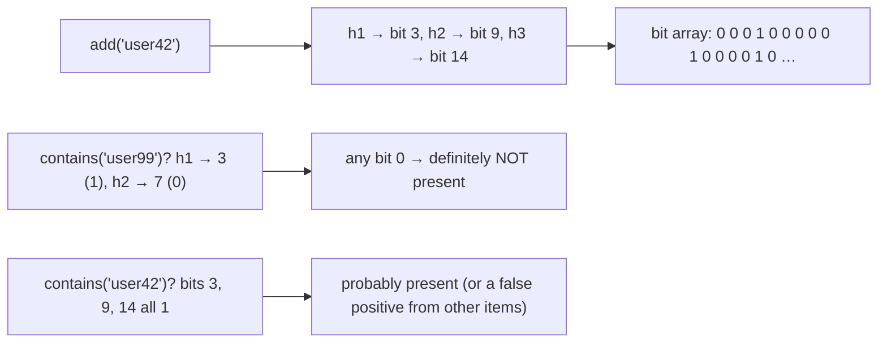
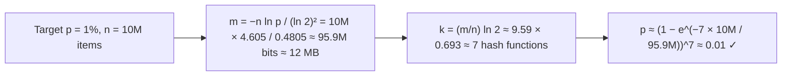
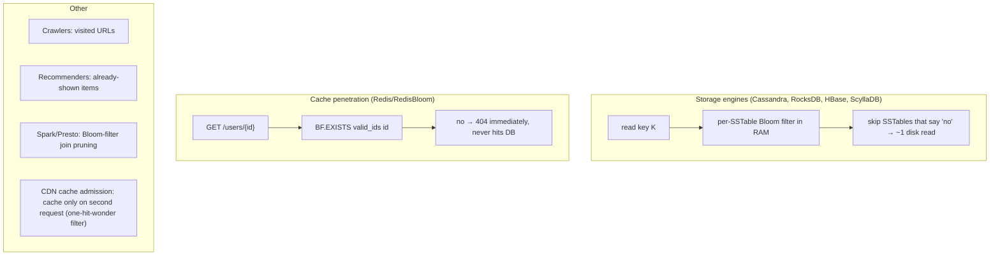
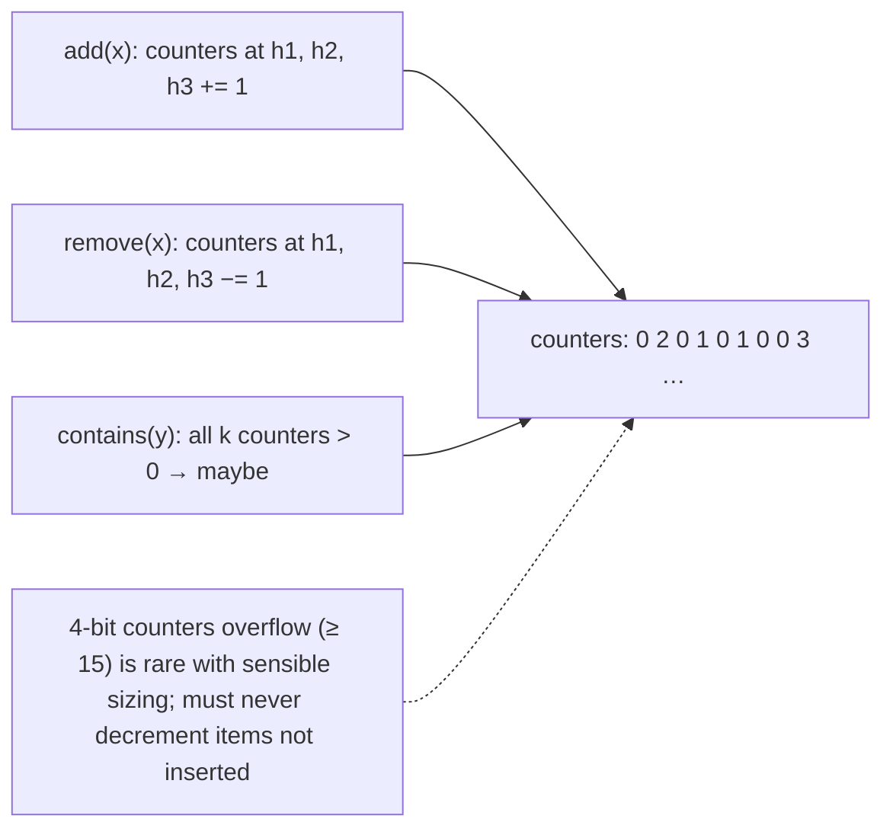
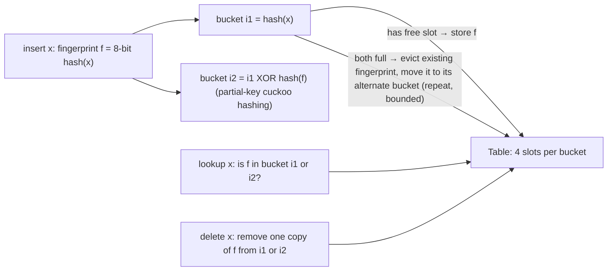
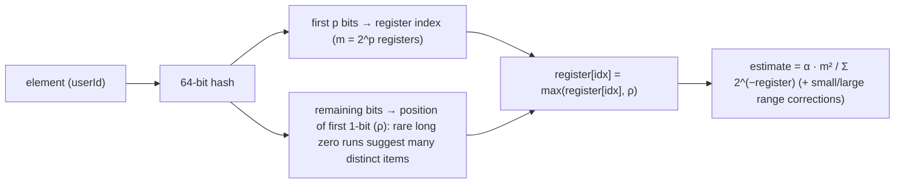
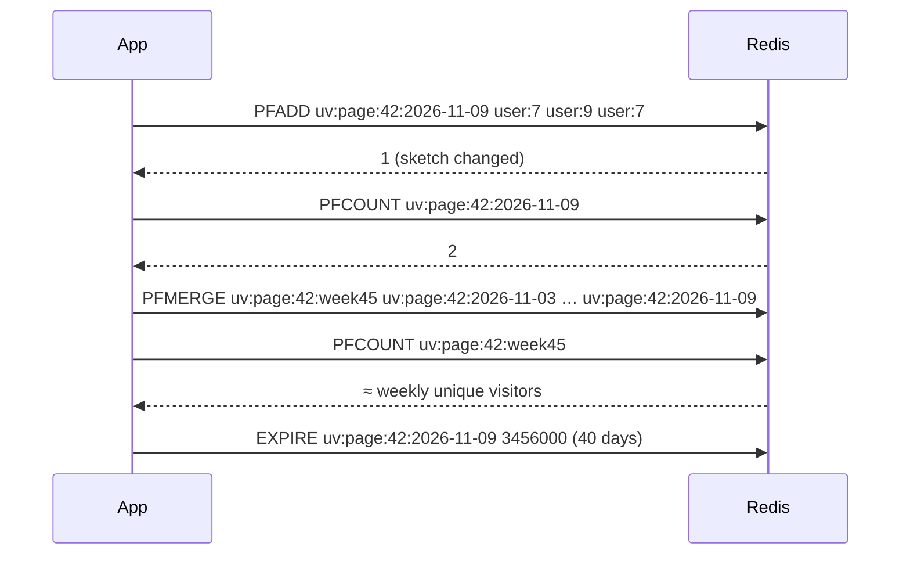
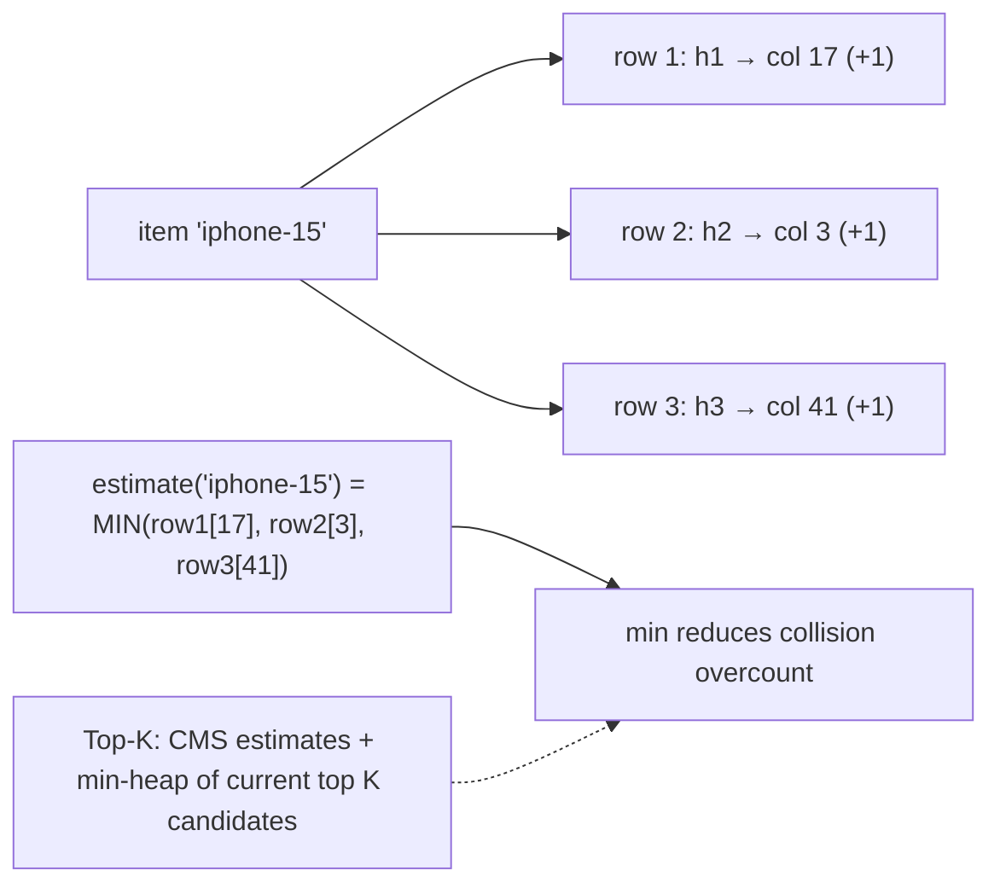
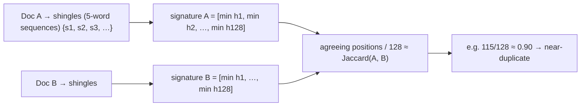
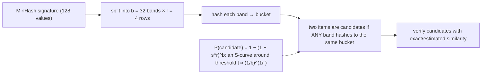

## Probabilistic & approximate structures

### Bloom filter — space-efficient probabilistic set: no false negatives, tunable false positive rate
A Bloom filter answers "**is x in the set?**" using a bit array and k hash functions, in a tiny fraction of the memory a real set needs. It can say **"definitely not"** or **"probably yes"**: there are no false negatives, but a tunable rate of false positives. Items can't be listed or (in the basic version) deleted.

#### Intuition
A bouncer with a rough memory of faces. If the bouncer says "never seen you", that is certain. If the bouncer says "I think you have been here", it is probably true but occasionally wrong.

#### Must know
- It answers "is x in the set?" using a bit array and k hash functions, in very little memory.
- Two possible answers: **"definitely not"** or **"probably yes"**.
- **No false negatives.** False positives happen at a rate you choose.
- Basic version: you cannot delete items or list them.
- It must be sized up front. Overfilling raises the false-positive rate fast.

#### Numbers to quote
- About 10 bits per item gives 1% false positives. About 14.4 bits gives 0.1%.
- 1 billion items at 1% needs about 1.2 GB.

#### Common mistakes
- Saying a Bloom filter can give false negatives.
- Inserting far more items than it was sized for.
- Using it where a wrong "yes" is unacceptable and there is no second check.

#### How it works


Operations are O(k) time and independent of set size. Memory is about 9.6 bits per item for 1% false positives, 14.4 bits for 0.1%.

```java
BloomFilter<String> seen = BloomFilter.create(Funnels.stringFunnel(UTF_8), 50_000_000, 0.01); // ~57 MB
seen.put("https://example.com/page");
boolean maybe = seen.mightContain("https://example.com/other");   // false → definitely new
```

#### Example
A web crawler tracks 1 billion visited URLs. A hash set would need ~100+ GB, while a Bloom filter at 1% false positives needs ~1.2 GB. A false positive means skipping a never-visited URL (acceptable at 1%), and a false negative (re-crawling) can't happen. Medium uses Bloom filters to avoid recommending articles a user has already read, and Chrome historically used one for its malicious-URL pre-check.

#### Trade-offs
Tiny memory and constant-time checks, but false positives, no deletion (basic), no enumeration, and it must be sized up front (overfilling raises the false-positive rate quickly).

#### Problems & fixes
| Symptom | Cause | Fix |
|---|---|---|
| False positive rate much higher than designed | more items inserted than planned | size for growth, scalable Bloom filters, rebuild |
| Need to remove items | standard Bloom can't delete | counting Bloom / cuckoo filter, periodic rebuild |
| Distributed instances disagree | separate local filters | shared filter (RedisBloom) or rebuild from source |

#### Cheat sheet
- "Definitely not" or "maybe". No false negatives.
- ~10 bits/item ≈ 1% false positives. k ≈ 0.7 × m/n hash functions.
- Size up front. Can't delete or list. RedisBloom / Guava.

#### Interview questions
<details><summary>Why can a Bloom filter have false positives but never false negatives?</summary>

Adding an item sets k bits to 1, and bits are never cleared. A lookup for an inserted item always finds all its k bits set, so it's never a false negative. A non-inserted item may find all its k bits set by coincidence because other items set them, which is a false positive. The probability grows as the array fills up.
</details>

<details><summary>Give three system-design uses of Bloom filters.</summary>

(1) LSM databases (Cassandra, RocksDB, HBase) skip SSTables that can't contain a key, saving disk reads. (2) Cache penetration protection: reject lookups for ids that don't exist before hitting cache or DB. (3) Crawlers and recommenders: "have we seen this URL or shown this item before?" for billions of items in little memory. Also useful for username-availability pre-checks and CDN cache admission.
</details>

#### Interview angle
> "For huge membership checks like visited URLs or already-shown items, a Bloom filter at about 10 bits per item gives 1% false positives and no false negatives, sized up front for growth."

#### Sources
- [Bloom filter](https://en.wikipedia.org/wiki/Bloom_filter) — Wikipedia
- [Bloom filter](https://redis.io/docs/latest/develop/data-types/probabilistic/bloom-filter/) — Redis docs

### Bloom filter FP rate — (1 − e^(−kn/m))^k where k=hash functions, n=items, m=bits
The false-positive probability of a Bloom filter with **m bits**, **n items** and **k hash functions** is approximately **p ≈ (1 − e^(−kn/m))^k**. The optimal k is **(m/n) · ln 2**, and for a target p the required bits are **m = −n · ln p / (ln 2)²**. These formulas let you size filters precisely.

#### Intuition
Think of a wall of light switches. Each item flips on a few switches. The more switches already on, the more likely a stranger's switches all happen to be on too. More wall per item means fewer coincidences.

#### Must know
- False-positive rate **p ≈ (1 − e^(−kn/m))^k**, for m bits, n items, k hash functions.
- Bits needed for a target p: **m = −n · ln p / (ln 2)²**.
- Best number of hashes: **k = (m/n) · ln 2**.
- More bits per item lowers the rate. More items than planned raises it sharply.
- The k hashes can be derived cheaply from two base hashes.

#### Numbers to quote
- 10 bits per item with k = 7 gives about 1%. Each extra 4.8 bits per item cuts the rate by 10×.
- Doubling the items in a 1% filter pushes it to about 15%.

#### Common mistakes
- Guessing the size and not using the formula.
- Not monitoring the fill level as data grows.
- A poor hash function that sets bits unevenly.

#### How it works


| Bits per item (m/n) | Optimal k | False positive rate |
|---|---|---|
| 5 | 3 | ~9.2% |
| 8 | 6 | ~2.1% |
| 10 | 7 | ~0.82% |
| 15 | 10 | ~0.07% |
| 20 | 14 | ~0.007% |

Intuition: each additional ~4.8 bits per item cuts the false-positive rate by about 10×. Implementation trick: k hashes come cheaply from two base hashes (Kirsch–Mitzenmacher: `h_i = h1 + i·h2`).

#### Example
Sizing for an e-commerce "seen product ids" filter per user session (n = 5,000 items, target 0.5%): m ≈ 5,000 × 5.298 / 0.4805 ≈ 55k bits ≈ 6.9 KB per user, with k ≈ 8. For 2M concurrent sessions that's ~14 GB in Redis, so they chose 2% (≈ 4 KB per user, 8 GB total) after confirming the business impact of extra false positives was negligible.

#### Trade-offs
Lower false-positive rates need more memory and more hash computations. The formula assumes independent uniform hashes and n not exceeding the design capacity.

#### Problems & fixes
| Symptom | Cause | Fix |
|---|---|---|
| FP rate degrades over time | n grew past design | monitor fill ratio, rebuild larger, scalable Bloom filters |
| Too slow per lookup | large k | accept slightly higher p, use double hashing |
| Uneven bit distribution | poor hash function | MurmurHash3/xxHash |

#### Cheat sheet
- p ≈ (1 − e^(−kn/m))^k. m = −n ln p / (ln 2)². k = (m/n) ln 2.
- 10 bits/item ≈ 1% (k = 7). +4.8 bits/item gives 10× fewer false positives.
- Double hashing for k hashes. Monitor the fill ratio.

#### Interview questions
<details><summary>How many bits do you need for 100M items at a 0.1% false-positive rate?</summary>

m = −n · ln(0.001) / (ln 2)² = 100M × 6.908 / 0.4805 ≈ 1.44 billion bits ≈ 180 MB, with k ≈ (m/n) ln 2 ≈ 14.4 × 0.693 ≈ 10 hash functions.
</details>

<details><summary>What happens if you insert twice as many items as the filter was sized for?</summary>

The false-positive rate rises sharply. For a filter sized at 10 bits per item (1%), doubling n gives 5 bits per item with the same k = 7, so p ≈ (1 − e^(−7/5))^7 ≈ 15%. You need to rebuild with larger m or use a scalable Bloom filter that adds new layers as it fills.
</details>

#### Interview angle
> "I size Bloom filters from the formula: about 10 bits per item and 7 hashes gives 1% false positives, each extra 4.8 bits per item gives 10 times fewer, and I monitor fill so growth doesn't silently raise the rate."

#### Sources
- [Bloom filter: probability of false positives](https://en.wikipedia.org/wiki/Bloom_filter#Probability_of_false_positives) — Wikipedia
- [BloomFilter](https://guava.dev/releases/snapshot/api/docs/com/google/common/hash/BloomFilter.html) — Guava API docs

### Bloom filter use cases — Cassandra SSTable key lookup, Redis key existence, DB query cache penetration
Bloom filters appear wherever a system must cheaply rule out expensive lookups for things that **probably don't exist**: storage engines skipping files, caches rejecting impossible keys, networks and CDNs filtering, and big-data joins pruning. The pattern is always "check the cheap filter first, do the expensive work only on a maybe".

#### Intuition
A sign on a shop door listing what is out of stock. Most people who want those items read the sign and leave, so the staff are only asked about things that might actually be there.

#### Must know
- The pattern: **check the cheap filter first, and do the expensive lookup only on a "maybe"**.
- **LSM databases** (Cassandra, RocksDB): one filter per SSTable skips files that cannot hold the key.
- **Cache penetration**: reject lookups for ids that do not exist before they reach the database.
- Crawlers and recommenders: "have we already seen this URL or shown this item?"
- It only helps when many lookups are for **absent** keys.

#### Common mistakes
- Forgetting to add new items to the filter, so valid items are rejected.
- Adding a filter to a path where almost every lookup is a hit.
- Expecting deleted items to leave a standard filter.

#### How it works


| System | How it uses Bloom filters |
|---|---|
| Cassandra / HBase / RocksDB | per-SSTable filters avoid disk reads for absent keys |
| PostgreSQL | `bloom` index extension, Bloom filters in hash joins |
| Redis (RedisBloom) | `BF.ADD`/`BF.EXISTS` shared across services |
| Akamai CDN | avoid caching one-hit-wonder objects |
| Bitcoin SPV (legacy) | lightweight clients filter transactions |
| Spark / Trino | runtime filters to prune scans in joins |

#### Example
A coupon service gets brute-forced with random coupon codes (millions per hour). A RedisBloom filter of all valid codes (5M codes at 0.1% false positives, ~9 MB) answers "code doesn't exist" in under a millisecond without touching Postgres. Only ~0.1% of junk lookups plus real codes reach the database. Combined with per-user rate limiting, DB load from the attack disappeared.

#### Trade-offs
Massive savings for negative lookups. They don't help when most lookups are hits, and filters must stay in sync with the underlying data (adds on create, rebuild on deletes).

#### Problems & fixes
| Symptom | Cause | Fix |
|---|---|---|
| Valid new items rejected | filter not updated on create | add in write path, rebuild periodically |
| Deleted items still pass | standard filter | cuckoo/counting filters or rebuild |
| Filter adds latency on hit-heavy path | most queries are hits anyway | skip filter where negatives are rare |

#### Cheat sheet
- Use it to rule out expensive lookups for absent keys.
- LSM SSTables, cache penetration, crawlers, recommenders, join pruning, CDN admission.
- Keep it in sync with the source data. Size for growth.

#### Interview questions
<details><summary>How do Bloom filters make Cassandra reads efficient?</summary>

Each SSTable has an in-memory Bloom filter of its partition keys. A read checks every SSTable's filter and only touches SSTables whose filter says "maybe", so for most keys only one or a few SSTables are read from disk instead of all of them. `bloom_filter_fp_chance` tunes memory vs false-positive reads.
</details>

<details><summary>What is "one-hit-wonder" filtering in CDNs?</summary>

Many objects are requested only once, so caching them wastes cache space and evicts useful content. The CDN keeps a Bloom filter of recently requested object keys and caches an object only on its second request (when the filter says "seen before"), which filters one-hit wonders cheaply and improves the hit ratio for popular content.
</details>

#### Interview angle
> "Whenever lots of lookups are for things that don't exist, like random coupon codes, absent keys in SSTables or crawled URLs, a Bloom filter in front turns expensive misses into microsecond rejections."

#### Sources
- [Bloom filters](https://cassandra.apache.org/doc/latest/cassandra/managing/operating/bloom_filters.html) — Apache Cassandra docs
- [RocksDB Bloom filter](https://github.com/facebook/rocksdb/wiki/RocksDB-Bloom-Filter) — RocksDB wiki

### Counting Bloom filter — allows deletions by using counters instead of bits
A counting Bloom filter replaces each bit with a **small counter** (typically 4 bits). Insert increments the k counters and delete decrements them, so items can be **removed** without breaking other items' membership. The cost is ~4× more memory than a standard Bloom filter.

#### Intuition
The same wall of switches, but each switch is now a tally counter. Adding an item clicks its counters up, removing it clicks them down, and a position counts as "on" while its tally is above zero.

#### Must know
- Each bit is replaced by a **small counter**, usually 4 bits.
- Insert increments the k counters. **Delete decrements them.**
- It costs about **4× the memory** of a plain Bloom filter.
- **Only delete items that were really inserted**, or you create false negatives.
- A cuckoo filter usually does deletion in less space.

#### Common mistakes
- Deleting an item that was never added, which breaks other items.
- Ignoring counter overflow.
- Choosing it without considering a cuckoo filter.

#### How it works


Rules: only delete items that were actually inserted (deleting a non-member corrupts counts and can create false negatives), and handle counter overflow (saturate at max and never decrement saturated counters).

#### Example
A rate-limit or abuse system keeps "currently banned device ids" in memory: bans are added and expire after 24 h. A counting Bloom filter supports removal on expiry, so the gateway quickly rejects banned devices ("maybe banned" triggers an authoritative Redis check, while "definitely not banned" passes immediately), and the filter stays accurate as bans expire.

#### Trade-offs
Supports deletion, but 3–4× the memory of a Bloom filter. Cuckoo filters usually achieve deletion with better space efficiency.

#### Problems & fixes
| Symptom | Cause | Fix |
|---|---|---|
| False negatives appear | deleting items never inserted, counter underflow | verify membership authoritatively before delete |
| Counter overflow | heavily repeated items / undersized | saturating counters, larger counters, proper sizing |
| Memory too high | 4-bit counters × m | cuckoo filter |

#### Cheat sheet
- Counters instead of bits: add increments, remove decrements.
- ~4× memory. Never delete non-members. Saturating counters.
- Cuckoo filters are often a better choice for deletable membership.

#### Interview questions
<details><summary>Why can't you delete from a standard Bloom filter, and how does a counting Bloom filter fix it?</summary>

In a standard filter, bits are shared by many items, so clearing an item's bits could clear bits other items rely on, which creates false negatives. A counting filter tracks how many items set each position, and deletion decrements counts, so a position stays non-zero while any other item still uses it.
</details>

<details><summary>What's the danger of deleting an item that was never added to a counting Bloom filter?</summary>

Its k counters get decremented even though they were incremented by other items, possibly reaching zero for positions that real members depend on. Those members then appear absent (false negatives), breaking the filter's core guarantee. Only delete items confirmed to be members.
</details>

#### Interview angle
> "When membership changes over time, like expiring bans, I'd use a counting Bloom filter or better a cuckoo filter, and only ever delete items confirmed as members."

#### Sources
- [Counting Bloom filter](https://en.wikipedia.org/wiki/Counting_Bloom_filter) — Wikipedia
- [Bloom filter: counting Bloom filters](https://en.wikipedia.org/wiki/Bloom_filter#Counting_Bloom_filters) — Wikipedia

### Cuckoo filter — more space-efficient than Bloom for same FP rate, supports deletions, better cache locality
A cuckoo filter stores short **fingerprints** of items in a table of buckets, with each item having two candidate buckets (cuckoo hashing). It supports **insert, lookup and delete**, typically uses **less space than a Bloom filter for false-positive rates below ~3%**, and has good cache locality (at most two bucket reads per lookup).

#### Intuition
A cloakroom where each coat has exactly two possible hooks and only a short tag is stored. If both hooks are taken, an existing coat is moved to its other hook to make room.

#### Must know
- It stores a short **fingerprint** of each item in one of **two candidate buckets**.
- It supports **insert, lookup and delete**.
- It uses less space than a Bloom filter when the false-positive target is below about 3%.
- A lookup reads at most two buckets, which is cache-friendly.
- **Inserts can fail** when the table is nearly full, so it must be resized.

#### Numbers to quote
- About 12 bits per item gives roughly 0.1% false positives. Keep the load below about 90%.

#### Common mistakes
- Deleting an item that was never inserted, which can remove another item's fingerprint.
- Filling it to capacity and hitting insert failures.
- Inserting the same item many times.

#### How it works


Properties: false-positive rate ≈ 2b / 2^f (b = slots per bucket, f = fingerprint bits), so 8–12 bit fingerprints give 0.01%–3%. Load factor up to ~95% with 4-slot buckets. Insertion can fail when the table is too full (resize or rebuild).

#### Example
RedisBloom offers `CF.ADD`/`CF.DEL`/`CF.EXISTS`. A session-revocation service tracks revoked token ids (jti) until they expire: tokens are added on logout and deleted at natural expiry. The cuckoo filter keeps memory small (~12 bits per entry at ~0.1% false positives) and supports deletion. Gateways check it on every request, and a "maybe revoked" falls back to an authoritative check.

#### Trade-offs
| Cuckoo filter | Bloom filter |
|---|---|
| deletions supported | no deletions (basic) |
| better space at low FP rates | simpler, better at high FP rates |
| ≤ 2 bucket reads (cache-friendly) | k scattered bit reads |
| insert can fail near capacity | inserts never fail (just raise FP) |
| duplicates limited per bucket | duplicates harmless |

#### Problems & fixes
| Symptom | Cause | Fix |
|---|---|---|
| Insert failures | table too full | resize/rebuild, keep load < ~90% |
| Deleting an item never inserted removes a colliding fingerprint | fingerprint collision | only delete confirmed members |
| Same item inserted many times fills buckets | duplicates | dedupe before insert |

#### Cheat sheet
- Fingerprints in two candidate buckets. Insert, lookup and delete.
- Better space than Bloom for FP below ~3%. Cache-friendly.
- Inserts can fail near capacity. Delete only real members.

#### Interview questions
<details><summary>When would you prefer a cuckoo filter over a Bloom filter?</summary>

When you need deletions (sets that change over time, like revoked tokens, active sessions or cached keys), when you want low false-positive rates (under ~3%) with less memory, or when lookup latency matters (at most two cache-line-friendly bucket probes). Use Bloom filters for append-only sets, very simple implementations, or higher acceptable FP rates.
</details>

<details><summary>Why can cuckoo filter insertions fail?</summary>

Each fingerprint has only two candidate buckets. When both are full, insertion relocates existing fingerprints to their alternate buckets, which can cascade. Near high load factors these relocation chains may loop or exceed the maximum kick count, so the insert fails and the filter must be resized or rebuilt.
</details>

#### Interview angle
> "For membership sets that need deletions, like revoked token ids, I'd use a cuckoo filter (RedisBloom CF): smaller than Bloom at low false-positive rates, two-probe lookups, kept under about 90% load."

#### Sources
- [Cuckoo filter: practically better than Bloom](https://www.cs.cmu.edu/~dga/papers/cuckoo-conext2014.pdf) — Fan, Andersen, Kaminsky and Mitzenmacher
- [Cuckoo filter](https://redis.io/docs/latest/develop/data-types/probabilistic/cuckoo-filter/) — Redis docs

### HyperLogLog — cardinality estimation: count distinct values with ~1.5% error using O(m) space
HyperLogLog (HLL) estimates **how many distinct elements** a stream contains using a few kilobytes, whether there are a thousand or billions of elements, with a standard error of about **1.04/√m** (m = number of registers). Sketches are **mergeable**, so unions across days, servers or shards are trivial.

#### Intuition
Guessing how many times a coin was flipped from the longest run of heads you were told about. A run of ten heads suggests a lot of flipping. Hash values with many leading zeros work the same way.

#### Must know
- It estimates **how many distinct items** a stream contains.
- Memory is fixed at a few kilobytes, for a thousand items or a billion.
- The result is **approximate**, with a small known error.
- Sketches are **mergeable**: combine per-day or per-shard sketches with no double counting.
- It cannot list items or test membership.

#### Numbers to quote
- Standard error ≈ 1.04/√m. Redis uses 16,384 registers: 0.81% error in 12 KB.

#### Common mistakes
- Using it for billing or anything that needs an exact count.
- Estimating intersections from sketches, which is unreliable.
- Adding up daily counts to get a monthly figure. Merge the sketches.

#### How it works


Intuition: seeing a hash with many leading zeros is unlikely unless you've seen many distinct values (like flipping 10 heads in a row). Averaging over many registers (stochastic averaging, harmonic mean) reduces variance.

Error vs memory: m = 16,384 registers (Redis default) gives ≈ 0.81% standard error in ~12 KB.

#### Example
Unique visitors per page per day for 1M pages: exact sets would need gigabytes (storing every visitor id per page). With HLL, ~12 KB per page per day in Redis. Weekly uniques for a page are `PFMERGE` of 7 daily sketches (unions, no double counting). Google BigQuery's `APPROX_COUNT_DISTINCT`, Presto's `approx_distinct` and Druid use HLL variants (HLL++).

#### Trade-offs
Tiny, mergeable, constant memory, but approximate (no exact counts), can't list elements or test membership, and intersections are inaccurate (derived via inclusion-exclusion, error-prone).

#### Problems & fixes
| Symptom | Cause | Fix |
|---|---|---|
| Need exact counts (billing) | HLL approximate | exact counting for money; HLL for analytics |
| Intersection estimates wildly off | inclusion-exclusion on sketches | MinHash/theta sketches for intersections |
| Inconsistent counts across systems | different HLL implementations/precision | standardise precision and hash |

#### Cheat sheet
- Distinct count in KB: error ≈ 1.04/√m (Redis: 0.81%, 12 KB).
- Mergeable (union) across time and shards. No membership or listing.
- Analytics yes, billing no. Intersections via theta sketches.

#### Interview questions
<details><summary>How would you count daily and monthly active users for 200M users cheaply?</summary>

Keep one HyperLogLog per day (`PFADD dau:2026-11-09 userId` on activity), so DAU = `PFCOUNT` (~0.8% error, 12 KB per day). MAU = `PFMERGE` of the last 30 daily sketches, then `PFCOUNT`, which avoids double counting users active on multiple days. For exact counts at that scale you'd need bitmaps (200M bits ≈ 25 MB per day) or sets, which are far larger.
</details>

<details><summary>Why are HyperLogLog sketches mergeable, and why does that matter?</summary>

Each register stores the maximum ρ seen for its bucket. The union of two streams' sketches is the register-wise maximum, exactly the sketch you'd get by processing both streams together. So distributed systems can compute sketches per shard, server or time window and combine them without re-reading raw data, for any rollup (hourly → daily → monthly, per region → global).
</details>

#### Interview angle
> "Unique counts like DAU, MAU or per-page uniques use HyperLogLog: about 0.8% error in 12 KB, merged across days and shards with no double counting. Billing-grade counts stay exact."

#### Sources
- [HyperLogLog](https://en.wikipedia.org/wiki/HyperLogLog) — Wikipedia
- [HyperLogLog: the analysis of a near-optimal cardinality estimation algorithm](https://algo.inria.fr/flajolet/Publications/FlFuGaMe07.pdf) — Flajolet, Fusy, Gandouet and Meunier
- [HyperLogLog in practice](https://research.google/pubs/hyperloglog-in-practice-algorithmic-engineering-of-a-state-of-the-art-cardinality-estimation-algorithm/) — Google Research

### HyperLogLog in Redis — PFADD (add), PFCOUNT (estimate), PFMERGE (combine); used for daily active users
Redis implements HyperLogLog natively: **`PFADD key element…`** adds elements, **`PFCOUNT key [key…]`** returns the estimated distinct count (across several keys as a union), and **`PFMERGE dest src…`** combines sketches. Each HLL uses at most **12 KB** with **0.81% standard error**, and small sets use a sparse encoding that's even smaller.

#### Intuition
A turnstile counter that recognises repeat visitors. You tap everyone in, it tells you roughly how many different people came, and you can combine the counters from seven days into one weekly figure.

#### Must know
- `PFADD key item` adds. `PFCOUNT key` returns the estimated distinct count.
- `PFMERGE dest a b c` combines sketches. `PFCOUNT a b c` gives the union directly.
- Typical use: **one key per day**, merged for weekly and monthly active users.
- Set a TTL on the daily keys.
- In Redis Cluster, multi-key commands need keys in the same hash slot (use hash tags).

#### Numbers to quote
- At most 12 KB per key, with 0.81% standard error.

#### Common mistakes
- Asking it "has user X been counted?". It cannot answer membership.
- Summing daily counts for a weekly figure, which double counts returning users.
- Daily keys that never expire.

#### How it works


Notes:
- `PFCOUNT` over multiple keys computes the union on the fly (it doesn't modify them).
- Sparse representation for low cardinalities switches to dense (12 KB) automatically.
- In Redis Cluster, multi-key `PFCOUNT`/`PFMERGE` need keys in the same hash slot (use hash tags like `uv:{page42}:…`).

#### Example
A news site tracks unique readers per article per day: `PFADD uv:{article}:{date} visitorId` in the request path (O(1), sub-millisecond). The editorial dashboard shows today's uniques (`PFCOUNT`) and 7-day uniques (`PFCOUNT` of 7 keys). Memory for 50k articles × 40 days ≈ 50k × 40 × ≤ 12 KB ≈ 24 GB worst case, but most articles have few readers (sparse encoding), so actual usage was ~3 GB.

#### Trade-offs
Effortless distinct counts at scale, but approximate, Cluster multi-key constraints, and no per-element information (can't ask "did user X visit?").

#### Problems & fixes
| Symptom | Cause | Fix |
|---|---|---|
| CROSSSLOT error on PFMERGE/PFCOUNT | keys in different slots | hash tags to co-locate related keys |
| Memory grows unbounded | sketches never expire | TTL per daily key, roll up then expire |
| Need "has user X been counted?" | HLL can't answer membership | separate set/bitmap/Bloom filter |

#### Cheat sheet
- `PFADD`, `PFCOUNT` (multi-key union), `PFMERGE`. ≤ 12 KB, 0.81% error.
- Daily keys + TTL. Merge for weekly or monthly. Hash tags in Cluster.
- Distinct counts only, no membership.

#### Interview questions
<details><summary>How do you compute weekly unique users from daily HyperLogLogs in Redis without storing raw ids?</summary>

Keep one HLL per day (`PFADD uu:YYYY-MM-DD userId`). For the week, `PFCOUNT uu:d1 uu:d2 … uu:d7` (computes the union estimate directly) or `PFMERGE uu:week uu:d1 … uu:d7` to persist the weekly sketch. Users active on several days are counted once, because the union of sketches dedupes.
</details>

<details><summary>Bitmaps vs HyperLogLog for DAU in Redis?</summary>

Bitmaps (`SETBIT dau:date userId 1`) give exact counts and membership ("was user X active?") and support intersections via BITOP (retention cohorts), but need max_user_id bits per day (100M users ≈ 12.5 MB per day). HLL gives approximate counts in 12 KB per key, without membership or exact intersections, which is better for many dimensions (per page, per country) or huge id spaces.
</details>

#### Interview angle
> "Unique counts are Redis HyperLogLogs per day with TTLs, merged for weekly and monthly uniques. When I need exact membership or retention cohorts, I'd use bitmaps instead."

#### Sources
- [HyperLogLog](https://redis.io/docs/latest/develop/data-types/probabilistic/hyperloglogs/) — Redis docs
- [PFCOUNT](https://redis.io/docs/latest/commands/pfcount/) — Redis command reference

### Count-Min Sketch — frequency estimation in data streams: O(ε,δ) space, approximate top-K
A Count-Min Sketch estimates **how often each item appears** in a stream using a small 2-D array of counters (d rows × w columns, one hash per row). It **never underestimates** (it may overestimate due to collisions), and the error is bounded: with w = ⌈e/ε⌉ and d = ⌈ln(1/δ)⌉, the overestimate is ≤ ε·N with probability 1 − δ.

#### Intuition
Several tally sheets, each with fewer rows than there are items, so items share rows. An item's count on any one sheet may be inflated by its row-mates. Taking the smallest count across the sheets gives the best guess.

#### Must know
- It estimates **how often each item appears** in a stream, in a small fixed grid of counters.
- Each row uses a different hash. **The estimate is the minimum across rows.**
- It **never underestimates**. Collisions can only add.
- Pair it with a heap to track the **top-K heavy hitters**.
- Sketches are mergeable by adding counters.

#### Numbers to quote
- Width w = e/ε and depth d = ln(1/δ). For 0.1% error at 99% confidence: about 2,719 × 5 counters, roughly 54 KB.

#### Common mistakes
- Trusting the count of a rare item, where collision noise dominates.
- Expecting it to list the top items by itself.
- No time window or decay, so old data dominates "trending".

#### How it works


Sizing example: ε = 0.001 (error ≤ 0.1% of total count) and δ = 0.01 give w = 2,719 and d = 5, so ~13.6k counters (~54 KB with 4-byte counters), whether the stream has thousands or billions of distinct items.

Variants: conservative update (increment only the minimum counters, which reduces overestimation), count-mean-min, heavy-keeper for top-K.

#### Example
Trending hashtags on a social platform: a stream processor keeps a Count-Min Sketch per 5-minute window plus a min-heap of the top 50, giving trending topics in real time with ~100 KB of state per window instead of a hash map of millions of hashtags. Redis offers `CMS.INCRBY`/`CMS.QUERY` and `TOPK.ADD`/`TOPK.LIST` (RedisBloom). Hot-key detection in caches and DDoS heavy-hitter detection (top source IPs) use the same idea.

#### Trade-offs
Fixed tiny memory and fast updates, but approximate (overestimates, especially for rare items), can't enumerate items without a companion structure, and error is relative to the total stream size.

#### Problems & fixes
| Symptom | Cause | Fix |
|---|---|---|
| Rare items show inflated counts | collisions | larger w, conservative update, only trust counts of heavy hitters |
| Can't list top items | CMS stores counts only | keep a heap / Top-K structure alongside |
| Counts dominated by old data | no decay | sliding/tumbling windows, decay factors |

#### Cheat sheet
- d × w counters. Estimate = min across rows. Never underestimates.
- w = e/ε, d = ln(1/δ). Error ≤ εN with probability 1 − δ.
- Heavy hitters / top-K with a heap. Window or decay for trends.

#### Interview questions
<details><summary>Design "top 10 trending search queries in the last hour" for 100k queries per second.</summary>

Stream queries through Kafka to a stream processor (Flink / Kafka Streams). Per tumbling 1-minute window, update a Count-Min Sketch and a min-heap of the top ~100 candidates (by CMS estimate). Merge the last 60 windows' sketches (CMS are mergeable by adding counters) to get the hourly top 10, refreshed every minute. Store results in Redis for the API. Memory per window is tens of KB instead of millions of query strings.
</details>

<details><summary>Why does Count-Min Sketch take the minimum across rows?</summary>

Each row's counter for an item includes the item's true count plus counts of other items that collided in that row. Collisions only add, so every row overestimates. Taking the minimum picks the row with the least collision noise, giving the tightest upper bound on the true frequency.
</details>

#### Interview angle
> "For trending or heavy-hitter detection on high-volume streams I'd use a Count-Min Sketch with a top-K heap per window. It's mergeable and fixed-size, and I only trust estimates for the frequent items."

#### Sources
- [Count–min sketch](https://en.wikipedia.org/wiki/Count%E2%80%93min_sketch) — Wikipedia
- [Count-min sketch](https://redis.io/docs/latest/develop/data-types/probabilistic/count-min-sketch/) — Redis docs

### MinHash — estimate Jaccard similarity between sets; used for near-duplicate detection
MinHash estimates the **Jaccard similarity** of two sets (|A ∩ B| / |A ∪ B|) using small fixed-size **signatures**: for each of k hash functions, record the minimum hash value over the set's elements. The fraction of signature positions where two sets agree approximates their Jaccard similarity.

#### Intuition
To compare two huge guest lists, ask each host the same 100 odd questions, such as "which guest's name comes first alphabetically after scrambling the alphabet this way?". The share of matching answers tells you how much the lists overlap.

#### Must know
- It estimates **Jaccard similarity**: overlap divided by union of two sets.
- Each set becomes a small fixed-size **signature**: the minimum hash value under each of k hash functions.
- **The fraction of matching positions ≈ the Jaccard similarity.**
- Documents are first cut into **shingles** (overlapping word sequences).
- Combine with LSH so you never compare every pair.

#### Numbers to quote
- Error ≈ 1/√k. 128 hashes give roughly ±9%.

#### Common mistakes
- Comparing every pair of signatures, which is still O(n²).
- A poor shingle size, so small edits hide or fake similarity.
- Using it for a similarity measure other than set overlap.

#### How it works


Why it works: for a random hash function, P[min hash(A) = min hash(B)] = Jaccard(A, B), because the element with the minimum hash across A ∪ B is equally likely to be any element of the union, and the minima match exactly when it's in the intersection. With k hashes the estimate's standard error ≈ 1/√k (k = 128 gives ±~9%, k = 256 gives ±~6%).

Usually combined with **LSH banding** (next topic) to find similar pairs without comparing all pairs.

#### Example
A news aggregator ingests 2M articles a day, many syndicated copies with small edits. Each article becomes 5-word shingles and a 128-value MinHash signature (512 bytes), and LSH bucketing finds candidate pairs with Jaccard ≥ 0.8. Near-duplicates are clustered so readers see one story with "and 14 other sources". Web crawlers (Google's early near-duplicate detection) and plagiarism detectors use the same approach.

#### Trade-offs
Compact signatures, fast similarity estimation and a natural fit with LSH, but approximate, it measures set overlap (Jaccard) only, and shingling choices strongly affect results.

#### Problems & fixes
| Symptom | Cause | Fix |
|---|---|---|
| Similar docs not detected | shingles too long / formatting noise | normalise text, tune shingle size |
| Too many false matches | short documents, few shingles | minimum length, higher threshold, more hashes |
| Pairwise comparison too slow | O(n²) signature comparisons | LSH banding for candidate generation |

#### Cheat sheet
- Signature = per-hash minimums. Agreement fraction ≈ Jaccard.
- Error ≈ 1/√k. Shingle documents first. Use with LSH.
- Near-duplicate docs, plagiarism, dedupe of listings or records.

#### Interview questions
<details><summary>How would you detect near-duplicate product listings across 50M listings?</summary>

Normalise each listing (title + description: lowercase, strip punctuation), create shingles (word or character n-grams), compute MinHash signatures (e.g. 128 hashes), and use LSH banding to bucket listings likely to be similar (only those sharing a band hash become candidates). Verify candidates by estimated Jaccard (and maybe image hashes or attributes), then cluster duplicates for merge or review. This avoids comparing 50M² pairs.
</details>

<details><summary>Why does the probability that two MinHashes match equal the Jaccard similarity?</summary>

Under a random hash, each element of A ∪ B is equally likely to have the smallest hash value. Both sets have the same minimum exactly when that overall-minimum element belongs to both sets, i.e. lies in A ∩ B. The probability is |A ∩ B| / |A ∪ B|, which is the Jaccard similarity.
</details>

#### Interview angle
> "For near-duplicate detection at scale I shingle the text, compute 128-value MinHash signatures and use LSH banding to find candidate pairs above a Jaccard threshold, never comparing all pairs."

#### Sources
- [MinHash](https://en.wikipedia.org/wiki/MinHash) — Wikipedia
- [Mining of Massive Datasets (chapter 3: finding similar items)](http://www.mmds.org/) — Leskovec, Rajaraman and Ullman

### Locality-Sensitive Hashing (LSH) — hash similar items to same bucket; approximate nearest neighbor
Locality-Sensitive Hashing uses hash functions designed so that **similar items collide with high probability** and dissimilar items rarely do. Instead of comparing a query against every item, you only compare against items in the same buckets: **sub-linear approximate nearest-neighbour search** and similar-pair detection.

#### Intuition
Sorting people into rooms by a few rough traits, so similar people tend to end up in the same room. To find someone like you, you only look around your own room, not the whole building.

#### Must know
- Ordinary hashing spreads similar items apart. **LSH makes similar items collide on purpose.**
- You compare a query only with items in the same buckets, so search is sub-linear.
- **Banding**: split a signature into bands. Two items are candidates if any band matches.
- Candidates are then verified with the exact similarity.
- It is approximate. For vector search, HNSW usually gives better recall.

#### Common mistakes
- Treating bucket matches as final results with no verification.
- Too few bands or tables, so similar items are missed.
- Presenting LSH as the modern default for embeddings.

#### How it works


LSH families per similarity measure:
| Similarity | LSH family |
|---|---|
| Jaccard (sets) | MinHash + banding |
| Cosine (vectors) | random hyperplanes (SimHash: sign of dot product) |
| Euclidean | p-stable distributions (random projections + bucketing) |
| Hamming | bit sampling |

Tuning b and r shifts the threshold and trades false positives (extra candidates to verify) against false negatives (missed similar pairs).

#### Example
A music service finds songs similar to a given track among 80M embeddings using random-hyperplane LSH (SimHash): each 256-dim embedding becomes several 16-bit signatures across multiple tables, and a query checks its buckets in each table, verifying a few thousand candidates with exact cosine similarity, which takes milliseconds instead of scanning 80M vectors. (Modern vector databases often use HNSW graphs instead, but LSH remains simple and streaming-friendly.)

#### Trade-offs
Sub-linear search, simple, works with streaming inserts, but approximate (misses some neighbours), needs parameter tuning and many hash tables (memory) for high recall, and graph-based ANN (HNSW) usually achieves better recall and latency trade-offs for vectors.

#### Problems & fixes
| Symptom | Cause | Fix |
|---|---|---|
| Missed similar items (low recall) | too few bands/tables | more bands/tables, multi-probe LSH |
| Too many candidates (slow) | threshold too low | adjust b and r, more rows per band |
| Poor recall on vector search vs alternatives | LSH limitations in high dims | HNSW/IVF-PQ vector indexes |

#### Cheat sheet
- Similar items collide. Compare only within buckets.
- MinHash banding (Jaccard), SimHash (cosine), p-stable (Euclidean).
- Tune bands × rows for the S-curve threshold. Verify candidates. HNSW often wins for vectors.

#### Interview questions
<details><summary>How does banding turn MinHash into a fast similar-pair finder?</summary>

Split each signature into b bands of r rows and hash each band to a bucket. Two items become candidates if they collide in at least one band. Highly similar items agree on many signature positions, so they very likely share some full band, while dissimilar items rarely do. Only candidates get compared, avoiding O(n²) comparisons, and b and r set the similarity threshold of the S-curve.
</details>

<details><summary>LSH vs HNSW for vector similarity search?</summary>

LSH uses random hash projections and buckets: simple, supports streaming inserts and parallelism, has theoretical guarantees, but often needs many tables for good recall in high dimensions. HNSW builds a navigable small-world graph and searches greedily, generally achieving higher recall at lower latency, at the cost of more memory and complex updates. Most vector databases default to HNSW or IVF variants.
</details>

#### Interview angle
> "LSH makes similarity search sub-linear by hashing similar items into the same buckets, with MinHash banding for documents and SimHash for vectors. I tune bands against the recall threshold, though HNSW usually wins for embeddings."

#### Sources
- [Locality-sensitive hashing](https://en.wikipedia.org/wiki/Locality-sensitive_hashing) — Wikipedia
- [Mining of Massive Datasets (chapter 3: finding similar items)](http://www.mmds.org/) — Leskovec, Rajaraman and Ullman

