## Hashing & distribution

### Consistent hashing — arrange nodes on ring; key maps to next clockwise node; only K/N keys remap on node change
Consistent hashing maps both keys and nodes onto a circular hash space (the ring). A key belongs to the first node clockwise from its hash. When a node joins or leaves, only the keys in its arc move (about **K/N** of K keys across N nodes), instead of almost all keys as with `hash % N`. (Phase 3 covers its use in sharding.)

#### How it works
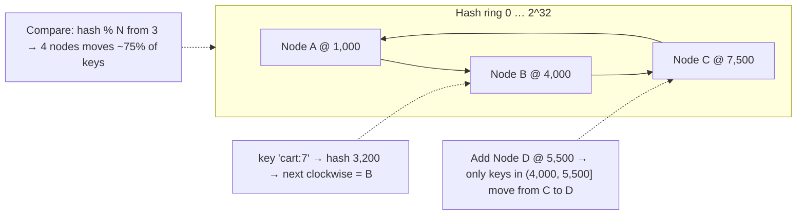

Lookup: keep node positions in a sorted array or tree and binary search for the first position ≥ hash(key), wrapping around (O(log N)).

```java
TreeMap<Long, String> ring = new TreeMap<>();
void addNode(String node, int vnodes) { for (int i = 0; i < vnodes; i++) ring.put(hash(node + "#" + i), node); }
String nodeFor(String key) {
  Map.Entry<Long, String> e = ring.ceilingEntry(hash(key));
  return (e != null ? e : ring.firstEntry()).getValue();   // wrap around
}
```

#### Example
A memcached tier of 20 nodes using ketama consistent hashing: adding 2 nodes during a sale moved ~9% of keys (2/22), so the hit rate dipped slightly and recovered in minutes. With modulo hashing, ~91% of keys would have moved and the database would have been flooded with misses.

#### Trade-offs
Minimal remapping and decentralised computation (any client computes placement), but uneven load without virtual nodes, and hot keys still land on one node.

#### Problems & fixes
| Symptom | Cause | Fix |
|---|---|---|
| Uneven load | few ring points per node | virtual nodes (100–200 per node) |
| Clients map keys differently | inconsistent membership views | shared membership source, versioned ring |
| Hot node | hot keys | replication of hot keys, L1 cache |

#### Cheat sheet
- Ring with keys going to the next node clockwise. Join or leave moves ~K/N keys.
- Sorted map + binary search. Wrap around.
- Add virtual nodes for balance. Hot keys need other fixes.

#### Interview questions
<details><summary>Why is consistent hashing better than modulo hashing for caches?</summary>

With `hash(key) % N`, changing N (adding or removing a node) changes the mapping for almost all keys, causing a mass cache miss storm on the database. With consistent hashing, a node change affects only the keys in its arc (~1/N of keys), so most cached data stays valid.
</details>

<details><summary>How do you look up a key's node efficiently on the ring?</summary>

Store node (virtual node) positions in a sorted structure (array or TreeMap), hash the key, and binary search for the first position ≥ the key's hash, wrapping to the first position if none. O(log V) where V is the number of virtual nodes, and it's computed locally on every client.
</details>

#### Interview angle
> "Cache and storage placement uses a consistent hash ring with virtual nodes, so adding a node remaps only about 1/N of keys instead of nearly all of them."

### Virtual nodes (vnodes) — each physical node owns N virtual positions on ring; better load balance
With virtual nodes, each physical node is placed on the ring at **many positions** (e.g. 100–256 tokens) instead of one. Random arcs average out, so each node owns roughly equal key ranges, and when a node fails its load spreads across **many** nodes rather than its single clockwise neighbour.

#### How it works
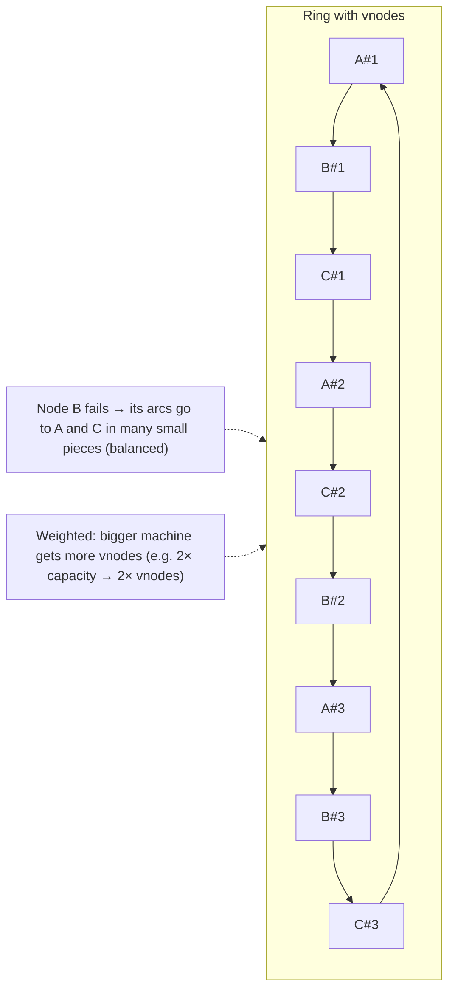

Benefits: balance, smoother rebalancing, heterogeneous capacity (weights via vnode count), faster recovery (many nodes stream data in parallel to a replacement).

Costs: more ring metadata, and with replication, vnodes increase the number of nodes involved in repairs and can reduce availability under multiple failures (more combinations of replica sets). Cassandra lowered the default `num_tokens` from 256 to 16 (with a smarter allocation algorithm) for this reason.

#### Example
A 12-node cache cluster with 1 token per node had one node owning 19% of the ring (it should be ~8%), which made it a constant hotspot. Switching to 160 vnodes per node brought every node within ±3% of the average. A newer instance type with 2× memory was given 320 vnodes to take proportionally more keys.

#### Trade-offs
Balance and weighted capacity vs metadata size and replica-set combinatorics.

#### Problems & fixes
| Symptom | Cause | Fix |
|---|---|---|
| One node owns far more keys | single token per node | 100–200 vnodes per node |
| Big new machines underused | equal vnodes for unequal capacity | vnode count proportional to capacity |
| Slow repairs/streaming in Cassandra with 256 tokens | too many ranges | fewer tokens with allocation algorithm |

#### Cheat sheet
- Many ring positions per physical node give an even split and spread-out failover.
- Weight capacity by vnode count.
- Typical 100–200 (caches). Cassandra now ~16 with token allocation.

#### Interview questions
<details><summary>What problems do virtual nodes solve in consistent hashing?</summary>

With one position per node, arc sizes are random and highly uneven (some nodes own much more of the keyspace), and a node failure dumps all its keys on one neighbour, possibly overloading it. Many virtual positions per node average arc sizes toward equality and split a failed node's load across many nodes. They also let you weight nodes by capacity.
</details>

<details><summary>Why might a database reduce the number of vnodes per node?</summary>

Each vnode creates a separate token range to replicate, repair and stream. Too many (e.g. 256) increase repair overhead and the number of distinct replica sets, so with multiple simultaneous node failures, more ranges lose quorum. Fewer tokens with an allocation algorithm that places them evenly keeps balance with less overhead.
</details>

#### Interview angle
> "I give each node 100 to 200 virtual nodes, weighted by capacity, so load stays within a few percent of even and a failed node's keys spread across the whole cluster."

### Consistent hashing math — with V vnodes per node, variance of load = O(1/V); common: V=150
With random placement, the load (fraction of the ring) owned by a node with **one** token varies wildly: the largest share is around **O(log N / N)** instead of the ideal 1/N. With **V virtual nodes per node**, each node's share is a sum of V random arcs, so the **relative standard deviation falls roughly as 1/√V** and the variance as O(1/V). With V ≈ 100–200, nodes typically sit within ±5–10% of the mean.

#### How it works
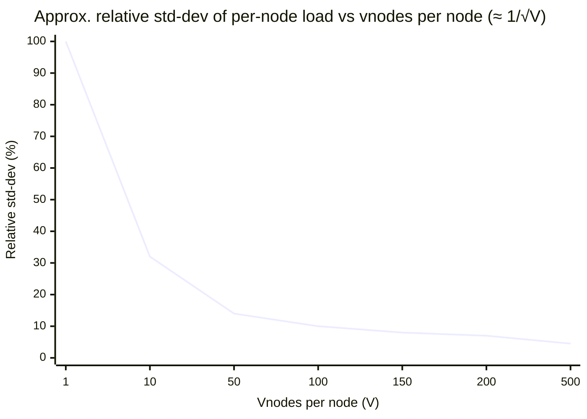

Back-of-envelope:
- Ideal share per node = 1/N.
- With V vnodes, the share ≈ the sum of V arcs, each with expected length 1/(NV), and the relative deviation ≈ 1/√V.
- V = 100 → ~10%, V = 150 → ~8%, V = 400 → ~5%.

Memory: N × V ring entries (e.g. 50 nodes × 150 = 7,500 entries, trivial). Lookup: O(log(N·V)).

Alternatives with better balance: **jump consistent hash** (near-perfect balance, no ring, but nodes numbered 0..N−1) and **Maglev hashing** (lookup table with near-perfect balance, used in load balancers).

#### Example
A team needed node load within ±10% for a 30-node cache. Simulation (hashing 10M synthetic keys) showed V = 50 gave a max deviation of ~22%, V = 150 about 9%, and V = 300 about 6%. They chose 160 vnodes and verified with production key samples, because real key distributions (skew, hot keys) matter more than the theoretical uniform case.

#### Trade-offs
More vnodes give better balance but more metadata and more ranges to move or repair (in replicated stores). Real-world skew in key popularity can dominate placement variance.

#### Problems & fixes
| Symptom | Cause | Fix |
|---|---|---|
| Imbalance despite many vnodes | skewed key popularity, not placement | hot-key mitigation, weighting by observed load |
| Ring metadata large in clients | thousands of nodes × many vnodes | jump hash / Maglev / rendezvous, coarser vnodes |
| Unknown balance quality | no measurement | simulate with real key samples, monitor per-node load |

#### Cheat sheet
- Relative std-dev ≈ 1/√V. V = 100 gives ~10%, V = 150 gives ~8%.
- Memory N×V, lookup O(log NV).
- Measure with real keys. Popularity skew needs separate handling.

#### Interview questions
<details><summary>Approximately how unbalanced is consistent hashing with a single token per node?</summary>

Very. Arc lengths follow roughly an exponential distribution, so some nodes own several times the average share. The maximum load is about O(log N) times the ideal 1/N. Virtual nodes fix it by summing many arcs per node, shrinking relative deviation to ≈ 1/√V.
</details>

<details><summary>How would you validate that your ring is balanced enough?</summary>

Simulate: place nodes with the chosen vnode count, hash a large sample of real (or realistic, skewed) keys, and compute per-node key counts and request-weighted load (using access frequencies). Check max/mean and p99 deviation, repeat for node additions and failures, and monitor per-node key and request counts in production.
</details>

#### Interview angle
> "Load deviation shrinks as one over root V, so about 150 vnodes gives roughly ±8%. I validate with real key samples, because popularity skew usually matters more than placement variance."

### Rendezvous hashing (HRW) — score = hash(key + node), assign to highest score; O(1) per lookup
Rendezvous (Highest Random Weight) hashing assigns each key to the node with the **highest score `hash(key, node)`**. Every client computes the same choice independently with no ring structure. Removing a node moves only the keys that chose it, and those spread evenly across the remaining nodes. Lookup cost is **O(N)** per key, computing a score for each node (it's O(1) memory per node, and fast for modest N).

#### How it works
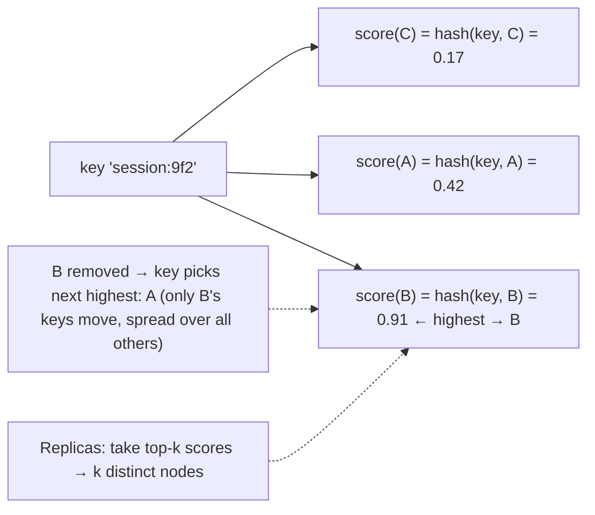

```java
String nodeFor(String key, List<String> nodes) {
  String best = null; long bestScore = Long.MIN_VALUE;
  for (String n : nodes) {
    long s = murmur3_64(key + "|" + n);       // deterministic per (key, node)
    if (s > bestScore) { bestScore = s; best = n; }
  }
  return best;
}
// weighted variant: score = -weight / ln(uniform(hash))
```

#### Example
A CDN or proxy layer with 20 cache servers routes each URL to the server with the highest HRW score, so the same URL always hits the same cache (high hit rate), without maintaining a ring. When a server is removed, only its URLs redistribute, evenly across all others. Top-3 scores give replica placement. Envoy's ring-hash and Maglev balancers and some distributed caches offer similar semantics. HRW is popular for small-to-medium N.

#### Trade-offs
Simple, perfect balance with good hash functions, natural top-k replicas and weights, no ring metadata, but O(N) per lookup (fine for tens or hundreds of nodes, costly for thousands unless combined hierarchically).

#### Problems & fixes
| Symptom | Cause | Fix |
|---|---|---|
| Lookup cost high with thousands of nodes | O(N) scoring | hierarchical HRW (pick group then node), skeleton-based variants |
| Unequal capacities | plain HRW assumes equal nodes | weighted HRW formula |
| Inconsistent node lists across clients | membership drift | shared discovery source |

#### Cheat sheet
- Choose the node with max hash(key, node). Minimal disruption, even redistribution.
- O(N) per lookup, no ring. Top-k for replicas. Weighted variant available.
- Great for tens or hundreds of nodes.

#### Interview questions
<details><summary>Consistent hashing ring vs rendezvous hashing: trade-offs?</summary>

The ring needs vnodes for balance and a sorted structure, but gives O(log N) lookups that scale to many nodes. Rendezvous needs no ring and gives excellent balance and simple weighted or top-k replica selection, but each lookup scores all N nodes (O(N)). For modest node counts HRW is simpler, and for very large clusters rings, jump hash or Maglev are more efficient.
</details>

<details><summary>How do you pick replica nodes with rendezvous hashing?</summary>

Compute the score for every node and take the top-k highest-scoring distinct nodes as the replica set (optionally filtering by failure domain, e.g. distinct racks). When a node leaves, each affected key replaces it with the next highest, so changes are minimal and spread evenly.
</details>

#### Interview angle
> "For tens of cache nodes I like rendezvous hashing: each key goes to the highest hash(key, node), there's no ring to maintain, top-k gives replicas, and only a removed node's keys move."

### Jump consistent hash — O(1) space, deterministic, minimal disruption; used in Guava
Jump consistent hash (Lamping and Veach, Google, 2014) maps a key to one of **N buckets numbered 0..N−1** with a tiny loop: O(1) memory, ~O(ln N) time, near-perfect balance, and when N grows to N+1 only ~1/(N+1) of keys move. The catch: buckets are just numbers, so you can **only add or remove at the end** (not arbitrary nodes).

#### How it works
```java
// Guava: Hashing.consistentHash(long input, int buckets) implements this
int jumpConsistentHash(long key, int numBuckets) {
  long b = -1, j = 0;
  while (j < numBuckets) {
    b = j;
    key = key * 2862933555777941757L + 1;                      // 64-bit LCG step
    j = (long) ((b + 1) * ((double) (1L << 31) / ((key >>> 33) + 1)));
  }
  return (int) b;
}
```

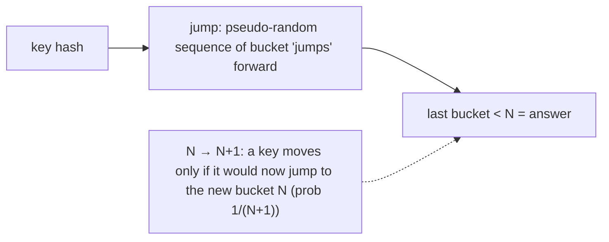

Compared with rings: no vnodes needed, perfect balance, no memory. But a removed bucket in the middle would reshuffle every bucket after it, so it fits **numbered shards** (storage shards, partitions), not arbitrary node membership.

#### Example
A time-series store with numbered storage shards (0..63) uses jump hash to map series ids to shards. Growing to 80 shards moves exactly ~20% of series (16/80), all to the new shards 64–79, with no ring to maintain and perfectly even shard sizes. Node failures are handled at a separate layer (each shard is replicated across machines), so shard numbers never disappear.

#### Trade-offs
Ideal balance and zero metadata for append-only bucket sets, but no arbitrary removal or weights, and it pairs best with a replication layer that hides node failures.

#### Problems & fixes
| Symptom | Cause | Fix |
|---|---|---|
| Removing a middle node reshuffles many keys | jump hash buckets must be contiguous | map buckets to replica groups; replace failed machines without renumbering |
| Need weights per node | not supported | multiple buckets per heavy node, or HRW |

#### Cheat sheet
- `jumpHash(key, N)` gives bucket 0..N−1. O(1) memory, perfect balance.
- N → N+1 moves ~1/(N+1) of keys, all to the new bucket.
- Only grow or shrink at the end. Use for numbered shards behind a replication layer.

#### Interview questions
<details><summary>When is jump consistent hash a better choice than a hash ring?</summary>

When buckets are a numbered sequence that only grows or shrinks at the end (logical shards, partitions) and each bucket is backed by a replicated group, so individual machine failures don't remove bucket numbers. It then gives perfect balance with no memory or ring maintenance and minimal movement on growth.
</details>

<details><summary>Why can't you remove an arbitrary node with jump hash?</summary>

Buckets are identified only by their index in 0..N−1. Removing bucket 5 of 10 means renumbering buckets 6–9 or shrinking N, which changes the mapping for keys in many buckets, not just those in bucket 5. The algorithm guarantees minimal movement only when adding or removing the last bucket.
</details>

#### Interview angle
> "For numbered logical shards backed by replicated groups, jump consistent hash gives perfect balance with zero metadata, and growing from N to N+1 shards moves only 1/(N+1) of keys."

### Geohash — encode (lat, lng) to base32 string; proximity = shared prefix; grid cells of varying size
Geohash encodes a latitude/longitude into a short **base32 string** by recursively bisecting the world and interleaving latitude and longitude bits. Each character adds precision, and **points with a shared prefix are in the same cell**, so nearby searches become **prefix lookups**, which ordinary B-tree indexes and key-value stores support.

#### How it works
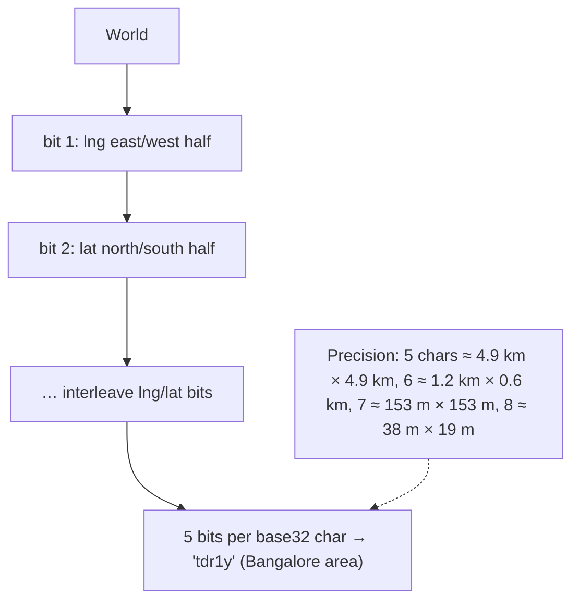

Nearby search: compute the user's geohash at a precision matching the search radius, query that cell **plus its 8 neighbours** (to handle points just across a cell edge), then filter by exact distance (haversine).

Storage options: a B-tree index on a geohash column (`WHERE geohash LIKE 'tdr1y%'`), Redis `GEOADD`/`GEOSEARCH` (uses 52-bit geohash in sorted sets), Elasticsearch `geo_point`, DynamoDB keys with a geohash prefix.

#### Example
A food-delivery "restaurants near me": restaurants stored with a 6-char geohash. For a 2 km search, query the user's 6-char cell and its 8 neighbours (9 indexed prefix queries, or one Redis `GEOSEARCH BYRADIUS 2 km`), compute exact distances, and sort by distance and rating. Driver locations (updated every 4 s) live in Redis GEO for fast radius queries.

#### Trade-offs
Simple, works with ordinary indexes and KV stores, and the hierarchy maps to string prefixes, but cells vary in shape (rectangles distort toward the poles), edge effects require neighbour searches, and the Z-order curve has jumps (nearby points can have very different hashes across cell boundaries).

#### Problems & fixes
| Symptom | Cause | Fix |
|---|---|---|
| Nearby items missed | point across cell boundary | always query the 8 neighbouring cells |
| Too many/too few results | wrong precision for radius | choose precision by radius, expand rings if needed |
| Dense areas overload one cell | uneven density | finer precision in dense areas, or quadtree/H3 |

#### Cheat sheet
- Interleaved lat/lng bits → base32. Shared prefix = same cell.
- Precision 5 ≈ 5 km, 6 ≈ 1 km, 7 ≈ 150 m.
- Query the cell + 8 neighbours, then filter by exact distance. Redis GEO uses geohash.

#### Interview questions
<details><summary>Why must a geohash proximity search include neighbouring cells?</summary>

A point can sit right at the edge of its cell, and its nearest neighbours may be in an adjacent cell with a completely different prefix (especially across major boundaries, like the equator or prime meridian, where prefixes share nothing). Querying only the user's cell would miss them, so you query the cell plus its 8 neighbours and then filter by real distance.
</details>

<details><summary>How would you store and query driver locations updated every few seconds?</summary>

Keep only the latest location per driver in an in-memory geo index: Redis `GEOADD drivers:{city} lng lat driverId` (sharded by city), queried with `GEOSEARCH … BYRADIUS 3 km WITHDIST COUNT 20`, with TTL-based or heartbeat cleanup of stale drivers. Stream location history to Kafka for analytics rather than writing every update to a database.
</details>

#### Interview angle
> "Nearby search uses geohash or Redis GEO at a precision matched to the radius, always querying the cell plus its eight neighbours and then filtering by haversine distance. Live driver locations stay in memory, sharded by city."

### Geohash edge cases — cells near the poles, cells on the prime meridian; requires neighbor search
Geohash's simplicity hides edge cases: **prefix boundaries** (points metres apart can share no prefix when they straddle the equator, prime meridian or any major cell boundary), **distortion** (cells shrink in width toward the poles, so a "cell" isn't a fixed distance), and the **antimeridian** (±180° longitude wraps). Correct systems always do neighbour expansion and exact distance filtering.

#### How it works
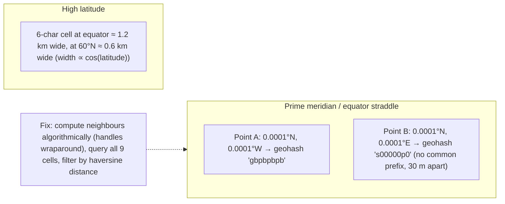

Other gotchas:
- **Radius vs precision**: at high latitudes a fixed precision covers less east-west distance, so pick precision per latitude or expand to more neighbour rings.
- **Large radii** may need many cells. Use a coarser precision then filter, or cover with a set of cells (like S2 region coverers).
- **Sorting by geohash ≠ sorting by distance** (Z-order jumps).

#### Example
A ride-hailing prototype in London matched riders only to drivers sharing a 6-character prefix. Riders standing near the Greenwich meridian (0° longitude) regularly saw "no drivers nearby" while drivers were 50 m away across the boundary (completely different prefixes). The fix: neighbour expansion (9 cells), an exact distance filter, and later a move to H3 cells with `gridDisk` rings for uniform neighbourhoods.

#### Trade-offs
Handling edge cases adds queries and code. Alternative grids (S2, H3) reduce distortion and give better-defined neighbourhoods, at the cost of more complex libraries.

#### Problems & fixes
| Symptom | Cause | Fix |
|---|---|---|
| Results vanish near specific lines | prefix discontinuity at boundaries | neighbour search, never prefix-only matching |
| Radius inaccurate at high latitudes | cell width shrinks with cos(lat) | latitude-aware precision, more rings |
| Wrong results across ±180° | antimeridian wrap ignored | library neighbour functions handling wrap |

#### Cheat sheet
- Close points can share no prefix (equator, meridian, cell edges).
- Cell width ∝ cos(latitude). Antimeridian wrap.
- Always: 9-cell search + exact distance. Consider S2/H3 for uniformity.

#### Interview questions
<details><summary>Two users are 20 metres apart but their geohashes share no prefix. How is that possible and what does it mean for your design?</summary>

Geohash cells are defined by recursive bisection, so points just on either side of a major boundary (the equator, the prime meridian, or any higher-level cell edge) fall into cells whose binary paths diverge at the first bit, giving no common prefix. Designs must never rely on prefix equality alone. They query neighbouring cells and filter by exact distance.
</details>

<details><summary>Why might you prefer H3 or S2 over geohash for a global ride-hailing system?</summary>

Geohash cells are rectangles whose size and shape distort with latitude and whose neighbourhoods are irregular at boundaries. S2 (cells on a sphere via a cube projection and a Hilbert curve) has better locality and region coverings. H3's hexagons have uniform neighbour distances and roughly equal areas per resolution, ideal for supply and demand analytics, surge pricing and k-ring searches.
</details>

#### Interview angle
> "Geohash has edge cases where points metres apart share no prefix across boundaries, and cells shrink toward the poles, so I always do a nine-cell neighbour search plus exact distance, and I'd prefer H3 or S2 for global systems."

### Quadtree — recursively subdivide 2D space into 4 quadrants; density-adaptive; used in Uber, Twitter
A quadtree recursively splits a 2D region into **four quadrants** whenever a node holds too many points. Dense areas (city centres) get deep, fine-grained subdivisions and sparse areas (oceans, deserts) stay coarse. That makes it **density-adaptive** for spatial indexing, nearest-neighbour and range queries.

#### How it works
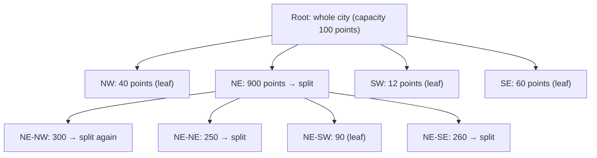

Queries: find all points in a bounding box (descend only into quadrants intersecting it), and nearest neighbours (search the containing leaf, then expand to neighbouring nodes until the k nearest are found). In-memory quadtrees handle frequent updates if points are re-inserted on move (or rebuilt periodically).

#### Example
A "nearby drivers" service (Uber's earlier geo approach discussed this idea) keeps an in-memory quadtree per city: drivers update locations every 4 s, and a rider request queries the leaf containing the rider and adjacent leaves, ranking drivers by ETA. Dense downtown areas split into small cells with ~50 drivers each, so lookups stay fast. Yelp-style "places near me" uses a static quadtree (places change rarely) built once and loaded into memory.

#### Trade-offs
Adapts to density with efficient range and kNN queries, but a dynamic tree with constant updates needs locking or rebuild strategies, it lives in memory (sharding by region needed), and distribution across machines is harder than with fixed grids (geohash/S2/H3 cell ids map to keys trivially).

#### Problems & fixes
| Symptom | Cause | Fix |
|---|---|---|
| Hotspot leaf in dense area | capacity threshold too high | lower capacity, deeper splits |
| Contention on updates | global lock on tree | shard by city/region, per-region trees, copy-on-write rebuilds |
| Hard to distribute across nodes | tree structure in memory | use cell ids (S2/H3) for partitioning, quadtree within shard |

#### Cheat sheet
- Split into 4 when a node exceeds capacity: deep in dense areas, shallow in sparse.
- Range and kNN queries descend only into relevant quadrants.
- In-memory, per-region shards. Rebuild or lock carefully under heavy updates.

#### Interview questions
<details><summary>Why is a quadtree better than a fixed grid for indexing restaurants across a country?</summary>

Density varies hugely: thousands of restaurants in a few city blocks, almost none in rural areas. A fixed grid is either too coarse in cities (cells with thousands of entries) or too fine in rural areas (millions of empty cells). A quadtree subdivides only where points are dense, keeping each leaf at a manageable size everywhere.
</details>

<details><summary>How would you handle millions of moving drivers with a quadtree?</summary>

Shard by city or region (one in-memory structure per shard on dedicated servers). Apply location updates by removing and re-inserting only when a driver changes leaf (most updates stay within the same leaf), or rebuild the tree periodically from a snapshot of positions. Serve queries from the latest structure, and keep authoritative last-known locations in Redis for recovery.
</details>

#### Interview angle
> "For density-varying data like restaurants I'd use a quadtree that subdivides where points are dense, sharded per city in memory. For partitioning across machines I prefer cell ids from S2 or H3."

### R-tree — spatial index for rectangles and polygons; used in PostGIS, MySQL Spatial, SQLite R*Tree
An R-tree indexes **spatial objects with extent** (rectangles, polygons, lines, not just points) by grouping nearby objects under **minimum bounding rectangles (MBRs)** in a balanced tree, like a B-tree for 2D. Queries such as "which polygons intersect this area?" or "which delivery zone contains this point?" descend only into nodes whose MBRs overlap the query.

#### How it works
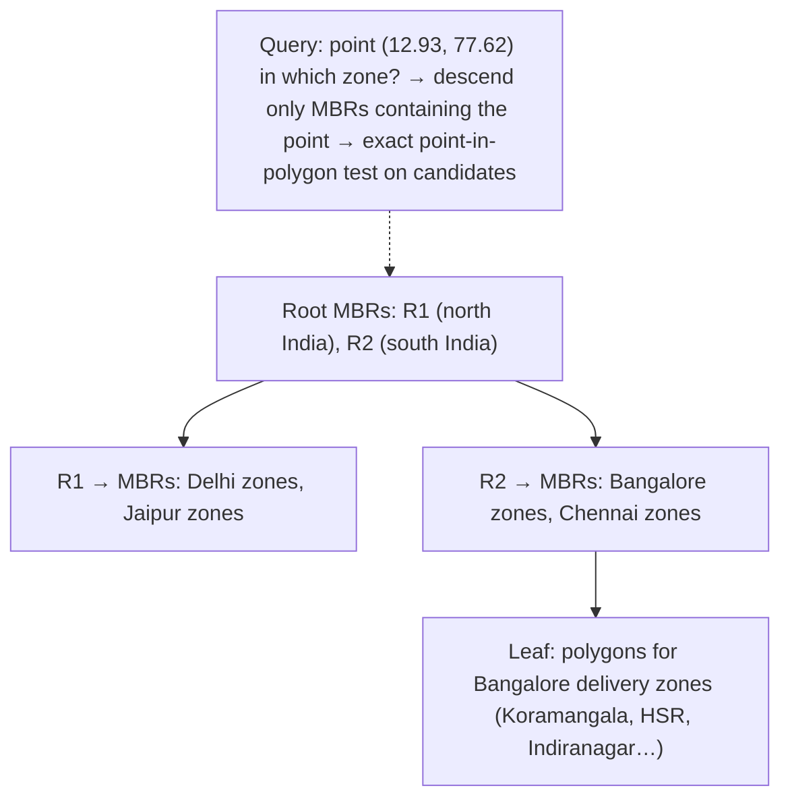

Variants: R*-tree (better splits, less overlap), Hilbert R-tree, GiST-based R-trees in PostgreSQL/PostGIS (`CREATE INDEX … USING GIST (geom)`).

```sql
CREATE INDEX idx_zones_geom ON delivery_zones USING GIST (geom);
SELECT zone_id FROM delivery_zones
WHERE ST_Contains(geom, ST_SetSRID(ST_MakePoint(77.62, 12.93), 4326));   -- index on MBR, then exact test
```

#### Example
A quick-commerce app assigns each order to a dark store based on serviceable polygons (irregular shapes drawn by ops). PostGIS with a GiST index on zone polygons answers "which zone contains this customer's location?" in ~1 ms among 20,000 zones. A geohash index can't represent irregular polygons well, but an R-tree handles them naturally.

#### Trade-offs
Handles shapes with extent and supports intersection, containment and nearest queries efficiently, but MBR overlap reduces pruning (bad splits mean more nodes to visit), updates are costlier than with fixed grids, and it's typically a single-node database index (sharding is up to you).

#### Problems & fixes
| Symptom | Cause | Fix |
|---|---|---|
| Spatial queries slow | no GiST/spatial index, or functions prevent index use | create GiST index, use index-aware predicates (ST_Contains, ST_DWithin) |
| Huge polygons slow exact tests | complex geometries | ST_Subdivide large polygons, simplify geometry |
| Distance queries wrong | degrees vs metres | geography type or projected SRID, ST_DWithin with metres |

#### Cheat sheet
- A tree of bounding rectangles for points, lines and polygons. Intersection and containment queries.
- PostGIS GiST, MySQL spatial, SQLite R*Tree.
- MBR filter then exact geometry test. Subdivide big polygons.

#### Interview questions
<details><summary>How would you determine which delivery zone (an irregular polygon) a customer address falls into, quickly?</summary>

Store zones as polygons in PostGIS with a GiST (R-tree) index and query `ST_Contains(zone.geom, point)`. The index filters candidates by bounding rectangles, then an exact point-in-polygon test runs on the few candidates. For very complex polygons, pre-subdivide them, and cache results per geohash cell if traffic is heavy.
</details>

<details><summary>R-tree vs geohash: when do you need an R-tree?</summary>

When indexing objects with extent (polygons, routes, regions) or needing intersection and containment queries ("which zones overlap this area?"). Geohash suits points and radius or prefix lookups in key-value stores. R-trees handle arbitrary shapes and spatial relationships inside spatial databases.
</details>

#### Interview angle
> "Serviceability zones are polygons, so they live in PostGIS with a GiST R-tree index. The bounding boxes prune candidates, then an exact contains test assigns each order to its dark store in about a millisecond."

### Google S2 — spherical geometry using Hilbert curve; uniform cell sizes at each level; used by Uber, Foursquare
Google's S2 library models the Earth as a **sphere** (projected onto a cube's 6 faces), divides each face hierarchically into cells (levels 0–30), and numbers cells along a **Hilbert curve**. Every cell has a **64-bit id**. Nearby cells usually have nearby ids (better locality than geohash's Z-order), and any region can be approximated by a small set of cells (**region coverings**).

#### How it works
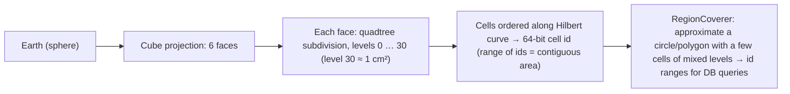

Useful levels: level 12 ≈ 3–6 km², level 13 ≈ 1 km², level 16 ≈ 0.02 km² (approximate, area varies ~2×).

Uses: radius and polygon searches as a handful of cell-id range scans in any ordered key-value store (Bigtable, Spanner, Cassandra clustering keys), sharding by cell, geofencing.

#### Example
A ride-hailing marketplace shards supply data by S2 level-12 cells. A rider's 3 km radius is covered by ~8–12 cells (mixed levels via RegionCoverer), each mapped to cell-id ranges, and drivers indexed by their level-16 cell ids in sorted storage are found with a few range scans. Google Maps, Foursquare and early Uber dispatch used S2. Pokémon Go used S2 cells for its spawn and gym grid.

#### Trade-offs
Accurate spherical geometry, good locality, flexible region coverings, and 64-bit ids fit any database. Cells are quadrilaterals with varying area (~2× across the globe), neighbour distances aren't uniform (unlike hexagons), and the library is more complex.

#### Problems & fixes
| Symptom | Cause | Fix |
|---|---|---|
| Too many ranges to scan | covering too fine | limit max cells in RegionCoverer, mixed levels |
| Missing edge results | covering too coarse/approximate | exact distance filter after cell candidates |
| Uneven shard load | dense cities in single cells | finer cells in dense areas, adaptive sharding |

#### Cheat sheet
- Sphere → cube faces → hierarchical cells on a Hilbert curve → 64-bit ids.
- Region coverings turn a circle or polygon into a few cell-id ranges for ordered stores.
- Used by Google, Foursquare, Uber (earlier). Always filter by exact distance.

#### Interview questions
<details><summary>Why is a Hilbert curve better than a Z-order curve (geohash) for spatial ids?</summary>

Both map 2D to 1D, but the Hilbert curve never makes big jumps between consecutive cells: consecutive ids are always adjacent cells, so a contiguous id range covers a compact area and fewer range scans are needed per region. The Z-order curve has large discontinuities at quadrant boundaries, so nearby areas can be far apart in id space.
</details>

<details><summary>How would you implement "find drivers within 3 km" with S2 in a key-value store?</summary>

Index each driver by the S2 cell id at a fine level (e.g. 16) as part of a sorted key (city + cellId + driverId). For a query, use RegionCoverer to cover the 3 km circle with a limited number of cells, convert each to an id range, scan those ranges, then filter candidates by exact distance and sort by ETA.
</details>

#### Interview angle
> "S2 maps the sphere onto Hilbert-ordered 64-bit cell ids, so a radius or polygon becomes a few id-range scans in any sorted store, followed by an exact distance filter."

### Uber H3 — hexagonal hierarchical grid; constant area per cell; better for analytics than quadtree
H3 (open-sourced by Uber) indexes the Earth into **hexagonal cells** at 16 resolutions (res 0 ≈ 4.3M km² down to res 15 ≈ 1 m²). Hexagons have **one kind of neighbour** (all 6 neighbours are equidistant from the centre), which makes **k-ring neighbourhoods**, smoothing, movement modelling and **supply and demand analytics** much cleaner than with squares or rectangles.

#### How it works
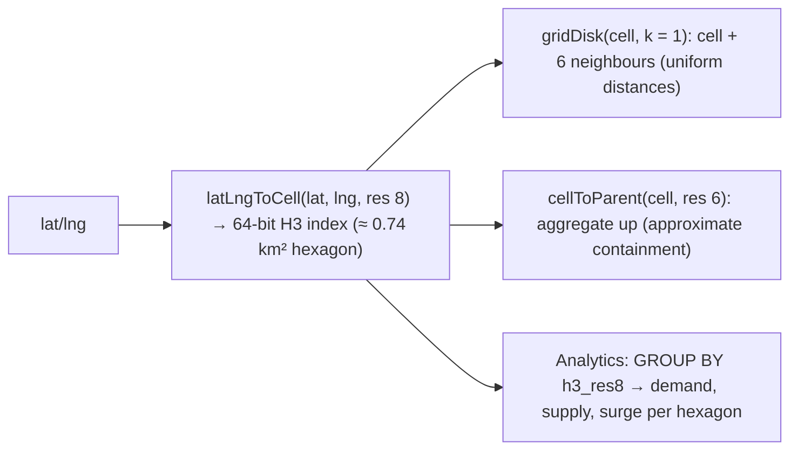

| Resolution | Avg area | Typical use |
|---|---|---|
| 6 | ~36 km² | city districts, regional aggregates |
| 7 | ~5.2 km² | neighbourhood surge zones |
| 8 | ~0.74 km² | dispatch, demand heatmaps |
| 9 | ~0.1 km² | block-level |

Note: parent hexagons don't perfectly contain their 7 children (hierarchy is approximate), unlike S2 or quadtree squares.

#### Example
Surge pricing: every ride request and available driver is tagged with its H3 res-8 cell. A stream job computes demand/supply ratios per cell every 30 s and smooths with k-ring neighbours (so surge doesn't jump sharply between adjacent cells). The pricing service looks up the rider's cell multiplier. Analysts aggregate trips by H3 cells in the warehouse (Snowflake, BigQuery and Databricks have H3 functions) for heatmaps and demand forecasting.

#### Trade-offs
Uniform neighbours and similar areas give excellent analytics and smoothing, and 64-bit ids index easily, but the hierarchy isn't exact (parent/child containment is approximate), the Earth can't be tiled with hexagons only (12 pentagons per resolution), and exact polygon coverage requires polyfill approximations.

#### Problems & fixes
| Symptom | Cause | Fix |
|---|---|---|
| Aggregations don't sum exactly across levels | approximate parent containment | aggregate from finest level, or use exact polygon assignment where needed |
| Edge artifacts near pentagons | 12 pentagons per resolution | rare (mostly in oceans), handle in library calls |
| Wrong resolution choice | too coarse/fine | choose by use case (dispatch res 8–9, regional 6–7) |

#### Cheat sheet
- Hexagonal hierarchical grid, 16 resolutions, 64-bit ids.
- Uniform neighbours: gridDisk k-rings for smoothing, ETAs, surge.
- Analytics-friendly. Parent/child containment is approximate.

#### Interview questions
<details><summary>Why do ride-hailing companies like hexagons for surge pricing zones?</summary>

Each hexagon has six neighbours at the same distance, so neighbourhood operations (k-rings for smoothing demand, nearby supply, movement between cells) are uniform in every direction. Square grids have two kinds of neighbours (edge and corner) at different distances, and geohash cells distort with latitude. Hexagons give smoother, fairer surge boundaries and cleaner spatial statistics.
</details>

<details><summary>H3 vs S2: how do you choose?</summary>

H3 for analytics and operations on uniform neighbourhoods: surge, heatmaps, demand forecasting, k-ring searches. S2 for exact hierarchical containment and region coverings (polygon queries via id ranges), indexing in ordered key-value stores and precise spherical geometry. Some systems use both: S2 for storage indexing, H3 for analytics.
</details>

#### Interview angle
> "For surge and demand analytics I'd tag events with H3 res-8 hexagons and smooth over k-rings, since all six neighbours are equidistant. S2 is my choice for exact containment and id-range indexing."
