## Indexing & lookup structures

### B+ tree — all data in leaf nodes linked in sorted order; O(log N) search + efficient range scans; used in all RDBMS
A B+ tree is a balanced, high-fan-out search tree where **internal nodes hold only routing keys** and **all records (or pointers) live in leaves**, which are **linked in sorted order**. Point lookups take O(log_B N) page reads (3–4 for billions of rows), and range scans walk the leaf chain sequentially. (Phase 2 covers query-level usage.)

#### Intuition
A phone directory with a guide at the top of each section. The guides only point you to the right page. The real entries are all on the bottom pages, in order, and each page tells you where the next one is.

#### Must know
- A balanced tree with a very high fan-out, so it is only **3–4 levels deep** even for billions of rows.
- **Internal nodes hold only routing keys. All rows live in the leaves.**
- Leaves are **linked in sorted order**, so a range scan walks along them.
- A full page **splits** on insert.
- Random keys cause splits all over the tree. Sequential keys append at the right edge.

#### Numbers to quote
- With roughly 400 keys per node, 4 levels cover billions of rows. A lookup costs 1–2 disk reads because the upper levels stay cached.

#### Common mistakes
- Random UUIDs as the primary key of a large table.
- Describing a B-tree and a B+ tree as the same thing.
- Forgetting that deletes leave half-empty pages (bloat).

#### How it works
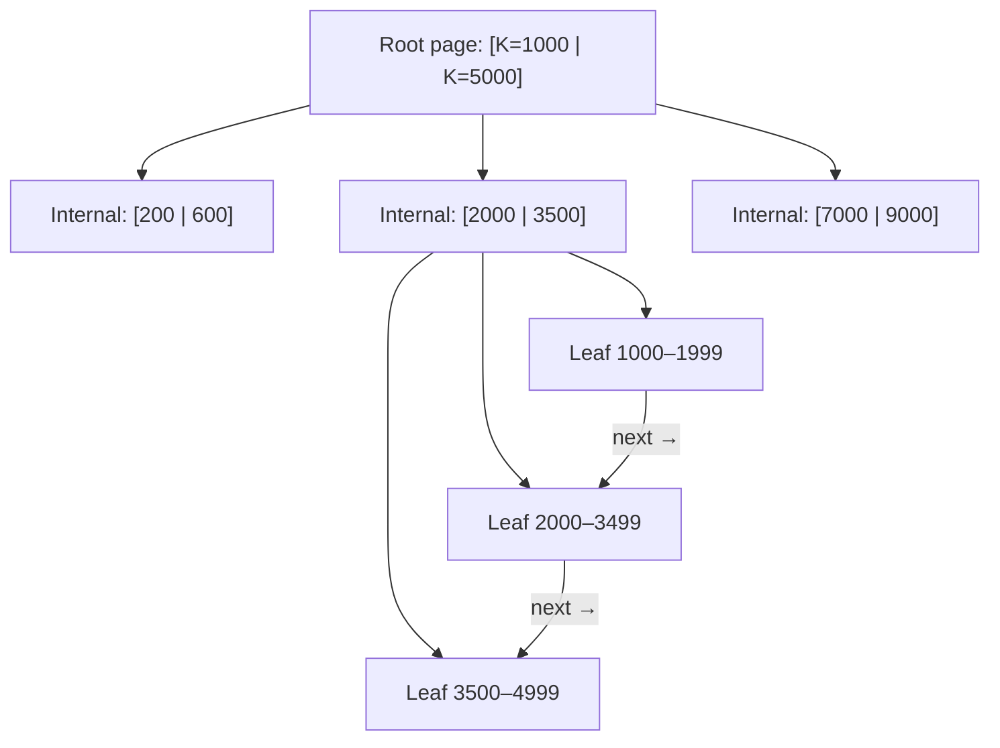

- Node = page (4–16 KB), fan-out 100–1000 keys, so height stays tiny.
- **Insert**: find leaf, insert sorted. If full, **split** and push a separator key up (splits can propagate to the root, which is how the tree grows).
- **Delete**: remove, then merge or redistribute when underfull (many engines tolerate underfull pages and rely on vacuum or rebuild).
- Concurrency: latch coupling / B-link trees. Durability via WAL.

#### Example
Height math: 16 KB pages with ~400 keys per internal node and ~100 rows per leaf: level 1 = 400 children, level 2 = 160k, level 3 = 64M leaves × 100 rows = 6.4 billion rows in 4 levels. The root and level-2 pages stay cached, so a lookup costs ~1–2 disk reads. `WHERE created_at BETWEEN …` finds the first leaf, then reads consecutive leaves.

#### Trade-offs
Excellent reads and ranges with predictable latency, but random inserts cause page splits and fragmentation, write amplification (whole-page writes), and concurrency control complexity.

#### Problems & fixes
| Symptom | Cause | Fix |
|---|---|---|
| Insert slowdown with random keys | splits all over the tree | sequential keys (UUIDv7, bigint) |
| Index bloat after deletes | half-empty pages | REINDEX/rebuild, fillfactor tuning |
| Hot right-most page contention | monotonic keys at high insert rates | hash-prefixed keys, partitioning |

#### Cheat sheet
- Data in linked leaves, routing in internal nodes. O(log_B N) with tiny height.
- Splits on insert, merges or tolerance on delete.
- Great for point and range reads. Random keys fragment it.

#### Interview questions
<details><summary>B-tree vs B+ tree: what's the difference and why do databases use B+ trees?</summary>

In a B-tree, records can live in internal nodes too. In a B+ tree, all records live in the leaves, internal nodes hold only keys (so fan-out is higher and the tree shallower), and leaves are linked for fast sequential range scans. Databases want shallow trees (fewer I/Os) and efficient range queries, so they use B+ trees.
</details>

<details><summary>What causes a B+ tree page split and why does it matter for performance?</summary>

Inserting into a full leaf requires splitting it into two half-full pages and inserting a separator key into the parent (which may split too). Splits cost extra writes and WAL, leave pages half empty (bloat), and with random keys happen all over the tree, causing random I/O. Sequential keys mostly append to the rightmost leaf, which reduces splits.
</details>

#### Interview angle
> "B+ trees keep data in sorted, linked leaves under a three-to-four-level tree, so point lookups take one or two I/Os and ranges are sequential. I choose sequential keys to avoid split storms."

#### Sources
- [B+ tree](https://en.wikipedia.org/wiki/B%2B_tree) — Wikipedia
- [The search tree (B-tree) makes the index fast](https://use-the-index-luke.com/sql/anatomy/the-tree) — Use The Index, Luke
- [B-tree indexes](https://www.postgresql.org/docs/current/btree.html) — PostgreSQL docs

### LSM tree — MemTable → immutable SSTable → leveled compaction; write-optimized; used in Cassandra, RocksDB, LevelDB
A Log-Structured Merge tree buffers writes in an in-memory sorted **memtable** (plus a WAL for durability), flushes it as an immutable sorted file (**SSTable**), and merges files in the background via **compaction**. Writes are sequential and fast. Reads may consult several files, helped by bloom filters and indexes. (Phase 3 covers the trade-offs.)

#### Intuition
A busy office that never files papers one by one. New papers go on a desk tray. When the tray is full it is sorted and boxed, and later the boxes are merged into bigger tidy boxes in the back room.

#### Must know
- Writes go to an in-memory sorted **memtable** and a write-ahead log.
- A full memtable is flushed to disk as an immutable sorted file, an **SSTable**.
- **Compaction** merges files in the background and drops old versions.
- **Writes are sequential and fast.** Reads may have to check several files.
- A delete is a marker (tombstone), removed later by compaction.

#### Common mistakes
- Calling it faster at everything. Reads and range scans cost more than in a B+ tree.
- Ignoring compaction, which causes write stalls when it falls behind.
- Heavy deletes that leave many tombstones.

#### How it works
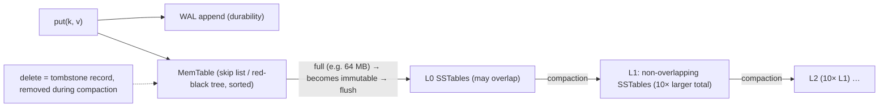

Components: WAL, memtable, immutable memtables, SSTables (sorted key-value blocks + index + bloom filter + metadata), the manifest (which files are in which level), and compaction strategies (leveled, tiered/universal, FIFO, time-window).

#### Example
RocksDB powers Kafka Streams state stores, CockroachDB (Pebble), TiKV, MyRocks and many more. A Kafka Streams aggregation updating 200k keys/s writes only to the WAL plus the memtable, flushes 64 MB SSTables every few seconds, and compacts in the background. A B-tree with random page updates would struggle at that write rate on the same disks.

#### Trade-offs
High write throughput and good compression, at the cost of read and space amplification, compaction CPU and I/O, and write stalls if compaction falls behind.

#### Problems & fixes
| Symptom | Cause | Fix |
|---|---|---|
| Write stalls | L0 file count or pending compaction limits | tune compaction threads, memtable size, faster disks |
| Slow reads | many SSTables per read | leveled compaction, bloom filters, block cache |
| Disk usage spikes | compaction temporary space / tombstones | headroom, compaction strategy, TTL with time-window |

#### Cheat sheet
- WAL + memtable → flush SSTables → compaction across levels.
- Writes sequential. Reads merge levels with bloom filters.
- Tune compaction. Watch stalls, tombstones and amplification.

#### Interview questions
<details><summary>What happens during an LSM flush and compaction?</summary>

Flush: when the memtable reaches its size limit, it becomes immutable and is written sequentially to disk as a new sorted SSTable (with an index and bloom filter), and its WAL segment can be discarded. Compaction: background jobs merge-sort overlapping SSTables into new ones, dropping overwritten values and expired tombstones, and move data into deeper levels, keeping read amplification and space under control.
</details>

<details><summary>What is a write stall in RocksDB/LSM engines?</summary>

When flushes or compactions can't keep up with incoming writes (too many L0 files, too much pending compaction bytes, too many immutable memtables), the engine deliberately slows or stops writes to prevent unbounded read amplification and memory growth. Fix by increasing compaction parallelism, tuning memtable and level sizes, using faster storage, or throttling ingestion.
</details>

#### Interview angle
> "LSM engines turn writes into WAL appends plus memtable inserts, flushed as immutable SSTables and merged by compaction. I tune compaction to avoid write stalls and rely on bloom filters for reads."

#### Sources
- [The log-structured merge-tree (LSM-tree)](https://www.cs.umb.edu/~poneil/lsmtree.pdf) — O'Neil, Cheng, Gawlick and O'Neil
- [RocksDB overview](https://github.com/facebook/rocksdb/wiki/RocksDB-Overview) — RocksDB wiki

### LSM read path — check bloom filter (each level) → check SSTable index → read data block; amortized O(log^2 N)
Reading a key in an LSM tree means checking newest data first: the **memtable**, then **immutable memtables**, then SSTables **level by level** (L0 files newest first, then one candidate file per deeper level). Per file, a **bloom filter** rules out absence, an **index** locates the block, and the **block cache** avoids disk reads. The first version found (value or tombstone) wins.

#### Intuition
Looking for a letter: check today's tray first, then the newest box, then older boxes. Each box has a label saying what is definitely not inside, so most boxes are skipped without being opened.

#### Must know
- Read order: **memtable, then SSTables from newest to oldest**. The first version found wins.
- For each file, a **bloom filter** says "definitely not here" and skips it.
- An index then points to the right block, often served from the block cache.
- A typical point read costs **about one disk read**.
- **Range scans cannot use bloom filters** and must merge every level.

#### Common mistakes
- Too many level-0 files after a write burst, which makes reads slow.
- A block cache so small that index and filter blocks get evicted.
- Expecting range scans to be as cheap as in a B+ tree.

#### How it works
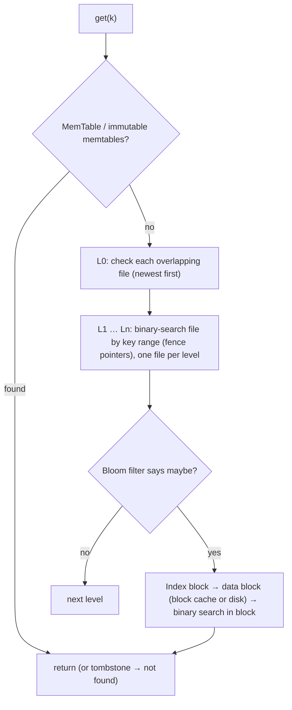

Complexity: O(L) levels × (bloom check + index search), where L ≈ log_T(N) for size ratio T. With bloom filters, most levels are skipped without I/O, so the typical cost is ~1 data block read for existing keys. Range scans (iterators) merge-sort across the memtable and every level, and bloom filters can't help them (prefix bloom filters can for prefix scans).

#### Example
A RocksDB-backed user-profile store showed p99 read latency spikes. Metrics revealed L0 file count bursts (flushes faster than L0→L1 compaction), so reads checked 20+ L0 files. Increasing compaction threads, raising `max_bytes_for_level_base` and enabling partitioned bloom filters with pinned index and filter blocks in the block cache brought p99 back from 30 ms to 3 ms.

#### Trade-offs
Fast point reads when filters and caches are well tuned, but reads are more variable than B-trees, range scans are costlier, and compaction health directly affects read latency.

#### Problems & fixes
| Symptom | Cause | Fix |
|---|---|---|
| Read latency spikes | many L0 files / compaction backlog | compaction tuning, L0 limits |
| Disk reads for absent keys | bloom filters missing/too small | ~10 bits/key filters, keep in cache |
| Slow range scans | merging many levels, tombstones | leveled compaction, fewer tombstones, prefix bloom |
| Index/filter blocks evicted | small block cache | pin index/filter blocks, larger cache |

#### Cheat sheet
- Memtable → L0 (all files) → one file per level (fence pointers) → bloom → index → block.
- Newest version wins. Tombstones hide older values.
- Health = L0 count, compaction backlog, cache hit rate.

#### Interview questions
<details><summary>Why is a point read in an LSM tree usually only about one disk I/O despite many levels?</summary>

The memtable and recent data often answer directly. For each SSTable level, fence pointers (key ranges) pick at most one candidate file, and its in-memory bloom filter rules it out with high probability if the key isn't there. Index and filter blocks are cached, so typically only the one data block containing the key is read from disk.
</details>

<details><summary>Why do range scans cost more in LSM trees than in B+ trees?</summary>

A range scan must open iterators on the memtable and on every level (and every overlapping L0 file), merge-sorting them while skipping overwritten versions and tombstones. Bloom filters don't help ranges. A B+ tree just walks one sorted leaf chain.
</details>

#### Interview angle
> "An LSM point read checks the memtable, then one fence-pointer-selected file per level behind bloom filters, usually costing one block read. Its health depends on L0 file count, compaction backlog and pinned filter blocks."

#### Sources
- [RocksDB Bloom filter](https://github.com/facebook/rocksdb/wiki/RocksDB-Bloom-Filter) — RocksDB wiki
- [Leveled compaction](https://github.com/facebook/rocksdb/wiki/Leveled-Compaction) — RocksDB wiki

### Skip list — probabilistic balanced structure; O(log N) average search/insert; used in Redis sorted sets
A skip list is a sorted linked list with **express lanes**: each node is promoted to higher levels with probability p (e.g. 1/2 or 1/4), so upper levels skip over many nodes. Search starts at the top level and drops down, giving **O(log N) expected** search, insert and delete, with simpler code and easier concurrency than balanced trees.

#### Intuition
A railway with express and local lines. You ride the express past many stations, switch to a slower line as you get close, and finish on the local line that stops everywhere.

#### Must know
- A sorted linked list with extra **express lanes** on top.
- Each node is promoted to a higher lane **at random**.
- Search, insert and delete are **O(log N) on average**.
- It is simpler than a balanced tree and easier to make concurrent.
- Used in **Redis sorted sets** and in LSM memtables.

#### Common mistakes
- Calling the O(log N) a guarantee. It is an expected value.
- Using it for on-disk data, where a B-tree has better locality.
- Forgetting that Redis pairs it with a hash map for lookup by member.

#### How it works
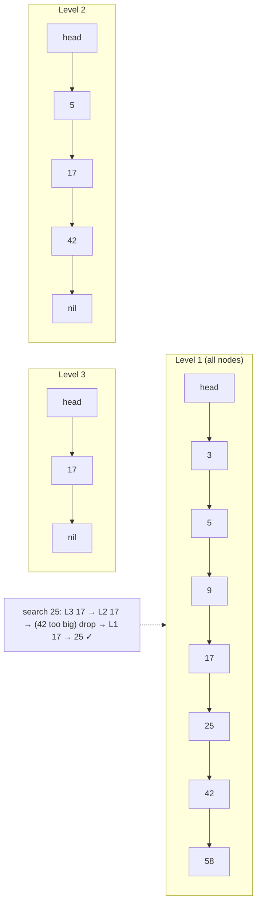

Properties: expected height O(log N), space O(N) (~1/(1−p) pointers per node), ordered iteration and range queries. Lock-free variants exist (Java's `ConcurrentSkipListMap`).

#### Example
Redis sorted sets (ZSET) use a skip list plus a hash map: the hash map gives O(1) score lookup by member, and the skip list gives ordered operations: `ZADD` (O(log N)), `ZRANGE` by rank, `ZRANGEBYSCORE` (range), and `ZRANK` (rank via span counters stored in the skip list's links). LevelDB and RocksDB use skip lists for memtables, and Java's `ConcurrentSkipListMap` backs concurrent sorted maps.

#### Trade-offs
Simple, concurrency-friendly and good for ordered in-memory data, but probabilistic (bad luck means worse performance, though rare), more pointer overhead than arrays, and worse cache locality than B-trees for disk-based data.

#### Problems & fixes
| Symptom | Cause | Fix |
|---|---|---|
| Memory overhead too high | many levels/pointers | lower promotion probability (p = 1/4) |
| Poor cache performance | pointer chasing | B-tree/array-based structures for hot paths |
| Contention in concurrent sorted map | locking structures | lock-free skip list (ConcurrentSkipListMap) |

#### Cheat sheet
- Layers of linked lists, promotion probability p. O(log N) expected.
- Ordered operations and ranges. Easy concurrency (lock-free variants).
- Redis ZSET (skip list + hash), LevelDB/RocksDB memtables, ConcurrentSkipListMap.

#### Interview questions
<details><summary>Why does Redis use a skip list for sorted sets instead of a balanced tree?</summary>

Skip lists offer the same O(log N) expected complexity for insert, delete and range queries, with simpler implementation and easy support for rank operations (storing spans on links). Range iteration is a simple linked-list walk, and memory and performance are comparable. Antirez cited simplicity and ease of tuning as key reasons.
</details>

<details><summary>Why are skip lists popular for LSM memtables?</summary>

Memtables need fast concurrent inserts and sorted iteration (for flushing to sorted SSTables). Skip lists support lock-free or fine-grained concurrent inserts and in-order traversal easily, without the rebalancing complexity of concurrent balanced trees.
</details>

#### Interview angle
> "Skip lists give O(log N) ordered operations with simple, concurrency-friendly code, which is why they back Redis sorted sets, with rank via span counters, and LSM memtables."

#### Sources
- [Skip list](https://en.wikipedia.org/wiki/Skip_list) — Wikipedia
- [Redis sorted sets](https://redis.io/docs/latest/develop/data-types/sorted-sets/) — Redis docs

### Trie (prefix tree) — O(m) lookup by prefix where m = key length; used in autocomplete, IP routing
A trie stores strings character by character along tree paths, so all keys sharing a prefix share a path. Lookup, insert and prefix search take **O(m)** for key length m, independent of how many keys exist, which makes tries natural for **autocomplete**, spell checking, IP longest-prefix matching and dictionaries.

#### Intuition
A dictionary laid out as branching paths: follow "c", then "a", then "t". Every word that starts with "ca" lies down the same first two steps.

#### Must know
- Keys are stored **character by character** along tree paths.
- Keys with a common prefix **share a path**.
- Lookup and prefix search take **O(key length)**, whatever the number of keys.
- For autocomplete, each node stores its **precomputed top-K completions**.
- It is memory-heavy, so real systems compress it.

#### Common mistakes
- Walking the whole subtree on every autocomplete request.
- A node per character with full pointer arrays, which wastes memory.
- Building suggestions from raw query logs with no filtering.

#### How it works
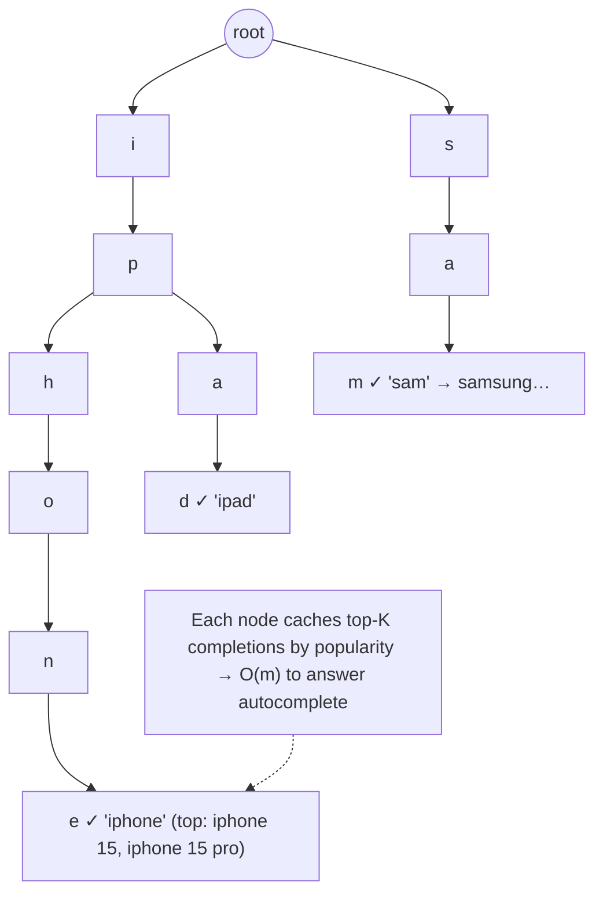

For autocomplete, each node stores the **top-K suggestions** for its prefix (precomputed from query logs), so answering is O(prefix length) with no subtree traversal at query time.

#### Example
Search autocomplete for an e-commerce site: an offline job builds a trie from the last 30 days of queries weighted by frequency and conversions, with each node storing the top 10 completions. The trie (or a serialised form) is loaded in memory on suggestion servers and refreshed hourly. Typing "iph" returns ["iphone 15", "iphone 15 pro", "iphone case"] in under a millisecond. Hot prefixes are also cached at the CDN. Alternatives at large scale: Elasticsearch completion suggester (FST-based).

#### Trade-offs
Fast prefix operations, but memory-heavy (node per character, pointers), poor cache locality, and updates to top-K need rebuilding or careful maintenance. Compressed tries (radix trees, FSTs) reduce memory.

#### Problems & fixes
| Symptom | Cause | Fix |
|---|---|---|
| Huge memory | node per character | radix/Patricia tries, FSTs, arrays for children |
| Slow autocomplete | traversing subtree for each query | precompute top-K per node |
| Stale suggestions | infrequent rebuilds | periodic rebuild + real-time trending layer |
| Offensive suggestions | raw query logs | filtering/blocklists before building |

#### Cheat sheet
- Characters along paths. O(m) lookup and prefix search.
- Autocomplete: top-K per node, precomputed offline, cached.
- Memory-heavy, so compress (radix, FST).

#### Interview questions
<details><summary>Design the data structure behind search autocomplete for 100M daily queries.</summary>

Aggregate query logs offline (e.g. hourly) into frequencies with decay and filtering. Build a trie where each node stores the top K completions for its prefix, then serialise it compactly (radix trie/FST) and load it into memory on stateless suggestion servers, sharded by prefix if needed. Queries take O(prefix length). Cache hot prefixes in Redis or the CDN, debounce on the client, and add a real-time trending layer merged at query time.
</details>

<details><summary>How are tries used in IP routing?</summary>

Routers store prefixes (like 10.0.0.0/8, 10.1.0.0/16) in a binary or compressed trie keyed by address bits. Looking up a destination walks the trie bit by bit, remembering the last matching prefix, which yields the longest prefix match (the most specific route) in O(32) or O(128) steps for IPv4 or IPv6.
</details>

#### Interview angle
> "Autocomplete is a trie whose nodes store precomputed top-K completions, built offline from weighted query logs and served from memory and the CDN, so lookups are O(prefix length)."

#### Sources
- [Trie](https://en.wikipedia.org/wiki/Trie) — Wikipedia
- [Suggesters: completion suggester](https://www.elastic.co/docs/reference/elasticsearch/rest-apis/search-suggesters) — Elasticsearch docs

### Compressed trie (Patricia/Radix tree) — merge single-child nodes; O(m) space instead of O(m²)
A radix tree (compressed trie, Patricia trie) **merges chains of single-child nodes into one edge labelled with a string**. Lookups are still proportional to key length, but the number of nodes drops to O(number of keys), dramatically reducing memory and pointer chasing compared with a plain trie.

#### Intuition
Road directions that say "follow this road for 5 km" in place of listing every house you pass. Long stretches with no junction are collapsed into one step.

#### Must know
- A trie where each **chain of single-child nodes is merged into one edge** labelled with a string.
- The number of nodes drops to about the **number of keys**.
- Lookup is still proportional to key length.
- Used in HTTP routers, IP routing tables and Redis internals.
- Insert and delete are more complex, because edges split and merge.

#### Common mistakes
- A plain trie for long keys with unique tails, which explodes in memory.
- A router that checks every route pattern in order.
- No rule for static segments versus parameters (`/users/new` against `/users/:id`).

#### How it works
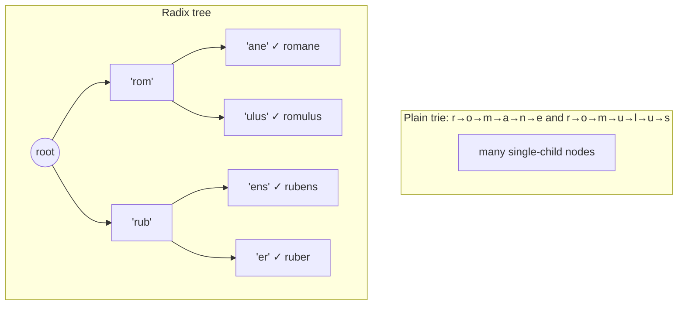

Where you see them:
- **HTTP routers**: Go's httprouter/Echo/Gin, Node's find-my-way match `/users/:id/orders` routes in O(path length).
- **Linux kernel** routing tables and radix trees for page cache indexing.
- **Ethereum** Merkle Patricia Trie for state.
- **Redis**: rax (radix tree) for Streams ids and Cluster key tracking.
- **IP longest-prefix match** (Patricia tries in BSD routing).

#### Example
An API gateway's routing table with 3,000 routes was implemented as a list of regexes checked in order (O(routes) per request, ~200 µs). Switching to a radix-tree router made matching O(path length) (~2 µs) and gave deterministic precedence (static segments before parameters). Envoy and many gateways use similar tree-based matching.

#### Trade-offs
Much smaller than plain tries with fast prefix matching, but more complex insert and delete (splitting and merging edges), and still pointer-based (cache locality varies). Adaptive radix trees (ART) improve locality.

#### Problems & fixes
| Symptom | Cause | Fix |
|---|---|---|
| Plain trie memory explosion | node per character | radix tree / ART |
| Ambiguous routes (`/users/new` vs `/users/:id`) | unclear precedence | static segments take priority, conflict detection at registration |

#### Cheat sheet
- Compress single-child chains into labelled edges. Nodes ≈ number of keys.
- HTTP routers, IP routing, Redis rax, Ethereum MPT, kernel radix trees.
- ART for cache-friendly in-memory indexes.

#### Interview questions
<details><summary>Why do fast HTTP routers use radix trees?</summary>

Matching a request path against thousands of routes by checking each pattern is linear in route count. A radix tree shares common path prefixes (`/api/v1/users…`) in compressed edges, so matching walks the tree along the path in O(path length) regardless of route count, with clear precedence between static and parameter segments.
</details>

<details><summary>How does a radix tree reduce memory compared with a plain trie?</summary>

A plain trie creates a node per character, and long keys with unique suffixes create long chains of nodes that each have one child. A radix tree collapses each chain into a single edge labelled with the substring, so the number of nodes is bounded by about twice the number of keys, rather than the total number of characters.
</details>

#### Interview angle
> "Radix trees compress single-child chains, so prefix matching stays O(key length) with node count near the key count. That's why gateways and HTTP routers use them for thousands of routes."

#### Sources
- [Radix tree](https://en.wikipedia.org/wiki/Radix_tree) — Wikipedia
- [httprouter](https://github.com/julienschmidt/httprouter) — Julien Schmidt, GitHub

### Inverted index — term → postings list (docID, frequency, position offsets); foundation of all search engines
An inverted index maps each **term** to a **postings list**: the documents containing it, often with term frequency and positions. Answering "documents containing *red* AND *shoes*" means intersecting two sorted postings lists instead of scanning every document. It's the core structure of Lucene, Elasticsearch, OpenSearch, Solr and Postgres full-text search (GIN).

#### Intuition
The index at the back of a book. You look up a word and get the page numbers where it appears. You do not read every page to find it.

#### Must know
- It maps each **term to the list of documents** containing it (the postings list).
- A query for two words **intersects two sorted lists**.
- Text is analysed first: tokenised, lowercased, stemmed.
- Stored positions make phrase queries possible.
- Lucene writes immutable segments, so new documents are searchable after a short refresh.

#### Numbers to quote
- Elasticsearch refreshes about once per second by default, so search is near real time.

#### Common mistakes
- `LIKE '%word%'` on a large table in place of a search index.
- Different analysers at index time and query time, so obvious matches are missed.
- Expecting a document to be searchable the instant it is written.

#### How it works
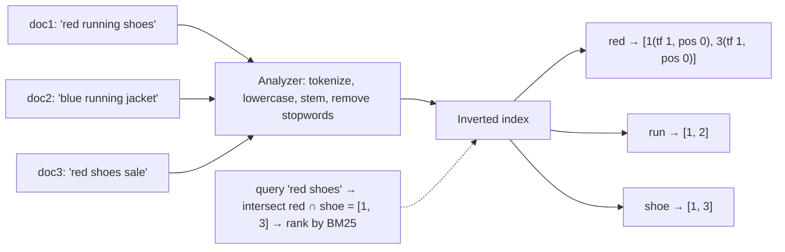

Details:
- Postings sorted by doc id, **delta-encoded and compressed** (variable-byte, PForDelta, roaring bitmaps), with **skip lists** inside postings for fast intersections.
- Positions enable **phrase queries** ("red shoes" adjacent).
- Lucene writes immutable **segments** (like LSM SSTables), merged in the background. Deletes are marked in bitsets.
- Ranking (BM25) uses term frequency, document frequency and field length.

#### Example
A product search over 20M items: Elasticsearch builds inverted indexes per field (title, brand, description) with analyzers (stemming, synonyms like "tee → t-shirt"). Query "red nike shoes" intersects postings, scores with BM25 plus boosts (popularity, in-stock), and filters by price with doc values (columnar storage), in about 30 ms. A SQL `LIKE '%shoes%'` scan over 20M rows takes seconds.

#### Trade-offs
Very fast text queries and relevance ranking, but index build and update cost (near-real-time refresh, not immediate), storage overhead, and analyzers to tune (language and synonym quirks).

#### Problems & fixes
| Symptom | Cause | Fix |
|---|---|---|
| Searches miss obvious matches | analyzer mismatch (stemming, case, synonyms) | consistent index/query analyzers, synonym sets |
| New docs not searchable immediately | refresh interval (near real time) | refresh=wait_for for critical writes, accept ~1 s |
| Slow queries on common terms | huge postings lists | filters before scoring, caching, stopwords, shard sizing |

#### Cheat sheet
- Term → sorted, compressed postings (doc ids, tf, positions).
- AND = intersection, OR = union. Positions for phrases. BM25 ranking.
- Immutable segments + merges (LSM-like). Analyzers matter.

#### Interview questions
<details><summary>How does a search engine answer "red AND shoes" over 100M documents in milliseconds?</summary>

Look up each term's postings list in the term dictionary, then intersect the two sorted, compressed lists, starting from the rarer term and using skip pointers to jump ahead in the longer list. Only matching documents are scored (BM25) and the top-k kept in a heap, with no full scan of the documents.
</details>

<details><summary>Why are Lucene segments immutable, and what are the consequences?</summary>

Immutable segments allow lock-free concurrent reads, aggressive compression, filesystem caching and simple crash recovery. New documents are written into new segments (visible after a refresh), deletes and updates are marked in deletion bitsets, and background merges combine segments and purge deleted docs. The consequences are near-real-time visibility and merge I/O overhead.
</details>

#### Interview angle
> "Search runs on inverted indexes: analyzed terms map to compressed postings intersected with skip pointers and scored with BM25, in immutable Lucene segments that refresh roughly every second."

#### Sources
- [Elasticsearch from the bottom up](https://www.elastic.co/blog/found-elasticsearch-from-the-bottom-up) — Elastic blog
- [Inverted index](https://en.wikipedia.org/wiki/Inverted_index) — Wikipedia

### Term dictionary — sorted list of all terms; binary search or trie for lookup; stored in SSTable-like format
The term dictionary maps every indexed **term to the location of its postings list** (plus statistics like document frequency). It must be compact and fast to search: Lucene stores terms sorted in blocks and indexes them with an in-memory **FST** (finite state transducer, a compressed trie-like automaton), enabling prefix, fuzzy and range term lookups.

#### Intuition
The alphabetical list of headwords in the book's index. Before you can read the page numbers for a word, you have to find the word itself, and a sorted list makes that quick.

#### Must know
- It maps every indexed **term to the location of its postings list**.
- Terms are kept **sorted**, with a compact in-memory index on top.
- Lucene's index is an **FST**, a compressed trie-like structure.
- Sorted terms make **prefix queries fast**.
- A **leading wildcard** (`*shoe`) cannot use the sort order.

#### Common mistakes
- Leading-wildcard queries on a big index.
- Indexing ids as analysed text, which bloats the dictionary.
- Unlimited fuzzy matching over a huge dictionary.

#### How it works


Capabilities enabled by sorted terms plus an FST: exact lookup, prefix queries (`sho*`), range queries on terms, fuzzy queries via Levenshtein automata intersected with the FST, and autocomplete (completion suggester uses FSTs with weights).

#### Example
An Elasticsearch cluster with high heap usage traced it partly to terms-index memory on fields with huge cardinality (unique ids indexed as `text` with n-grams). Mapping id fields as `keyword` without n-grams, disabling norms where scoring wasn't needed, and moving autocomplete to a dedicated completion field cut heap use by 40%. (Newer Lucene versions moved the terms index off-heap.)

#### Trade-offs
FSTs are extremely compact and fast but immutable (rebuilt per segment) and complex. High-cardinality fields (ids, timestamps as text, n-grams) inflate dictionary size.

#### Problems & fixes
| Symptom | Cause | Fix |
|---|---|---|
| Large index/heap usage | high-cardinality text fields, n-grams everywhere | keyword fields for ids, targeted n-grams, edge n-grams only where needed |
| Slow wildcard queries (`*shoe*`) | leading wildcards can't use sorted prefix | n-gram fields, reverse-token tricks, avoid leading wildcards |
| Fuzzy queries expensive | large automata over big dictionaries | limit fuzziness, prefix_length, max_expansions |

#### Cheat sheet
- Sorted terms in blocks + an in-memory FST index → postings offsets + stats.
- Supports exact, prefix, range and fuzzy term lookups. Powers completion.
- Watch high-cardinality fields and leading wildcards.

#### Interview questions
<details><summary>Why can prefix queries be fast but leading-wildcard queries slow in search engines?</summary>

The term dictionary is sorted, so a prefix query seeks to the first term with that prefix and scans forward over a contiguous range. A leading wildcard (`*shoe`) has no fixed prefix, so the engine must examine every term in the dictionary (or use special n-gram or reversed-term indexes), which is expensive for large dictionaries.
</details>

<details><summary>What is an FST and why does Lucene use it?</summary>

A finite state transducer is a minimal automaton that shares both prefixes and suffixes of sorted keys and maps each key to an output (like a block pointer). It compresses millions of terms into a small structure that supports fast exact and prefix traversal and intersection with automata (fuzzy, regex), ideal for an in-memory terms index and the completion suggester.
</details>

#### Interview angle
> "The term dictionary keeps sorted term blocks indexed by an FST, so exact, prefix and fuzzy lookups are cheap. I map ids as keyword fields and avoid leading wildcards to keep it small and fast."

#### Sources
- [Lucene index file formats: term dictionary](https://lucene.apache.org/core/10_0_0/core/org/apache/lucene/codecs/lucene912/package-summary.html) — Apache Lucene docs
- [Using finite state transducers in Lucene](https://blog.mikemccandless.com/2010/12/using-finite-state-transducers-in.html) — Mike McCandless

### Merkle tree — hash tree: leaf = hash(data), parent = hash(children); detect inconsistencies between replicas
A Merkle tree hashes data blocks into leaves and builds parents by hashing their children, up to a single **root hash** that summarises everything. Comparing two roots tells you instantly whether datasets differ. Descending only into mismatched subtrees finds **exactly which blocks differ** in O(log n) comparisons. It also enables **inclusion proofs** (prove one item is in the set with log n hashes).

#### Intuition
A fingerprint of fingerprints. Each chapter of two copies of a book gets a fingerprint, and those are combined into one for the whole book. If the book fingerprints match, the copies are identical. If not, you compare halves to find the chapter that differs.

#### Must know
- Leaves are hashes of data blocks. Each parent is the hash of its children.
- The single **root hash summarises everything**.
- Equal roots mean identical data.
- If roots differ, descend only into mismatching branches to find the differing blocks.
- An **inclusion proof** shows an item is in the set using about log n hashes.

#### Common mistakes
- Leaves that each cover too much data, so one small difference forces a large transfer.
- Rebuilding the whole tree on every change.
- Thinking it is only for blockchains. Git, Cassandra and certificate logs use it.

#### How it works
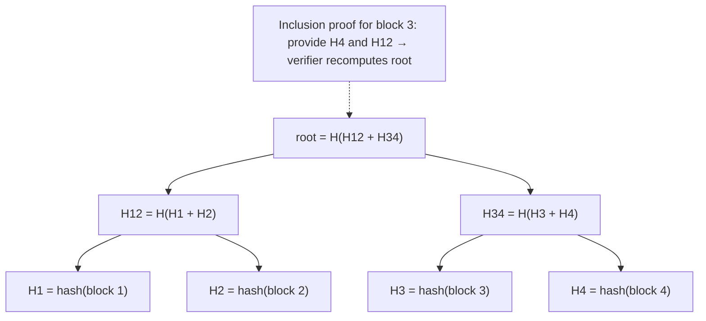

Uses: replica anti-entropy (Cassandra, DynamoDB internals, Riak), Git (commits and trees are Merkle DAGs), blockchains (transactions in blocks, light-client proofs), certificate transparency logs (append-only proofs), IPFS/content addressing, ZFS and Btrfs data integrity, and backup deduplication (rsync-like sync).

#### Example
Certificate Transparency: every TLS certificate issued is appended to public Merkle-tree logs. Browsers can verify a certificate is in the log with an inclusion proof (~20 hashes for millions of entries), and monitors verify consistency proofs that the log only appended entries, which makes mis-issued certificates detectable.

#### Trade-offs
Efficient difference detection and tamper evidence, but trees must be rebuilt or updated as data changes (hashing cost), and the granularity of leaves trades precision against tree size.

#### Problems & fixes
| Symptom | Cause | Fix |
|---|---|---|
| Large transfers despite small differences | coarse leaves (each covers huge ranges) | finer leaves / deeper trees |
| High CPU building trees | rebuilding entire tree frequently | incremental updates, build per range on schedule |
| Second-preimage attacks on naive trees | same hashing for leaves and nodes | domain-separate leaf vs internal hashes |

#### Cheat sheet
- Leaves = hash(data), parents = hash(children), root summarises all.
- Compare roots, then descend into mismatches. Inclusion proofs with log n hashes.
- Anti-entropy, Git, blockchain, CT logs, filesystems.

#### Interview questions
<details><summary>How do Merkle trees let two replicas sync efficiently?</summary>

Each replica builds a Merkle tree over the same key ranges. They exchange root hashes, and if equal they're identical. If not, they compare children and recurse only into subtrees whose hashes differ, quickly isolating the specific ranges that diverge, and then transfer only those ranges' data instead of the whole dataset.
</details>

<details><summary>What is a Merkle inclusion proof?</summary>

To prove an item is part of a dataset with a known root hash, you provide the item plus the sibling hashes along its path to the root (log₂ n hashes). The verifier hashes the item, combines it with the siblings level by level, and checks the result equals the trusted root, which proves inclusion without seeing the rest of the data.
</details>

#### Interview angle
> "Merkle trees summarise a dataset in one root: replicas compare roots and descend into mismatched subtrees to sync only the differences, and logs give log-n inclusion proofs."

#### Sources
- [Merkle tree](https://en.wikipedia.org/wiki/Merkle_tree) — Wikipedia
- [How CT works](https://certificate.transparency.dev/howctworks/) — Certificate Transparency

### Merkle tree in Cassandra — compare replicas without transferring all data; send tree hashes instead
During **anti-entropy repair**, each Cassandra replica builds a **Merkle tree for a token range** (validation compaction), the coordinator collects trees from all replicas, compares them, and replicas **stream only the sub-ranges whose hashes differ**. This keeps replicas convergent without shipping terabytes. (Phase 3 covers repair operations.)

#### Intuition
Two branch offices check their ledgers by reading out a checksum per section over the phone. Only the sections whose checksums differ get couriered across.

#### Must know
- During **repair**, each replica builds a Merkle tree for a token range.
- The trees are compared, and **only mismatching sub-ranges are streamed**.
- Building a tree reads all the data in the range, which is I/O heavy.
- Coarse leaves cause **overstreaming**: more data is sent than actually differs.
- Repair smaller sub-ranges, and finish every cycle within `gc_grace_seconds`.

#### Numbers to quote
- `gc_grace_seconds` defaults to 10 days.

#### Common mistakes
- Full-range repairs on large nodes.
- Skipping repairs, so deleted data comes back.
- Unthrottled repairs during peak traffic.

#### How it works
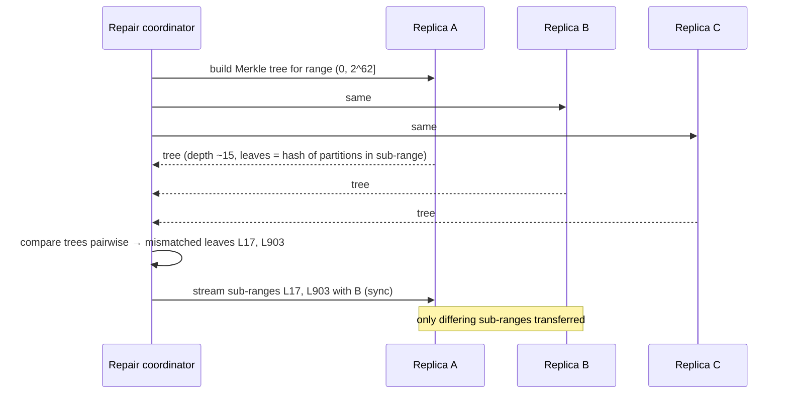

Details: building trees reads all data in the range (validation compaction, I/O heavy). Tree depth is limited (default max ~2^20 leaves), so very large ranges mean coarse leaves, which causes **overstreaming** (sending more than needed). **Subrange repairs** (Reaper) reduce data per tree, making leaves finer and repairs more incremental. Incremental repair marks repaired SSTables so later trees cover only new data.

#### Example
A 2 TB-per-node cluster ran full repairs per node: each validation took hours and overstreamed tens of GB because each leaf covered huge ranges. With Cassandra Reaper running subrange repairs (thousands of small ranges, throttled, continuous), each tree covered less data, mismatches streamed MBs, and a full cycle completed within 4 days (well within gc_grace of 10 days).

#### Trade-offs
Efficient convergence and essential for correctness, but validation compaction is I/O-heavy, coarse trees overstream, and repairs need orchestration and monitoring.

#### Problems & fixes
| Symptom | Cause | Fix |
|---|---|---|
| Repairs take forever, impact latency | full-range repairs on big nodes | subrange repairs, throttling, Reaper |
| Overstreaming (more data than needed) | coarse Merkle leaves | smaller ranges per repair |
| Zombie data after missed repairs | repairs not within gc_grace | schedule and monitor repair completion |

#### Cheat sheet
- Repair: each replica builds a Merkle tree per range, compare, stream differing sub-ranges.
- Validation reads all data in the range, which is I/O heavy. Coarse leaves overstream.
- Subrange + incremental repairs (Reaper), within gc_grace.

#### Interview questions
<details><summary>What is overstreaming in Cassandra repair and how do you reduce it?</summary>

Merkle tree depth is limited, so for a large token range each leaf covers many partitions. One tiny difference marks the whole leaf as mismatched, and all its partitions are streamed, far more than necessary. Reduce it by repairing smaller subranges (more trees with finer leaves), using incremental repair, and running repairs regularly so differences stay small.
</details>

<details><summary>Why is building Merkle trees for repair expensive?</summary>

To hash the data in a range, each replica must read every partition in that range from its SSTables (validation compaction), which uses disk I/O and CPU proportional to the data size, competing with normal traffic. That's why repairs are throttled, split into subranges and scheduled.
</details>

#### Interview angle
> "Cassandra repair compares per-range Merkle trees and streams only mismatched sub-ranges. I run throttled subrange repairs via Reaper so leaves stay fine and every cycle finishes inside gc_grace_seconds."

#### Sources
- [Repair](https://cassandra.apache.org/doc/latest/cassandra/managing/operating/repair.html) — Apache Cassandra docs
- [Cassandra Reaper](http://cassandra-reaper.io/) — Reaper project

### Segment tree — range query (sum, min, max) in O(log N) with O(N) space; used in real-time analytics
A segment tree is a binary tree over an array where each node stores an **aggregate (sum, min, max, count) of a segment**. Any range query and any point update take **O(log N)**, versus O(N) per query with a plain array or O(N) per update with prefix sums. With **lazy propagation**, range updates are O(log N) too.

#### Intuition
A tournament bracket of subtotals. Each match-up stores the total of its two halves, so any stretch of the array can be answered by adding a handful of ready-made subtotals.

#### Must know
- A binary tree in which each node stores an **aggregate of a segment** of the array.
- **Range query and point update are both O(log N).**
- It works for sum, min, max or any associative operation.
- **Lazy propagation** makes range updates O(log N) as well.
- Mainly an in-memory structure. Databases use pre-aggregated rollups.

#### Common mistakes
- Using prefix sums when values change often, which costs O(N) per update.
- Using a segment tree when only sums are needed and a Fenwick tree would do.
- A full array over a huge sparse range.

#### How it works
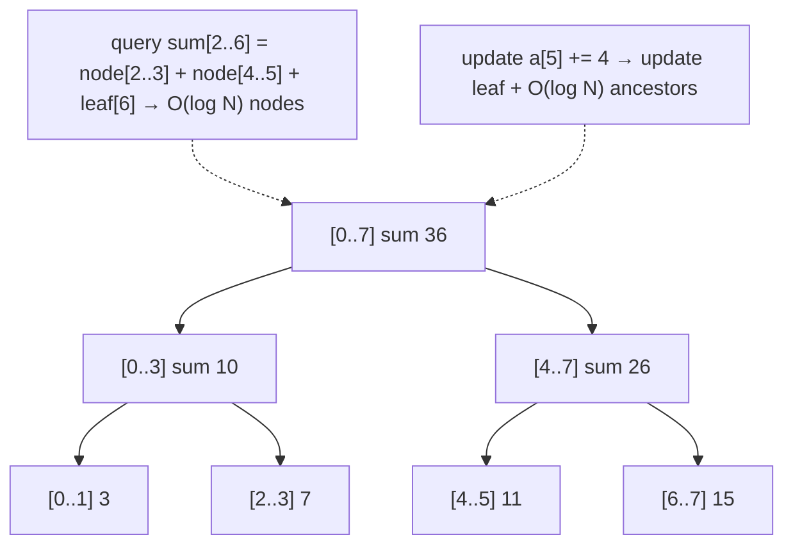

Array implementation: a size-4N (or 2N iterative) array, node i with children 2i and 2i+1. Variants: lazy propagation (range add or assign), persistent segment trees (versions), and 2D segment trees.

#### Example
A trading dashboard maintains per-second traded volume for the current day (86,400 slots) in a segment tree: each trade updates its second's bucket (O(log N)), and arbitrary "volume between 10:15:00 and 10:45:30" or "max one-second volume in the last hour" queries take O(log N). Similar structures back in-memory time-bucketed metrics, leaderboards over ranges and rate calculations.

#### Trade-offs
Fast dynamic range queries and updates, but more memory (2–4N) and code than prefix sums or Fenwick trees, mainly for in-memory use. Databases and TSDBs usually use pre-aggregated rollups instead.

#### Problems & fixes
| Symptom | Cause | Fix |
|---|---|---|
| Range updates slow | point-update-only tree | lazy propagation |
| Memory heavy for sparse huge ranges | full array over huge domain | dynamic (pointer-based) or compressed coordinates |
| Overkill for sum-only queries | segment tree complexity | Fenwick tree |

#### Cheat sheet
- Tree of segment aggregates. Query and update O(log N). 2–4N space.
- Supports sum, min, max, gcd, any associative operation. Lazy propagation for range updates.
- In-memory real-time range analytics. Fenwick for prefix sums.

#### Interview questions
<details><summary>When would you choose a segment tree over prefix sums?</summary>

When the underlying values change frequently and you also need range queries. Prefix sums give O(1) queries but O(N) updates (recompute the prefixes). A segment tree gives O(log N) for both and supports non-invertible aggregates like min and max, which prefix sums can't handle.
</details>

<details><summary>What is lazy propagation?</summary>

A technique to apply range updates (e.g. add 5 to all elements in [l, r]) in O(log N): instead of updating every leaf, mark the covering nodes with a pending "lazy" value and update their aggregates. Children receive the pending update only when a later query or update needs to descend into them.
</details>

#### Interview angle
> "For in-memory range aggregates that change constantly, like per-second volume with arbitrary window queries, a segment tree gives O(log N) updates and queries, with lazy propagation for range updates."

#### Sources
- [Segment tree](https://cp-algorithms.com/data_structures/segment_tree.html) — cp-algorithms
- [Segment tree](https://en.wikipedia.org/wiki/Segment_tree) — Wikipedia

### Fenwick tree (Binary Indexed Tree) — range sum in O(log N) with simpler implementation than segment tree
A Fenwick tree (Binary Indexed Tree) stores partial sums in an array so that **prefix sums and point updates are O(log N)**, using a few lines of bit manipulation (`i & -i`). Range sums come from two prefix sums. It's smaller (N + 1 entries) and simpler than a segment tree, but limited to invertible operations like sums and counts.

#### Intuition
A set of running subtotals of clever sizes: some cover 1 item, some 2, some 4, some 8. Any total from the start can be made by adding just a few of them.

#### Must know
- It gives **prefix sums and point updates in O(log N)**.
- A range sum is the difference of two prefix sums.
- The whole thing is one array and a few lines using `i & -i`.
- **Only for operations with an inverse**, such as sums and counts.
- Useful for ranks: "how many scores are below X?"

#### Common mistakes
- Trying to answer range min or max with it.
- Off-by-one errors from its 1-based indexing.
- An array over a huge sparse range with no coordinate compression.

#### How it works
```java
class Fenwick {
  private final long[] tree;                        // 1-indexed
  Fenwick(int n) { tree = new long[n + 1]; }
  void add(int i, long delta) { for (; i < tree.length; i += i & -i) tree[i] += delta; }   // point update
  long prefix(int i) { long s = 0; for (; i > 0; i -= i & -i) s += tree[i]; return s; }     // sum[1..i]
  long range(int l, int r) { return prefix(r) - prefix(l - 1); }
}
```

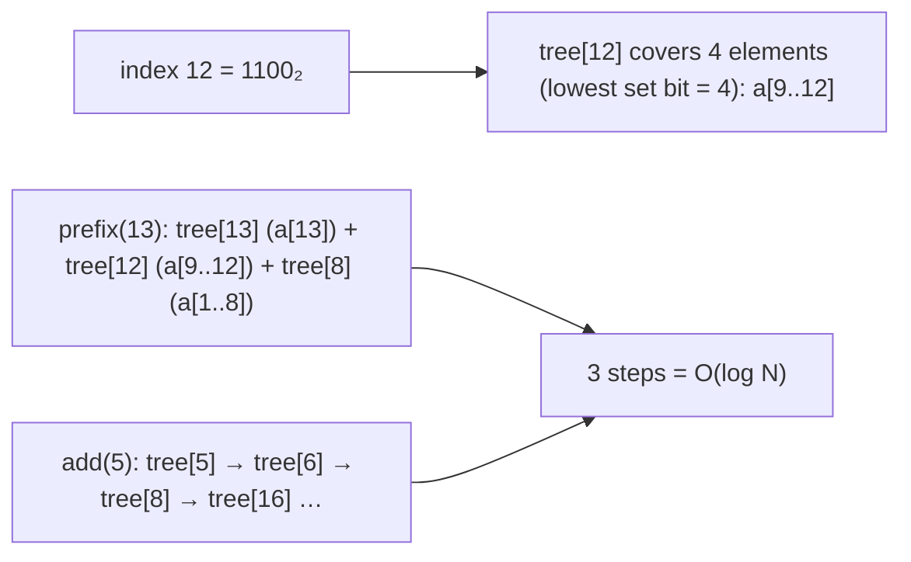

#### Example
A leaderboard service needs "how many players have score below X?" (rank) with constant score updates. Scores are bucketed (0–1,000,000) into a Fenwick tree of counts: score changes do `add(old, −1)` and `add(new, +1)`, and rank = `prefix(score − 1)`, all O(log N) with ~8 MB of memory. Also used for counting inversions, frequency tables in compressed streams (arithmetic coding), and order statistics with binary lifting.

#### Trade-offs
Tiny and fast, minimal code, but only operations with an inverse (sums and counts, not min or max for arbitrary ranges), and less flexible than segment trees.

#### Problems & fixes
| Symptom | Cause | Fix |
|---|---|---|
| Need range min/max | Fenwick only handles invertible ops cleanly | segment tree |
| Off-by-one errors | 1-indexing | wrapper API, tests |
| Huge sparse domain | array over full range | coordinate compression |

#### Cheat sheet
- Prefix sums + point updates in O(log N) with `i & -i`. N + 1 array.
- Range sum = prefix(r) − prefix(l − 1). Counts and ranks.
- Sums only. Use segment trees for min, max and lazy range updates.

#### Interview questions
<details><summary>How would you compute a player's rank among millions with frequent score updates?</summary>

Maintain a Fenwick tree of counts indexed by score (with coordinate compression if scores are sparse). Updating a score is `add(oldScore, −1)` and `add(newScore, +1)`, and rank is the number of players with a higher score = total − prefix(score). Both are O(log maxScore). At larger scale, Redis sorted sets (`ZREVRANK`) are the practical equivalent.
</details>

<details><summary>Fenwick tree vs segment tree?</summary>

Fenwick: simpler code, N + 1 memory, very fast, but limited to invertible associative operations (sums and counts) and point updates (range updates via tricks). Segment tree: more code and 2–4N memory, but supports any associative operation (min, max, gcd), range updates with lazy propagation and more complex queries.
</details>

#### Interview angle
> "For prefix sums and rank counts under constant updates, a Fenwick tree does it in O(log N) with a dozen lines and an N-sized array. I'd use a segment tree only for min, max or range updates."

#### Sources
- [Fenwick tree](https://cp-algorithms.com/data_structures/fenwick.html) — cp-algorithms
- [Fenwick tree](https://en.wikipedia.org/wiki/Fenwick_tree) — Wikipedia


## Unique ID generation

### UUID v4 — 128-bit random; globally unique with 2^122 possibilities; not sortable, no ordering
UUID v4 is a 128-bit identifier with **122 random bits**: generated anywhere with no coordination, with practically zero collision probability. It's great for distributed id generation and unguessable identifiers, but its **randomness hurts database index locality** and it carries no time ordering.

#### Intuition
Raffle tickets printed with numbers so long that two printers working separately will never produce the same one. The tickets come out in no order at all.

#### Must know
- A 128-bit id with **122 random bits**, generated anywhere with no coordination.
- Collisions are practically impossible.
- It is **unguessable**, which suits public tokens.
- **Random values scatter inserts across a B-tree**, which hurts large tables.
- It carries no time order. Store it as 16 bytes, not as text.

#### Numbers to quote
- About 2.7 × 10^18 ids are needed for a 50% chance of one collision.

#### Common mistakes
- UUIDv4 as the primary key of a very large table.
- Storing it as a 36-character string.
- Worrying about the collision maths while using a weak random source.

#### How it works
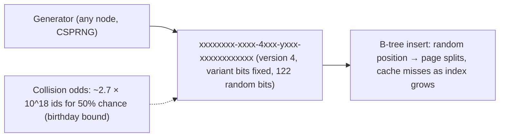

Storage: 16 bytes as binary (Postgres `uuid` type, MySQL `BINARY(16)`), 36 bytes as text, so avoid the text form in indexes.

#### Example
A team used UUIDv4 primary keys in MySQL InnoDB for an events table growing to 2 billion rows. Inserts slowed sharply as the index outgrew memory (random leaf pages) and secondary indexes ballooned (each stores the 16-byte PK). Switching new tables to UUIDv7 (time-ordered) restored insert throughput, while v4 remained for public-facing tokens where unguessability matters.

#### Trade-offs
Coordination-free and unguessable, but random index inserts, 16-byte size, no ordering, and poor human readability.

#### Problems & fixes
| Symptom | Cause | Fix |
|---|---|---|
| Insert throughput collapses at scale | random B-tree inserts | UUIDv7 / ULID / Snowflake for PKs |
| Huge indexes | 36-char text UUIDs | native uuid / BINARY(16) |
| Can't sort by creation | no time component | v7, or separate created_at column |

#### Cheat sheet
- 122 random bits. Generate anywhere. Collisions negligible.
- Random leads to bad index locality. Store as 16 bytes.
- Good for public tokens. Use v7/ULID/Snowflake for primary keys.

#### Interview questions
<details><summary>Why are UUIDv4 primary keys problematic for large tables?</summary>

Each new id is random, so inserts land on random B-tree leaf pages. Once the index exceeds memory, nearly every insert causes a random read, plus page splits that fragment pages, so throughput drops and indexes bloat. In clustered-index engines (InnoDB) the whole table is affected and every secondary index stores the large key.
</details>

<details><summary>Is UUIDv4 collision a real concern?</summary>

Practically no: with 122 random bits you'd need about 2.7 quintillion ids for a 50% chance of a single collision (with a good random source). Real risks come from broken generators (poor seeding, VM cloning, buggy libraries), not the math. Use cryptographically secure generators and a unique constraint as a safety net.
</details>

#### Interview angle
> "UUIDv4 is perfect for coordination-free, unguessable ids like public tokens, but as a primary key it scatters B-tree inserts, so new tables use time-ordered UUIDv7 stored as 16 bytes."

#### Sources
- [Universally unique identifiers (RFC 9562)](https://www.rfc-editor.org/rfc/rfc9562) — IETF
- [Universally unique identifier](https://en.wikipedia.org/wiki/Universally_unique_identifier) — Wikipedia

### UUID v7 (new standard) — 48-bit Unix timestamp ms + 74-bit random; sortable, monotone within ms
UUIDv7 (RFC 9562, 2024) puts a **48-bit Unix millisecond timestamp first**, followed by random bits (with optional counters for monotonicity). It keeps UUID's format and coordination-free generation while being **time-ordered**, so new ids append to the end of B-tree indexes, and ids sort by creation time.

#### Intuition
A raffle ticket that starts with the date and time and ends with a random number. Tickets printed later always sort later, and two printers still never clash.

#### Must know
- A standard UUID that **starts with a 48-bit millisecond timestamp**, followed by random bits.
- Ids **sort by creation time**.
- New rows append at the **right edge of the B-tree**, so inserts stay fast.
- Still generated anywhere with no coordination.
- It **reveals the creation time**, so keep public ids random.

#### Numbers to quote
- Standardised in RFC 9562 (2024). PostgreSQL 18 has a built-in `uuidv7()`.

#### Common mistakes
- Relying on it for strict ordering across servers. Clocks differ.
- Exposing it where creation time should stay private.
- Storing it as text.

#### How it works
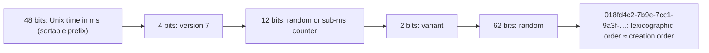

Generation: libraries (Java `uuid-creator`, Postgres 18 `uuidv7()`, many languages) add counters for monotonicity within the same millisecond on one generator.

#### Example
An orders service switched from v4 to v7 PKs in Postgres: insert throughput on the 1B-row table stabilised (rightmost-leaf appends), "latest orders" queries could use the PK index ordering, and ids remained globally unique without a central service. Since v7 reveals creation time, public-facing ids (like share links) still use random tokens.

#### Trade-offs
Index-friendly and sortable, standard UUID format and tooling, but exposes creation time (a privacy or enumeration consideration), clock dependence (skew affects ordering across nodes), and 16 bytes (larger than 64-bit Snowflake).

#### Problems & fixes
| Symptom | Cause | Fix |
|---|---|---|
| Out-of-order ids across servers | clock skew between generators | acceptable for most; NTP; don't use ids for strict ordering logic |
| Creation time leaked in public ids | timestamp prefix | random opaque public ids, v7 internally |
| Hot rightmost index page at extreme insert rates | monotonic keys | usually fine; partitioning/hash prefix for extreme cases |

#### Cheat sheet
- ms timestamp + random. Sortable, index-friendly, standard UUID.
- Good default PK for distributed systems. Store as native uuid.
- Leaks creation time. Order across nodes depends on clocks.

#### Interview questions
<details><summary>Why is UUIDv7 a better primary key than UUIDv4?</summary>

Its leading timestamp makes ids roughly increasing over time, so inserts append near the right edge of the B-tree (hot pages stay cached, few splits) instead of scattering randomly, which keeps insert throughput high and indexes compact. It also allows rough time-ordering by id, while keeping coordination-free generation and the standard UUID format.
</details>

<details><summary>Can you rely on UUIDv7 for strict global ordering of events?</summary>

No. Ordering is by each generator's wall clock, so clock skew between machines (and identical milliseconds across machines) means ids from different servers can be out of real-time order. Within one generator, monotonic counters give ordering. For strict global ordering use a single sequencer, a consensus log or per-entity sequence numbers.
</details>

#### Interview angle
> "New tables use UUIDv7 primary keys: coordination-free, time-ordered for append-friendly B-trees, stored as native uuid. Public identifiers stay random, because v7 leaks creation time."

#### Sources
- [Universally unique identifiers (RFC 9562)](https://www.rfc-editor.org/rfc/rfc9562) — IETF
- [UUID functions](https://www.postgresql.org/docs/current/functions-uuid.html) — PostgreSQL docs

### ULID — 48-bit timestamp + 80-bit random; lexicographically sortable; URL-safe base32 encoding
A ULID (Universally Unique Lexicographically Sortable Identifier) is 128 bits: a **48-bit millisecond timestamp** plus **80 random bits**, encoded as a **26-character Crockford base32 string** (`01HF9ZK3W2Q6Y5T8B4N7R2M0PX`). It sorts lexicographically by time, is URL-safe and case-insensitive, and predates UUIDv7 with similar goals.

#### Intuition
The same idea as UUIDv7, written as a short tidy string. Sort the strings alphabetically and you have them in the order they were created.

#### Must know
- 128 bits: a **48-bit millisecond timestamp plus 80 random bits**.
- Written as a **26-character base32 string** that is URL-safe.
- The strings **sort by creation time**.
- Handy as a string key: S3 object keys, DynamoDB sort keys, URLs.
- It is not an official UUID version. **UUIDv7 is the standard equivalent.**

#### Common mistakes
- Mixing binary and text storage forms in one system.
- Choosing it over UUIDv7 where a native UUID type exists.
- Forgetting that it also reveals creation time.

#### How it works
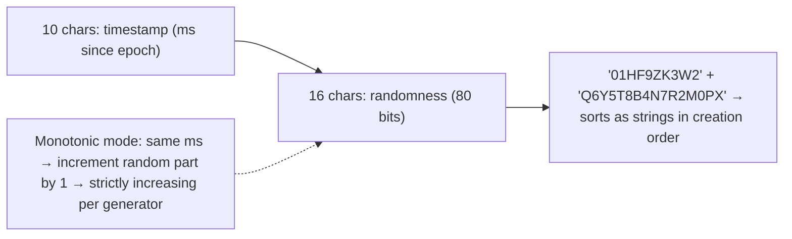

Can be stored as 16 bytes (binary-compatible with UUID columns) or as a 26-char string.

#### Example
An event-logging system stores events in S3 and DynamoDB with ULID keys: sorting objects or items by key gives chronological order, and keys are readable in URLs and logs (`/events/01HF9ZK3W2Q6Y5T8B4N7R2M0PX`). DynamoDB sort keys like `EVENT#<ULID>` give time-ordered queries without a separate timestamp attribute.

#### Trade-offs
Sortable, compact text form and URL-safe, but not an official UUID version (v7 is now the standard), it leaks timestamps, and the 26-character strings are larger than binary storage.

#### Problems & fixes
| Symptom | Cause | Fix |
|---|---|---|
| Mixed ordering when stored as UUID binary vs text | different encodings | consistent storage form |
| Monotonic overflow in same ms | extreme generation rates | wait for next ms or error, multiple generators |
| Interop with UUID-only systems | non-standard format | UUIDv7 for standards compliance |

#### Cheat sheet
- 48-bit ms time + 80 random bits. 26-char base32, sortable as strings.
- Great as string keys (S3, DynamoDB sort keys, URLs).
- UUIDv7 is the standardised equivalent.

#### Interview questions
<details><summary>ULID vs UUIDv7: how do they compare?</summary>

Both are 128-bit, time-ordered (48-bit ms timestamp) with randomness, and coordination-free. ULID defines a 26-char Crockford base32 text form and monotonic mode, while UUIDv7 is the IETF standard in the familiar UUID format with native support in databases and libraries. For new systems needing UUID compatibility choose v7, and use ULID when its string format is convenient.
</details>

<details><summary>Why are time-sortable string ids useful in key-value and object stores?</summary>

Stores like S3, DynamoDB sort keys, Cassandra clustering keys and Bigtable order items by key bytes. Ids whose string form sorts by creation time let you list or range-query items chronologically ("latest 50 events") using the key alone, without secondary indexes on a timestamp.
</details>

#### Interview angle
> "Where ids are strings in key-value stores, like S3 keys or DynamoDB sort keys, ULIDs give chronological ordering for free. For UUID-typed columns I'd pick the standard UUIDv7."

#### Sources
- [ULID specification](https://github.com/ulid/spec) — ULID, GitHub
- [Universally unique identifiers (RFC 9562)](https://www.rfc-editor.org/rfc/rfc9562) — IETF

### Twitter Snowflake ID — 64-bit: 1 sign bit + 41 timestamp (ms, 69yr range) + 10 machine ID + 12 sequence (4096 IDs/ms)
Snowflake generates **64-bit, roughly time-ordered, unique ids** without coordination per id: **41 bits of milliseconds since a custom epoch** (~69 years), **10 bits of machine or worker id** (1,024 generators) and a **12-bit per-millisecond sequence** (4,096 ids per ms per worker, ~4M/s per worker). The ids fit in a `BIGINT` and sort by time.

#### Intuition
A ticket number made of three parts: the time it was printed, which machine printed it, and a counter for tickets printed in the same instant. No two machines can ever print the same number.

#### Must know
- A **64-bit id** built from **timestamp + machine id + sequence**.
- It fits in a `BIGINT` and **sorts roughly by time**.
- Generated locally, with no network call per id.
- Each generator needs a **unique machine id**.
- It depends on the clock, and it must be sent to JavaScript as a string.

#### Numbers to quote
- 41 bits of milliseconds (about 69 years), 10 bits of machine id (1,024 machines), 12 bits of sequence (4,096 ids per millisecond per machine).

#### Common mistakes
- Two instances sharing a machine id, which produces duplicates.
- No handling of the clock moving backwards.
- Sending the id as a JSON number, which JavaScript rounds above 2^53.

#### How it works
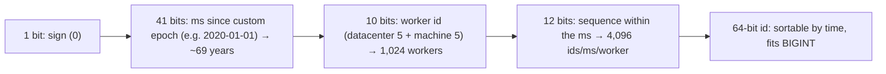

```java
synchronized long nextId() {
  long now = System.currentTimeMillis();
  if (now < lastTs) throw new IllegalStateException("clock moved backwards");   // or wait (next topic)
  if (now == lastTs) {
    sequence = (sequence + 1) & 0xFFF;
    if (sequence == 0) now = waitNextMillis(lastTs);    // 4,096 ids used this ms
  } else sequence = 0;
  lastTs = now;
  return ((now - EPOCH) << 22) | (workerId << 12) | sequence;
}
```

Worker id assignment: static config, ZooKeeper/etcd leases, Kubernetes StatefulSet ordinal, or a DB-claimed id with a lease (must be unique among live generators).

#### Example
A messaging platform (Discord uses Snowflake-style ids) generates message ids in each service instance: ids are 64-bit (compact in Cassandra keys), roughly time-ordered (so messages sort by id without a timestamp column), and the creation time can be extracted from the id. With 200 instances (each a worker id leased from etcd), capacity far exceeds traffic.

#### Trade-offs
Compact (8 bytes), sortable, fast local generation, but depends on clocks (backwards jumps), worker id management (duplicates if two instances share an id), ordering only roughly by time across workers, and the epoch range is finite.

#### Problems & fixes
| Symptom | Cause | Fix |
|---|---|---|
| Duplicate ids | two generators with same worker id | lease-based worker ids (etcd/ZooKeeper), StatefulSet ordinals |
| Errors when clock jumps back | NTP step backwards | wait until clock catches up, monotonic clock deltas, alerting |
| Sequence exhausted | > 4,096 ids/ms per worker | wait next ms, more workers |
| JavaScript precision loss | 64-bit ints exceed JS Number (2^53) | send ids as strings in JSON |

#### Cheat sheet
- 41-bit ms + 10-bit worker + 12-bit sequence = 64-bit sortable id.
- ~69 years per epoch, 1,024 workers, 4,096/ms/worker.
- Unique worker ids (leases). Handle clock skew. Strings in JSON.

#### Interview questions
<details><summary>Design a distributed unique id generator producing 1M ids/s, time-sortable, 64-bit.</summary>

Snowflake: each generator instance gets a unique worker id (leased from etcd/ZooKeeper or derived from a StatefulSet ordinal) and builds ids from a 41-bit ms timestamp, 10-bit worker id and 12-bit sequence. Each worker can produce 4,096 ids per ms, so a few workers cover 1M/s. Generation is local (no network per id). Handle clock regressions by waiting or failing, and expose ids as strings to JavaScript clients.
</details>

<details><summary>Why send Snowflake ids as strings in JSON APIs?</summary>

JavaScript numbers are IEEE-754 doubles with 53 bits of integer precision. 64-bit Snowflake ids exceed that, so parsing them as numbers silently rounds them, producing wrong ids. Serialising as strings preserves exact values (Twitter's API added `id_str` for this reason).
</details>

#### Interview angle
> "For compact, time-sortable ids I'd use Snowflake: 41-bit milliseconds, 10-bit leased worker id and 12-bit sequence, generated locally, with clock-regression handling and string serialisation for JavaScript clients."

#### Sources
- [Snowflake ID](https://en.wikipedia.org/wiki/Snowflake_ID) — Wikipedia
- [API reference: snowflakes](https://discord.com/developers/docs/reference#snowflakes) — Discord developer docs

### Snowflake clock skew problem — if system clock goes back, ID generation pauses or errors
Snowflake ids embed wall-clock time, so if a generator's **clock moves backwards** (an NTP step correction, VM migration, manual change, leap-second handling), new ids could have **smaller timestamps than previous ones**, so ordering breaks and **duplicates** become possible (the same timestamp and sequence again). Generators must detect regressions and handle them safely.

#### Intuition
A date stamp whose dial is accidentally wound back an hour. Everything stamped next looks older than what came before, and may repeat a stamp that was already used.

#### Must know
- Snowflake ids contain wall-clock time.
- If the **clock moves backwards**, new ids can repeat or sort before older ones.
- The generator must **remember the last timestamp** it used and compare.
- Small step back: **wait** until the clock catches up. Large step back: **refuse and alert**.
- Configure time sync to slew (adjust gradually), not step.

#### Common mistakes
- No check for a backwards clock at all.
- Restarting a generator with no memory of the last timestamp it used.
- Letting NTP step the clock back on a production host.

#### How it works
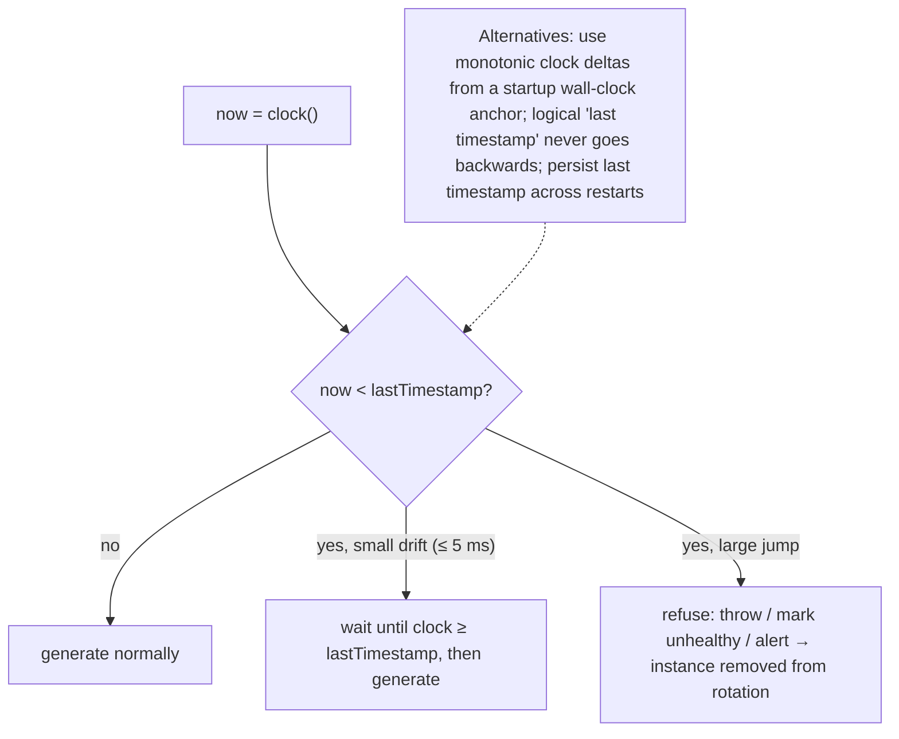

Mitigations:
- **Never step clocks backwards in production**: configure chrony or NTP to **slew** (gradually adjust) rather than step after boot.
- **Track lastTimestamp** and refuse or wait on regressions.
- Use a **monotonic clock** to advance time between occasional wall-clock anchors (so internal time never decreases).
- **Persist the last timestamp** (or wait out the max possible skew) on restart, in case the clock was reset during a reboot.
- Leap seconds: prefer smeared time (Google, AWS) over stepped.

#### Example
After a VM live migration, a host's clock jumped back 2 seconds. Two of the id generators kept producing ids (no check), creating ~300 duplicate message ids that collided in Cassandra and silently overwrote messages. Fix: regression checks (wait ≤ 10 ms, otherwise fail and alert), chrony configured with `makestep` only at boot plus slewing afterwards, and a monotonic-clock-based timestamp source.

#### Trade-offs
Waiting or failing protects uniqueness at the cost of brief unavailability. Monotonic approaches avoid pauses but can drift from real time (bounded by periodic re-anchoring).

#### Problems & fixes
| Symptom | Cause | Fix |
|---|---|---|
| Duplicate ids after clock adjustment | no regression check | detect and wait/fail |
| Long generation pause | big backwards jump with wait strategy | fail fast + remove instance, alert |
| Duplicates after restart | clock reset on reboot, sequence restarts | persist last timestamp / wait out skew at startup |

#### Cheat sheet
- Backwards clock means duplicate or out-of-order ids.
- Check lastTimestamp: wait (small) or fail (large) + alert.
- Slew, don't step. Monotonic clock anchoring. Persist the last timestamp.

#### Interview questions
<details><summary>What should a Snowflake generator do if it detects the clock moved backwards by 50 ms?</summary>

Never generate ids with the earlier timestamp. Either wait until the clock passes the last used timestamp (acceptable for small regressions like 50 ms), or refuse to generate (throw an error or report unhealthy so traffic moves to other generators) for larger jumps, and alert. Also fix the time sync configuration so clocks slew instead of stepping.
</details>

<details><summary>How can a generator avoid depending on wall-clock regressions entirely?</summary>

Take a wall-clock reading at startup as an anchor and compute "current time" as anchor + monotonic elapsed time (System.nanoTime), which never decreases. Periodically re-anchor only forward (never move internal time backwards). Persist the highest timestamp used so a restart never reuses timestamps.
</details>

#### Interview angle
> "Snowflake generators must never move backwards in time: they track the last timestamp, wait out tiny regressions, fail and alert on big ones, and run on slewed, monotonic-anchored clocks."

#### Sources
- [Snowflake ID](https://en.wikipedia.org/wiki/Snowflake_ID) — Wikipedia
- [Frequently asked questions](https://chrony-project.org/faq.html) — chrony project
- [Leap smear](https://developers.google.com/time/smear) — Google Public NTP

### Instagram shard ID — 41-bit epoch ms + 13-bit shard ID + 10-bit sequence; generated in PostgreSQL
Instagram generated 64-bit ids **inside PostgreSQL** on each logical shard: **41 bits of milliseconds since a custom epoch**, **13 bits of logical shard id** (8,192 shards) and **10 bits of a per-shard sequence** (1,024 ids per ms per shard). Ids are time-sortable **and encode which shard owns the row**, so there's no separate id service.

#### Intuition
A parcel tracking number that includes the depot code. Anyone holding the number knows which depot has the parcel, with no lookup needed.

#### Must know
- A 64-bit id made of **timestamp + logical shard id + sequence**.
- It is generated **inside PostgreSQL** by a function, so there is no separate id service.
- **The id itself says which shard holds the row.**
- Ids sort by creation time.
- Thousands of **logical shards** map onto fewer physical databases, so shards can move with no id change.

#### Numbers to quote
- 41 bits of milliseconds, 13 bits of shard (8,192 logical shards), 10 bits of sequence (1,024 ids per millisecond per shard).

#### Common mistakes
- Too few shard bits for future growth.
- Tying ids to physical servers and not to logical shards.
- Forgetting that the database clock now matters.

#### How it works
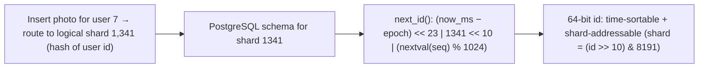

```sql
CREATE OR REPLACE FUNCTION insta5.next_id(OUT result bigint) AS $$
DECLARE
  our_epoch bigint := 1314220021721;
  seq_id bigint;
  now_millis bigint;
  shard_id int := 5;
BEGIN
  SELECT nextval('insta5.table_id_seq') % 1024 INTO seq_id;
  SELECT FLOOR(EXTRACT(EPOCH FROM clock_timestamp()) * 1000) INTO now_millis;
  result := (now_millis - our_epoch) << 23;
  result := result | (shard_id << 10);
  result := result | (seq_id);
END;
$$ LANGUAGE plpgsql;
```

Logical shards (thousands) map to fewer physical databases. Moving a logical shard to a new server doesn't change ids.

#### Example
A social app adopting this scheme: given a photo id, the API extracts the shard id from bits 10–22 and routes the query directly to the right database, with no lookup table. Sorting a user's photos by id equals sorting by creation time. Ids are generated by the database during insert, so there are no extra services and no worker-id management.

#### Trade-offs
Self-routing, time-sortable 64-bit ids without extra infrastructure, but tied to the sharding scheme (shard count fixed by bit allocation), sequence capacity per shard per ms (1,024), and DB clock dependence.

#### Problems & fixes
| Symptom | Cause | Fix |
|---|---|---|
| Need more than 8,192 logical shards | 13-bit limit | plan bit allocation upfront (or new id version) |
| Sequence wrap within ms under extreme load | > 1,024 ids/ms per shard | more logical shards, wider sequence bits |
| Clock issues on DB hosts | time-based ids | NTP slewing, monitoring |

#### Cheat sheet
- 41-bit ms + 13-bit logical shard + 10-bit sequence, generated in PostgreSQL.
- The id encodes its shard (self-routing) and its time (sortable).
- Thousands of logical shards mapped onto fewer physical DBs.

#### Interview questions
<details><summary>What's the benefit of embedding the shard id inside the primary key?</summary>

Any service holding an id can compute which shard stores the row (bit-shifting), with no directory lookup or broadcast query. Ids stay valid when logical shards move between physical servers, since only the logical-to-physical mapping changes.
</details>

<details><summary>Why use many logical shards mapped to fewer physical databases?</summary>

It decouples data placement from hardware: you start with thousands of logical shards on a few servers and, as load grows, move whole logical shards to new servers without re-sharding data or changing ids. Rebalancing becomes moving schemas rather than splitting tables.
</details>

#### Interview angle
> "Instagram-style ids encode the logical shard: 41-bit time, 13-bit shard and 10-bit sequence, generated in Postgres. Any service can route by id, and logical shards move between servers without id changes."

#### Sources
- [Sharding and IDs at Instagram](https://medium.com/instagram-engineering/sharding-ids-at-instagram-1cf5a71e5a5c) — Instagram engineering
- [Snowflake ID](https://en.wikipedia.org/wiki/Snowflake_ID) — Wikipedia

### NanoID — URL-safe alphabet, configurable length, cryptographically random, similar collision prob to UUID
NanoID generates **compact, URL-safe random string ids** (default 21 characters from `A-Za-z0-9_-`, ~126 random bits, comparable to UUIDv4's 122) using a cryptographically secure random generator. The length and alphabet are configurable, which suits short public identifiers like share links, invite codes and slugs.

#### Intuition
A short random code like the one on a gift card. It is easy to put in a link, impossible to guess, and you choose how long it is depending on how many you will issue.

#### Must know
- A **short, URL-safe random string** id from a secure random source.
- **Length and alphabet are configurable.**
- Good for public ids: share links, invite codes, slugs.
- It is random, so it is **not sortable** and makes a poor primary key.
- For short codes, add a **unique constraint and retry** on collision.

#### Numbers to quote
- The default 21 characters give about 126 random bits, similar to UUIDv4.

#### Common mistakes
- Codes too short for the expected volume.
- Using it as the clustered primary key.
- Look-alike characters (0/O, l/1) in codes people must type.

#### How it works
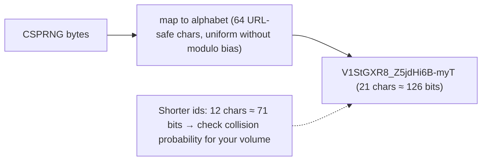

Collision sizing: with an alphabet of size A and length L, there are A^L ids. For a 1% collision probability after n ids, you need roughly A^L ≥ n² / (2 × 0.01). Tools like the NanoID collision calculator help pick a length.

#### Example
A URL shortener for marketing links uses a custom alphabet without look-alike characters (no 0/O, l/1) and 8 characters (~2.2 × 10^14 combinations with 58 symbols). It generates random codes and inserts with a unique constraint, retrying on the rare collision. Unlike sequential ids, codes aren't enumerable (competitors can't scrape all campaigns by incrementing). Internally, the database row also has a UUIDv7 primary key.

#### Trade-offs
Short, URL-safe and unguessable, but not sortable (random, so bad index locality like UUIDv4), and short lengths need collision handling.

#### Problems & fixes
| Symptom | Cause | Fix |
|---|---|---|
| Collisions with short codes | length too short for volume | longer ids, unique constraint + retry |
| Index fragmentation | random keys as PK | time-ordered PK internally, NanoID as secondary unique column |
| Confusing characters in human-typed codes | default alphabet | custom alphabet without ambiguous chars |

#### Cheat sheet
- Secure random, URL-safe, configurable length (21 chars ≈ UUID strength).
- Great for public ids, share links, invite codes.
- Not sortable. Unique constraint + retry for short codes.

#### Interview questions
<details><summary>How would you generate short codes for a URL shortener without a central counter?</summary>

Generate random codes from a URL-safe alphabet (NanoID-style) with a length sized for the expected volume and an acceptable collision probability (e.g. 7–8 base62 characters for billions of links), and insert with a unique constraint, retrying on conflict. That avoids sequential, enumerable codes and needs no coordination. Alternatively, encode a Snowflake id in base62 for guaranteed uniqueness.
</details>

<details><summary>Why not expose auto-increment ids in public URLs?</summary>

They're enumerable (attackers or competitors iterate ids to scrape data or probe for IDOR bugs), they leak business volume (order #10,523 reveals order counts), and they couple public URLs to internal storage. Random opaque ids (NanoID, UUIDv4) or mapped slugs avoid these issues, with authorization checks still required.
</details>

#### Interview angle
> "Public-facing ids like share links are NanoID-style random strings sized for collision safety, with a unique constraint and retry, while internal primary keys stay time-ordered."

#### Sources
- [Nano ID](https://github.com/ai/nanoid) — Andrey Sitnik, GitHub
- [Nano ID collision calculator](https://zelark.github.io/nano-id-cc/) — Zelark

### Ticket server (Flickr-style) — centralized DB auto-increment; simple but single point of failure
A ticket server hands out ids from a **central database auto-increment** (Flickr's approach used MySQL `REPLACE INTO` on a single-row table to get `LAST_INSERT_ID()`). It gives compact, strictly increasing 64-bit ids with trivial logic, but it's a **central dependency**: availability and throughput are bounded by the ticket servers.

#### Intuition
A single ticket dispenser at a deli counter. Everyone gets the next number in order, which is simple, but if the dispenser jams nobody can queue. Handing each till a roll of 1,000 tickets fixes most of that.

#### Must know
- A **central database auto-increment** hands out ids.
- Ids are compact and strictly increasing.
- It is a **central dependency** and a possible bottleneck.
- Fix 1: two servers issuing odd and even numbers.
- Fix 2: **block allocation**. Each service reserves a range and hands ids out from memory.

#### Numbers to quote
- Reserving blocks of 1,000 cuts the load on the id database by about 1,000×.

#### Common mistakes
- One database round trip per id.
- A single ticket database with no failover.
- Exposing dense sequential numbers publicly, which reveals volume.

#### How it works
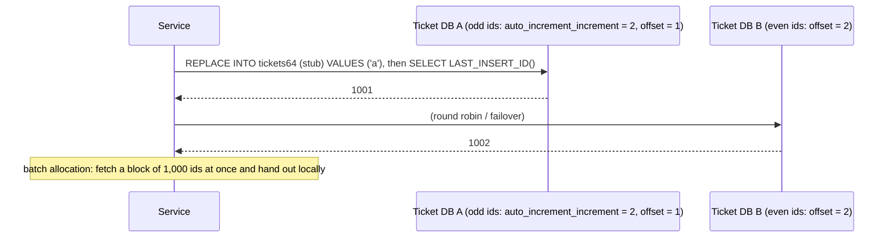

Improvements:
- **Two servers** with interleaved increments (odd/even) for availability.
- **Segment / batch allocation** (e.g. Meituan's Leaf, "hi/lo" pattern): each service reserves a range (`UPDATE seq SET max_id = max_id + 1000`) and hands out ids from memory, with pre-fetching the next segment before exhaustion.
- Database sequences (`nextval` with `CACHE`) are the built-in form.

#### Example
An order-number service needs short, human-friendly, increasing order numbers (`ORD-20261109-000123`). A Leaf-style segment allocator: each app instance reserves blocks of 1,000 numbers from a small MySQL table (one row per business type), refilling asynchronously when 20% remain. The ticket DB sees ~10 writes per second even at 10k orders per second, and with two segments buffered an outage of the DB for minutes doesn't stop order creation.

#### Trade-offs
Simple, compact, near-sequential ids, but a central dependency (needs HA), segment allocation creates gaps and only rough ordering across instances, and exposing sequential ids publicly leaks volume.

#### Problems & fixes
| Symptom | Cause | Fix |
|---|---|---|
| Id service outage blocks writes | single ticket DB | two DBs with odd/even, segment buffering, HA |
| Ticket DB is a bottleneck | one round trip per id | batch/segment allocation |
| Gaps in sequence | restarts discard unused segment | accept gaps, or don't expose as dense numbers |

#### Cheat sheet
- Central auto-increment. Compact and ordered, but a SPOF and bottleneck.
- Two servers (odd/even) + segment allocation (hi/lo, Leaf).
- Gaps are normal. Don't expose dense counters publicly.

#### Interview questions
<details><summary>How do you make a centralised id generator scale and stay available?</summary>

Allocate ids in blocks: each client reserves a range (e.g. 1,000 ids) with one DB write and hands them out from memory, fetching the next block in the background before exhaustion, which reduces DB load by about 1,000× and tolerates short DB outages. Run two ticket databases with interleaved increments (odd/even), or replicated HA, so one failure doesn't stop allocation.
</details>

<details><summary>Snowflake vs ticket server: when would you choose a ticket server?</summary>

When you need compact ids that are nearly sequential (dense, human-friendly order numbers, legacy systems expecting increasing integers) and can accept a central dependency mitigated with segments and HA. Snowflake fits high-scale distributed generation without a central component, where time-sortability is enough and gaps don't matter.
</details>

#### Interview angle
> "For compact, near-sequential numbers like order numbers I'd use a segment-allocated ticket table, where each instance reserves 1,000 ids per DB write. For high-scale distributed ids I'd use Snowflake."

#### Sources
- [Ticket servers: distributed unique primary keys on the cheap](https://code.flickr.net/2010/02/08/ticket-servers-distributed-unique-primary-keys-on-the-cheap/) — Flickr engineering
- [Leaf](https://github.com/Meituan-Dianping/Leaf) — Meituan-Dianping, GitHub

### Monotonic IDs — crucial for sort order in databases and for Kafka partition ordering; avoid UUID as PK
Monotonic (or at least time-ordered) ids **increase over time**: auto-increment, sequences, Snowflake, UUIDv7, ULID. They keep B-tree inserts at the "right edge" (good locality, few page splits), make "newest first" queries cheap, enable cursor pagination by id, and give natural ordering for events. Random ids (UUIDv4) as primary keys scatter writes across the index.

#### Intuition
Numbered pages added to the back of a notebook. You always write on the last page, which is already open. Random ids are like inserting each new page at a random place in the notebook.

#### Must know
- Monotonic or time-ordered ids **increase over time**: sequences, Snowflake, UUIDv7, ULID.
- New rows land on the **right edge of the index**, which stays in memory.
- "Newest first" queries and cursor pagination by id become cheap.
- Across many generators the order is only **approximate**.
- For strict order per entity, use a **per-entity version number**.

#### Common mistakes
- Random UUIDv4 primary keys on big tables.
- Treating distributed time-ordered ids as a strict global order.
- Exposing time-ordered ids publicly, which reveals creation time and volume.

#### How it works
```mermaid
flowchart LR
  subgraph Mono["Time-ordered ids (UUIDv7, Snowflake)"]
    M1["new ids → rightmost leaf pages (hot, cached)"] --> M2["few splits, compact index, ORDER BY id ≈ ORDER BY time"]
  end
  subgraph Rand["Random ids (UUIDv4)"]
    R1["new ids → random leaf pages"] --> R2["cache misses + splits everywhere as table grows"]
  end
  K["Kafka: per-key sequence numbers let consumers detect gaps/duplicates and apply in order"] -.-> Mono
```

Where monotonicity matters:
- **Database PKs**: insert performance and index size (especially InnoDB clustered indexes).
- **Cursor pagination**: `WHERE id < :lastId ORDER BY id DESC`.
- **Event ordering**: per-aggregate version or sequence numbers to apply events in order and dedupe.
- **Log and stream offsets** (Kafka offsets are monotonic per partition).

Caveats: global strict monotonicity across many generators needs a single sequencer (or consensus). Time-ordered distributed ids are only *roughly* ordered across nodes. Extremely high insert rates on a single right-edge page can contend (use hash-prefix partitioning in such cases).

#### Example
An events table in InnoDB with UUIDv4 PKs reached 600M rows with inserts at 2k/s and climbing p99, and the buffer pool thrashed. Migrating new partitions to UUIDv7 kept inserts at the tail, the buffer pool hit rate rose from 85% to 99%, insert p99 dropped 10×, and "latest events per device" queries used a compact composite index `(device_id, id)`.

#### Trade-offs
Big performance and usability wins, but time-ordered ids leak creation time and volume (keep public ids separate), cross-node ordering is approximate, and right-edge hotspots appear at extreme rates.

#### Problems & fixes
| Symptom | Cause | Fix |
|---|---|---|
| Slow inserts, bloated indexes | random UUID PKs | UUIDv7/Snowflake/sequence PKs |
| Ordering assumptions broken across services | relying on distributed ids for strict order | per-entity sequence numbers, single sequencer where needed |
| Right-edge page contention at very high rate | strictly increasing keys | hash-prefixed or partitioned keys |

#### Cheat sheet
- Time-ordered PKs = right-edge inserts, compact indexes, cheap newest-first and cursor pagination.
- Avoid UUIDv4 PKs at scale. Use UUIDv7, Snowflake or sequences.
- Strict global order needs a sequencer. Use per-entity versions for event ordering.

#### Interview questions
<details><summary>Why do monotonic primary keys improve write performance?</summary>

New rows go to the end of the B-tree index (the rightmost leaf), which stays in memory, so inserts rarely need disk reads and cause few page splits, with pages filled sequentially and compactly. Random keys spread inserts over the whole index, causing random I/O once it exceeds memory, frequent splits and fragmented half-empty pages.
</details>

<details><summary>How do you guarantee events for an entity are applied in order across a distributed system?</summary>

Give each entity a monotonically increasing version or sequence number assigned by its single owner (the aggregate's service, an optimistic version column), publish events keyed by entity id (same Kafka partition), and have consumers apply an event only if its version is the next expected one (buffering or rejecting out-of-order events, ignoring duplicates). Don't rely on globally generated ids or timestamps for strict ordering.
</details>

#### Interview angle
> "Primary keys are time-ordered (UUIDv7, Snowflake or sequences) for right-edge inserts and cheap cursor pagination, and per-entity version numbers, not global ids, enforce event ordering."

#### Sources
- [Universally unique identifiers (RFC 9562)](https://www.rfc-editor.org/rfc/rfc9562) — IETF
- [Clustered and secondary indexes](https://dev.mysql.com/doc/refman/8.4/en/innodb-index-types.html) — MySQL reference manual

