## Search engine internals

### Web crawler — BFS URL frontier with priority queue; politeness: per-domain rate limit, robots.txt, crawl-delay
A web crawler discovers and downloads pages at scale: it starts from seed URLs, fetches pages, extracts links, and adds new URLs to a **frontier** (a prioritised queue). Production crawlers balance **coverage, freshness and priority** against **politeness** (never overloading any site) and **robustness** (traps, duplicates, failures).

#### How it works
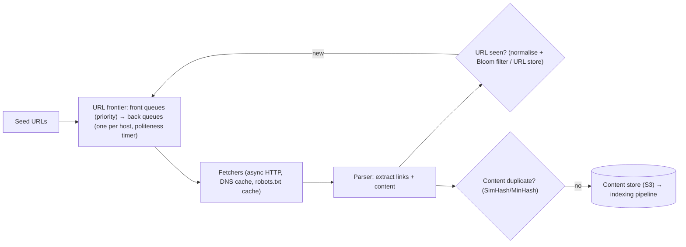

Key components:
- **Frontier**: priority by PageRank-ish importance, freshness needs and depth. **Per-host queues** enforce politeness (one connection per host, crawl-delay).
- **robots.txt** fetched and cached per host, honouring `Disallow` and `Crawl-delay`.
- **DNS cache**: DNS lookups otherwise become a bottleneck.
- **Dedupe**: URL normalisation and canonicalisation, a Bloom filter for seen URLs, content fingerprints for duplicate pages.
- **Trap avoidance**: max depth, URL length limits, infinite calendars, session ids in URLs.
- **Recrawl scheduling**: change frequency estimates (news sites hourly, static pages monthly).

#### Example
Estimate: 1 billion pages per month means ~400 pages/s average. At 100 KB per page that's ~40 MB/s of download and ~100 TB/month raw (compressed ~25 TB in S3). Fetchers are distributed by host hash (consistent hashing), so each host's politeness queue lives on one worker. A 2 GB Bloom filter tracks ~1.5B seen URLs at 1% false positives.

#### Trade-offs
BFS-style breadth gives coverage, while priority scheduling gives importance and freshness. Politeness slows crawling of big sites, and aggressive crawling risks bans and legal issues.

#### Problems & fixes
| Symptom | Cause | Fix |
|---|---|---|
| Crawler banned / site overloaded | no per-host rate limiting | per-host queues, crawl-delay, robots.txt, back off on 429/503 |
| Infinite URL spaces (calendars, filters) | crawler traps | depth/URL-length limits, pattern detection, per-host budgets |
| Recrawling same content | URL variants (utm params, session ids) | normalisation, canonical tags, content hashing |
| DNS bottleneck | lookup per fetch | local DNS cache/resolver |

#### Cheat sheet
- Frontier (priority) + per-host politeness queues + robots.txt.
- Normalise URLs, Bloom filter for seen URLs, SimHash for duplicate content.
- Distribute by host hash. Recrawl based on change rate.

#### Interview questions
<details><summary>How do you ensure politeness in a distributed crawler?</summary>

Assign each host to exactly one worker (consistent hashing by hostname) and give it a per-host queue with a timer: one connection at a time, delays based on crawl-delay or response times, back-off on errors and 429/503. Fetch and cache robots.txt per host and obey it, identify via user agent, and cap the per-host daily budget.
</details>

<details><summary>How does the crawler avoid crawling the same page twice?</summary>

Normalise URLs (lowercase host, remove default ports, sort query parameters, strip tracking parameters and fragments, resolve relative paths, respect canonical links), then check a seen-URL set (a Bloom filter in memory plus a persistent store) before enqueueing. Detect duplicate content across different URLs with content fingerprints (SimHash, MinHash) and skip near-identical pages.
</details>

#### Interview angle
> "The crawler is a prioritised frontier feeding per-host politeness queues, sharded by host. robots.txt and DNS are cached, URLs are normalised and checked against a Bloom filter, near-duplicate content is caught with SimHash, and recrawls follow each page's change rate."

### URL deduplication — canonical URL normalization + Bloom filter to avoid recrawling
URL deduplication prevents a crawler (or link processor) from fetching the **same resource many times under different URL spellings**. It has two parts: **normalisation and canonicalisation** (turn variants into one canonical form) and a fast **seen-set** (a Bloom filter in front of a persistent store) to check billions of URLs cheaply.

#### How it works
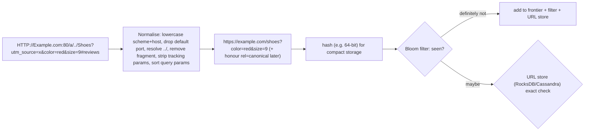

Normalisation rules: case of scheme and host, default ports, trailing slashes (site-dependent), percent-encoding normalisation, removing session ids and tracking params (`utm_*`, `gclid`, `fbclid`), sorting query params, and IDN to punycode. After fetching, respect `<link rel="canonical">` and redirects (map variants to the final URL).

#### Example
An e-commerce crawler (price monitoring) found each product page linked under ~40 variants (filter orders, tracking params, sessions). Normalisation plus a canonical-tag mapping cut fetched URLs by 85%. A Bloom filter (1.2 GB for 1B URLs at 1% false positives) handles the fast path, and false positives (1% of new URLs wrongly considered seen) are acceptable because important pages are re-discovered via other links and sitemaps.

#### Trade-offs
Aggressive normalisation risks merging genuinely different pages (some sites use query params meaningfully), while lax normalisation wastes crawl budget. Bloom false positives skip some new URLs.

#### Problems & fixes
| Symptom | Cause | Fix |
|---|---|---|
| Same page crawled many times | tracking params, sessions in URLs | normalisation rules, canonical tags |
| Distinct pages merged wrongly | over-aggressive param stripping | per-site param allow-lists learned from content hashes |
| Important new URLs skipped | Bloom false positives | sitemaps, priority re-discovery, larger filter |

#### Cheat sheet
- Normalise (case, ports, paths, params, fragments), then canonicalise (rel=canonical, redirects).
- Bloom filter fast path + exact URL store.
- Per-site rules for meaningful parameters.

#### Interview questions
<details><summary>Which URL normalisation steps would you apply in a crawler?</summary>

Lowercase scheme and host, remove default ports (:80/:443), remove fragments (#…), resolve dot segments (`/a/../b`), normalise percent-encoding, strip known tracking and session parameters, sort query parameters, convert IDNs to punycode, and apply consistent trailing-slash handling. After fetching, follow redirects and canonical links to map variants to one canonical URL.
</details>

<details><summary>Why use a Bloom filter and a persistent store together for seen URLs?</summary>

The Bloom filter answers "definitely not seen" for most new URLs instantly in memory (billions of URLs in a few GB). For "maybe" answers, an exact check in a persistent key-value store confirms whether the URL was really seen, which corrects false positives where it matters and keeps durable state across restarts.
</details>

#### Interview angle
> "URLs are normalised (case, ports, dot segments, tracking params, sorted query, no fragment), canonicalised after fetch, and checked against a Bloom filter backed by an exact URL store."

### Inverted index construction — tokenize → normalize → build term→postings list mapping
Building an inverted index turns documents into a searchable structure: **analyse** text (tokenise, lowercase, remove stop words, stem), then for each term **accumulate postings** (doc ids, frequencies, positions), sort and **compress** them, and write **segments**. At scale it's done incrementally (Lucene segments) or in batch (MapReduce-style). (Phase 10 covers the structure itself.)

#### How it works
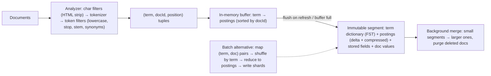

Lucene and Elasticsearch specifics: documents are buffered in memory and written as a new segment on **refresh** (default 1 s, so near-real-time search). A translog provides durability before a Lucene **commit** (flush). Deletes and updates mark old doc ids as deleted (an update = delete + add). **Merges** combine segments.

#### Example
Indexing 50M product documents into Elasticsearch: a bulk reindex job sets `refresh_interval: -1` and replicas 0 during the load, uses the `_bulk` API with ~5–15 MB batches from parallel workers, then restores refresh=1s and replicas 1 and force-merges read-only indices. Throughput rose from 3k to 40k docs/s compared with default settings. Live updates then stream via CDC → Kafka → indexer.

#### Trade-offs
Fast queries come from precomputation: indexing costs CPU and I/O, there's a near-real-time delay, and analyzers must match between index and query time.

#### Problems & fixes
| Symptom | Cause | Fix |
|---|---|---|
| Slow bulk indexing | refreshes + replicas during load, small bulks | disable refresh/replicas during bulk, tune bulk size, parallelism |
| Too many small segments, slow searches | frequent refresh, heavy updates | tune refresh interval, merge policy, force-merge read-only indices |
| Query doesn't match indexed terms | different analyzers at index vs search | consistent analyzers, analyze API to debug |

#### Cheat sheet
- Analyze → (term, doc, pos) → postings → compressed immutable segments → merges.
- Refresh (1 s) gives near real time. Translog for durability. Updates = delete + add.
- Bulk loads: refresh off, replicas 0, then restore.

#### Interview questions
<details><summary>Why is Elasticsearch called "near real-time"?</summary>

Newly indexed documents are buffered in memory and become searchable only when a refresh writes them into a new Lucene segment (every 1 second by default). Until then they're durable (in the translog) but not visible to search. Writes can request `refresh=wait_for` to block until visible.
</details>

<details><summary>How would you build an index for billions of documents in batch?</summary>

MapReduce-style: map each document to (term, docId, positions) pairs after analysis, shuffle and sort by term (and docId), and reduce to postings lists written into index shards partitioned by document id ranges (document-partitioned) or by term (term-partitioned). Then load the shards into the serving system. Spark jobs can build Lucene segments offline for bulk loading.
</details>

#### Interview angle
> "Indexing analyzes text into terms, buffers postings and writes immutable segments that refresh every second and merge in the background. Bulk loads disable refresh and replicas, then restore them."

### Postings list — docID + term frequency + position offsets; sorted by docID for merge operations
A postings list holds, for one term, every document containing it, **sorted by doc id**, often with **term frequency** (for scoring) and **positions** (for phrase and proximity queries). Sorting enables fast **merge-based intersection and union**, and **delta encoding + compression** keeps lists small enough to stream from cache.

#### How it works
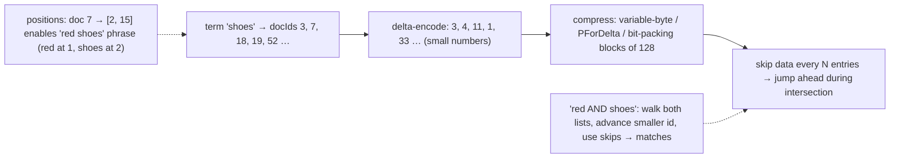

Index options trade size for capability: doc ids only (filtering), + frequencies (BM25), + positions (phrases), + offsets (highlighting). In Elasticsearch `index_options: docs | freqs | positions | offsets`.

Intersection strategies: iterate the shortest list first, galloping or skip-pointer search in longer lists, and bitsets (roaring bitmaps) for very frequent terms and filters.

#### Example
A log-search cluster indexed message text with positions and offsets by default, so indices were huge. Analysis showed phrase queries and highlighting were rarely used on the `message` field, and switching to `index_options: freqs` (and `docs` for keyword fields used only as filters) cut index size ~35% and improved query throughput through better cache fit.

#### Trade-offs
More information per posting (positions, offsets) enables richer queries but grows the index. Compression trades CPU for I/O (usually a big win).

#### Problems & fixes
| Symptom | Cause | Fix |
|---|---|---|
| Index too large | positions/offsets indexed everywhere | index_options per field, disable norms where unneeded |
| Slow queries with very common terms | huge postings lists | filters (cached bitsets), stop words, early termination (top-k pruning, WAND/MaxScore) |
| Phrase queries fail | positions not indexed | enable positions on fields needing phrases |

#### Cheat sheet
- Sorted doc ids (+ tf, + positions, + offsets), delta-encoded + compressed, skip data.
- Intersect via merge plus skips, shortest list first.
- Index only what queries need.

#### Interview questions
<details><summary>Why are postings lists sorted by document id?</summary>

Sorted lists allow linear-time merge-based intersection and union (walk two lists in step), skip pointers to jump ahead, and delta encoding (gaps between consecutive ids are small numbers that compress very well). Unsorted lists would require hashing or sorting at query time.
</details>

<details><summary>How do search engines avoid scoring every document that matches a common term?</summary>

Dynamic pruning algorithms (WAND, block-max WAND, MaxScore) use per-term and per-block score upper bounds to skip documents that can't make the current top-k. Combined with filters applied first (cached bitsets) and early termination on sorted indices, only a small fraction of matching documents are fully scored.
</details>

#### Interview angle
> "Postings are doc-id-sorted, delta-compressed lists with skip data, intersected shortest-first. I index positions only on fields that need phrases, and block-max WAND avoids scoring every match."

### TF-IDF — term frequency (how often term appears in doc) × inverse document frequency (log(N/df))
TF-IDF scores how important a term is to a document within a collection: **term frequency** (a term appearing often in a document suggests relevance) × **inverse document frequency** (terms appearing in few documents are more discriminative). A query's score sums the TF-IDF of its terms, often combined with vector-space cosine similarity.

#### How it works
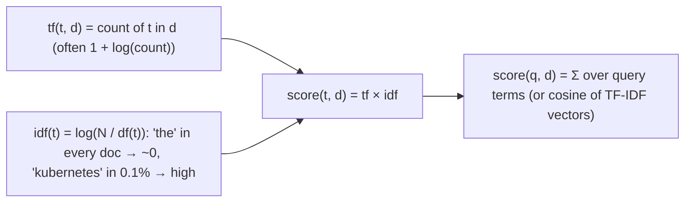

Worked example (N = 1,000,000 documents):
| Term | df | idf = log10(N/df) | tf in doc | tf × idf |
|---|---|---|---|---|
| "the" | 990,000 | 0.004 | 20 | 0.09 |
| "running" | 50,000 | 1.30 | 3 | 3.9 |
| "marathon" | 2,000 | 2.70 | 2 | 5.4 |

Rare, repeated terms dominate. Common words contribute almost nothing.

#### Example
An internal documentation search with plain TF-IDF ranked a 30-page runbook mentioning "kafka" 120 times above a focused 1-page "Kafka consumer lag" guide, because raw TF keeps growing with repetition and long documents have more terms. That's why Lucene moved its default to BM25, which saturates TF and normalises by length.

#### Trade-offs
Simple, explainable and effective baseline, but unbounded TF rewards keyword stuffing and long documents, and there's no notion of semantics (synonyms) or term proximity.

#### Problems & fixes
| Symptom | Cause | Fix |
|---|---|---|
| Long documents dominate | no length normalisation | BM25 (b parameter), length norms |
| Keyword stuffing ranks high | linear TF | log/saturating TF (BM25 k1) |
| Synonyms miss | lexical matching only | synonyms, stemming, semantic/hybrid search |

#### Cheat sheet
- tf × idf, with idf = log(N/df). Rare and repeated terms score high.
- Baseline relevance. Weak on length and saturation.
- BM25 fixes saturation and length. Semantic search fixes synonyms.

#### Interview questions
<details><summary>Explain intuitively why IDF uses a logarithm.</summary>

Document frequencies span many orders of magnitude (from a term appearing in 1 doc to all docs). The ratio N/df grows hugely for rare terms, and without dampening one ultra-rare term would dwarf everything else. The logarithm compresses this range, so rarer terms get more weight with diminishing returns.
</details>

<details><summary>What are TF-IDF's main weaknesses for ranking?</summary>

Term frequency grows linearly (or log-linearly) without saturation, rewarding repetition and keyword stuffing. There's no document-length normalisation in the basic form, so long docs score higher. It ignores term order and proximity and treats synonyms as unrelated. BM25 addresses the first two, and phrase or proximity scoring and semantic embeddings address the rest.
</details>

#### Interview angle
> "TF-IDF weighs terms by in-document frequency times rarity. It's the intuition behind ranking, but in production I'd use BM25 for saturation and length normalisation, plus semantic signals."

### BM25 — improved TF-IDF: saturates term frequency, normalizes by document length; default in Elasticsearch
BM25 (Okapi BM25) is the standard lexical ranking function and the default in Lucene, Elasticsearch, OpenSearch and Solr. It improves TF-IDF with **term-frequency saturation** (k1: extra occurrences matter less and less) and **document-length normalisation** (b: long documents don't win just by being long).

#### How it works
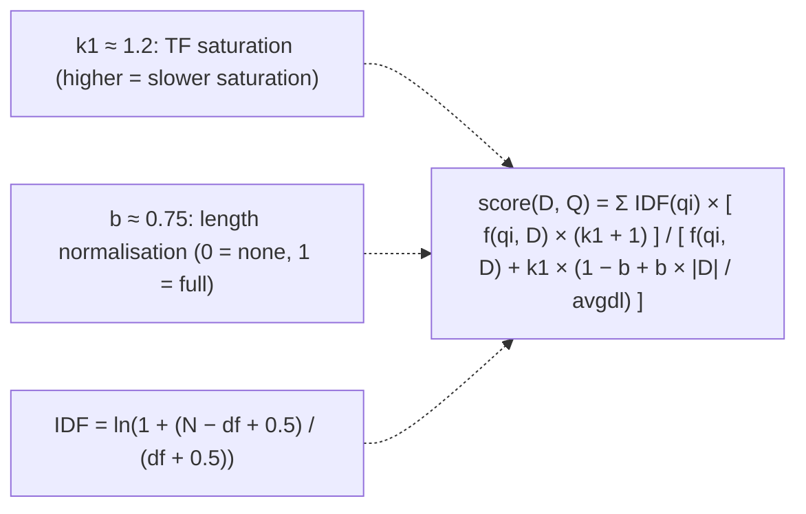

Effect of saturation (k1 = 1.2, average-length doc): tf = 1 gives 1.0×, tf = 2 gives ~1.38×, tf = 5 gives ~1.77×, tf = 20 gives ~2.06×, so repetition beyond a few occurrences adds little.

Tuning: short fields (titles) often benefit from lower b. Fields with meaningful repetition can use higher k1. Field-level BM25 plus boosting (`title^3`) and multi-field queries (`multi_match` with `best_fields` / `most_fields` / `cross_fields`) matter more in practice than tweaking k1 and b.

#### Example
Product search: `multi_match` over `title^3`, `brand^2`, `description` using BM25. "nike running shoes" ranks a product titled "Nike Pegasus Running Shoes" above a long description that mentions "running" 15 times, thanks to field boosts, TF saturation and length normalisation. A `function_score` adds popularity and in-stock boosts on top.

#### Trade-offs
Strong, fast, explainable baseline with little tuning, but it's still lexical: it misses synonyms and paraphrases (combine with dense vectors in hybrid search) and knows nothing about business signals (combine with boosts or learning to rank).

#### Problems & fixes
| Symptom | Cause | Fix |
|---|---|---|
| Long descriptions outrank precise titles | single combined field | per-field BM25 with boosts, title-weighted fields |
| Repetitive spam ranks high | high k1 | lower k1, spam filters |
| Semantically relevant docs missing | lexical-only scoring | hybrid search with embeddings |
| Scores inconsistent across shards | per-shard IDF stats | enough docs per shard, dfs_query_then_fetch for small indices |

#### Cheat sheet
- BM25 = IDF × saturated TF (k1 ≈ 1.2) with length normalisation (b ≈ 0.75).
- Default in Lucene and Elasticsearch. Tune via field boosts first.
- Add business signals (function_score/LTR) and semantics (hybrid).

#### Interview questions
<details><summary>What problems of TF-IDF does BM25 solve?</summary>

Term-frequency saturation: BM25's k1 parameter makes additional occurrences contribute less and less, so keyword stuffing doesn't keep increasing scores. Document-length normalisation: the b parameter scales term frequency by document length relative to the average, so long documents aren't favoured just for containing more words. Its IDF variant is also smoothed.
</details>

<details><summary>Why might scores differ for the same document on different Elasticsearch shards?</summary>

BM25's IDF and average document length are computed per shard from local statistics. With few documents or uneven term distributions across shards, the same term has different IDFs per shard, which changes scores and ranking. Mitigate with enough documents per shard, routing that evens distributions, or `dfs_query_then_fetch` (global stats, slower) for small indices.
</details>

#### Interview angle
> "Lexical relevance is BM25 per field with boosts like title^3, tuned mostly through fields rather than k1 and b, then combined with popularity signals and dense vectors in hybrid ranking."

### Tokenization — split text on whitespace and punctuation; language-specific tokenizers (ICU, MeCab for Japanese)
Tokenization splits text into **tokens** (terms), the units that get indexed and matched. Simple whitespace and punctuation splitting works for English-ish text, but real systems need language-aware tokenizers: no spaces in Chinese, Japanese and Thai, compound words in German, scripts and transliteration in Indian languages, and special handling of emails, SKUs and hyphens.

#### How it works
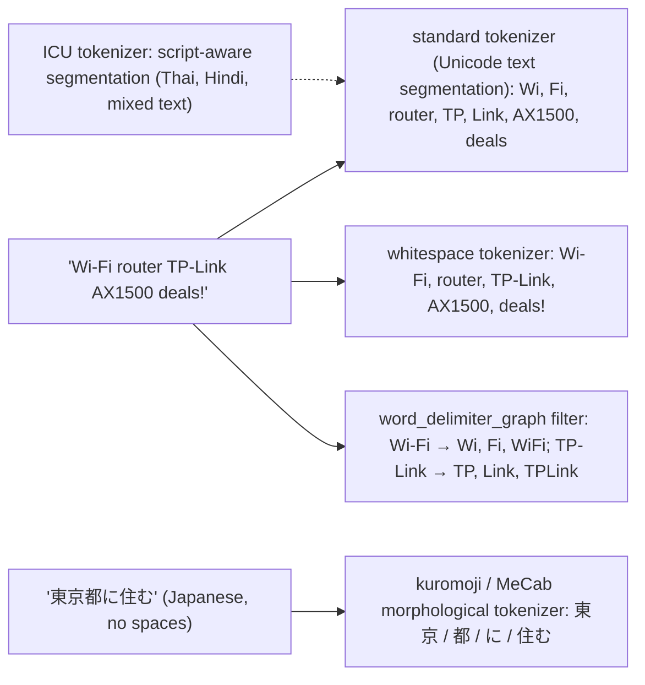

Elasticsearch building blocks: char filters (HTML strip, mapping) → **tokenizer** (standard, whitespace, keyword, pattern, ngram, edge_ngram, icu_tokenizer, kuromoji, smartcn) → token filters (lowercase, asciifolding, stop, stemmer, synonym, word_delimiter_graph).

#### Example
An Indian e-commerce search failed on queries like "iphone15" vs "iPhone 15" and "t-shirt" vs "tshirt" vs "tee shirt". The fix was a custom analyzer: `word_delimiter_graph` (splitting letters from digits and hyphenated parts while preserving catenated forms), lowercase, asciifolding, a synonym filter ("tee, t-shirt, tshirt"), and a separate `keyword` sub-field for exact SKU matching. Hindi and Hinglish queries got an ICU-based field with transliteration support.

#### Trade-offs
More aggressive tokenisation improves recall but can hurt precision ("AX1500" split badly) and index size. Language-specific analyzers need per-language fields and detection.

#### Problems & fixes
| Symptom | Cause | Fix |
|---|---|---|
| "iphone15" doesn't match "iPhone 15" | letters/digits not split | word_delimiter_graph with catenation |
| CJK search returns garbage | whitespace tokenizer on unspaced text | kuromoji/smartcn/ICU tokenizers |
| SKU/email searches break | tokenized into parts | keyword sub-fields for exact matching |

#### Cheat sheet
- Tokenizer is the most important analyzer choice. Test with the `_analyze` API.
- Standard/ICU for general text. Language-specific for CJK. word_delimiter for SKUs and hyphens.
- Multi-fields: analysed text + keyword for exact matches.

#### Interview questions
<details><summary>How would you make "tshirt", "t-shirt" and "t shirt" all match each other?</summary>

Use an analyzer with `word_delimiter_graph` (splitting on hyphens with `catenate_words` so "t-shirt" produces t, shirt and tshirt), lowercase, and a synonym filter mapping variants ("t shirt, tshirt, t-shirt, tee"), applied consistently at index and search time (synonym_graph at search time). Verify with the `_analyze` API and test queries.
</details>

<details><summary>Why can't you use a whitespace tokenizer for Japanese or Chinese text?</summary>

These languages don't separate words with spaces, so a whitespace tokenizer produces one giant token per sentence, and searching for any word inside it fails. You need morphological analyzers (kuromoji/MeCab for Japanese, smartcn/IK for Chinese) or n-gram or ICU segmentation that identify word boundaries.
</details>

#### Interview angle
> "I design analyzers per field and test them with _analyze: word_delimiter for SKUs and hyphenated words, synonyms for variants like tshirt, keyword sub-fields for exact codes, and ICU or kuromoji for non-space languages."

### Stemming — reduce words to root form (running → run); Porter, Snowball stemmers
Stemming chops words down to a common **stem** using rules ("running", "runs" → "run"; "connection", "connected" → "connect"), so different inflections match each other. It's fast and language-specific (Porter, Snowball/Porter2, KStem, light stemmers). Stems aren't necessarily real words, and aggressive stemmers can conflate unrelated words.

#### How it works
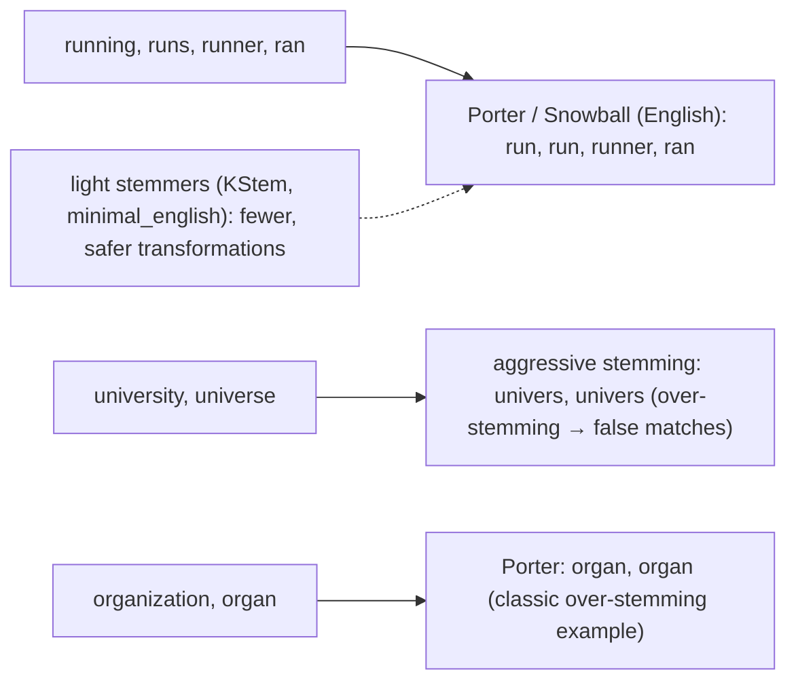

Choices in Elasticsearch: `stemmer` filter with language (`english`, `light_english`, `minimal_english`, `porter2`), `kstem`, `hunspell` (dictionary-based), and the `keyword_marker` filter to protect brand names from stemming.

#### Example
A fashion search used the aggressive Porter stemmer, so "dresses" matched "dress" (good) but "shorts" was stemmed to "short", matching "short sleeve shirt" and "short kurta" for the query "shorts" (bad precision). Switching to `light_english` plus `keyword_marker` protecting product-type terms, and boosting exact (unstemmed) matches through a multi-field, restored precision while keeping plural recall.

#### Trade-offs
Better recall for inflections, at the cost of precision (over-stemming conflates different words, under-stemming misses variants). Rule-based stemming is fast but ignores context.

#### Problems & fixes
| Symptom | Cause | Fix |
|---|---|---|
| Irrelevant matches (organ vs organization) | over-stemming | lighter stemmer, keyword_marker, boost exact field |
| Plurals/tenses don't match | no stemming | add stemmer to analyzer |
| Brand names mangled | stemmer applied to proper nouns | keyword_marker / protected words list |

#### Cheat sheet
- Rule-based suffix stripping: fast, language-specific, imperfect.
- Prefer light stemmers. Protect brand and product terms. Index a stemmed and an exact field, and boost exact.
- Index and query must use the same stemmer.

#### Interview questions
<details><summary>How do you get the benefits of stemming without hurting precision?</summary>

Index the text twice with multi-fields: one stemmed (for recall on inflections) and one with minimal analysis (exact or unstemmed). Query both and boost the unstemmed field, so exact matches rank higher while stemmed matches still appear. Use light stemmers and protect important terms (brands, product types) with keyword_marker.
</details>

<details><summary>What is over-stemming vs under-stemming?</summary>

Over-stemming reduces unrelated words to the same stem ("universal", "university", "universe" → "univers"), causing false matches. Under-stemming fails to reduce related forms to the same stem ("ran" vs "run", "alumnus" vs "alumni"), causing missed matches. Stemmer choice balances the two.
</details>

#### Interview angle
> "I use a light stemmer on a recall field plus an unstemmed field boosted for exact matches, protecting brand and product terms, so 'shorts' doesn't turn into 'short'."

### Lemmatization — context-aware stemming (better → good); computationally heavier than stemming
Lemmatization reduces words to their **dictionary form (lemma)** using vocabulary and morphological analysis, often with part-of-speech context: "better" → "good", "ran" → "run", "mice" → "mouse", "meeting" (noun) stays "meeting" while "meeting" (verb) → "meet". It's more accurate than stemming, but slower and needs language resources.

#### How it works
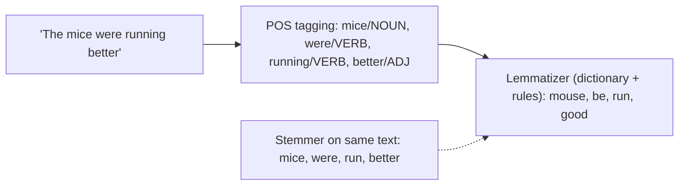

Tools: spaCy, Stanza, NLTK WordNet lemmatizer, hunspell dictionaries (Elasticsearch `hunspell` filter approximates lemmatization), and commercial linguistic plugins. For search, lemmatization is usually done at **index time** (and query time) via a dictionary-based filter, while heavyweight NLP pipelines are used offline (document enrichment) rather than per query.

#### Example
A legal-document search where precision matters (lawyers searching "was liable" should match "be liable") used a hunspell-based English dictionary filter plus spaCy lemmatization in the ingestion pipeline to add a `lemmas` field. Queries are lemmatized the same way. Irregular forms (paid/pay, went/go) matched correctly, which Porter stemming would miss, with ~3× slower indexing, acceptable for this corpus.

#### Trade-offs
Higher precision and better handling of irregular forms, but slower, language-specific dictionaries and models, ambiguity errors, and sometimes lower recall than aggressive stemming. Modern semantic embeddings often reduce the need for it.

#### Problems & fixes
| Symptom | Cause | Fix |
|---|---|---|
| Indexing too slow | NLP lemmatization per document at write time | batch enrichment pipeline, dictionary filters |
| Unknown words not lemmatized | dictionary coverage gaps | fallback to light stemming |
| Inconsistent query/index forms | different lemmatizers | same pipeline for both |

#### Cheat sheet
- Dictionary form with context: better → good, mice → mouse, ran → run.
- More accurate, slower, language resources needed.
- Use for precision-critical domains. Combine with stemming fallback or semantic search.

#### Interview questions
<details><summary>Stemming vs lemmatization for an e-commerce search engine?</summary>

Usually light stemming: it's fast, handles plurals and common inflections, and product queries are short and noun-heavy, where irregular verb forms rarely matter. Lemmatization adds cost for little gain there. Precision-critical, linguistically rich domains (legal, medical, research) benefit more from lemmatization, often done in an enrichment pipeline.
</details>

<details><summary>Why does lemmatization need part-of-speech information?</summary>

The correct dictionary form depends on how a word is used: "saw" is "see" as a verb but "saw" as a noun (the tool), and "meeting" can be a noun (keep) or verb ("meet"). POS tagging disambiguates which lemma applies, while stemmers apply the same rules regardless of context.
</details>

#### Interview angle
> "For short product queries light stemming is enough. For precision-critical text like legal documents I'd lemmatize in an enrichment pipeline, so irregular forms like paid and pay match."

### Stop words — filter high-frequency words (the, a, is) to reduce index size
Stop words are extremely common words ("the", "a", "is", "of") that carry little meaning for ranking. Historically engines removed them to save index space and speed up queries. Today, with compression and BM25's low IDF for common terms, removing them is often **unnecessary or harmful** (phrases like "to be or not to be", "The Who", "vitamin A").

#### How it works
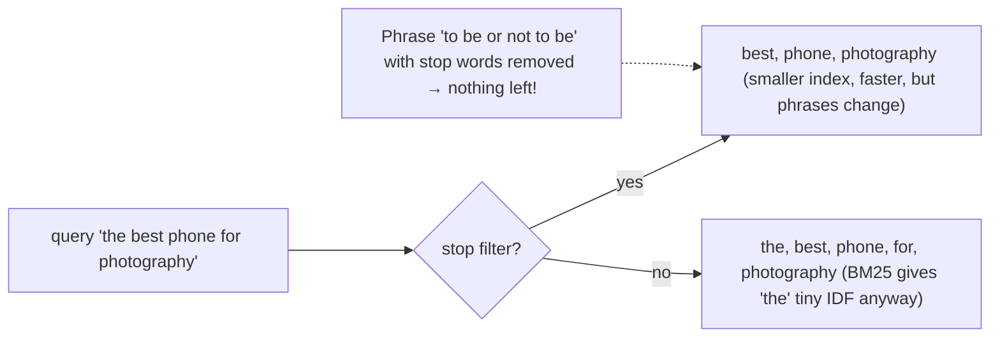

Modern approaches: keep stop words in the index (compression makes huge postings lists cheap), rely on BM25 IDF to down-weight them, and use the `common_grams` filter (index bigrams like "the_who") to speed phrase queries containing common words. Search-time stop filtering only on specific fields if needed.

#### Example
A media streaming search removed English stop words, and queries for the band "The The", the movie "It", and "Let It Be" returned nothing useful. They re-indexed without the stop filter on title fields (keeping it only on long description fields to reduce noise) and added `common_grams` for phrase speed, and title searches recovered with negligible index growth.

#### Trade-offs
Removing stop words gives a smaller index and faster queries on old hardware, but breaks phrases, names and certain queries. Keeping them costs some index size, mitigated by compression and IDF.

#### Problems & fixes
| Symptom | Cause | Fix |
|---|---|---|
| Titles like "The Who", "It" unsearchable | stop word removal | keep stop words on title/name fields |
| Phrase queries with common words slow | huge postings for "the" | common_grams filter |
| Noise from common words in long text | no down-weighting | BM25 handles; optional stop filter on long fields only |

#### Cheat sheet
- Stop words = very common, low-information terms.
- Modern default: keep them (BM25 + compression). Remove selectively at most.
- Use common_grams for phrase performance. Protect names and titles.

#### Interview questions
<details><summary>Should you remove stop words in a modern search engine?</summary>

Usually not globally. BM25 already gives very common words low weight, compressed postings make them cheap to store, and removing them breaks phrase queries and titles or names made of common words ("The Office", "To Be or Not to Be"). Remove them selectively (e.g. on long description fields) or use common_grams for performance.
</details>

<details><summary>What does the common_grams filter do?</summary>

It indexes bigrams that combine common words with their neighbours (e.g. "the_office", "to_be") alongside the regular tokens. Phrase queries containing very frequent terms can then use the much shorter bigram postings lists instead of intersecting enormous lists for "the" or "to", which speeds those queries while keeping stop words searchable.
</details>

#### Interview angle
> "I keep stop words on titles and names (BM25 down-weights them and compression makes them cheap) and use common_grams for fast phrases, so searches like 'The Office' still work."

### Elasticsearch cluster — master node (cluster state), data nodes (store/query shards), coordinating nodes
An Elasticsearch cluster is a set of nodes with **roles**: **master-eligible** nodes manage cluster state (indices, mappings, shard allocation) via a quorum-based election, **data** nodes store shards and execute searches and indexing, **coordinating** (client) nodes route requests and merge results, and **ingest** nodes run preprocessing pipelines. Separating roles keeps large clusters stable.

#### How it works
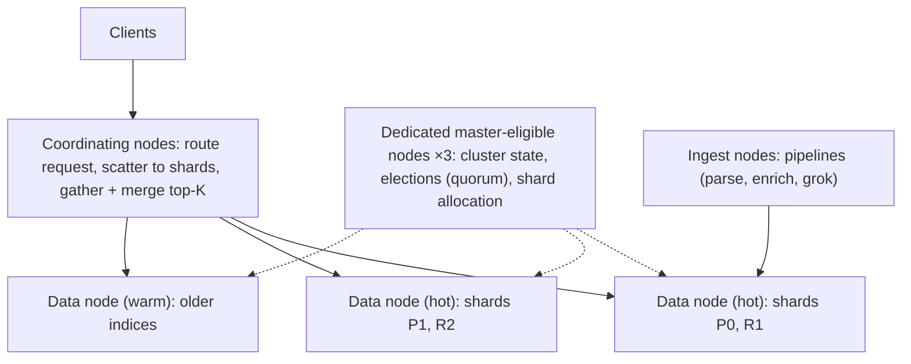

Search flow (query then fetch): the coordinator sends the query to one copy of each shard, each shard returns top-k doc ids and scores (query phase), the coordinator merges a global top-k and fetches those documents (fetch phase).

Sizing guidance: 3 dedicated masters (small instances) for clusters beyond a handful of nodes, data nodes sized by shard count and heap (≤ ~30 GB heap for compressed pointers, rest for page cache), and zone awareness for replicas across AZs.

#### Example
A logging cluster with 30 data nodes was unstable: masters also served heavy searches, garbage collection pauses delayed cluster-state updates, nodes dropped out, and shards reallocated in storms. Fixes: 3 dedicated master nodes, coordinating nodes for Kibana and API traffic, hot/warm data tiers with ILM, shard-count reduction, and AZ-aware allocation. The cluster stabilised.

#### Trade-offs
Role separation gives stability and scalability, but more nodes to operate. Managed services (Elastic Cloud, OpenSearch Service) simplify it at a cost.

#### Problems & fixes
| Symptom | Cause | Fix |
|---|---|---|
| Cluster instability, master elections | masters overloaded by data/search work | dedicated master nodes (3) |
| Split brain (older versions) | wrong minimum masters | modern versions use quorum voting; keep odd number of masters |
| Coordinator memory pressure | huge aggregations/deep pagination | limits, search_after, dedicated coordinating nodes |
| Node loss causes red indices | replicas on same zone | zone awareness, ≥1 replica |

#### Cheat sheet
- Roles: master (state, quorum), data (shards), coordinating (scatter-gather), ingest.
- 3 dedicated masters. Heap ≤ ~30 GB. Page cache matters.
- Query then fetch. Zone awareness. Hot/warm tiers.

#### Interview questions
<details><summary>Why use dedicated master nodes in Elasticsearch?</summary>

Masters maintain and publish cluster state (mappings, shard allocation) and run elections. If they also handle heavy indexing and search, GC pauses or overload can delay cluster-state updates, cause nodes to be considered dead and trigger mass shard reallocation, destabilising the cluster. Three small dedicated masters keep cluster coordination reliable.
</details>

<details><summary>How does a search request execute across shards?</summary>

The coordinating node forwards the query to one copy (primary or replica) of every relevant shard. Each shard executes locally and returns its top-k doc ids and scores (query phase). The coordinator merges them into a global top-k, then requests those documents' contents from the owning shards (fetch phase) and returns the results.
</details>

#### Interview angle
> "A production Elasticsearch cluster has three dedicated masters, data nodes sized for shard count and page cache, coordinating nodes for heavy fan-in, zone-aware replicas and hot/warm tiers managed by ILM."

### Elasticsearch shard — Lucene index; primary + replica; max ~50GB per shard for performance
An Elasticsearch index is split into **primary shards** (each a full Lucene index holding a subset of documents), and each primary has **replica shards** on other nodes for high availability and read throughput. Shard count and size strongly affect performance: aim for roughly **10–50 GB per shard** and avoid thousands of tiny shards.

#### How it works
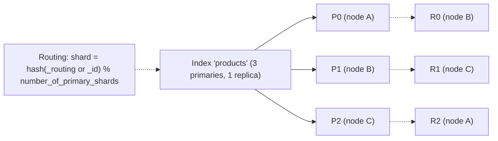

Rules:
- The **number of primaries is fixed at index creation** (change it via reindex, split or shrink APIs).
- Replicas can change anytime. More replicas means more read capacity and HA, at more storage and indexing cost.
- **Custom routing** (e.g. by tenant id) sends a tenant's docs to one shard, so its queries hit one shard (but watch hot shards).
- Too many shards cost heap per shard, cluster-state size and per-shard query overhead. Too few means oversized shards with slow recovery and limited parallelism.
- Time-series data: daily or rollover indices with ILM and data streams.

#### Example
A team created daily log indices with 5 primaries × 1 replica = 10 shards per day across 90 days and 40 services, giving 36,000 shards for 8 TB of data (avg 220 MB per shard). Heap and cluster state ballooned and masters struggled. Fix: data streams with rollover at 40 GB or 1 day, 1–2 primaries per index, and shrinking warm indices. Shard count dropped to ~800, and search latency and stability improved dramatically.

#### Trade-offs
More primaries give more indexing parallelism and spread, but more overhead. Larger shards are efficient but slow to recover and move.

#### Problems & fixes
| Symptom | Cause | Fix |
|---|---|---|
| Heap pressure, slow cluster state | too many small shards | rollover by size, fewer primaries, shrink |
| Slow recovery/rebalancing | huge shards (> 100 GB) | more primaries, rollover sizing |
| Hot shard | skewed custom routing | routing_partition_size, better keys |
| Can't increase primaries | fixed at creation | split/reindex API, plan with rollover |

#### Cheat sheet
- Primary shards (fixed) + replicas (adjustable). shard = hash(routing) % primaries.
- Target ~10–50 GB per shard. Avoid shard explosions.
- Rollover/ILM for time series. Custom routing for tenant locality.

#### Interview questions
<details><summary>How do you choose the number of primary shards for a new index?</summary>

Estimate total index size over its lifetime (or until rollover) and target ~10–50 GB per shard: 300 GB means ~6–10 primaries. Consider indexing throughput (more primaries spread writes across nodes) and cluster size. For time-series data, use rollover by size or age instead of guessing up front.
</details>

<details><summary>Why is having too many shards bad?</summary>

Each shard is a Lucene index with its own memory overhead (segments, caches), file handles and cluster-state entries. Every search fans out to every shard (more per-shard coordination and merging). Thousands of tiny shards waste heap, bloat cluster state (slowing masters) and increase query latency, without adding capacity.
</details>

#### Interview angle
> "I size shards at 10 to 50 GB using rollover and data streams for time series, keep replicas at least one across zones, and avoid shard explosions that eat heap and slow masters."

### Elasticsearch queries — match (full-text), term (exact), bool (must/should/must_not/filter), range, fuzzy, phrase, nested
Elasticsearch's Query DSL combines **full-text queries** (analysed, scored) with **term-level queries** (exact, not analysed) inside a **bool** query. Using the right query type, and putting non-scoring conditions in **filter context** (cached, no scoring), is the core of fast, relevant search.

#### How it works
```json
GET products/_search
{
  "query": {
    "bool": {
      "must":   [{ "multi_match": { "query": "running shoes", "fields": ["title^3", "brand^2", "description"] } }],
      "should": [{ "match_phrase": { "title": { "query": "running shoes", "boost": 2 } } }],
      "filter": [
        { "term":  { "in_stock": true } },
        { "terms": { "brand.keyword": ["nike", "adidas"] } },
        { "range": { "price": { "gte": 2000, "lte": 8000 } } }
      ],
      "must_not": [{ "term": { "category.keyword": "kids" } }]
    }
  },
  "sort": ["_score", { "popularity": "desc" }],
  "size": 20, "search_after": [12.3, 9876]
}
```

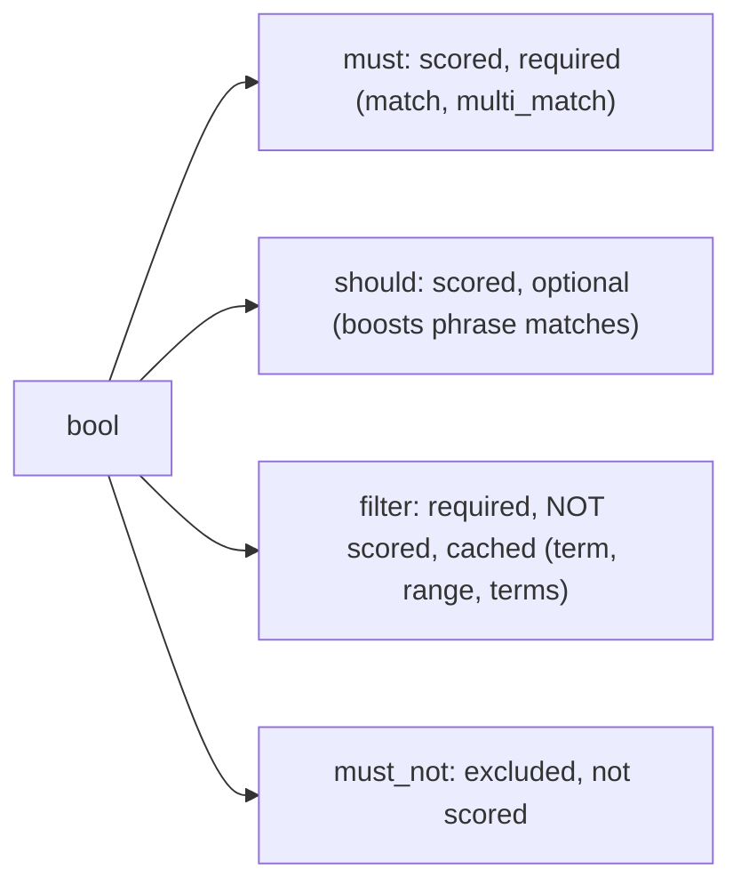

| Query | Use |
|---|---|
| `match` / `multi_match` | full-text on analysed fields |
| `term` / `terms` | exact values on keyword/numeric fields (not analysed) |
| `range` | numbers, dates |
| `match_phrase` | words in order (needs positions) |
| `fuzzy` / `match` with `fuzziness: AUTO` | typos |
| `prefix` / `wildcard` | prefix matching (prefer edge n-grams) |
| `nested` | query objects in arrays independently |
| `function_score` | add recency, popularity, geo decay to scores |

#### Example
A bug: filtering by `term: { "brand": "Nike" }` on an analysed `text` field returned nothing (the indexed token was "nike" in lowercase, while term queries aren't analysed). Fix: use `brand.keyword` for exact filters, or `match` for full text. Moving price, stock and brand conditions from `must` to `filter` also enabled filter caching and cut p95 from 120 ms to 45 ms.

#### Trade-offs
A flexible DSL, but easy to misuse (term on text, scoring filters, deep pagination with from/size, leading wildcards).

#### Problems & fixes
| Symptom | Cause | Fix |
|---|---|---|
| term query finds nothing | term on analysed text | keyword sub-field or match |
| Slow queries | filters in must (scored), leading wildcards | filter context, edge n-grams instead of wildcards |
| Deep pagination slow/blocked | from+size beyond 10k | search_after + PIT |
| Arrays of objects match wrong combos | object flattening | nested type + nested query |

#### Cheat sheet
- match = analysed full text. term = exact keyword or number.
- bool: must and should (score), filter and must_not (no score, cached).
- search_after for deep pages. nested for object arrays. function_score for business signals.

#### Interview questions
<details><summary>What's the difference between query context and filter context?</summary>

Query context ("how well does this document match?") computes relevance scores and is used for full-text conditions (must, should). Filter context ("does it match, yes or no?") skips scoring and can be cached as bitsets, which is used for exact conditions like price ranges, status, tenant id and dates. Putting non-relevance conditions in filter makes queries faster and keeps scores clean.
</details>

<details><summary>Why do you need the nested type for arrays of objects?</summary>

By default Elasticsearch flattens object arrays into multi-valued fields, losing which values belong together. A product with variants [{color: red, size: 9}, {color: blue, size: 10}] would match "color red AND size 10". The nested type indexes each object as a hidden sub-document, so nested queries match conditions within the same object.
</details>

#### Interview angle
> "Relevance conditions go in must and should, exact constraints in filter context for caching, keyword fields for term filters, search_after for deep pagination, and nested mappings for variant arrays."

### Elasticsearch aggregations — terms (counts), date_histogram, stats, percentiles, nested agg
Aggregations compute analytics over the documents matching a query: **bucket aggregations** group documents (terms, date_histogram, range, filters, geohash grids) and **metric aggregations** compute values (sum, avg, min/max, stats, cardinality, percentiles), and they can be **nested** (buckets within buckets). They power facets, dashboards (Kibana) and analytics APIs.

#### How it works
```json
GET orders/_search
{
  "size": 0,
  "query": { "range": { "created_at": { "gte": "now-7d/d" } } },
  "aggs": {
    "per_day": {
      "date_histogram": { "field": "created_at", "calendar_interval": "day" },
      "aggs": {
        "revenue": { "sum": { "field": "total" } },
        "p95_delivery_minutes": { "percentiles": { "field": "delivery_minutes", "percents": [95] } }
      }
    },
    "top_cities": { "terms": { "field": "city.keyword", "size": 10 } },
    "unique_customers": { "cardinality": { "field": "customer_id" } }
  }
}
```

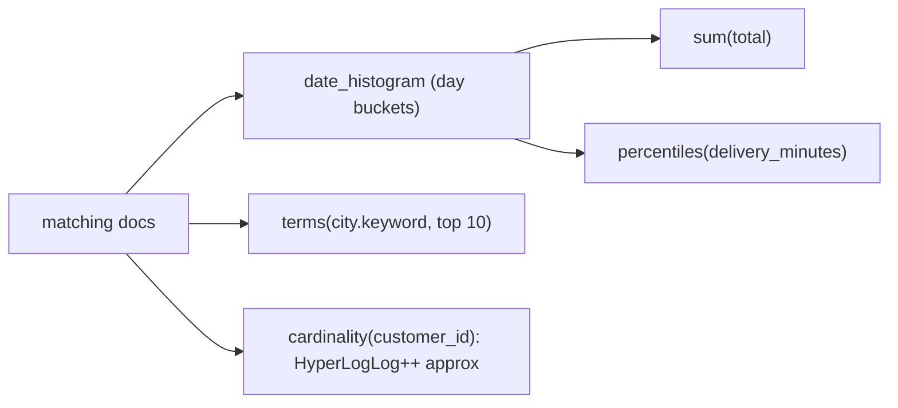

Implementation notes: aggregations read **doc values** (columnar on-disk storage) for keyword, numeric and date fields. `terms` on high-cardinality fields is approximate across shards (shard_size, doc_count_error). `cardinality` uses HyperLogLog++ and percentiles use TDigest, both approximate. The **composite** aggregation paginates through all buckets.

#### Example
A seller dashboard showing 7-day revenue per day, top cities and unique customers runs in ~80 ms on Elasticsearch over 50M orders, using `size: 0`, doc values and an index with a time-based routing strategy. For exact financial reports, the same numbers come from the warehouse, because Elasticsearch `terms` and `cardinality` can be approximate.

#### Trade-offs
Fast, flexible analytics on search data, but approximate in places, memory-heavy for high-cardinality terms (heap and circuit breakers), not a replacement for a warehouse on complex joins or exact finance, and fielddata on text fields is dangerous.

#### Problems & fixes
| Symptom | Cause | Fix |
|---|---|---|
| Circuit breaker exceptions | huge terms aggs / fielddata on text | keyword fields with doc values, smaller size, composite agg |
| Inaccurate top terms | per-shard top-N approximation | increase shard_size, routing, accept or use exact store |
| Slow dashboards | aggregating raw events over long ranges | rollups/transforms, pre-aggregated indices |

#### Cheat sheet
- Bucket (terms, date_histogram, range) + metric (sum, avg, percentiles, cardinality), nested.
- Doc values. size 0. composite for pagination. Some results are approximate (terms, HLL, TDigest).
- Exact finance belongs in the warehouse.

#### Interview questions
<details><summary>Why can Elasticsearch terms aggregation counts be inaccurate?</summary>

Each shard computes its local top-N terms (shard_size) and the coordinator merges them. A term that's moderately frequent on every shard but just outside each shard's local top list can be undercounted or missed globally. Elasticsearch reports doc_count_error_upper_bound. Increasing shard_size or routing related docs to the same shard improves accuracy.
</details>

<details><summary>How would you serve fast analytics dashboards over billions of events in Elasticsearch?</summary>

Pre-aggregate with transforms or rollup jobs into summary indices (per hour, per dimension), use time-based indices with ILM (hot recent data), query with `size: 0` and appropriate intervals, cache dashboard queries, and offload complex or exact analytics to a columnar store (ClickHouse, Druid, a warehouse).
</details>

#### Interview angle
> "Elasticsearch aggregations power facets and near-real-time dashboards over doc values, with transforms for pre-aggregation. Exact financial reporting comes from the warehouse, since terms and cardinality can be approximate."

### Autocomplete — edge n-gram analyzer (index), completion suggester (FST-based, very fast)
Autocomplete suggests completions as users type. In Elasticsearch there are two main approaches: **edge n-gram fields** (index prefixes of each word, flexible and searchable with full query features) and the **completion suggester** (an in-memory FST of weighted suggestions, extremely fast prefix lookups but less flexible). Production systems often add a popularity-ranked query-log layer.

#### How it works
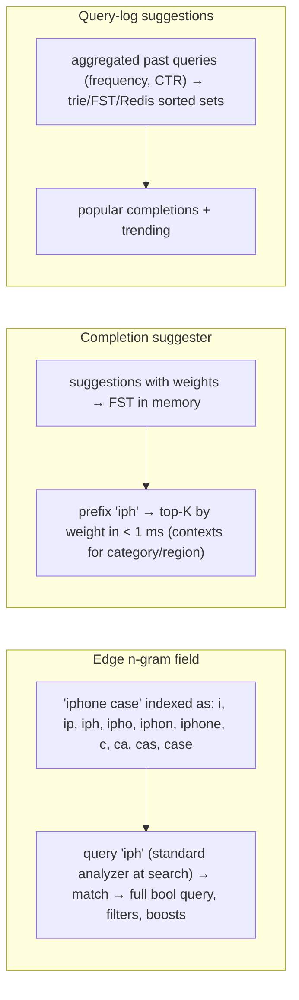

Edge n-gram mapping sketch: index analyzer = standard tokenizer + lowercase + edge_ngram(1–15). The search analyzer must be **without** n-grams, otherwise the query itself gets n-grammed and matches too broadly.

Elasticsearch also offers `search_as_you_type` fields (shingles + edge n-grams) and `match_bool_prefix` queries.

#### Example
An e-commerce search box: (1) query-log suggestions from the last 30 days, weighted by frequency and conversion, served from a completion suggester (FST) with a category context, then (2) product suggestions from an edge n-gram `title.autocomplete` field (with filters for in-stock items and region). The client debounces (150 ms) and cancels stale requests, and the CDN caches the top 1,000 prefixes for 60 s. p99 is 40 ms at 20k req/s.

#### Trade-offs
| Edge n-grams | Completion suggester |
|---|---|
| flexible queries, filters, scoring | fastest, weighted, contexts |
| larger index | rebuild/update suggestions; prefix-only, limited filtering |
| infix matching possible with care | memory (FST) |

#### Problems & fixes
| Symptom | Cause | Fix |
|---|---|---|
| Irrelevant suggestions (too broad) | n-gram analyzer applied at search time | separate search_analyzer without n-grams |
| Index bloat | n-grams on long fields / large max_gram | limit fields, max_gram ~15–20 |
| Too many requests from typing | no debounce | client debounce + cancel + CDN cache |
| Offensive/odd suggestions | raw query logs | filters, minimum frequency, blocklists |

#### Cheat sheet
- Edge n-grams (index) + standard analyzer (search) = flexible prefix search.
- Completion suggester (FST) = fastest weighted prefixes. Query logs give popular completions.
- Debounce, cancel and cache hot prefixes. Filter suggestions.

#### Interview questions
<details><summary>Why must the search analyzer differ from the index analyzer for edge n-gram autocomplete?</summary>

At index time words are expanded into prefixes so that partial input matches. If the query "iph" were also n-grammed, it would become "i", "ip" and "iph", matching every document with words starting with "i", far too broad. The search analyzer should keep the user's input as whole tokens so it matches indexed prefixes precisely.
</details>

<details><summary>How would you scale autocomplete to 50k requests per second?</summary>

Serve popular prefixes from cache (CDN or Redis with short TTL), since a small set of prefixes dominates traffic. Use a fast in-memory structure (completion suggester FST or a dedicated trie service) for suggestion lookups, debounce on the client (100–200 ms) and cancel stale requests, keep responses tiny (top 5–10), and scale stateless suggestion nodes horizontally with replicas.
</details>

#### Interview angle
> "Autocomplete blends query-log suggestions from a completion FST with product prefix matches from edge n-gram fields (searched with a non-n-gram analyzer), plus client debouncing and CDN-cached hot prefixes."

### Spell correction — edit distance (Levenshtein), phonetic matching (Soundex, Metaphone)
Spell correction handles typos and misspellings so "iphnoe" finds "iPhone" and "samsng" finds "Samsung". Techniques: **edit distance** (Levenshtein/Damerau: insertions, deletions, substitutions, transpositions), **phonetic algorithms** (Soundex, Metaphone, Double Metaphone for sound-alike words), and **query-log-based** corrections ("did you mean") learned from user behaviour.

#### How it works
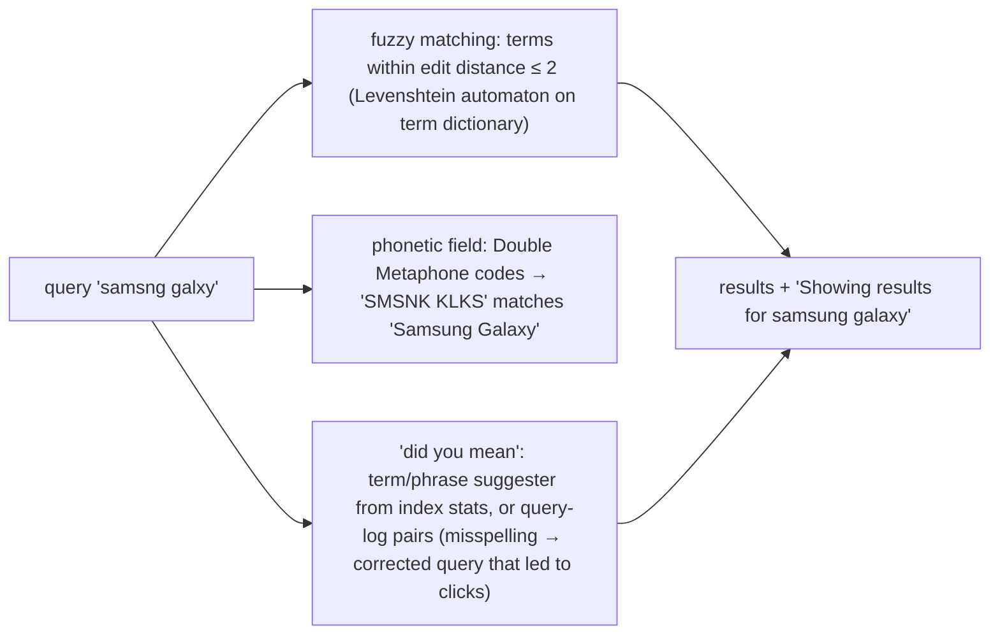

Elasticsearch tools: `fuzziness: "AUTO"` in match queries (edit distance 0 for 1–2 char terms, 1 for 3–5, 2 for longer), `prefix_length` (first chars must match, a big performance win), `max_expansions`, the term and phrase suggesters ("did you mean"), and phonetic analysis plugins.

#### Example
A grocery app in India: users type brand names in many ways ("amul", "amool", "aamul") and Hinglish transliterations. The solution combined fuzzy matching (`AUTO`, `prefix_length: 1`), a phonetic Double Metaphone sub-field for brand names, and a correction dictionary mined from query logs (queries with zero results followed by a successful reformulation within the same session). Zero-result queries dropped from 12% to 4%.

#### Trade-offs
Recovers lost searches, but fuzzy matching can surface wrong results (short words especially), costs performance on large dictionaries, and phonetic algorithms are language-specific (English-centric).

#### Problems & fixes
| Symptom | Cause | Fix |
|---|---|---|
| Wrong matches for short words ("cat" → "car") | fuzziness on short terms | fuzziness AUTO, boost exact matches |
| Slow fuzzy queries | expansions across huge dictionaries | prefix_length ≥ 1, max_expansions limits |
| Corrections miss domain terms | generic dictionaries | query-log mined corrections, domain synonyms |

#### Cheat sheet
- Edit distance (fuzzy AUTO + prefix_length), phonetic codes, query-log corrections.
- Boost exact matches above fuzzy ones. Limit expansions.
- Measure zero-result rate and reformulations.

#### Interview questions
<details><summary>How would you implement "did you mean" for a search engine?</summary>

Combine dictionary-based suggestions (terms within edit distance from the index's term dictionary, ranked by frequency: the term or phrase suggester) with query-log mining (pairs where a zero- or low-result query was followed by a successful reformulation, scored by frequency and click-through). Show the correction when the original has few results or the suggestion is much more popular, and evaluate with A/B tests on success metrics.
</details>

<details><summary>Why set prefix_length on fuzzy queries?</summary>

Fuzzy matching builds a Levenshtein automaton and must examine all terms within the edit distance, which is expensive for large term dictionaries. Requiring the first N characters to match exactly (users rarely mistype the first letter) drastically shrinks the candidate set, improving latency with little loss in recall.
</details>

#### Interview angle
> "Typos are handled by fuzzy AUTO with prefix_length 1, phonetic sub-fields for brand names, and corrections mined from query logs, with exact matches always boosted. I track the zero-result rate."

### Faceted search — aggregations + post_filter; show category/price/brand counts alongside results
Faceted search shows **filter options with counts** (brand: Nike (120), Adidas (85); price ranges; ratings) next to results, and lets users narrow down. It's implemented with **aggregations** on the result set, plus careful use of **post_filter** (or filtered aggregations) so selecting one facet value doesn't zero out the counts of its sibling values.

#### How it works
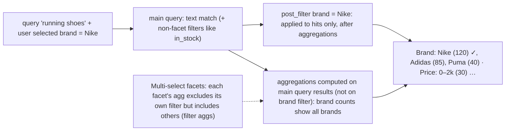

```json
{
  "query": { "bool": { "must": [{ "match": { "title": "running shoes" } }], "filter": [{ "term": { "in_stock": true } }] } },
  "post_filter": { "term": { "brand.keyword": "nike" } },
  "aggs": {
    "brands": { "terms": { "field": "brand.keyword", "size": 20 } },
    "price_ranges": { "range": { "field": "price", "ranges": [{ "to": 2000 }, { "from": 2000, "to": 5000 }, { "from": 5000 }] } },
    "colors_given_brand": {
      "filter": { "term": { "brand.keyword": "nike" } },
      "aggs": { "colors": { "terms": { "field": "color.keyword" } } }
    }
  }
}
```

#### Example
An apparel marketplace with multi-select facets (brand, size, colour, price): each facet's counts must reflect the other selected facets but not its own selection (so users see counts for adding more brands). Implementation: the main query with text plus global filters, `post_filter` with all facet selections, and per-facet filter aggregations applying every *other* facet's selection. Facet fields are keyword or numeric with doc values, and the top facets are cached for popular queries.

#### Trade-offs
Great UX and discovery, but aggregations add query cost (especially many facets on high-cardinality fields), multi-select logic is subtle, and counts may be approximate across shards.

#### Problems & fixes
| Symptom | Cause | Fix |
|---|---|---|
| Selecting a brand hides other brand options | facet filter in main query | post_filter + filtered aggregations |
| Slow facet queries | many high-cardinality term aggs | limit facets/size, precomputed facet values, caching |
| Facet counts don't match results | aggregation scope mismatch | consistent filter application per facet |

#### Cheat sheet
- Facets = aggregations on the result set. post_filter applies selections to hits only.
- Multi-select: each facet aggregates with all other filters except its own.
- Keyword or numeric doc values. Limit facet sizes. Cache popular ones.

#### Interview questions
<details><summary>What is post_filter for in faceted search?</summary>

It filters search hits after aggregations are computed. That lets facet counts reflect the broader result set (e.g. all brands for "running shoes") while the displayed hits are narrowed to the user's selection (Nike), so users can see and pick alternative values instead of facets collapsing to only the selected one.
</details>

<details><summary>How do you implement multi-select facets correctly?</summary>

Run the main query without facet selections (only text and global filters), apply all facet selections via post_filter for the hits, and compute each facet's aggregation inside a filter aggregation that applies every other facet's selections but not its own. Counts then show what you'd get by adding or changing a value within that facet, given the other selections.
</details>

#### Interview angle
> "Facets are aggregations on doc-value fields. Selections go into post_filter, and each facet aggregates with every filter except its own, so multi-select counts stay meaningful."

### Search relevance tuning — field boosting (title^3), function_score (recency), learning to rank
Relevance tuning makes the **best results appear first**: weight fields differently (title above description), blend text relevance with **business signals** (popularity, recency, margin, availability, distance) via `function_score` or rank features, and at scale train **learning-to-rank (LTR)** models on click and conversion data. Changes are validated with offline metrics (NDCG) and online A/B tests.

#### How it works
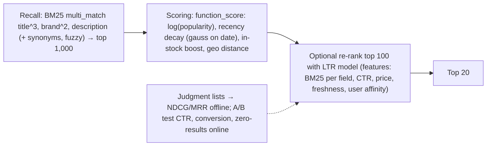

```json
{
  "query": {
    "function_score": {
      "query": { "multi_match": { "query": "running shoes", "fields": ["title^3", "brand^2", "description"] } },
      "functions": [
        { "field_value_factor": { "field": "popularity", "modifier": "log1p", "factor": 1.2 } },
        { "gauss": { "listed_at": { "origin": "now", "scale": "30d", "decay": 0.5 } } },
        { "filter": { "term": { "in_stock": true } }, "weight": 1.5 }
      ],
      "score_mode": "sum", "boost_mode": "multiply"
    }
  }
}
```

#### Example
A marketplace's search conversion was low because exact title matches for out-of-stock items ranked top. Changes: in-stock boost, log-popularity, a 30-day recency decay for new listings, and title phrase matching boosted. NDCG@10 on 2,000 judged queries rose from 0.61 to 0.72, and an A/B test showed +4.5% search conversion. Later an XGBoost LTR model (Elasticsearch LTR plugin / OpenSearch LTR) re-ranks the top 100 with click-derived features for another +2%.

#### Trade-offs
Business-aware ranking improves outcomes, but over-boosting popularity creates rich-get-richer effects and hides new items, tuning by intuition without evaluation regresses quietly, and LTR needs data pipelines and monitoring.

#### Problems & fixes
| Symptom | Cause | Fix |
|---|---|---|
| Popular items dominate everything | strong popularity boost | log/saturating modifiers, exploration slots |
| Tuning changes break other queries | no evaluation set | judgment lists + offline metrics + A/B tests |
| LTR model degrades over time | feature/data drift | retraining pipeline, monitoring |
| Position bias in click data | top results get clicks regardless | counterfactual/IPS corrections, interleaving tests |

#### Cheat sheet
- Field boosts → function_score (popularity, recency, stock, geo) → LTR re-rank.
- Measure: NDCG/MRR offline, conversion and CTR online (A/B, interleaving).
- Saturate signals. Watch position bias and rich-get-richer effects.

#### Interview questions
<details><summary>How would you improve a product search where relevant but less popular items never show up?</summary>

Reduce the strength of popularity signals (log or saturation modifiers), add recency boosts for new items, ensure text relevance (field boosts, phrase matching) is the primary signal, introduce exploration (reserved slots or randomisation for new items), and evaluate with judged queries offline and A/B tests online. LTR models with debiased click data can learn better trade-offs.
</details>

<details><summary>How do you measure search relevance?</summary>

Offline: build judgment lists (queries with graded relevance labels from experts or click models) and compute metrics like NDCG@k, MRR and precision@k for each ranking change. Online: A/B tests or interleaving measuring click-through, conversion, add-to-cart, zero-result rate, reformulation rate and time to success.
</details>

#### Interview angle
> "Relevance is BM25 with field boosts, blended through function_score with saturated popularity, recency and stock signals, optionally LTR re-ranking, and every change is gated on NDCG and A/B-tested conversion."

### Index lifecycle management (ILM) — hot → warm → cold → delete phases for time-series indices
ILM automates managing time-based indices (logs, metrics, events) through **phases**: **hot** (actively written and queried, fast hardware), **warm** (read-only, fewer replicas, cheaper nodes, force-merged), **cold/frozen** (rarely queried, searchable snapshots on object storage) and **delete**. With **rollover** and **data streams**, indices are created and retired automatically by size or age.

#### How it works
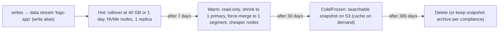

```json
PUT _ilm/policy/logs-policy
{ "policy": { "phases": {
  "hot":    { "actions": { "rollover": { "max_primary_shard_size": "40gb", "max_age": "1d" } } },
  "warm":   { "min_age": "7d",   "actions": { "shrink": { "number_of_shards": 1 }, "forcemerge": { "max_num_segments": 1 }, "allocate": { "number_of_replicas": 1 } } },
  "cold":   { "min_age": "30d",  "actions": { "searchable_snapshot": { "snapshot_repository": "s3-repo" } } },
  "delete": { "min_age": "365d", "actions": { "delete": {} } }
}}}
```

#### Example
A platform ingesting 2 TB of logs per day kept everything on hot NVMe nodes for 90 days, which was costly and caused frequent shard-count issues. After ILM (hot 7 days on NVMe, warm 23 days on HDD-backed nodes, frozen 60 days on S3 searchable snapshots, delete at 90 days), storage cost fell ~60%, recent-log queries stayed fast, and older logs remained searchable (slower) without restores.

#### Trade-offs
Big cost savings and automation, but slower queries on cold or frozen data, policy design effort, and rollover sizing affects shard counts.

#### Problems & fixes
| Symptom | Cause | Fix |
|---|---|---|
| Huge storage bill | all data on hot tier | ILM tiers, searchable snapshots |
| Too many small indices/shards | daily indices regardless of volume | rollover by size + age, data streams |
| Old data unsearchable without restore | snapshots only | searchable snapshots (cold/frozen) |
| ILM stuck in a step | allocation constraints/missing tiers | check ILM explain API, node attributes |

#### Cheat sheet
- Data streams + rollover (size/age) → hot → warm (shrink, force-merge) → cold/frozen (searchable snapshots) → delete.
- Match tiers to query patterns and retention requirements.
- Watch shard counts and ILM explain for stuck steps.

#### Interview questions
<details><summary>Design log storage in Elasticsearch for 1 TB/day with 1-year retention at reasonable cost.</summary>

Data streams with rollover at ~40–50 GB per primary shard or 1 day. Hot tier (NVMe) for 3–7 days with 1 replica. Warm tier (cheaper storage) after a week, shrunk and force-merged. Frozen tier with searchable snapshots on S3 after 30 days (no replicas needed, since S3 is durable). Delete at 365 days. Use ingest pipelines to drop noisy fields, and consider sampling debug logs.
</details>

<details><summary>What does rollover solve for time-series indices?</summary>

Instead of fixed daily indices (tiny on quiet days, huge on busy ones), rollover creates a new backing index when the current one hits a size, document count or age threshold. Shard sizes stay in the efficient range regardless of volume swings, which avoids shard explosions and oversized shards, and writes go to the data stream or write alias transparently.
</details>

#### Interview angle
> "Time-series indices use data streams with size-based rollover and ILM: hot NVMe for a week, warm shrunk and force-merged, frozen searchable snapshots on S3, then delete. That cuts cost by more than half while old data stays searchable."
