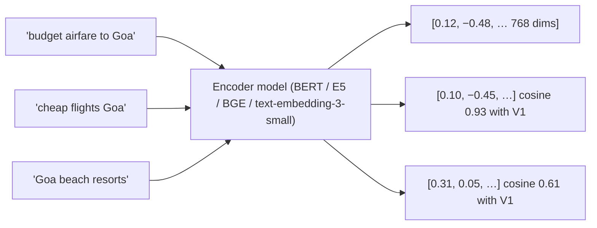
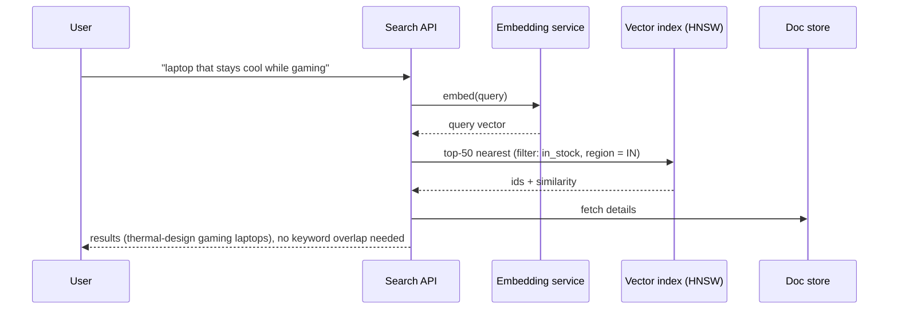
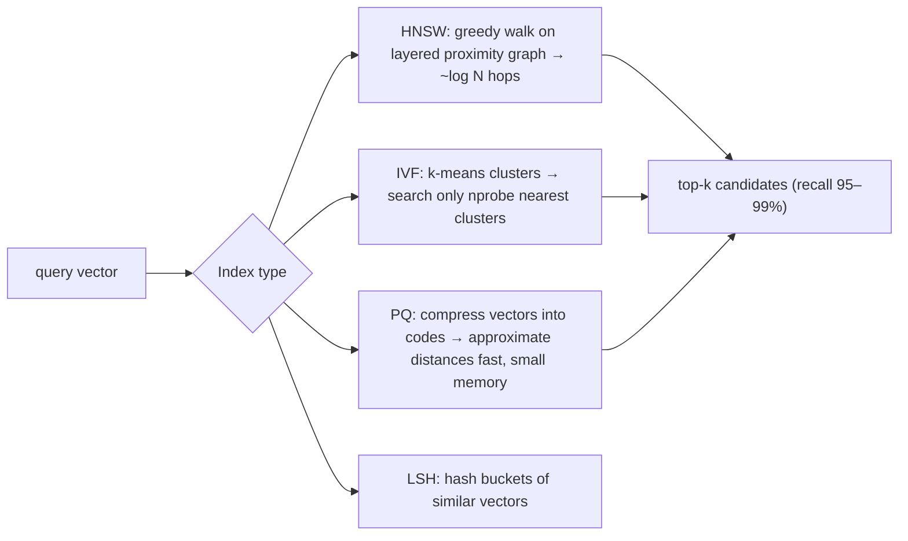
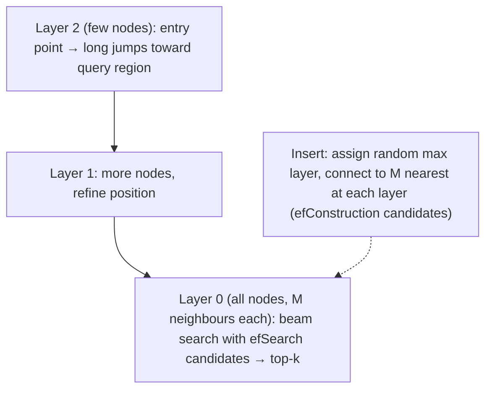
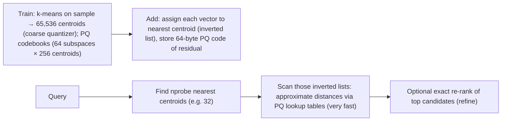
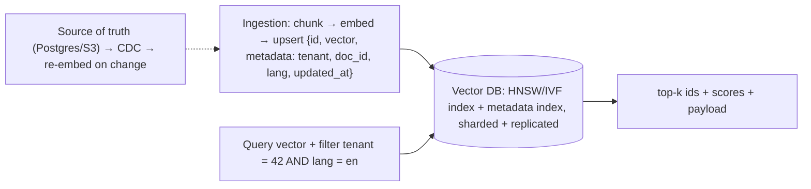
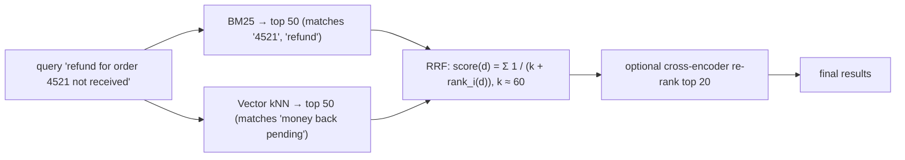
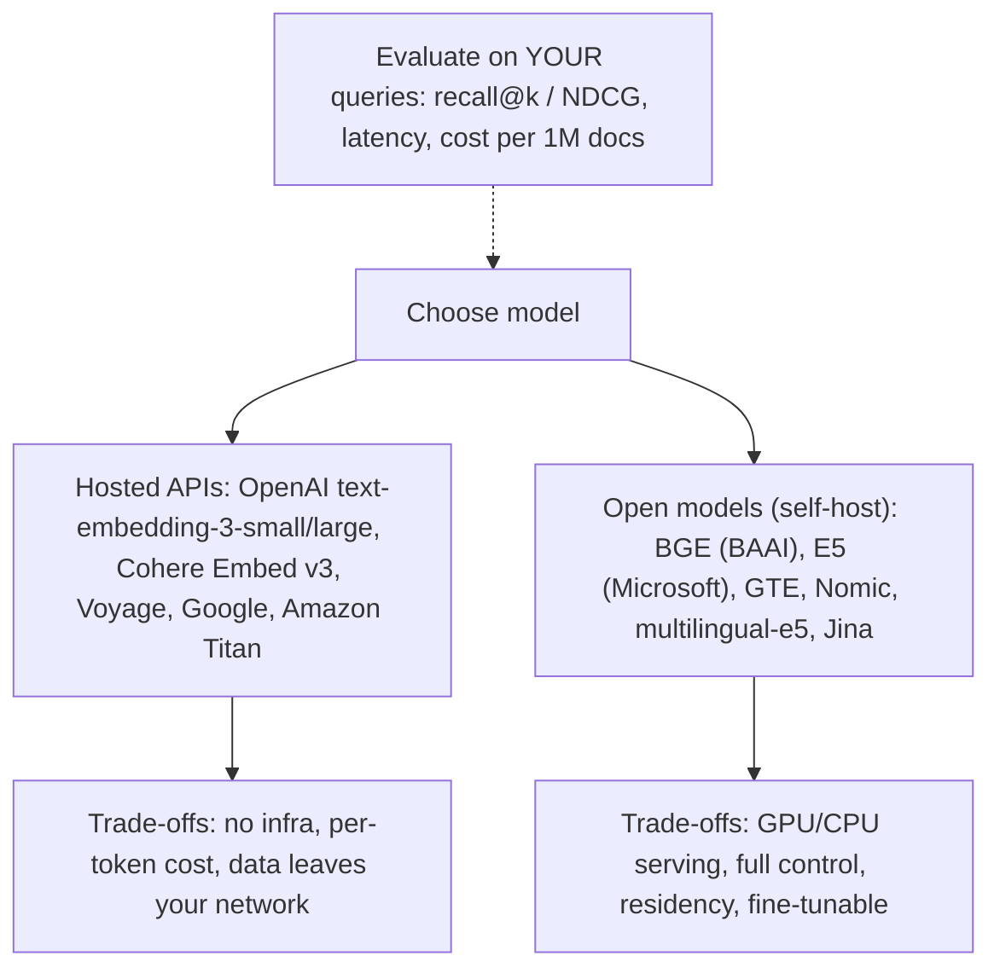
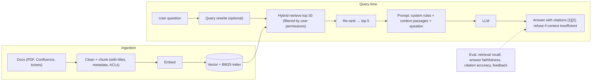
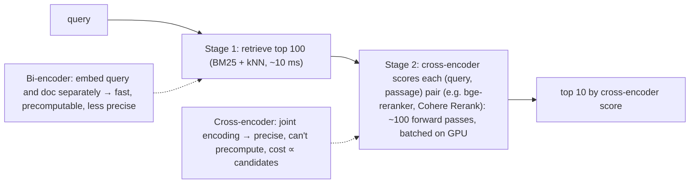

## Vector & semantic search

### Dense vector embeddings — neural encoder maps text/image to fixed-dim float vector in semantic space
An embedding model turns text, images or other items into a **fixed-length vector of floats** (e.g. 384, 768, 1,536 dimensions), placing semantically similar items close together. "Cheap flights to Goa" and "budget airfare Goa" land near each other even with no shared words. Similarity is measured with **cosine similarity**, dot product or Euclidean distance.

#### How it works


Practical points:
- Use the **same model** (and version) for documents and queries. Changing the model means re-embedding everything.
- Normalise vectors (unit length) so cosine equals dot product.
- **Chunk** long documents (e.g. 300–800 tokens with overlap). Models have token limits, and smaller chunks retrieve more precisely.
- Storage: 1M vectors × 768 dims × 4 bytes ≈ 3 GB (before index overhead). Quantisation (int8, binary) shrinks it 4–32×.
- Multimodal models (CLIP) embed images and text into the same space.

#### Example
A support knowledge base: 50k articles chunked into 400k passages, embedded with an open model (BGE-base, 768 dims) in a batch job. The query "my refund hasn't come yet" retrieves passages titled "Refund processing timelines" though no words overlap. Storage is ~1.2 GB of float32 vectors, or 300 MB with int8 quantisation.

#### Trade-offs
Captures meaning, synonyms and paraphrases, but embeddings are opaque (hard to debug), weak on exact identifiers (SKUs, error codes, names), cost compute to generate and re-generate, and quality depends on domain fit.

#### Problems & fixes
| Symptom | Cause | Fix |
|---|---|---|
| Exact codes/names not found | embeddings blur exact tokens | hybrid search with BM25 |
| Results got worse after model upgrade | mixing old and new embeddings | re-embed corpus, version vectors per model |
| Long documents retrieved poorly | whole document as one vector | chunking with overlap, metadata |
| Memory too high | float32 high-dim vectors | quantisation, smaller models, dimension reduction (Matryoshka) |

#### Cheat sheet
- Encoder → fixed-dim vector. Similar meaning, nearby vectors (cosine).
- Same model for docs and queries. Chunk long text. Normalise.
- Memory = N × dims × 4 bytes. Quantise. Pair with BM25 for exact terms.

#### Interview questions
<details><summary>Why do semantic search systems chunk documents before embedding them?</summary>

Embedding models have input limits (often 512–8k tokens), and one vector for a long document averages many topics into a vague point, so specific passages are hard to retrieve. Chunking into focused passages (with overlap so context isn't cut mid-thought) makes each vector represent one idea, which improves retrieval precision and lets RAG systems pass only relevant text to the LLM.
</details>

<details><summary>What happens if you upgrade the embedding model?</summary>

Vectors from different models live in different spaces and aren't comparable, so query vectors from the new model won't match document vectors from the old one. You must re-embed the entire corpus (a backfill pipeline, usually into a new index), switch queries atomically (blue/green index alias), and keep the model version stored with each vector.
</details>

#### Interview angle
> "Documents are chunked and embedded with one versioned model, normalised for cosine similarity and quantised to save memory. Exact identifiers still come from BM25, so I combine both."

### Semantic search — find similar meaning, not exact keyword match; handles synonyms, paraphrases
Semantic search ranks results by **meaning**: the query and documents are embedded, and the nearest document vectors are returned. It handles synonyms, paraphrases, cross-lingual queries and natural-language questions that keyword (lexical) search misses, and is usually combined with lexical search for exact matches.

#### How it works


Pipeline pieces: an ingestion pipeline (chunk, embed, upsert with metadata), query embedding (low latency, cached for frequent queries), ANN retrieval with metadata filters, optional re-ranking, and evaluation (recall@k, NDCG on labelled queries).

#### Example
An HR policy assistant: employees ask "can I carry forward unused leaves?" and semantic search retrieves the "Leave encashment and carry-over" section, which keyword search ranked poorly because the policy says "encash" and "accrued" rather than "carry forward". Adding a Hindi-English multilingual model also let "chhutti carry forward" queries work.

#### Trade-offs
Big recall gains for natural-language queries, but less precise for exact or rare terms, harder to explain ("why this result?"), needs embedding infrastructure and ANN indexes, and has subtle failure modes (returns something even when nothing is relevant).

#### Problems & fixes
| Symptom | Cause | Fix |
|---|---|---|
| Always returns results even if irrelevant | nearest neighbours always exist | similarity thresholds, "no answer" handling, re-ranker scores |
| Misses exact product codes | semantic-only retrieval | hybrid with BM25 |
| Slow queries | embedding + ANN latency | cache query embeddings, smaller models, tuned HNSW params |
| Domain-specific terms misunderstood | generic model | domain-tuned embeddings, fine-tuning |

#### Cheat sheet
- Embed query, retrieve nearest vectors (ANN with filters), optionally re-rank.
- Great for natural-language and paraphrased queries.
- Thresholds, hybrid with BM25, evaluation sets.

#### Interview questions
<details><summary>When does semantic search beat keyword search, and when does it lose?</summary>

It wins for natural-language questions, synonyms and paraphrases, vocabulary mismatch between users and documents, and multilingual queries. It loses for exact identifiers (SKUs, error codes, names), rare jargon the model didn't learn, boolean-precise requirements and explainability. That's why hybrid search combines both.
</details>

<details><summary>How would you add semantic search to an existing Elasticsearch product search?</summary>

Add a `dense_vector` field (Elasticsearch/OpenSearch kNN with HNSW), backfill embeddings for products via a batch pipeline, and embed new or updated products in the indexing pipeline. At query time embed the query and run a kNN search with the same filters, combine with the existing BM25 query via RRF or weighted scores, evaluate on labelled queries, and A/B test before rollout.
</details>

#### Interview angle
> "Semantic search retrieves by meaning through query embeddings and filtered ANN, with similarity thresholds for 'no good answer'. I always run it hybrid with BM25 so exact codes and names still match."

### Approximate Nearest Neighbor (ANN) — find K most similar vectors without exhaustive search
Exact nearest-neighbour search compares the query against **every vector** (O(N × d)), which is too slow for millions or billions of vectors. ANN algorithms trade a little **recall** for orders-of-magnitude speed using graphs (HNSW), clustering (IVF), quantisation (PQ), trees (Annoy) or hashing (LSH).

#### How it works


Key metrics: **recall@k** (fraction of true neighbours found), **latency** (p99), **throughput (QPS)**, **memory per vector**, **build time** and **update support**.

Exact brute force is fine for small sets (under ~100k vectors) or with GPU, and it's the ground truth for measuring ANN recall.

#### Example
A visual search over 200M product images (512-dim CLIP vectors): brute force would be 200M × 512 multiply-adds per query, far too slow. IVF-PQ (FAISS) with 65,536 clusters, nprobe = 32 and 64-byte PQ codes fits in ~13 GB RAM and returns top-100 in ~10 ms at ~92% recall. A re-ranking step computes exact distances on the 100 candidates using full vectors from disk.

#### Trade-offs
Massive speedups at the cost of recall below 100%, parameter tuning (efSearch, nprobe), memory/latency/recall trade-offs, and update or delete complexity depending on the index.

#### Problems & fixes
| Symptom | Cause | Fix |
|---|---|---|
| Relevant items missing | low recall settings | increase efSearch/nprobe, better index params, re-rank |
| High memory | full-precision vectors in graph | PQ/scalar quantisation, disk-based indexes (DiskANN) |
| Filtered queries return too few results | post-filtering after ANN | pre-filtering/filtered HNSW, larger candidate pools |

#### Cheat sheet
- ANN = approximate top-k fast: HNSW (graph), IVF (clusters), PQ (compression), LSH.
- Tune recall@k vs latency vs memory. Measure against brute-force ground truth.
- Re-rank candidates with exact distances when needed.

#### Interview questions
<details><summary>How do you measure whether your ANN index is good enough?</summary>

Take a sample of queries, compute exact top-k neighbours by brute force (ground truth), and measure recall@k of the ANN results against it, along with latency percentiles, QPS, memory and build time. Tune parameters (efSearch, M, nprobe) until recall meets the target (e.g. ≥ 95%) within latency budgets, then validate with end-to-end relevance metrics.
</details>

<details><summary>Why can filtering make ANN search return too few results?</summary>

If filters are applied after ANN retrieval (post-filtering), the top-k candidates may mostly fail the filter (e.g. only 2% of products are in stock in a region), leaving few or no results. Use engines supporting filtered or pre-filtered ANN (filter-aware graph traversal), increase the candidate pool, or partition indexes by common filter values.
</details>

#### Interview angle
> "At millions of vectors I use ANN, HNSW or IVF-PQ, tuned for recall@k against brute-force ground truth within the latency budget, with filter-aware search and exact re-ranking of candidates."

### HNSW — Hierarchical Navigable Small World: graph-based ANN, O(log N) query, best recall/speed tradeoff
HNSW builds a **multi-layer proximity graph**: upper layers are sparse long-range "highways", lower layers are dense local neighbourhoods. A search starts at the top, greedily moves toward the query, and descends layer by layer, finding nearest neighbours in roughly **O(log N)** hops. It's the default index in most vector databases.

#### How it works


Parameters:
| Param | Effect |
|---|---|
| **M** (neighbours per node, e.g. 16–48) | higher = better recall, more memory |
| **efConstruction** (e.g. 100–400) | build quality vs build time |
| **efSearch** (≥ k, e.g. 64–256) | query recall vs latency (tunable per query) |

Memory ≈ vectors (N × d × 4 B) + graph links (N × M × ~2 × 4 B). Supports incremental inserts. Deletes are typically soft (tombstones), with periodic rebuilds.

#### Example
A RAG system with 10M chunks (768-dim) in Qdrant/OpenSearch with HNSW M = 16, efConstruction = 200: about 30 GB vectors + 1.3 GB graph (with int8 quantisation the vectors drop to ~7.5 GB). efSearch = 128 gives ~98% recall@10 at ~5 ms p99. Raising efSearch to 256 for an internal research tool trades 2× latency for 99.3% recall.

#### Trade-offs
Excellent recall/latency, incremental inserts, simple to tune, but memory-heavy (vectors + graph in RAM), slower builds, and deletes and updates degrade the graph over time.

#### Problems & fixes
| Symptom | Cause | Fix |
|---|---|---|
| RAM exhausted | float32 vectors + large M | quantisation, smaller M, disk-based ANN, sharding |
| Recall drops after many deletes/updates | graph degradation with tombstones | periodic rebuild/optimisation |
| Latency too high | efSearch too large | lower efSearch, more replicas, better hardware |

#### Cheat sheet
- Layered graph, greedy descent, ~log N hops.
- M (memory/recall), efConstruction (build), efSearch (query recall vs latency).
- RAM-heavy. Quantise. Rebuild after heavy churn.

#### Interview questions
<details><summary>How does efSearch affect HNSW queries?</summary>

efSearch is the size of the candidate list kept during the bottom-layer beam search. Larger values explore more of the graph, so higher recall but more distance computations and higher latency. It can be tuned per query without rebuilding the index, letting you pick different recall/latency points for different use cases.
</details>

<details><summary>How would you fit a billion-vector HNSW index?</summary>

A single machine can't hold a billion float32 vectors (3+ TB at 768 dims) in RAM. Shard vectors across many nodes (each with its own HNSW, fan out queries and merge top-k), apply quantisation (int8/PQ/binary) to cut memory 4–32×, or use disk-based ANN (DiskANN, SPANN) that keeps compressed vectors in RAM and full vectors on SSD, re-ranking candidates.
</details>

#### Interview angle
> "HNSW is my default vector index: M around 16, efConstruction around 200, efSearch tuned for about 98% recall at single-digit milliseconds, with quantisation for memory and periodic rebuilds after heavy churn."

### FAISS — Meta's ANN library: IVF (inverted file index) + PQ (product quantization for compression)
FAISS (Facebook AI Similarity Search) is a C++/Python library with GPU support for **similarity search and clustering of dense vectors**. It offers many index types, notably **IVF** (cluster vectors with k-means, then search only the closest clusters) and **PQ** (product quantisation: compress vectors into short codes), composable as `IVF65536,PQ64`, plus HNSW and flat (exact) indexes.

#### How it works


PQ intuition: split a 768-dim vector into 64 sub-vectors of 12 dims, replace each with the id of its nearest of 256 sub-centroids (1 byte), giving 64 bytes instead of 3,072 bytes (48× smaller), with distances computed from precomputed tables.

Index factory strings: `Flat` (exact), `IVF4096,Flat`, `IVF65536,PQ64`, `HNSW32`, `OPQ64,IVF65536,PQ64`. GPU versions accelerate brute force and IVF.

#### Example
A deduplication pipeline for 1 billion image embeddings uses FAISS on GPUs: `OPQ64,IVF262144,PQ64` gives ~64 GB of codes (fits across a few GPUs or RAM), batch k-NN queries for clustering near-duplicates run in hours instead of weeks, and recall is validated against exact search on samples. Vector databases (Milvus) build on FAISS-style indexes internally.

#### Trade-offs
Extremely fast and memory-efficient with GPU support, but it's a library, not a database (no built-in persistence, replication, filtering or updates management), IVF and PQ need training data and tuning, and quantisation reduces accuracy.

#### Problems & fixes
| Symptom | Cause | Fix |
|---|---|---|
| Low recall | too few nprobe / coarse PQ | increase nprobe, OPQ, larger codes, re-rank |
| Poor clusters after data drift | centroids trained on old data | retrain periodically |
| Operational gaps (HA, filters) | library only | vector database (Milvus, Qdrant…) or service wrapper |

#### Cheat sheet
- Library for vector search: Flat, IVF, PQ, HNSW, GPU.
- IVF = search nprobe clusters. PQ = compress vectors into bytes.
- Train on representative data. Tune nprobe. Re-rank. Needs a service layer for production.

#### Interview questions
<details><summary>Explain IVF-PQ in simple terms.</summary>

IVF partitions the vector space into clusters (via k-means) and, at query time, only searches the few clusters closest to the query instead of everything. PQ compresses each vector into a short code by splitting it into chunks and replacing each chunk with the nearest of 256 learned prototypes, so many vectors fit in memory and distances are computed quickly from lookup tables. Together they give fast, memory-efficient approximate search at billion scale.
</details>

<details><summary>FAISS vs a vector database: when do you use which?</summary>

FAISS when you need a high-performance embedded index or offline batch similarity (dedupe, clustering, research), with your own code handling persistence and serving. A vector database when you need an operational service: CRUD and upserts, metadata filtering, replication and sharding, persistence, access control and APIs. Many vector DBs use FAISS-like algorithms internally.
</details>

#### Interview angle
> "For billion-scale batch similarity I'd use FAISS IVF-PQ on GPUs, searching nprobe clusters over compressed codes and re-ranking exactly. For an online service with filters and upserts, a vector database."

### Vector databases — Pinecone, Weaviate, Milvus, Qdrant, pgvector (Postgres extension)
Vector databases store embeddings with metadata and serve **filtered ANN queries** as an operational service: upserts and deletes, metadata filters, hybrid search, replication and sharding, persistence, multi-tenancy, backups and APIs. Options range from managed services (Pinecone) to open-source engines (Milvus, Qdrant, Weaviate) and extensions of existing databases (**pgvector**, Elasticsearch/OpenSearch kNN, Redis, MongoDB Atlas Vector Search).

#### How it works


| Option | Strengths | Consider when |
|---|---|---|
| **pgvector** | in Postgres: transactions, joins, existing ops; HNSW/IVFFlat | ≤ tens of millions of vectors, want one DB |
| Elasticsearch/OpenSearch kNN | hybrid with BM25 in one engine | already running search cluster |
| Qdrant / Weaviate / Milvus | purpose-built, filtering, quantisation, scale | large-scale vector workloads |
| Pinecone (managed) | zero ops, serverless | managed preference, budget OK |

```sql
CREATE EXTENSION vector;
CREATE TABLE chunks (id bigserial PRIMARY KEY, tenant_id bigint, doc_id bigint, content text, embedding vector(768));
CREATE INDEX ON chunks USING hnsw (embedding vector_cosine_ops) WITH (m = 16, ef_construction = 200);
SELECT id, content FROM chunks WHERE tenant_id = 42 ORDER BY embedding <=> :query_vec LIMIT 10;
```

#### Example
A B2B SaaS adding "ask your documents" to 2,000 tenants (~15M chunks total) chose pgvector: chunks live next to tenant data with row-level security for isolation, transactional updates when documents change, HNSW indexes, and no new database to operate. A customer with 40M chunks later moved to Qdrant with tenant-based sharding.

#### Trade-offs
Purpose-built engines scale and filter better, while extensions reduce operational sprawl. Managed services trade cost for zero operations. All require re-embedding pipelines and recall tuning.

#### Problems & fixes
| Symptom | Cause | Fix |
|---|---|---|
| Tenant data leakage in results | missing tenant filter | mandatory tenant filter/namespace per tenant, RLS |
| Stale vectors after document edits | no sync pipeline | CDC → re-embed → upsert, delete removed chunks |
| pgvector queries slow at scale | index/memory limits, filters | HNSW tuning, partitioning, dedicated vector DB |

#### Cheat sheet
- Store vectors + metadata. Filtered ANN, upserts, replication.
- pgvector for moderate scale inside Postgres. Dedicated engines for large scale.
- Tenant isolation, sync pipelines, recall monitoring.

#### Interview questions
<details><summary>pgvector or a dedicated vector database for a new RAG feature?</summary>

Start with pgvector if the corpus is moderate (up to tens of millions of chunks), data already lives in Postgres, and you value transactions, joins, row-level security and one fewer system. Choose a dedicated vector database for very large scale, heavy filtered ANN workloads, advanced quantisation or multi-node sharding, or when vector search load would hurt the OLTP database.
</details>

<details><summary>How do you keep a vector index in sync with changing source documents?</summary>

Treat the source store as truth. Emit change events (CDC/outbox) on document create, update and delete, and a pipeline re-chunks and re-embeds changed documents, upserts new chunk vectors (deterministic chunk ids per doc and position) and deletes vectors for removed or changed chunks. Record the embedding model version and source document version in metadata so you can detect staleness and run full re-embeds on model changes.
</details>

#### Interview angle
> "For moderate scale I'd keep vectors in pgvector next to tenant data with RLS and HNSW, synced by CDC re-embedding. I'd move to Qdrant or Milvus only when scale or filtered-ANN load demands it."

### Hybrid search — BM25 keyword + dense vector; combine with Reciprocal Rank Fusion (RRF)
Hybrid search runs **lexical (BM25)** and **semantic (vector)** retrieval in parallel and **fuses** the result lists. BM25 nails exact terms, codes and names, and vectors capture meaning and paraphrases. Fusion is commonly **Reciprocal Rank Fusion**, which combines ranks rather than incomparable raw scores.

#### How it works


Why RRF: BM25 scores (unbounded) and cosine similarities (0–1) aren't comparable, and weighted sums require normalisation and tuning per query type. RRF uses only ranks, is robust and needs almost no tuning. Alternatives: weighted score fusion after normalisation (min-max, z-score), and learned fusion.

Elasticsearch, OpenSearch, Weaviate, Qdrant and Vespa support hybrid queries and RRF natively.

#### Example
A developer-docs search: pure vector search failed on queries like "ERR_CONN_RESET 1042" (error codes), and pure BM25 failed on "app keeps disconnecting randomly". Hybrid with RRF (k = 60) over BM25 top 100 and kNN top 100, then a cross-encoder re-ranking the top 30, gave NDCG@10 of 0.74 vs 0.61 for BM25 alone and 0.58 for vectors alone on their labelled set.

#### Trade-offs
Best of both retrieval styles and robust, but two retrieval paths (latency, infrastructure), fusion choices to evaluate, and harder relevance debugging.

#### Problems & fixes
| Symptom | Cause | Fix |
|---|---|---|
| One retriever dominates | naive raw score addition | RRF or normalised weighted fusion |
| Latency doubled | sequential retrievals | run in parallel, smaller candidate sets |
| Fusion helps some queries, hurts others | static weights | RRF, query classification, learned fusion |

#### Cheat sheet
- BM25 + vector in parallel, then fuse (RRF: Σ 1/(k + rank), k ≈ 60), then re-rank.
- RRF avoids score normalisation problems.
- Evaluate each part and the fusion with labelled queries.

#### Interview questions
<details><summary>Why use Reciprocal Rank Fusion instead of adding BM25 and cosine scores?</summary>

BM25 scores depend on query terms, field statistics and length, and are unbounded, while cosine similarity lives in a small fixed range, so adding them lets one dominate unpredictably and needs constant tuning. RRF uses only each document's rank in each list, rewarding documents ranked highly by either or both retrievers, robustly and with a single gentle parameter.
</details>

<details><summary>What kinds of queries need the lexical side of hybrid search?</summary>

Exact identifiers and rare tokens: product SKUs, order or error codes, names of people, places or brands, version numbers, legal citations, acronyms and quoted phrases. Embedding models often blur these or don't know them, while BM25 matches them precisely.
</details>

#### Interview angle
> "Production retrieval is hybrid: BM25 and kNN run in parallel, fused with RRF and re-ranked by a cross-encoder, so error codes and paraphrased questions both work, measured on labelled queries."

### Embedding models — text-embedding-3-small (OpenAI), BERT, BGE, E5, Cohere Embed
Embedding models convert text (or images) into vectors. Choices differ in **quality on your domain and language**, **dimensions** (cost and memory), **max input length**, **latency and cost** (API vs self-hosted), **licensing and data residency**, and **multilingual support**. Benchmarks like MTEB help shortlist, but your own evaluation decides.

#### How it works


Considerations:
- **Dimensions**: 384 (small, cheap) to 3,072. Some models support **Matryoshka** truncation (use the first 256 dims with a modest quality loss).
- **Asymmetric prefixes**: E5 and BGE expect "query: …" and "passage: …" prefixes. Missing them hurts quality.
- **Multilingual**: multilingual-e5, BGE-M3 and Cohere multilingual handle Hindi and Hinglish better than English-only models.
- **Cost math**: 50M chunks × 300 tokens = 15B tokens to embed. At API prices this is meaningful, so compare with self-hosting on GPUs.

#### Example
An Indian fintech's support bot compared models on 500 labelled customer queries (English, Hindi, Hinglish): an English-only model scored recall@5 of 0.62, multilingual-e5-base 0.78 and BGE-M3 0.81. They self-hosted BGE-M3 on a GPU node pool for data residency (RBI guidance on customer data), at 768 dimensions with int8 quantisation in the vector store.

#### Trade-offs
Bigger models are usually better but slower and costlier. Hosted APIs are easy but cost per token and send data out. Self-hosting gives control at the price of operations.

#### Problems & fixes
| Symptom | Cause | Fix |
|---|---|---|
| Poor retrieval for Hindi/regional queries | English-only model | multilingual model, evaluate per language |
| Quality lower than benchmarks suggest | missing query/passage prefixes, domain mismatch | follow model conventions, domain evaluation, fine-tuning |
| Embedding costs high | re-embedding often, large model | cache embeddings, embed only changes, smaller/truncated dims |

#### Cheat sheet
- Pick by domain and language quality, dimensions, latency, cost, licence and residency.
- Use MTEB to shortlist, then evaluate on your labelled queries.
- Follow prefixes. Matryoshka truncation. Version embeddings per model.

#### Interview questions
<details><summary>How would you choose an embedding model for a new semantic search feature?</summary>

Shortlist candidates from MTEB for your task and language (retrieval, multilingual), build a labelled evaluation set from real queries with relevant documents, measure recall@k and NDCG for each model (with correct prefixes and chunking), and weigh against latency, cost per million tokens, dimensions (memory), licence and data-residency constraints. Then pilot the winner and A/B test.
</details>

<details><summary>Hosted embedding API vs self-hosted open model?</summary>

Hosted: no infrastructure, strong quality and easy scaling, but per-token cost, latency over the network, vendor dependency, and data leaves your boundary (compliance). Self-hosted: control, residency, fine-tuning and predictable cost at high volume, but you run GPU or CPU inference (autoscaling, batching, monitoring). High-volume or regulated workloads often self-host.
</details>

#### Interview angle
> "I shortlist embedding models from MTEB and decide on our own labelled queries across English, Hindi and Hinglish, weighing quality against dimensions, cost and data residency, which often means self-hosting a multilingual model."

### RAG (Retrieval-Augmented Generation) — vector search retrieves context, LLM generates answer
Retrieval-Augmented Generation answers questions by first **retrieving relevant passages** from your knowledge base (hybrid or vector search), then giving them to an **LLM as context** to generate a grounded answer with citations. It lets LLMs use private, fresh knowledge without retraining, and reduces hallucination when done well.

#### How it works


Design concerns: chunking strategy, **permission-aware retrieval** (users must only see documents they're allowed to), freshness (sync pipelines), prompt design (answer only from context, cite sources), guardrails (prompt injection in documents), cost and latency (caching, smaller models), and evaluation (golden Q&A sets, LLM-as-judge with human review).

#### Example
An internal engineering assistant over runbooks, ADRs and incident postmortems: hybrid retrieval filtered by the user's group ACLs, a cross-encoder re-ranks the top 30 to 6, and the LLM answers with citations and "I don't know" when context is missing. On a 300-question golden set, faithfulness was 92% and citation accuracy 88%, and weekly evaluation runs catch regressions when documents or prompts change.

#### Trade-offs
Fresh, private and grounded answers without fine-tuning, but quality is bounded by retrieval, latency and cost per query, security risks (data leakage across permissions, prompt injection), and evaluation is hard.

#### Problems & fixes
| Symptom | Cause | Fix |
|---|---|---|
| Hallucinated answers | weak retrieval / prompt allows guessing | better retrieval + re-ranking, "answer only from context", refuse when unsure |
| Users see restricted info | retrieval ignores ACLs | permission filters at retrieval time (document-level ACL metadata) |
| Malicious text in docs hijacks the model | prompt injection | treat retrieved text as data, sanitise, output filtering, least-privilege tools |
| Outdated answers | stale index | CDC-driven re-indexing, show source dates |

#### Cheat sheet
- Ingest (chunk, embed, index with ACLs), then retrieve (hybrid + re-rank), then generate with citations.
- Permission-aware retrieval, refuse when unsupported, prompt-injection defences.
- Evaluate retrieval and answers continuously.

#### Interview questions
<details><summary>Design a RAG system for an internal knowledge base with document-level permissions.</summary>

Ingest documents with their ACLs (groups and users) stored as metadata on every chunk. At query time resolve the user's groups and apply them as a mandatory filter in hybrid retrieval, so restricted chunks never reach the prompt. Re-rank, then generate with citations and refusal when context is insufficient. Sync permissions and content via CDC, log queries and sources for audit, and evaluate faithfulness regularly.
</details>

<details><summary>RAG vs fine-tuning an LLM on your documents?</summary>

RAG injects knowledge at query time: it's fresh (update the index, not the model), cites sources, respects permissions per query, and is cheaper to update. Fine-tuning changes model behaviour or style and can teach formats or domain language, but it's poor at memorising facts reliably, hard to update and can't enforce per-user access. Most knowledge Q&A uses RAG, sometimes with light fine-tuning for tone or format.
</details>

#### Interview angle
> "RAG ingests chunks with ACL metadata, retrieves permission-filtered hybrid results, re-ranks, and generates cited answers that refuse when unsupported, with golden-set evaluation of faithfulness and prompt-injection defences."

### Re-ranking — cross-encoder (slower, higher quality) re-ranks top-K ANN results for final list
Re-ranking is a **second stage**: a fast retriever (BM25, vectors, hybrid) fetches the top 50–200 candidates, and a slower, more accurate model re-scores them to produce the final order. **Cross-encoders** read the query and document **together** (full attention between them), so they judge relevance far better than embeddings computed separately (bi-encoders).

#### How it works


Other re-rankers: learning-to-rank models (gradient-boosted trees on features), LLM-based re-ranking (listwise prompts, which are expensive), and business-rule re-ranking (diversity, freshness).

Latency budget: a cross-encoder over 100 passages × ~300 tokens takes ~20–60 ms on a GPU with batching, and much longer on CPU, so tune the candidate count.

#### Example
A legal-search product retrieved the top 100 with hybrid search (NDCG@10 0.63). Adding a cross-encoder re-ranker over the top 50 raised NDCG@10 to 0.77 at +35 ms p95 (GPU inference service with dynamic batching). For RAG it also improved answer faithfulness, since better top-5 context means fewer hallucinations.

#### Trade-offs
Large precision gains, but added latency and GPU cost proportional to the candidate count, it can't improve recall (only re-orders candidates the first stage found), and the model needs serving infrastructure.

#### Problems & fixes
| Symptom | Cause | Fix |
|---|---|---|
| Latency too high | too many candidates, CPU inference | fewer candidates, GPU batching, distilled re-rankers |
| Relevant docs never appear | recall problem in stage 1 | improve retrieval (hybrid, more candidates) |
| Results lack diversity | re-ranker favours near-duplicates | MMR/diversity re-ranking, dedupe |

#### Cheat sheet
- Two-stage: cheap recall (top 100), then expensive precise re-rank (top 10).
- Cross-encoder = joint query-document scoring, the most accurate.
- Watch latency and cost. Re-ranking can't fix recall.

#### Interview questions
<details><summary>Why are cross-encoders more accurate than bi-encoder embeddings, and why not use them for retrieval?</summary>

A cross-encoder processes the query and document together, so every query token attends to every document token, capturing fine-grained relevance (negations, exact relationships). A bi-encoder compresses each into a vector independently. But cross-encoders can't precompute document representations, so scoring millions of documents per query is impossible. They're used only on a small candidate set after fast retrieval.
</details>

<details><summary>How many candidates should you re-rank?</summary>

Enough to contain the relevant documents (check stage-1 recall@N on labelled data, often 50–200), but few enough to meet the latency budget given the re-ranker's per-pair cost and batching. Measure end-to-end NDCG and latency at several N values and choose the knee of the curve.
</details>

#### Interview angle
> "Search and RAG are two-stage: hybrid retrieval fetches about 100 candidates, and a GPU-served cross-encoder re-ranks them to the top 10. Re-ranking only reorders, so recall must come from the first stage."
