## Analytics & data pipelines

### OLTP vs OLAP — row-oriented (many small writes) vs columnar (analytical aggregations)
**OLTP** (online transaction processing) systems run the business: many small, concurrent reads and writes of individual rows (place order, update balance) with ACID guarantees and millisecond latency. **OLAP** (online analytical processing) systems analyse the business: large scans and aggregations over millions or billions of rows (revenue by city per month), typically in **columnar** stores optimised for read throughput.

#### How it works
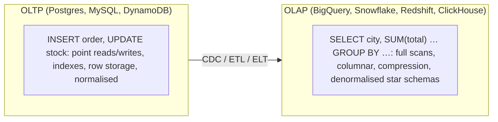

| | OLTP | OLAP |
|---|---|---|
| Queries | point lookups, small transactions | scans, aggregations, joins over history |
| Volume per query | few rows | millions to billions of rows |
| Storage | row-oriented, indexes | columnar, compressed, partitioned |
| Schema | normalised (3NF) | star/snowflake, denormalised |
| Latency target | ms | seconds (sub-second for real-time OLAP) |
| Users | applications | analysts, dashboards, ML |

**HTAP** systems (TiDB + TiFlash, SingleStore, AlloyDB) try to serve both.

#### Example
An e-commerce company's finance team ran month-end revenue queries directly on the production Postgres, and checkout latency spiked every month. Moving analytics to BigQuery (fed by Debezium CDC through Kafka into a lakehouse and dbt models) made month-end queries take 6 seconds over 2 billion rows, with zero impact on checkout.

#### Trade-offs
Separation gives each workload the right engine, but data must be moved (pipeline complexity, freshness lag) and definitions kept consistent.

#### Problems & fixes
| Symptom | Cause | Fix |
|---|---|---|
| Production slows during reports | OLAP queries on OLTP DB | replicate to warehouse/replica |
| Stale dashboards | nightly batch only | CDC streaming, real-time OLAP |
| Metrics disagree across teams | inconsistent transformations | semantic layer, dbt models, metric definitions |

#### Cheat sheet
- OLTP: row store, small ACID transactions. OLAP: columnar, big scans.
- Move data via CDC/ETL into a warehouse or lakehouse.
- Never run heavy analytics on the production primary.

#### Interview questions
<details><summary>Why are columnar databases faster for analytics but worse for transactions?</summary>

Analytics reads a few columns across many rows. Columnar storage reads only those columns, compresses them well and vectorises processing. Transactions read or write whole rows. In a column store, inserting or updating one row touches many column files (expensive), and point lookups need reassembly, so row stores with indexes are better.
</details>

<details><summary>How do you get production data into an analytics system without hurting production?</summary>

Change data capture (Debezium reading the WAL or binlog → Kafka → warehouse or lakehouse), or periodic extracts from a read replica, never heavy queries on the primary. Land raw data, transform with ELT (dbt) into star schemas, and monitor freshness.
</details>

#### Interview angle
> "OLTP stays on Postgres for ACID point operations. Analytics gets CDC into a columnar warehouse modelled with dbt, so finance queries never touch checkout's database."

### Star schema — fact table (events) + dimension tables (who, what, when, where); Kimball model
A star schema (Kimball dimensional modelling) organises analytical data into a central **fact table** of measurable events (orders, payments, page views) with foreign keys to **dimension tables** describing context (customer, product, date, store). Queries join the fact to a few dimensions and aggregate, which is simple for analysts and fast for columnar engines.

#### How it works
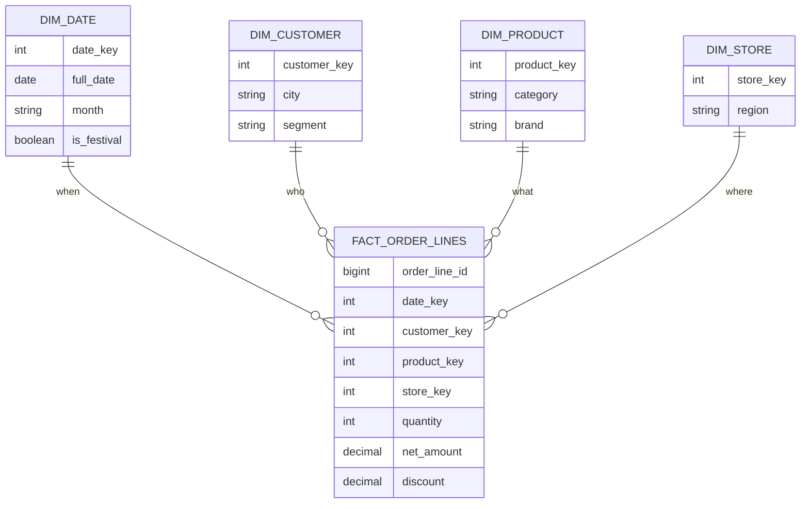

Concepts: **grain** (what one fact row represents, e.g. one order line), additive measures (amount, quantity) vs semi- or non-additive ones (balances, ratios), surrogate keys, **slowly changing dimensions** (SCD Type 2: keep history with valid-from and valid-to, so past sales report the customer's city at that time), and conformed dimensions shared across facts.

#### Example
"Revenue by brand and city during Diwali week vs last year": `SELECT p.brand, c.city, SUM(f.net_amount) FROM fact_order_lines f JOIN dim_product p … JOIN dim_customer c … JOIN dim_date d … WHERE d.is_festival AND d.year IN (2025, 2026) GROUP BY …`, a readable query running in seconds on BigQuery or Snowflake. SCD2 on dim_customer means customers who moved cities count toward the city where they lived when they ordered.

#### Trade-offs
Intuitive and fast with a stable modelling approach, but needs upfront design (grain, SCD handling), duplicates attributes (denormalised dimensions), and the ETL/ELT logic is involved.

#### Problems & fixes
| Symptom | Cause | Fix |
|---|---|---|
| Double counting | mixed grains in one fact table | define and enforce a single grain per fact |
| History rewritten (past revenue moves cities) | SCD Type 1 overwrite | SCD Type 2 for attributes needing history |
| Slow joins on huge dimensions | massive customer dim | clustering/partitioning, mini-dimensions |

#### Cheat sheet
- Fact (events, measures) + dimensions (who, what, when, where).
- Define the grain. Surrogate keys. SCD Type 2 for history. Conformed dimensions.
- Ideal for BI tools and columnar warehouses.

#### Interview questions
<details><summary>What is the "grain" of a fact table and why does it matter?</summary>

The grain is the precise meaning of one row: "one row per order line per order", "one row per payment attempt", "daily balance per account". All measures and dimension keys must be consistent with it. Mixing grains (some rows per order, others per line) causes double counting and wrong aggregates. Declaring the grain is the first step of dimensional design.
</details>

<details><summary>What is a slowly changing dimension Type 2?</summary>

A technique to keep history of dimension attribute changes: instead of overwriting a customer's city, insert a new dimension row with a new surrogate key and effective-from and effective-to dates (and a current flag). Facts reference the surrogate key valid at the time of the event, so historical reports reflect the attributes as they were then.
</details>

#### Interview angle
> "Analytics is modelled as Kimball star schemas: a declared grain per fact table, conformed dimensions, and SCD Type 2 where history matters, so past revenue never shifts when a customer moves."

### Snowflake schema — normalized dimensions; reduces redundancy but more JOINs
A snowflake schema is a star schema whose **dimensions are normalised into sub-dimensions**: product → category → department, customer → city → state. It reduces redundancy and update anomalies in dimensions, at the cost of **more joins** at query time. (Not to be confused with the Snowflake data warehouse product.)

#### How it works
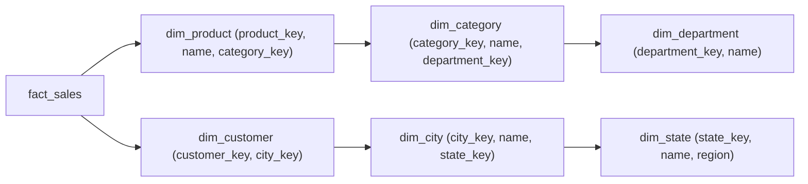

| | Star | Snowflake |
|---|---|---|
| Dimension structure | denormalised (flat) | normalised (hierarchies split) |
| Query joins | fewer | more |
| Storage redundancy | higher | lower |
| BI friendliness | high | lower |
| Typical today | default choice | when dimensions are huge or shared hierarchies are managed separately |

Modern columnar warehouses compress repeated values extremely well, so the storage savings of snowflaking are usually small, and star schemas (or even wide denormalised tables) are preferred.

#### Example
A retailer with a 2,000-row category hierarchy maintained by a merchandising team kept `dim_category` separate (snowflaked), because category renames happen often and are owned by another team. But for BI performance they materialise a flattened `dim_product_flat` view (with category and department columns) that dashboards use, getting snowflake maintainability with star query simplicity.

#### Trade-offs
Less redundancy and easier maintenance of hierarchies, but more joins, slower and more complex queries, and harder for analysts.

#### Problems & fixes
| Symptom | Cause | Fix |
|---|---|---|
| Dashboards slow with many joins | deeply snowflaked dims | flatten into star / materialised views |
| Inconsistent hierarchy updates | duplicated hierarchy in flat dims | maintain hierarchy table, rebuild flattened dims |

#### Cheat sheet
- Snowflake = normalised dimension hierarchies. Star = flattened dimensions.
- Columnar compression makes star's redundancy cheap, so star is usually preferred.
- Keep hierarchies normalised for maintenance, expose flattened views for BI.

#### Interview questions
<details><summary>Star vs snowflake schema: which would you choose for a cloud warehouse and why?</summary>

Usually star: fewer joins mean simpler SQL for analysts and faster queries, and columnar compression makes repeated dimension attributes cheap to store. Snowflake normalisation can help maintain large or shared hierarchies, but you'd typically still present flattened (star) views to BI tools.
</details>

<details><summary>Why does storage redundancy matter less in modern warehouses?</summary>

Columnar formats store each column separately with dictionary and run-length encoding, so a repeated category name across millions of rows compresses to almost nothing, and storage is cheap relative to compute. Query performance and usability now matter more than minimising redundancy.
</details>

#### Interview angle
> "I keep hierarchies normalised where another team maintains them, but expose flattened star dimensions to BI, since columnar compression makes the redundancy nearly free and fewer joins keep queries fast."

### Columnar storage — Parquet, ORC: compress and encode columns together; 10–100× faster for analytics
Columnar file formats such as **Parquet** and **ORC** store data column by column within row groups, with per-column encoding (dictionary, RLE, delta), compression (Snappy, ZSTD) and statistics (min/max, null counts, bloom filters). Engines read only needed columns and skip row groups using statistics, which makes data-lake analytics fast and cheap. (Phase 3 covers columnar execution.)

#### How it works
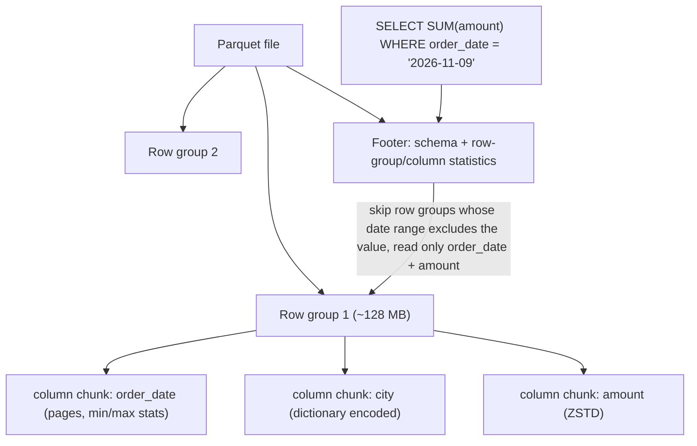

Best practices: partition data by commonly filtered columns (e.g. `dt=2026-11-09/`), sort or cluster within files by filter columns for tighter min/max stats, target 128 MB – 1 GB files (avoid the small-files problem), use ZSTD compression, and use table formats (Iceberg, Delta) on top for ACID and schema evolution.

#### Example
Clickstream data in S3 as gzipped JSON (25 TB/month): an Athena query for one day's conversions scanned 800 GB and cost ~$4 per query. Converting to Parquet partitioned by date and sorted by event type gave 3.5 TB/month, and the same query scanned 6 GB (~$0.03) and ran 20× faster.

#### Trade-offs
Massive savings for analytical reads, but expensive row-level updates (rewrite files, mitigated by table formats), write cost for encoding, and small files hurt performance.

#### Problems & fixes
| Symptom | Cause | Fix |
|---|---|---|
| Queries scan whole dataset | no partitioning / unsorted data | partition by date, cluster by filter columns |
| Slow queries with thousands of tiny files | streaming writes produce small files | compaction jobs, table-format optimize |
| Schema changes break readers | raw files without schema management | Iceberg/Delta schema evolution |

#### Cheat sheet
- Column chunks in row groups + statistics, so engines read fewer columns and skip blocks.
- Partition + sort, 128 MB–1 GB files, ZSTD.
- Use table formats for ACID, updates and evolution.

#### Interview questions
<details><summary>Why is converting JSON logs to Parquet such a big win for data lakes?</summary>

JSON is row-oriented text, so every query parses entire records and all fields, with weak compression. Parquet stores typed columns with efficient encoding and compression (often 5–10× smaller), lets engines read only referenced columns, and uses min/max statistics and partitioning to skip irrelevant data. Bytes scanned (cost) and latency drop by an order of magnitude or more.
</details>

<details><summary>What is the small-files problem in data lakes?</summary>

Streaming or frequent micro-batch writes create thousands of tiny files. Each file adds open, metadata and planning overhead (listing S3, reading footers), and tiny row groups have poor compression and statistics, so query engines spend more time on overhead than data. Fix with compaction into larger files (table formats' optimize/rewrite, scheduled jobs) and with buffered writes.
</details>

#### Interview angle
> "Lake data is ZSTD Parquet partitioned by date and sorted by common filters, compacted into 128 MB to 1 GB files and managed by Iceberg or Delta, so queries scan a tiny fraction of the bytes."

### Data warehouse — Snowflake (cloud-native), BigQuery (serverless), Redshift (columnar, AWS)
A cloud data warehouse is a managed, columnar, massively parallel SQL engine for analytics: **Snowflake** (separate storage and compute "virtual warehouses", multi-cloud), **BigQuery** (serverless, pay per bytes scanned or slots), **Redshift** (AWS, provisioned or serverless, with Spectrum for S3). They provide SQL, governance, concurrency, time travel and BI integrations.

#### How it works
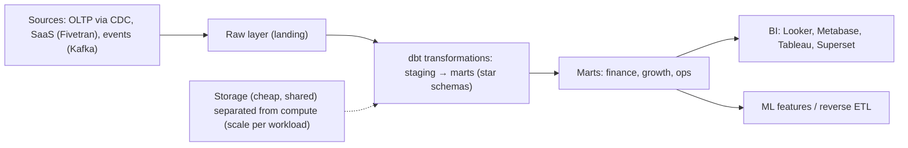

| | Snowflake | BigQuery | Redshift |
|---|---|---|---|
| Model | virtual warehouses (compute clusters) on shared storage | serverless, slots | clusters (RA3) or serverless |
| Pricing | per-second compute + storage | bytes scanned or slot reservations | node-hours / RPU |
| Strengths | multi-cloud, data sharing, workload isolation | zero ops, huge scale, ML in SQL | AWS integration, Spectrum on S3 |

#### Example
A startup on GCP chose BigQuery: CDC from Cloud SQL via Datastream, dbt for models, Looker for dashboards. Cost surprises came from analysts running `SELECT *` on a 30 TB events table without partition filters, fixed with partitioning by date, clustering by event type, `require_partition_filter`, per-user quotas and cost dashboards.

#### Trade-offs
Fast, scalable and managed SQL analytics, but costs can explode with careless queries, vendor lock-in, and data freshness depends on pipelines.

#### Problems & fixes
| Symptom | Cause | Fix |
|---|---|---|
| Huge bills | full scans, unpartitioned tables, idle warehouses | partitioning/clustering, required partition filters, auto-suspend, quotas |
| Slow dashboards under concurrency | one shared compute cluster | separate warehouses per workload, result caching, materialised views |
| Conflicting metrics | ad-hoc SQL everywhere | dbt models, tests, semantic layer |

#### Cheat sheet
- Columnar MPP SQL with storage/compute separation.
- ELT with dbt: raw → staging → marts. BI and ML on marts.
- Cost controls: partitions, clustering, auto-suspend, quotas.

#### Interview questions
<details><summary>What does separating storage from compute give you in Snowflake or BigQuery?</summary>

Storage scales cheaply and independently, while multiple compute clusters can read the same data concurrently without contention (ETL on one, BI on another, data science on a third), each sized and scaled or suspended independently. You pay for compute only when queries run, and workloads don't interfere.
</details>

<details><summary>How do you control BigQuery costs?</summary>

Partition tables (by date) and require partition filters, cluster on frequently filtered columns, avoid `SELECT *`, use materialised views and BI Engine for repeated dashboard queries, set custom quotas per user or project, consider slot reservations for predictable workloads, and monitor bytes scanned per query and user.
</details>

#### Interview angle
> "The warehouse (BigQuery or Snowflake) gets CDC and SaaS data into raw layers, dbt builds tested marts, and BI reads only marts, with partitioning, clustering, auto-suspend and quotas keeping cost predictable."

### Data lake — raw files in S3/GCS, queried via Athena/Presto on-demand; flexible but no ACID
A data lake stores **raw and processed data as files in object storage** (S3, GCS, ADLS) in open formats (JSON, CSV, Parquet, Avro), cheaply and at any scale, decoupled from compute. Engines like **Athena, Trino/Presto, Spark and EMR** query it on demand. Without a table format, lakes lack ACID transactions, schema enforcement and easy updates.

#### How it works
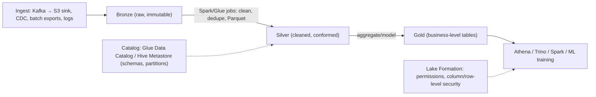

Lake vs warehouse: lakes are schema-on-read, cheap storage, open formats and any data type (images, logs, ML datasets). Warehouses are schema-on-write, managed performance, SQL-first and strong governance. Lakehouses converge the two.

#### Example
A ride-hailing company lands GPS pings, app events and trip records in S3 (~5 TB/day) as Parquet partitioned by date and city. Data scientists train ETA models with Spark on months of pings, analysts query via Athena, and only curated aggregates go to the warehouse. Before table formats, a late-arriving data fix required rewriting entire partitions by hand, and concurrent jobs occasionally produced readers seeing half-written partitions.

#### Trade-offs
Cheap, flexible, open and scalable, but it can turn into a "data swamp" without governance, has no ACID (partial writes, concurrent-writer issues), is hard to update or delete (GDPR), and performance depends on file layout.

#### Problems & fixes
| Symptom | Cause | Fix |
|---|---|---|
| Readers see partial data | non-atomic multi-file writes | table formats (Iceberg/Delta/Hudi) |
| Nobody knows what data exists | no catalog/ownership | data catalog, ownership, documentation |
| Deleting a user's data impossible | immutable files without row-level ops | table formats with deletes, partition design |
| Slow queries | small files, no partitioning | compaction, partitioning, Parquet |

#### Cheat sheet
- Files in object storage, open formats, compute on demand (Athena, Trino, Spark).
- Bronze → silver → gold. Catalog + permissions.
- Add Iceberg/Delta for ACID, updates and schema evolution.

#### Interview questions
<details><summary>Data lake vs data warehouse: when do you need each?</summary>

A lake when you need cheap storage of huge, varied or raw data (logs, events, images, ML training sets) with flexible processing engines. A warehouse when you need fast, governed SQL analytics with high concurrency for BI. Many organisations land everything in a lake and load curated data into a warehouse, or adopt a lakehouse to do both on one copy.
</details>

<details><summary>What problems do lakes have without a table format?</summary>

No atomic commits (readers can see partially written data), concurrent writers can corrupt state, no row-level updates or deletes (GDPR erasure requires rewriting partitions), schema drift breaks queries, listing millions of files for query planning is slow, and there's no time travel or rollback.
</details>

#### Interview angle
> "Raw data lands in an S3 lake as bronze, silver and gold Parquet with a catalog and Lake Formation permissions. I add Iceberg once we need ACID, deletes or schema evolution."

### Lakehouse — ACID transactions on data lake; Delta Lake, Apache Iceberg, Apache Hudi
A lakehouse adds a **table format** on top of data-lake files: a transactional **metadata layer** (manifests or logs) that provides **ACID commits, snapshots and time travel, schema evolution, row-level updates and deletes, partition evolution** and efficient planning, while data stays in open Parquet files on cheap object storage and any engine can query it.

#### How it works
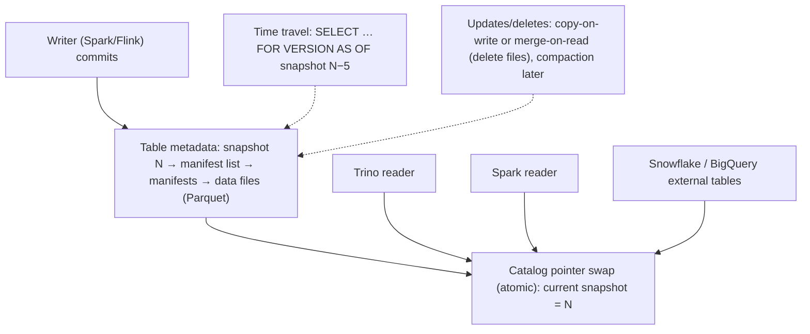

| Format | Origin | Notes |
|---|---|---|
| **Apache Iceberg** | Netflix | engine-neutral, hidden partitioning, partition evolution, wide adoption (Snowflake, BigQuery, Athena, Trino, Spark, Flink) |
| **Delta Lake** | Databricks | transaction log, strong Spark/Databricks integration, UniForm interoperability |
| **Apache Hudi** | Uber | upsert-heavy CDC ingestion, incremental pulls |

#### Example
A fintech ingests CDC from 40 Postgres databases into Iceberg tables via Flink (upserts with merge-on-read), with hourly compaction. Analysts query with Trino and Snowflake (reading the same Iceberg tables), data scientists use Spark, GDPR deletes are a `DELETE FROM` plus a rewrite, and a bad pipeline run was rolled back by reverting to the previous snapshot. One copy of data serves warehouse-style and lake-style workloads.

#### Trade-offs
Warehouse-like guarantees on open, cheap storage with multi-engine access, but table maintenance (compaction, snapshot expiry, orphan file cleanup), catalog choices, and performance tuning (file sizes, sort orders) are your responsibility.

#### Problems & fixes
| Symptom | Cause | Fix |
|---|---|---|
| Queries slow down over time | many small files/delete files | scheduled compaction, rewrite data files |
| Storage keeps growing | old snapshots retained | expire snapshots, remove orphan files |
| Concurrent writer conflicts | optimistic commits on same partitions | partition writes, retries, write coordination |

#### Cheat sheet
- Table formats = ACID + snapshots + time travel + schema/partition evolution on Parquet in S3.
- Iceberg (engine-neutral), Delta (Databricks), Hudi (upserts).
- Maintenance: compaction, snapshot expiry, orphan cleanup.

#### Interview questions
<details><summary>How does a table format give ACID on top of S3?</summary>

Writers produce new data files and new metadata files describing the table's new snapshot (which files belong to it), then atomically swap the catalog's pointer to the new metadata (via a catalog transaction or conditional write). Readers always read a consistent snapshot, never partially written data, and concurrent writers use optimistic concurrency with retries on conflict.
</details>

<details><summary>What is merge-on-read vs copy-on-write for updates in lakehouse tables?</summary>

Copy-on-write rewrites affected data files with the updates applied at write time: slower writes, fastest reads. Merge-on-read writes small delete or update files (position or equality deletes) and merges them at read time: fast writes (good for CDC upserts), slower reads until compaction rewrites the files. Choose by write vs read patterns.
</details>

#### Interview angle
> "CDC lands in Iceberg tables in S3 (merge-on-read upserts plus hourly compaction), queried by Trino, Spark and Snowflake from one copy, with snapshots for rollback and SQL deletes for GDPR."

### Batch processing — Apache Spark: RDD, DataFrame, Spark SQL, lazy evaluation, Catalyst optimizer
Apache Spark is the dominant distributed **batch** (and micro-batch streaming) engine: you express transformations on **DataFrames/Datasets** (or Spark SQL), Spark builds a **lazy logical plan**, optimises it with **Catalyst** (predicate pushdown, column pruning, join reordering) and runs it as **stages and tasks** across executors, with in-memory processing and fault tolerance via lineage.

#### How it works
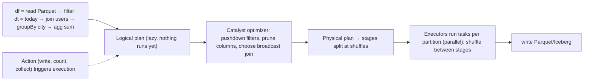

Concepts:
- **Transformations** (lazy: map, filter, join) vs **actions** (trigger jobs).
- **Narrow** (no shuffle) vs **wide** (shuffle: groupBy, join) dependencies.
- **Partitions** = parallelism. **Broadcast joins** for small tables. **AQE** (adaptive query execution) handles skew and coalesces partitions.
- **Caching** reused DataFrames. Avoid `collect()` on large data.

#### Example
A nightly job computes merchant settlement reports from 2 billion payment records. The first version took 4 hours: a skewed join where one mega-merchant's partition ran forever, plus a full shuffle of a small currency table. Fixes: broadcast the currency table, enable AQE skew-join handling (or salt the merchant key), filter to yesterday's partition early, and size the output files. Runtime dropped to 35 minutes.

#### Trade-offs
Scalable, general-purpose and SQL-friendly with a rich ecosystem, but shuffle-heavy jobs are expensive, tuning (partitions, memory, skew) needs skill, latency is batch or minutes (not real time), and cluster costs can be high.

#### Problems & fixes
| Symptom | Cause | Fix |
|---|---|---|
| One task runs forever | data skew on join/group key | AQE skew join, salting, broadcast |
| OOM on executors | huge partitions, collect(), wide rows | more partitions, avoid collect, tune memory |
| Too many small output files | many partitions at write | coalesce/repartition before write, table optimize |
| Slow reads | no partition pruning | filter on partition columns early, Parquet stats |

#### Cheat sheet
- DataFrames/SQL → lazy plan → Catalyst → stages and tasks. Actions trigger execution.
- Shuffles are expensive. Broadcast small tables. AQE for skew.
- Partition sizing, avoid collect, write well-sized files.

#### Interview questions
<details><summary>What causes data skew in Spark and how do you fix it?</summary>

A few keys have far more records than others (one huge merchant or a null key), so after a shuffle a handful of tasks get most of the data and the stage waits for them. Fixes: AQE skew-join optimisation (splits skewed partitions), salting the key (add a random suffix and aggregate in two steps), broadcasting the smaller side of joins, and filtering or handling null keys separately.
</details>

<details><summary>Why is Spark's lazy evaluation useful?</summary>

Because transformations only build a plan, Catalyst can optimise the whole pipeline before running it: push filters down to the data source (reading less), prune unused columns, combine operations, pick join strategies, and avoid materialising intermediate results. Execution happens once, when an action needs the result.
</details>

#### Interview angle
> "Batch jobs run on Spark DataFrames, filtering partitions early, broadcasting small tables and letting AQE handle skew, then writing well-sized Parquet or Iceberg files. Shuffles are where cost hides."

### Stream processing — Apache Flink: event time vs processing time, watermarks, stateful operators, exactly-once
Apache Flink is a true streaming engine for **continuous, stateful computations** over unbounded data with low latency. Key ideas: **event time** (when the event happened) vs processing time, **watermarks** to handle out-of-order and late events, large **keyed state** (RocksDB) with **checkpoints** for exactly-once state consistency, and **windows** (tumbling, sliding, session).

#### How it works
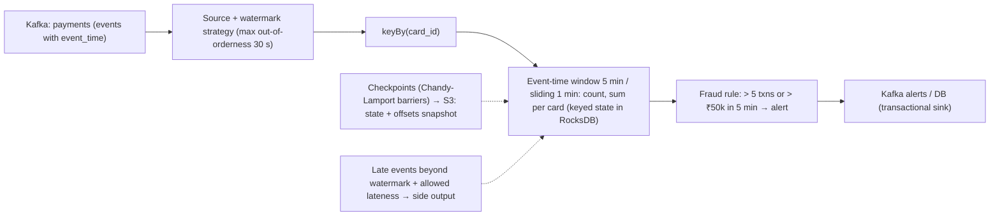

Concepts:
- **Event time vs processing time**: event time gives correct results despite delays and replays.
- **Watermark**: an assertion that "no events older than T are expected", which triggers window results and handles lateness.
- **State**: keyed or operator state, TTL, savepoints for upgrades.
- **Exactly-once**: checkpoints plus replayable sources plus transactional or idempotent sinks.

#### Example
Real-time card fraud detection: Flink consumes card transactions, keys by card id, and computes rolling counts and amounts over 5-minute event-time windows plus a "new merchant category" feature in keyed state. Mobile-network delays cause out-of-order events, and watermarks with 30 s tolerance keep windows correct. Alerts go to a Kafka topic within ~200 ms. Checkpoints every 30 s to S3 allow recovery with no double alerts (transactional Kafka sink).

#### Trade-offs
Low latency, correct event-time semantics and huge state, but operational complexity (state size, checkpoints, upgrades with savepoints), and late-data trade-offs (latency vs completeness).

#### Problems & fixes
| Symptom | Cause | Fix |
|---|---|---|
| Windows never fire | watermark stuck (idle partitions) | idle source detection, per-partition watermarks |
| Late events dropped | watermark too aggressive | larger out-of-orderness, allowed lateness, side outputs |
| Checkpoints slow/failing | huge state, backpressure | incremental RocksDB checkpoints, unaligned checkpoints, tune parallelism |
| Duplicate outputs after failure | non-transactional sink | transactional/idempotent sinks |

#### Cheat sheet
- Event time + watermarks for out-of-order data. Keyed state (RocksDB). Windows.
- Checkpoints + replayable source + transactional sink = exactly-once.
- Savepoints for upgrades. Watch idle partitions and backpressure.

#### Interview questions
<details><summary>Why use event time instead of processing time for streaming aggregations?</summary>

Events arrive late and out of order (mobile networks, retries, backlogs, replays). Processing-time windows group events by when they're processed, so results change with delays and aren't reproducible on replay. Event-time windows group by when events actually happened, so results are correct and deterministic, with watermarks deciding when a window is complete enough to emit.
</details>

<details><summary>How does Flink achieve exactly-once state consistency?</summary>

It periodically injects checkpoint barriers into the streams. As barriers flow through operators, each snapshots its state (asynchronously, to durable storage) aligned with source offsets. On failure, all operators restore the last completed checkpoint and sources rewind to the recorded offsets, so state reflects each event exactly once. End-to-end exactly-once also needs transactional (two-phase commit) or idempotent sinks.
</details>

#### Interview angle
> "Real-time features run on Flink with event-time windows and watermarks for late mobile data, keyed RocksDB state, checkpoints to S3, and a transactional Kafka sink for exactly-once alerts."

### Kafka Streams — lightweight stream processing: stateful with embedded RocksDB, runs inside application
Kafka Streams is a **Java library** (no separate cluster) for stream processing on Kafka: your application instances consume topics, run stateful transformations with **local RocksDB state stores** backed by **changelog topics**, and produce results to topics. It scales by running more instances (up to the partition count), with exactly-once via Kafka transactions. (Phase 7 covers internals.)

#### How it works
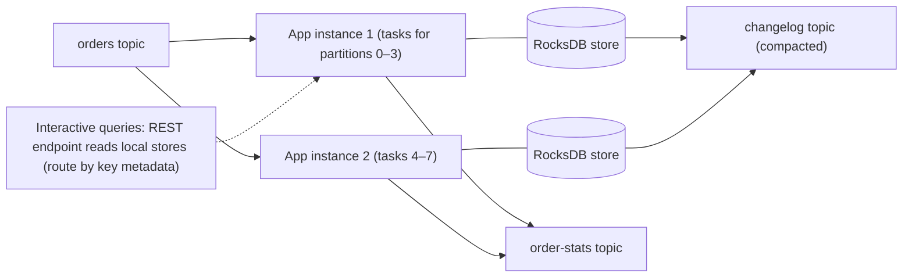

When to pick Kafka Streams vs Flink: Kafka Streams for Kafka-in, Kafka-out microservice-style processing embedded in existing JVM services, with moderate state, simpler operations and no cluster. Flink for complex event-time pipelines, very large state, many sources and sinks, SQL-heavy analytics and centralised streaming platforms.

#### Example
An order-tracking service computes "orders per restaurant in the last 15 minutes" (for kitchen load balancing) with Kafka Streams inside the existing Spring Boot service: a windowed count by restaurant id, materialised in a state store, and exposed via interactive queries at `/restaurants/{id}/load` (routing to the instance owning the key). There's no Flink cluster to run, and scaling is just adding pods (24 partitions → up to 24 instances).

#### Trade-offs
Simple deployment, tight Kafka integration and EOS, but Kafka-only sources and sinks, JVM-only, state restoration time for large stores, and parallelism capped by partitions.

#### Problems & fixes
| Symptom | Cause | Fix |
|---|---|---|
| Long downtime on restart | restoring large state from changelog | standby replicas, persistent volumes |
| Repartition topic explosion | frequent re-keying | key upstream, minimise selectKey/groupBy |
| Interactive queries hit wrong instance | key owned elsewhere | use metadata APIs to route |

#### Cheat sheet
- Library: KStream/KTable, windows, joins, RocksDB stores + changelogs.
- Scale with instances (≤ partitions). EOS v2. Standbys for failover.
- Pick it for Kafka-to-Kafka microservice processing, Flink for big platforms.

#### Interview questions
<details><summary>Kafka Streams or Flink for a team adding real-time aggregations to an existing Spring service?</summary>

Kafka Streams: input and output are Kafka topics, it runs inside the existing service with no new cluster to operate, the state size is moderate, and scaling with pods is simple. Flink becomes preferable for complex event-time logic over many sources, very large state, SQL-based analytics, or a shared streaming platform run by a data team.
</details>

<details><summary>What are interactive queries in Kafka Streams?</summary>

They let an application expose its local state stores (e.g. windowed counts) for direct reads, typically via a REST endpoint. Since state is partitioned across instances, the app uses Streams metadata to find which instance owns a key and forwards the request there, which avoids writing every aggregate to an external database.
</details>

#### Interview angle
> "For Kafka-to-Kafka aggregations inside our services I'd use Kafka Streams with windowed RocksDB state, standby replicas and interactive queries, with no extra cluster. Flink is for the heavy shared pipelines."

### Lambda architecture — batch layer (Spark, correctness) + speed layer (Flink, low latency) + serving layer
Lambda architecture runs **two parallel pipelines** over the same data: a **batch layer** that periodically recomputes accurate results from the full immutable dataset, and a **speed layer** that processes recent data in real time for low-latency (approximate or provisional) results. A **serving layer** merges the two views for queries.

#### How it works
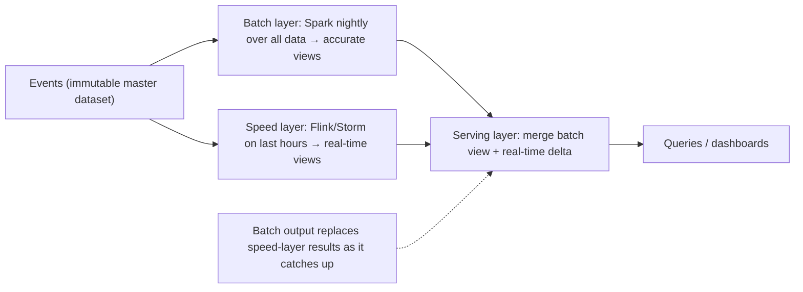

#### Example
An ad-tech company reports campaign spend: the speed layer (Flink) gives near-real-time spend for pacing decisions (seconds of latency, approximate with possible duplicates), and the nightly Spark batch recomputes exact, deduplicated billing numbers from raw logs. The dashboard shows batch-accurate totals up to yesterday plus real-time increments for today. Pain point: the same business logic was implemented twice (Spark and Flink) and occasionally diverged.

#### Trade-offs
Accurate batch plus fast speed results and robustness (batch can fix speed-layer errors), but **two codebases for the same logic**, complex merging and operational overhead. Kappa and unified engines (Flink, Spark Structured Streaming, Beam) emerged to avoid this.

#### Problems & fixes
| Symptom | Cause | Fix |
|---|---|---|
| Batch and real-time numbers differ | duplicated logic diverged | shared libraries, unified engine (Beam/Flink), or Kappa |
| Complex serving merges | two views with overlaps | clear cutover points (batch watermark) |
| High ops cost | two pipelines | consider Kappa with replayable log |

#### Cheat sheet
- Batch (accurate, slow) + speed (fast, provisional) + serving (merge).
- Pain: duplicate logic and complexity.
- Modern alternative: Kappa or unified batch/stream engines.

#### Interview questions
<details><summary>What problem did the Lambda architecture solve and what's its main drawback?</summary>

It combined low-latency results from stream processors (which historically lacked exactly-once guarantees and easy reprocessing) with accurate results from recomputing over all data in batch, getting both freshness and correctness. The drawback is maintaining the same logic in two systems, with divergence, double testing, complex merging and higher operational cost.
</details>

<details><summary>When might Lambda still make sense today?</summary>

When real-time results must be available immediately but authoritative numbers (billing, finance) require heavy deduplication, reconciliation or late data that's easier in large batch recomputations, or when existing batch systems are mature and the real-time layer only adds provisional views. Even then, unified engines can share code between both paths.
</details>

#### Interview angle
> "Lambda pairs a correct batch layer with a fast speed layer, but duplicated logic drifts. Today I'd prefer Kappa or a unified engine, keeping batch recompute only where billing-grade reconciliation demands it."

### Kappa architecture — stream-only using Kafka as event log; reprocess historical data by replaying from offset 0
Kappa architecture uses **one stream processing pipeline** for everything: all data flows through a durable, replayable log (Kafka with long retention or tiered storage), real-time results come from the streaming job, and **reprocessing** (bug fixes, logic changes) is done by **replaying the log** through a new version of the job, with no separate batch layer.

#### How it works
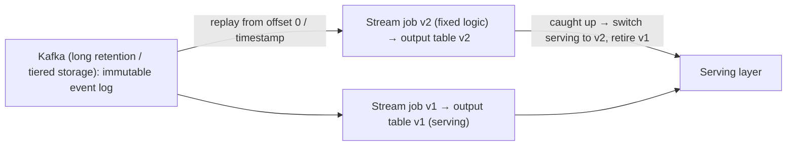

Requirements: a replayable source with sufficient retention (or an archive in a lakehouse), a deterministic streaming job (event time, not processing time), idempotent or versioned outputs, and enough capacity to replay quickly.

#### Example
A ride-hailing company computes driver earnings summaries with Flink from a Kafka trip-events topic (tiered storage, 1-year retention). When a bonus-calculation bug was found, they deployed job v2 reading from the start of the affected month into a new output table, which caught up in 3 hours. They then switched the API to v2 and deleted v1, with one codebase and no batch job.

#### Trade-offs
One codebase, simpler architecture and natural reprocessing, but replays of large histories take time and capacity, it requires long log retention (cost, tiered storage), and some heavy historical analytics are still easier in batch engines.

#### Problems & fixes
| Symptom | Cause | Fix |
|---|---|---|
| Can't reprocess old data | Kafka retention too short | tiered storage, archive to lakehouse and replay from there |
| Replay results differ | processing-time logic, non-determinism | event-time semantics, deterministic code |
| Replay overloads cluster | full-speed reprocessing | separate cluster/consumer group, throttling |

#### Cheat sheet
- One streaming pipeline + replayable log. Reprocess by replaying into a new versioned output.
- Needs long retention, event-time determinism and idempotent outputs.
- Simpler than Lambda. Replays cost time and capacity.

#### Interview questions
<details><summary>How do you fix a bug in historical results in a Kappa architecture?</summary>

Deploy a corrected version of the streaming job as a new consumer group that reads the log from the beginning (or the affected point) and writes to a new versioned output table. When it has caught up with live data, switch consumers or APIs to the new table atomically, then decommission the old job and table.
</details>

<details><summary>What must be true of the event log for Kappa to work?</summary>

It must be durable and replayable for as far back as you may need to reprocess (long retention or tiered storage, or an archived copy), contain complete immutable events (not just current state), preserve per-key ordering, and have schemas that can still be read (schema registry with compatible evolution) years later.
</details>

#### Interview angle
> "I prefer Kappa: one Flink pipeline over a long-retention Kafka log with tiered storage, where a bug fix means replaying into a new versioned table and switching over once it catches up."

### ELT vs ETL — load raw first then transform (ELT with dbt) vs transform before loading (ETL with SSIS/Informatica)
**ETL** (extract, transform, load) transforms data in a separate processing tier before loading it into the warehouse. **ELT** (extract, load, transform) loads **raw data first** into a scalable warehouse or lakehouse, then transforms it **inside** with SQL (dbt). Cloud warehouses made ELT the modern default: keep raw data, transform flexibly and version transformations as code.

#### How it works
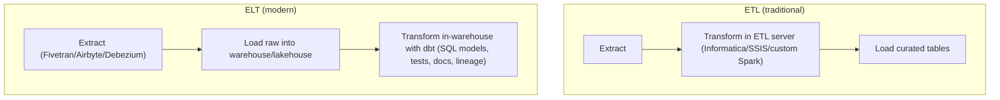

dbt essentials: SQL models (`select` statements materialised as views or tables or incremental tables), `ref()` for dependencies (a DAG), tests (unique, not_null, relationships, custom), documentation and lineage, environments, and CI on pull requests.

```sql
-- models/marts/fct_orders.sql
{{ config(materialized='incremental', unique_key='order_id') }}
select o.order_id, o.customer_id, o.created_at::date as order_date, sum(i.amount) as total
from {{ ref('stg_orders') }} o join {{ ref('stg_order_items') }} i using (order_id)
 where o.updated_at > (select max(updated_at) from {{ this }}) 
group by 1, 2, 3
```

#### Example
A company replaced a fragile nightly ETL (Python scripts transforming in memory and loading final tables, with no raw history kept) with ELT: Fivetran loads raw tables from 12 SaaS tools and Postgres into Snowflake, and dbt builds staging → intermediate → marts with tests on keys and freshness. When finance changed a revenue definition, they re-ran the dbt models over the retained raw history, which the old ETL couldn't have done.

#### Trade-offs
ELT gives flexibility, raw history, SQL accessibility and version control, but more warehouse compute cost, raw sensitive data lands centrally (needs masking and governance), and SQL isn't ideal for every transformation. ETL still fits heavy pre-processing, privacy filtering before load, or non-SQL transformations.

#### Problems & fixes
| Symptom | Cause | Fix |
|---|---|---|
| Can't recompute history after logic change | ETL discarded raw data | ELT with raw retention |
| Warehouse bill grows | full refreshes of huge models | incremental models, partitioning |
| PII exposed in raw layer | loading everything raw | masking at load, column-level security, filtering sensitive fields (ETL step) |
| Broken dashboards from model changes | no tests/CI | dbt tests, CI on PRs, contracts |

#### Cheat sheet
- ETL = transform before load. ELT = load raw, transform in-warehouse (dbt).
- dbt: SQL models, ref DAG, tests, docs, incremental models, CI.
- Keep raw data. Govern PII. Watch compute costs.

#### Interview questions
<details><summary>Why has ELT become the default with cloud warehouses?</summary>

Cloud warehouses provide cheap storage and elastic compute, so loading raw data first and transforming with SQL inside is fast and scalable. Keeping raw data enables reprocessing when definitions change, transformations become version-controlled code (dbt) with tests and lineage, and analysts who know SQL can own transformations.
</details>

<details><summary>When would you still do transformation before loading?</summary>

When regulations or policy forbid landing certain raw data centrally (PII or card data must be masked or tokenised first), when data needs heavy non-SQL processing (images, complex parsing, ML inference), when raw volume is too large to land economically (aggressive filtering or aggregation at the edge), or when targets aren't capable of transformation.
</details>

#### Interview angle
> "Analytics is ELT: Fivetran or Debezium land raw data, and dbt builds tested incremental models from staging to marts, with PII masked on the way in and raw history kept so definitions can be recomputed."

### Apache Airflow — workflow orchestration: DAGs, schedulers, workers, metadata DB; define pipelines as code
Apache Airflow orchestrates **batch workflows as code**: Python-defined **DAGs** of tasks with dependencies, schedules, retries, SLAs, backfills and a UI showing every run. A **scheduler** decides what runs when, **executors and workers** run tasks, and a **metadata database** stores state. It orchestrates work done elsewhere (Spark, dbt, SQL, APIs) and shouldn't do the heavy lifting itself.

#### How it works
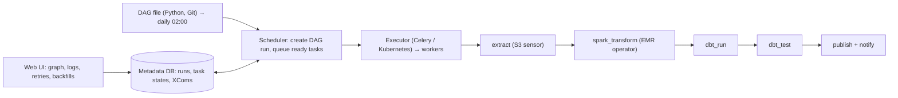

```python
with DAG("daily_settlements", schedule="0 2 * * *", start_date=datetime(2026, 1, 1), catchup=False,
         default_args={"retries": 3, "retry_delay": timedelta(minutes=10)}) as dag:
    wait = S3KeySensor(task_id="wait_for_export", bucket_key="s3://exports/{{ ds }}/_SUCCESS", mode="reschedule")
    transform = EmrServerlessStartJobOperator(task_id="spark_settlements", ...)
    dbt = BashOperator(task_id="dbt_build", bash_command="dbt build --select settlements --vars '{run_date: {{ ds }}}'")
    wait >> transform >> dbt
```

Principles: **idempotent, deterministic tasks** parameterised by the logical date (`{{ ds }}`) so retries and backfills are safe, heavy compute in external systems, small XComs (metadata only), sensors in reschedule mode or deferrable operators, and clear SLAs and alerts.

#### Example
A fintech's daily settlement pipeline: wait for the bank's file in S3 → validate the file → Spark reconciliation job on EMR → dbt models → reports → emails to finance. Failed tasks retry with backoff, and when the bank sent a corrected file for 3 days ago, they cleared and re-ran that DAG run for the date. Tasks being idempotent and date-partitioned made the backfill safe.

#### Trade-offs
Mature, flexible, code-based and observable, but the scheduler and metadata DB need care at scale, it's batch-oriented (not for streaming or low-latency events), and DAG code can turn into spaghetti. Alternatives: Dagster, Prefect, Step Functions, Argo Workflows, Temporal.

#### Problems & fixes
| Symptom | Cause | Fix |
|---|---|---|
| Backfills produce duplicates | non-idempotent tasks | overwrite partitions by logical date, upserts |
| Workers clogged by waiting sensors | poke-mode sensors | reschedule mode / deferrable operators |
| Scheduler slow, DAGs delayed | heavy top-level DAG code, too many DAGs | lightweight DAG files, scheduler tuning |
| Airflow workers OOM | heavy processing in tasks | push compute to Spark/warehouse |

#### Cheat sheet
- DAGs as Python: scheduler + executor/workers + metadata DB + UI.
- Idempotent date-parameterised tasks. Orchestrate, don't compute.
- Deferrable sensors, retries, SLAs, backfills.

#### Interview questions
<details><summary>What makes an Airflow task safe to retry and backfill?</summary>

Idempotence and determinism: the task's output depends only on its logical date and inputs, writes go to a date-specific partition (overwritten, not appended) or use upserts, external side effects are guarded (dedupe keys), and it doesn't depend on "now" or on mutable state outside its inputs. Running it twice for the same date produces the same result.
</details>

<details><summary>Should Airflow process the data itself?</summary>

Generally no. Airflow is an orchestrator: tasks should trigger work in systems built for it (Spark, warehouse SQL, dbt, Kubernetes jobs) and monitor them. Doing heavy processing on Airflow workers causes memory and CPU contention, poor scalability and scheduler instability.
</details>

#### Interview angle
> "Airflow DAGs orchestrate idempotent, date-partitioned tasks (sensor, Spark on EMR, dbt build, publish) with retries and deferrable sensors. Backfilling a corrected file is just re-running that date."

### CDC with Debezium — reads DB WAL (binary log) → publishes change events to Kafka; zero impact on source DB
Debezium captures **row-level changes from databases' transaction logs** (Postgres WAL via logical decoding, MySQL binlog, MongoDB oplog/change streams, SQL Server CDC, Oracle LogMiner/XStream) and publishes them as events to Kafka (via Kafka Connect) or other sinks (Debezium Server). It's the standard way to feed analytics, search, caches and other services from operational databases. (Phase 7 covers the event-driven usage.)

#### How it works
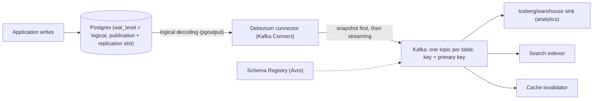

Operational details: an **initial snapshot** (consistent, can be incremental with signalling) then streaming. **Replication slot** monitoring is critical (an inactive slot retains WAL and fills disks). Large transactions and schema changes need handling. Use the **outbox event router** for domain events instead of raw table events where contracts matter. Heartbeats keep slots advancing on idle databases.

"Zero impact" is relative: reading WAL is light, but snapshots scan tables and slots retain WAL, so it's low impact when operated well.

#### Example
A company streams 30 Postgres databases into an Iceberg lakehouse: Debezium connectors per DB (Avro + Schema Registry), Flink applying upserts into Iceberg tables, and analytics freshness of ~2 minutes instead of nightly. One incident: a connector was paused for a weekend, its slot retained 400 GB of WAL and the primary's disk hit 95%. They added slot-lag alerts and `max_slot_wal_keep_size`, and heartbeat events.

#### Trade-offs
Complete, ordered, low-latency change streams with no dual writes, but exposes internal schemas (coupling), replication slots are operational risks, and snapshots of huge tables and schema evolution need planning.

#### Problems & fixes
| Symptom | Cause | Fix |
|---|---|---|
| Database disk filling with WAL | stalled connector/slot | alert on slot lag, max_slot_wal_keep_size, auto-restart |
| Snapshot overloads DB | full scan of huge tables | incremental snapshots, run off-peak/replica-based where supported |
| Consumers break on schema change | raw table schema as contract | schema registry compatibility, outbox events for contracts |
| Idle DB slot never advances | no writes → no LSN progress | heartbeat table/events |

#### Cheat sheet
- Read WAL/binlog, emit per-row change events to Kafka. Snapshot, then stream.
- Monitor replication slots. Heartbeats. Schema registry.
- Raw CDC for internal pipelines. Outbox for public contracts.

#### Interview questions
<details><summary>What's the biggest operational risk with Debezium on Postgres and how do you mitigate it?</summary>

The replication slot: if the connector stops consuming (failure, pause, misconfiguration), Postgres retains all WAL since the slot's last confirmed position, which can fill the disk and take down the primary. Mitigate with monitoring and alerts on slot lag or retained WAL, `max_slot_wal_keep_size` (newer Postgres) to cap retention, connector auto-restart and runbooks, heartbeats on idle databases, and dropping slots for decommissioned connectors.
</details>

<details><summary>How do Debezium events preserve ordering?</summary>

Events are keyed by the table's primary key and produced to Kafka partitions by key, so all changes to a given row land in the same partition in commit order (the log's order). Consumers processing partitions sequentially see each row's changes in order. Ordering across different rows or tables isn't guaranteed beyond transaction metadata (Debezium can emit transaction boundary events).
</details>

#### Interview angle
> "Operational data streams through Debezium CDC into Kafka with Avro schemas, feeding the lakehouse, search and caches within minutes. Replication slot lag is alerted on and capped so a stalled connector can't fill the primary's disk."

### ClickHouse — columnar OLAP engine, 100–1000× faster than MySQL for aggregations, real-time ingestion
ClickHouse is an open-source **columnar OLAP database** built for very fast analytical queries over huge datasets with **real-time ingestion**: vectorised execution, aggressive compression, sparse primary indexes, and the **MergeTree** family of table engines. It's popular for product analytics, observability (logs and metrics), ad-tech and real-time dashboards.

#### How it works
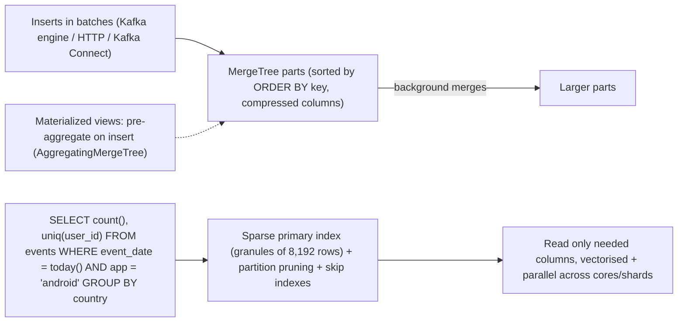

Design keys:
- **ORDER BY (sorting key)** = the primary index: put low-cardinality, frequently filtered columns first (e.g. `(app, event_date, user_id)`).
- **PARTITION BY** (e.g. month) for data management and TTL.
- **Batch inserts** (thousands of rows per insert), not row-by-row.
- **Materialised views** for real-time rollups. Engines: ReplacingMergeTree (dedupe), AggregatingMergeTree, CollapsingMergeTree.
- Distributed tables over shards plus replicas (ClickHouse Keeper).

#### Example
A product-analytics platform ingests 5B events/day from Kafka into ClickHouse (12 nodes, 3 shards × 2 replicas, a few hundred GB per day compressed ~10×). Funnel and retention queries over 90 days return in 1–3 seconds. Materialised views maintain per-minute aggregates for live dashboards. The same queries on MySQL took minutes to hours.

#### Trade-offs
Extremely fast aggregations, great compression and real-time ingestion, but weak point updates and deletes (mutations are heavy, use Replacing engines or lightweight deletes), joins are less mature than warehouses (prefer denormalised wide tables or dictionaries), and it needs tuning and operational expertise.

#### Problems & fixes
| Symptom | Cause | Fix |
|---|---|---|
| "Too many parts" errors | small, frequent inserts | batch inserts, async inserts, buffer via Kafka |
| Queries scan too much | ORDER BY not matching filters | choose sorting key by query patterns, skip indexes |
| Duplicate rows | at-least-once ingestion | ReplacingMergeTree / dedupe keys, FINAL sparingly |
| Slow big joins | large right-side tables | denormalise, dictionaries, join algorithms tuning |

#### Cheat sheet
- Columnar + vectorised + MergeTree sorted parts + sparse index.
- ORDER BY = main index. Batch inserts. Materialised views for rollups.
- Denormalise. Avoid heavy updates. Watch part counts.

#### Interview questions
<details><summary>Why is ClickHouse so fast for aggregations?</summary>

It reads only the needed columns, compressed with codecs suited to each column, skips large parts of data using partition pruning and a sparse primary index over sorted data, processes data in vectorised batches using SIMD across all cores, parallelises across shards, and can pre-aggregate on insert with materialised views.
</details>

<details><summary>How should you insert data into ClickHouse?</summary>

In batches (thousands to hundreds of thousands of rows per insert, roughly one insert per second per table), via the Kafka table engine, Kafka Connect, buffered producers or async inserts. Each insert creates a new part, and frequent tiny inserts create too many parts, overloading background merges ("too many parts" errors).
</details>

#### Interview angle
> "For real-time product analytics I'd use ClickHouse: batched Kafka ingestion into MergeTree tables sorted by the common filters, materialised views for per-minute rollups and denormalised wide tables, giving second-level queries over billions of events."

### Apache Druid — real-time OLAP: ingest from Kafka, sub-second queries, time-series optimized
Apache Druid is a distributed **real-time analytics database** designed for **sub-second slice-and-dice queries** over event data at high concurrency: streaming ingestion from Kafka/Kinesis (queryable within seconds), time-partitioned **segments** with columnar storage and bitmap indexes, optional **rollup** at ingestion, and a separation of ingestion, historical and query (broker) nodes.

#### How it works
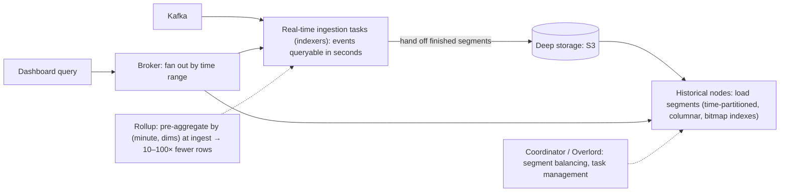

Strengths: time-based partitioning (queries usually filter by time), bitmap (Roaring) indexes on dimensions for fast filtering, approximate sketches (HLL, theta, quantiles) for distinct counts and percentiles, and high query concurrency for user-facing analytics.

#### Example
An ad network shows advertisers real-time campaign dashboards (impressions, clicks, spend by country, device and hour) with thousands of concurrent users. Druid ingests 1M events/s from Kafka with rollup to per-minute granularity by campaign, country and device (reducing rows ~40×). Queries return in 100–500 ms, data is visible within seconds, and older segments sit in S3 and load onto historicals as needed.

#### Trade-offs
Fast, concurrent and real-time time-series OLAP, but limited join support, rollup loses raw detail, many component types to operate, and it's less flexible than general warehouses for ad-hoc SQL.

#### Problems & fixes
| Symptom | Cause | Fix |
|---|---|---|
| Can't drill into raw events | rollup discarded detail | keep raw data in lake; choose rollup granularity carefully |
| Slow queries without time filter | full time-range scans | always constrain time, appropriate segment granularity |
| Too many small segments | streaming ingestion | compaction tasks |

#### Cheat sheet
- Real-time OLAP: Kafka ingestion visible in seconds, time-partitioned columnar segments, bitmap indexes.
- Rollup at ingest. Sketches for distinct counts and percentiles. High concurrency.
- Weak joins. Keep raw data elsewhere. Compaction.

#### Interview questions
<details><summary>ClickHouse vs Druid for user-facing real-time analytics?</summary>

Both are fast columnar OLAP engines with streaming ingestion. Druid is optimised for time-series slice-and-dice with very high query concurrency, ingestion-time rollup, bitmap indexes and a cloud-native segment architecture (deep storage). ClickHouse offers broader SQL, simpler deployment, excellent raw-scan performance and flexible table engines. Choice depends on concurrency needs, rollup suitability, SQL requirements and team expertise. Apache Pinot is another option in this space.
</details>

<details><summary>What is rollup in Druid and what's the trade-off?</summary>

During ingestion, events with the same timestamp bucket (e.g. minute) and dimension values are pre-aggregated into one row with summed metrics or sketches. It shrinks storage and speeds queries dramatically, but loses individual events and any dimension not included, so you can't query raw details or new dimensions later. Keep raw data in a lake if needed.
</details>

#### Interview angle
> "For high-concurrency, user-facing real-time dashboards I'd consider Druid: Kafka ingestion visible in seconds, per-minute rollup, bitmap indexes and sketches. Raw events stay in the lake for drill-down."

### Presto / Trino — federated SQL query engine: query S3, Hive, Cassandra, MySQL with single SQL
Trino (formerly PrestoSQL) and Presto are **distributed SQL query engines** that query data **where it lives**: S3/Iceberg/Hive tables, MySQL, Postgres, Cassandra, Kafka, Elasticsearch and more, through **connectors**, and can even join across sources in one query. A coordinator plans queries and workers execute them in memory with pipelined, MPP execution. Amazon Athena is built on Presto/Trino.

#### How it works
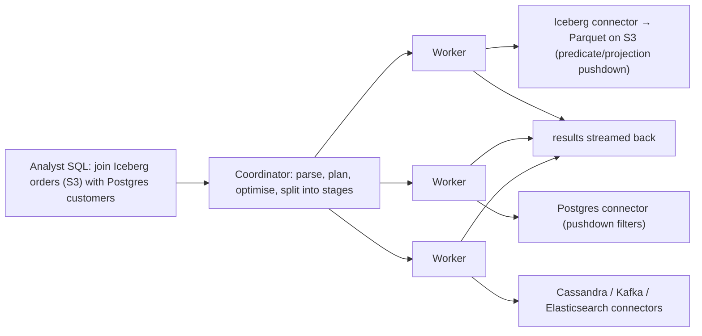

Characteristics: interactive latency (seconds), in-memory pipelined execution (classic Trino isn't fault-tolerant mid-query, newer versions add fault-tolerant execution for long ETL), cost-based optimisation, pushdown to connectors, and no storage of its own.

#### Example
A company's analysts query the Iceberg lakehouse (2 PB in S3) via Trino, joining it ad hoc with a small Postgres reference database (merchant metadata) without copying it. Athena (serverless Trino) handles occasional queries at pay-per-TB pricing, while a dedicated Trino cluster on Kubernetes serves heavy, frequent BI workloads with resource groups to isolate teams.

#### Trade-offs
One SQL interface over many systems with no data movement for exploration, but federated joins are only as fast as the slowest source (pushdown limits), long queries were historically fragile (memory limits), and heavy queries against OLTP sources can hurt them.

#### Problems & fixes
| Symptom | Cause | Fix |
|---|---|---|
| Queries hammer production MySQL | federated scans on OLTP | query replicas, limit connectors, copy data to lake |
| OOM / query failures on big joins | in-memory execution limits | spill to disk, fault-tolerant execution, better partitioning |
| Slow lake queries | small files, no partition pruning | compaction, partitioning, Iceberg statistics |
| Noisy neighbour teams | shared cluster | resource groups, query limits |

#### Cheat sheet
- Distributed SQL over many sources via connectors. No storage of its own.
- Coordinator + workers, pushdown, interactive speed. Athena = serverless Presto/Trino.
- Protect OLTP sources. Lake layout matters. Resource groups.

#### Interview questions
<details><summary>When would you use Trino instead of loading everything into a warehouse?</summary>

When data lives in a lake (Iceberg/Hive on S3) and you want interactive SQL without copying it, when you need ad-hoc federation across sources (lake plus a reference database plus Kafka) for exploration, or for open-format, multi-engine architectures. A warehouse may still be better for highly concurrent BI with strict SLAs and governed performance.
</details>

<details><summary>What are the risks of federated queries against operational databases?</summary>

Large scans or joins pushed to an OLTP database can saturate its CPU and I/O and hurt production traffic. Pushdown may be partial, so lots of data gets pulled over the network. Point-in-time consistency across sources isn't guaranteed. Use read replicas, restrict connector usage, or replicate the data into the lake.
</details>

#### Interview angle
> "Trino gives analysts interactive SQL over the Iceberg lakehouse, plus occasional federation to replicas, with resource groups per team. It never runs heavy scans against production OLTP."
