## Real-time systems

### WebSocket upgrade — HTTP Upgrade header (101 Switching Protocols), then full-duplex ws:// protocol
A WebSocket starts life as an ordinary HTTP/1.1 request carrying `Upgrade: websocket`. If the server agrees, it answers **101 Switching Protocols** and the same TCP (usually TLS) connection becomes a **full-duplex, message-framed** channel. Both sides can then send at any time with ~2–14 bytes of framing overhead, without repeating HTTP headers.

#### Intuition
A phone call that starts as a text message: "Can we switch to a call?" If the other side agrees, the line stays open and both people can talk whenever they like.

#### Must know
- It begins as a normal HTTP request with an `Upgrade: websocket` header.
- The server answers **101 Switching Protocols**, and the same connection becomes a **two-way channel**.
- After that, either side can send at any time with very little overhead.
- **Authenticate at the handshake** and check the `Origin` header.
- Send **heartbeats** (ping/pong) to detect dead connections and keep idle timeouts away.

#### Numbers to quote
- Ping every 20–30 seconds. Many load balancers drop idle connections after about 60 seconds.

#### Common mistakes
- No heartbeat, so a dead connection looks alive for minutes.
- No `Origin` check with cookie auth, which allows cross-site hijacking.
- No resume on reconnect, so messages sent during the gap are lost.

#### How it works
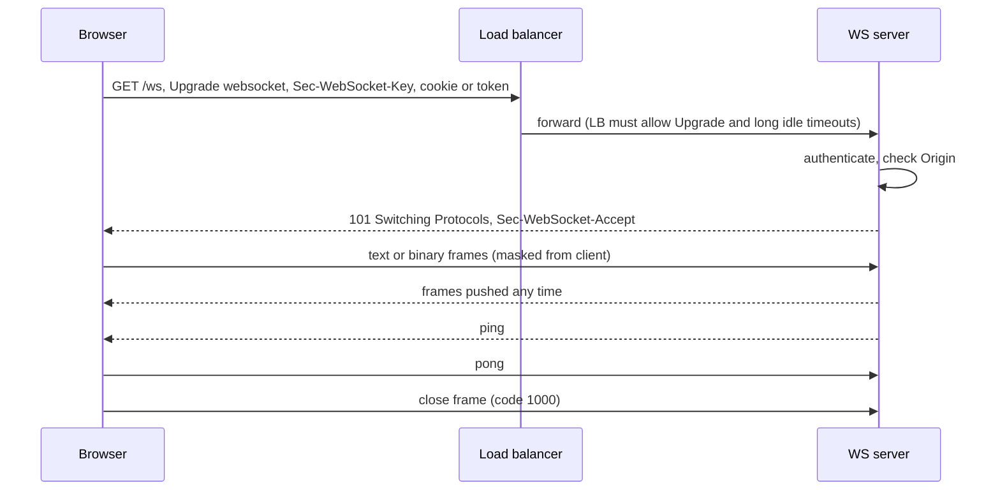

Key details:
- `Sec-WebSocket-Accept` = base64(SHA-1(key + fixed GUID)). It proves the server speaks WebSocket and is **not** authentication.
- Use `wss://` (TLS) always. Corporate proxies break plain `ws://`.
- **Authenticate at the handshake** (cookie, or short-lived token in a query param or first message) and **check `Origin`** to stop cross-site WebSocket hijacking.
- **Heartbeats** (ping/pong every 20–30 s) detect dead peers and keep NAT/LB idle timers alive.
- Proxies and LBs need Upgrade support and idle timeouts longer than the heartbeat interval.

#### Example
A trading app streams prices over `wss://`. Users on mobile networks kept "freezing": a carrier NAT dropped idle mappings after 60 s and neither side noticed for minutes. Adding a 25 s server ping and closing connections that miss two pongs made the client reconnect in under a minute instead of silently going stale. The client resubscribes and asks for a snapshot after every reconnect.

#### Trade-offs
Lowest latency and bidirectional, but stateful connections complicate load balancing and deploys, need custom auth/reconnect/backpressure logic, and some networks block them.

#### Problems & fixes
| Symptom | Cause | Fix |
|---|---|---|
| Connections drop every 60 s | LB/proxy idle timeout | heartbeat under the timeout, raise LB idle timeout |
| Clients look connected but get nothing | half-open TCP after network change | ping/pong with deadline, client-side watchdog |
| Another site opens sockets as your user | no Origin check, cookie auth | validate Origin, CSRF-style token at handshake |
| Messages lost on reconnect | no resume protocol | sequence numbers, resume-from-offset or snapshot on reconnect |
| Deploys disconnect everyone at once | hard kill of WS servers | drain: stop accepting, send close with reconnect hint, jittered client backoff |

#### Cheat sheet
- HTTP GET + Upgrade → 101 → framed full-duplex over the same TCP.
- wss only. Auth + Origin check at handshake.
- Ping/pong 20–30 s. Reconnect with jittered backoff + resume.

#### Interview questions
<details><summary>How do you authenticate a WebSocket connection?</summary>

At the handshake: browsers can't set custom headers on WebSocket requests, so use a session cookie (plus an Origin check, since cookies are sent cross-site) or a short-lived signed token in the query string or the first message, validated before subscribing to anything. Re-check authorization per subscription (user may only join their own channels), and expire long-lived connections or re-validate when the token would expire.
</details>

<details><summary>Users report a chat that "stops updating" without any error. What's going on and how do you fix it?</summary>

Likely half-open connections: the network path died (Wi-Fi switch, NAT timeout) but neither TCP endpoint got a FIN, so the client thinks it's connected. Fix with application-level heartbeats (server ping every ~25 s, close on missed pongs; client watchdog that reconnects if no message or pong within a deadline), then reconnect with backoff and resume from the last seen sequence number so missed messages are replayed.
</details>

#### Interview angle
> "Clients upgrade to wss with a short-lived token and an Origin check. Heartbeats every 25 s catch half-open sockets, and reconnects resume from the last sequence number so nothing is silently missed."

#### Sources
- [The WebSocket protocol (RFC 6455)](https://www.rfc-editor.org/rfc/rfc6455) — IETF
- [Writing WebSocket servers](https://developer.mozilla.org/en-US/docs/Web/API/WebSockets_API/Writing_WebSocket_servers) — MDN

### WebSocket scalability — fan-out via Redis Pub/Sub across multiple WebSocket server instances
Each WebSocket server only knows its own connections. When user A on server 1 messages a room that has users on servers 2 and 3, the message must be **fanned out across instances**. The common pattern is a **pub/sub backplane** (Redis Pub/Sub, Redis Streams, NATS, Kafka): every server subscribes to the channels its connected users care about and pushes received messages to the local sockets.

#### Intuition
Several post offices, each knowing only its own customers. To reach someone at another office, you put the letter on a shared conveyor belt that every office watches, and each office delivers to its own people.

#### Must know
- Each server knows **only its own connections**.
- A **pub/sub backplane** (Redis, NATS, Kafka) carries messages between servers.
- Every server subscribes for the rooms its users are in and pushes to its local sockets.
- **Save the message first, then publish.** Pub/sub keeps nothing for offline users.
- Use sequence numbers, so a reconnecting client can fetch what it missed.

#### Numbers to quote
- One tuned server holds roughly 100,000 to 1 million idle connections. Fan-out rate is usually the real limit.

#### Common mistakes
- Relying on pub/sub alone for delivery.
- All clients reconnecting at once after a deploy, with no jittered backoff.
- Unbounded send buffers for slow clients, which eat server memory.

#### How it works
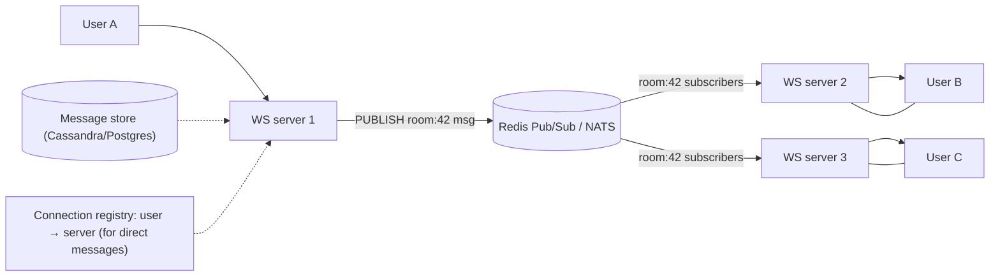

Capacity numbers to quote: one tuned server (epoll, Go/Node/Netty) holds **100k–1M idle connections**, limited by memory (~10–50 KB per connection with buffers) and file descriptors. The real limit is usually **message fan-out rate**, not connection count.

Design points:
- Persist first (message store), then publish. Pub/sub is fire-and-forget, so offline or reconnecting users read history from the store.
- Subscribe per room/channel only on servers that have members, or shard channels across several Redis nodes (Redis Cluster sharded pub/sub).
- Very large rooms (live events with 1M viewers): batch and sample, use a tree of fan-out nodes, or degrade to periodic polling of a cached snapshot.
- L4 or L7 LB with least-connections. Sticky sessions aren't needed once state lives in the backplane.

#### Example
A chat app with 2M concurrent users runs 20 WS nodes (~100k sockets each). A message is written to Cassandra with a per-room sequence number, then published to `room:{id}` on a sharded Redis cluster. Only nodes with members of that room are subscribed. On reconnect, clients send their last sequence number and the node backfills from Cassandra. During a celebrity AMA (300k members in one room), they switched that room to batched delivery every 500 ms to keep fan-out bounded.

#### Trade-offs
Horizontal scaling with simple servers, but pub/sub adds a hop and doesn't guarantee delivery, hot channels concentrate load, and per-server subscription management gets complex.

#### Problems & fixes
| Symptom | Cause | Fix |
|---|---|---|
| Messages missing after reconnect | pub/sub is at-most-once | store first, sequence numbers, backfill on reconnect |
| One Redis node at 100% CPU | hot channel / single pub/sub node | sharded pub/sub, per-room sharding, batch hot rooms |
| Reconnect storm after deploy kills backend | all clients reconnect together | drain gradually, jittered backoff, connection rate limits |
| Slow clients bloat server memory | unbounded per-socket send buffers | bounded queues, drop or disconnect slow consumers |

#### Cheat sheet
- Servers are stateless about routing; backplane (Redis/NATS/Kafka) fans out.
- Persist → publish. Sequence numbers + backfill.
- Connections are cheap; fan-out and reconnect storms are the real limits.

#### Interview questions
<details><summary>How would you scale a chat system to 10 million concurrent WebSocket connections?</summary>

~100 WS gateway nodes at ~100k connections each behind an L4 LB, stateless except for their sockets. A connection registry (user → gateway) in Redis for direct messages, and sharded pub/sub (or Kafka partitions by room) for group fan-out. Messages are persisted with per-conversation sequence numbers before being published. Clients reconnect with jittered backoff and resume from their last sequence number. Bound per-connection queues, and handle huge rooms with batching or sampling.
</details>

<details><summary>Why is Redis Pub/Sub alone not enough for reliable messaging?</summary>

Redis Pub/Sub delivers only to currently connected subscribers and keeps nothing: if a gateway restarts or a client is mid-reconnect, those messages are gone. Reliability comes from writing to a durable store or log (database, Redis Streams, Kafka) with sequence numbers and letting clients catch up from the last acknowledged offset. Pub/sub is just the low-latency notification path.
</details>

#### Interview angle
> "Gateways only hold sockets. Messages are persisted with sequence numbers, then fanned out over sharded pub/sub. Clients backfill gaps on reconnect, and huge rooms switch to batched delivery."

#### Sources
- [Redis Pub/Sub](https://redis.io/docs/latest/develop/pubsub/) — Redis docs
- [Core NATS](https://docs.nats.io/learn/core-nats/) — NATS docs

### Server-Sent Events — HTTP streaming, server pushes events, client auto-reconnects; simpler than WebSocket
Server-Sent Events (SSE) is a **one-way, server-to-client** stream over a normal HTTP response with `Content-Type: text/event-stream`. The browser's `EventSource` API parses events, **reconnects automatically**, and sends `Last-Event-ID` so the server can resume. It works through ordinary HTTP infrastructure and is ideal for feeds, notifications, progress and LLM token streaming.

#### Intuition
A radio broadcast over an ordinary web request. The server keeps talking and the browser keeps listening. If the signal drops, the browser tunes back in by itself and says where it stopped.

#### Must know
- A **one-way stream from server to client** over a normal HTTP response.
- The browser's `EventSource` **reconnects automatically**.
- It sends `Last-Event-ID` on reconnect, so the server can **resume**.
- It works through ordinary HTTP infrastructure and is simpler than WebSocket.
- Good for notifications, live feeds, progress updates and LLM token streams.

#### Numbers to quote
- On HTTP/1.1 browsers allow about 6 connections per origin. HTTP/2 removes that limit.

#### Common mistakes
- A proxy that buffers the response, so events arrive in bursts.
- No event ids, so nothing can be replayed after a reconnect.
- Choosing it when the client also needs to send frequent messages.

#### How it works
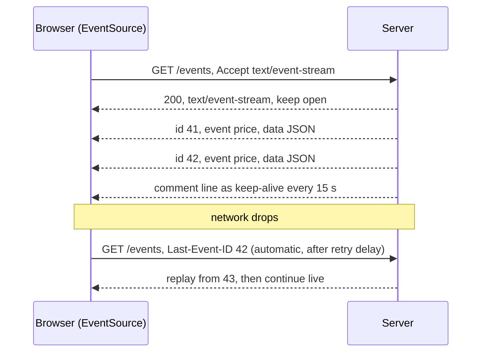

Wire format:
```
id: 42
event: order-status
data: {"orderId":"o-77","status":"OUT_FOR_DELIVERY"}

```

Notes:
- Text only (UTF-8). Send binary as base64 or use WebSocket.
- Over **HTTP/1.1** browsers allow ~6 connections per origin, so many tabs can exhaust them; **HTTP/2** multiplexes and removes the problem.
- Disable proxy buffering (`X-Accel-Buffering: no` on Nginx) and compression buffering so events flush immediately.
- Client-to-server traffic uses normal HTTP requests.

#### Example
A food-delivery app shows order status and rider ETA. They replaced 5-second polling with SSE: `GET /orders/{id}/events` streams status changes with ids, and the browser reconnects with `Last-Event-ID` after network drops. Server load fell ~80% because idle requests disappeared. The first rollout showed events arriving in bursts of 30 seconds, traced to Nginx response buffering, fixed with `proxy_buffering off` for that route.

#### Trade-offs
Simple, HTTP-native, auto-reconnect with resume, but one direction only, text-only, per-origin connection limits on HTTP/1.1, and still a long-lived connection per client on the server.

#### Problems & fixes
| Symptom | Cause | Fix |
|---|---|---|
| Events arrive in bursts | proxy/gzip buffering | disable buffering for the route, flush per event |
| New tabs hang loading | 6-connection limit on HTTP/1.1 | HTTP/2, share one stream across tabs (BroadcastChannel/SharedWorker) |
| Events lost on reconnect | no ids or replay buffer | send `id:`, keep a short replay log keyed by id |
| Connection killed after 60 s idle | LB idle timeout | comment-line keep-alives every 15–30 s |

#### Cheat sheet
- `text/event-stream`, `EventSource`, auto-reconnect, `Last-Event-ID` resume.
- Server → client only. Use HTTP/2. Turn off proxy buffering.
- Great for notifications, dashboards, LLM token streams.

#### Interview questions
<details><summary>SSE or WebSocket for a live notifications feed? Justify.</summary>

SSE: traffic is server-to-client, it runs over plain HTTP (works with existing auth, proxies, HTTP/2 and observability), and the browser handles reconnection and resume via `Last-Event-ID` for free. Occasional client actions (mark as read) are normal POSTs. WebSocket is worth its extra complexity when the client sends frequent messages too (chat typing, games, collaborative editing) or needs binary frames.
</details>

<details><summary>How would you ensure a client doesn't miss events during a reconnect?</summary>

Give every event a monotonically increasing id (per stream or per user), keep a bounded replay buffer (Redis Stream or a recent-events table), and when the client reconnects with `Last-Event-ID`, replay everything after that id before switching to live events. If the id is too old for the buffer, tell the client to fetch a full snapshot first.
</details>

#### Interview angle
> "For one-way live updates I'd pick SSE over HTTP/2: ids on every event, a short Redis replay buffer for Last-Event-ID resume, keep-alive comments, and buffering disabled at the proxy."

#### Sources
- [Using server-sent events](https://developer.mozilla.org/en-US/docs/Web/API/Server-sent_events/Using_server-sent_events) — MDN
- [Server-sent events](https://html.spec.whatwg.org/multipage/server-sent-events.html) — HTML Living Standard

### Long polling — client holds connection (30s timeout) until event; reconnects immediately after response
Long polling emulates push over plain request/response: the client sends a request, the server **holds it open** until there is new data or a timeout (~25–30 s), responds, and the client **immediately sends the next request**. It works everywhere (old browsers, strict proxies) and is the classic fallback when WebSocket or SSE aren't available.

#### Intuition
Asking "anything new?" and the other person staying silent until there is something to say, or until half a minute passes. Then you ask again straight away.

#### Must know
- The client sends a request and the server **holds it open** until there is data or a timeout.
- The client **immediately sends the next request**.
- It works everywhere, so it is the classic **fallback** when WebSocket and SSE are blocked.
- A **cursor** (`since=`) prevents missing events between requests.
- The server must be **asynchronous**, or held requests use up all its threads.

#### Numbers to quote
- Hold for about 25–30 seconds, and keep that below every proxy timeout on the path.

#### Common mistakes
- A thread-per-request server holding thousands of idle polls.
- No cursor, so events between two polls are lost.
- A hold time longer than a proxy timeout, which gives random 504 errors.

#### How it works
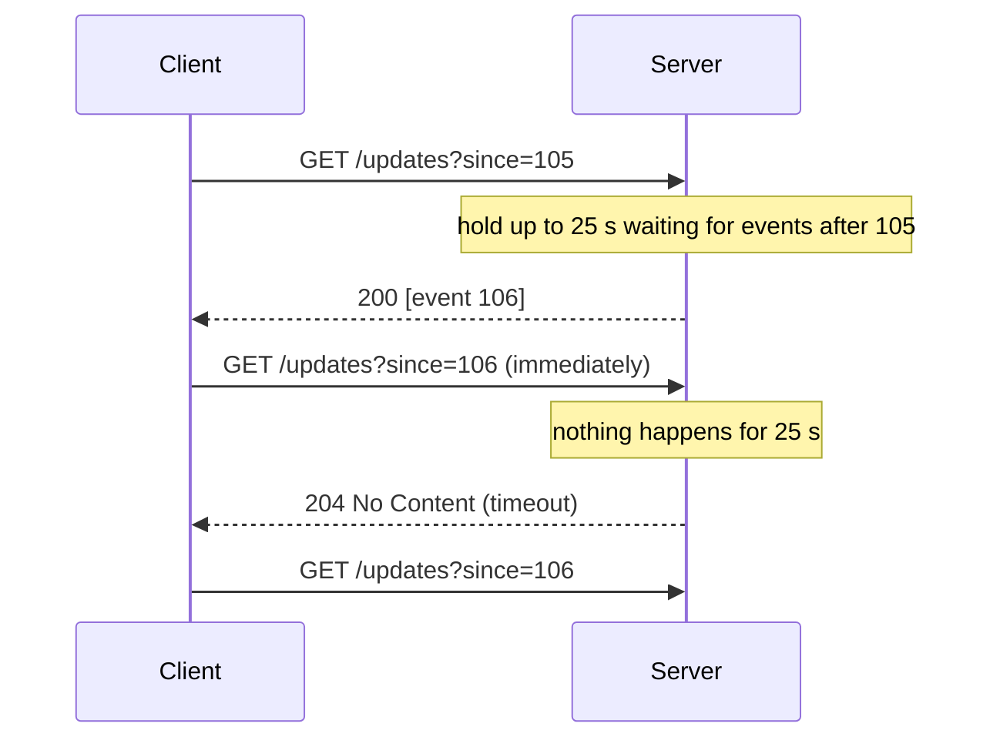

Compared with short polling (ask every N seconds) it delivers events within milliseconds and wastes far fewer empty requests. Compared with SSE/WebSocket it pays one request plus headers per event batch and has a tiny gap between responses (covered by the `since` cursor).

Implementation needs:
- A **cursor** (`since=` offset) so events between polls aren't lost.
- **Async servers** (Node, Go, Netty, async servlets). Thread-per-request servers run out of threads holding idle requests.
- Server timeout shorter than every proxy/LB timeout in the path.
- Return **batches** if several events arrived.

#### Example
A payments dashboard behind a bank's strict corporate proxy couldn't use WebSockets. Long polling with `GET /payments/updates?since={cursor}` held for 25 s on an async Go server, returning batched events. Each server handled ~50k waiting requests. An earlier Tomcat version with a 200-thread pool collapsed at 200 users until they switched to async request handling.

#### Trade-offs
Universal compatibility and simple semantics, but more overhead per message than streaming, holding requests needs async servers, and high event rates turn into near-constant polling.

#### Problems & fixes
| Symptom | Cause | Fix |
|---|---|---|
| Server stops accepting requests | threads blocked holding polls | async/non-blocking handlers |
| Gateway 504s randomly | hold time exceeds proxy timeout | server timeout below the smallest proxy timeout |
| Events lost between polls | no cursor | `since=` offset, server returns everything after it |
| Thundering herd after outage | all clients repoll at once | jittered retry backoff on errors |

#### Cheat sheet
- Hold request until data or ~25 s timeout, client repolls immediately.
- Cursor (`since`) prevents gaps. Batch events. Async server.
- Fallback when WebSocket/SSE are blocked.

#### Interview questions
<details><summary>Short polling vs long polling vs SSE vs WebSocket: how do you choose?</summary>

Short polling for infrequent, non-urgent updates where simplicity wins (refresh every minute). Long polling when you need near-instant delivery but only plain request/response works through the network. SSE for one-way server push over HTTP with auto-reconnect. WebSocket for frequent bidirectional messaging or binary data. Many systems negotiate: try WebSocket, fall back to SSE or long polling (as Socket.IO does).
</details>

<details><summary>Why can long polling take down a thread-per-request server, and what's the fix?</summary>

Each held request occupies a worker thread for up to the full timeout while doing nothing, so concurrent waiting clients quickly exhaust the pool and new requests queue or fail. Use non-blocking servers (event loop or async servlet/coroutine handlers) that park waiting requests cheaply in memory and resume them when an event or timeout fires.
</details>

#### Interview angle
> "Long polling is my compatibility fallback: async handlers, a since-cursor so nothing is missed, batched responses, and a hold time under every proxy timeout."

#### Sources
- [Known issues and best practices for the use of long polling and streaming in bidirectional HTTP (RFC 6202)](https://www.rfc-editor.org/rfc/rfc6202) — IETF
- [Long polling](https://javascript.info/long-polling) — javascript.info

### Real-time presence system — heartbeat every 30s with TTL=60s in Redis; expire = offline; publish change via Pub/Sub
Presence ("online", "last seen", "typing") is soft state: clients **heartbeat** every ~30 s, the server records the user in Redis with a **TTL of ~60 s** (two missed beats), and an expired key means **offline**. State changes are **published** to the user's contacts or room via pub/sub. It's deliberately eventually consistent: a few seconds of staleness is fine; correctness at huge fan-out matters more.

#### Intuition
A sign-in sheet that erases your name unless you tick it again every half minute. Nobody has to notice you leaving. If the ticks stop, your name simply disappears.

#### Must know
- Clients send a **heartbeat**. The server stores "online" with a **short TTL**.
- If the key expires, the user is **offline**. No logout message is needed.
- **Publish only changes** (offline → online), never every heartbeat.
- Send presence only to people who are actually looking at that user.
- Presence is approximate by design. A few seconds of staleness is fine.

#### Numbers to quote
- Heartbeat every 30 seconds with a 60-second TTL (two missed beats means offline).

#### Common mistakes
- Relying on an explicit "I am offline" message, which a crash never sends.
- Notifying every contact on every change.
- No grace period, so users on flaky mobile networks flicker on and off.

#### How it works
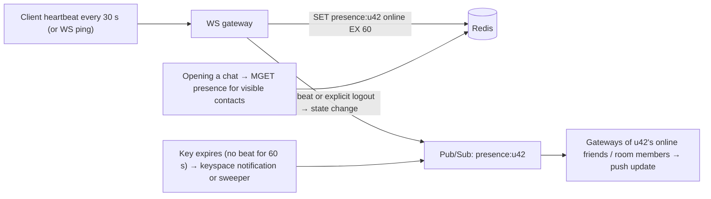

Scale tricks:
- **Publish only transitions** (offline → online), never every heartbeat.
- **Don't fan out to every contact**: send presence only for contacts currently visible on screen, or fetch lazily when a chat opens. For 1,000-member groups, show a count.
- **Debounce flapping** (mobile reconnecting): wait a few seconds before announcing offline.
- Store "last seen" timestamp separately for the "last seen 5 min ago" display.
- Keyspace notifications are best-effort; a periodic sweeper of a sorted set (score = last beat) is more reliable for expiry events.

#### Example
A messaging app with 50M daily users: each WS gateway writes `presence:{user}` with EX 60 on connect and on every 30 s ping. Transitions publish to `presence:{user}`, and gateways subscribe only for users that some connected client is currently viewing. Flapping on mobile caused contacts' screens to flicker online/offline, fixed by a 10 s grace period before publishing offline.

#### Trade-offs
Cheap and scalable with natural crash cleanup (TTL), but presence is approximate (up to the TTL stale), and naive fan-out to every contact costs O(friends) writes per change.

#### Problems & fixes
| Symptom | Cause | Fix |
|---|---|---|
| Redis overloaded by presence traffic | publishing every heartbeat | publish transitions only |
| Users flicker online/offline | mobile reconnects | grace period/debounce before offline |
| Ghost "online" users | crash without logout | TTL expiry, short TTL |
| Fan-out explosion for big groups | notify all members | lazy fetch for visible users, counts for large groups |

#### Cheat sheet
- Heartbeat 30 s, `SET … EX 60`; expired = offline.
- Publish transitions only. Debounce offline. Fan out to viewers, not all contacts.
- Presence is soft, eventually consistent state.

#### Interview questions
<details><summary>Design "online" indicators for a chat app with 100M users.</summary>

Gateways track connections and refresh a Redis key per user with a short TTL on each heartbeat. Transitions (connect, explicit logout, TTL expiry via a sweeper) are published on per-user channels. Clients subscribe only to presence for contacts currently visible, and fetch current state with MGET when a list opens. Debounce offline transitions, store last-seen separately, shard Redis by user id, and accept a few seconds of staleness.
</details>

<details><summary>Why use TTLs rather than explicit "set offline" on disconnect?</summary>

Disconnects aren't reliable: phones lose signal, apps get killed, gateways crash, and no logout message is ever sent. A TTL refreshed by heartbeats makes absence the default: if no beat arrives within the window, the user expires to offline automatically, no matter how the connection died. Explicit logout can still set offline immediately as an optimisation.
</details>

#### Interview angle
> "Presence is soft state: heartbeats refresh a 60 s TTL, only transitions get published, offline is debounced for flaky mobiles, and updates go only to clients actually viewing that user."

#### Sources
- [EXPIRE](https://redis.io/docs/latest/commands/expire/) — Redis command reference
- [Redis Pub/Sub](https://redis.io/docs/latest/develop/pubsub/) — Redis docs

### Live leaderboard — Redis sorted set: ZADD adds score, ZRANGE gets rank, ZRANK gets position; push via WebSocket
Redis **sorted sets** keep members ordered by score in a skip list, giving **O(log N)** updates and rank lookups. That makes them the standard tool for live leaderboards: `ZADD`/`ZINCRBY` to update a score, `ZREVRANGE … WITHSCORES` for the top N, `ZREVRANK` for a player's position, with changes pushed to clients via WebSocket or SSE.

#### Intuition
A scoreboard that re-sorts itself the instant any score changes. You can ask for the top ten or for any one player's position, and both answers come back at once.

#### Must know
- A Redis **sorted set** keeps members ordered by score.
- `ZADD` / `ZINCRBY` update a score. `ZREVRANGE` returns the top N. `ZREVRANK` returns one player's rank.
- All of these are **O(log N)**.
- Use one key per period (daily, weekly) with a TTL.
- **Redis is the serving index, not the source of truth.** Keep a durable log of score events.

#### Common mistakes
- No tie-break rule, so players with equal scores are ordered arbitrarily.
- Pushing an update to clients on every single score change.
- Redis as the only copy, so a failover loses the board.

#### How it works
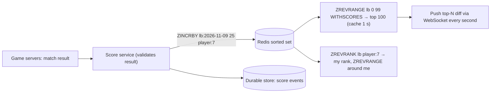

```
ZINCRBY lb:daily 25 player:7          # O(log N)
ZREVRANGE lb:daily 0 9 WITHSCORES     # top 10
ZREVRANK lb:daily player:7            # 0-based rank
ZREVRANGE lb:daily 1180 1200          # neighbours around rank 1190
EXPIRE lb:daily 172800                # rolling period keys
```

Design notes:
- **Ties**: encode a tie-breaker in the score (e.g. `score * 1e10 + (MAX_TS - achieved_at)`) so earlier achievers rank higher.
- **Periods**: separate keys per day/week/season with TTLs; union with `ZUNIONSTORE` for aggregates.
- **Huge boards** (100M players): one sorted set (~100 bytes per member → ~10 GB) is OK on one node, but writes concentrate; shard by score range or region, or show exact rank for the top and **approximate percentiles** for the long tail.
- Redis is the serving index; the score event log in a DB is the source of truth for rebuilds and anti-cheat.
- Push **throttled diffs** (once per second), not every score change.

#### Example
A mobile game with 20M players and 5k score updates/s: `ZINCRBY` on daily, weekly and all-time keys in a pipelined call, top-100 cached for 1 s and pushed to viewers over WebSocket, "my rank" served directly via `ZREVRANK`. A Redis failover lost 2 s of updates; they rebuilt the affected keys by replaying the score events table.

#### Trade-offs
Simple, fast and exact for most scales, but memory-bound in one key, cross-shard global ranks are hard, and Redis is not the system of record.

#### Problems & fixes
| Symptom | Cause | Fix |
|---|---|---|
| Ties ordered arbitrarily | equal scores sort by member name | composite score with timestamp tie-break |
| Hot key saturates one Redis node | single global sorted set | replicas for reads, shard by region/range, approximate tail ranks |
| Clients flooded with updates | push on every change | throttle to 1 s diffs of top N |
| Leaderboard lost after failover | Redis as source of truth | durable score log, rebuild job |

#### Cheat sheet
- Sorted set: ZADD/ZINCRBY, ZREVRANGE top N, ZREVRANK position, all O(log N).
- Composite scores for ties. Per-period keys with TTL.
- Push throttled diffs. Durable event log for rebuilds.

#### Interview questions
<details><summary>How would you show a player their exact rank among 100 million players?</summary>

One Redis sorted set handles it (`ZREVRANK` is O(log N), ~10 GB memory), with read replicas for rank queries. If write volume or memory outgrows one node, shard by score buckets and keep a small count-per-bucket index: rank = players in higher buckets + rank within the player's bucket. Often the product only needs exact ranks for the top ~10k and a percentile ("top 3%") for everyone else, which is much cheaper.
</details>

<details><summary>How do you break ties so the player who reached a score first ranks higher?</summary>

Fold time into the score: score = points × 10^10 + (MAX_TIMESTAMP − achieved_at_seconds). Higher points dominate, and for equal points the earlier achievement gets a larger fractional part. Mind double precision (53 bits of integer accuracy), and keep the true points in a separate field for display.
</details>

#### Interview angle
> "The leaderboard is a Redis sorted set per period: ZINCRBY on writes, ZREVRANK for my rank, composite scores for ties, a throttled top-N push, and a durable score log to rebuild after failover."

#### Sources
- [Redis sorted sets](https://redis.io/docs/latest/develop/data-types/sorted-sets/) — Redis docs
- [ZREVRANK](https://redis.io/docs/latest/commands/zrevrank/) — Redis command reference

### Real-time collaborative editing — OT (Operational Transformation, Google Docs) vs CRDT (conflict-free, Figma, Notion)
Collaborative editors let several people edit the same document simultaneously with local, instant edits. Concurrent operations must **converge** to the same result everywhere. **Operational Transformation (OT)** transforms each incoming operation against concurrent ones, usually through a central server that orders operations (Google Docs). **CRDTs** (conflict-free replicated data types) give every element a unique, ordered identity so operations commute and merge in any order without a central arbiter (Yjs, Automerge; Figma uses a CRDT-inspired, server-authoritative model).

#### Intuition
Two people editing the same sentence at once. OT has a referee who adjusts each edit to account for the other. A CRDT gives every character a permanent name tag, so edits can be merged in any order and still agree.

#### Must know
- Each user's edits apply **locally at once**, and all copies must **converge** to the same result.
- **OT** transforms each operation against concurrent ones, usually with a central server ordering them.
- A **CRDT** gives elements unique ids, so operations merge in any order with no central arbiter.
- CRDTs support offline and peer-to-peer use, but carry more metadata.
- Store an operation log plus periodic snapshots.

#### Common mistakes
- Writing your own transform logic when a proven library exists.
- Loading a document by replaying its entire history.
- CRDT tombstones that grow forever with no compaction.

#### How it works
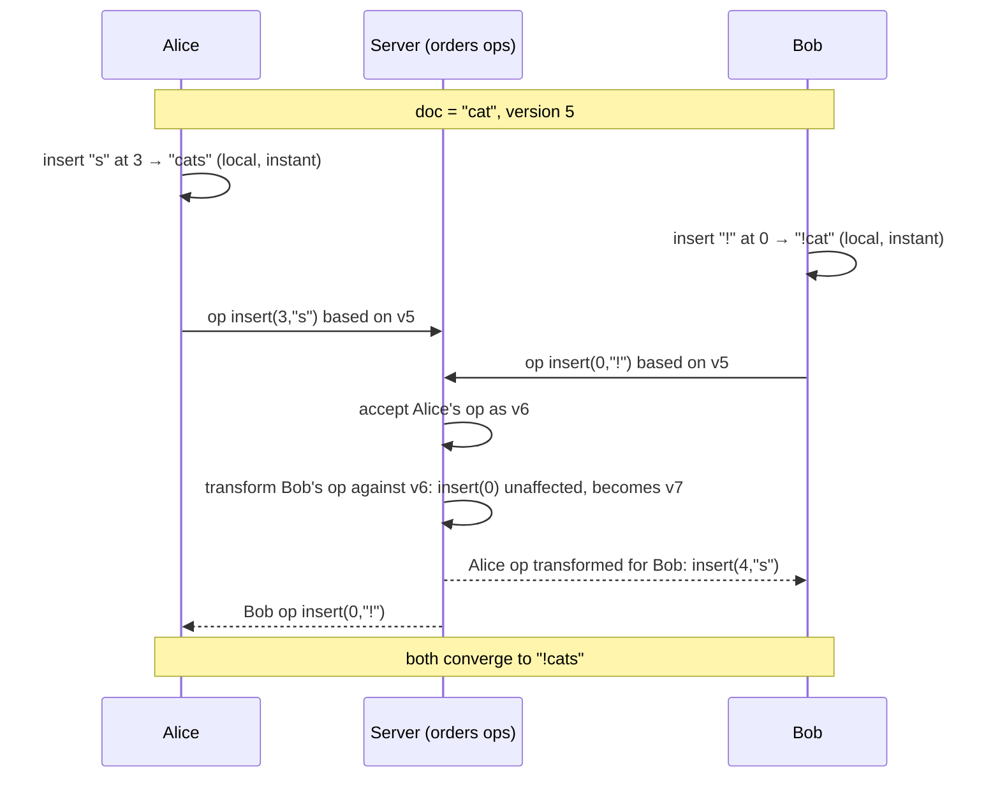

| | OT | CRDT |
|---|---|---|
| Convergence | transform functions over concurrent ops | commutative ops on uniquely identified elements |
| Topology | central server ordering (practical) | peer-to-peer, offline-first possible |
| Metadata | small | per-character ids/tombstones (needs compaction) |
| Complexity | transform correctness is notoriously hard | data structure is complex, merge is simple |
| Examples | Google Docs, Etherpad | Yjs, Automerge, Notion-style blocks, Apple Notes |

Other parts of the system: a WebSocket session per document, an **operation log** plus periodic **snapshots** for loading, presence and cursors (ephemeral), undo per user, and permissions checked on every op.

#### Example
A whiteboard startup chose Yjs (a CRDT): clients edit offline on a flight and merge on reconnect. A sync server relays updates per document room and persists merged state to Postgres every few seconds plus an update log. Documents that had been edited for months grew large from tombstones until they enabled garbage collection and periodic snapshot compaction.

#### Trade-offs
OT keeps metadata small but depends on a central server and very careful transform logic. CRDTs support offline and peer-to-peer and merge simply, but carry metadata overhead and can produce semantically surprising (though convergent) merges.

#### Problems & fixes
| Symptom | Cause | Fix |
|---|---|---|
| Documents diverge between users | buggy transform functions | proven library (ShareDB, Yjs), property-based convergence tests |
| Large docs load slowly | replaying the entire op log | periodic snapshots + tail of ops |
| CRDT state grows forever | tombstones | GC, snapshot compaction |
| Hot document overloads one server | all editors on one room | route a document to one node (consistent hashing), limit editors, shard by section |

#### Cheat sheet
- Goal: local-first edits + convergence. OT = transform with central ordering. CRDT = commutative merges.
- Op log + snapshots, presence/cursors as ephemeral state.
- Use a proven library; test convergence with randomized concurrent ops.

#### Interview questions
<details><summary>Design the backend for a Google-Docs-like editor.</summary>

Clients apply edits locally and send operations over WebSocket to the document's session server (route all editors of a document to the same node via consistent hashing). The server assigns a version, transforms concurrent ops (OT) or merges updates (CRDT), appends to a durable op log, and broadcasts to other editors. Snapshots every N ops speed up loading. Presence and cursors go through a separate, ephemeral channel. Permissions are checked per op, and the server handles reconnects by sending ops since the client's last version.
</details>

<details><summary>When would you choose a CRDT over OT?</summary>

When offline editing or peer-to-peer sync matters (mobile, local-first apps), when you want to avoid a single ordering server per document, or when your data model is more like structured objects (blocks, shapes) than a single text stream. OT is reasonable when you already have a central server per document and want minimal metadata.
</details>

#### Interview angle
> "Edits apply locally and sync over WebSocket to a per-document session server that orders and transforms them (OT), or merges them with a CRDT like Yjs if offline matters, with an op log plus snapshots for fast loads."

#### Sources
- [Yjs documentation](https://docs.yjs.dev/) — Yjs
- [Conflict-free replicated data types](https://crdt.tech/) — crdt.tech
- [How Figma's multiplayer technology works](https://www.figma.com/blog/how-figmas-multiplayer-technology-works/) — Figma blog

### Online gaming — authoritative server model, UDP for state updates, client-side prediction + reconciliation
Fast multiplayer games keep an **authoritative server** that simulates the game at a fixed **tick rate** (e.g. 30–128 Hz) and is the only source of truth, which prevents most cheating. Clients send **inputs** (not positions) over **UDP**, apply them immediately with **client-side prediction**, and later **reconcile** with the server's authoritative state. Other players are shown with **interpolation**, and the server uses **lag compensation** for hit detection.

#### Intuition
A referee who alone decides what really happened. Players do not wait for the whistle to move. They act straight away and get nudged back if the referee disagrees.

#### Must know
- The **server is authoritative**: it runs the simulation and is the only source of truth.
- Clients send **inputs, not positions**, which blocks most cheating.
- **UDP** is used because an old position is worthless once a newer one exists.
- **Client-side prediction**: apply your own input at once, then **reconcile** with the server's state.
- Other players are drawn slightly in the past and smoothed (interpolation).

#### Numbers to quote
- Typical tick rates are 30–128 updates per second.

#### Common mistakes
- Trusting positions sent by the client.
- TCP for fast state updates, where one lost packet stalls everything behind it.
- Sending the full world state to every player on every tick.

#### How it works
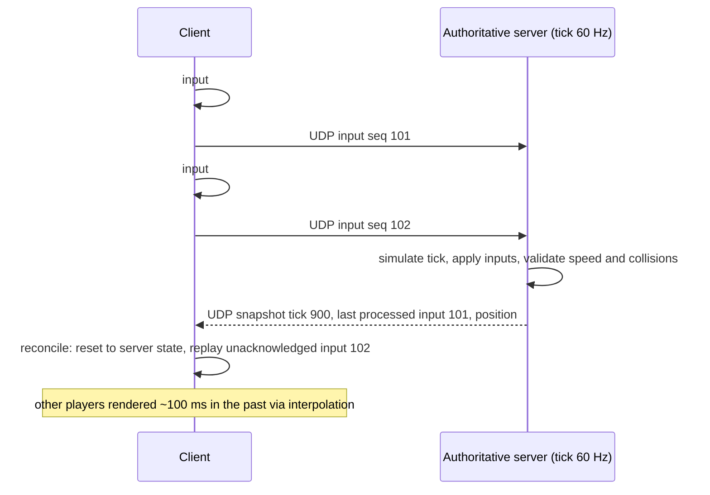

Why UDP: a lost TCP packet blocks all following packets (head-of-line blocking) while it's retransmitted, so stale positions arrive late. Games prefer the newest state over a retransmitted old one. Reliability is added selectively (acks for critical events like "item purchased"); ENet, KCP or QUIC datagrams are common.

Other techniques: **delta compression** of snapshots against the last acked one, **interest management** (only send nearby entities), and matchmaking that places players in regional servers to keep RTT low.

#### Example
A 5v5 shooter runs dedicated servers at 64 ticks per second in each region. Clients predict their own movement, so pressing a key feels instant even at 80 ms RTT. When a speed hack sent impossible positions, nothing happened because the server only accepts inputs and checks speed. Lag compensation rewinds hitboxes to what the shooter saw (up to 200 ms back) so shots on target count.

#### Trade-offs
Responsive feel with server authority, but prediction errors cause visible snapping, lag compensation can make victims feel "shot around corners", dedicated servers per match cost money, and UDP reliability is custom work.

#### Problems & fixes
| Symptom | Cause | Fix |
|---|---|---|
| Rubber-banding | prediction mismatches server | smooth corrections, deterministic movement code shared with server |
| Teleporting cheats | client-authoritative positions | send inputs only, server validates |
| Bandwidth too high with many players | full snapshots to everyone | delta compression, interest management |
| Laggy feel for distant players | far-away servers | regional servers, matchmaking by ping |

#### Cheat sheet
- Server authoritative, fixed tick. Clients send inputs over UDP.
- Prediction + reconciliation for self, interpolation for others, lag compensation for hits.
- Delta snapshots, interest management, regional servers.

#### Interview questions
<details><summary>Why do fast-paced games use UDP instead of TCP?</summary>

TCP guarantees in-order delivery, so a single lost packet stalls everything behind it until it's retransmitted (head-of-line blocking), adding latency spikes exactly when the network is bad. In a game, an old position is worthless once a newer one exists. UDP delivers what arrives immediately, and the game adds reliability only for messages that need it.
</details>

<details><summary>How does client-side prediction with reconciliation work?</summary>

The client applies its own inputs immediately and keeps a buffer of inputs with sequence numbers. Server snapshots include the last input sequence processed. On receipt, the client resets its state to the server's authoritative state, discards acknowledged inputs, and re-applies the still-unacknowledged ones. If prediction was right there's no visible change; otherwise there's a small correction, smoothed visually.
</details>

#### Interview angle
> "The server is authoritative at a fixed tick. Clients send inputs over UDP, predict and reconcile their own movement, interpolate others, and the server rewinds for lag-compensated hits."

#### Sources
- [Fast-paced multiplayer: client-server game architecture](https://www.gabrielgambetta.com/client-server-game-architecture.html) — Gabriel Gambetta
- [What every programmer needs to know about game networking](https://gafferongames.com/post/what_every_programmer_needs_to_know_about_game_networking/) — Glenn Fiedler
- [Source multiplayer networking](https://developer.valvesoftware.com/wiki/Source_Multiplayer_Networking) — Valve developer wiki

### Real-time location tracking — GPS → WebSocket → geospatial index (Redis GEO or Quadtree) → nearby query
Ride-hailing and delivery apps track hundreds of thousands of moving devices: drivers send GPS updates every few seconds over a persistent connection, the backend keeps **only the latest position** in an in-memory **geospatial index** (Redis GEO, geohash/H3 cells, or an in-memory quadtree), and serves **nearby queries** ("drivers within 2 km") and live location to riders. History goes to a log for analytics.

#### Intuition
A control-room map covered in moving pins. Only the newest position of each pin matters. Old positions are swept into a logbook, and "who is near this point?" is answered by looking at the map, not the logbook.

#### Must know
- Devices send GPS updates every few seconds over a persistent connection.
- Keep **only the latest position** in an in-memory geospatial index.
- Send location **history** to a log (Kafka) for analytics.
- A nearby query finds candidates by radius, then **ranks them by real travel time**.
- Shard the index by city or cell, and expire drivers who stop reporting.

#### Numbers to quote
- 500,000 drivers × one update every 4 seconds = 125,000 writes per second.

#### Common mistakes
- Writing every GPS update to a relational database.
- Matching by straight-line distance across a river or a one-way road.
- Stale drivers left in the index after they go offline.

#### How it works
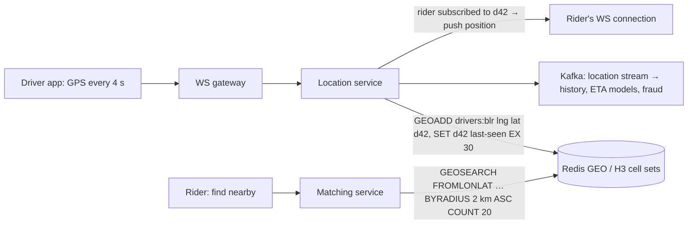

Numbers: 500k active drivers × 1 update / 4 s = **125k writes/s**. Each update is tiny, so the challenge is write rate, not storage. Shard the index by city or geographic cell.

Design notes:
- Store current position only in the hot index; drop stale drivers via TTL on a last-seen key or periodic cleanup (GEO members don't expire on their own).
- **H3/geohash cells**: keep a set per cell, query the cell plus neighbours (k-ring), and filter by exact distance.
- Reduce updates with **adaptive frequency** (less often when stationary) and dead reckoning.
- Smooth noisy GPS (Kalman filter, snap to road) before showing it.
- Riders only receive the location of their own assigned driver.

#### Example
A delivery platform in 40 cities: Redis GEO keys per city (`drivers:blr`), sharded across a cluster. Driver apps send updates every 4 s while moving and every 30 s when idle, which cut write volume by 45%. Matching queries the nearest 20 available drivers, then ranks them by road-network ETA rather than straight-line distance.

#### Trade-offs
In-memory indexes are fast and simple, but positions are always slightly stale, write rates are high, straight-line distance misleads (rivers, one-way streets), and city-level sharding can create hot shards.

#### Problems & fixes
| Symptom | Cause | Fix |
|---|---|---|
| Matched driver is across a river | radius on straight-line distance | rank candidates by routing ETA |
| Offline drivers still matched | stale GEO members | last-seen TTL check, cleanup job |
| Index node overloaded in one city | one key per big city | shard by H3 cell, adaptive update rate |
| Map shows driver jumping | noisy GPS | filtering, snap-to-road, interpolation on client |

#### Cheat sheet
- Latest position only in Redis GEO / H3 cells; history to Kafka.
- GEOSEARCH radius → rank by ETA. Shard by city/cell. TTL stale drivers.
- Adaptive update frequency, GPS smoothing.

#### Interview questions
<details><summary>Design "find nearby drivers" for Uber at 500k active drivers.</summary>

Drivers send positions every ~4 s over persistent connections to stateless gateways, which write the latest position into an in-memory geo index sharded by city or H3 cell (125k writes/s spread across shards) and append to Kafka for history. A nearby query searches the rider's cell and neighbouring cells, filters by availability and freshness, takes the closest candidates, and ranks them by road-network ETA. Stale drivers are removed by TTL, and update frequency adapts to movement.
</details>

<details><summary>Why not store driver locations in Postgres with PostGIS?</summary>

PostGIS can run the spatial queries, but 100k+ updates per second of constantly changing positions means heavy write load, index churn and WAL volume for data that's obsolete within seconds. An in-memory index handles the hot "current position" workload cheaply; durable databases store trip records and history asynchronously.
</details>

#### Interview angle
> "Live positions live only in a city-sharded Redis GEO or H3 index with last-seen TTLs, history streams to Kafka, and nearby search fetches candidates by radius then ranks them by real ETA."

#### Sources
- [GEOSEARCH](https://redis.io/docs/latest/commands/geosearch/) — Redis command reference
- [H3: Uber's hexagonal hierarchical spatial index](https://www.uber.com/blog/h3/) — Uber engineering

### Live streaming — RTMP ingest → transcode (FFmpeg) → HLS segmentation → CDN origin → edge → viewer
A live-streaming pipeline takes one broadcaster's feed and delivers it to many viewers: the encoder pushes **RTMP/SRT** to an **ingest** server, **transcoders** (FFmpeg/GPU) produce several renditions, a **packager** cuts them into short **HLS/DASH segments** with playlists, an **origin** serves them, and a **CDN** caches segments at the edge for millions of viewers. Latency is usually 5–30 s (standard HLS) or 2–5 s (LL-HLS/LL-DASH). Interactive sub-second use cases use **WebRTC**.

#### Intuition
A live match sent out as a string of short video files, a few seconds each. Because they are ordinary files, CDN servers around the world can copy and hand them out, so the broadcaster does not serve each viewer directly.

#### Must know
- Pipeline: **ingest → transcode → package → origin → CDN → viewer**.
- The broadcaster pushes one stream. Transcoders produce several quality levels.
- The packager cuts video into **short HTTP segments** with a playlist (HLS or DASH).
- Segments are plain files, so the **CDN does the fan-out** to millions.
- Shorter segments lower the delay but leave less buffer. WebRTC is for sub-second needs.

#### Numbers to quote
- Standard HLS runs 5–30 seconds behind live. Low-latency HLS runs 2–5 seconds behind.

#### Common mistakes
- Pushing video over a WebSocket to every viewer.
- A single ingest path with no backup feed.
- No origin shield, so every CDN edge hits the origin at the start of a big event.

#### How it works
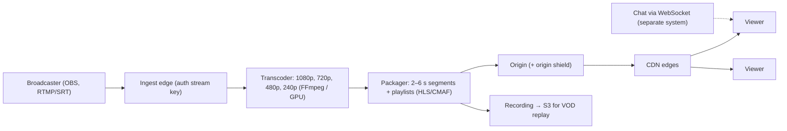

Why HTTP segments: they are just files, so CDNs cache them, and millions of viewers cost the origin almost nothing. One popular segment request per edge (request collapsing) instead of per viewer.

Latency levers: shorter segments and partial segments (LL-HLS), fewer buffered segments on the player, and CMAF chunked transfer. Lower latency means less buffer to absorb network jitter.

#### Example
A sports-streaming service handled a cricket final with 25M concurrent viewers: ingest from the stadium over redundant SRT feeds, cloud GPU transcoding into 6 renditions, 4 s CMAF segments, multi-CDN with an origin shield so each edge only fetched each segment once. Origin egress stayed modest while CDN delivered over 50 Tbps. Stream latency was ~8 s, which they accepted for stability.

#### Trade-offs
HTTP segment delivery scales almost without limit and works on every device, but adds seconds of latency; WebRTC gives sub-second latency but costs far more per viewer to scale. Transcoding is compute heavy.

#### Problems & fixes
| Symptom | Cause | Fix |
|---|---|---|
| Origin melts at start of big event | cache misses from all edges | origin shield, request collapsing, multi-CDN |
| Stream dies when one ingest fails | single ingest path | redundant ingest (primary + backup feeds), failover |
| 30 s delay vs TV | long segments, big player buffer | LL-HLS/CMAF chunks, shorter segments |
| Spoilers in chat before video | chat is real-time, video is delayed | align chat with stream delay or warn |

#### Cheat sheet
- RTMP/SRT ingest → transcode ladder → HLS/DASH segments → origin → shield → CDN.
- Segments are cacheable files, so CDN does the fan-out.
- LL-HLS for 2–5 s latency, WebRTC for sub-second interactive.

#### Interview questions
<details><summary>Design a Twitch-like live streaming platform.</summary>

Broadcasters push RTMP/SRT to regional ingest servers that authenticate stream keys. Transcoders produce an ABR ladder, a packager writes 2–4 s HLS/CMAF segments and playlists, and segments go to an origin fronted by an origin shield and a CDN that serves viewers. Recordings go to object storage for VOD. Chat is a separate WebSocket system with pub/sub fan-out. Viewer counts and analytics flow through an event pipeline. Scale is dominated by CDN egress; transcoding is the main compute cost.
</details>

<details><summary>Why doesn't live video use WebSockets to every viewer?</summary>

Pushing video bytes over millions of individual connections means your servers handle all egress with no caching. Packaging video as HTTP segments lets CDNs cache each segment once per edge and serve millions of viewers from cache, using infrastructure built exactly for that. WebSocket/WebRTC delivery is reserved for small, latency-critical audiences.
</details>

#### Interview angle
> "Ingest over SRT with redundancy, transcode an ABR ladder, package short CMAF segments, and let an origin shield plus multi-CDN do the fan-out. LL-HLS gets us to a few seconds of latency."

#### Sources
- [HTTP Live Streaming (RFC 8216)](https://www.rfc-editor.org/rfc/rfc8216) — IETF
- [HTTP Live Streaming](https://developer.apple.com/streaming/) — Apple Developer

### Adaptive bitrate streaming — HLS/DASH: multiple quality levels; client switches based on bandwidth
Adaptive bitrate (ABR) streaming encodes the same video at several **quality levels** (a "bitrate ladder", e.g. 240p to 4K), each cut into aligned short segments, described by a manifest (**HLS** `.m3u8` or **DASH** `.mpd`). The **player** measures throughput and buffer level and picks the rendition for each next segment, switching up or down seamlessly to avoid stalls.

#### Intuition
A video kept in several sizes, like clothes in S, M, L and XL. Every few seconds the player checks the network and picks the size that will arrive in time, so the picture gets blurrier but does not stop.

#### Must know
- The same video is encoded at **several quality levels** (a bitrate ladder).
- Each level is cut into short segments that line up across levels.
- A **manifest** lists the levels. The **player chooses** the level for each next segment.
- The choice uses measured bandwidth and how much video is buffered.
- Segments must start on **aligned keyframes**, so switches are seamless.

#### Common mistakes
- Starting at the highest quality, which stalls at once on a slow network.
- Switching too eagerly, so quality flickers up and down.
- One ladder for all content, when cartoons need far fewer bits than sport.

#### How it works
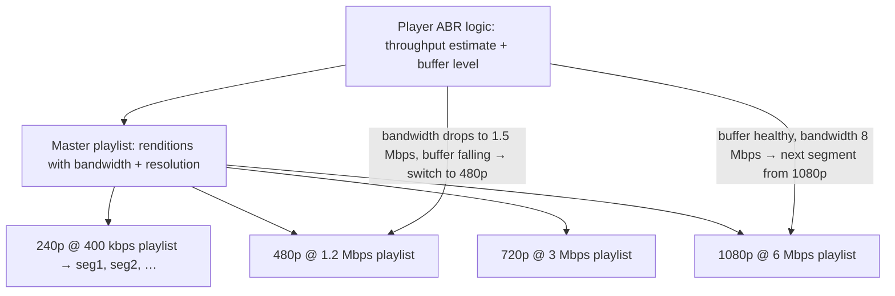

```
#EXTM3U
#EXT-X-STREAM-INF:BANDWIDTH=1200000,RESOLUTION=854x480
480p/index.m3u8
#EXT-X-STREAM-INF:BANDWIDTH=6000000,RESOLUTION=1920x1080
1080p/index.m3u8
```

Details:
- Segments across renditions start on **aligned keyframes**, so switching at any boundary is seamless.
- ABR algorithms: throughput-based, buffer-based (BOLA), or hybrids. Start low for fast startup, then climb.
- **Per-title encoding**: cartoons need fewer bits than sports, so tune the ladder per content.
- Codecs: H.264 everywhere, HEVC/AV1 for better compression where supported. **CMAF** lets HLS and DASH share the same segment files.

#### Example
A video platform found that 12% of mobile sessions stalled. Analysis showed the player started at 1080p and its throughput estimate lagged on 4G. Starting at 480p, adding a buffer-based switching rule, and adding a 360p rung cut rebuffering by 60% while average quality barely changed. Per-title encoding then saved 25% of CDN bandwidth on animated content.

#### Trade-offs
Smooth playback across networks, but multiplies encoding and storage (one copy per rung), and aggressive switching causes visible quality oscillation.

#### Problems & fixes
| Symptom | Cause | Fix |
|---|---|---|
| Frequent rebuffering | starts too high, slow down-switch | start low, buffer-aware ABR |
| Quality flickers up and down | over-reactive switching | hysteresis, smoothed bandwidth estimates |
| Glitches at switches | unaligned keyframes | fixed GOP aligned across renditions |
| Huge storage/CDN costs | one ladder for everything | per-title encoding, modern codecs |

#### Cheat sheet
- Ladder of renditions, aligned segments, manifest (HLS m3u8 / DASH mpd).
- Player chooses per segment from throughput + buffer.
- Aligned keyframes, start low, per-title encoding, CMAF.

#### Interview questions
<details><summary>How does a player decide which quality to download next?</summary>

It estimates available bandwidth from recent segment download times and looks at how many seconds of video are buffered. If the buffer is healthy and throughput comfortably exceeds a higher rung's bitrate, it switches up; if the buffer drains or throughput falls, it switches down before a stall. Algorithms add hysteresis to avoid flapping and often start at a low rung for fast startup.
</details>

<details><summary>Why must segments be aligned on keyframes across renditions?</summary>

A segment can only be decoded independently if it starts with a keyframe. If all renditions put keyframes and segment boundaries at the same timestamps, the player can switch from segment N of 720p to segment N+1 of 1080p and playback continues seamlessly. Misaligned boundaries cause glitches, repeated or skipped frames, or a decoder reset.
</details>

#### Interview angle
> "Video is encoded into a per-title ABR ladder with aligned keyframes and CMAF segments. The player starts low and switches using buffer plus throughput, which minimises rebuffering without wasting bandwidth."

#### Sources
- [HTTP Live Streaming (RFC 8216)](https://www.rfc-editor.org/rfc/rfc8216) — IETF
- [Per-title encode optimization](https://netflixtechblog.com/per-title-encode-optimization-7e99442b62a2) — Netflix tech blog
- [DASH Industry Forum](https://dashif.org/) — DASH-IF

### Real-time counters at scale — Redis INCR + async batch flush to DB every N seconds; eventual consistency
Counting views, likes or clicks at high rates directly in a relational database turns every event into a row lock on the same hot row. Instead, increment in memory (**Redis `INCR`/`HINCRBY`**, or local in-process counters), and **flush aggregated deltas** to the durable database every few seconds. Readers see near-real-time values from Redis; the database is **eventually consistent**.

#### Intuition
A doorman with a hand clicker. He clicks for every visitor, and only writes the total into the ledger every few seconds. Writing in the ledger for each person would cause a queue at the door.

#### Must know
- A database `UPDATE` per event makes every writer fight over **one hot row**.
- Increment **in memory** (Redis `INCR`), which is fast and atomic.
- **Flush the accumulated delta** to the database every few seconds.
- Readers see near-real-time counts from Redis. The database lags slightly.
- For money-grade counts, use a durable log (Kafka) and not volatile counters.

#### Common mistakes
- `views = views + 1` in SQL for every view of a viral item.
- A flush that reads and then resets in two steps, which loses or double counts increments.
- Using lossy counters for billing or ad impressions.

#### How it works
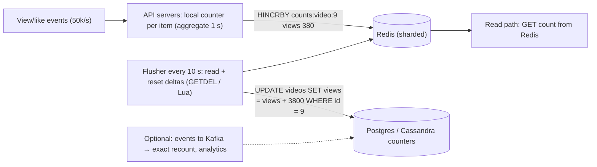

Variants:
- **Local aggregation first**: each server sums for 1 s and sends one increment, which collapses millions of increments to thousands.
- **Sharded counters** for hot keys: split `views:9` into `views:9:{0..15}`, increment a random shard, sum on read.
- **Kafka + stream aggregation** (Flink windowed counts) when you need durability and replay.
- **Approximate** counters (HyperLogLog for unique viewers) when exact isn't required.
- Likes are different from views: "did I like it" needs a per-user record (idempotency) and the count is derived.

#### Example
A short-video app counted views with `UPDATE videos SET views = views + 1`. A viral video at 20k views/s caused lock contention that slowed every write in that table. Moving to Redis `HINCRBY` plus a 10 s flush (via a Lua script that reads and zeroes the delta atomically) took the database down to one update per video per 10 s. Counts on screen lag by a few seconds, which nobody notices. A Redis failover once lost ~10 s of increments, acceptable for views, so they kept it; for paid ad impressions they use Kafka with exactly-once aggregation instead.

#### Trade-offs
Massive throughput and cheap reads, but counts can be lost in a cache crash (between flushes), the DB value lags, and you need care to flush without double counting.

#### Problems & fixes
| Symptom | Cause | Fix |
|---|---|---|
| DB lock contention on hot rows | per-event UPDATE | in-memory increments + batched flush |
| One Redis key overloaded | viral item | local pre-aggregation, sharded counter keys |
| Double counting after flush failure | read-flush-reset not atomic | atomic GETDEL/Lua, idempotent flush with batch ids |
| Lost counts on Redis crash | volatile deltas | AOF persistence, or Kafka log for billing-grade counts |

#### Cheat sheet
- INCR in Redis (or local aggregate), flush deltas every N s, DB is eventually consistent.
- Hot keys: local batching, sharded counters.
- Billing-grade counts: durable log + exactly-once aggregation.

#### Interview questions
<details><summary>Design a view counter for videos that may receive 100k views per second.</summary>

API servers aggregate views locally for about a second and send one increment per video per server to a sharded Redis (with sharded keys for viral videos). A flusher atomically reads and resets deltas every few seconds and adds them to the durable store. Displayed counts come from Redis. Raw view events also go to Kafka for fraud filtering and exact offline recounts. The trade-off is a few seconds of lag and a small potential loss on failure, which is fine for views.
</details>

<details><summary>How do you flush counters from Redis to the database without losing or double-counting increments?</summary>

Make read-and-reset atomic: use `GETDEL`, or a Lua script that reads the delta and decrements it by the amount read, so increments arriving during the flush are preserved. Write to the database idempotently (record a flush batch id with the update, or use an outbox), and only remove the delta from Redis after the DB write succeeds, or keep the pending batch until confirmed.
</details>

#### Interview angle
> "Hot counters increment in Redis after local one-second aggregation and flush atomically to the database every few seconds. Billing-grade counts go through Kafka with exactly-once aggregation instead."

#### Sources
- [INCR](https://redis.io/docs/latest/commands/incr/) — Redis command reference
- [HINCRBY](https://redis.io/docs/latest/commands/hincrby/) — Redis command reference

