## Reliability & availability

### SLA — Service Level Agreement: contractual uptime commitment (e.g., 99.9% uptime per month)
An SLA is a **contract with customers**: a promised level of service (usually availability, sometimes latency or support response time) measured over a period, with **consequences** if it's missed, typically service credits. SLAs are set **looser than internal SLOs**, so you breach your own target long before you owe anyone money.

#### How it works
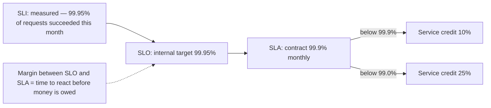

What a good SLA defines precisely:
- **What counts as down** (error rate threshold per minute, specific endpoints, from where it's measured).
- **Measurement window** (calendar month) and **exclusions** (scheduled maintenance, customer misuse, force majeure).
- **Remedy** (credit tiers) and how customers claim it.
- Dependencies: your SLA can't exceed what your providers promise you unless you add redundancy. Serial dependencies multiply: 99.9% × 99.9% ≈ 99.8%.

#### Example
A payments API sold a 99.95% monthly SLA. Their stack depended serially on one cloud region's managed database (99.95% SLA) and a load balancer (99.99%), which mathematically capped them near 99.94% before counting their own bugs. They either had to add a cross-region standby or lower the SLA to 99.9%. They lowered the SLA while building multi-region, and set an internal SLO of 99.95%.

#### Trade-offs
Higher SLAs win deals but require redundancy, on-call rigor and cost that grows steeply with each nine. Vague SLAs invite disputes.

#### Problems & fixes
| Symptom | Cause | Fix |
|---|---|---|
| Paying credits frequently | SLA equals or exceeds internal SLO | keep SLA looser than SLO |
| Disputes over whether you were down | vague definition | precise SLI definition and measurement source |
| SLA impossible given dependencies | serial dependency math | redundancy or lower commitment |

#### Cheat sheet
- SLA = external contract with penalties. SLO = internal target. SLI = measurement.
- SLA looser than SLO. Define "down" precisely.
- Serial availability multiplies; parallel redundancy adds nines.

#### Interview questions
<details><summary>Your service depends on three services each with 99.9% availability. What availability can you promise?</summary>

If all three are needed for each request (serial), availability is at most 0.999³ ≈ 99.7%, before your own failures. To promise more you need to remove hard dependencies (caching, graceful degradation, async processing) or make them redundant: two independent 99.9% replicas in parallel give 1 − 0.001² = 99.9999% in theory (less in practice because failures correlate).
</details>

<details><summary>Why should an SLA be lower than the SLO?</summary>

The SLO is the operational target that triggers internal action (freezes, prioritising reliability work). The gap gives the team time to detect and fix issues before contractual penalties apply. If they're equal, every SLO miss costs money and there's no buffer for measurement differences between your monitoring and the customer's view.
</details>

#### Interview angle
> "I'd set the SLA a step below our SLO, say 99.9% against 99.95%, with a precise definition of downtime, and check the dependency math so the promise is actually achievable."

### SLO — Service Level Objective: internal target (e.g., p99 latency < 200ms, error rate < 0.1%)
An SLO is an **internal reliability target** for an SLI over a window: "99.9% of checkout requests succeed over 28 days" or "99% of search requests complete in under 300 ms". It defines "reliable enough", balancing user happiness against development speed, and it drives alerting and prioritisation through the **error budget**.

#### How it works
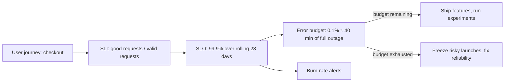

Setting good SLOs:
- Start from **user journeys** (login, search, checkout), not servers.
- Measure as close to the user as possible (LB logs, client telemetry), not CPU.
- Pick targets from **historical performance** and what users notice; 100% is never right.
- Few SLOs per service (2–4): availability and latency mostly.
- Rolling 28/30-day windows; review quarterly.

#### Example
A search team had no SLO and argued every incident's severity. They defined: availability 99.9% (non-5xx at the LB) and latency 99% under 400 ms, over 28 days. Their history showed 99.95% and 98.5%, so latency was already out of budget. They paused a ranking-model rollout that added 80 ms and fixed a slow index shard first.

#### Trade-offs
Explicit targets align teams and allow measured risk-taking, but bad SLIs (wrong measurement) give false confidence, and too-tight SLOs freeze development.

#### Problems & fixes
| Symptom | Cause | Fix |
|---|---|---|
| SLO green while users complain | SLI measured at wrong place | measure at edge/client, per journey |
| Team ignores SLO | no consequences | error budget policy agreed with product |
| Constant budget exhaustion | target unrealistic | renegotiate target or invest in reliability |

#### Cheat sheet
- SLO = target for an SLI over a window. Per user journey.
- Availability + latency, 2–4 per service. Never 100%.
- Drives error budget, burn-rate alerts, launch decisions.

#### Interview questions
<details><summary>How would you choose SLOs for a new service?</summary>

Identify critical user journeys, define SLIs that reflect user experience (success ratio and latency at the load balancer or client), look at historical data, and set targets slightly below current performance that users would accept. Agree an error budget policy with product. Start with a few SLOs and revisit them after a few months of data.
</details>

<details><summary>Why is 100% availability the wrong target?</summary>

It's unattainable (networks, dependencies and user devices fail), each extra nine costs exponentially more, and users can't tell 99.99% from 100% because their own connectivity is less reliable. A 100% target means no changes can ever be risked, which halts development. An SLO below 100% creates a budget for releases and experiments.
</details>

#### Interview angle
> "SLOs are per user journey, measured at the edge: for example 99.9% success and p99 under 400 ms over 28 days, with an agreed policy for what happens when the budget runs out."

### SLI — Service Level Indicator: the actual measured metric (e.g., % of requests completing < 200ms)
An SLI is the **measured quantity** behind an SLO, best expressed as a ratio: **good events / valid events**. For example, successful requests / all requests, or requests faster than 300 ms / all requests. Ratios make SLIs comparable across services and directly map to error budgets.

#### How it works
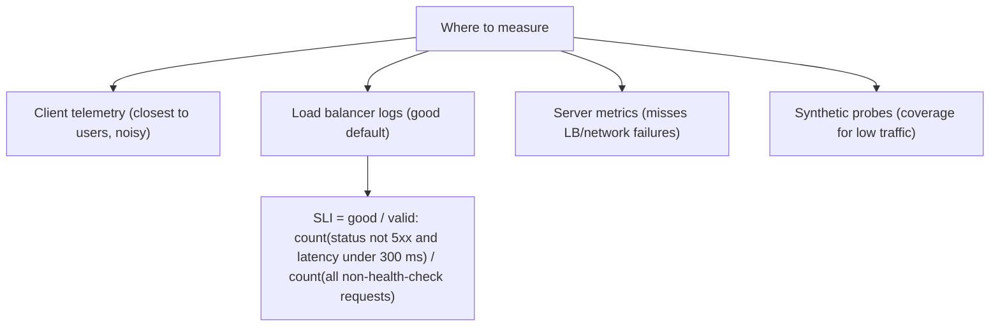

Common SLI types:
- **Availability**: proportion of successful requests.
- **Latency**: proportion faster than a threshold (better than "p99 < X" because it's a ratio).
- **Freshness** (data pipelines): proportion of data updated within N minutes.
- **Correctness**: proportion of outputs that are correct (checked by probes).
- **Durability**: proportion of data retrievable.

Decide what's "valid": exclude health checks, 4xx caused by clients (but include 429s you caused), and bots.

```promql
sum(rate(http_requests_total{job="checkout",code!~"5.."}[5m]))
/ sum(rate(http_requests_total{job="checkout"}[5m]))
```

#### Example
An API reported 99.99% availability from server metrics, but customers saw failures. The load balancer was returning 502s when pods were overloaded and crashed, and those requests never reached the application metrics. Switching the SLI source to LB logs showed 99.8%, matching user complaints, and led to fixing pod memory limits.

#### Trade-offs
Measuring closer to users is more accurate but noisier and harder to collect. Simple server metrics are easy but miss failures outside the app.

#### Problems & fixes
| Symptom | Cause | Fix |
|---|---|---|
| SLI says healthy during outage | measured inside the app | LB/edge or client measurement |
| SLI noisy at low traffic | few requests per window | synthetic probes, longer windows |
| Client errors drag SLI down | counting 4xx as bad | define valid/good carefully |

#### Cheat sheet
- SLI = good / valid events, measured near the user.
- Types: availability, latency-threshold, freshness, correctness.
- Exclude health checks and client errors; include errors you cause.

#### Interview questions
<details><summary>Why express latency SLIs as "proportion of requests under X ms" rather than "p99 under X ms"?</summary>

A proportion is a ratio of good to total events, so it composes into an error budget (each slow request consumes budget) and can be summed across time windows and instances correctly. Percentiles can't be averaged or aggregated across instances or windows, and they hide how far beyond the threshold the slow requests went.
</details>

<details><summary>Where should you measure availability for a web API?</summary>

At the load balancer or API gateway as a good default: it sees requests that never reach healthy application instances (crashed pods, timeouts, 502/503s). Complement it with client-side telemetry for real user experience and synthetic probes for low-traffic endpoints and external paths like DNS and CDN.
</details>

#### Interview angle
> "SLIs are good-over-valid ratios taken at the load balancer, so I count the 502s that never reached the app. Latency is expressed as the share of requests under the threshold, which makes it budgetable."

### Error budget — 1 − SLO: how much downtime/error is acceptable in a period (99.9% → 43 min/month)
The error budget is the **allowed unreliability**: 1 − SLO. With a 99.9% monthly SLO, 0.1% of requests may fail, roughly **43 minutes** of full outage per 30 days. Teams **spend** it on releases, experiments and incidents. When it's exhausted, an agreed **error budget policy** shifts priority from features to reliability.

#### How it works
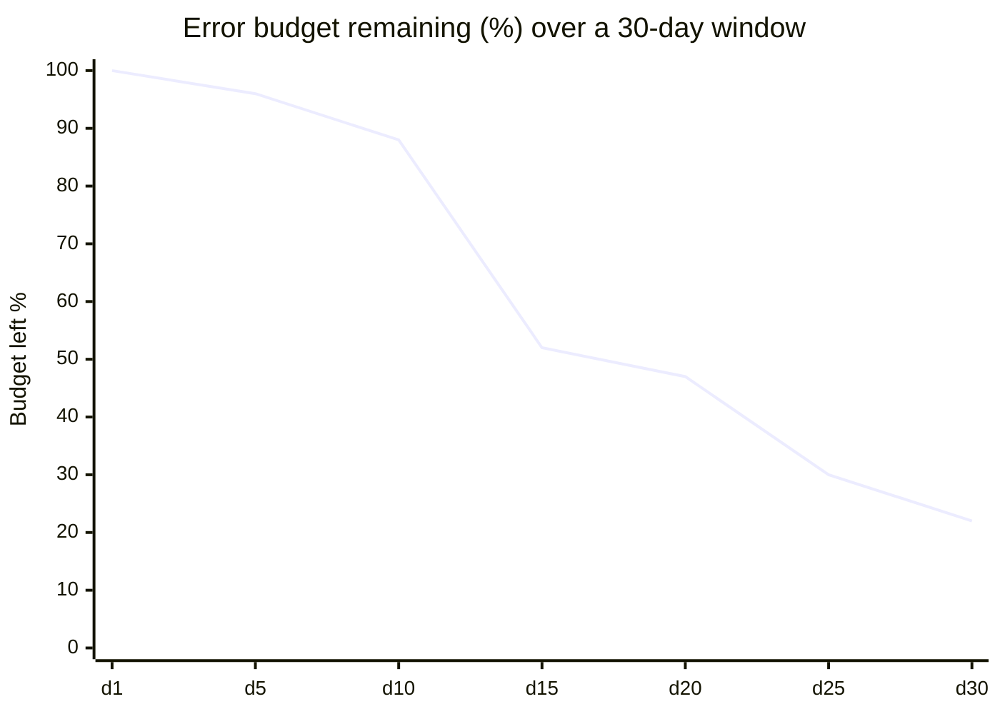

Budget at 99.9% over 30 days:
- 1,000,000 requests → **1,000** may fail.
- A 20-minute full outage consumes ~46% of the month's budget.

Typical error budget policy:
- Budget healthy: normal release velocity.
- Under 25% left: extra review for risky changes.
- Exhausted: feature freeze for that service (except fixes), postmortem actions prioritised, until budget recovers.
- Single incident using over 20% of budget: mandatory postmortem.

#### Example
In the chart above, a bad deploy on day 15 burned 36% of the budget in one hour. With 47% left on day 20 and a risky database migration planned, the team delayed it a week and first added automated canary rollback. The budget then recovered as the rolling window moved past the incident.

#### Trade-offs
Turns reliability vs velocity into an objective, shared rule, but requires trustworthy SLIs and real buy-in from product. Without enforcement, it's just a number.

#### Problems & fixes
| Symptom | Cause | Fix |
|---|---|---|
| Budget always full, team slow | SLO too loose or too cautious | ship faster, tighten SLO if users need it |
| Budget exhausted monthly, nothing changes | no policy enforcement | written policy signed by product and eng leads |
| Dependency outages eat your budget | external failures count | still count (users felt it), invest in resilience |

#### Cheat sheet
- Budget = 1 − SLO. 99.9%/30 d ≈ 43 min, 99.99% ≈ 4.3 min.
- Spend on releases; exhausted → freeze features, fix reliability.
- Needs a written policy agreed with product.

#### Interview questions
<details><summary>How does an error budget help resolve conflicts between product and SRE teams?</summary>

It replaces opinion with an agreed number: as long as the service is within budget, product can ship as fast as they like (risk is acceptable), and when budget runs out, reliability work takes priority by prior agreement. Both sides want the budget used well: product wants room to launch, SRE wants it not to be exceeded.
</details>

<details><summary>A 99.95% SLO service had a 30-minute outage. How much budget is left for the month?</summary>

The monthly budget is 0.05% of ~43,200 minutes ≈ 21.6 minutes of full outage. A 30-minute full outage exceeds it (about 139% used), so the budget is exhausted and the error budget policy applies: freeze risky releases, run a postmortem and complete its reliability actions.
</details>

#### Interview angle
> "Error budgets make reliability negotiable with data: at 99.9% we have about 43 minutes a month, and when it's spent our written policy freezes risky launches until the fixes land."

### Error budget burn rate — rate at which budget is consumed; fast burn = imminent SLO violation
Burn rate is how fast you're consuming the error budget relative to the rate that would use exactly 100% by the end of the window. **Burn rate 1** = on track to use the whole budget. **Burn rate 14.4** = the 30-day budget is gone in ~2 days. Alerting on burn rate, with **multiple windows**, pages for real user-impacting problems quickly while ignoring blips.

#### How it works
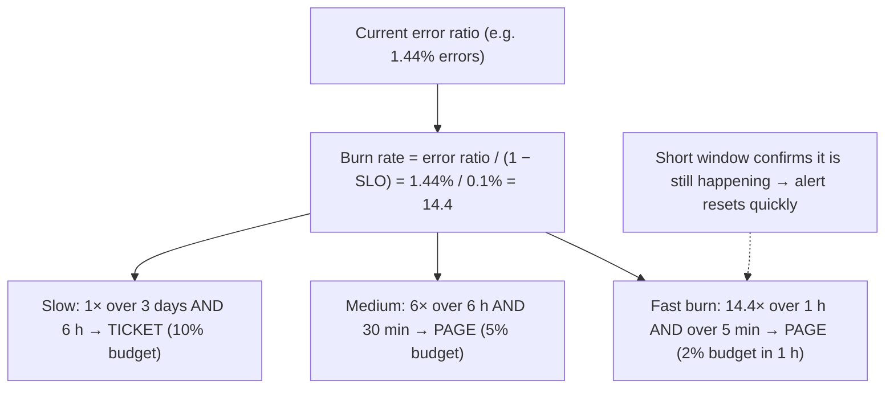

```promql
# fast burn: error ratio over 1h and 5m both above 14.4 × 0.001
(
  sum(rate(http_requests_total{code=~"5.."}[1h])) / sum(rate(http_requests_total[1h])) > 14.4 * 0.001
) and (
  sum(rate(http_requests_total{code=~"5.."}[5m])) / sum(rate(http_requests_total[5m])) > 14.4 * 0.001
)
```

Why not alert on "error rate > 1%"? Static thresholds ignore the SLO: they page for short blips that barely touch the budget, and stay silent for slow leaks that quietly exhaust it.

#### Example
A team's old alert ("5xx > 2% for 5 minutes") paged on 10 short spikes a week that never threatened the SLO, and missed a 0.3% error leak lasting 9 days that consumed the whole month's budget. Switching to multi-window burn-rate alerts (14.4×/1 h page, 6×/6 h page, 1×/3 d ticket) cut pages by 80% and caught the slow leak as a ticket within 3 days.

#### Trade-offs
Precise, SLO-aligned alerting with low noise, but needs reliable SLI data and enough traffic, and the PromQL and recording rules are more complex.

#### Problems & fixes
| Symptom | Cause | Fix |
|---|---|---|
| Too many pages for blips | static thresholds | multi-window burn-rate alerts |
| Slow leaks unnoticed | only fast-window alerts | add slow burn (1×–3×) ticket alerts |
| Alert keeps firing after fix | long window only | AND with short window |
| False alarms at night | low traffic, ratio noisy | minimum request count, synthetic traffic |

#### Cheat sheet
- Burn rate = error ratio / (1 − SLO).
- Page: 14.4× (1 h + 5 min), 6× (6 h + 30 min). Ticket: 1× (3 d + 6 h).
- Short window for fast reset, long window for significance.

#### Interview questions
<details><summary>What is a burn rate of 14.4 and why is it a common paging threshold?</summary>

Burn rate 14.4 means errors are consuming budget 14.4 times faster than sustainable. Over a 30-day window, that rate exhausts the budget in about 50 hours, and spends 2% of the monthly budget in a single hour. It's significant enough to need a human now, yet the 1-hour window filters out brief blips.
</details>

<details><summary>Why use two windows for each burn-rate alert?</summary>

The long window (e.g. 1 h) ensures enough budget has actually been consumed to matter. The short window (e.g. 5 min) ensures the problem is still happening now. Without it, the alert would keep firing for up to an hour after a fix, because the long window still contains the bad period.
</details>

#### Interview angle
> "I page on multi-window burn rate (14.4× over 1 h confirmed by 5 min) and open tickets for 1× over 3 days. That catches fast outages and slow leaks without paging for blips."

### 99% = 87.6 hr/yr, 99.9% = 8.7 hr/yr, 99.99% = 52 min/yr, 99.999% = 5.2 min/yr
The "nines" table converts availability percentages into allowed downtime. Each additional nine cuts allowed downtime by 10×, and roughly multiplies the **cost and engineering effort** needed, because at four or five nines humans can't even respond in time: recovery must be **automatic**.

#### How it works
| Availability | Per year | Per month (30 d) | Per week | Per day |
|---|---|---|---|---|
| 99% | 87.6 h (3.65 d) | 7.2 h | 1.68 h | 14.4 min |
| 99.5% | 43.8 h | 3.6 h | 50.4 min | 7.2 min |
| 99.9% | 8.76 h | 43.2 min | 10.1 min | 1.44 min |
| 99.95% | 4.38 h | 21.6 min | 5 min | 43 s |
| 99.99% | 52.6 min | 4.32 min | 1 min | 8.6 s |
| 99.999% | 5.26 min | 26 s | 6 s | 0.86 s |

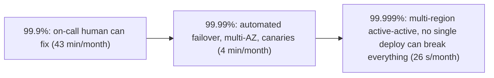

Composition rules:
- **Serial** (all needed): A_total = A1 × A2 × … (always lower than the weakest).
- **Parallel** (any one suffices): A_total = 1 − (1 − A1)(1 − A2) (higher), assuming independent failures.

#### Example
An interviewer asks for "five nines" on a URL shortener. 26 seconds per month means no human-in-the-loop recovery, no maintenance windows, and deploys that can't take the service down. That implies multi-region active-active with health-checked DNS/anycast, automated rollback, read path served from replicated caches even if the write path fails. Discussing whether redirects (reads) need five nines while link creation (writes) only needs three is the strongest answer.

#### Trade-offs
More nines mean happier users and more contracts, but exponentially more cost, slower change processes and more complex architecture.

#### Problems & fixes
| Symptom | Cause | Fix |
|---|---|---|
| Promised nines unachievable | serial dependency chain | remove hard deps, add redundancy |
| Maintenance blows budget | planned downtime | zero-downtime deploys and migrations |
| Recovery too slow for target | manual runbooks | automated failover and rollback |

#### Cheat sheet
- 99.9% ≈ 43 min/month, 99.99% ≈ 4.3 min/month, 99.999% ≈ 26 s/month.
- Serial multiplies (worse), parallel redundancy improves.
- 4+ nines require automated recovery.

#### Interview questions
<details><summary>A system has an API (99.95%), a database (99.99%) and a cache (99.9%) all in the request path. What's the combined availability, and how would you improve it?</summary>

Serially: 0.9995 × 0.9999 × 0.999 ≈ 0.9984, about 99.84% (~70 minutes of downtime per month). Improve by making the cache non-critical (fall back to the database on cache failure, so it drops out of the serial chain), adding replicas and automatic failover for the API and database, and degrading gracefully instead of failing.
</details>

<details><summary>What changes in your design when going from three to four nines?</summary>

Downtime allowance drops from ~43 minutes to ~4 minutes a month, too short for humans to diagnose and fix. You need automated detection and failover (multi-AZ with health checks), canary deploys with automatic rollback, zero-downtime schema migrations, no single points of failure, and dependency isolation. Often the scope is reduced: four nines for the critical read path, three for less critical features.
</details>

#### Interview angle
> "Each nine is ten times less downtime: 99.99% is about 4 minutes a month, which only automation can meet. I'd apply the strict target to the critical path and relax it elsewhere."

### MTTR — Mean Time to Recovery: key reliability metric; minimize with runbooks + automation
MTTR is the average time from a failure starting to service being restored. It breaks down into **time to detect + time to diagnose/engage + time to mitigate**. Because availability ≈ MTBF / (MTBF + MTTR), cutting MTTR from 60 to 6 minutes improves availability as much as making failures 10× rarer, and it's usually easier.

#### How it works
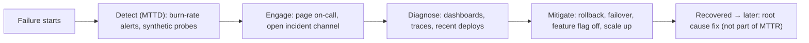

Levers per stage:
- **Detect**: SLO burn-rate alerts, probes from outside, alert on symptoms.
- **Engage**: clear on-call rotation, auto-created incident channels, paging with context.
- **Diagnose**: dashboards linked from alerts, deploy markers, tracing, "what changed?" timeline.
- **Mitigate**: one-click rollback, feature flags, automated failover. Mitigate first, root-cause later.

#### Example
A team's median MTTR was 52 minutes: 15 to detect (CPU alerts, not user-facing ones), 10 to find the right engineer, 20 debugging, 7 to roll back. They added burn-rate alerts (detect in 3 min), alert links to runbooks and dashboards with deploy markers, and an automated canary rollback. Most incidents were bad deploys, so median MTTR fell to 9 minutes.

#### Trade-offs
Investing in fast recovery pays off broadly, but automation can itself fail (automated rollback loops, failover flapping), and a focus on MTTR alone can hide repeated failures.

#### Problems & fixes
| Symptom | Cause | Fix |
|---|---|---|
| Users notice before alerts fire | alerting on causes not symptoms | SLO-based alerts, external probes |
| Long time debugging | no context in alerts | runbooks, dashboards, deploy markers |
| Fix requires a new deploy | no quick mitigation | rollback button, feature flags |
| Incidents mostly from deploys | no progressive delivery | canaries with auto rollback |

#### Cheat sheet
- MTTR = detect + engage + diagnose + mitigate.
- Availability ≈ MTBF / (MTBF + MTTR).
- Mitigate first (rollback, flag, failover), root-cause later.

#### Interview questions
<details><summary>How would you reduce MTTR for a team that averages an hour per incident?</summary>

Measure where the time goes first. Then: alert on user-facing SLO symptoms to cut detection time; route pages with runbooks and dashboard links; show deploy and config change markers since most incidents follow changes; make rollback and feature-flag kill switches one click; automate failover for known failure modes; and practise with game days so responders know the tools.
</details>

<details><summary>Why is "mitigate first, root-cause later" the right incident approach?</summary>

Users care about service being restored, not the explanation. Rolling back a suspect deploy, failing over or disabling a feature often restores service in minutes even if the cause is unknown, while root-causing can take hours. After mitigation, investigate calmly and fix permanently through the postmortem.
</details>

#### Interview angle
> "Most incidents follow a change, so the fastest MTTR wins come from SLO alerts, deploy markers next to every graph and one-click rollback. Root cause comes after service is back."

### MTBF — Mean Time Between Failures; maximize with fault isolation and redundancy
MTBF is the average operating time between failures. You increase it by preventing failures (testing, safer deployments, capacity headroom) and, at the system level, by making component failures **not become system failures** through redundancy, isolation and graceful degradation. Availability = MTBF / (MTBF + MTTR).

#### How it works
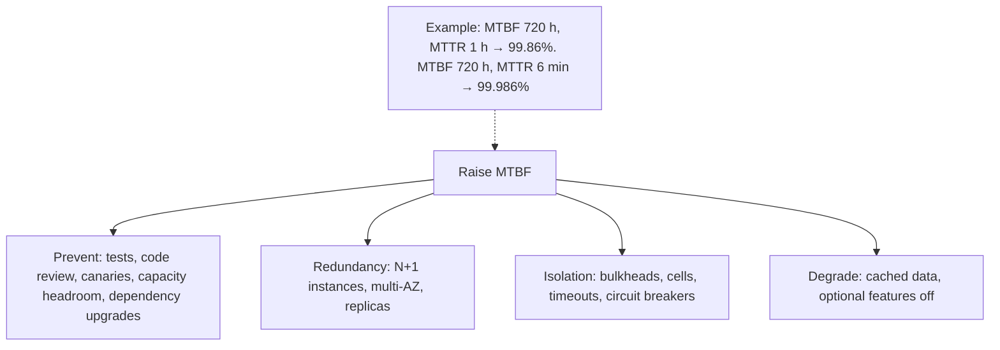

At hardware scale failures are constant: with 10,000 disks at an annual failure rate of 2%, about 200 fail per year, nearly one per working day. The system's MTBF matters, not each component's. This is why designs assume failure and replicate.

#### Example
A service had ~2 incidents per month. Postmortems showed: 50% bad deploys, 25% a downstream dependency timing out and exhausting threads, 25% capacity during peaks. Fixes targeted each cause: canary releases, bulkheads plus circuit breakers for the dependency, and autoscaling with 30% headroom. Incidents dropped to one every two months (MTBF up ~4×).

#### Trade-offs
Prevention and redundancy cost money and slow down delivery; perfect MTBF is impossible, so balance with MTTR investment.

#### Problems & fixes
| Symptom | Cause | Fix |
|---|---|---|
| One component failure takes everything down | no redundancy/isolation | N+1, bulkheads, cell architecture |
| Recurring incidents of same type | postmortem actions not done | track action items to completion |
| Correlated failures defeat redundancy | same AZ, same deploy, same config | spread across AZs, staged rollouts |

#### Cheat sheet
- MTBF up via prevention, redundancy, isolation, degradation.
- At scale, components fail daily; design for failure.
- Watch correlated failures (same deploy, AZ, config).

#### Interview questions
<details><summary>Which is usually more cost-effective to improve: MTBF or MTTR?</summary>

Often MTTR, because failures will happen anyway in complex systems and faster detection plus one-click mitigation helps for every kind of failure. MTBF improvements are cause-specific. Mature teams do both: analyse incident causes to prevent repeated classes of failure, and invest in detection and rollback to cut recovery time.
</details>

<details><summary>Why doesn't adding redundancy always increase MTBF?</summary>

Redundant components often fail together due to shared causes: the same buggy deploy rolled out to all replicas, a shared configuration error, the same AZ or power domain, or the same overload condition. Redundancy only helps against independent failures, so you also need staged rollouts, spread across failure domains and isolation.
</details>

#### Interview angle
> "I raise MTBF by classifying incident causes and fixing whole classes (canaries for deploys, bulkheads for dependencies, headroom for peaks) and by keeping replicas out of shared failure domains."

### RTO — Recovery Time Objective: max acceptable downtime (DR planning)
RTO is the **maximum acceptable time** to restore a service after a disaster (region loss, data corruption, ransomware). It's a business decision tied to the cost of downtime, and it determines the disaster recovery (DR) strategy: backup-and-restore (hours), pilot light (tens of minutes to hours), warm standby (minutes), or active-active (near zero).

#### How it works
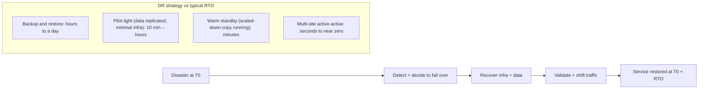

Practical points: RTO includes the **human decision time** to declare a disaster; restore times for big databases are often much longer than expected (test them); infrastructure as code makes rebuilding a region feasible; and DR plans that aren't rehearsed don't work.

#### Example
A lending platform set RTO = 1 hour for the loan application flow. Their plan was to restore from nightly snapshots into another region, but a DR drill took 5.5 hours: the 4 TB database restore alone took 3 hours, plus DNS and config fixes. They moved to a warm standby (cross-region read replica promoted on failover, scaled-down app tier via Terraform plus auto-scaling), and the next drill hit 35 minutes.

#### Trade-offs
Lower RTO means more standby infrastructure and complexity (cost scales sharply toward active-active). Higher RTO is cheap but risks business loss.

#### Problems & fixes
| Symptom | Cause | Fix |
|---|---|---|
| Actual recovery far exceeds RTO | untested restores | regular DR drills with timing |
| Decision paralysis during disaster | unclear authority | pre-agreed failover criteria and owners |
| Rebuild fails in DR region | manual infra, missing quotas | IaC, pre-provisioned quotas, pilot light |

#### Cheat sheet
- RTO = max downtime. Determines DR tier.
- Backup/restore (hours) → pilot light → warm standby (minutes) → active-active (≈ 0).
- Drill it; include decision time.

#### Interview questions
<details><summary>How do RTO requirements drive architecture choices?</summary>

A multi-hour RTO allows backup and restore into a new region via IaC. Tens of minutes need a pilot light (data continuously replicated, minimal infrastructure ready to scale). A few minutes need a warm standby with a running scaled-down stack and automated failover. Near-zero RTO requires active-active multi-region with traffic already flowing to both. Cost and complexity rise sharply at each step.
</details>

<details><summary>Your DR plan says RTO 1 hour but you've never tested it. What do you do?</summary>

Schedule a DR drill: actually restore or fail over in the secondary region with a stopwatch, including detection, the decision, data recovery, application deploy, DNS/traffic shift and validation. Fix what breaks (missing configs, quotas, slow restores), automate steps, and repeat regularly. Untested DR plans almost always miss their RTO.
</details>

#### Interview angle
> "RTO picks the DR tier. For a one-hour RTO I'd run a warm standby with cross-region replicas and Terraform-built scaled-down capacity, and prove it with timed drills."

### RPO — Recovery Point Objective: max acceptable data loss (backup frequency)
RPO is the **maximum acceptable amount of data loss**, measured in time: if RPO = 5 minutes, after a disaster you may lose at most the last 5 minutes of writes. It determines replication and backup strategy: nightly backups (RPO 24 h), WAL/PITR archiving (minutes), asynchronous replication (seconds), synchronous replication (zero).

#### How it works
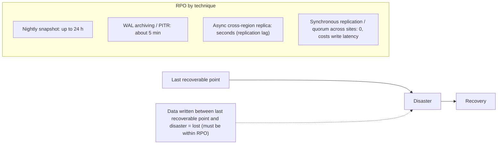

RPO = 0 across regions requires synchronous replication, which adds an inter-region round trip to every write (e.g. 30–80 ms). Most systems choose RPO of seconds with async replication and then reconcile.

Logical corruption (bad migration, deleted table, ransomware) replicates instantly, so replicas don't help: you need **point-in-time recovery** and immutable, offsite backups.

#### Example
A wallet service required RPO = 0 for balances within a region: Aurora's quorum writes across 3 AZs handle AZ loss with no data loss. For regional disaster they accepted RPO ≈ 1 s (Aurora Global Database async replication) plus reconciliation with the payment partner's records to recover any in-flight transactions. A developer once ran a bad `UPDATE` without a `WHERE`; replicas copied it instantly, and PITR to 2 minutes before the statement saved them.

#### Trade-offs
Lower RPO costs more (continuous replication, synchronous write latency). Higher RPO is cheap but loses data.

#### Problems & fixes
| Symptom | Cause | Fix |
|---|---|---|
| Accidental delete replicated everywhere | replicas aren't backups | PITR, delayed replicas, immutable backups |
| Lost hours of data | only nightly backups | WAL archiving / continuous backup |
| Cross-region writes too slow | sync replication for RPO 0 | async + reconciliation, RPO 0 only within region |
| Backups encrypted by ransomware | backups writable from prod | immutable (object lock), separate account |

#### Cheat sheet
- RPO = max data loss in time. Drives backup/replication frequency.
- Nightly (24 h) → PITR (min) → async replica (s) → sync (0, latency cost).
- Replicas don't protect against logical corruption: PITR + immutable backups.

#### Interview questions
<details><summary>What's the difference between RTO and RPO?</summary>

RTO is how long until the service is back up (downtime); RPO is how much data you can afford to lose (measured as time before the disaster). They're independent: a system restored from last night's backup in 10 minutes has a short RTO but a 24-hour RPO; a synchronously replicated database that takes 3 hours to bring online has RPO 0 but a long RTO.
</details>

<details><summary>Why isn't a replica a backup?</summary>

A replica faithfully copies every change, including mistakes: an accidental `DROP TABLE`, a buggy migration or ransomware encryption replicates within seconds. Backups (snapshots plus WAL for point-in-time recovery, ideally immutable and in a separate account) let you go back to a moment before the corruption.
</details>

#### Interview angle
> "RPO picks the replication mode: quorum writes across AZs for zero loss, async cross-region for seconds, and PITR with immutable backups for the bad-migration case that replicas copy straight away."

### Multi-AZ deployment — replicate across availability zones for HA within a region
An **availability zone (AZ)** is one or more data centres with independent power, cooling and networking, connected to other AZs in the region by low-latency links (~1–2 ms). Running across **at least 2–3 AZs** protects against data-centre-level failures with minimal latency cost. It's the baseline for production high availability.

#### How it works
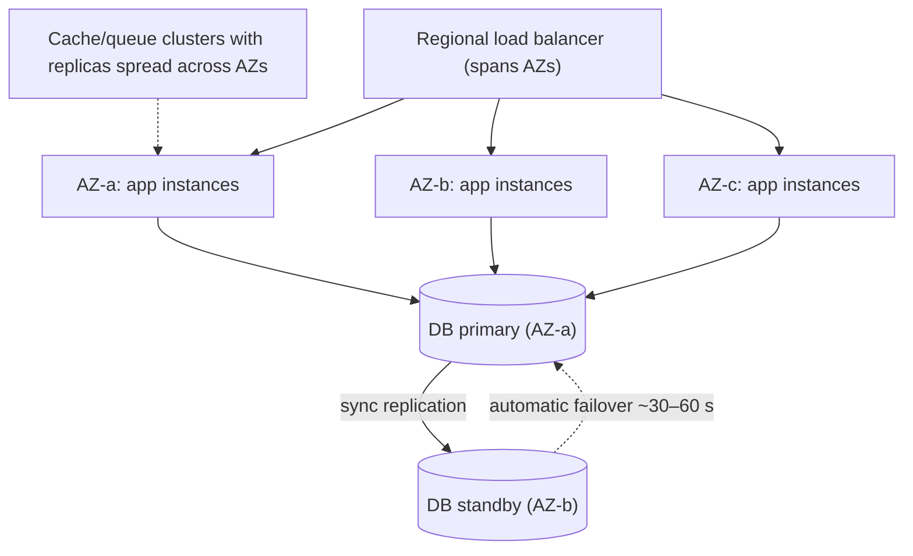

Rules:
- Spread instances evenly, with enough capacity to lose one AZ (**N+1 at AZ level**: with 3 AZs run each at ≤ 66% of needed load).
- Use **zone-aware** placement (Kubernetes topology spread constraints, ASG across subnets).
- Managed multi-AZ databases (RDS Multi-AZ, Aurora) fail over automatically; clients must reconnect (DNS TTL, retry logic).
- Cross-AZ traffic is billed (~$0.01/GB each way), so keep chatty traffic zone-local where possible.

#### Example
During an AZ power event, a service with 6 pods spread across 3 AZs lost 2 pods, while the remaining 4 handled the load because they had headroom, and the RDS Multi-AZ database failed over in 40 s. A neighbouring team ran all pods in one AZ "for latency" and was down for 3 hours.

#### Trade-offs
Strong protection for a small latency and cost overhead, but doesn't protect against regional failures, bad deploys, or control-plane outages, and cross-AZ data transfer adds cost.

#### Problems & fixes
| Symptom | Cause | Fix |
|---|---|---|
| AZ loss overloads remaining capacity | no headroom | size for N−1 AZs |
| All pods in one AZ | scheduler packing | topology spread constraints, AZ-balanced ASGs |
| App errors for minutes after DB failover | cached DNS/connections | low DNS TTL, connection retry, RDS proxy |
| Surprising data transfer bill | cross-AZ chatter | zone-aware routing |

#### Cheat sheet
- 2–3 AZs, evenly spread, N+1 capacity at AZ level.
- Multi-AZ DB with auto failover; clients retry and reconnect.
- Baseline HA; not DR for region loss.

#### Interview questions
<details><summary>How do you make a stateless service and its database resilient to an AZ failure?</summary>

Run the service across three AZs behind a regional load balancer with health checks, with capacity so two AZs can carry full load, and enforce even spreading. Use a multi-AZ database (synchronous standby or quorum storage) with automatic failover, and make clients handle failover (retry with backoff, short DNS TTL or a proxy). Spread caches and queues across AZs too.
</details>

<details><summary>Why size for N−1 availability zones?</summary>

When an AZ fails, its share of traffic shifts to the remaining AZs instantly. If each AZ runs near capacity, the survivors overload and fail too: a cascading outage. With three AZs, each must handle 50% of total load (so run at about 66% of capacity normally) to survive losing one.
</details>

#### Interview angle
> "Production runs across three AZs sized for N−1, with topology spread constraints and a Multi-AZ database whose failover clients ride through with retries."

### Multi-region deployment — replicate across regions for DR; active-active vs active-passive
Multi-region deployments run the system in **two or more geographic regions**, for **disaster recovery** (surviving a whole-region outage), **latency** (serving users nearby) and **data residency**. The core challenges are **data replication** across ~50–200 ms links and **traffic routing**. The two broad models are **active-passive** and **active-active**.

#### How it works
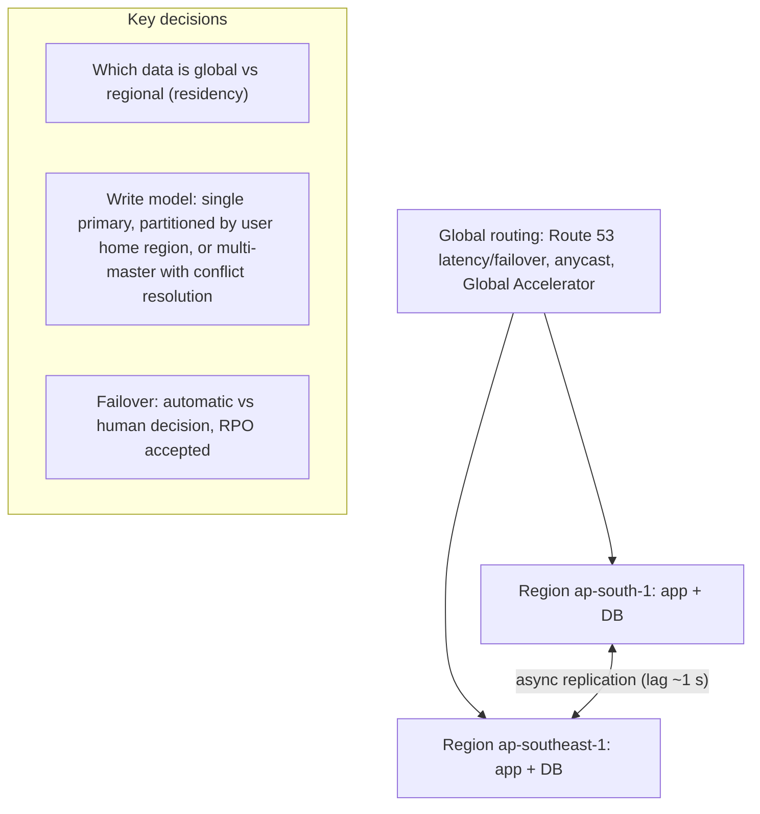

| | Active-passive | Active-active |
|---|---|---|
| Traffic | one region serves | all regions serve |
| RTO | minutes (failover) | near zero |
| Data | primary + async replica | multi-writer or partitioned writes |
| Complexity / cost | lower | high (conflicts, capacity in both) |

A common middle path is **home-region partitioning**: each user's data lives in one region (writes go there), other regions serve reads or proxy, and failover reassigns home regions.

#### Example
An Indian fintech must keep payment data in India (RBI localisation), so it runs active-passive between Mumbai and Hyderabad regions, with a cross-region Aurora replica and pre-scaled standby compute. For global marketing content, it serves from multiple regions active-active through a CDN. One region failover drill took 12 minutes, mostly waiting for a human decision, so they wrote explicit failover criteria.

#### Trade-offs
Survives regional disasters and reduces latency, but roughly doubles infrastructure cost, adds replication lag and consistency problems, and makes deploys and testing more complex.

#### Problems & fixes
| Symptom | Cause | Fix |
|---|---|---|
| Data loss on regional failover | async replication lag | accept RPO, reconcile, or sync for critical data |
| Conflicting writes in two regions | multi-master without design | home-region partitioning, CRDTs, LWW only where safe |
| Failover never works when needed | untested | regular region evacuation drills |
| Residency violations | global replication of regulated data | per-region data stores, policy controls |

#### Cheat sheet
- Reasons: DR, latency, residency.
- Active-passive (simpler, minutes RTO) vs active-active (complex, ≈ 0 RTO).
- Home-region partitioning avoids most write conflicts.

#### Interview questions
<details><summary>How would you design writes in an active-active multi-region system?</summary>

Avoid concurrent writes to the same record in different regions. Assign each user or tenant a home region where their writes go (routing by user), replicate asynchronously to other regions for reads and failover, and on regional failure promote the replica and reassign home regions. If true multi-region writes to the same data are required, use conflict resolution (CRDTs, version vectors, application-level merges) or a globally consistent database (Spanner, CockroachDB) and pay the latency.
</details>

<details><summary>What do you lose by failing over to a region with an asynchronous replica?</summary>

Writes committed in the failed region but not yet replicated, up to the replication lag at failure time (the RPO). Afterwards you must reconcile: replay from upstream sources, compare with external records (payment partners), and handle the old region's unreplicated writes when it returns, without blindly merging them.
</details>

#### Interview angle
> "Multi-region writes stay conflict-free by giving each user a home region. Failover promotes the async replica, and we reconcile the lag window against upstream records."

### Active-active failover — both regions serve traffic; complex consistency, zero downtime
In active-active, **all regions serve production traffic simultaneously**. If one fails, global routing stops sending traffic there and the others absorb it, with no promotion step, so failover is near-instant and the standby is always proven to work. The hard part is **data**: concurrent writes in multiple regions need partitioning, conflict resolution or a globally consistent database.

#### How it works
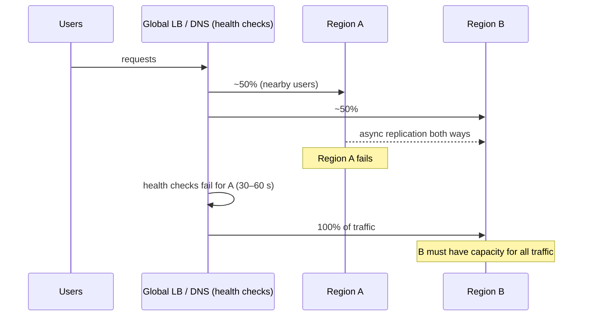

Requirements:
- Each region has **capacity for the full load** (or autoscaling fast enough), otherwise failover causes a cascading overload.
- Data model supports multi-region writes: **home-region routing**, globally distributed databases (Spanner, CockroachDB, DynamoDB Global Tables with last-writer-wins), or CRDTs.
- **Idempotent** operations so retried requests landing in another region don't duplicate effects.
- Avoid global single points: one shared auth service or config store in one region defeats the design.

#### Example
A streaming service runs active-active across three regions. During a regional networking outage, DNS health checks shifted traffic in ~1 minute. Viewing history (DynamoDB Global Tables, last-writer-wins) tolerated occasional conflicts. However, the remaining regions briefly hit capacity limits because autoscaling took 8 minutes, so they pre-provisioned 50% headroom per region.

#### Trade-offs
Near-zero RTO and a continuously tested secondary, but highest cost (spare capacity everywhere), conflict handling complexity and harder debugging.

#### Problems & fixes
| Symptom | Cause | Fix |
|---|---|---|
| Survivors overload after failover | no headroom | provision for N−1 regions |
| Lost updates | last-writer-wins on concurrent writes | home-region writes, CRDTs, conditional writes |
| Duplicate side effects after rerouting | non-idempotent operations | idempotency keys shared across regions |
| Hidden single-region dependency | global service in one region | audit dependencies, replicate control services |

#### Cheat sheet
- All regions live, routing removes failed one.
- Capacity for N−1 regions. Multi-region data model. Idempotency.
- Watch hidden single-region dependencies.

#### Interview questions
<details><summary>What must be true for active-active failover to actually work?</summary>

Remaining regions need capacity (or fast enough scaling) for the failed region's traffic; data must be available and writable in surviving regions (replicated, with a conflict strategy); requests must be idempotent so retries don't duplicate effects; health checks and routing must detect failure quickly; and no critical dependency may live in only one region.
</details>

<details><summary>How would you handle a user updating their profile from two regions simultaneously?</summary>

Preferably route each user to a single home region for writes so concurrent cross-region writes to their profile can't happen. If they can, use per-field last-writer-wins with synchronized timestamps (acceptable for profile data), or version vectors or CRDTs to detect and merge conflicts. Financial data should never rely on last-writer-wins.
</details>

#### Interview angle
> "Active-active means every region is live and provisioned for N−1, writes route to each user's home region, and idempotency keys make cross-region retries safe."

### Active-passive failover — primary serves all traffic; secondary on standby; DNS failover
In active-passive, **one region (primary) serves all traffic**, while a **secondary** keeps a replicated copy of data and standby (often scaled-down) infrastructure. On disaster, you **promote** the secondary's database, scale it up, and **switch traffic** (DNS failover or global load balancer). It's simpler than active-active because writes only happen in one place.

#### How it works
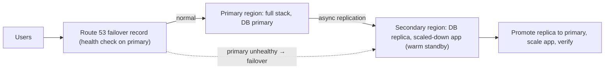

Failover steps: detect (health checks, alerts) → decide (automatic or human) → **fence the old primary** (stop it from accepting writes, avoiding split brain) → promote replica → scale secondary → switch DNS (low TTL, ~60 s) → verify → communicate. Failback later is a planned operation in reverse.

#### Example
An e-commerce company ran active-passive between two regions with RTO 30 minutes. In a drill, DNS switched in 2 minutes, but clients with cached DNS (some ISPs ignore TTL) kept hitting the dead region for 20 minutes. They moved to AWS Global Accelerator (static anycast IPs, instant endpoint switching), cutting traffic shift to under a minute.

#### Trade-offs
Simpler data consistency and lower cost (standby can be smaller), but failover takes minutes, the standby is less proven (until drills), and async replication means some data loss (RPO).

#### Problems & fixes
| Symptom | Cause | Fix |
|---|---|---|
| Two primaries after failover | old primary still accepting writes | fencing (revoke credentials, network isolation) |
| Clients stuck on old region | DNS caching | low TTL, anycast/global accelerator |
| Standby can't handle load | scaled down, slow to grow | warm capacity, pre-scale runbook, quotas reserved |
| Failover broken in reality | config drift between regions | IaC for both, regular drills |

#### Cheat sheet
- One active region, replicated standby, DNS/global LB failover.
- Steps: detect, decide, fence, promote, scale, switch, verify.
- Cheaper and simpler than active-active; minutes of RTO plus replication RPO.

#### Interview questions
<details><summary>What is fencing and why is it important during failover?</summary>

Fencing ensures the old primary can no longer accept writes once the secondary is promoted (by revoking its credentials, isolating it at the network level, or using a lease/epoch the storage checks). Without it, a primary that was only partitioned (not dead) could keep accepting writes: split brain, with two diverging copies of data that are very hard to reconcile.
</details>

<details><summary>Should regional failover be automatic or manual?</summary>

Often semi-automatic: automatic detection, then a human confirms, because regional failover has costs (data loss within RPO, risk of split brain, failback effort) and false positives from flaky health checks are expensive. Automatic failover fits when RTO is very short and the system is designed for it (fencing, idempotency, tested regularly). Either way, the procedure must be scripted.
</details>

#### Interview angle
> "Active-passive is the pragmatic DR default: async replica and warm standby, fence the old primary before promoting, anycast or a global accelerator for traffic switching, and regular drills."

### Chaos engineering — intentionally inject failures: kill random pods (Chaos Monkey), Gremlin
Chaos engineering is the discipline of **running controlled experiments that inject failures in production-like environments** (killing instances, adding latency, failing dependencies, filling disks) to verify the system degrades as expected, and to find weaknesses before real incidents do. Tools include Chaos Monkey, Gremlin, LitmusChaos, Chaos Mesh and AWS Fault Injection Service.

#### How it works
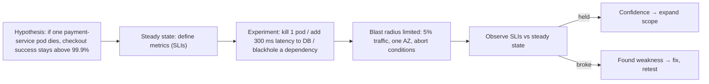

Principles: start small (staging, then a slice of production), define **abort conditions** (stop if error rate exceeds X), automate experiments to run continuously, and fix what you find. Common experiments: instance or pod termination, AZ outage simulation, dependency latency or errors, DNS failure, clock skew, CPU or memory pressure, network partitions.

#### Example
A team believed their service would survive a Redis outage because "the cache is optional". A chaos experiment blackholing Redis in staging showed all requests hanging 30 s (the client's default timeout), exhausting threads, and taking the service down. They set a 50 ms Redis timeout with a circuit breaker and DB fallback. The rerun showed latency rising by 20 ms with no errors.

#### Trade-offs
Finds real weaknesses and builds confidence, but experiments in production carry risk, need mature observability and buy-in, and poorly scoped experiments cause real incidents.

#### Problems & fixes
| Symptom | Cause | Fix |
|---|---|---|
| Experiment caused a real outage | blast radius too large, no abort | start small, automatic abort conditions |
| Findings never fixed | no ownership | treat as incidents with action items |
| Can't tell if experiment hurt users | weak observability | define SLI steady state first |

#### Cheat sheet
- Hypothesis → steady-state SLIs → inject failure → observe → fix.
- Limit blast radius, define abort conditions, start in staging.
- Classic finds: missing timeouts, no fallbacks, untested failover.

#### Interview questions
<details><summary>How would you introduce chaos engineering to a team that has never done it?</summary>

Start with observability and SLOs so you can measure impact. Run the first experiments in staging with obvious hypotheses (kill one pod), then simple production experiments with small blast radius and abort conditions during business hours with the team watching. Fix findings, share results, gradually automate experiments and expand scope (dependency failures, AZ evacuation).
</details>

<details><summary>What weaknesses does chaos engineering typically uncover?</summary>

Missing or too-long timeouts causing thread exhaustion, retry storms, "optional" dependencies that are actually critical, failover that doesn't work (DB promotion, DNS caching), insufficient capacity when instances or AZs are lost, alerts that don't fire, and runbooks that are outdated.
</details>

#### Interview angle
> "I validate resilience claims with chaos experiments: a hypothesis on SLIs, a small blast radius with auto-abort, then injected latency or dependency loss. It nearly always finds a missing timeout."

### Game days — scheduled chaos: simulate region outage, practice incident response with real team
A game day is a **scheduled exercise** where the team deliberately simulates a significant failure (a region outage, database failover, a dependency down, a lost key engineer) and **responds as in a real incident**, using real dashboards, runbooks and communication channels. It tests the system *and* the people and processes: detection, roles, runbooks, decision-making.

#### How it works
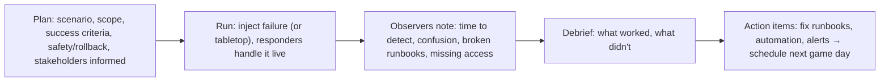

Formats: **tabletop** (walk through a scenario verbally, cheap, finds process gaps), **staging injection**, and **production game days** (real failover of a region with safeguards). Measure time to detect, time to mitigate, and whether the runbook worked as written.

#### Example
A payments team ran a game day simulating their primary database region failing at 2 pm. Findings: the on-call engineer lacked IAM permissions to promote the replica, the runbook referenced a renamed script, and the status page update took 25 minutes because nobody knew who owned it. All were fixed in two weeks, and the next quarter's game day completed failover in 14 minutes.

#### Trade-offs
Reveals people and process gaps that tools can't, but takes team time and planning, and production game days carry risk.

#### Problems & fixes
| Symptom | Cause | Fix |
|---|---|---|
| Real incident chaotic despite runbooks | runbooks never exercised | regular game days |
| Same gaps found each time | action items not done | track and verify before next game day |
| Fear of production impact | no safeguards | start with tabletops and staging, abort plans |

#### Cheat sheet
- Planned failure scenario + real responders + real tools.
- Tabletop → staging → production.
- Outputs: fixed runbooks, permissions, alerts, automation.

#### Interview questions
<details><summary>What's the difference between chaos engineering and a game day?</summary>

Chaos engineering is ongoing, often automated experiments that test system behaviour against hypotheses (e.g. continuous pod-kill tests). A game day is a scheduled event focused on a larger scenario that exercises the humans and processes too: detection, communication, runbooks, access, decision-making. Game days often use chaos tools to inject the failure.
</details>

<details><summary>What would you measure during a game day?</summary>

Time to detect (did alerts fire and page the right person), time to engage, time to mitigate and full recovery versus RTO, data loss versus RPO, whether runbooks worked as written, whether responders had the access and tools they needed, and the quality of communication to stakeholders and customers.
</details>

#### Interview angle
> "Quarterly game days rehearse things like a region failover with the real on-call team. The useful findings are usually missing permissions and stale runbooks, not code."

### Graceful degradation — serve reduced functionality when dependency fails (disable recommendations, show cached data)
Graceful degradation means that when a dependency fails or the system is overloaded, you **keep the core experience working** with reduced functionality instead of failing entirely: show cached or default data, hide optional features, queue work for later, or serve read-only. It requires classifying features as **critical vs non-critical** and building fallbacks ahead of time.

#### How it works
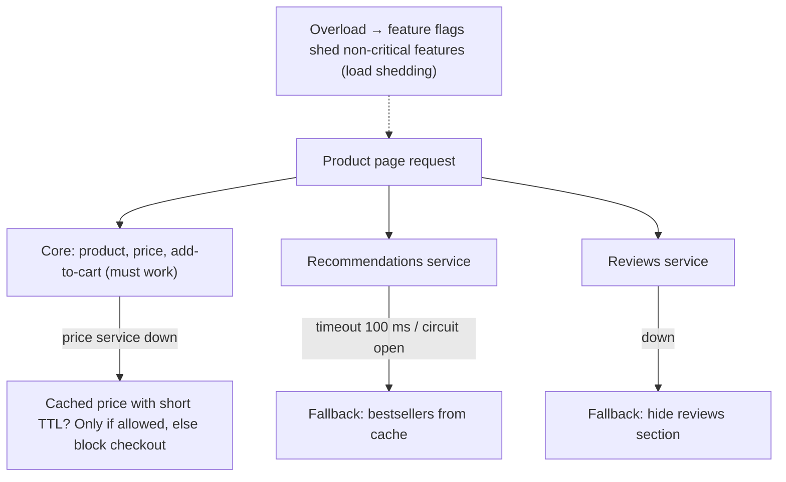

Techniques: timeouts plus circuit breakers with fallbacks, **stale-while-revalidate** caches, **static fallbacks** (default config, bestseller lists), **feature flags / kill switches** to disable expensive features under load, **read-only mode** when writes fail, **async queues** for non-urgent work (emails), and client-side handling of partial responses.

#### Example
During a festival sale, a food delivery app's recommendation service fell over. Because the home page called it with a 150 ms timeout and fell back to a cached "popular near you" list, users barely noticed and orders continued. Earlier in the year, without the fallback, the same failure blanked the home page and orders dropped 40%.

#### Trade-offs
Keeps the business running through partial failures, but needs explicit design per feature, fallback paths that are rarely exercised (must be tested), and stale or simplified data can confuse users.

#### Problems & fixes
| Symptom | Cause | Fix |
|---|---|---|
| Optional service outage takes down page | synchronous hard dependency | timeouts + fallbacks, async loading |
| Fallback path itself broken | never tested | chaos tests, synthetic tests of fallback |
| Stale data shown for critical info | over-eager fallback | classify data: never serve stale prices/balances where wrong |
| Overload cascades | everything treated as critical | priority-based load shedding, kill switches |

#### Cheat sheet
- Classify features: critical vs optional.
- Fallbacks: cache, defaults, hide, queue, read-only.
- Timeouts + circuit breakers + kill switches. Test fallbacks.

#### Interview questions
<details><summary>How would you design an e-commerce product page to survive a reviews-service outage?</summary>

Load reviews asynchronously or call with a short timeout behind a circuit breaker. On failure, hide the section or show cached review summaries. Product data, price and add-to-cart stay on separate critical paths. Monitor fallback rates and test the degraded path regularly with chaos experiments.
</details>

<details><summary>When is serving stale data as a fallback dangerous?</summary>

When correctness matters more than availability: account balances, inventory at checkout, prices in a binding order, permissions or access revocation. Serving stale values could cause overselling, wrong charges or security holes. For these, fail closed (block or show an error) or degrade differently (read-only mode, queue for later confirmation).
</details>

#### Interview angle
> "Every dependency is classified as critical or optional. Optional ones get tight timeouts, circuit breakers and cached fallbacks, and kill switches shed expensive features under load."

### Bulkhead isolation — separate thread pools and connection pools per downstream dependency
Named after ship compartments, a bulkhead **isolates resources** (thread pools, connection pools, semaphores, even separate clusters) per dependency, tenant or workload, so that one slow or failing part can't consume all shared resources and sink the whole service.

#### How it works
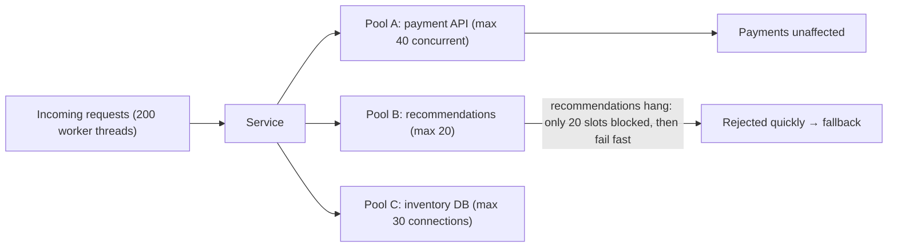

Forms:
- **Thread pool / semaphore per dependency** (Resilience4j Bulkhead, Polly).
- **Connection pools** per database or service.
- **Separate deployments or clusters** per workload (critical vs batch, per tenant tier).
- **Cell-based architecture**: independent copies of the stack, each serving a subset of customers, limiting blast radius.
- Combine with **timeouts** (release resources) and **circuit breakers** (stop calling failing dependencies).

#### Example
A checkout service shared one 200-thread pool for all outbound calls. When the loyalty-points service slowed to 30 s responses, all 200 threads waited on it and checkout stopped entirely. After adding a 20-permit bulkhead for loyalty calls (plus a 500 ms timeout and fallback "points will be added later"), the next loyalty outage only affected the points display.

#### Trade-offs
Contains failures and noisy neighbours, but partitioned resources can be underused, sizing each pool needs data, and more pools mean more configuration.

#### Problems & fixes
| Symptom | Cause | Fix |
|---|---|---|
| One slow dependency stops everything | shared thread pool | per-dependency bulkheads + timeouts |
| Batch jobs slow down user traffic | shared DB/cluster | separate pools/replicas/clusters for batch |
| Large tenant degrades others | shared resources | per-tenant quotas, cell architecture |
| Bulkhead rejects too often | pool too small | size via Little's Law and observed latency |

#### Cheat sheet
- Isolate pools per dependency/workload/tenant.
- Pair with timeouts and circuit breakers.
- Cells limit blast radius at architecture level.

#### Interview questions
<details><summary>How does a bulkhead differ from a circuit breaker?</summary>

A bulkhead limits how many resources (threads, connections, concurrent calls) a dependency can consume, so its slowness can't exhaust shared capacity. It's always on. A circuit breaker watches failure rates and stops calling a dependency entirely once it's failing, failing fast until it recovers. They complement each other: the bulkhead contains damage while the breaker is still deciding.
</details>

<details><summary>How would you size a bulkhead for a dependency?</summary>

Use Little's Law: concurrency = request rate × latency. If you call a service at 100 req/s with p99 latency 200 ms, you need about 20 concurrent slots at normal load. Add headroom (say 30), set the timeout so slots free up promptly, and monitor rejections and saturation to adjust.
</details>

#### Interview angle
> "Each downstream call gets its own bulkhead sized by Little's Law, plus a timeout and a circuit breaker, so a hung loyalty service can never take checkout down with it."
