## Observability — logs, metrics, traces

### Three pillars of observability — logs (what happened), metrics (how much), traces (how long and where)
Observability is the ability to understand a system's internal state from its outputs, including for failures nobody predicted. The three classic signal types complement each other: **metrics** (cheap numeric time series: tell you *that* something is wrong), **traces** (the path and timing of a request across services: tell you *where*), and **logs** (detailed events: tell you *why*). They're most powerful when **correlated** through shared ids (trace_id) and labels.

#### Intuition
A doctor's three tools. The thermometer says something is wrong (metrics). The X-ray shows where (traces). The patient's own account explains why (logs). Used together they give a diagnosis.

#### Must know
- **Metrics** are cheap numbers over time. They tell you **that** something is wrong.
- **Traces** follow one request across services. They tell you **where**.
- **Logs** are detailed event records. They tell you **why**.
- They are far more useful when **linked by a shared trace id**.
- Logs cost the most at scale, so control volume and retention.

#### Common mistakes
- Using logs for everything, including trends and alerts.
- Three separate tools with no way to jump between them.
- Debug-level logging left on in production.

#### How it works
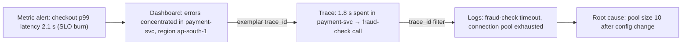

| | Metrics | Traces | Logs |
|---|---|---|---|
| Answers | how much, how often, is it bad | where is time spent, which hop failed | what exactly happened |
| Cost | low (aggregated) | medium (sampled) | high (per event volume) |
| Cardinality | must be bounded | high (per request) | high |
| Typical tools | Prometheus, CloudWatch | Jaeger, Tempo, X-Ray | ELK, Loki, CloudWatch Logs |

Newer additions: **continuous profiling** (CPU/memory per function in production) and **events** (deploys, config changes) as a fourth signal.

#### Example
During a latency incident, the on-call engineer went from a burn-rate alert to a Grafana latency panel, clicked an **exemplar** (a sample trace id attached to the slow histogram bucket) to open the trace in Tempo, saw the slow span, and jumped to that trace's logs in Loki: "pool exhausted, waited 1.7 s". Total diagnosis: 6 minutes. Before correlation was set up, the same kind of incident took over an hour of grepping.

#### Trade-offs
Rich, correlated telemetry slashes diagnosis time, but storage and vendor costs grow quickly (logs especially), and instrumentation must be consistent across services.

#### Problems & fixes
| Symptom | Cause | Fix |
|---|---|---|
| Can't jump from metrics to logs | no shared ids | trace_id in logs, exemplars on metrics |
| Observability bill exceeds compute bill | logging everything at DEBUG, high-cardinality metrics | sampling, log levels, retention tiers, cardinality limits |
| Know something is slow, not where | no tracing | distributed tracing with OpenTelemetry |

#### Cheat sheet
- Metrics = that, traces = where, logs = why.
- Correlate with trace_id, exemplars, consistent service/env labels.
- Control cost: sampling, retention, cardinality.

#### Interview questions
<details><summary>Walk through how you'd debug a latency spike using the three pillars.</summary>

Start from metrics: an SLO or latency alert, then break down by service, endpoint, region and version to narrow scope (and check for a recent deploy). Open an exemplar or a sample of slow traces to see which span dominates the latency. Filter logs by those trace ids to see the error or detail, such as timeouts, retries or pool exhaustion. Mitigate (rollback, scale, failover), then confirm the metrics recover.
</details>

<details><summary>Why can't you just use logs for everything?</summary>

Logs are expensive at scale (every event stored and indexed), slow to aggregate into trends, and noisy for alerting. Metrics give cheap, fast, long-retention aggregates for dashboards and alerts. Traces show causal, cross-service timing that logs can only reconstruct painfully. Each signal is efficient for different questions.
</details>

#### Interview angle
> "Alerts come from metrics, exemplars link slow buckets to traces, and trace_ids link traces to logs. That gets you from page to root cause in minutes without grepping."

#### Sources
- [Observability primer](https://opentelemetry.io/docs/concepts/observability-primer/) — OpenTelemetry docs
- [Monitoring distributed systems](https://sre.google/sre-book/monitoring-distributed-systems/) — Google SRE book

### Four golden signals (Google SRE) — latency, traffic (RPS), errors (rate), saturation (utilization)
From Google's SRE book: if you can only measure four things about a user-facing system, measure **latency** (how long requests take, separating successes and failures), **traffic** (demand, e.g. requests per second), **errors** (rate of failed requests, including wrong content and slow-as-failure) and **saturation** (how full the most constrained resource is: CPU, memory, queue depth, connection pool).

#### Intuition
The four dials on a car dashboard you actually watch: speed, how much traffic, warning lights, and how close the engine is to its limit. If you could only have four, these are the ones.

#### Must know
- **Latency**: how long requests take.
- **Traffic**: how much demand there is, such as requests per second.
- **Errors**: the rate of failed requests.
- **Saturation**: how full the most constrained resource is.
- **Saturation moves first.** Latency and errors follow.

#### Common mistakes
- Mixing fast failures into latency, which makes an outage look quick.
- Watching CPU when the real limit is a connection pool or a queue.
- A dashboard with dozens of panels and no clear top row.

#### How it works
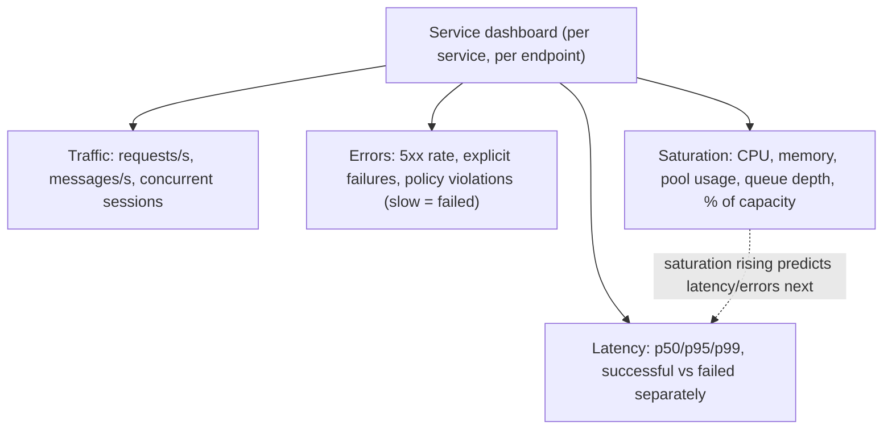

Tips:
- Track latency of **errors separately**: fast 500s can make average latency look great during an outage.
- Saturation is the **leading** indicator: queue depth and pool usage climb before latency explodes.
- Put the four signals at the top of every service dashboard, with deploy annotations.

#### Example
A team's dashboard showed latency improving during an outage: a broken dependency made the service return fast 503s, dragging p50 down. Splitting latency by status and graphing error rate next to it made the incident obvious. They also added DB connection-pool utilisation (saturation), which reached 100% 10 minutes before the next incident's latency spike, and turned it into an early-warning alert.

#### Trade-offs
Simple, universal starting point, but doesn't cover business correctness or batch systems by itself, and saturation needs knowing the actual bottleneck.

#### Problems & fixes
| Symptom | Cause | Fix |
|---|---|---|
| Latency looks better during outage | errors mixed with successes | split latency by outcome |
| Overload discovered only via errors | no saturation metric | track pool/queue/CPU saturation, alert on trends |
| Dashboards with 80 panels nobody reads | no prioritisation | golden signals on top, details below |

#### Cheat sheet
- Latency (split success/failure), Traffic, Errors, Saturation.
- Saturation leads, latency and errors follow.
- Golden signals at the top of every service dashboard.

#### Interview questions
<details><summary>Why measure latency for successful and failed requests separately?</summary>

Failures often return very quickly (immediate 503 from a circuit breaker or validation error), so mixing them in pulls latency percentiles down and hides problems, sometimes showing "improved latency" exactly during an outage. Conversely, slow timeouts can inflate latency. Separate series show the real experience of successful requests.
</details>

<details><summary>What's a good saturation signal for a service that mostly waits on a database?</summary>

Database connection pool utilisation and wait time for a connection, plus request queue depth and in-flight requests per instance. CPU will be low while the service is saturated on connections. As the pool nears 100% busy, requests queue and latency rises sharply, so pool usage is the leading indicator.
</details>

#### Interview angle
> "Every service dashboard starts with the golden signals: latency split by outcome, traffic, errors, and the real saturation point, like pool usage, since saturation moves first."

#### Sources
- [Monitoring distributed systems: the four golden signals](https://sre.google/sre-book/monitoring-distributed-systems/#xref_monitoring_golden-signals) — Google SRE book
- [Instrumentation](https://prometheus.io/docs/practices/instrumentation/) — Prometheus docs

### RED method — Rate (requests/sec), Errors (rate), Duration (latency distribution)
RED (coined by Tom Wilkie) is a request-centric monitoring method for **services**: for every service (and ideally every endpoint), track **Rate** (requests per second), **Errors** (failed requests per second or as a ratio) and **Duration** (latency distribution via histograms). It's essentially the golden signals minus saturation, and easy to standardise across microservices.

#### Intuition
Three questions about any shop counter. How many customers per minute? How many left unhappy? How long did each one wait?

#### Must know
- A monitoring recipe for **request-driven services**.
- **Rate**: requests per second. **Errors**: failed requests. **Duration**: the latency distribution.
- Emit them from shared middleware or a service mesh, so every service looks the same.
- One dashboard template then works for all services.
- It does not cover resources. Use USE for those.

#### Common mistakes
- Raw URL paths as metric labels, which creates millions of series.
- Averaging per-instance percentiles.
- Every team building its own differently shaped dashboard.

#### How it works
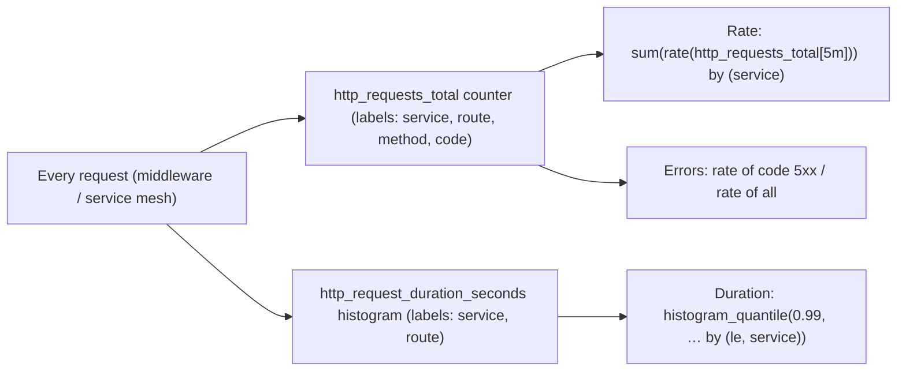

```promql
sum by (service) (rate(http_requests_total[5m]))                                   # Rate
sum by (service) (rate(http_requests_total{code=~"5.."}[5m]))
  / sum by (service) (rate(http_requests_total[5m]))                               # Errors
histogram_quantile(0.99, sum by (le, service) (rate(http_request_duration_seconds_bucket[5m])))  # Duration
```

Service meshes (Istio, Linkerd) and OpenTelemetry instrumentation emit RED metrics automatically for every service, giving instant uniform dashboards.

#### Example
A company with 120 microservices had inconsistent, hand-built dashboards. They adopted RED via standard HTTP/gRPC middleware metrics and one templated Grafana dashboard with a service dropdown. Any engineer could now open any service and immediately see rate, errors and p99, and the same template powered auto-generated SLO alerts.

#### Trade-offs
Simple, uniform and automatable, but request-centric (doesn't cover resources, batch jobs or queues well), and route labels must be templated to avoid cardinality explosions.

#### Problems & fixes
| Symptom | Cause | Fix |
|---|---|---|
| Prometheus memory explodes | raw URL paths as labels (/users/123) | use route templates (/users/:id) |
| p99 can't be aggregated across pods | using summaries | histograms, aggregate buckets then quantile |
| Each team's dashboards differ | no standard | RED middleware + templated dashboard |

#### Cheat sheet
- Rate, Errors, Duration per service/route.
- Counter + histogram via middleware or mesh.
- Templated routes, histograms not summaries.

#### Interview questions
<details><summary>RED vs USE: when do you use each?</summary>

RED for request-driven services (APIs, microservices): it describes what users experience. USE for resources (CPU, memory, disks, network, connection pools, queues): it describes whether infrastructure is the bottleneck. Use RED to detect a problem in a service and USE to find which resource is causing it.
</details>

<details><summary>How do you avoid high-cardinality problems when instrumenting HTTP metrics?</summary>

Label with bounded values only: the route template (`/orders/:id`), method, status code class or code, service, and not raw paths, user ids, order ids or query strings. Those unbounded values belong in traces and logs. Limit label combinations and monitor active series counts.
</details>

#### Interview angle
> "Every service emits RED metrics from shared middleware with templated route labels and histograms, so one dashboard template and one SLO alert template cover all 120 services."

#### Sources
- [The RED method: how to instrument your services](https://grafana.com/blog/2018/08/02/the-red-method-how-to-instrument-your-services/) — Grafana Labs blog
- [Instrumentation](https://prometheus.io/docs/practices/instrumentation/) — Prometheus docs

### USE method — Utilization, Saturation, Errors per resource (CPU, memory, disk, network)
The USE method (Brendan Gregg) is a checklist for finding **resource bottlenecks**: for every resource, check **Utilization** (% of time busy or % used), **Saturation** (extra work queued that it can't service yet) and **Errors** (error events). Resources include CPUs, memory, disks, network interfaces, and software resources like thread pools, connection pools, file descriptors and locks.

#### Intuition
Checking each machine on a factory floor in turn. How busy is it? Is work piling up in front of it? Is it throwing faults? The machine with the pile-up is your bottleneck.

#### Must know
- A checklist for finding **resource bottlenecks**.
- For every resource check **Utilisation**, **Saturation** and **Errors**.
- Include software resources: thread pools, connection pools, queues, file descriptors.
- **Saturation (queued work) is what causes latency**, not high utilisation alone.
- RED finds that a service is slow. USE finds which resource is the cause.

#### Common mistakes
- Checking only CPU and memory.
- Treating 90% utilisation as a problem with no queueing present.
- Missing container CPU throttling, which average CPU hides.

#### How it works
| Resource | Utilization | Saturation | Errors |
|---|---|---|---|
| CPU | % busy | run-queue length, throttling (cgroups) | — |
| Memory | % used | swapping, OOM kills, GC pressure | allocation failures |
| Disk | % busy (iostat util) | I/O queue depth, await | I/O errors |
| Network | bandwidth % | drops, retransmits, socket backlog | interface errors |
| Connection pool | active / max | threads waiting for a connection | timeouts acquiring |
| Thread pool | busy / max | task queue length | rejections |

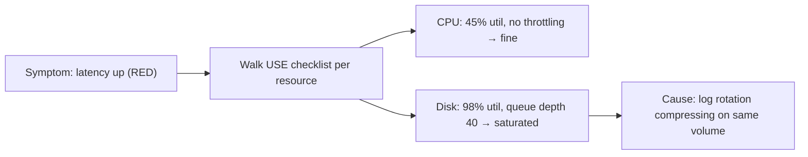

High utilisation alone isn't a problem (100% CPU on a batch job is fine); **saturation** is what causes queueing and latency. In containers, watch **CPU throttling**: a pod at 50% average CPU can still be throttled heavily if its limit is low.

#### Example
A Java API's p99 doubled at noon daily, with CPU at only 40%. The USE check found container CPU throttling at 35% of periods (bursty GC threads hitting a 2-core limit) and GC pauses. Raising the CPU limit (or removing it while keeping requests) and tuning GC threads fixed the latency.

#### Trade-offs
Systematic and fast at finding bottlenecks, but needs metrics for each resource (including software resources), and identifying what counts as "saturation" for each can take expertise.

#### Problems & fixes
| Symptom | Cause | Fix |
|---|---|---|
| Latency spikes at low average CPU | cgroup throttling, short bursts | track throttled periods, adjust limits |
| Slow requests, all hardware fine | software resource saturated (pool, lock) | instrument pools/queues |
| Random timeouts | network retransmits/drops | monitor interface errors, conntrack table |

#### Cheat sheet
- For each resource: Utilization, Saturation, Errors.
- Include software resources: pools, queues, fds, locks.
- Saturation (queueing) causes latency; watch container throttling.

#### Interview questions
<details><summary>A service is slow but CPU and memory look fine. How do you find the bottleneck?</summary>

Apply USE beyond hardware: check connection pool wait times, thread pool queue length, file descriptor limits, lock contention, disk I/O queue and await, network retransmits, and container CPU throttling (average CPU hides bursts). Also check downstream dependencies' latency via traces. Usually a saturated software resource or a slow dependency is to blame.
</details>

<details><summary>Why can high utilization be fine while saturation is always a problem?</summary>

Utilization measures how busy a resource is, and a resource at 90% busy is efficiently used. Saturation means work is waiting because the resource can't keep up, which directly adds queueing delay to requests and, if sustained, grows without bound. Latency rises sharply as utilization nears 100% because saturation (queueing) begins.
</details>

#### Interview angle
> "When latency rises but CPU looks fine, I walk the USE checklist through software resources too: pool waits, queue depth, fd limits and cgroup throttling. That's where the saturation usually hides."

#### Sources
- [The USE method](https://www.brendangregg.com/usemethod.html) — Brendan Gregg
- [USE method: Linux performance checklist](https://www.brendangregg.com/USEmethod/use-linux.html) — Brendan Gregg

### Structured logging — JSON format: include trace_id, span_id, request_id, user_id, service_name
Structured logging means emitting logs as **machine-parseable records** (usually JSON) with consistent fields, instead of free-form strings. This lets log systems index, filter and aggregate by field (`service=payments AND level=ERROR AND merchant_id=m42`) and link logs to traces through `trace_id` and `span_id`.

#### Intuition
A form with labelled boxes against a handwritten note. You can sort and filter a thousand forms by any box in seconds. With handwritten notes you have to read each one.

#### Must know
- Logs are emitted as **machine-readable records**, usually JSON, with consistent fields.
- You can then filter and aggregate by field, not by text search.
- Every line carries a **trace id**, which links logs to traces.
- Use a shared set of fields across services: time, level, service, version, trace id, event name.
- **Never log secrets or personal data.**

#### Common mistakes
- Free-text messages that need a regular expression to parse.
- Logging whole request bodies, which leaks card numbers and tokens.
- The same field as a number in one service and a string in another.

#### How it works
```json
{"ts":"2026-11-09T10:15:32.481Z","level":"ERROR","service":"payment-svc","env":"prod",
 "version":"2.14.1","trace_id":"4bf92f3577b34da6a3ce929d0e0e4736","span_id":"00f067aa0ba902b7",
 "request_id":"req-8f2c","user_id":"u_8812","event":"psp_charge_failed",
 "psp":"razorpay","http_status":502,"latency_ms":3012,"attempt":2,"msg":"PSP returned 502"}
```

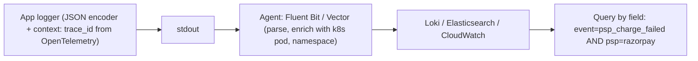

Good practice:
- Fixed schema of common fields across services (timestamp in UTC ISO-8601, level, service, env, version, trace_id).
- Use a stable **event name** field for each kind of log line, rather than parsing messages.
- Inject context automatically (MDC, context-aware loggers) so every line in a request carries the trace_id.
- **Never log secrets or sensitive data** (card numbers, passwords, tokens, full PII); redact at source.

#### Example
A support engineer needed "all failed payments for merchant m42 yesterday with latency over 3 s". With old free-text logs this was a regex hunt over 400 GB. With structured logs: `service="payment-svc" event="psp_charge_failed" merchant_id="m42" latency_ms>3000`, answered in seconds, then clicking a trace_id opened the full request trace.

#### Trade-offs
Queryable, correlatable and reliable, but more verbose (bigger volume), requires schema discipline, and high-cardinality fields increase index costs in some backends.

#### Problems & fixes
| Symptom | Cause | Fix |
|---|---|---|
| Can't correlate logs across services | no trace_id field | inject OpenTelemetry context into logger |
| Card numbers found in logs | logging request bodies | redaction filters, never log raw payloads |
| Field types conflict in index | same field as string and number | shared schema, typed fields |
| Huge index cost | indexing every field | index key fields, store rest unindexed |

#### Cheat sheet
- JSON logs, shared schema: ts, level, service, env, version, trace_id, span_id, event.
- Context injected automatically. Event names, not message parsing.
- Redact secrets and PII at source.

#### Interview questions
<details><summary>What fields would you require in every log line across your microservices?</summary>

Timestamp (UTC, ISO-8601 with milliseconds), level, service name, environment, version or commit, host or pod, trace_id and span_id, request_id, an event name, and a message. Domain identifiers (order_id, merchant_id) where relevant, and outcome fields like status and latency. Never secrets or raw PII.
</details>

<details><summary>How do you keep sensitive data out of logs?</summary>

Don't log raw request or response bodies. Use allow-listed structured fields rather than dumping objects. Add redaction filters in the logging library for patterns like card numbers, tokens and emails. Mask identifiers (last four digits), run scanners on log streams to detect leaks, restrict log access, and set retention policies. Treat logs as sensitive data.
</details>

#### Interview angle
> "Logs are JSON with a shared schema, trace_id injected from the OpenTelemetry context, stable event names, and redaction at source, so one field query plus a trace link answers most support questions."

#### Sources
- [OpenTelemetry logs](https://opentelemetry.io/docs/concepts/signals/logs/) — OpenTelemetry docs
- [Logging cheat sheet](https://cheatsheetseries.owasp.org/cheatsheets/Logging_Cheat_Sheet.html) — OWASP

### Log levels — TRACE (verbose), DEBUG, INFO (business events), WARN (recoverable), ERROR (needs action), FATAL
Log levels classify severity so you can control volume and route attention. Typical meaning: **TRACE/DEBUG** for developer detail (off in production by default), **INFO** for significant business events and lifecycle milestones, **WARN** for unexpected but handled situations, **ERROR** for failures of an operation that need investigation, and **FATAL** for errors that terminate the process.

#### Intuition
Volume settings for what the system says. A whisper for developer detail, a normal voice for business events, a raised voice when something odd was handled, and a shout when an operation failed.

#### Must know
- **DEBUG / TRACE**: developer detail, off in production by default.
- **INFO**: meaningful business and lifecycle events.
- **WARN**: something unexpected that was handled, such as a retry.
- **ERROR**: an operation failed and needs a look.
- **Log an error once**, at the place where it is handled.

#### Common mistakes
- Logging the same exception at every layer while rethrowing it.
- Debug detail written at INFO, which bloats volume and cost.
- Paging on the count of ERROR lines, when the alert should come from an SLO.

#### How it works
| Level | Use for | Production default | Example |
|---|---|---|---|
| TRACE | step-by-step internals | off | entering function with args |
| DEBUG | diagnostic detail | off (enable dynamically) | cache miss for key |
| INFO | business events, lifecycle | on | order placed, service started |
| WARN | handled anomaly, degraded | on | retry 2/3 to PSP, fallback used |
| ERROR | operation failed, needs a look | on | payment capture failed after retries |
| FATAL | process can't continue | on | cannot bind port, invalid config |

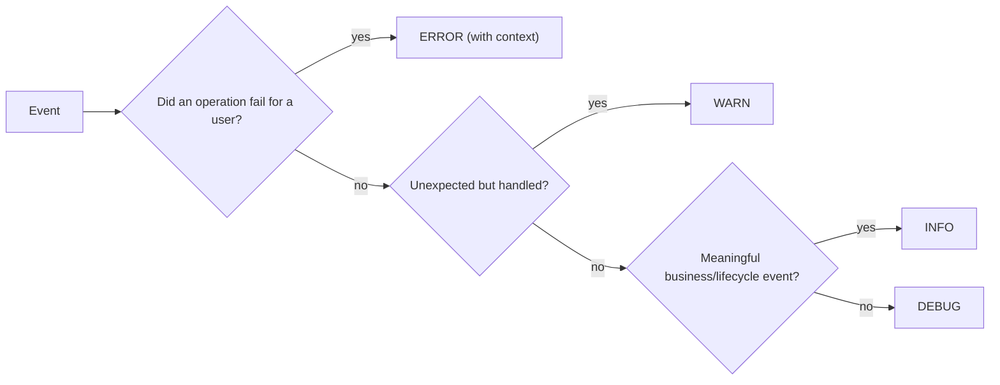

Practices: log an error **once** where it's handled (not at every layer while rethrowing), allow **dynamic level changes** per service or logger (without redeploy), sample repetitive DEBUG/INFO logs, and don't page on ERROR log counts; page on SLOs.

#### Example
A service logged the same exception at ERROR in the repository, service and controller layers, so one failure became three ERROR lines, and dashboards showed "3,000 errors/min" when 1,000 requests failed. They changed to logging only at the boundary that handles the error, plus WARN for retries. During a tricky incident, they temporarily enabled DEBUG for one logger on one pod via a runtime endpoint.

#### Trade-offs
Levels control noise and cost, but inconsistent use across teams makes them meaningless, and too much at INFO bloats costs.

#### Problems & fixes
| Symptom | Cause | Fix |
|---|---|---|
| Duplicate error lines | log-and-rethrow at every layer | log once at handling boundary |
| Logs too noisy to read | INFO used for debug detail | level guidelines, sampling |
| Need detail during incident but DEBUG off | static levels | dynamic level control per logger |
| Alert fatigue from ERROR logs | alerting on log counts | alert on SLOs, use logs for diagnosis |

#### Cheat sheet
- DEBUG off in prod, INFO business events, WARN handled anomalies, ERROR failed operations.
- Log errors once. Dynamic levels. Sample noisy logs.
- Page on SLOs, not ERROR counts.

#### Interview questions
<details><summary>A retry succeeds on the second attempt. What level do you log the first failure at?</summary>

WARN (or even INFO/DEBUG with a retry counter metric): the operation ultimately succeeded, so nobody needs to act, but frequent retries indicate a problem worth noticing. Log ERROR only if all retries fail and the operation fails. Track retry rates as metrics for alerting.
</details>

<details><summary>Why is "log and rethrow" an anti-pattern?</summary>

Each layer logs the same exception before passing it up, producing multiple ERROR entries for one failure: inflated error counts, noisy logs and confusing investigations. Instead, add context when wrapping exceptions and log once at the layer that actually handles the error (e.g. the request boundary or a consumer's error handler).
</details>

#### Interview angle
> "Errors are logged once where they're handled, retries are WARN, DEBUG can be switched on at runtime for a single logger, and paging comes from SLOs, not log counts."

#### Sources
- [Syslog: severity level](https://en.wikipedia.org/wiki/Syslog#Severity_level) — Wikipedia
- [Logs data model: severity fields](https://opentelemetry.io/docs/specs/otel/logs/data-model/#severity-fields) — OpenTelemetry specification

### Log aggregation — Fluentd/Logstash collect → Elasticsearch store → Kibana visualize (ELK/EFK)
Log aggregation ships logs from every host and container to a **central store** where they can be searched, retained and visualised. Classic stacks are **ELK** (Elasticsearch, Logstash, Kibana) and **EFK** (Fluentd or Fluent Bit instead of Logstash). Cheaper modern alternatives index only labels (**Grafana Loki**) or use columnar stores (ClickHouse-based tools). Managed options include CloudWatch Logs, Datadog and others.

#### Intuition
A post room that collects the letters from every desk in the building and files them in one searchable archive. Without it, you would walk to each desk to find one letter.

#### Must know
- Logs from every host and container are shipped to **one central store**.
- Pipeline: **agent → buffer → processor → store → search UI**.
- A **buffer** (Kafka or disk) absorbs spikes, so logs are not dropped.
- Use tiered retention: recent logs searchable, old logs in cheap archive.
- **Cost follows ingest volume.** Drop noise at the agent.

#### Common mistakes
- No buffer, so logs vanish during the incident when they are needed most.
- Indexing every field of every log for ever.
- Nobody monitoring the logging pipeline itself.

#### How it works
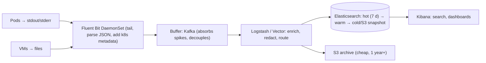

Design points:
- **Agents** on every node (Fluent Bit is lightweight), log to stdout in containers.
- **Buffering** (Kafka or the agent's disk buffer) so log spikes or a slow backend don't drop logs or block apps.
- **Index lifecycle management**: hot, warm, cold tiers, delete after N days; archive to S3 for compliance.
- **Index per day/service**, control mapping explosion (dynamic fields).
- Costs scale with ingest volume: drop noisy logs at the agent, sample, keep DEBUG out.

#### Example
A company ingesting 3 TB/day into Elasticsearch spent more on the logging cluster than on the product. They moved high-volume access logs to Loki (indexes only labels, stores chunks in S3, ~10× cheaper), kept application error and business logs in Elasticsearch with 14-day hot retention, archived everything to S3 for one year, and added drop rules for health-check logs (22% of volume).

#### Trade-offs
Central search and retention are essential for debugging and audits, but full-text indexing is expensive at scale, and the pipeline itself needs capacity planning and monitoring.

#### Problems & fixes
| Symptom | Cause | Fix |
|---|---|---|
| Logs missing during incidents | backend overloaded, agent dropping | Kafka/disk buffers, backpressure monitoring |
| Elasticsearch cluster red, mapping explosion | dynamic fields from arbitrary JSON | strict mappings, flatten/limit fields |
| Logging cost too high | indexing everything forever | drop/sample at agent, tiered retention, Loki for bulk |
| Slow searches | huge hot indices | ILM rollover, time-bounded queries |

#### Cheat sheet
- Agent (Fluent Bit) → buffer (Kafka) → processor → store (ES/Loki) → UI (Kibana/Grafana).
- Tiered retention + S3 archive. Drop noise at the agent.
- Monitor the logging pipeline itself.

#### Interview questions
<details><summary>Design log aggregation for 500 microservices producing 5 TB of logs per day.</summary>

Services log structured JSON to stdout. A Fluent Bit DaemonSet tails, parses and enriches with Kubernetes metadata, then ships to Kafka as a buffer. Processors (Vector or Logstash) redact, route and drop noise. Store searchable logs in Elasticsearch/OpenSearch or Loki with hot retention of 7–14 days and ILM tiers, and archive everything to S3 (queryable with Athena) for long-term retention. Access control by team, and monitor pipeline lag and drops.
</details>

<details><summary>Why put Kafka between log agents and Elasticsearch?</summary>

It decouples producers from the store: log spikes (incidents generate far more logs) are absorbed by Kafka instead of overwhelming Elasticsearch or making agents drop data or block applications. It allows replaying into a rebuilt cluster, fanning out to multiple destinations (SIEM, archive), and maintenance on the store without losing logs.
</details>

#### Interview angle
> "Fluent Bit ships structured logs through Kafka to OpenSearch or Loki with tiered retention and an S3 archive. Noise is dropped at the agent, because ingest volume is the cost driver."

#### Sources
- [Fluent Bit documentation](https://docs.fluentbit.io/manual/) — Fluent Bit
- [Loki overview](https://grafana.com/docs/loki/latest/get-started/overview/) — Grafana Loki docs

### Prometheus data model — time series labeled by key-value pairs; pull-based scraping
Prometheus stores **time series**: each series is identified by a **metric name plus a set of key-value labels** (`http_requests_total{service="checkout", route="/pay", code="200"}`) and holds (timestamp, float64) samples. Prometheus **pulls** (scrapes) metrics over HTTP from targets' `/metrics` endpoints at an interval (15–30 s), discovered via service discovery (Kubernetes, Consul, EC2).

#### Intuition
An inspector with a clipboard who walks round every 15 seconds and writes down each machine's readings. Each reading is filed under the machine's name and a few tags.

#### Must know
- A **time series** is a metric name plus a set of **labels**, with a value over time.
- Prometheus **pulls** (scrapes) metrics from each target's `/metrics` endpoint.
- Targets are found through service discovery.
- **Every unique label combination is a separate series.**
- Keep labels bounded. One server is not highly available without extra components.

#### Numbers to quote
- Scrape interval is usually 15–30 seconds. Local retention defaults to 15 days.

#### Common mistakes
- A user id or request id as a label, which exhausts memory.
- Expecting short-lived batch jobs to be scraped before they exit.
- One Prometheus with no replica, so alerting dies with it.

#### How it works
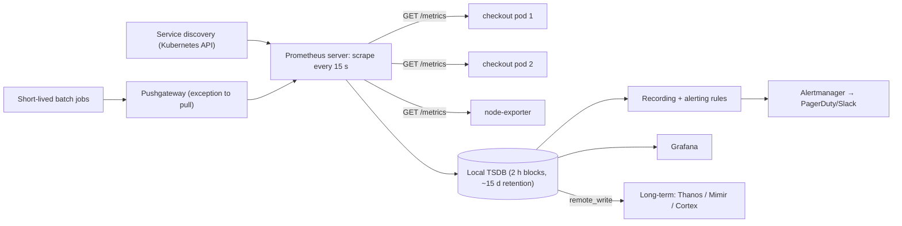

```
# HELP http_requests_total Total HTTP requests.
# TYPE http_requests_total counter
http_requests_total{route="/pay",method="POST",code="200"} 184213
http_requests_total{route="/pay",method="POST",code="502"} 37
```

**Cardinality**: every unique label combination is a separate series. `user_id` as a label could create millions of series and exhaust memory. Keep labels bounded.

Pull model benefits: Prometheus knows when a target is down (`up == 0`), targets don't need to know where to send, and scrape rate is centrally controlled. Pull struggles with short-lived jobs (Pushgateway) and targets behind NAT.

#### Example
An engineer added `customer_id` as a label to a latency histogram (20 buckets × 200k customers × routes). Active series jumped from 2M to 40M, and Prometheus OOM-crashed, taking alerting down with it. The fix: drop the label (per-customer analysis moved to traces and logs), add `sample_limit` per scrape job and an alert on series growth.

#### Trade-offs
Simple, reliable, powerful query language, great Kubernetes integration, but single-node by default (needs Thanos/Mimir for HA and long retention), cardinality limits, and no event-level detail.

#### Problems & fixes
| Symptom | Cause | Fix |
|---|---|---|
| Prometheus OOM | label cardinality explosion | bounded labels, sample_limit, relabel to drop |
| Batch job metrics missing | job finished before scrape | Pushgateway or push via OTLP |
| Only 15 days of history | local TSDB retention | Thanos/Mimir remote storage |
| Alerting down with Prometheus | single instance | HA pair + Alertmanager cluster |

#### Cheat sheet
- Series = metric name + labels. Samples are float64 over time.
- Pull scraping with service discovery. `up` metric for target health.
- Bounded labels only. Thanos/Mimir for HA and long retention.

#### Interview questions
<details><summary>Why shouldn't you use user_id as a Prometheus label?</summary>

Each unique combination of label values creates a new time series stored in memory and on disk. User ids are unbounded (millions of values), multiplied by other labels and histogram buckets, causing cardinality explosion: huge memory use, slow queries and potentially crashing Prometheus. Per-user detail belongs in logs, traces or an analytics store.
</details>

<details><summary>Pull vs push metrics collection: trade-offs?</summary>

Pull (Prometheus): central control over what and how often to scrape, automatic target health (`up`), easy local debugging (curl /metrics), and no client configuration of destinations, but it needs network reachability to targets and struggles with short-lived jobs. Push (StatsD, OTLP push, CloudWatch): works for ephemeral jobs and behind NAT, but the server can't distinguish "dead" from "quiet" without extra logic, and misbehaving clients can flood it.
</details>

#### Interview angle
> "Prometheus scrapes pods found through Kubernetes discovery, labels stay bounded (per-customer detail lives in traces), and Thanos or Mimir provide HA and long retention."

#### Sources
- [Data model](https://prometheus.io/docs/concepts/data_model/) — Prometheus docs
- [Overview](https://prometheus.io/docs/introduction/overview/) — Prometheus docs

### Prometheus metric types — Counter (monotone: total_requests), Gauge (current: active_connections), Histogram (latency buckets), Summary
Prometheus has four metric types: **Counter** (only goes up, resets on restart: requests, errors, bytes; query with `rate()`), **Gauge** (goes up and down: memory, queue depth, active connections), **Histogram** (observations counted into configurable buckets plus sum and count, aggregatable, used for latency percentiles), and **Summary** (client-side computed quantiles, not aggregatable across instances).

#### Intuition
A car has an odometer that only goes up, a fuel gauge that goes up and down, and a trip log that sorts journeys into "under 10 km", "under 50 km" and so on. Those are a counter, a gauge and a histogram.

#### Must know
- **Counter**: only increases. Query it with `rate()`.
- **Gauge**: goes up and down. Read the value directly.
- **Histogram**: counts observations into buckets. It can be **combined across instances**.
- **Summary**: quantiles computed in the client, which **cannot** be combined across instances.
- Use histograms for latency, with a bucket boundary at your SLO threshold.

#### Common mistakes
- Plotting a raw counter, which gives a sawtooth.
- Averaging p99 values from several pods.
- A counter for something that can decrease.

#### How it works
| Type | Example | Query pattern | Notes |
|---|---|---|---|
| Counter | `http_requests_total` | `rate(x[5m])`, `increase(x[1h])` | never use raw value; resets handled by rate |
| Gauge | `queue_depth`, `jvm_memory_used_bytes` | raw value, `avg_over_time`, `max_over_time` | snapshot at scrape time |
| Histogram | `http_request_duration_seconds_bucket{le="0.25"}` | `histogram_quantile(0.99, sum by (le)(rate(x_bucket[5m])))` | aggregatable; accuracy depends on buckets |
| Summary | `rpc_duration_seconds{quantile="0.99"}` | raw quantile per instance | can't aggregate quantiles across pods |

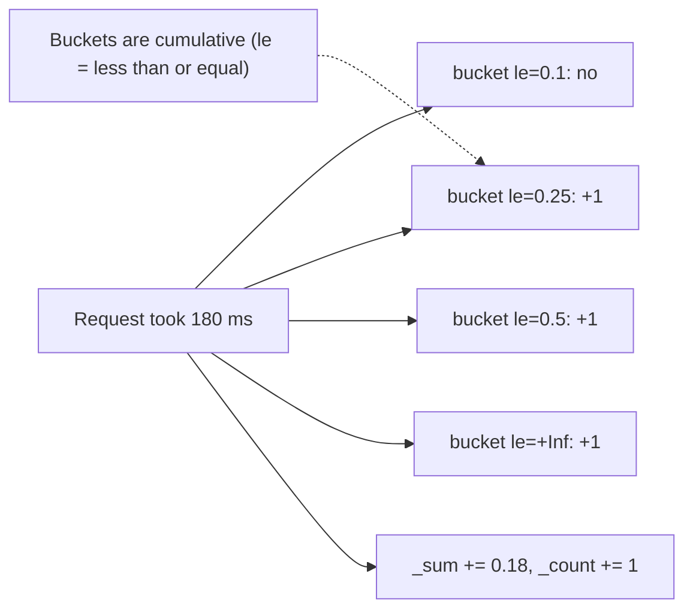

Bucket choice matters: put boundaries around your SLO threshold (e.g. 0.1, 0.25, **0.3**, 0.5, 1, 2.5) for accurate SLI ratios. **Native histograms** (newer Prometheus) use exponential buckets automatically with better accuracy.

#### Example
A team tracked latency with a Summary in each of 30 pods and averaged the p99s in Grafana, which is mathematically meaningless: the dashboard showed 180 ms while real fleet-wide p99 was 600 ms (a few pods were much slower). Switching to a histogram and computing `histogram_quantile` over summed buckets showed the true p99 and the slow pods.

#### Trade-offs
Histograms are flexible and aggregatable but approximate (bucket resolution) and multiply series by bucket count. Summaries are exact per instance but can't be aggregated. Counters require `rate()` understanding.

#### Problems & fixes
| Symptom | Cause | Fix |
|---|---|---|
| Graph of requests looks like a sawtooth | plotting raw counter | `rate()` / `increase()` |
| Fleet p99 wrong | averaging summary quantiles | histograms aggregated before quantile |
| p99 jumps between bucket values | coarse buckets | buckets near SLO thresholds, native histograms |
| Series explosion | many buckets × many labels | fewer buckets, fewer labels |

#### Cheat sheet
- Counter (rate it), Gauge (read it), Histogram (aggregate buckets then quantile), Summary (per-instance only).
- Buckets around SLO thresholds.
- Never average percentiles.

#### Interview questions
<details><summary>Why can't you average p99 latencies from multiple instances?</summary>

Percentiles aren't linear: the average of each instance's p99 isn't the p99 of all requests combined, especially when instances have different traffic or latency. Histograms store bucket counts, which can be summed across instances first, then the quantile is computed over the combined distribution.
</details>

<details><summary>Should "current number of in-flight requests" be a counter or a gauge?</summary>

A gauge: it goes up and down. Counters are only for cumulative totals that increase (requests served, errors, bytes sent). Using a counter for something that decreases breaks `rate()` because decreases are interpreted as counter resets.
</details>

#### Interview angle
> "Latency is a histogram with buckets at the SLO threshold, summed across pods before histogram_quantile, because averaging per-pod p99s is meaningless."

#### Sources
- [Metric types](https://prometheus.io/docs/concepts/metric_types/) — Prometheus docs
- [Histograms and summaries](https://prometheus.io/docs/practices/histograms/) — Prometheus docs

### PromQL queries — rate(http_requests_total[5m]), histogram_quantile(0.99, ...), topk(5, ...)
PromQL is Prometheus's functional query language for selecting and aggregating time series. Core building blocks: **selectors** with label matchers, **range vectors** (`[5m]`), functions like `rate()`, `increase()`, `histogram_quantile()`, aggregation operators (`sum by`, `avg`, `topk`), and binary operations between series (ratios, thresholds) that power dashboards, recording rules and alerts.

#### Intuition
A spreadsheet formula language for time series. Pick the series you want, turn the running totals into per-second speeds, then add them up by group.

#### Must know
- `rate(counter[5m])` turns a counter into a per-second rate.
- **Apply `rate()` first, then `sum()`**, so counter resets are handled.
- `histogram_quantile(0.99, sum by (le) (rate(..._bucket[5m])))` gives p99. Keep the `le` label.
- A ratio of two rates gives an error ratio.
- Use **recording rules** for queries that dashboards and alerts run constantly.

#### Numbers to quote
- Make the range at least 4× the scrape interval.

#### Common mistakes
- `sum` before `rate`, which gives spikes whenever a pod restarts.
- Dropping `le` when aggregating histogram buckets.
- Heavy raw queries on every dashboard refresh.

#### How it works
```promql
# per-second request rate per service over 5 minutes
sum by (service) (rate(http_requests_total{env="prod"}[5m]))

# error ratio per service
sum by (service) (rate(http_requests_total{code=~"5.."}[5m]))
  / sum by (service) (rate(http_requests_total[5m]))

# p99 latency per route (aggregate buckets first, keep le)
histogram_quantile(0.99, sum by (le, route) (rate(http_request_duration_seconds_bucket[5m])))

# top 5 pods by CPU usage
topk(5, sum by (pod) (rate(container_cpu_usage_seconds_total{namespace="checkout"}[5m])))

# disk will fill within 4 hours (linear prediction)
predict_linear(node_filesystem_avail_bytes{mountpoint="/"}[6h], 4 * 3600) < 0

# targets down
up == 0
```

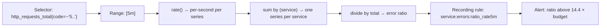

Rules of thumb: `rate()` **before** `sum()` (rate must see each counter's resets); keep `le` in `by` for histogram quantiles; range at least 4× the scrape interval; use **recording rules** for expensive, frequently used queries (dashboards and alerts).

#### Example
A dashboard query `rate(sum(http_requests_total)[5m])` (sum then rate, via a subquery) showed huge negative spikes whenever a pod restarted, because summing counters hides individual resets. Rewriting as `sum(rate(http_requests_total[5m]))` fixed it. Expensive per-route p99 queries were turned into recording rules, cutting dashboard load time from 12 s to under 1 s.

#### Trade-offs
Powerful and concise, but easy to write subtly wrong queries (rate/sum order, missing `le`), and heavy queries over long ranges are slow without recording rules.

#### Problems & fixes
| Symptom | Cause | Fix |
|---|---|---|
| Spikes at restarts | sum before rate | rate then sum |
| histogram_quantile returns NaN/garbage | `le` dropped in aggregation | `sum by (le, …)` |
| Jagged or empty rates | range too short for scrape interval | range ≥ 4× scrape interval |
| Slow dashboards and alert evaluation | heavy raw queries | recording rules |

#### Cheat sheet
- `rate()` counters, then `sum by`. Keep `le` for histograms.
- `topk`, `predict_linear`, `up == 0`, ratios for SLIs.
- Recording rules for hot queries.

#### Interview questions
<details><summary>Why must you apply rate() before sum()?</summary>

Counters reset to zero when a process restarts. `rate()` detects resets per series and compensates. If you sum counters across pods first, a reset in one pod looks like a drop in the total that `rate()` can't correctly interpret, producing wrong or negative spikes. Rate each series, then aggregate.
</details>

<details><summary>Write a PromQL expression for the 99th percentile latency of the checkout service.</summary>

`histogram_quantile(0.99, sum by (le) (rate(http_request_duration_seconds_bucket{service="checkout"}[5m])))`: compute per-second bucket rates, sum across all pods while keeping the `le` label, then estimate the 99th percentile from the combined histogram.
</details>

#### Interview angle
> "Rate first, then sum, keep le for quantiles, and use recording rules for anything a dashboard or alert evaluates constantly."

#### Sources
- [Querying basics](https://prometheus.io/docs/prometheus/latest/querying/basics/) — Prometheus docs
- [Query functions](https://prometheus.io/docs/prometheus/latest/querying/functions/) — Prometheus docs
- [Recording rules](https://prometheus.io/docs/practices/rules/) — Prometheus docs

### Grafana — connect to Prometheus/CloudWatch/InfluxDB; build dashboards, set alert thresholds
Grafana is the de facto open-source **visualisation and dashboarding** layer for observability. It connects to many **data sources** (Prometheus, Loki, Tempo, CloudWatch, Elasticsearch, InfluxDB, SQL databases), lets you build dashboards with variables and templates, link metrics → traces → logs, and define **alerts** routed to Slack, PagerDuty and others.

#### Intuition
The control-room wall of screens. It stores no data itself. It pulls numbers from many systems and draws them side by side, so one glance shows what is happening.

#### Must know
- The standard open-source **dashboard layer** for observability.
- It **connects to many data sources**: metrics, logs, traces, cloud monitoring, SQL.
- Dashboards use variables, so one template serves every service.
- Mark **deploys** on every graph.
- Keep dashboards in Git as code, with an owner.

#### Common mistakes
- Hundreds of stale, duplicated dashboards.
- No deploy markers, so nobody can tell whether a release caused the spike.
- Alerts defined in several tools with no standard.

#### How it works
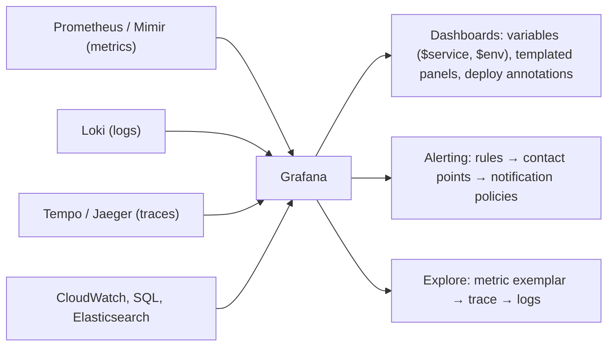

Dashboard practices:
- **Hierarchy**: overview (all services' SLOs) → service (golden signals) → deep-dive (resources, dependencies).
- **Templated** dashboards with variables, managed as code (JSON in Git, Grafonnet, Terraform provider).
- **Annotations** for deploys and incidents on every graph.
- Consistent units, thresholds, and colour conventions. Every panel answers a question.
- Link panels to runbooks and to related dashboards.

#### Example
A company had 900 dashboards, most stale or duplicated, and on-call engineers didn't know which to open. They rebuilt around three tiers: an SLO overview, one templated service dashboard (RED + saturation + deploy annotations), and per-dependency dashboards, all provisioned from Git via Terraform. Alerts linked straight to the service dashboard with the relevant variables pre-filled.

#### Trade-offs
Flexible, multi-source, open source, but dashboard sprawl is common, alerts defined in many places get confusing, and complex dashboards can overload data sources.

#### Problems & fixes
| Symptom | Cause | Fix |
|---|---|---|
| Hundreds of stale dashboards | no ownership | dashboards as code, ownership, cleanup |
| Dashboards slow or time out | expensive queries, long ranges | recording rules, sensible defaults, caching |
| Can't tell if a deploy caused the spike | no annotations | deploy annotations from CI/CD |
| Alerts in both Prometheus and Grafana | no standard | choose one alerting path per team |

#### Cheat sheet
- Many data sources, dashboards, Explore, alerting.
- Tiered dashboards, templating, annotations, dashboards as code.
- Link metrics → traces → logs; link alerts → dashboards → runbooks.

#### Interview questions
<details><summary>What makes a good on-call dashboard?</summary>

It answers "is it broken, how badly, since when, and where" at a glance: SLO and error budget status, the golden signals split by key dimensions (region, version, route), dependency health, saturation, and deploy annotations. It's templated per service, loads quickly, uses consistent units and thresholds, and links to traces, logs and runbooks.
</details>

<details><summary>Why manage dashboards as code?</summary>

Version control and review prevent accidental breakage, changes are auditable and revertible, dashboards are reproducible across environments and clusters, templates can be shared across services, and ownership is clear. Clicked-together dashboards drift, duplicate and rot.
</details>

#### Interview angle
> "Dashboards are provisioned from Git in three tiers (SLO overview, templated service view, dependency deep-dives) with deploy annotations and exemplar links to Tempo and Loki."

#### Sources
- [Grafana dashboard best practices](https://grafana.com/docs/grafana/latest/dashboards/build-dashboards/best-practices/) — Grafana docs
- [About Grafana](https://grafana.com/docs/grafana/latest/introduction/) — Grafana docs

### Distributed tracing — trace = end-to-end request; span = single operation with start/end/metadata
Distributed tracing follows a single request through every service it touches. A **trace** is the whole journey, identified by a **trace_id**. It's composed of **spans**, each one operation (an HTTP handler, a DB query, a Kafka publish) with start time, duration, attributes, status and a **parent span id**. Context is **propagated** across process boundaries in headers, so spans from different services assemble into one tree.

#### Intuition
A parcel's tracking history. Every depot scans it and records when it arrived and left. Put the scans together and you see the whole journey and where it sat waiting.

#### Must know
- A **trace** is one request's whole journey, identified by a trace id.
- A **span** is one operation inside it, with a start, a duration and a parent.
- Context is **passed along in headers**, so spans from different services join into one tree.
- **Sampling** controls cost: head-based is simple, tail-based keeps errors and slow traces.
- Queues need the context carried in message headers too.

#### Common mistakes
- One service that does not forward the headers, which breaks the trace.
- 1% head sampling, so the rare error is never captured.
- No tracing across Kafka or other asynchronous hops.

#### How it works
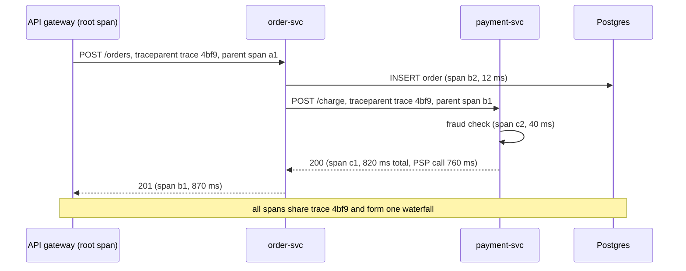

**Sampling** controls cost:
- **Head-based**: decide at the start (e.g. keep 5%), simple and cheap, but may miss rare errors.
- **Tail-based**: buffer spans in a collector and decide after the trace completes (keep all errors, all slow traces, plus a small % of normal ones). Better signal, more infrastructure.

Async boundaries (Kafka, SQS) need context passed in message headers. Span links connect a consumer batch to multiple producer traces.

#### Example
Checkout p99 was 2 s, and every team insisted their service was fast. A trace waterfall showed order-svc calling inventory-svc **sequentially for each of 12 cart items** (12 × 80 ms), and payment-svc retrying the PSP once after a 500 ms timeout. Parallelising inventory calls and fixing the timeout dropped p99 to 650 ms. With tail-based sampling keeping every trace over 1 s, those examples were always available.

#### Trade-offs
Unmatched visibility into cross-service latency and errors, but requires consistent instrumentation and propagation everywhere (one uninstrumented hop breaks the trace), and storage cost needs sampling.

#### Problems & fixes
| Symptom | Cause | Fix |
|---|---|---|
| Traces broken into fragments | a service doesn't propagate headers | OpenTelemetry auto-instrumentation, propagation in queues |
| Slow/error traces missing | head sampling at 1% | tail-based sampling for errors and slow traces |
| Tracing bill too high | 100% sampling | sampling policies, attribute limits |
| Async flows invisible | no context in message headers | inject context into Kafka headers, span links |

#### Cheat sheet
- Trace = tree of spans sharing a trace_id; parent ids link spans.
- Propagate context in HTTP headers and message headers.
- Head vs tail sampling; keep all errors and slow traces.

#### Interview questions
<details><summary>Head-based vs tail-based sampling: what's the trade-off?</summary>

Head-based sampling decides at the first span (keep a percentage), so it's cheap and simple, but blind to outcome: rare errors or slow requests may be dropped. Tail-based sampling buffers all spans of a trace in collectors and decides after completion based on errors, latency or attributes, keeping the interesting traces, at the cost of collector memory, complexity and needing all spans of a trace routed to the same collector.
</details>

<details><summary>How do you trace a request through Kafka?</summary>

The producer injects the trace context (W3C traceparent) into Kafka message headers when publishing, creating a producer span. The consumer extracts it and starts a consumer span as a child (or with a span link, especially for batch processing). OpenTelemetry instrumentation for Kafka clients does this automatically.
</details>

#### Interview angle
> "Every hop propagates W3C trace context, including Kafka headers, and tail sampling keeps all error and slow traces. The waterfall exposes things like sequential fan-out immediately."

#### Sources
- [Traces](https://opentelemetry.io/docs/concepts/signals/traces/) — OpenTelemetry docs
- [Dapper, a large-scale distributed systems tracing infrastructure](https://research.google/pubs/dapper-a-large-scale-distributed-systems-tracing-infrastructure/) — Google Research
- [Sampling](https://opentelemetry.io/docs/concepts/sampling/) — OpenTelemetry docs

### OpenTelemetry — vendor-neutral SDK for traces, metrics, logs; single integration for all backends
OpenTelemetry (OTel) is the CNCF standard for generating and exporting telemetry: **APIs and SDKs** for traces, metrics and logs in all major languages, **auto-instrumentation** for common frameworks, the **OTLP** wire protocol, and the **Collector**, a pipeline that receives, processes and exports telemetry to any backend. You instrument once and can switch vendors without touching code.

#### Intuition
A universal plug. You wire your application once to a standard socket, and can then connect it to any monitoring product with no rewiring.

#### Must know
- The open standard for **producing and exporting telemetry**: traces, metrics and logs.
- **Instrument once.** Changing vendor is a configuration change.
- **Auto-instrumentation** covers common frameworks with little code.
- **OTLP** is its wire protocol.
- The **Collector** receives, processes (batch, sample, redact) and forwards telemetry.

#### Common mistakes
- Not setting `service.name`, so everything shows as an unknown service.
- A Collector with no memory limit, which crashes under load.
- Sensitive values captured in span attributes by default.

#### How it works
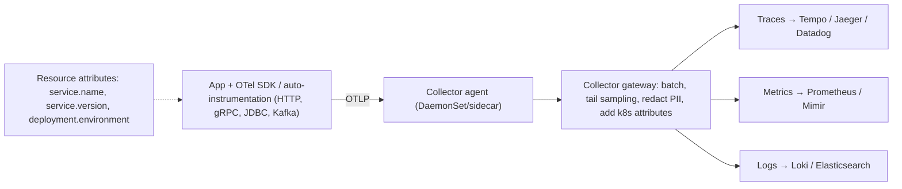

Key concepts: **resource** (what's emitting: service name, version, environment), **semantic conventions** (standard attribute names like `http.request.method`, `db.system`), **context propagation** (W3C traceparent by default), and **processors** in the Collector (batch, memory limiter, attributes, tail sampling).

#### Example
A company paying a large APM bill used vendor agents in 200 services. They migrated to OTel auto-instrumentation (Java agent, Node SDK) exporting to an OTel Collector. The Collector initially sent data both to the vendor and to a self-hosted Grafana stack (Tempo, Mimir, Loki) for a side-by-side comparison, then switched fully, cutting costs ~60%. Code didn't change when they changed backends.

#### Trade-offs
Vendor neutrality, one standard across languages, rich auto-instrumentation, but maturity varies by signal and language, the Collector is another system to run, and semantic conventions still evolve.

#### Problems & fixes
| Symptom | Cause | Fix |
|---|---|---|
| Services show as "unknown_service" | service.name not set | set resource attributes via env (OTEL_SERVICE_NAME) |
| Collector OOM under load | no memory limiter, huge batches | memory_limiter processor, scaling |
| PII in span attributes | auto-instrumented query params/bodies | attribute processors to redact, config limits |
| Locked into vendor agents | proprietary SDKs | OTel SDK + Collector exporters |

#### Cheat sheet
- One API/SDK for traces, metrics, logs. OTLP protocol. Collector pipelines.
- Auto-instrumentation + semantic conventions + resource attributes.
- Collector: batch, memory limiter, tail sampling, redaction, multi-export.

#### Interview questions
<details><summary>Why run an OpenTelemetry Collector instead of exporting directly from apps to the backend?</summary>

The Collector centralises processing: batching and retries, tail-based sampling, redaction of sensitive attributes, enrichment with Kubernetes metadata, and routing to one or several backends. Backend changes or credentials are handled in config rather than in every app, and apps offload export work quickly to a local agent.
</details>

<details><summary>How does OpenTelemetry help avoid vendor lock-in?</summary>

Code is instrumented against the vendor-neutral OTel API and SDK and emits OTLP. Choosing or changing a backend is a Collector exporter configuration change, not a re-instrumentation of hundreds of services. Most vendors accept OTLP natively.
</details>

#### Interview angle
> "Services use OpenTelemetry auto-instrumentation and export OTLP to a Collector that batches, tail-samples and redacts before sending to the backends. Switching vendors is a config change."

#### Sources
- [What is OpenTelemetry?](https://opentelemetry.io/docs/what-is-opentelemetry/) — OpenTelemetry docs
- [Collector](https://opentelemetry.io/docs/collector/) — OpenTelemetry docs

### W3C TraceContext — traceparent and tracestate headers for cross-service trace propagation
W3C Trace Context is the standard for propagating trace identity across services in HTTP (and other) headers. **`traceparent`** carries the version, a 16-byte trace id, the 8-byte parent span id and trace flags (sampled bit). **`tracestate`** carries vendor-specific key-values. A standard header lets services using different tracing vendors and libraries join the same trace. **Baggage** (a separate W3C header) carries application key-values.

#### Intuition
A reference number written on a letter as it passes between departments. Each department keeps the same reference and adds its own initials, so the whole chain can be traced later.

#### Must know
- The standard header for passing trace identity between services.
- `traceparent` holds a **version, trace id, parent span id and flags**.
- Each hop keeps the trace id and replaces the parent id with its own span id.
- The **sampled** flag tells services downstream whether to record.
- `tracestate` carries vendor data. `baggage` carries application key-values.

#### Numbers to quote
- The trace id is 16 bytes (32 hex characters). The span id is 8 bytes (16 hex characters).

#### Common mistakes
- Trusting a `traceparent` sent by an external client, which can force sampling.
- Mixed propagation formats (W3C and B3) with no bridge.
- Sensitive data in baggage, which is sent to every downstream service.

#### How it works
```
traceparent: 00-4bf92f3577b34da6a3ce929d0e0e4736-00f067aa0ba902b7-01
             │  │                                │                └ flags: 01 = sampled
             │  │                                └ parent span id (16 hex)
             │  └ trace id (32 hex)
             └ version
tracestate: dd=s:1;o:rum,congo=t61rcWkgMzE
baggage: tenant=acme,plan=gold
```

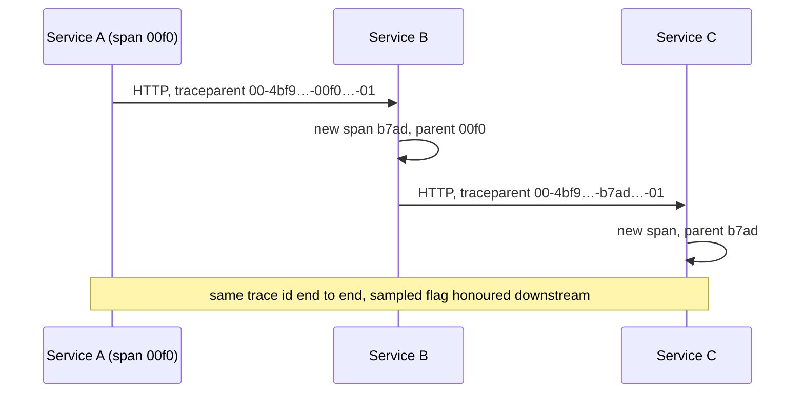

Points:
- Each hop keeps the trace id, replaces the parent id with its own span id, and respects the sampled flag (consistent sampling decisions).
- Edge services decide whether to **trust incoming** traceparent from the internet (can be spoofed or abused to force sampling); often start a new trace and link the external one.
- Older formats (B3 from Zipkin, X-Ray headers) can be bridged by propagators.
- Don't put sensitive data in baggage: it's sent to every downstream service and possibly third parties.

#### Example
Traces broke at a Go service using an old Zipkin library that only understood B3 headers. Configuring composite propagators (W3C + B3) in the OTel SDK on both sides restored full traces during the migration. Later, a mobile client sent forged traceparents with the sampled flag set, causing 100% sampling of that traffic; the edge gateway now starts fresh traces for external requests.

#### Trade-offs
Interoperable standard across vendors and languages, but legacy formats need bridging, incoming context from untrusted clients needs policy, and baggage can leak data or bloat headers.

#### Problems & fixes
| Symptom | Cause | Fix |
|---|---|---|
| Traces split at one service | different propagation format | composite propagators (W3C + B3) |
| External clients force sampling | trusting incoming traceparent | restart trace at edge, link external |
| Sensitive data seen by third parties | baggage propagated outbound | restrict baggage keys, strip at egress |

#### Cheat sheet
- traceparent = version-traceid-parentid-flags. tracestate = vendor data. baggage = app key-values.
- Each hop keeps trace id, sets new parent id, honours sampled flag.
- Bridge B3/X-Ray; don't trust or leak context at the edge.

#### Interview questions
<details><summary>What does each part of the traceparent header mean?</summary>

`00` is the version, the next 32 hex characters are the trace id (constant across the whole trace), the next 16 hex characters are the parent span id (the calling span, replaced at each hop), and the final byte is the trace flags, mainly the sampled bit telling downstream services whether to record.
</details>

<details><summary>Should a public API gateway trust incoming traceparent headers?</summary>

Usually not blindly: external clients can forge ids or force the sampled flag, inflating tracing costs or polluting traces. A common policy is to start a new trace at the edge and attach the external context as a link or attribute, trusting incoming context only from known internal or partner sources (or your own instrumented frontends).
</details>

#### Interview angle
> "Propagation uses W3C traceparent everywhere, with B3 bridged during migrations. At the edge we start fresh traces rather than trusting client-supplied sampling flags."

#### Sources
- [Trace Context](https://w3c.github.io/trace-context/) — W3C
- [Propagation format for distributed context: Baggage](https://w3c.github.io/baggage/) — W3C

### Jaeger / Zipkin — open-source distributed tracing backends; Tempo (Grafana), X-Ray (AWS)
Tracing backends receive, store and visualise spans. **Zipkin** (Twitter, 2012) and **Jaeger** (Uber, CNCF) are the classic open-source options with search UIs and service dependency graphs. **Grafana Tempo** stores traces cheaply in object storage, indexing only trace ids (found via exemplars, logs or TraceQL). **AWS X-Ray** is the managed AWS option. All accept OpenTelemetry data today.

#### Intuition
The filing room for parcel-tracking records. Different rooms file them differently: some index every detail for quick search, others stack them cheaply and find them by tracking number.

#### Must know
- A tracing backend **stores spans and shows them** as a waterfall.
- **Jaeger and Zipkin**: classic open-source backends with indexed search.
- **Tempo**: stores traces in object storage with a minimal index. Much cheaper at scale.
- **X-Ray**: the managed AWS option.
- All accept OpenTelemetry data, so the backend can change later.

#### Common mistakes
- Indexing every span attribute at full volume.
- No way to find the interesting trace: no exemplars and no trace id in logs.
- Vendor-specific instrumentation that ties you to one backend.

#### How it works
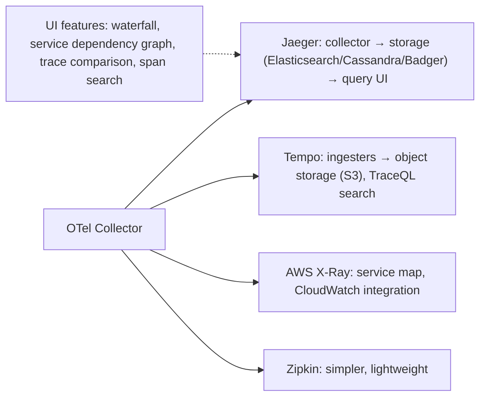

| | Jaeger | Zipkin | Tempo | X-Ray |
|---|---|---|---|---|
| Storage | ES, Cassandra, Badger | ES, Cassandra, MySQL | object storage | managed |
| Strength | mature, CNCF, sampling strategies | simple, lightweight | very cheap at scale, Grafana integration | AWS-native, Lambda support |
| Search | by service, tags, duration | similar | TraceQL, via exemplars/logs | filter expressions |

#### Example
A team ran Jaeger with Elasticsearch storage and spent heavily on ES nodes to keep 7 days of traces at 30k spans/s. Moving to Tempo with S3 storage let them keep 30 days at a fraction of the cost. They found traces mostly via exemplars on Grafana latency graphs and trace_ids in Loki logs, plus TraceQL queries like `{ span.http.status_code >= 500 && resource.service.name = "checkout" }`.

#### Trade-offs
Open-source backends avoid vendor costs but need operating storage. Tempo is cheap but relies on other signals or TraceQL for discovery. Managed X-Ray is easy on AWS but less flexible.

#### Problems & fixes
| Symptom | Cause | Fix |
|---|---|---|
| Tracing storage costs high | indexed span storage at full volume | Tempo/object storage, sampling |
| Can't find the interesting trace | no search by attributes | TraceQL, exemplars, trace ids in logs |
| Vendor migration painful | vendor-specific instrumentation | OTel everywhere |

#### Cheat sheet
- Jaeger/Zipkin: classic OSS with indexed storage. Tempo: object storage, cheap. X-Ray: AWS-managed.
- Feed all via OTel Collector.
- Discover traces via exemplars, logs and attribute queries.

#### Interview questions
<details><summary>How do you choose a tracing backend?</summary>

Consider volume and retention cost (indexed stores vs object storage), how engineers will find traces (attribute search vs exemplars/logs), integration with existing dashboards (Grafana stack, AWS), operational capacity (self-hosted vs managed), and features like tail sampling support or service maps. With OpenTelemetry instrumentation, the backend can change later.
</details>

<details><summary>Why can Tempo be so much cheaper than Jaeger with Elasticsearch?</summary>

Tempo writes spans into compressed blocks in object storage and indexes minimally (by trace id, with columnar Parquet blocks for TraceQL), avoiding the large, memory- and disk-heavy inverted indexes Elasticsearch builds for every span attribute. Object storage costs far less per GB than ES cluster nodes.
</details>

#### Interview angle
> "Spans flow from the OTel Collector into Tempo on S3 for cheap 30-day retention. Engineers reach traces through exemplars, log trace_ids and TraceQL rather than heavy indexes."

#### Sources
- [Jaeger documentation](https://www.jaegertracing.io/docs/) — Jaeger
- [Grafana Tempo documentation](https://grafana.com/docs/tempo/latest/) — Grafana Tempo
- [Zipkin](https://zipkin.io/) — OpenZipkin

### APM tools — Datadog, New Relic, Dynatrace: trace + metrics + logs in one platform
Application Performance Monitoring (APM) platforms like **Datadog, New Relic, Dynatrace, Elastic APM, Honeycomb** provide **all observability signals in one SaaS product**: auto-instrumentation agents, distributed tracing, metrics, logs, real-user monitoring, profiling, error tracking, service maps and AI-assisted anomaly detection, with correlation built in.

#### Intuition
Hiring a full facilities company where you could have bought tools and staffed it yourself. Everything works together on day one, and the bill grows with every room you add.

#### Must know
- A hosted product with **traces, metrics and logs in one place**, already linked.
- **Buy**: quick to adopt, no operations work, rich features.
- **Build** (Prometheus, Loki, Tempo, Grafana): cheaper at scale, needs a platform team.
- Cost grows with hosts, log volume, spans and custom metrics.
- Instrument with **OpenTelemetry** to keep the option of switching.

#### Common mistakes
- Indexing all logs and adding high-cardinality tags to custom metrics.
- Proprietary agents everywhere, which makes leaving very expensive.
- No per-team view of what the telemetry costs.

#### How it works
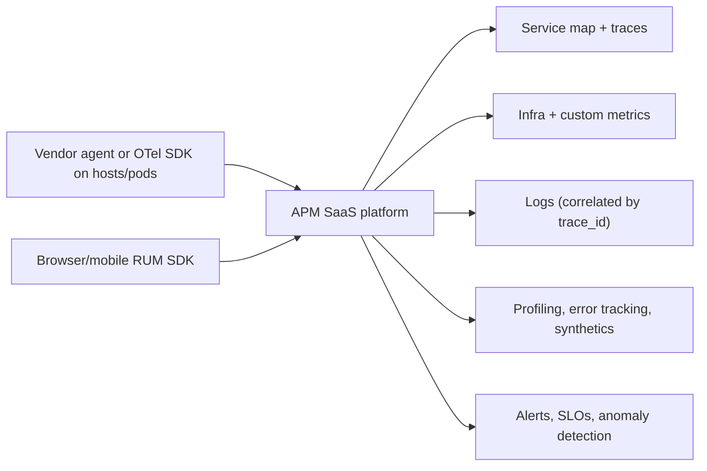

Build vs buy:
- **Buy (APM)**: fast to adopt, integrated correlation, no ops burden, advanced features. But cost scales with hosts, spans, log GB and custom metrics, which can become very large, plus lock-in to proprietary agents.
- **Build (Grafana stack / OSS)**: cheaper at scale, flexible, but needs a platform team to run Prometheus/Mimir, Loki, Tempo, Collectors.
- Many use **OpenTelemetry** with a vendor to keep options open, and control cost with sampling, log exclusion and metric cardinality limits.

#### Example
A startup adopted Datadog early and loved it, then the bill grew to 18% of cloud spend, mostly from indexed logs and custom metrics with high-cardinality tags. They excluded noisy logs (indexing only errors and business events, archiving the rest to S3), dropped high-cardinality tags, and moved to OTel instrumentation, which halved the bill and gave them leverage in renewal negotiations.

#### Trade-offs
Fastest path to full observability with great UX, but costs can grow nonlinearly with scale, and proprietary agents create lock-in.

#### Problems & fixes
| Symptom | Cause | Fix |
|---|---|---|
| Bill explodes | indexed logs, custom metric tags, span volume | exclusion filters, sampling, cardinality governance |
| Locked to vendor agents | proprietary instrumentation | OpenTelemetry SDKs |
| Teams create unbounded custom metrics | no governance | budgets per team, tag policies |

#### Cheat sheet
- APM = SaaS with traces, metrics, logs, RUM, profiling, correlation.
- Buy for speed, build for cost at scale; OTel keeps the door open.
- Govern cost: log indexing, metric tags, sampling.

#### Interview questions
<details><summary>Would you choose an APM vendor or a self-hosted observability stack for a 50-engineer company?</summary>

Usually a vendor at first: integrated tooling with no dedicated platform team needed, and faster incident response. Instrument with OpenTelemetry to avoid lock-in, set cost controls from day one, and reassess as scale grows. A self-hosted Grafana stack becomes attractive when telemetry volume makes vendor pricing very expensive and there's a team to run it.
</details>

<details><summary>What usually drives APM costs, and how do you control them?</summary>

Number of hosts or containers, indexed log volume, ingested and indexed spans, and custom metrics (each unique tag combination billed). Control with log exclusion and sampling (archive rather than index), tail-based trace sampling, avoiding high-cardinality tags on metrics, retention tiers, and per-team cost visibility.
</details>

#### Interview angle
> "At our size I'd buy an APM but instrument with OpenTelemetry, index only error and business logs, and govern metric tags, so cost stays predictable and switching stays possible."

#### Sources
- [Vendors who natively support OpenTelemetry](https://opentelemetry.io/ecosystem/vendors/) — OpenTelemetry
- [APM](https://docs.datadoghq.com/tracing/) — Datadog docs

### Alerting best practices — alert on SLO burn rate, not raw metrics; PagerDuty + runbooks for every alert
Good alerting wakes a human **only when users are (or will soon be) impacted and a human must act**. Page on **symptoms** (SLO burn rate, user-facing errors and latency), not causes (CPU at 80%). Route lower-urgency issues to tickets. Every page must be **actionable**, have an **owner**, and link to a **runbook** and a dashboard.

#### Intuition
A smoke alarm should ring for a fire, not for toast. If it rings every morning, people take the battery out, and then it is silent on the day there is a fire.

#### Must know
- **Page a person only when users are affected and a person must act.**
- Page on **symptoms** (SLO burn rate), not causes (CPU at 80%).
- Less urgent issues become tickets, not pages.
- Every page has an **owner, a runbook and a dashboard link**.
- Group and suppress related alerts, and review alert quality regularly.

#### Numbers to quote
- Aim for no more than about 2 actionable pages per on-call shift.

#### Common mistakes
- Dozens of noisy cause-based alerts that everyone learns to ignore.
- One root cause producing fifty separate pages.
- A page with no runbook, so the responder starts from nothing.

#### How it works
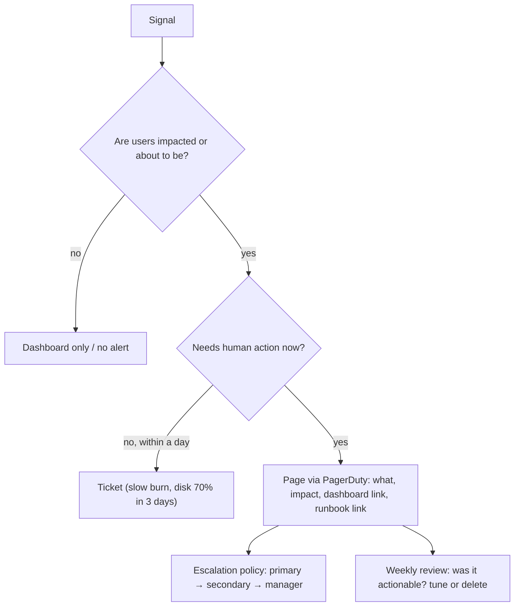

Rules:
- **Symptom-based** paging (burn rate) plus a few cause-based ones that predict certain outages (disk full in 4 hours, certificate expires in 7 days).
- Each alert: clear title, severity, impact, links to dashboard and runbook, owner team.
- **Deduplicate and group** (Alertmanager grouping, inhibition: don't page for 50 services when the database is down).
- Review alert quality weekly: track pages per shift, % actionable, false positives. Delete alerts nobody acts on.
- Target: no more than ~2 actionable pages per on-call shift.

#### Example
An on-call rotation received ~60 alerts per week, mostly CPU, memory and single-pod restarts, which engineers learned to ignore, and a real outage was missed for 25 minutes. The team replaced cause alerts with SLO burn-rate pages for each critical journey, kept a few predictive alerts, added runbook links, and set Alertmanager inhibition rules. Pages dropped to ~4 per week, all actionable.

#### Trade-offs
Fewer, better alerts improve response and on-call health, but symptom-only alerting may react later to some failures, and SLO alerts need good SLIs.

#### Problems & fixes
| Symptom | Cause | Fix |
|---|---|---|
| Alert fatigue, ignored pages | noisy cause-based alerts | symptom/SLO alerts, delete non-actionable ones |
| Alert storm for one root cause | no grouping/inhibition | Alertmanager grouping and inhibition rules |
| Responder doesn't know what to do | no runbook | runbook link mandatory for every page |
| Predictable failures not caught | only symptom alerts | predictive alerts (disk, certs, quotas) |

#### Cheat sheet
- Page on symptoms and burn rate; ticket slow burns; dashboard the rest.
- Every page actionable, owned, with runbook and dashboard links.
- Group, inhibit, review weekly; ~2 pages per shift max.

#### Interview questions
<details><summary>Why is "CPU above 80%" usually a bad paging alert?</summary>

High CPU doesn't necessarily affect users (batch workloads, autoscaling will handle it, efficient utilisation), so it pages people for non-problems and trains them to ignore alerts. Meanwhile, user-impacting failures can happen at low CPU. Page on user-facing symptoms; keep CPU on dashboards and use it for capacity planning or autoscaling.
</details>

<details><summary>What should a good runbook contain?</summary>

What the alert means and its user impact, how to verify it (dashboard and query links), common causes with diagnostic steps, mitigation steps (rollback, failover, scaling, feature flags) with exact commands, escalation contacts, and links to past incidents. Keep it short, current and tested in game days.
</details>

#### Interview angle
> "We page only on SLO burn rate plus a few predictive alerts like disk or cert expiry. Every page carries a runbook and dashboard link, and alerts nobody acts on get deleted in the weekly review."

#### Sources
- [Alerting on SLOs](https://sre.google/workbook/alerting-on-slos/) — Google SRE workbook
- [Alerting](https://prometheus.io/docs/practices/alerting/) — Prometheus docs

### P50/P99/P99.9 latency — mean misleads; tail latency (P99.9) matters at scale (1 in 1000 requests)
Latency percentiles describe the distribution: **p50** (median, the typical request), **p99** (1 in 100 is slower), **p99.9** (1 in 1,000 is slower). Means hide tail behaviour and get skewed by outliers. At scale, tails dominate user experience because one page load or API call **fans out** to many backend calls, and the slowest one determines the response.

#### Intuition
A supermarket's average queue time can be two minutes while one unlucky shopper in a hundred waits twenty. If each trip means visiting many counters, you are very likely to hit at least one long queue.

#### Must know
- **p50** is the typical request. **p99** means 1 in 100 is slower. **p99.9** means 1 in 1,000.
- **The mean hides the tail.** Always report percentiles.
- With **fan-out**, the slowest of many backend calls sets the response time.
- Percentiles cannot be averaged. Compute them from histograms.
- Tail causes: GC pauses, queueing, cold caches, retries.

#### Numbers to quote
- A request calling 100 backends hits at least one beyond its p99 with probability 1 − 0.99^100 ≈ 63%.

#### Common mistakes
- Reporting only average latency.
- Averaging per-instance p99 values.
- Load tests that wait for each response before sending the next, which hides the tail.

#### How it works
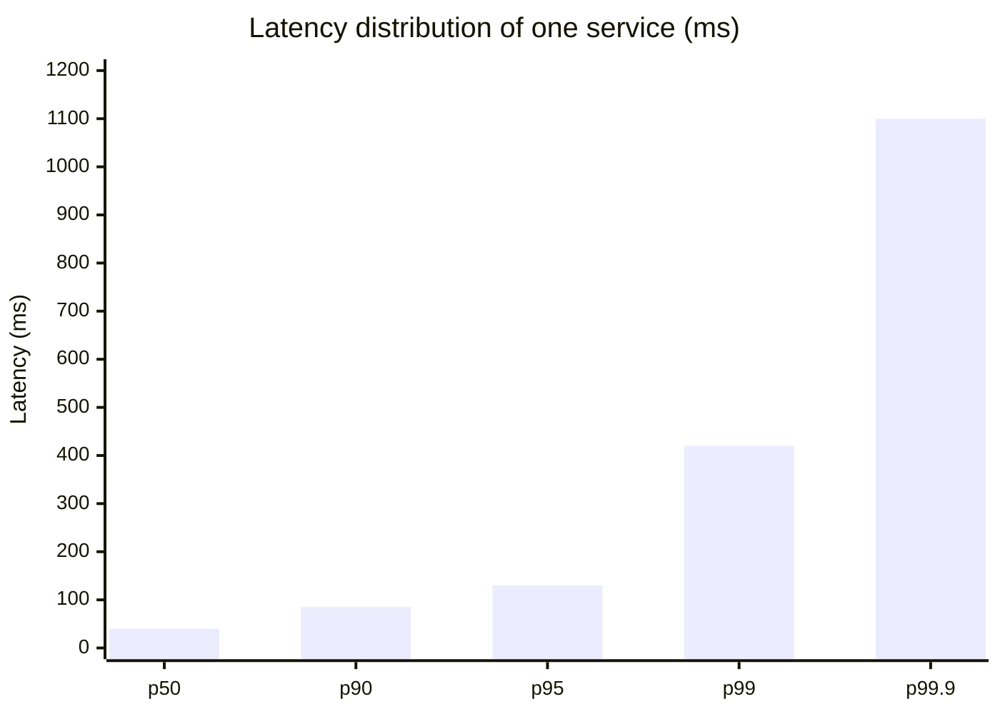

Fan-out amplification: if each backend call has a 1% chance of being slow (beyond its p99), a request that calls **100** backends in parallel is slow with probability 1 − 0.99^100 ≈ **63%**. Your service's p50 becomes the backends' p99.

Rules:
- Report p50, p95/p99, p99.9 and max, never only the average.
- Percentiles can't be averaged; compute from histograms.
- Watch **coordinated omission** in load tests: tools that wait for responses before sending the next request under-report tail latency.
- Causes of tails: GC pauses, queueing, cold caches, lock contention, noisy neighbours, retries, slow disks, network retransmits.

#### Example
A search service averaged 60 ms and the team considered it fast. But the aggregator fanned out to 50 index shards, and each shard's p99 was 400 ms (GC pauses), so ~40% of user searches took over 400 ms. Tuning GC on shards (moving to ZGC) and adding hedged requests brought the shard p99 to 90 ms and user p99 to 150 ms.

#### Trade-offs
Tail-focused targets reflect real experience at scale, but measuring and fixing tails is harder (requires histograms, tracing and careful tuning), and chasing p99.99 can be expensive.

#### Problems & fixes
| Symptom | Cause | Fix |
|---|---|---|
| Users complain, average looks fine | tail latency hidden by mean | track p99/p99.9 |
| Fan-out requests consistently slow | backend tails amplified | reduce fan-out, hedged requests, fix backend tails |
| Load test shows good p99, prod doesn't | coordinated omission | open-model load tools (wrk2, k6 constant arrival rate) |
| Periodic latency spikes | GC pauses, cron jobs, compaction | GC tuning, schedule background work, isolate |

#### Cheat sheet
- Use p50/p99/p99.9, never just mean.
- Fan-out: 1 − 0.99^N of requests hit a backend's tail.
- Don't average percentiles. Beware coordinated omission.

#### Interview questions
<details><summary>A request fans out to 100 servers, each with p99 = 1 s and p50 = 10 ms. What's the user-facing latency profile?</summary>

The request waits for the slowest of 100 parallel calls. The probability that all 100 are under their p99 is 0.99^100 ≈ 37%, so about 63% of user requests take at least 1 s. Effectively the user-facing median is at the backend's p99. Fixes: reduce tail latency in backends, hedge requests, use partial results with deadlines, or reduce fan-out.
</details>

<details><summary>Why is average latency misleading?</summary>

Latency distributions are skewed with long tails. A few very slow requests barely move the mean while many users suffer, or a single extreme outlier can inflate it, and fast failures can lower it. The mean doesn't correspond to any real user experience. Percentiles describe what proportion of users see what latency.
</details>

#### Interview angle
> "I report p50, p99 and p99.9 from histograms, because with fan-out the backend's p99 becomes the user's median. Tail latency is the thing to engineer for."

#### Sources
- [The tail at scale](https://research.google/pubs/the-tail-at-scale/) — Dean and Barroso, Google Research
- [Monitoring distributed systems](https://sre.google/sre-book/monitoring-distributed-systems/) — Google SRE book

### Tail latency mitigation — hedged requests: send duplicate to second server if first exceeds threshold, use first response
Tail latency mitigation techniques make the slowest requests faster without fixing every cause. The best known, from Google's "The Tail at Scale", is **hedged requests**: send the request to one replica, and if it hasn't answered within (say) its p95 latency, send a duplicate to another replica and use whichever answers first. Related techniques: **tied requests**, **micro-partitioning**, **selective replication** of hot data, **latency-aware load balancing** and **good-enough** partial results.

#### Intuition
You order a taxi and it has not come after a reasonable wait, so you order a second from another company and take whichever arrives first. You only do this when the first one is late.

#### Must know
- **Hedged request**: if the first replica is slow, send a duplicate to a second and take the first answer.
- Send the duplicate only after a delay near the **p95**, so the extra load is small.
- **Only for idempotent operations**, normally reads.
- **Cap the extra load** and switch hedging off under overload.
- Related tools: load balancing that avoids slow instances, deadlines, partial results.

#### Numbers to quote
- Hedging after the p95 adds about 5% load and cuts p99.9 sharply.

#### Common mistakes
- Hedging writes that are not idempotent.
- Unlimited hedging during an overload, which makes it worse.
- Treating hedging as a fix when every replica is slow for the same reason.

#### How it works
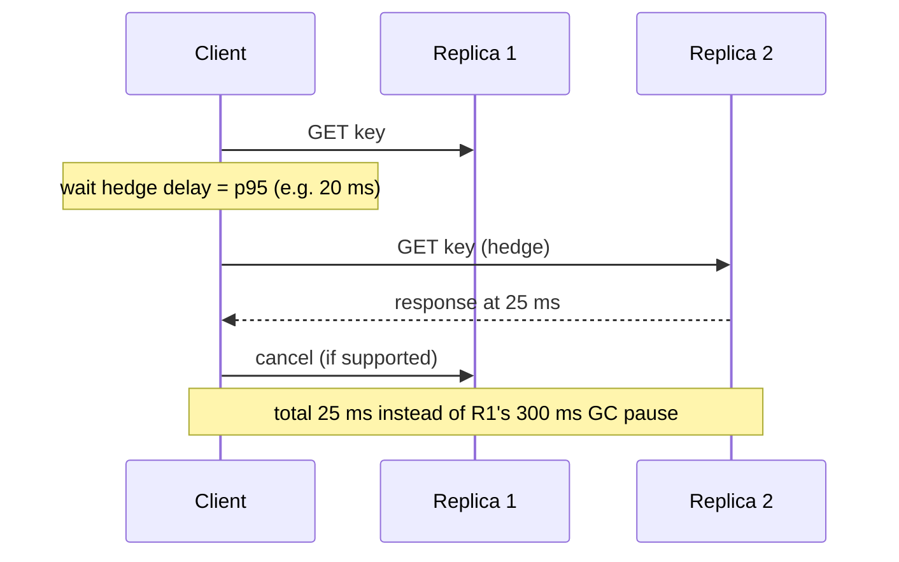

Rules:
- Hedge only **idempotent reads** (or writes with idempotency keys).
- Set hedge delay around p95: only ~5% extra load, while cutting the tail dramatically.
- Cap hedging (e.g. at most 10% extra requests) to avoid amplifying overload, and **cancel** the loser.
- Other techniques: **least-outstanding-requests / power-of-two-choices** load balancing (avoid slow instances), **timeouts with deadline propagation**, **partial results** (search returns results from 98% of shards rather than waiting), **isolating** background work (compactions, GC) from serving.

#### Example
A key-value lookup service had p50 2 ms but p99.9 180 ms because of occasional GC pauses and disk hiccups on individual replicas. Adding hedged reads after 10 ms (the p95) to a second replica increased load by ~4% and brought p99.9 down to 14 ms. During an overload test, hedging was automatically disabled when error rates rose, to avoid making things worse.

#### Trade-offs
Big tail improvements for modest extra load, but extra load can worsen overload, only safe for idempotent operations, and it hides underlying problems rather than fixing them.

#### Problems & fixes
| Symptom | Cause | Fix |
|---|---|---|
| Hedging doubles load during incidents | unconditional hedging | hedge budget/cap, disable under overload |
| Duplicate side effects | hedging non-idempotent writes | hedge reads only, or idempotency keys |
| Requests still slow | all replicas slow (shared cause) | fix root cause, isolate background work |
| Load balancer keeps sending to slow pod | round robin | least-outstanding / P2C, outlier detection |

#### Cheat sheet
- Hedge after ~p95, use first response, cancel the other.
- Idempotent only. Cap extra load. Disable under overload.
- Plus: P2C load balancing, deadlines, partial results, isolate background work.

#### Interview questions
<details><summary>How do hedged requests reduce tail latency without doubling load?</summary>

The duplicate is only sent if the first request hasn't completed within a delay set around the p95 latency, so only ~5% of requests get hedged, adding ~5% load. Those slow requests are usually slow because of a transient issue on one replica (GC, disk, queueing), so the hedge to another replica typically returns quickly, cutting the p99 and p99.9.
</details>

<details><summary>When can hedged requests make things worse?</summary>

When slowness is caused by system-wide overload: hedging adds more requests to an already overloaded system, increasing queueing and latency further (positive feedback). Also when operations aren't idempotent (duplicate writes), or when all replicas share the cause (a slow shared database). Use hedge budgets, disable hedging when error or latency rates spike, and cancel losing requests.
</details>

#### Interview angle
> "For idempotent reads I'd hedge after the p95 with a capped hedge budget, plus least-outstanding load balancing, which cuts the p99.9 for about 5% extra load and switches off under overload."

#### Sources
- [The tail at scale](https://research.google/pubs/the-tail-at-scale/) — Dean and Barroso, Google Research
- [Request hedging](https://grpc.io/docs/guides/request-hedging/) — gRPC docs

### On-call best practices — runbooks, escalation policy, post-mortems, blameless culture, rotation fairness
Sustainable on-call ensures incidents get fast, competent responses **without burning people out**: clear rotations and escalation policies, actionable alerts with runbooks, defined incident roles, **blameless postmortems** that produce real fixes, fair load distribution, and compensation or time off for out-of-hours work.

#### Intuition
A fire station's duty roster. Someone is always on duty, they know the drill, there is backup if they do not answer, and after every fire the crew reviews what happened without blaming anyone.

#### Must know
- A clear **rotation and escalation path**: primary, secondary, then a manager.
- Every page is actionable and has a **runbook**.
- Big incidents have defined roles, with one **incident commander** coordinating.
- **Blameless postmortems**: ask what in the system made the mistake easy, not who did it.
- Track on-call load, and finish the follow-up actions.

#### Numbers to quote
- Keep at least 6–8 people in a rotation.

#### Common mistakes
- A tiny rotation with constant night pages, which leads to burnout.
- Postmortem action items that are never finished.
- A blame culture, so people hide what actually happened.

#### How it works
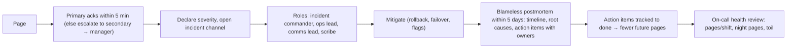

Practices:
- **Rotations**: primary + secondary, weekly, follow-the-sun for global teams; at least 6–8 people per rotation.
- **Handoffs**: summary of ongoing issues at each rotation change.
- **Incident roles**: separating the commander (coordinates) from the people debugging speeds resolution.
- **Blameless postmortems**: focus on systems and processes ("what made this mistake easy?"), not individuals.
- **Health metrics**: pages per shift, night pages, time spent on toil; fix the top noisy alerts each sprint.
- **Ownership**: "you build it, you run it", with SRE support.

#### Example
A team's on-call engineer averaged 12 night pages a week and two people quit within a quarter. The team made on-call load a sprint priority: deleted non-actionable alerts, auto-remediated the top three noisy issues (disk cleanup, pod restarts), added a secondary on-call and follow-the-sun handoff with their Europe team, and required postmortem action items to be completed within 30 days. Night pages fell to under 1 per week.

#### Trade-offs
Healthy on-call improves reliability and retention but requires investment (time for fixes, larger rotations, compensation), and blameless culture requires leadership consistency.

#### Problems & fixes
| Symptom | Cause | Fix |
|---|---|---|
| Burnout, attrition | too many pages, small rotation | alert hygiene, bigger rotation, follow-the-sun |
| Same incidents recur | postmortem actions not done | track actions with owners and deadlines |
| People hide mistakes | blame culture | blameless postmortems, leadership modelling |
| Chaotic major incidents | no roles | incident commander process, practice |

#### Cheat sheet
- Rotation + escalation + runbooks + incident roles.
- Blameless postmortems with tracked action items.
- Measure on-call load; fix noisy alerts continuously.

#### Interview questions
<details><summary>What makes a postmortem "blameless" and why does it matter?</summary>

It assumes people acted reasonably given the information and tools they had, and asks what in the system allowed the failure (missing guardrails, confusing tooling, gaps in tests) instead of who to blame. It matters because blame makes people hide information, so the organisation can't learn, and the same failures recur. Blameless analysis surfaces true contributing factors and systemic fixes.
</details>

<details><summary>Your team's on-call is getting 20 pages a week. What do you do?</summary>

Categorise the pages: actionable vs noise, and by cause. Delete or downgrade non-actionable alerts, convert cause alerts to SLO burn-rate alerts, group and inhibit duplicates, automate remediation for repetitive issues, and fix the top recurring root causes as prioritised engineering work. Track pages per shift as a team health metric reviewed every sprint.
</details>

#### Interview angle
> "Sustainable on-call needs a large enough rotation, actionable pages with runbooks, an incident commander for big incidents, and blameless postmortems whose action items actually get finished."

#### Sources
- [Being on-call](https://sre.google/sre-book/being-on-call/) — Google SRE book
- [Postmortem culture: learning from failure](https://sre.google/sre-book/postmortem-culture/) — Google SRE book
- [PagerDuty incident response](https://response.pagerduty.com/) — PagerDuty

