## Performance optimization

### Profiling — CPU flame graphs (async-profiler, py-spy), heap dumps, I/O tracing (strace, perf)
Profiling measures **where a program actually spends resources** (CPU time, memory allocations, lock waits, I/O) instead of guessing. Sampling profilers (async-profiler for the JVM, py-spy for Python, pprof for Go, perf for native code) capture stack traces many times per second with low overhead, safe enough for production. Heap dumps and allocation profiles find memory leaks. strace, perf and eBPF tools trace system calls and I/O.

#### Intuition
Checking where your money actually goes by looking at the bank statement. Guessing usually blames the wrong thing. The statement shows the real biggest expense.

#### Must know
- Profiling **measures where a program really spends** CPU, memory and waiting time.
- **Measure before optimising.** Guesses about the slow part are often wrong.
- Sampling profilers have low overhead and are safe to run in production.
- Pick the profile by symptom: CPU, wall-clock (waiting), memory allocation, or locks.
- A CPU profile does not show time spent waiting.

#### Common mistakes
- Optimising code that was never measured.
- Using a CPU profile to explain latency that is really lock or I/O waiting.
- Profiling under a load that looks nothing like production.

#### How it works
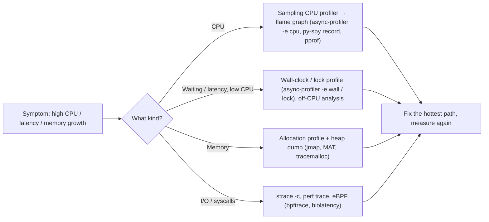

```bash
# JVM: 30 s CPU profile of a running process → interactive flame graph
./asprof -d 30 -e cpu -f /tmp/cpu.html <pid>
# Python: profile a running process without restarting it
py-spy record -o profile.svg --pid 12345 --duration 30
# Go: built-in pprof endpoint
go tool pprof -http=:8081 http://svc:6060/debug/pprof/profile?seconds=30
# Which syscalls dominate?
strace -c -f -p <pid>
```

Principles: **measure before optimising**, profile **production-like load** (or production itself with sampling), compare before and after, and remember that CPU profiles don't show time spent **waiting** (use wall-clock or off-CPU profiles for that). Continuous profiling (Pyroscope, Parca, Datadog) keeps profiles over time so you can compare versions.

#### Example
An order API used 70% CPU at moderate traffic. Everyone suspected the database layer. A 30-second async-profiler flame graph showed 45% of CPU in **JSON serialization** of a huge, mostly unused response object, and 15% in regex compilation inside a loop (`Pattern.compile` per call). Trimming the response DTO and caching the compiled pattern cut CPU by 55% without touching the database.

#### Trade-offs
Data-driven optimisation finds real hotspots, but profilers add some overhead, need symbols and access in production, and results can mislead if the load isn't representative.

#### Problems & fixes
| Symptom | Cause | Fix |
|---|---|---|
| Optimised code, no improvement | guessed instead of measured | profile first, fix the top frame |
| Slow requests but CPU profile looks idle | time spent waiting (locks, I/O) | wall-clock/off-CPU profiling, tracing |
| Missing frames in Java profiles | safepoint bias in old profilers | async-profiler (AsyncGetCallTrace + perf) |
| Memory grows until OOM | leak (caches, listeners) | heap dump comparison, dominator tree |

#### Cheat sheet
- Measure, don't guess. Sampling profilers are safe in production.
- CPU vs wall-clock vs allocation vs lock profiles; pick by symptom.
- Continuous profiling to compare versions over time.

#### Interview questions
<details><summary>Your service's CPU doubled after a release. How do you find out why?</summary>

Capture CPU profiles of the old and new versions under similar load (continuous profiling makes this easy, otherwise async-profiler or pprof on a canary), and compare flame graphs or use a differential flame graph. The new hot frames point at the change: a new serialization path, an N² loop, logging in a hot path, a regex or allocation-heavy code. Fix, then verify with another profile.
</details>

<details><summary>Latency is high but CPU is low. What kind of profiling helps?</summary>

Time is being spent waiting, not computing: on locks, I/O, network calls, connection pools or GC. Use wall-clock profiling (samples all threads, including blocked ones), lock contention profiling, off-CPU analysis with eBPF, and distributed tracing to see time in downstream calls. GC logs show pause times.
</details>

#### Interview angle
> "I never optimise by guessing: a 30-second sampling profile under real load, CPU or wall-clock depending on the symptom, then fix the widest frame and profile again."

#### Sources
- [async-profiler](https://github.com/async-profiler/async-profiler) — async-profiler, GitHub
- [Linux perf examples](https://www.brendangregg.com/perf.html) — Brendan Gregg
- [py-spy](https://github.com/benfred/py-spy) — Ben Frederickson, GitHub

### Flame graph — visualize hot code paths; identify unexpected CPU consumers in production
A flame graph (Brendan Gregg) visualises sampled stack traces: each box is a function, the **width is the proportion of samples** (time) it appeared in, and boxes are stacked by call hierarchy (callers below, callees above). Wide plateaus at the top are where CPU is actually burned. The x-axis is **not time**; it's sorted alphabetically to merge identical stacks.

#### Intuition
A stacked bar picture of where time went. The wider a block, the more time that function took. You look for the widest blocks at the top, the way you spot the biggest slice of a pie chart.

#### Must know
- A picture of thousands of sampled stack traces merged together.
- **Width = share of samples**, which means share of time.
- Callers are below, the functions they call are above.
- **Wide blocks at the top** are where the CPU is actually burned.
- The horizontal axis is **not time**. It is sorted alphabetically.

#### Common mistakes
- Reading left to right as a timeline.
- Giving meaning to the colours, which are usually arbitrary.
- Using an on-CPU graph to explain time spent blocked. Use an off-CPU graph.

#### How it works
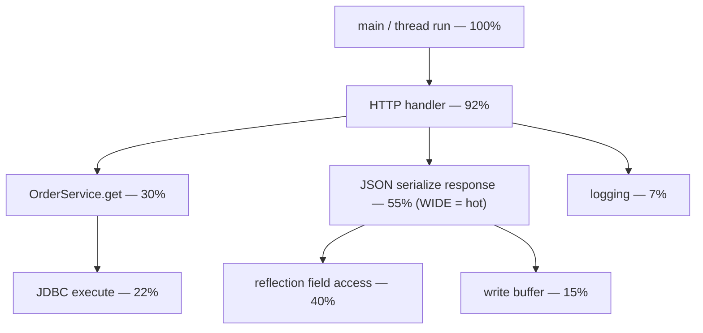

How to read it:
- Look for **wide boxes at the top** of stacks (self time) — that's where CPU is spent.
- Wide boxes lower down mean that subtree is expensive in total.
- Colour is usually meaningless (or encodes language/kernel vs user).
- **Differential flame graphs** colour frames by increase or decrease between two profiles.
- **Icicle graphs** are the same, upside down. Off-CPU flame graphs show where threads block.

#### Example
A Node.js service had periodic CPU spikes. The flame graph showed a wide plateau in `JSON.parse` under a config-refresh function that re-downloaded and parsed a 15 MB feature-flag file every 10 seconds on every instance. Changing the refresh to use ETags (only parse when changed) removed the spikes.

#### Trade-offs
Makes complex profiles readable at a glance, but only shows sampled stacks (missing rare events), the time ordering is lost, and you need symbols (and JIT-aware tooling) for meaningful frame names.

#### Problems & fixes
| Symptom | Cause | Fix |
|---|---|---|
| Frames show as hex addresses | missing symbols / JIT maps | perf-map-agent, debug symbols, async-profiler |
| Can't see what changed between releases | separate profiles | differential flame graph |
| Thread waiting time invisible | on-CPU profile only | off-CPU / wall-clock flame graph |

#### Cheat sheet
- Width = share of samples. Top edges = self CPU. X-axis isn't time.
- Differential flame graphs for regressions. Off-CPU for blocking.
- Needs symbols.

#### Interview questions
<details><summary>How do you read a flame graph to find the bottleneck?</summary>

Look for the widest frames, especially at the top of stacks where a function has lots of self time. Follow downward to see which callers lead there. A wide frame in a library (serialization, regex, logging, hashing) under your handler often reveals an unexpected cost. Remember width is proportion of samples, not elapsed time, and the horizontal order is alphabetical.
</details>

<details><summary>What is an off-CPU flame graph?</summary>

It shows stack traces where threads were blocked rather than running (waiting on locks, I/O, sleep, network), weighted by time blocked. It explains latency that on-CPU profiles can't, such as threads waiting for a database connection or a mutex.
</details>

#### Interview angle
> "In a flame graph I look for wide plateaus at the top. That's where CPU actually goes, and it's frequently serialization or logging rather than the code everyone suspected."

#### Sources
- [Flame graphs](https://www.brendangregg.com/flamegraphs.html) — Brendan Gregg
- [CPU flame graphs](https://www.brendangregg.com/FlameGraphs/cpuflamegraphs.html) — Brendan Gregg

### Load testing — k6, Locust, Apache JMeter, wrk; always test in staging environment first
Load testing simulates expected traffic to verify the system meets **performance targets** (throughput, latency percentiles, error rate) at that load, and to find bottlenecks before users do. Tools: **k6** (JavaScript scripts, great for CI), **Locust** (Python), **JMeter** (GUI, mature), **wrk/wrk2** (raw HTTP benchmarking), **Gatling** (Scala/Java).

#### Intuition
A dress rehearsal with a full audience. Before opening night you fill the theatre with the crowd you expect and check that the doors, seats and exits cope.

#### Must know
- It simulates the **expected traffic** to check throughput, latency and error rate.
- It finds bottlenecks before users do.
- Be realistic: production-like data size, request mix and hot keys.
- Use an **open model**: send at a fixed arrival rate, whatever the response time.
- Set pass/fail thresholds on p99 and error rate, not on averages.

#### Common mistakes
- Testing only the home page while the real bottleneck is checkout.
- A tiny test database, where every query looks fast.
- A closed-loop test that slows down with the system and hides the tail.

#### How it works
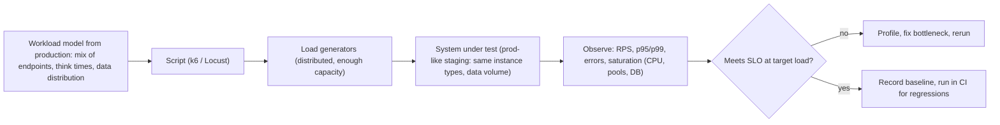

```javascript
// k6: open model — constant arrival rate avoids coordinated omission
export const options = {
  scenarios: { checkout: { executor: 'constant-arrival-rate', rate: 500, timeUnit: '1s',
                           duration: '15m', preAllocatedVUs: 200 } },
  thresholds: { http_req_failed: ['rate<0.001'], http_req_duration: ['p(99)<400'] },
};
export default function () { http.post(`${BASE}/checkout`, payload(), params); }
```

Realism matters: production-like **data volume** (indexes behave differently on 1k vs 100M rows), realistic **request mix** and **key distribution** (hot keys, cache hit rates), warmed caches or not (test both), and **open-model** load (requests arrive at a rate regardless of response time) rather than closed loops that slow down with the system.

#### Example
A ticketing platform load-tested before a concert sale with 50k virtual users hitting the homepage, and it passed. On sale day, the real bottleneck was the seat-reservation endpoint (row locks on the same seats), which the test barely exercised. The next test used a production traffic mix replayed from logs plus a hot-seat scenario, which revealed the lock contention, fixed with Redis-based seat holds.

#### Trade-offs
Catches capacity and latency problems before release, but realistic tests are expensive to build and run, staging rarely matches production exactly, and third-party dependencies need mocks or sandboxes.

#### Problems & fixes
| Symptom | Cause | Fix |
|---|---|---|
| Test passes, production fails | unrealistic workload mix/data | model from prod logs, prod-size data |
| p99 looks great in test | coordinated omission (closed model) | constant-arrival-rate / wrk2 |
| Load generator is the bottleneck | underpowered generators | distribute, monitor generator CPU |
| Hitting real payment provider | no isolation | mocks/sandboxes for third parties |

#### Cheat sheet
- Target load from SLOs and forecasts. Realistic mix, data, keys.
- Open model (arrival rate). Thresholds on p99 and error rate.
- Prod-like staging; run regularly and in CI.

#### Interview questions
<details><summary>How would you load test a new checkout service before Black Friday?</summary>

Estimate peak RPS from last year's data plus growth with a safety margin. Build scenarios from production traffic mix (browse, cart, checkout ratios, hot products), use a production-sized dataset in a prod-like environment, mock external providers with realistic latency, run constant-arrival-rate tests ramping to 1.5–2× expected peak, and watch p99, errors and saturation of every tier (DB connections, caches, queues). Fix bottlenecks and repeat; also run spike and soak tests.
</details>

<details><summary>What is coordinated omission?</summary>

In closed-loop load tests, each virtual user waits for a response before sending the next request. When the system stalls, the tool sends fewer requests, so the stall affects only a few measured requests instead of all those that would have arrived during it, making tail latency look far better than real users experience. Open-model tools that send at a fixed arrival rate (wrk2, k6 constant-arrival-rate) avoid this.
</details>

#### Interview angle
> "Load tests replay the production request mix against production-sized data at a constant arrival rate, with thresholds on p99 and error rate rather than averages."

#### Sources
- [Grafana k6 documentation](https://grafana.com/docs/k6/latest/) — Grafana k6
- [Open and closed models](https://grafana.com/docs/k6/latest/using-k6/scenarios/concepts/open-vs-closed/) — Grafana k6 docs

### Stress testing — find breaking point (max RPS before error rate spikes)
Stress testing pushes load **beyond expected levels** until the system breaks, to learn **where the limit is, which component fails first, and how it fails** (gracefully shedding load, or collapsing and not recovering). It answers "what's our real headroom?" and "does the system recover after the overload ends?"

#### Intuition
Loading a bridge with heavier and heavier lorries until it creaks. You want to know the weight at which it creaks, which part gives first, and whether it springs back when the load is removed.

#### Must know
- Push load **beyond the expected peak** until the system breaks.
- Find the **knee** (latency starts climbing) and the **breaking point** (errors spike).
- Identify **which component fails first**.
- Check how it fails: clean rejections, or everything timing out?
- Check that it **recovers by itself** when the load drops.

#### Numbers to quote
- Run production at no more than about 50–70% of the breaking point.

#### Common mistakes
- Only recording the maximum requests per second.
- No load shedding, so overload becomes a total collapse.
- Client retries with no backoff, which keep the system down after the load has gone.

#### How it works
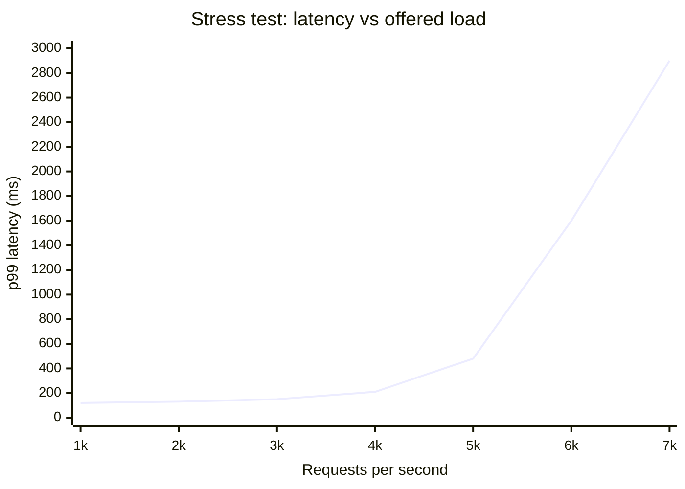

Procedure:
- Ramp load in steps (hold each step long enough to stabilise) past expected peak.
- Record the **knee** (latency starts rising sharply, here ~4.5k RPS) and the **breaking point** (errors exceed threshold).
- Identify the **first bottleneck** (DB connections, CPU, a lock, a downstream dependency).
- Check failure mode: does it shed load with 429/503 and keep serving the rest, or does everything time out?
- Drop the load and confirm **recovery** without manual intervention.

Planning rule: run production at a comfortable distance below the knee (commonly ≤ 50–70% of the breaking point).

#### Example
A stress test on a booking API showed the knee at 4.5k RPS and total collapse at 6k RPS: the DB connection pool saturated, requests queued, timeouts triggered retries from the mobile app (retry storm), and the service didn't recover until restarted. Fixes: bounded request queues with fast 503s (load shedding), client retry with exponential backoff and jitter, and a larger pool on a bigger DB instance. The retest degraded gracefully at 7k RPS and recovered within 30 s when load dropped.

#### Trade-offs
Reveals true limits and failure modes, but requires an isolated environment (you'll break things), and the breaking point depends heavily on test realism.

#### Problems & fixes
| Symptom | Cause | Fix |
|---|---|---|
| System never recovers after overload | retry storms, unbounded queues | load shedding, backoff with jitter, bounded queues |
| Collapse instead of graceful degradation | no admission control | rate limiting, concurrency limits, 503 fast |
| Unknown headroom | never tested beyond peak | regular stress tests, capacity reports |

#### Cheat sheet
- Ramp past peak to find knee and breaking point.
- Identify first bottleneck and failure mode.
- Must degrade gracefully and recover automatically.

#### Interview questions
<details><summary>What do you look for in a stress test besides the maximum RPS?</summary>

Which component saturates first (and whether that matches capacity plans), how the system fails (graceful load shedding with clear errors vs cascading timeouts), whether retries amplify the problem, whether alerts fire appropriately, and whether the system recovers automatically once load drops. A system with a lower limit that degrades gracefully is often preferable to one that collapses completely.
</details>

<details><summary>Why might a system not recover after an overload even when traffic returns to normal?</summary>

Metastable failure: retries and timeouts keep the effective load above capacity (clients retry failed requests, queues stay full with requests that will time out anyway, caches emptied during the incident push more load to the database). Fixes include load shedding, retry budgets with backoff and jitter, bounded queues that drop stale work, and cache warming.
</details>

#### Interview angle
> "A stress test finds the knee, the first bottleneck and the failure mode. What I want to see is clean 503s under overload and automatic recovery, not a retry storm that keeps it down."

#### Sources
- [Stress testing](https://grafana.com/docs/k6/latest/testing-guides/test-types/stress-testing/) — Grafana k6 docs
- [Addressing cascading failures](https://sre.google/sre-book/addressing-cascading-failures/) — Google SRE book

### Soak testing — sustained load for hours; catch memory leaks, connection pool exhaustion
Soak (endurance) testing runs a **realistic, steady load for a long period** (hours to days) to find problems that only appear over time: memory leaks, connection or file descriptor leaks, growing queues, disk filling with logs, cache bloat, degrading GC behaviour, and slow performance drift.

#### Intuition
Leaving a tap dripping into a bucket overnight. In five minutes you see nothing. By morning the bucket has overflowed. Some problems only show up with time.

#### Must know
- A **steady, realistic load for hours or days**.
- It finds problems that build up slowly: memory leaks, connection leaks, growing queues, filling disks.
- Watch for anything that **trends upward** under constant load.
- Key signals: heap after garbage collection, open connections, file descriptors, disk, latency.
- Two heap dumps taken hours apart show what is accumulating.

#### Common mistakes
- Trusting a 30-minute test for a service that runs for weeks.
- Watching only averages and missing the slow trend.
- Unbounded in-memory maps and caches with no eviction.

#### How it works
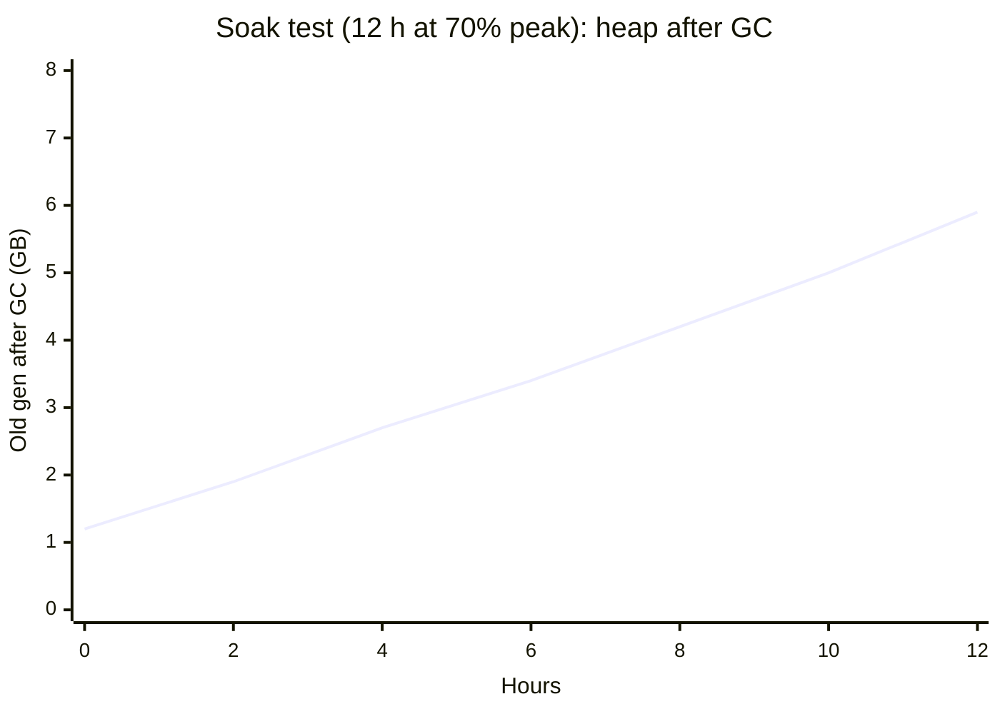

What to watch over time: heap after GC (rising = leak), RSS memory, open file descriptors and connections, thread count, queue lengths, disk usage, latency trend, and error rate. Anything that **trends steadily upward** under constant load is a leak or accumulation.

#### Example
A notification service passed a 30-minute load test but crashed in production every ~3 days with OOM. A 12-hour soak test reproduced the steadily climbing heap (as in the chart). Heap dumps at hours 2 and 10 showed an in-memory map of "pending acks" that never removed entries for clients that disconnected. Adding expiry (and bounding the map) flattened the heap.

#### Trade-offs
Catches slow failures that short tests miss, but long tests tie up environments and cost money, and you need good trend monitoring to interpret them.

#### Problems & fixes
| Symptom | Cause | Fix |
|---|---|---|
| OOM after days in production | slow memory leak | soak test + heap dump diffing |
| "Timeout acquiring connection" after hours | connection leak (not returned to pool) | leak detection in pool, try-with-resources |
| Disk full after a week | logs/temp files not rotated | log rotation, retention, disk alerts |
| Latency slowly rises | growing data structures, fragmentation | bound caches, profile over time |

#### Cheat sheet
- Steady realistic load for hours/days.
- Watch trends: heap after GC, fds, connections, threads, disk, latency.
- Heap dumps at two points to find what's accumulating.

#### Interview questions
<details><summary>What kinds of bugs does a soak test find that a load test doesn't?</summary>

Accumulation bugs: memory leaks, connection or file handle leaks, threads not terminated, unbounded caches or maps, queues that slowly grow when consumers are slightly slower than producers, log or temp file growth, and certificate or token refresh problems after hours. These only become visible after long runtimes.
</details>

<details><summary>How do you confirm a memory leak in a JVM service?</summary>

Watch heap usage after full GCs over time under constant load: a sawtooth whose baseline rises steadily indicates retained objects. Take heap dumps at two points and compare (Eclipse MAT dominator tree, histogram diffs) to see which object types and references grow, then trace the retention path to the code (static maps, listeners, caches without eviction, ThreadLocals).
</details>

#### Interview angle
> "Soak tests run 12+ hours at steady load and I watch heap-after-GC, file descriptors and pool usage for upward trends. Two heap dumps then show exactly what's leaking."

#### Sources
- [Soak testing](https://grafana.com/docs/k6/latest/testing-guides/test-types/soak-testing/) — Grafana k6 docs
- [Eclipse Memory Analyzer](https://eclipse.dev/mat/) — Eclipse MAT

### Spike testing — sudden 10× traffic increase; test auto-scaling and DB connection pool behavior
Spike testing applies a **sudden, sharp increase** in load (e.g. 10× in seconds) to see how the system copes **before autoscaling catches up**: do queues absorb it, does load shedding protect the core, how fast does capacity scale, do connection pools and databases survive a burst of new connections, and does it settle back afterwards.

#### Intuition
A stadium crowd arriving at one small café at half-time. More staff are on their way, but for the first few minutes the queue is out of the door. The test is what happens in those minutes.

#### Must know
- A **sudden, sharp jump** in load, within seconds.
- The danger is the **gap before autoscaling catches up**.
- Defences: pre-scale for known events, queue work, shed non-critical load.
- Scale on a leading signal such as request rate, not on CPU.
- New instances each open database connections, so **protect the database with a pooler**.

#### Common mistakes
- Relying on reactive autoscaling alone for a spike that takes 30 seconds.
- Scaling the app tier out until it exhausts database connections.
- Causing your own spike, such as a push notification to every user at once.

#### How it works
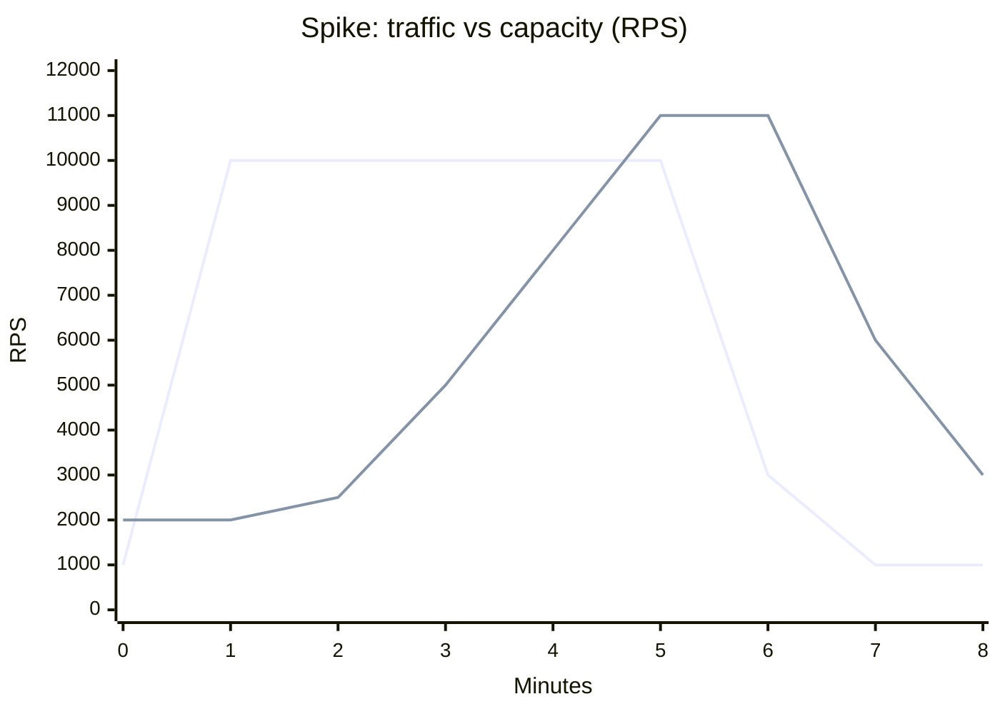

The first line (blue) is incoming traffic and the second (green) is serving capacity. The gap where traffic is above capacity (minutes 1–4) is the danger zone: demand exceeds capacity while autoscaling reacts. Strategies:
- **Pre-scale** for known events (sales, launches, push notifications).
- **Buffer** with queues for work that can be async.
- **Load shed** non-critical traffic; waiting rooms for flash sales.
- **Faster scaling**: smaller images, warm pools, scale on leading metrics (RPS, queue depth) rather than CPU.
- **Database protection**: new pods each opening 20 connections can exhaust DB max_connections, so use a connection proxy (PgBouncer, RDS Proxy).
- **Caches**: avoid stampedes on cold keys (request coalescing).

#### Example
A news app sent a push notification to 8M users; traffic went from 2k to 25k RPS in 40 seconds. Kubernetes HPA (CPU-based, 1-minute metrics) took 4 minutes to add pods, and each new pod opened 30 DB connections, hitting Postgres max_connections and failing everything. Fixes: pre-scaling before scheduled pushes, staggered push delivery over 5 minutes, PgBouncer in transaction mode, and HPA on RPS per pod.

#### Trade-offs
Validates elasticity and protection mechanisms, but realistic spikes are hard to generate, and fully absorbing spikes needs headroom that costs money.

#### Problems & fixes
| Symptom | Cause | Fix |
|---|---|---|
| Errors during first minutes of spike | autoscaling lag | pre-scale, warm pools, scale on RPS |
| DB falls over when app scales out | connection explosion | connection pooler, per-pod pool limits |
| Cache stampede on cold keys | many misses at once | request coalescing, pre-warming |
| Self-inflicted spikes | push to all users at once | staggered sends, waiting rooms |

#### Cheat sheet
- Sudden 5–10× jump; the danger is the autoscaling gap.
- Pre-scale, queue, shed load, scale on leading metrics.
- Protect the DB with connection pooling; stagger self-caused spikes.

#### Interview questions
<details><summary>Your autoscaling takes 3 minutes but traffic spikes 10× in 30 seconds. How do you handle it?</summary>

Avoid relying on reactive scaling alone: pre-scale ahead of predictable events, keep baseline headroom, and use warm pools and fast-starting images to shorten scale-up. Scale on leading indicators (RPS, queue depth). During the gap, protect the system with rate limiting and load shedding (prioritise critical endpoints), queue async work, serve cached responses, and stagger self-generated spikes such as notifications.
</details>

<details><summary>Why can scaling out the application tier take down the database?</summary>

Each new instance opens its own connection pool. Scaling from 10 to 100 pods with 20 connections each means 2,000 connections, exceeding the database's max_connections or exhausting its memory and CPU on connection handling. Use a connection pooler (PgBouncer, RDS Proxy), smaller per-pod pools, and plan DB capacity for the maximum pod count.
</details>

#### Interview angle
> "Spike tests expose the minutes before autoscaling catches up. I pre-scale for known events, scale on RPS rather than CPU, shed non-critical load and put PgBouncer in front of the database."

#### Sources
- [Spike testing](https://grafana.com/docs/k6/latest/testing-guides/test-types/spike-testing/) — Grafana k6 docs
- [Horizontal pod autoscaling](https://kubernetes.io/docs/tasks/run-application/horizontal-pod-autoscale/) — Kubernetes docs

### Little's Law in practice — L = λW: if p99 latency increases, L (queue depth) grows; fix by reducing W or λ
Little's Law: in a stable system, **L = λ × W**, the average number of items in the system (in-flight requests, queue length) equals the arrival rate times the average time each spends in the system. It's a practical tool for sizing pools, queues and concurrency, and for explaining why latency increases cause resource exhaustion.

#### Intuition
A café where 10 customers arrive each minute and each stays 5 minutes will have about 50 people inside. If people start staying 20 minutes, there are 200 inside, with the same arrival rate.

#### Must know
- **L = λ × W**: items in the system = arrival rate × time each one spends.
- It gives the concurrency you need: requests in flight = requests per second × latency.
- Use it to **size pools**: connections needed = queries per second × query time.
- When a dependency slows down, **required concurrency rises in proportion**.
- That is why a slow dependency exhausts threads with no change in traffic.

#### Numbers to quote
- 2,000 requests/s × 50 ms = 100 in flight. At 500 ms it becomes 1,000.

#### Common mistakes
- Sizing pools by guesswork.
- Blaming traffic when the latency was what changed.
- Using the average with no headroom for the tail.

#### How it works
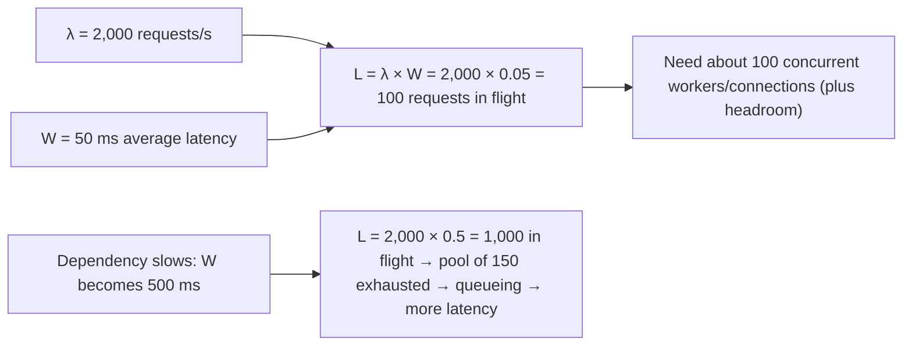

Uses:
- **Pool sizing**: DB pool needed = queries/s × average query time. 3,000 queries/s × 4 ms = 12 connections busy on average.
- **Explaining incidents**: a dependency's latency rising 10× multiplies required concurrency by 10×; threads and connections run out even though traffic didn't change.
- **Queue wait**: queue length 5,000 with drain rate 1,000/s → ~5 s wait.
- **Throughput limits**: with concurrency capped at L_max, max throughput = L_max / W.

#### Example
A service with a 200-thread pool handled 4,000 RPS at 40 ms average (L = 160 threads busy, fine). A downstream service degraded to 300 ms; L needed became 1,200 threads, the pool saturated, requests queued, and the service failed even though its own code hadn't changed. Little's Law made the cause obvious, and the fix was a timeout of 100 ms plus a bulkhead for that dependency, capping the impact.

#### Trade-offs
Simple and broadly applicable, but uses averages (tail latency needs headroom), assumes a stable system (not during transients), and must be applied per resource.

#### Problems & fixes
| Symptom | Cause | Fix |
|---|---|---|
| Thread pool exhausted with unchanged traffic | latency (W) increased | timeouts, bulkheads, circuit breakers |
| Pool sized by guess | no calculation | size = λ × W × headroom |
| Queue wait unknown | no queue metrics | measure depth and drain rate, wait = L / λ |

#### Cheat sheet
- L = λ × W. In-flight = rate × latency.
- Latency up → concurrency needed up → pools exhausted.
- Size pools with it, add headroom for tails; cap W with timeouts.

#### Interview questions
<details><summary>A service handles 1,000 RPS, each request makes 2 DB queries of 5 ms. How big should the DB connection pool be?</summary>

Query rate λ = 2,000/s, W = 5 ms → L = 2,000 × 0.005 = 10 connections busy on average. Add headroom for bursts and tail latency (say 2×), giving roughly 20 connections in total across instances, divided by instance count. Then validate with pool wait-time metrics under load.
</details>

<details><summary>Explain using Little's Law why a slow dependency can take down a healthy service.</summary>

Concurrency equals arrival rate times latency. If traffic stays at 1,000 RPS but a dependency's latency rises from 50 ms to 2 s, the number of in-flight requests rises from 50 to 2,000. Threads, connections or memory run out, new requests queue (adding more latency) and the service fails. Timeouts cap W, and bulkheads cap the concurrency one dependency can consume.
</details>

#### Interview angle
> "Little's Law sizes pools (rate × latency × headroom) and explains incidents: when a dependency gets ten times slower, required concurrency goes up ten times, so timeouts and bulkheads cap the damage."

#### Sources
- [Little's law](https://en.wikipedia.org/wiki/Little%27s_law) — Wikipedia
- [Handling overload](https://sre.google/sre-book/handling-overload/) — Google SRE book

### Connection pool sizing — formula: pool = (cores × 2) + effective_spindle_count; too large → context switch overhead
A database can only execute a limited number of queries truly in parallel (roughly its CPU cores plus some overlap for I/O waits). The HikariCP guideline **pool = (DB cores × 2) + effective spindle count** suggests that **small pools** (often 10–30 connections per database) outperform large ones: extra connections just add context switching, lock contention and memory overhead on the database while requests queue anyway.

#### Intuition
A kitchen with four cooks. Letting 200 waiters shout orders at once does not produce food faster. It only makes the cooks trip over each other. A short orderly queue gets more meals out.

#### Must know
- A database can run only a **limited number of queries truly in parallel**.
- **Small pools beat large ones.** Extra connections add contention, not speed.
- The guideline is for **total connections to the database**, across all app instances.
- With many instances, put a **connection pooler** (PgBouncer, RDS Proxy) in front.
- Watch the time requests wait for a connection.

#### Numbers to quote
- Starting point: (database cores × 2) + 1. An 8-core database wants about 17 active connections.

#### Common mistakes
- "Fixing" timeouts by raising the pool to hundreds.
- Forgetting that the pool size is multiplied by the number of pods.
- A remote call made inside a transaction, which holds a connection.

#### How it works
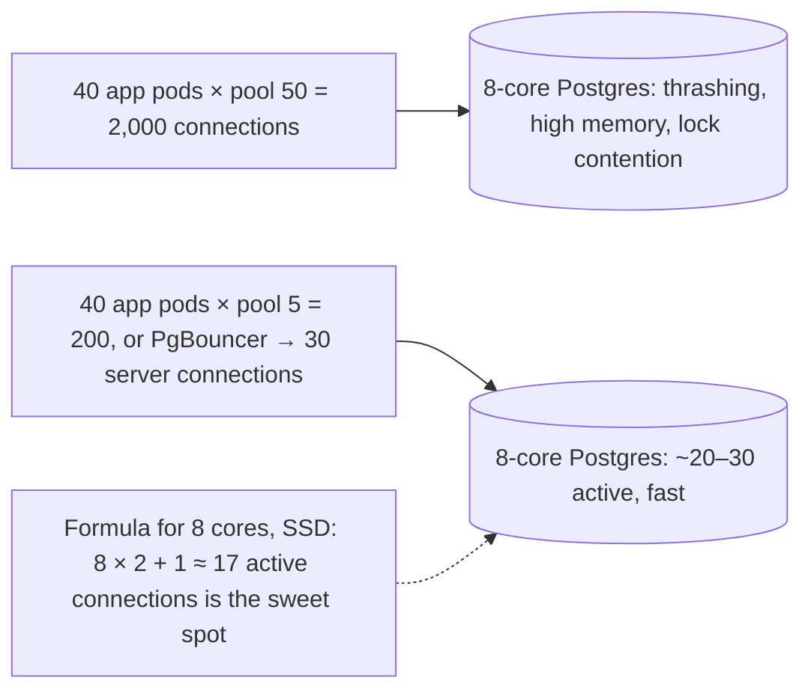

Practical points:
- The formula is for **total active connections to the DB**, not per app instance. Divide across instances.
- Use **Little's Law** to check demand: queries/s × avg query time.
- With many app instances or serverless, use a **connection pooler** (PgBouncer in transaction mode, RDS Proxy) to multiplex many client connections onto few server connections.
- Postgres connections are processes (~5–10 MB each); hundreds to thousands hurt performance.
- Monitor **pool wait time** (time requests wait for a connection) and active vs idle connections.
- Long transactions hold connections: keep transactions short, no remote calls inside them.

#### Example
A team "fixed" connection timeouts by raising pool size from 20 to 200 per pod (×30 pods = 6,000 connections). Postgres slowed dramatically (memory pressure, lock contention), and timeouts got worse. Reverting to 10 per pod behind PgBouncer (40 server connections total) and fixing a slow query that held connections for 800 ms brought p99 down by 70%.

#### Trade-offs
Small pools maximise DB throughput, but requests may wait for a connection during bursts; poolers add a hop and restrict some session features (prepared statements, session variables in transaction mode).

#### Problems & fixes
| Symptom | Cause | Fix |
|---|---|---|
| Timeouts waiting for connection | slow queries/long transactions holding connections | fix queries, shorten transactions |
| DB slow with thousands of connections | oversized pools × many instances | smaller pools, PgBouncer/RDS Proxy |
| Serverless functions exhaust DB connections | connection per invocation | RDS Proxy / Data API |
| Pool leaks under errors | connections not returned | try-with-resources, leak detection |

#### Cheat sheet
- Small pools win: ~(DB cores × 2) + spindles active connections total.
- Use a pooler with many instances. Keep transactions short.
- Monitor pool wait time and active connections.

#### Interview questions
<details><summary>Why doesn't increasing the connection pool size fix "timeout waiting for connection" errors?</summary>

The database can only execute a limited number of queries in parallel based on its cores and I/O. More connections means more concurrent queries contending for the same CPU, locks and memory, so each runs slower, and connections are held longer, so the wait persists or worsens. The real fixes are faster queries, shorter transactions, fewer queries per request, or more database capacity.
</details>

<details><summary>How do you handle database connections with 500 application pods?</summary>

Put a connection pooler between them and the database (PgBouncer in transaction mode or RDS Proxy) so the DB sees a small number of server connections (tens) while pods each keep a small client pool. Size totals by DB cores and Little's Law, and plan the max pod count against the pooler's limits.
</details>

#### Interview angle
> "The database wants about cores × 2 active connections in total, not per pod. With many pods I put PgBouncer in front and fix the slow queries that hold connections, rather than growing the pools."

#### Sources
- [About pool sizing](https://github.com/brettwooldridge/HikariCP/wiki/About-Pool-Sizing) — HikariCP wiki
- [PgBouncer features](https://www.pgbouncer.org/features.html) — PgBouncer docs

### Thread pool sizing — I/O-bound: threads = (1 + wait_time/service_time) × cores; CPU-bound: threads ≈ cores
Thread pool size should match the work type. **CPU-bound** tasks gain nothing beyond about one thread per core (more threads just context switch). **I/O-bound** tasks spend most time waiting, so more threads keep the CPU busy: **threads ≈ cores × (1 + wait time / compute time)** (Goetz's formula). Separate pools for different work types keep a slow I/O dependency from starving CPU work.

#### Intuition
Cooks who are chopping need one board each, so more cooks than boards is pointless. Cooks who mostly wait for the oven can share a board, so you can have many more of them.

#### Must know
- **CPU-bound work**: about one thread per core. More only adds switching.
- **I/O-bound work**: threads mostly wait, so use more.
- Formula: **threads ≈ cores × (1 + wait time ÷ compute time)**.
- Use **bounded queues** with a rejection policy.
- Keep separate pools for different kinds of work. The downstream limit is still the real ceiling.

#### Numbers to quote
- 8 cores, 10 ms compute and 90 ms waiting per request: 8 × (1 + 9) = 80 threads.

#### Common mistakes
- One big shared pool for CPU work and I/O work.
- An unbounded queue, which hides overload until memory runs out.
- 200 threads all queuing for a 20-connection database pool.

#### How it works
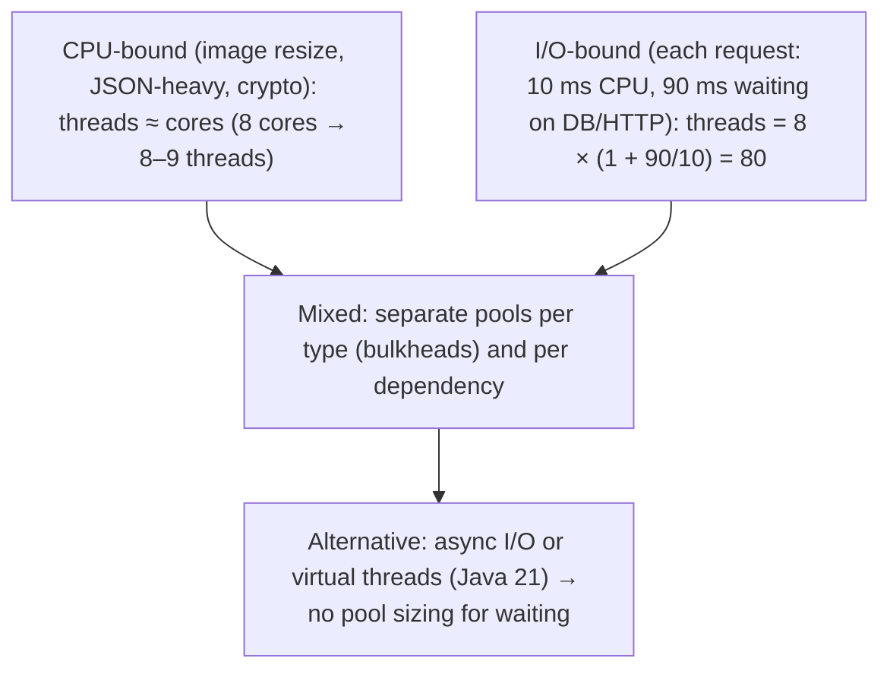

Practical notes:
- The formula gives a starting point; **measure** with load tests (throughput vs pool size curve) and adjust.
- Use **bounded queues** with a rejection policy; an unbounded queue hides overload until memory runs out.
- **Downstream limits** cap useful concurrency: 200 threads calling a DB with a 20-connection pool just queue on the pool.
- **Virtual threads** (Java 21) or async frameworks make I/O-bound concurrency cheap (millions of tasks), shifting the limit to downstream resources (still need semaphores or bulkheads).

#### Example
An image-processing service ran CPU-heavy resizing in the same 200-thread pool that served HTTP requests on a 4-core machine. Context switching made each resize slower, and HTTP health checks timed out under load. Moving resizing to a dedicated 4-thread pool with a bounded queue (rejecting with 503 when full) and keeping a separate I/O pool for HTTP stabilised latency and increased total throughput by 30%.

#### Trade-offs
Correct sizing maximises throughput and stability, but optimal sizes change with workload and dependencies, and too many separate pools waste resources.

#### Problems & fixes
| Symptom | Cause | Fix |
|---|---|---|
| CPU work slower with more threads | oversubscription, context switching | CPU pool ≈ cores |
| Low CPU, high latency, threads all busy | I/O-bound pool too small or slow dependency | bigger I/O pool / async, timeouts |
| OOM under overload | unbounded work queue | bounded queue + rejection (503) |
| One task type starves others | shared pool | separate pools (bulkheads) |

#### Cheat sheet
- CPU-bound: ≈ cores. I/O-bound: cores × (1 + wait/compute).
- Bounded queues, separate pools by work type.
- Virtual threads/async remove pool sizing for I/O, not downstream limits.

#### Interview questions
<details><summary>How many threads for a service on 16 cores where each request spends 5 ms on CPU and 45 ms waiting for a database?</summary>

threads ≈ 16 × (1 + 45/5) = 16 × 10 = 160. But check downstream capacity: if the DB pool only has 30 connections, 160 threads just queue for connections, so the effective limit is the DB pool. Load test to confirm, and consider async I/O or virtual threads.
</details>

<details><summary>Do Java 21 virtual threads eliminate the need to think about concurrency limits?</summary>

They remove the need to size thread pools for blocking I/O, since virtual threads are cheap and you can run one per request. But downstream resources (DB connections, rate limits of external APIs, memory) are still finite, so you still need semaphores, connection pools and bulkheads to cap concurrency to each dependency. Also watch for pinning (synchronized blocks during blocking calls in older JDKs).
</details>

#### Interview angle
> "CPU pools are sized to cores and I/O pools to cores × (1 + wait/compute), all with bounded queues and separated by work type. Downstream connection limits are still the real ceiling."

#### Sources
- [Virtual threads](https://docs.oracle.com/en/java/javase/21/core/virtual-threads.html) — Oracle Java 21 docs
- [ThreadPoolExecutor](https://docs.oracle.com/en/java/javase/21/docs/api/java.base/java/util/concurrent/ThreadPoolExecutor.html) — Java 21 API docs

### Async I/O and non-blocking — event loop (Node.js, Netty, asyncio): single thread handles thousands of I/O connections
Non-blocking I/O lets a small number of threads handle **thousands of concurrent connections**: instead of a thread blocking on each socket read, an **event loop** asks the OS (epoll, kqueue, io_uring) which sockets are ready and runs callbacks or resumes coroutines only when data is available. Node.js, Netty, Nginx, Python asyncio, Go's runtime and Rust's tokio are built on this model.

#### Intuition
One waiter serving a whole restaurant. They take an order, hand it to the kitchen and move to the next table, never standing still waiting for a dish. It works well until the waiter stops to cook a meal.

#### Must know
- A few threads handle **thousands of connections** by never waiting on any one of them.
- An **event loop** asks the operating system which sockets are ready and works only on those.
- An idle connection costs very little memory.
- **Never block the event loop.** One blocking call stalls every request.
- Move CPU-heavy work to worker threads, and still cap downstream concurrency.

#### Common mistakes
- A synchronous file read or heavy computation inside a request handler.
- An "async" framework sitting on a blocking database driver.
- Not monitoring event-loop lag.

#### How it works
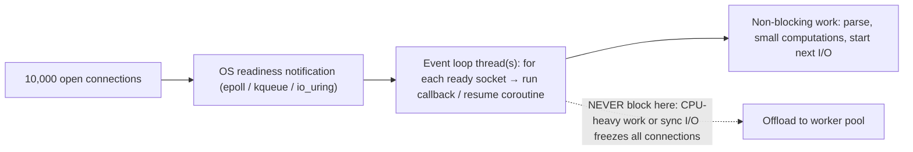

| | Thread-per-request | Event loop / async |
|---|---|---|
| Concurrency cost | ~1 MB stack + scheduling per thread | small per-connection state |
| Code style | simple, sequential | callbacks/promises/async-await |
| Danger | thread exhaustion under slow I/O | one blocking call stalls everything |
| Good for | moderate concurrency, CPU work | many idle/slow connections, proxies, WebSockets |

Rule #1 of event loops: **never block the loop**: no synchronous file or network calls, no long CPU loops (offload to worker threads), no blocking libraries (some DB drivers). Monitor **event loop lag** as a key metric.

#### Example
A Node.js API had random multi-second latency spikes for all users. Event-loop-lag metrics showed 2–4 s stalls coinciding with a report endpoint that synchronously parsed a 50 MB CSV (`fs.readFileSync` + sync parsing). Moving the parsing to a worker thread (and streaming the file) eliminated the stalls for everyone else.

#### Trade-offs
Excellent scalability for I/O-heavy concurrency and efficient memory use, but more complex code and debugging, a single blocking call hurts all requests, and CPU-bound work needs separate handling.

#### Problems & fixes
| Symptom | Cause | Fix |
|---|---|---|
| All requests stall periodically | blocking call on event loop | async APIs, worker threads, monitor loop lag |
| Async code still slow | blocking driver underneath | use truly async drivers or thread pool offload |
| Unbounded concurrency overloads DB | async makes concurrency cheap | semaphores, connection limits |
| Hard-to-read callback chains | callback style | async/await, structured concurrency |

#### Cheat sheet
- Event loop + epoll: few threads, many connections.
- Never block the loop; offload CPU work; monitor loop lag.
- Still limit concurrency to downstream capacity.

#### Interview questions
<details><summary>Why can a single Node.js process handle 10,000 concurrent connections but a thread-per-request server struggles?</summary>

Node uses a non-blocking event loop: idle connections cost only a small amount of memory, and the single thread only does work when sockets are ready, using OS readiness APIs like epoll. Thread-per-request needs a thread (with its stack, ~1 MB, and scheduling overhead) for every concurrent connection, even if it's just waiting, so memory and context switching limit concurrency.
</details>

<details><summary>What happens if you run a CPU-heavy computation in a Node.js request handler?</summary>

The event loop is blocked for the duration, so no other request, timer or I/O callback can run: every client experiences latency spikes, health checks may fail, and throughput collapses. Offload CPU work to worker threads, a separate service, or a job queue, and monitor event loop lag.
</details>

#### Interview angle
> "Async I/O gives cheap concurrency for slow or idle connections, but the event loop must never block, so CPU work is offloaded, loop lag is alerted on, and downstream concurrency is still capped."

#### Sources
- [The Node.js event loop](https://nodejs.org/en/learn/asynchronous-work/event-loop-timers-and-nexttick) — Node.js docs
- [Don't block the event loop (or the worker pool)](https://nodejs.org/en/learn/asynchronous-work/dont-block-the-event-loop) — Node.js docs
- [epoll(7)](https://man7.org/linux/man-pages/man7/epoll.7.html) — Linux manual pages

### N+1 query — detect via slow query log or ORM verbose mode; fix with JOIN, eager loading, or DataLoader
The N+1 query problem: code fetches a list (1 query) and then runs **one more query per item** to load related data (N queries), typically hidden behind ORM lazy loading or naive GraphQL resolvers. 100 orders → 101 queries; each fast alone, but the round trips add up and hammer the database.

#### Intuition
Going to the shop for one item, coming home, and going back for the next, a hundred times over. Each trip is short, but one trip with a full list would have been far quicker.

#### Must know
- Code runs **1 query for a list, then 1 more query per item**.
- It is usually hidden behind ORM lazy loading or GraphQL resolvers.
- Each query is fast. The **round trips add up**.
- Fixes: a JOIN, eager loading, or a single `IN (...)` query.
- In GraphQL, **DataLoader** batches the lookups.

#### Numbers to quote
- 100 orders become 101 queries. The fix is 2.

#### Common mistakes
- Looking only at slow-query logs, where each of these queries looks fine.
- Eager loading several collections with one JOIN, which multiplies rows.
- No guard, so the problem returns later.

#### How it works
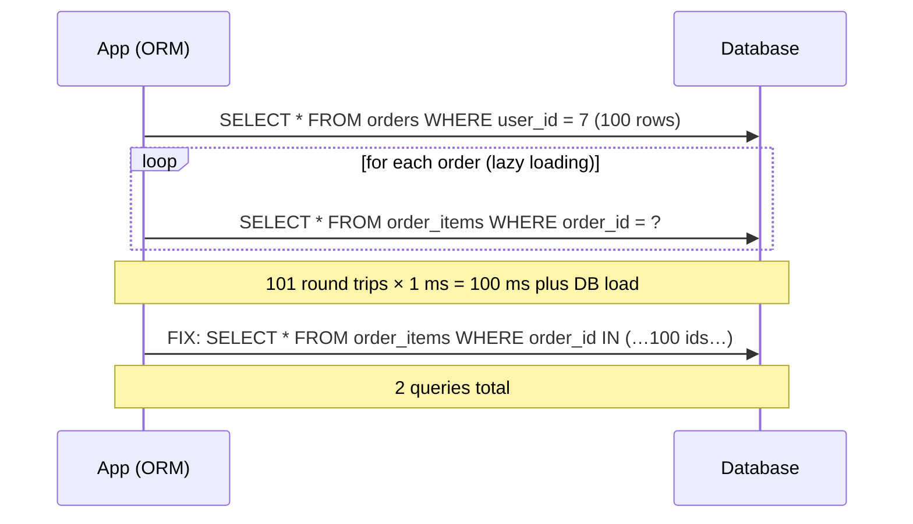

Fixes:
- **JOIN** or a second `IN (…)` query (eager loading: `JOIN FETCH` in JPA, `select_related`/`prefetch_related` in Django, `includes` in Rails).
- **DataLoader** pattern for GraphQL: collect all keys requested in one tick and batch them into a single query, with per-request caching.
- **Batch APIs** for service-to-service calls (same problem across HTTP).

Detection: count queries per request (APM spans, Hibernate statistics, Django debug toolbar, `bullet` gem), log queries in development, and add tests that assert query counts.

#### Example
A "my orders" page took 1.8 s. The trace showed 1 + 50 + 50×3 queries: orders, then items per order, then product per item, all lazy loaded. One query for orders plus `prefetch` for items and products (3 queries total) brought it to 90 ms. A test asserting "this endpoint executes at most 5 queries" prevented regressions.

#### Trade-offs
Eager loading fixes round trips but can over-fetch (loading relations you don't need), and big JOINs can duplicate rows (cartesian products with multiple collections), so pick JOIN vs separate IN-query per case.

#### Problems & fixes
| Symptom | Cause | Fix |
|---|---|---|
| Hundreds of tiny queries per request | lazy loading in loops | eager loading / IN batch |
| GraphQL nested queries explode | per-field resolvers fetch individually | DataLoader batching |
| Huge result sets after eager fetch | joining multiple collections | separate IN queries per relation |
| Regressions creep back | no guard | query-count assertions in tests |

#### Cheat sheet
- 1 list query + N per-item queries. Hidden by ORMs and resolvers.
- Fix: JOIN/eager load, IN batch, DataLoader, batch APIs.
- Detect via query counts in traces; assert counts in tests.

#### Interview questions
<details><summary>How do you detect N+1 queries in a production system?</summary>

Look at traces: a request with dozens or hundreds of nearly identical DB spans is the signature. APM tools flag repeated queries per request. Database statistics (pg_stat_statements) show extremely high call counts for simple queries. In development, enable ORM query logging or tools like Bullet or the Django debug toolbar, and add automated tests asserting query counts.
</details>

<details><summary>How does DataLoader solve N+1 in GraphQL?</summary>

Each resolver asks DataLoader for a key instead of querying directly. DataLoader collects all keys requested during the same event-loop tick (or execution phase) and calls a batch function once with all of them (e.g. `SELECT … WHERE id IN (…)`), then distributes results back to each resolver. It also caches per request so repeated keys are loaded once.
</details>

#### Interview angle
> "N+1 shows up in traces as a wall of identical DB spans. I fix it with eager loading or an IN batch (DataLoader in GraphQL) and lock it in with query-count assertions in tests."

#### Sources
- [DataLoader](https://github.com/graphql/dataloader) — GraphQL, GitHub
- [The N+1 query problem](https://vladmihalcea.com/n-plus-1-query-problem/) — Vlad Mihalcea

### Batch APIs — reduce round trips: fetch 100 items in one request vs 100 individual requests (10× improvement)
Batch APIs let a client fetch or modify **many items in one request** (`GET /products?ids=1,2,3…` or `POST /products:batchGet`), eliminating per-request overhead: network round trips, TLS and HTTP processing, auth checks, and per-call database queries. For chatty service-to-service communication, batching is often the single biggest latency win.

#### Intuition
One delivery van carrying a hundred parcels, as against a hundred vans carrying one each. The driving, parking and paperwork happen once.

#### Must know
- One request fetches or changes **many items**.
- It removes the per-request cost: network round trip, auth check, separate query.
- On the server, turn it into **one set-based query**, not a loop.
- **Cap the batch size.**
- Return **per-item results and errors**, so one bad item does not fail the rest.

#### Common mistakes
- A batch endpoint that loops single queries inside.
- All-or-nothing behaviour when partial success would be fine.
- No size limit, so one huge batch hurts everyone's latency.

#### How it works
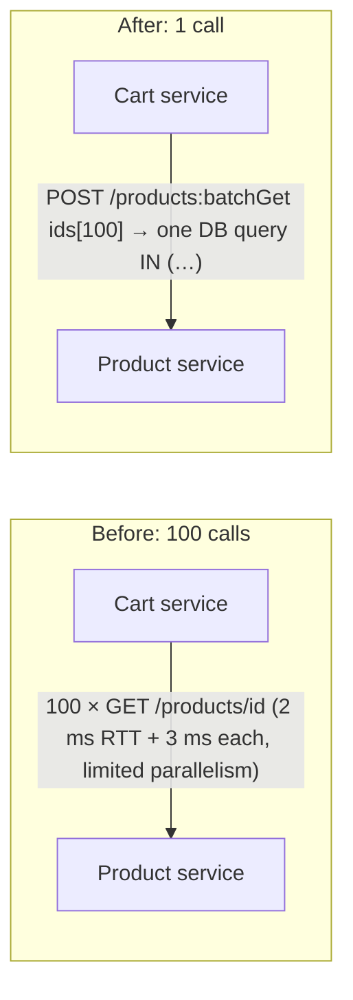

Design guidelines:
- Cap batch size (e.g. 100–500) to bound latency and payload.
- Define **partial failure** semantics: return per-item results and errors (`{id, product}` or `{id, error}`), not all-or-nothing, unless atomicity is required.
- Keep ordering or return a map keyed by id.
- For writes, make batch operations **idempotent** (per-item idempotency keys) and document atomicity.
- Server side: translate to set-based queries (`WHERE id IN`), not a loop of single queries.
- Client side: **auto-batching** (collect calls over a few ms, like DataLoader) when callers make individual requests.

#### Example
A recommendation page needed details for 60 products and called the product service 60 times with a concurrency limit of 10: ~6 waves × 25 ms = 150 ms. A batchGet endpoint (one `IN` query, response map keyed by id, missing ids listed separately) took 18 ms total and cut the product service's request rate by 98%, letting them halve its fleet.

#### Trade-offs
Fewer round trips, less overhead, better DB efficiency, but bigger payloads, more complex error handling, and one huge batch can hurt tail latency (cap size).

#### Problems & fixes
| Symptom | Cause | Fix |
|---|---|---|
| Fan-out of tiny calls dominates latency | per-item API | batch endpoint |
| Batch endpoint slow | server loops single queries | set-based query |
| One bad item fails the whole batch | all-or-nothing semantics | per-item results/errors |
| Giant batches spike latency/memory | no limit | max batch size, pagination |

#### Cheat sheet
- Many items, one request. Set-based queries server-side.
- Cap size, per-item errors, idempotent writes.
- Client auto-batching for scattered calls.

#### Interview questions
<details><summary>How would you design a batch-get endpoint for a product service?</summary>

`POST /v1/products:batchGet` with a list of up to N ids. Validate the size, fetch with one `IN` query (or batched cache lookups first, then the DB for misses), and return a map or ordered list with per-item results and a separate list of not-found or failed ids. Make it read-only and cacheable per item, and document limits and partial-failure behaviour.
</details>

<details><summary>What's the trade-off between batching and latency?</summary>

Batching reduces per-item overhead and total work, but the batch completes only when all items are processed, so one slow item delays the whole response, and auto-batching adds a small wait to collect requests. Bound batch sizes, use short collection windows (a few ms), and process items in parallel inside the server.
</details>

#### Interview angle
> "Chatty fan-out becomes one batchGet with a capped size, a set-based query and per-item errors. That's usually the biggest latency win between services."

#### Sources
- [AIP-231: batch methods: get](https://google.aip.dev/231) — Google API Improvement Proposals
- [BatchGetItem](https://docs.aws.amazon.com/amazondynamodb/latest/APIReference/API_BatchGetItem.html) — Amazon DynamoDB API reference

### Compression — Snappy (fastest, moderate ratio), LZ4 (balanced), gzip (best ratio, slower), Zstandard (best of both)
Compression trades CPU for fewer bytes on the network and disk. Algorithms sit on a speed/ratio spectrum: **LZ4** and **Snappy** are extremely fast with moderate ratios (good for hot paths, Kafka, caches, databases), **gzip/deflate** gives good ratios at moderate speed (universal on the web), **Brotli** compresses web assets better, and **Zstandard (zstd)** offers gzip-or-better ratios at much higher speed with tunable levels.

#### Intuition
Vacuum-packing clothes for a suitcase. It takes a little effort at each end, but far more fits. A quick squeeze saves some space, and a slow careful pack saves more.

#### Must know
- Compression **trades CPU for fewer bytes** on the network and disk.
- **LZ4 and Snappy**: very fast, moderate saving. For hot paths.
- **gzip**: works everywhere on the web. **Brotli**: better for static web files.
- **Zstandard**: gzip-like or better ratio at much higher speed.
- Compress batches. Skip tiny payloads and data that is already compressed.

#### Numbers to quote
- Text and JSON shrink roughly 2× with LZ4 or Snappy, and 4–6× with gzip or Zstandard.

#### Common mistakes
- A high compression level on a latency-critical path.
- Compressing images, video or encrypted data again.
- Compressing each tiny message separately, which gives a poor ratio.

#### How it works
| Algorithm | Compress speed | Ratio (text/JSON) | Typical uses |
|---|---|---|---|
| LZ4 | very fast (~500+ MB/s per core) | ~2× | Kafka, RocksDB, real-time |
| Snappy | very fast | ~2× | Parquet default (older), Cassandra, gRPC |
| gzip (level 6) | moderate (~30–50 MB/s) | ~4–6× | HTTP responses, archives |
| Brotli | slow at high levels | better than gzip for web | pre-compressed static assets |
| Zstandard | fast (level 1–3), slower at high levels | gzip-like or better | Kafka, Parquet, backups, logs, HTTP (zstd) |

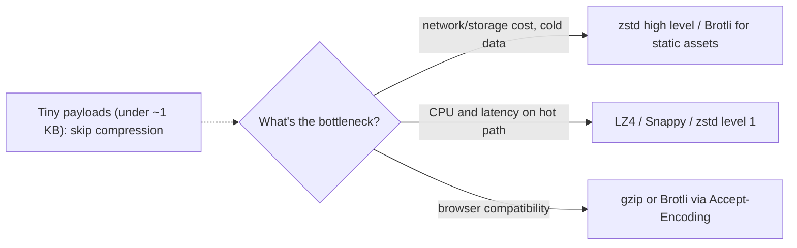

Practical notes: don't compress already-compressed data (JPEG, MP4, zipped files); tiny payloads may grow; compress **batches** (Kafka compresses whole record batches, so higher linger and batch size improve ratio); **dictionary compression** (zstd dictionaries) helps many small similar messages; be careful compressing secrets alongside attacker-controlled data over TLS (BREACH-style attacks).

#### Example
A Kafka pipeline moved 1.2 GB/s of JSON events across AZs, costing a fortune in cross-AZ transfer. Enabling `compression.type=zstd` on producers with `linger.ms=20` (bigger batches) achieved a 5.5× ratio, cut network and broker disk usage by ~80%, and added only ~3% producer CPU.

#### Trade-offs
Big savings in bandwidth, storage and often latency (less data to send), at the cost of CPU and some added latency for compress/decompress, and complexity with mixed clients.

#### Problems & fixes
| Symptom | Cause | Fix |
|---|---|---|
| High transfer/storage bills | uncompressed text data | zstd/gzip, batch compression |
| CPU spike after enabling compression | high compression level on hot path | lower level, LZ4/zstd-1 |
| Responses bigger after compression | compressing small or already compressed data | min size threshold, skip media |
| Poor ratio in Kafka | tiny batches | increase linger.ms and batch.size |

#### Cheat sheet
- LZ4/Snappy = fast. gzip = universal. Brotli = static web. zstd = best all-rounder.
- Compress batches; skip tiny and already-compressed payloads.
- Tune level by bottleneck (CPU vs bytes).

#### Interview questions
<details><summary>Which compression would you choose for Kafka topics and why?</summary>

Zstandard for most topics (high ratio at good speed, saving broker disk and network, especially cross-AZ), or LZ4 when producer CPU and latency are the tightest constraint. Compression applies per batch, so tune linger.ms and batch.size for larger batches. Consumers decompress automatically, and brokers keep data compressed if topic and producer settings match.
</details>

<details><summary>When can compression hurt performance?</summary>

When CPU is the bottleneck (high compression levels on hot paths), when payloads are tiny (headers outweigh gains, and output can grow), when data is already compressed (images, video, encrypted data), and when it adds latency to latency-critical paths. Measure CPU, latency and bytes saved before choosing levels.
</details>

#### Interview angle
> "I pick compression by bottleneck: zstd for Kafka and storage, with bigger batches for ratio, LZ4 when CPU is tight, Brotli for static assets, and nothing for tiny or already-compressed payloads."

#### Sources
- [Zstandard](https://facebook.github.io/zstd/) — Meta open source
- [LZ4](https://github.com/lz4/lz4) — LZ4, GitHub
- [Compression in HTTP](https://developer.mozilla.org/en-US/docs/Web/HTTP/Guides/Compression) — MDN

### Efficient serialization — Protocol Buffers 3–10× smaller than JSON; Avro for Kafka schemas; MessagePack for binary JSON
Serialization format affects payload size, CPU time and schema evolution. **JSON** is human-readable and universal but verbose (field names repeated, numbers as text) and slow to parse. **Protocol Buffers** (gRPC) and **Avro** (Kafka, Hadoop) are compact binary formats with **schemas** and well-defined evolution rules. **MessagePack/CBOR** are schemaless binary JSON. **FlatBuffers/Cap'n Proto** allow zero-copy reads.

#### Intuition
A form where both sides already know what box 1, box 2 and box 3 mean. You send only the box numbers and the values, not the question text each time. JSON resends every question.

#### Must know
- **JSON**: readable and universal, but bulky and slow to parse.
- **Protocol Buffers**: compact binary with a schema. Used with gRPC.
- **Avro**: compact binary with a schema, common with Kafka and a schema registry.
- Binary formats send **field numbers, not field names**.
- Evolve safely: only add optional fields, and never reuse a field number.

#### Numbers to quote
- Protobuf messages are often 3–10× smaller than the same JSON.

#### Common mistakes
- Reusing or renumbering a Protobuf field.
- No automatic compatibility check, so a rename breaks consumers.
- Binary formats on a public browser API, where JSON is expected.

#### How it works
```protobuf
syntax = "proto3";
message Order {
  string order_id = 1;          // field numbers, not names, go on the wire
  int64 amount_paise = 2;       // varint encoding: small numbers take 1–2 bytes
  OrderStatus status = 3;
  repeated LineItem items = 4;
  reserved 5;                   // never reuse removed field numbers
}
```

| Format | Size | Speed | Schema | Evolution | Typical use |
|---|---|---|---|---|---|
| JSON | large | slow | optional (JSON Schema) | ad hoc | public APIs, browsers |
| Protobuf | small (often 3–10× smaller) | fast | required (.proto) | field numbers, add optional fields | gRPC, internal services |
| Avro | small | fast | required, schema with data/registry | reader/writer schema resolution | Kafka, data lakes |
| MessagePack | medium | fast | none | ad hoc | caches, binary JSON |
| FlatBuffers | small | zero-copy reads | required | additive | games, mobile |

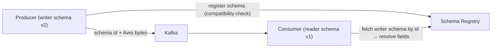

Evolution rules: add fields as optional with defaults, never change a field's type or reuse its number or name, and enforce compatibility in a schema registry or CI (buf breaking).

#### Example
A service mesh between 40 microservices exchanged JSON averaging 4 KB per message; JSON parsing took ~25% of CPU on busy services. Switching internal calls to gRPC/Protobuf shrank messages to ~700 bytes and cut serialization CPU by 70%. A later incident (a team renamed a JSON field and broke two consumers) wouldn't have happened with Protobuf field numbers and `buf breaking` checks in CI.

#### Trade-offs
Binary schema-based formats are compact, fast and safely evolvable, but not human-readable, need code generation and tooling, and browsers/public clients usually expect JSON.

#### Problems & fixes
| Symptom | Cause | Fix |
|---|---|---|
| High CPU in serialization | large JSON payloads | Protobuf/Avro internally |
| Consumers break after a change | no schema compatibility checks | schema registry / buf breaking in CI |
| Data corrupted after field reuse | reused Protobuf field number | `reserved` removed numbers/names |
| Hard to debug binary payloads | not human-readable | tooling (grpcurl, registry-aware consumers) |

#### Cheat sheet
- JSON for public/browser APIs; Protobuf for gRPC; Avro + registry for Kafka.
- Field numbers on the wire; add optional fields; reserve removed ones.
- Enforce compatibility in CI or registry.

#### Interview questions
<details><summary>Why are Protobuf messages so much smaller than JSON?</summary>

Protobuf sends small numeric field tags instead of repeated field names, encodes integers as varints (small values use 1–2 bytes), stores binary data without base64, omits fields with default values, and has no whitespace or quoting. The schema lives in generated code on both sides, not in each message.
</details>

<details><summary>How do you evolve a Protobuf schema safely?</summary>

Only add new fields with new field numbers (old readers ignore unknown fields, new readers see defaults for missing ones). Never change the type or number of an existing field. When removing a field, mark its number and name as `reserved` so they're never reused. Check compatibility automatically in CI (e.g. `buf breaking`) against the deployed version.
</details>

#### Interview angle
> "External APIs stay JSON, internal traffic uses Protobuf over gRPC, and Kafka uses Avro with a schema registry, with compatibility enforced in CI so a renamed field can't break consumers."

#### Sources
- [Encoding](https://protobuf.dev/programming-guides/encoding/) — Protocol Buffers docs
- [Language guide (proto 3): updating a message type](https://protobuf.dev/programming-guides/proto3/#updating) — Protocol Buffers docs
- [Apache Avro documentation](https://avro.apache.org/docs/) — Apache Avro

### GC tuning (JVM) — G1GC for balanced latency; ZGC for sub-ms GC pauses; tune heap: not too small (frequent GC), not too large (long GC)
JVM garbage collectors trade **throughput, pause times and memory overhead**. **G1** (default) aims for configurable pause targets (e.g. 200 ms) with good throughput. **ZGC** and **Shenandoah** do almost all work concurrently, giving **sub-millisecond pauses** even on huge heaps at some CPU cost. **Parallel GC** maximises throughput for batch jobs and tolerates long pauses. Tuning starts with **reducing allocation** and sizing the heap correctly, not with flags.

#### Intuition
Clearing tables in a restaurant. You can stop service for a moment and clear everything at once, or have staff clear continuously while guests eat. The second never interrupts, but needs extra staff.

#### Must know
- A garbage collector trades **throughput, pause time and memory**.
- **G1** is the default: balanced, with a pause target.
- **ZGC**: nearly all work done concurrently, so pauses are under a millisecond.
- **Parallel GC**: best throughput for batch jobs, with long pauses.
- **Cut allocation and size the heap first.** Flags come last.

#### Numbers to quote
- Size the heap at about 2–3× the live data. In a container, give the heap about 75% of memory.

#### Common mistakes
- Tuning flags before looking at the allocation rate.
- Setting the heap equal to the container limit, so the process is OOM-killed.
- Running with no GC logs.

#### How it works
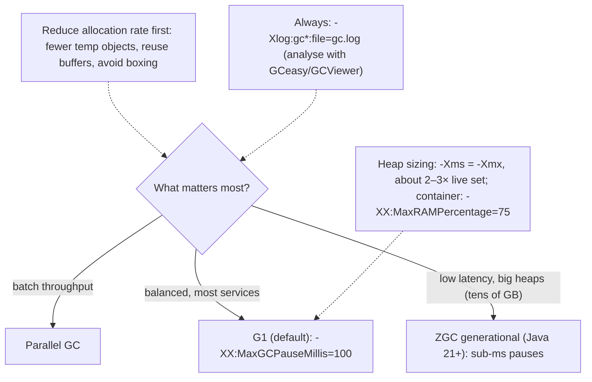

Heap sizing:
- **Too small**: frequent GCs, high CPU, risk of OOM.
- **Too large** (with G1/Parallel): longer pauses for full collections, wasted memory.
- Set `-Xms` = `-Xmx` in services to avoid resize pauses. In containers, use `MaxRAMPercentage` (leave room for metaspace, threads, direct buffers).

Signs of GC trouble: p99 latency spikes aligned with GC logs, GC CPU over ~5–10%, frequent full GCs, "allocation failure" storms, rising old-gen baseline (possible leak).

#### Example
A low-latency pricing API on a 24 GB heap with G1 showed p99.9 spikes of 300–400 ms during mixed collections. Profiling allocations revealed per-request `BigDecimal` and string building in logging that wasn't even enabled (debug messages concatenated eagerly). Fixing allocation hot spots halved GC frequency, and switching to generational ZGC (Java 21) brought GC pauses under 1 ms, so p99.9 dropped to 25 ms with ~8% more CPU.

#### Trade-offs
Low-pause collectors improve tail latency but use more CPU and memory headroom. Throughput collectors are efficient but pause longer. Flag-heavy tuning is fragile across JVM versions.

#### Problems & fixes
| Symptom | Cause | Fix |
|---|---|---|
| Periodic p99 spikes | long GC pauses | ZGC/Shenandoah, reduce allocation, tune heap |
| Container OOM-killed, heap looks fine | non-heap memory (metaspace, threads, direct buffers) | MaxRAMPercentage ~75%, limit threads, NMT |
| Frequent full GCs | heap too small or leak | size to live set × 2–3, check for leaks |
| High GC CPU | excessive allocation | allocation profiling, object reuse |

#### Cheat sheet
- G1 default; ZGC for sub-ms pauses; Parallel for batch.
- Heap ≈ 2–3× live set, Xms = Xmx, MaxRAMPercentage in containers.
- Reduce allocation first; always keep GC logs.

#### Interview questions
<details><summary>A Java service has p99.9 latency spikes every few minutes. How do you investigate?</summary>

Correlate spikes with GC logs (pause durations and types). If GC pauses align: check heap usage after GC (leak?), allocation rate (allocation profile with async-profiler `-e alloc`), and heap sizing. Fix allocation hot spots first, right-size the heap, and consider a low-pause collector like generational ZGC if pauses remain. If GC doesn't align, look at other causes (safepoints, lock contention, I/O, noisy neighbours).
</details>

<details><summary>Why can a JVM container get OOM-killed even though heap usage is under -Xmx?</summary>

The container's memory limit covers the whole process: heap plus metaspace, code cache, thread stacks, direct and NIO buffers, GC structures and native libraries. If -Xmx is set close to the container limit, non-heap memory pushes the total over it and the kernel OOM-kills the process. Use MaxRAMPercentage around 70–75%, cap threads and direct memory, and use Native Memory Tracking to inspect.
</details>

#### Interview angle
> "GC tuning starts with cutting allocation and sizing the heap at 2–3× the live set. For latency-critical services on Java 21 I'd use generational ZGC, and always keep GC logs on."

#### Sources
- [Introduction to garbage collection tuning](https://docs.oracle.com/en/java/javase/21/gctuning/introduction-garbage-collection-tuning.html) — Oracle Java 21 docs
- [JEP 439: generational ZGC](https://openjdk.org/jeps/439) — OpenJDK

### Database connection exhaustion — symptom: timeout waiting for connection; fix: pool size + circuit breaker upstream
Connection exhaustion happens when all connections in an app's pool (or the database's `max_connections`) are in use, so new requests **wait and then time out** ("Connection is not available, request timed out after 30000ms"). Root causes are usually **connections held too long** (slow queries, long transactions, remote calls inside transactions, leaks) or **too many clients** (scale-out, serverless), not "pool too small".

#### Intuition
Every phone line in a call centre is busy, so new callers wait and then give up. The cause is rarely too few lines. Usually some calls are being held far too long.

#### Must know
- Every connection in the pool is in use, so new requests **wait and then time out**.
- The usual cause is **connections held too long**: slow queries, long transactions, leaks.
- The other cause is too many clients: many pods, each with its own pool.
- **A bigger pool rarely fixes it.**
- Fail fast with a short acquire timeout, and set statement timeouts.

#### Numbers to quote
- Use a connection acquire timeout of about 1–2 seconds, not 30.

#### Common mistakes
- Calling an external API while a transaction is open.
- A long acquire timeout, so every request hangs before failing.
- Retrying hard against a database that is already struggling.

#### How it works
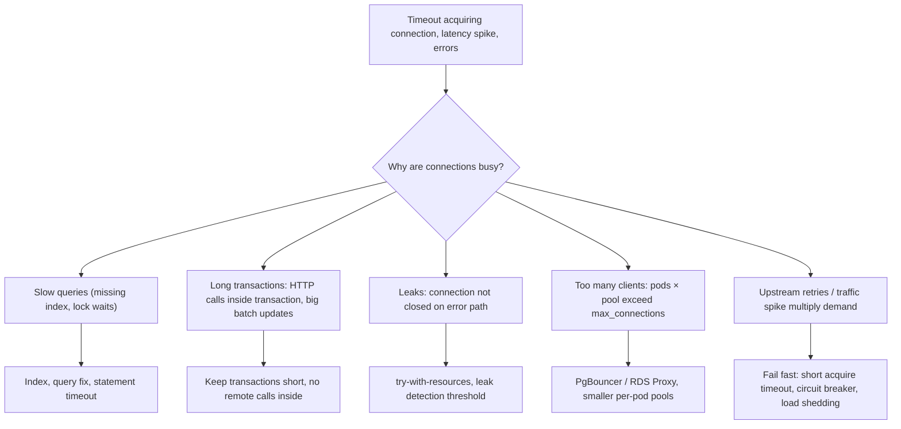

Defensive configuration:
- **Connection acquire timeout** short (e.g. 1–2 s, not 30 s), so requests fail fast instead of piling up.
- **Statement timeout** in the database to kill runaway queries.
- **idle_in_transaction_session_timeout** (Postgres) to kill abandoned transactions.
- **Leak detection** (HikariCP `leakDetectionThreshold`).
- **Circuit breaker and load shedding upstream** so a struggling DB isn't hammered with retries.
- Metrics: active, idle, pending connections, acquire time; DB-side `pg_stat_activity` grouped by state.

#### Example
At 9 am every Monday a reporting endpoint caused "timeout waiting for connection" across the whole service. `pg_stat_activity` showed 40 connections "idle in transaction": the report code opened a transaction, then called an external API to enrich each row while holding the connection for 20+ seconds. Restructuring (fetch data, close the transaction, then call the API), adding `idle_in_transaction_session_timeout=30s`, moving reports to a read replica, and a 2 s acquire timeout eliminated the problem.

#### Trade-offs
Fail-fast settings protect the system but surface errors sooner; poolers solve client counts but add a component; fixing root causes takes engineering time.

#### Problems & fixes
| Symptom | Cause | Fix |
|---|---|---|
| Many "idle in transaction" sessions | remote calls inside transactions, leaks | restructure, idle-in-transaction timeout |
| Pool exhausted under spike | demand × latency exceeds pool | fix latency, shed load, pooler |
| Requests hang 30 s before failing | long acquire timeout | 1–2 s acquire timeout + fallback |
| `too many connections` from DB | instance count × pool size | PgBouncer/RDS Proxy |

#### Cheat sheet
- Exhaustion = connections held too long or too many clients.
- Short acquire timeout, statement timeout, idle-in-transaction timeout, leak detection.
- Pooler for many clients; circuit breaker and load shedding upstream.

#### Interview questions
<details><summary>Your service suddenly reports "timeout waiting for a database connection." How do you debug it?</summary>

Check pool metrics (active vs idle vs pending, acquire time) and the database side (`pg_stat_activity` by state and query, lock waits, slow query log). Look for slow queries or lock contention, long or idle-in-transaction sessions, leaks (active connections that never return), recent deploys or traffic spikes, and total connections from all instances. Mitigate (kill runaway queries, roll back, shed load), then fix the root cause.
</details>

<details><summary>Why should the connection acquire timeout be short?</summary>

With a long timeout (e.g. 30 s), when the pool is exhausted every request waits for the full timeout, holding threads and memory and causing client timeouts and retries that make the overload worse. A short timeout (1–2 s) fails fast, returning a clear error or fallback, freeing resources and letting circuit breakers and load shedding kick in.
</details>

#### Interview angle
> "Connection exhaustion means connections are held too long or there are too many clients. I fix the long transactions and slow queries, put PgBouncer in front, and fail fast with short acquire timeouts and upstream circuit breakers."

#### Sources
- [HikariCP](https://github.com/brettwooldridge/HikariCP) — HikariCP, GitHub
- [Client connection defaults](https://www.postgresql.org/docs/current/runtime-config-client.html) — PostgreSQL docs
- [The cumulative statistics system](https://www.postgresql.org/docs/current/monitoring-stats.html) — PostgreSQL docs

