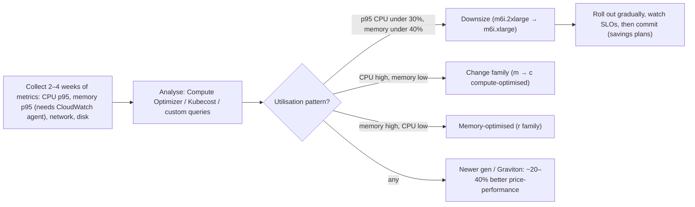
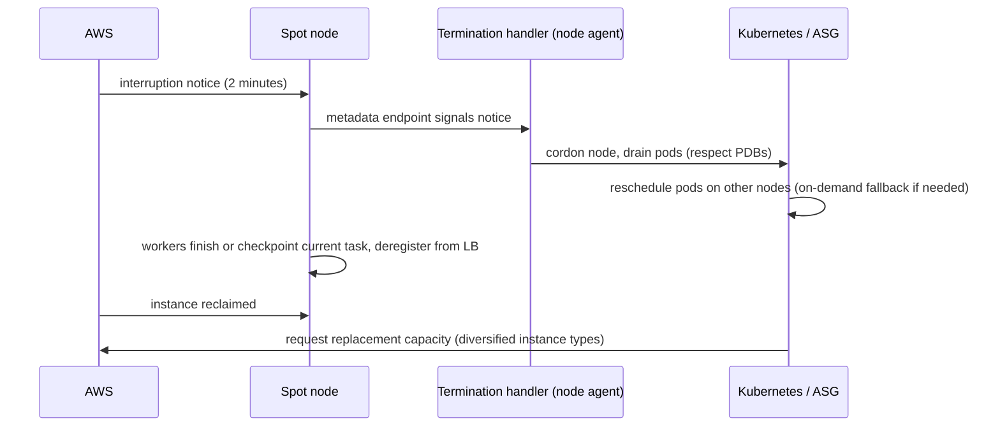
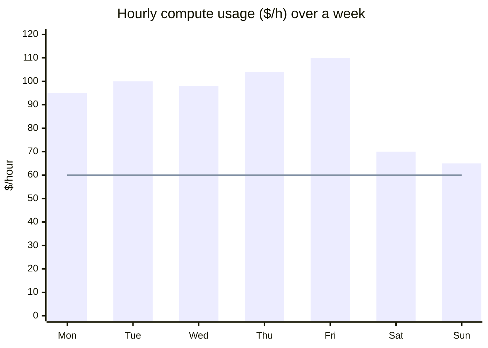
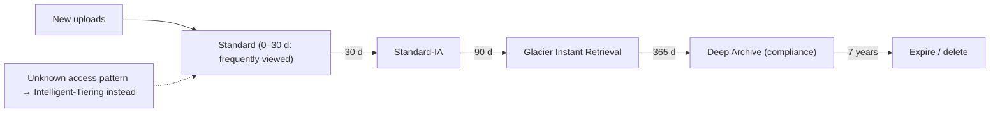
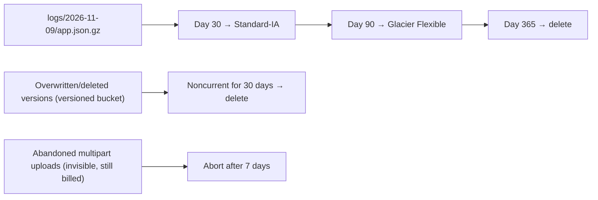
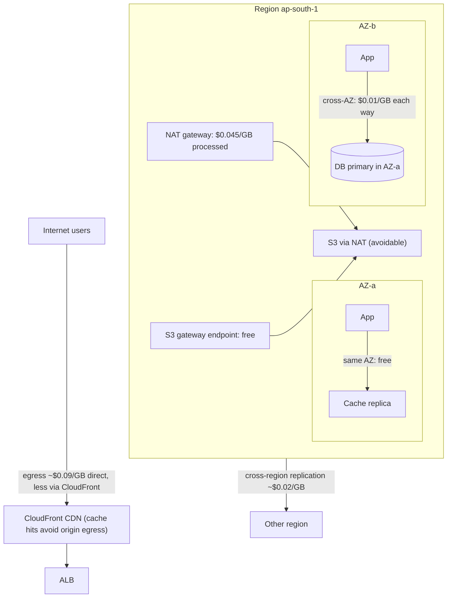
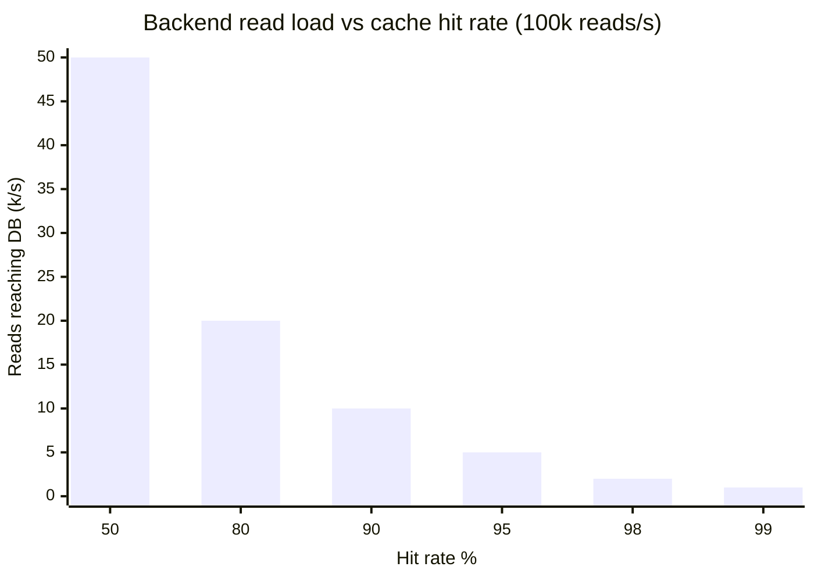
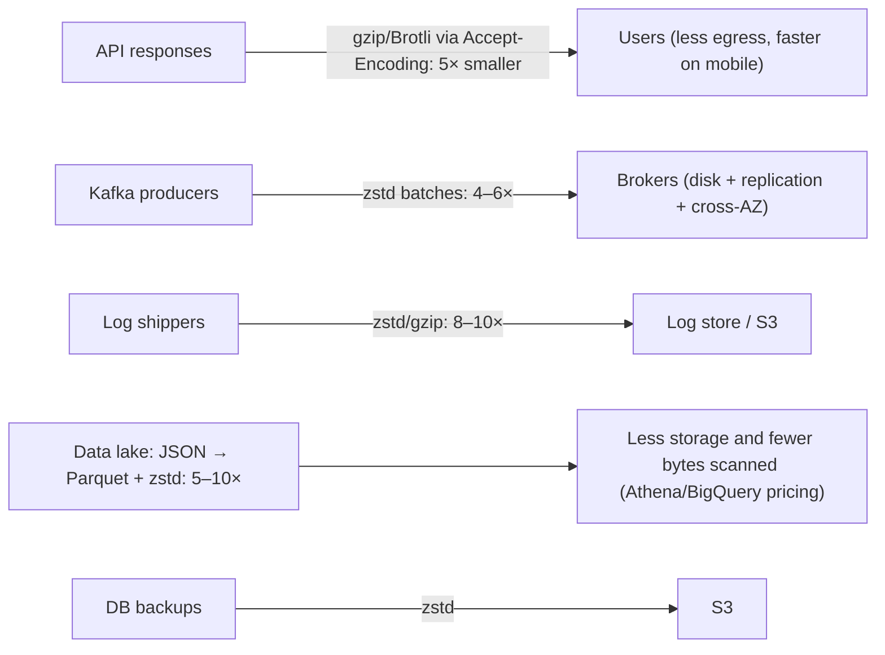
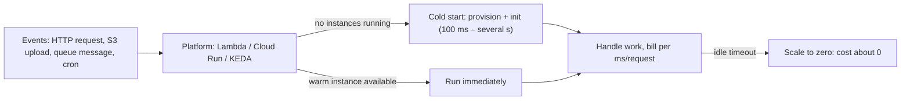
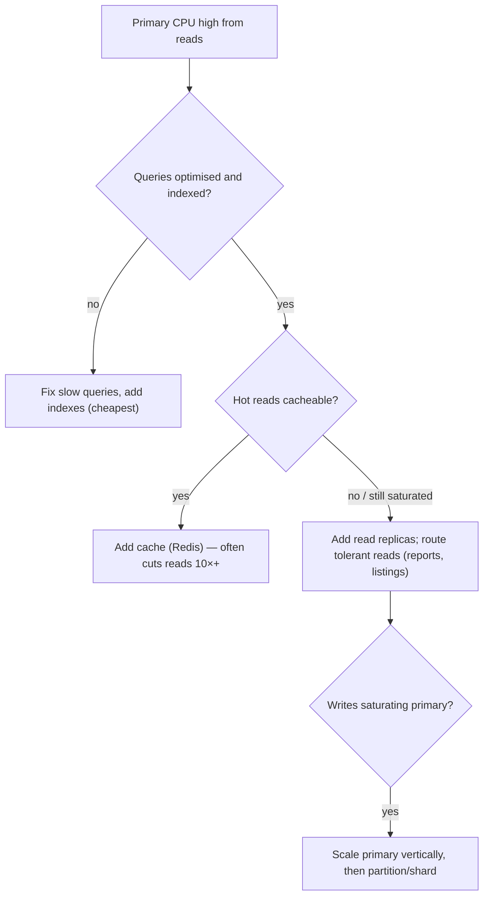

## Cost optimization & efficiency

### Right-sizing compute — use CloudWatch metrics to identify over-provisioned instances
Right-sizing means matching instance types and sizes (or container requests) to **actual resource usage**. Teams typically over-provision "to be safe", leaving instances at 10–20% CPU. Using utilisation metrics over a representative period (CPU, memory, network, at p95/p99, not averages) you downsize, change instance family, or move to newer, cheaper generations (e.g. Graviton/ARM).

#### How it works


In Kubernetes, right-sizing applies to **pod requests**: requests drive node packing and cost. Pods requesting 2 CPU but using 0.2 waste nodes. Use VPA recommendations or Kubecost data, and keep limits sensible.

Notes: memory isn't in default EC2 CloudWatch metrics (install the agent); size on **peaks** you must serve plus headroom, not averages; right-size **before** buying reservations so you don't commit to waste.

#### Example
A company's 300 EC2 instances averaged 12% CPU. AWS Compute Optimizer plus memory metrics showed 60% could drop one size, and Java services moved from m5 to m7g (Graviton) after a compatibility test. Monthly compute fell 38% with no SLO change. In Kubernetes, lowering inflated pod CPU requests (set once during a load test and never revisited) let the cluster shrink from 80 to 52 nodes.

#### Trade-offs
Large, low-risk savings, but too-aggressive downsizing hurts performance at peaks, needs ongoing review as workloads change, and ARM migrations need testing.

#### Problems & fixes
| Symptom | Cause | Fix |
|---|---|---|
| Fleet at 10% CPU | sized "to be safe" | right-size using p95 metrics |
| Downsized service slow at peak | sized on averages | size on peaks + headroom, autoscale |
| K8s cluster has many nearly idle nodes | inflated pod requests | VPA recommendations, request reviews |
| Locked into wrong instance types | reserved before right-sizing | right-size first, then commit |

#### Cheat sheet
- Measure 2–4 weeks; size on p95/peaks.
- Downsize, change family, move to Graviton/newer gens.
- In K8s, requests drive cost. Right-size before committing.

#### Interview questions
<details><summary>How would you approach reducing a large EC2 bill?</summary>

Get visibility first (cost by team, service and tag). Right-size using utilisation data (Compute Optimizer, memory via the CloudWatch agent), shut down idle and orphaned resources, move to newer or Graviton instances, add autoscaling for variable load, use spot for fault-tolerant workloads, and then cover the steady baseline with savings plans or reserved instances. Track savings and SLOs continuously.
</details>

<details><summary>Why size on p95 instead of average utilisation?</summary>

Averages hide peaks: a service averaging 20% CPU may hit 85% during daily peaks. Sizing on the average would cause latency and errors at peak. Sizing on p95 or p99 utilisation over a representative period (plus headroom, or autoscaling for variable demand) keeps performance while removing truly idle capacity.
</details>

#### Interview angle
> "Right-sizing on p95 CPU and memory, plus a Graviton migration, is usually the biggest low-risk saving. Only after that do we buy savings plans for the steady baseline."

### Spot / preemptible instances — 70–90% savings; design stateless workers that handle 2-min shutdown notice
Spot instances (AWS) / preemptible or Spot VMs (GCP) / Spot VMs (Azure) are **spare cloud capacity at 60–90% discount**, which the provider can **reclaim at short notice** (2 minutes on AWS, 30 seconds on GCP). They suit **fault-tolerant, stateless or checkpointed** workloads: batch processing, CI runners, data pipelines, stateless web tiers behind load balancers, and Kubernetes worker nodes with diverse instance types.

#### How it works


Best practices:
- **Diversify** across many instance types and AZs (capacity-optimised allocation) to reduce interruptions.
- Mix with **on-demand baseline** (e.g. 30% on-demand, 70% spot) for critical services.
- Handle the notice: drain connections, checkpoint long jobs, make tasks idempotent and retryable.
- Use Karpenter/Cluster Autoscaler with spot-aware provisioning, PodDisruptionBudgets.
- Avoid for stateful singletons, long non-checkpointable jobs, or databases.

#### Example
A data team ran nightly Spark jobs on on-demand EMR clusters costing $40k/month. Moving task nodes to spot with 15 instance types across 3 AZs (core nodes on-demand for HDFS stability), and enabling Spark's graceful decommissioning, cut cost by 72%. Interruptions caused occasional task retries but jobs still finished within the SLA.

#### Trade-offs
Huge savings, but interruptions require resilient design, capacity isn't guaranteed (some types get scarce), and it's unsuitable for stateful or latency-critical singletons.

#### Problems & fixes
| Symptom | Cause | Fix |
|---|---|---|
| Frequent interruptions | one instance type in one AZ | diversify types/AZs, capacity-optimised strategy |
| Lost work on interruption | no checkpointing, non-idempotent tasks | checkpoints, idempotent retryable tasks |
| Outage when spot capacity disappears | 100% spot for critical service | on-demand baseline, fallback |
| Dropped requests during reclaim | no draining | termination handler, LB deregistration |

#### Cheat sheet
- 60–90% off; reclaimable with 2-minute notice.
- Stateless, idempotent, checkpointed workloads.
- Diversify, mix with on-demand, drain on notice.

#### Interview questions
<details><summary>Which workloads would you put on spot instances, and which not?</summary>

Good fits: batch and data processing (Spark, video encoding), CI/CD runners, stateless web or API tiers with on-demand baseline capacity, queue workers with idempotent jobs, ML training with checkpoints, dev/test environments. Poor fits: databases and stateful singletons, long jobs that can't checkpoint, workloads with strict capacity guarantees, and latency-critical systems without redundancy.
</details>

<details><summary>How do you design a queue worker to run safely on spot instances?</summary>

Make each job idempotent and retryable; use visibility timeouts (SQS) or consumer group rebalancing (Kafka) so unfinished jobs are redelivered. On the interruption notice, stop pulling new jobs, finish or checkpoint the current one within the window, and exit cleanly. Spread across many instance types and AZs, and autoscale on queue depth.
</details>

#### Interview angle
> "Batch jobs, CI and idempotent queue workers run on diversified spot capacity with a termination handler that drains and checkpoints. Critical services keep an on-demand baseline."

### Reserved instances vs savings plans — 1–3 year commitment for 30–60% discount on baseline capacity
Commitment discounts trade flexibility for price: you commit to a level of usage for **1 or 3 years** and get **~30–72% off** on-demand. **Reserved Instances (RIs)** commit to specific instance families/regions (standard or convertible). **Savings Plans** commit to a **$/hour spend**: Compute Savings Plans apply across instance families, regions, Fargate and Lambda; EC2 Instance Savings Plans give deeper discounts for a family in a region. Commit only to the **steady baseline**; cover variable load with on-demand and spot.

#### How it works


The line is a savings-plan commitment at the stable floor (~$60/h): always fully used, discounted. Usage above it is covered by on-demand, spot or autoscaling.

| | Standard RI | Convertible RI | Compute Savings Plan | EC2 Instance SP |
|---|---|---|---|---|
| Discount (3 yr, all upfront) | highest (~up to 72%) | lower | ~up to 66% | ~up to 72% |
| Flexibility | fixed family/region | can exchange | any family, region, Fargate, Lambda | any size/OS within family+region |
| Also for | RDS, ElastiCache, OpenSearch, Redshift (RIs) | — | compute only | EC2 only |

Process: right-size first → analyse the **minimum steady usage** over months → commit to ~70–80% of that floor → layer commitments over time (stagger expiries) → monitor utilisation and coverage.

#### Example
A company spending $150k/month on EC2 and Fargate, after right-sizing, had a steady floor of ~$90k. They bought a 1-year Compute Savings Plan covering $75k equivalent (no upfront), saving ~$22k/month, while keeping flexibility to move to Graviton and Fargate. Databases got 1-year RDS reserved instances. A year earlier, a team had bought 3-year standard RIs for m4 instances and then migrated off them, paying for idle reservations, which is why they now favour Compute Savings Plans.

#### Trade-offs
Significant discounts on predictable usage, but commitment risk (paying for unused capacity if architecture or demand changes), less flexibility with standard RIs, and upfront cash for the deepest discounts.

#### Problems & fixes
| Symptom | Cause | Fix |
|---|---|---|
| Paying for unused reservations | committed before right-sizing, migrated away | right-size first, prefer flexible Compute SPs |
| Low coverage, high on-demand spend | no commitments | commit to steady baseline |
| Large expiry cliff | all commitments bought at once | stagger purchases quarterly |

#### Cheat sheet
- Commit to the steady floor only (1 or 3 years).
- Compute Savings Plans = flexible; RIs/EC2 SPs = deeper but rigid.
- Right-size first; track utilisation and coverage; stagger.

#### Interview questions
<details><summary>How do you decide how much to commit in savings plans?</summary>

After right-sizing, look at hourly usage over several months, find the stable minimum (the floor that's always used, excluding temporary projects), and commit to a portion of it (e.g. 70–80%) to leave room for efficiency improvements and architecture changes. Buy in tranches over time, monitor utilisation (should stay near 100%) and coverage, and increase as confidence grows.
</details>

<details><summary>Savings plans vs reserved instances: which would you choose for a team migrating to containers?</summary>

Compute Savings Plans: they apply automatically across EC2 instance families and sizes, regions, Fargate and Lambda, so the commitment stays useful as workloads move from VMs to containers or serverless, or to Graviton. Standard RIs lock to a family and region and risk becoming unused during migration.
</details>

#### Interview angle
> "Right-size first, then cover about 70–80% of the steady floor with flexible Compute Savings Plans bought in staggered tranches. Peaks ride on autoscaled on-demand and spot."

### S3 storage tiering — Standard → Standard-IA → Glacier Instant → Glacier Flexible → Deep Archive
S3 offers storage classes priced by **access frequency and retrieval speed**: the less often you need data and the longer you can wait for it, the cheaper per GB, but with retrieval fees and minimum storage durations. **Intelligent-Tiering** moves objects automatically based on access patterns for a small monitoring fee.

#### How it works
| Class | Storage $/GB-month (approx, us-east-1) | Retrieval | Min duration | Use for |
|---|---|---|---|---|
| Standard | ~$0.023 | free, ms | none | hot data |
| Intelligent-Tiering | auto (Standard → IA → archive tiers) | free (frequent/infrequent tiers) | none | unknown/changing patterns |
| Standard-IA | ~$0.0125 | per-GB fee, ms | 30 days | accessed monthly, needed instantly |
| One Zone-IA | ~$0.01 | per-GB fee, ms | 30 days | re-creatable data |
| Glacier Instant Retrieval | ~$0.004 | higher fee, ms | 90 days | quarterly access, instant |
| Glacier Flexible Retrieval | ~$0.0036 | minutes–hours | 90 days | backups, archives |
| Glacier Deep Archive | ~$0.00099 | 12–48 hours | 180 days | compliance, 7–10 year retention |



Watch out: **minimum object size** charges (IA classes bill small objects as 128 KB), **minimum duration** (deleting early still bills the minimum), **retrieval fees** that can exceed savings for data accessed more than expected, and **request costs** for transitioning millions of tiny objects.

#### Example
A media app stored 900 TB of user photos in Standard. Analysis with S3 Storage Lens showed 85% of objects untouched after 60 days. Lifecycle rules (Standard → Standard-IA at 30 days → Glacier Instant Retrieval at 180 days) cut storage cost ~65%. For thumbnails (tiny objects, often re-accessed), they kept Standard, because IA's 128 KB minimum and retrieval fees made it more expensive.

#### Trade-offs
Big storage savings for cold data, but retrieval fees, latency for archive tiers, minimum durations and sizes, and per-object transition request costs can surprise you.

#### Problems & fixes
| Symptom | Cause | Fix |
|---|---|---|
| Bill rose after moving to IA | small objects / frequent access fees | keep small or hot objects in Standard, analyse access |
| Restores take hours during incident | data in Glacier Flexible/Deep Archive | keep restore-critical data in instant tiers |
| Huge transition request charges | millions of tiny objects | aggregate small objects, filter by size |
| Unknown patterns | can't predict access | Intelligent-Tiering |

#### Cheat sheet
- Standard → IA → Glacier IR → Glacier Flexible → Deep Archive.
- Watch min duration, min size (128 KB), retrieval fees.
- Intelligent-Tiering when access is unpredictable; Storage Lens to analyse.

#### Interview questions
<details><summary>How would you store 5 PB of user uploads where most files are rarely accessed after a month?</summary>

Upload into Standard, with lifecycle policies transitioning to Standard-IA after 30 days and Glacier Instant Retrieval after ~90–180 days (keeps millisecond access for occasional views), or Intelligent-Tiering if access is unpredictable. Exclude tiny objects from IA transitions, keep thumbnails hot, put deletion rules on temporary data, and verify with Storage Lens and access logs.
</details>

<details><summary>When can moving data to a cheaper storage class increase your bill?</summary>

When objects are small (IA classes charge a minimum of 128 KB per object), when data is accessed more often than expected (per-GB retrieval fees), when objects are deleted before the minimum storage duration (30/90/180 days still billed), and when transitioning millions of tiny objects (per-request lifecycle charges).
</details>

#### Interview angle
> "Cold user uploads tier from Standard to IA to Glacier Instant Retrieval through lifecycle rules, or Intelligent-Tiering when access is unknown, while small hot objects stay in Standard because IA minimums cost more."

### Lifecycle policies — auto-transition objects to cheaper tier after 30/90/365 days
Lifecycle policies are **rules on a bucket** (by prefix or tag) that automatically **transition** objects to cheaper storage classes after a given age and **expire** (delete) them when no longer needed, including old object versions and incomplete multipart uploads. They turn data retention policy into automation.

#### How it works
```json
{
  "Rules": [
    { "ID": "logs", "Filter": { "Prefix": "logs/" }, "Status": "Enabled",
      "Transitions": [ { "Days": 30, "StorageClass": "STANDARD_IA" },
                       { "Days": 90, "StorageClass": "GLACIER" } ],
      "Expiration": { "Days": 365 } },
    { "ID": "versions", "Filter": {}, "Status": "Enabled",
      "NoncurrentVersionExpiration": { "NoncurrentDays": 30 },
      "AbortIncompleteMultipartUpload": { "DaysAfterInitiation": 7 } }
  ]
}
```



Common hidden costs that lifecycle rules fix: **noncurrent versions** in versioned buckets (every overwrite keeps the old copy), **incomplete multipart uploads** (invisible in listings but billed), and temporary or staging data nobody deletes. Align rules with legal retention: object lock and legal holds take precedence for compliance data.

#### Example
A bucket used for nightly database exports had versioning enabled "for safety" and grew to 2.1 PB, although current data was only 180 TB: each nightly export overwrote the same keys, keeping every old version forever. Adding noncurrent version expiration (keep 14 days) and aborting incomplete multipart uploads (5 TB of abandoned parts) cut storage by 90%.

#### Trade-offs
Automated, set-and-forget savings and retention enforcement, but wrong rules can delete data you need (test on prefixes, use tags), transitions incur request costs, and minimum durations apply.

#### Problems & fixes
| Symptom | Cause | Fix |
|---|---|---|
| Versioned bucket much bigger than data | noncurrent versions never expire | NoncurrentVersionExpiration |
| Invisible storage charges | incomplete multipart uploads | AbortIncompleteMultipartUpload |
| Data deleted that legal needed | expiration conflicts with retention | object lock/legal hold, review rules with compliance |
| Logs kept forever | no expiration | expiration per data class |

#### Cheat sheet
- Transition by age, expire when done, by prefix/tag.
- Always: noncurrent version expiration + abort incomplete multipart uploads.
- Align with legal retention; object lock for compliance.

#### Interview questions
<details><summary>What lifecycle rules would you apply to an application log bucket?</summary>

Transition to Standard-IA after 30 days (logs rarely needed after the first weeks), to Glacier Flexible or Deep Archive after 90 days if compliance requires long retention, and expire after the required retention period (e.g. 1 year). Also abort incomplete multipart uploads after a few days, and expire noncurrent versions if versioning is on.
</details>

<details><summary>Why can a versioned S3 bucket cost far more than the data you see?</summary>

Every overwrite or delete keeps the previous object as a noncurrent version (and deletes add delete markers), all billed as storage but hidden from normal listings. Repeatedly overwritten keys accumulate many versions. Noncurrent version expiration rules keep only recent versions for recovery.
</details>

#### Interview angle
> "Every bucket gets lifecycle rules: transitions by age, expiry per data class, noncurrent version expiration and multipart cleanup, all reviewed against legal retention."

### Data transfer costs — same-AZ is free; cross-AZ costs $0.01/GB; cross-region higher; CDN reduces egress
Cloud providers charge for data moving **between AZs, between regions and out to the internet**, and these costs are easy to overlook. On AWS (approximate): traffic within an AZ over private IPs is free, **cross-AZ ~$0.01/GB each direction**, **cross-region ~$0.02/GB**, and **internet egress ~$0.05–0.09/GB** (cheaper via CloudFront). NAT gateways add **~$0.045/GB processed**. High-throughput architectures can spend more on data transfer than on compute.

#### How it works


Savings levers:
- **CDN** for static and cacheable content (lower egress rates, fewer origin bytes).
- **VPC gateway endpoints** for S3/DynamoDB (free) instead of NAT gateways; interface endpoints for other services.
- **Zone-aware routing** (Kubernetes topology-aware routing, Kafka rack-aware consumers fetching from the nearest replica).
- **Compression** of inter-service and replication traffic.
- Avoid unnecessary **cross-region** replication and chatty cross-region calls.
- Tag and monitor transfer costs (Cost Explorer by usage type, VPC Flow Logs).

#### Example
A Kafka-heavy platform found $85k/month in "Regional Data Transfer" charges. Producers, brokers and consumers were spread across 3 AZs, so most bytes crossed AZs twice (producer → leader, replication to followers, leader → consumer). Enabling zstd compression, rack-aware follower fetching for consumers, and moving S3 traffic from a NAT gateway to a gateway endpoint cut the bill by $55k/month.

#### Trade-offs
Multi-AZ resilience inherently costs some cross-AZ traffic; zone-local routing can unbalance load; CDNs and endpoints add configuration. The aim is to remove unnecessary transfer, not resilience.

#### Problems & fixes
| Symptom | Cause | Fix |
|---|---|---|
| Large NAT gateway bill | S3/DynamoDB traffic via NAT | gateway VPC endpoints |
| High regional transfer costs | chatty cross-AZ services, Kafka replication | zone-aware routing, follower fetching, compression |
| High internet egress | serving media from origin | CDN, caching, compression |
| Surprise cross-region charges | replication or calls across regions | review need, compress, batch |

#### Cheat sheet
- Same AZ free; cross-AZ ~$0.01/GB each way; cross-region ~$0.02/GB; egress ~$0.09/GB.
- NAT gateway processing fees: use VPC endpoints.
- CDN, compression, zone-aware routing, rack-aware Kafka.

#### Interview questions
<details><summary>Why might a multi-AZ Kafka cluster have a huge data transfer bill, and how do you reduce it?</summary>

With replication factor 3 across AZs, each produced byte crosses AZ boundaries up to twice for replication, plus producer-to-leader and leader-to-consumer hops when clients are in other AZs, all billed at ~$0.01/GB each direction. Reduce with compression (zstd), rack awareness so consumers fetch from replicas in their own AZ (KIP-392), placing producers near leaders where possible, and reducing unnecessary retention-driven re-reads.
</details>

<details><summary>What's a common hidden networking cost in AWS VPCs?</summary>

NAT gateway data processing (~$0.045/GB) on traffic from private subnets to AWS services like S3, ECR or DynamoDB, plus hourly charges. Gateway endpoints for S3 and DynamoDB are free and remove that traffic from the NAT. Interface endpoints (PrivateLink) for other services often cost less than NAT processing at high volume.
</details>

#### Interview angle
> "I check data transfer early: gateway endpoints instead of NAT for S3, a CDN for egress, compression, and zone-aware routing with rack-aware Kafka fetches so bytes stop crossing AZs."

### Caching ROI — every cache hit saves a DB query; measure cache hit rate, aim for >95% for hot paths
Caching pays off when the **cost of the cache is lower than the backend work it avoids**: database capacity, compute, latency and third-party API fees. The key metric is **hit rate**: at 95% hits, the backend sees only 5% of read traffic (20× reduction); dropping to 80% quadruples backend load. Measure hit rate, latency and backend savings to justify (and size) caches.

#### How it works


ROI calculation example:
- 100k reads/s; DB read replica handles ~10k reads/s at ~$1,500/month each.
- Without cache: ~10 replicas = $15,000/month.
- With a Redis cluster (~$2,500/month) at 95% hit rate: 5k reads/s → 1 replica ($1,500). Total $4,000. **Savings ~$11,000/month** plus lower latency.

Improving hit rate: cache the right granularity, longer TTLs where staleness is acceptable, event-driven invalidation instead of very short TTLs, enough memory to hold the working set (watch evictions), consistent key design (avoid per-user keys for shared data), and request coalescing. Track hit rate **per key pattern**, not just globally.

#### Example
A product API had a 72% cache hit rate, and the team wanted to add DB replicas. Per-key-pattern metrics showed that price lookups had a 30% hit rate because the key included a session-specific currency formatting parameter. Normalising the key raised overall hit rate to 96%, DB reads fell 7×, and two existing replicas were decommissioned instead of adding more.

#### Trade-offs
Large savings and latency gains, but caches cost memory, add staleness and invalidation complexity, and a cache failure can shift full load to the backend (it must survive or degrade gracefully).

#### Problems & fixes
| Symptom | Cause | Fix |
|---|---|---|
| Low hit rate | keys too specific, TTL too short, working set exceeds memory | normalise keys, longer TTL with invalidation, size memory |
| High evictions | cache too small | scale memory, better eviction policy |
| DB overload when cache restarts | cold cache, no protection | warming, coalescing, gradual traffic |
| Cache costs more than it saves | caching rarely reused data | cache only hot/expensive items |

#### Cheat sheet
- Hit rate drives savings: 95% → backend sees 5%.
- Measure per key pattern; watch evictions.
- ROI = backend cost avoided − cache cost; plan for cold-cache failure.

#### Interview questions
<details><summary>How do you justify adding a Redis cluster to finance?</summary>

Show current backend load and cost (replicas, instance sizes, third-party API fees) and latency. Estimate the expected hit rate from access patterns (e.g. the top 10% of keys serve 90% of reads), compute how much backend capacity is no longer needed, and subtract the cluster cost. Add latency or conversion benefits. Then measure actual hit rate and decommissioned capacity after rollout.
</details>

<details><summary>Your cache hit rate dropped from 95% to 85%. What's the impact and what do you check?</summary>

Backend load triples (from 5% to 15% of reads), which may overload the database. Check recent deploys (key format changes, new parameters in keys), evictions or memory pressure (working set grew), TTL changes, traffic pattern changes (new unique content, crawlers), and hit rate per key pattern to isolate the cause.
</details>

#### Interview angle
> "Cache ROI is about hit rate: going from 95% to 85% triples database load. I track hit rate per key pattern and evictions, and justify the cluster by the replicas it lets us remove."

### Compression reduces bandwidth and storage — 3–10× reduction for JSON/text data
Text-based data (JSON, logs, CSV, HTML) is highly redundant and typically compresses **3–10×**. Compressing at the right places (HTTP responses, Kafka batches, logs, backups, data lakes via columnar formats) cuts **network egress, cross-AZ transfer, storage and I/O**, often improving latency too, in exchange for some CPU.

#### How it works


Where it pays most: anything billed per GB (egress, cross-AZ, NAT, storage, bytes scanned), slow links (mobile), and I/O-bound systems. Where to skip: already-compressed formats (images, video, archives), tiny messages, CPU-bound paths with cheap networks.

#### Example
A SaaS dashboard API returned 1.2 MB JSON responses uncompressed (compression had been disabled at the load balancer during a debugging session and never re-enabled). Enabling Brotli/gzip at the CDN cut responses to 140 KB, reduced CloudFront egress by ~85% ($9k/month), and improved mobile page loads by 1.5 s.

#### Trade-offs
Large savings in bytes for modest CPU, but adds latency for compress/decompress on very hot paths, offers nothing for compressed media, and has some security caveats when mixing secrets with attacker-controlled input (BREACH).

#### Problems & fixes
| Symptom | Cause | Fix |
|---|---|---|
| High egress, large JSON responses | compression disabled | enable gzip/Brotli at CDN/LB |
| Storage costs high for logs/backups | stored uncompressed | compress at write, columnar formats |
| CPU spikes | high compression levels | lower levels, offload to CDN |
| No gain | compressing media/encrypted data | skip by content type |

#### Cheat sheet
- Text compresses 3–10×; media doesn't.
- Compress where billed per GB: egress, cross-AZ, storage, bytes scanned.
- CDN for HTTP compression; zstd for Kafka, logs, backups; Parquet for lakes.

#### Interview questions
<details><summary>Where in a typical web architecture would you apply compression to save cost?</summary>

HTTP responses at the CDN or load balancer (gzip/Brotli), inter-service payloads on high-volume paths (or binary formats), Kafka producer batches (zstd), logs in transit and at rest, database backups and exports, and analytics data stored as compressed columnar Parquet. Focus on paths billed per GB or limited by bandwidth.
</details>

<details><summary>Why does converting JSON in S3 to compressed Parquet reduce query costs in Athena?</summary>

Athena charges per byte scanned. Compressed columnar Parquet is several times smaller overall, and queries read only the columns they reference and skip row groups using statistics, so bytes scanned (and cost) can drop by 10–100× compared with scanning full JSON records.
</details>

#### Interview angle
> "Compression is the cheapest cost win wherever we pay per GB: Brotli at the CDN, zstd for Kafka and logs, and Parquet in the lake to cut bytes scanned."

### Auto-scaling to zero — Lambda, Cloud Run, ECS Fargate: no cost when no traffic (ideal for batch workloads)
Scale-to-zero platforms run your code **only when there's work** and charge **nothing (or nearly nothing) when idle**: AWS Lambda, Google Cloud Run, Azure Functions/Container Apps, Knative/KEDA on Kubernetes. They suit **spiky, intermittent or low-traffic** workloads: internal tools, webhooks, scheduled jobs, event processing, dev/preview environments. The trade-off is **cold starts** and per-request pricing that becomes expensive at sustained high load.

#### How it works


Cost crossover: Lambda at ~$0.20 per million requests + ~$0.0000167 per GB-second. A function at 512 MB running 100 ms costs ~$1 per million requests. A steady 200 requests/s (~520M/month) would cost ~$520+ per month; a couple of small always-on containers might handle that for less. Rule of thumb: **intermittent → serverless, steady high utilisation → containers or VMs with commitments**.

Cold start mitigations: smaller packages, lighter runtimes, init outside handler, **provisioned concurrency** / min instances (which brings back some idle cost), SnapStart (Java on Lambda).

#### Example
A company ran 40 internal tools and webhook handlers on always-on t3.medium instances (~$1,200/month) at under 2% utilisation. Moving them to Cloud Run with min instances 0 cost ~$60/month. For the customer-facing API (steady 1,500 RPS), they kept ECS on EC2 with savings plans, because a Lambda estimate came out ~3× more expensive at that sustained load.

#### Trade-offs
Zero idle cost and no capacity management, but cold starts hurt latency-sensitive paths, per-request pricing is expensive for steady heavy traffic, execution limits (time, memory) apply, and connections to databases need pooling solutions.

#### Problems & fixes
| Symptom | Cause | Fix |
|---|---|---|
| Slow first requests | cold starts | min instances/provisioned concurrency for critical paths, slimmer init |
| Bill higher than containers | sustained high traffic on per-request pricing | move steady workloads to containers + commitments |
| DB connection exhaustion | many concurrent function instances | RDS Proxy, concurrency limits |
| Idle dev environments cost money | always-on staging | scale-to-zero preview environments |

#### Cheat sheet
- Pay only when running; ideal for spiky, intermittent workloads.
- Cold starts; per-request cost crossover at sustained load.
- Min instances for latency-critical paths; RDS Proxy for DBs.

#### Interview questions
<details><summary>When is serverless cheaper than containers, and when is it more expensive?</summary>

Cheaper when traffic is intermittent or spiky with long idle periods (internal tools, webhooks, scheduled jobs, low-traffic APIs, event processing), because you pay nothing while idle and no capacity is over-provisioned. More expensive for steady, high-throughput workloads where always-on containers or VMs run at high utilisation and can use commitment discounts. Compare cost per request at your actual traffic profile.
</details>

<details><summary>How do you reduce cold-start impact for a user-facing serverless API?</summary>

Keep packages and dependencies small, initialise expensive clients outside the handler and reuse them, choose faster-starting runtimes (or SnapStart for Java), and keep a minimum number of warm instances or provisioned concurrency for latency-critical endpoints during business hours. Move heavy initialisation to asynchronous paths.
</details>

#### Interview angle
> "Intermittent work like webhooks, cron jobs and internal tools scales to zero on Lambda or Cloud Run. Steady high-RPS services stay on containers with savings plans, because per-request pricing loses at sustained load."

### Database read replicas cost tradeoff — cheaper than sharding; only add when primary is read-saturated
Read replicas scale **reads** by copying the primary's data asynchronously to additional instances. They are far **simpler and cheaper than sharding** (no application changes beyond read/write routing), but each replica costs a full instance, adds **replication lag** (stale reads), and does nothing for write throughput. Add them when reads saturate the primary, **after** cheaper options: query optimisation, indexes and caching.

#### How it works


Considerations:
- **Replication lag**: read-your-writes problems (user updates profile, then reads stale data from a replica). Route those reads to the primary for a short window or use session consistency.
- **Cost**: each replica is a full instance (plus storage on some engines; Aurora replicas share storage). Two replicas can triple DB compute cost.
- **Use cases**: analytics and reporting offload, read-heavy endpoints tolerant of slight staleness, regional read latency, and failover candidates.
- **Sharding** is the step for **write** scale or datasets too big for one node, with much higher complexity.

#### Example
A team planned to shard their Postgres database because the primary sat at 85% CPU. Analysis showed 60% of CPU came from three unindexed reporting queries and a frequently polled "unread count" query. Adding two indexes, caching the unread count in Redis, and moving reports to a single read replica dropped primary CPU to 30%. Sharding was postponed indefinitely, saving months of work.

#### Trade-offs
Simple read scaling and isolation for heavy queries, but cost per replica, stale reads, no write scaling, and replication lag spikes under heavy write load.

#### Problems & fixes
| Symptom | Cause | Fix |
|---|---|---|
| Users don't see their own updates | reading from lagging replica | read-your-writes routing to primary |
| Replicas added but primary still saturated | write-bound or unoptimised queries | optimise, cache, scale primary, then shard |
| Replica lag spikes | heavy writes, long queries on replica | monitor lag, separate reporting replica, tune |
| DB bill tripled | replicas added instead of indexes/cache | try cheaper fixes first |

#### Cheat sheet
- Optimise queries → cache → replicas → vertical → shard.
- Replicas scale reads only; handle lag and read-your-writes.
- Each replica = full instance cost.

#### Interview questions
<details><summary>Your primary database is at 90% CPU. What do you do, in order?</summary>

Find what's consuming CPU (pg_stat_statements, slow query log). Optimise the top queries and add missing indexes. Cache hot, repeated reads. Move analytics and reporting to a read replica, and route staleness-tolerant reads to replicas with read-your-writes handling. If writes are the bottleneck, scale the primary vertically and reduce write amplification. Shard only when single-node write capacity or dataset size is truly exhausted.
</details>

<details><summary>How do you handle read-your-writes consistency with read replicas?</summary>

Route a user's reads to the primary for a short period after they write (e.g. a few seconds, tracked in session or cookie), or pass the write's commit position (LSN) and read from a replica only once it has replayed past it, or route specific consistency-critical endpoints to the primary always. Monitor replication lag and fall back to the primary when lag exceeds a threshold.
</details>

#### Interview angle
> "Before adding replicas I fix queries and cache hot reads. Replicas then take reporting and staleness-tolerant reads with read-your-writes routing, and sharding waits until writes truly saturate one node."
