## Payment flows

### Card payment parties — cardholder, merchant, acquirer/PSP, card network, issuer
A card payment involves five parties. The **cardholder** pays. The **merchant** sells. The **acquirer** (the merchant's bank, often reached through a **PSP/payment gateway** such as Razorpay, Stripe or Adyen) accepts card payments for the merchant. The **card network** (Visa, Mastercard, RuPay) routes messages and sets rules. The **issuer** (the cardholder's bank) approves or declines and later pays. Money and messages flow differently: authorisation is real-time messaging, while money moves later in clearing and settlement batches.

#### How it works
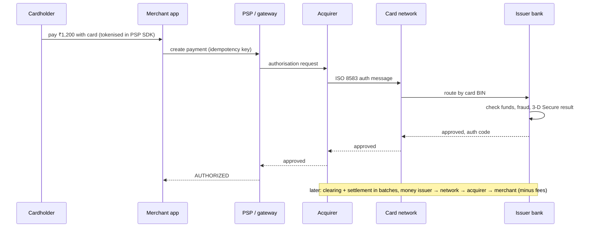

Fees: the merchant discount rate (MDR) is split between the **interchange** (to the issuer), **network fees** and the **acquirer/PSP margin**. In India, **3-D Secure / OTP** (an additional factor of authentication) is mandatory for most domestic online card payments, adding a redirect or challenge step before authorisation.

#### Example
A food-delivery app integrates only with a PSP. The PSP's SDK collects card details (so the app never touches raw card numbers), runs 3-D Secure, and returns a payment id. The app's backend later receives a webhook "payment.captured". Two days later the merchant's bank account receives the day's settlement, net of MDR and GST, with a settlement file listing every payment, which the app's finance system reconciles.

#### Trade-offs
Using a PSP hides network complexity and PCI scope, but adds fees and a dependency, and you inherit its outages and status semantics. Direct acquirer integration lowers fees at large scale but brings PCI and operational burden.

#### Problems & fixes
| Symptom | Cause | Fix |
|---|---|---|
| Customer charged, order shows failed | timeout between PSP and merchant | UNKNOWN state + status polling/webhooks + reconciliation |
| High decline rates | issuer fraud rules, missing 3DS data | better data (AVS, device), retries with different routing, multiple acquirers |
| Settlement amounts don't match orders | fees, refunds, chargebacks netted | reconcile with settlement files at line level |
| Single PSP outage stops sales | one provider | multi-PSP routing with failover |

#### Cheat sheet
- Cardholder → merchant → PSP/acquirer → network → issuer.
- Auth is real-time messaging; money moves later in settlement.
- MDR = interchange + network fee + acquirer/PSP margin.

#### Interview questions
<details><summary>Walk through what happens when a customer pays by card on an e-commerce site.</summary>

The PSP's SDK tokenises the card and runs 3-D Secure if needed. The merchant backend creates a payment with an idempotency key. The PSP sends an authorisation request through the acquirer and card network to the issuer, which checks funds, limits and fraud and approves with an auth code, placing a hold on the funds. The merchant captures (immediately or at shipment). Later, clearing and settlement move the funds from issuer to acquirer to merchant in batches, net of fees, and the merchant reconciles settlement files against its records.
</details>

<details><summary>Why would a large merchant integrate with multiple PSPs or acquirers?</summary>

Resilience (fail over when one PSP is down or degraded), higher authorisation rates (route by card type, BIN or issuer to the acquirer with the best approval rates), lower costs (negotiate and route by fees), and coverage of payment methods and regions. It requires an abstraction layer, a normalised payment state model, and reconciliation across providers.
</details>

#### Interview angle
> "Authorisation is a real-time message hop from PSP to acquirer, network and issuer, while money moves later in settlement batches. So my design separates payment status from money movement and reconciles the two."

### Authorization vs capture vs settlement — hold now, claim later, move money in batch
**Authorisation** asks the issuer to approve and **hold** funds on the card (no money moves yet). **Capture** tells the acquirer you're claiming the authorised amount (full or partial), typically at fulfilment. **Clearing and settlement** later move the money between banks in batches, and the merchant receives funds (T+1/T+2 days). Uncaptured authorisations **expire** (usually 5–7 days, varying by network and merchant category), releasing the hold.

#### How it works
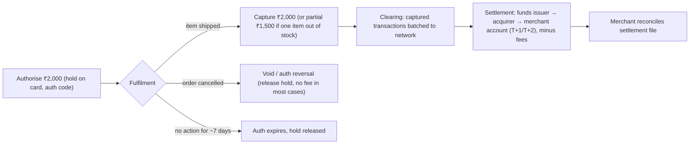

Patterns:
- **Auth + capture together** (sale / auto-capture): digital goods, food delivery.
- **Separate auth and capture**: e-commerce shipping, hotels, car rentals (holds), marketplaces.
- **Incremental authorisation**: hotel or ride adds charges to an existing hold.
- **Partial capture**: capture less than authorised when items are unavailable; release the rest.

#### Example
An electronics store authorises at checkout and captures when the warehouse ships. A phone in a two-item order is out of stock, so they capture only the in-stock item and release the remainder of the hold, avoiding a refund (refunds take days to reach the customer, and fees may not be returned). Orders not shipped within 5 days are re-authorised or cancelled, because the original authorisation may expire.

#### Trade-offs
Separate capture reduces refunds and supports fulfilment-time pricing, but auths can expire, holds frustrate customers if not released, and you need jobs to capture, void and re-authorise reliably.

#### Problems & fixes
| Symptom | Cause | Fix |
|---|---|---|
| Customers see holds for cancelled orders | no void on cancellation | void/auth reversal immediately |
| Capture fails days later | authorisation expired | capture within window, re-authorise if needed |
| Refund fees on unavailable items | capturing full amount first | partial capture |
| Double capture | retried capture without idempotency | idempotency keys, state guard AUTHORIZED → CAPTURED once |

#### Cheat sheet
- Auth = hold. Capture = claim. Settlement = actual money transfer later.
- Void before capture, refund after capture.
- Watch auth expiry; partial and incremental auth exist.

#### Interview questions
<details><summary>When would you separate authorisation from capture?</summary>

When the final amount or fulfilment isn't certain at checkout: shipped physical goods (capture on shipment), hotels and car rentals (holds plus incremental charges), marketplaces where sellers must accept the order, and ride-hailing where the final fare is known at trip end. It avoids refunds for cancelled or partially fulfilled orders.
</details>

<details><summary>What's the difference between a void and a refund?</summary>

A void (authorisation reversal) cancels an authorisation before capture: no money has moved, the hold is released quickly, and usually no fees apply. A refund returns money after capture and settlement: it's a new transaction moving money back, takes days to appear for the customer, and the original processing fees often aren't returned.
</details>

#### Interview angle
> "For shipped goods I'd authorise at checkout, capture partially or fully at dispatch, and void on cancellation, with a job that re-authorises before holds expire."

### UPI flow — payer PSP → NPCI → remitter bank → beneficiary bank
UPI (Unified Payments Interface), run by **NPCI**, enables real-time bank-to-bank payments using a **VPA** (UPI ID like `name@bank`) or QR code. A **payer PSP app** (PhonePe, Google Pay, Paytm, a bank app) sends the request to **NPCI's UPI switch**, which asks the **remitter (payer's) bank** to debit the account after PIN verification, then the **beneficiary (payee's) bank** to credit it. Merchants usually integrate through a payment aggregator or acquiring bank, receiving status via callbacks.

#### How it works
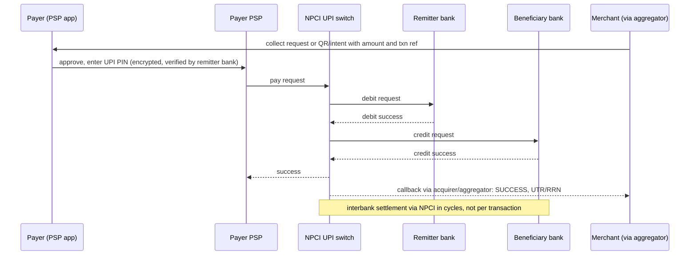

Flow types: **intent/QR** (payer app opens with prefilled details), **collect** (merchant sends a request that the payer approves; restricted for some P2P use due to fraud), **UPI AutoPay** (mandates for recurring payments), and **UPI Lite** (small offline-style payments).

Edge cases engineers must handle: **pending/deemed** states (debit happened but credit status is unknown), timeouts with later success callbacks, **auto-reversals** of failed credits (within T+1 per NPCI rules), duplicate callbacks, and checking status APIs before marking failures.

#### Example
A merchant marked payments as failed after a 2-minute timeout. Customers whose bank was slow received the success callback 5 minutes later; the order had been cancelled, so they had paid for nothing and complained. The fix: keep the payment PENDING on timeout, poll the aggregator's status API with backoff for up to 30 minutes, honour late success callbacks (auto-confirm or auto-refund per policy), and reconcile with the day's settlement report.

#### Trade-offs
Instant, low-cost (zero MDR for most P2M), ubiquitous in India, but pending and deemed states are common, bank downtimes vary, and status is often eventually consistent, requiring reconciliation.

#### Problems & fixes
| Symptom | Cause | Fix |
|---|---|---|
| Money debited, order failed | timeout treated as failure | PENDING state, status polling, late callback handling |
| Duplicate order confirmations | repeated callbacks | idempotent callback processing by txn ref/UTR |
| Spikes of failures from one bank | remitter bank downtime | show bank health, suggest alternatives, retry later |
| Mismatched totals | missing late successes/reversals | daily reconciliation with settlement reports |

#### Cheat sheet
- Payer PSP → NPCI → remitter bank (debit) → beneficiary bank (credit) → callbacks.
- PIN verified by the remitter bank; UTR/RRN identifies the transaction.
- Handle PENDING, late success, auto-reversal; reconcile daily.

#### Interview questions
<details><summary>A UPI payment times out after the customer entered their PIN. What should your system do?</summary>

Don't mark it failed. Keep it PENDING (the debit may have succeeded), show "payment processing" to the user, and poll the aggregator's status API with backoff while listening for callbacks. If success arrives, confirm the order (or refund automatically if the order can no longer be fulfilled). If a definitive failure arrives, fail it (any debit will be auto-reversed by the bank). Reconcile against the settlement report to catch anything missed.
</details>

<details><summary>How do you handle duplicate UPI callbacks?</summary>

Process callbacks idempotently: key on the merchant transaction reference (and UTR), use a state machine that only allows valid transitions (PENDING → SUCCESS once), ignore or acknowledge duplicates without side effects, and verify the callback's authenticity (signature, or confirming via the status API) before acting.
</details>

#### Interview angle
> "A UPI timeout is never a failure. The payment stays PENDING, we poll status and honour late callbacks idempotently by transaction ref, and daily reconciliation catches whatever slipped through."

### Payment state machine — CREATED → PROCESSING → AUTHORIZED/FAILED/UNKNOWN → CAPTURED → SETTLED/REFUNDED
Modelling a payment as an explicit **state machine** with allowed transitions prevents impossible states (refunding a failed payment, capturing twice) and makes the system auditable. Crucially it includes an **UNKNOWN** (or PENDING) state for when the outcome isn't known (timeouts, network errors), which must be resolved by status checks, webhooks and reconciliation rather than guessed.

#### How it works
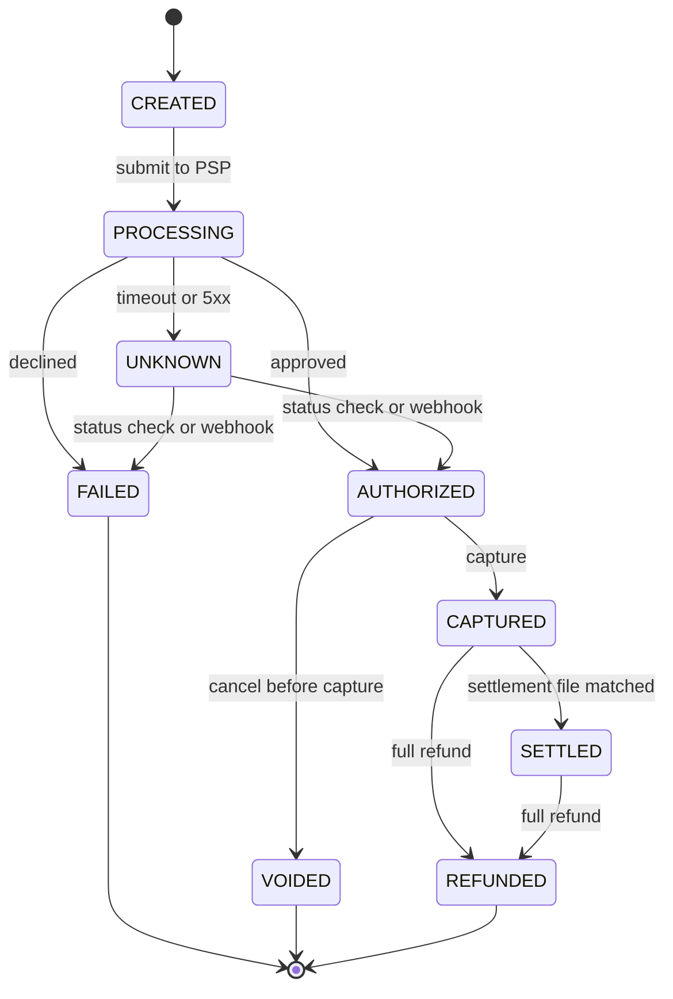

Implementation:
- **Guarded transitions**: `UPDATE payments SET status='CAPTURED', version=version+1 WHERE id=? AND status='AUTHORIZED' AND version=?` (optimistic locking, or conditional writes), so concurrent webhook and poller can't both apply.
- **Append-only event history** (payment_events) for audit, alongside the current state.
- **Terminal states** never change; corrections are new records (refunds, adjustments).
- **Outbox** to publish state-change events reliably.
- Partial refunds tracked as separate refund entities with their own states, and a refunded amount ≤ captured amount invariant.

#### Example
A webhook ("payment.captured") and a status-polling job arrived at the same moment for a payment in UNKNOWN; both read it as UNKNOWN and both triggered order fulfilment, shipping the item twice. Adding a conditional update (only the transition that succeeds proceeds, the other sees zero rows updated and stops) plus emitting fulfilment from an outbox in the same transaction fixed it.

#### Trade-offs
Explicit states make correctness and auditing tractable, but require discipline (all changes through the machine), handling of out-of-order events, and careful modelling of partial operations.

#### Problems & fixes
| Symptom | Cause | Fix |
|---|---|---|
| Duplicate fulfilment | concurrent transitions without guards | conditional updates / optimistic locking |
| Payments stuck in UNKNOWN | no resolution process | status polling with backoff, reconciliation, alerts on age |
| Out-of-order webhooks regress state | applying events blindly | allowed-transition table, ignore stale events |
| Can't explain how a payment got here | only current state stored | append-only event log |

#### Cheat sheet
- Explicit states + allowed transitions; UNKNOWN is a real state.
- Conditional updates for transitions; append-only history; outbox for events.
- Terminal states immutable; corrections are new records.

#### Interview questions
<details><summary>Why include an UNKNOWN state instead of treating timeouts as failures?</summary>

A timeout means you don't know whether the PSP or bank processed the request. Marking it failed may lead to retrying (double charging) or telling the customer it failed when they were charged. UNKNOWN makes the uncertainty explicit and triggers resolution via status queries, webhooks and reconciliation before any irreversible decision.
</details>

<details><summary>How do you prevent two processes from applying conflicting transitions to the same payment?</summary>

Make transitions atomic and conditional on the current state (and version): `UPDATE … SET status = 'CAPTURED' WHERE id = ? AND status = 'AUTHORIZED'`, and proceed only if one row was updated. Alternatively, take a row lock or process all events for a payment serially (partition by payment id). Combine with idempotency keys for external calls and an outbox for side effects.
</details>

#### Interview angle
> "Payments are an explicit state machine with UNKNOWN as a real state, conditional updates for every transition, an append-only event history and an outbox, so concurrent webhooks and pollers can't double-fulfil."

### Refunds, reversals & chargebacks — undoing money movement safely
Undoing a payment depends on its stage. A **void/reversal** cancels an authorisation before capture. A **refund** is a merchant-initiated return of captured money (full or partial), a new transaction. A **chargeback** is a **cardholder-initiated dispute** through their issuer (fraud, item not received), where funds are pulled back from the merchant and the merchant can submit evidence (**representment**). Each must be modelled as its own entity with states, idempotency and ledger entries.

#### How it works
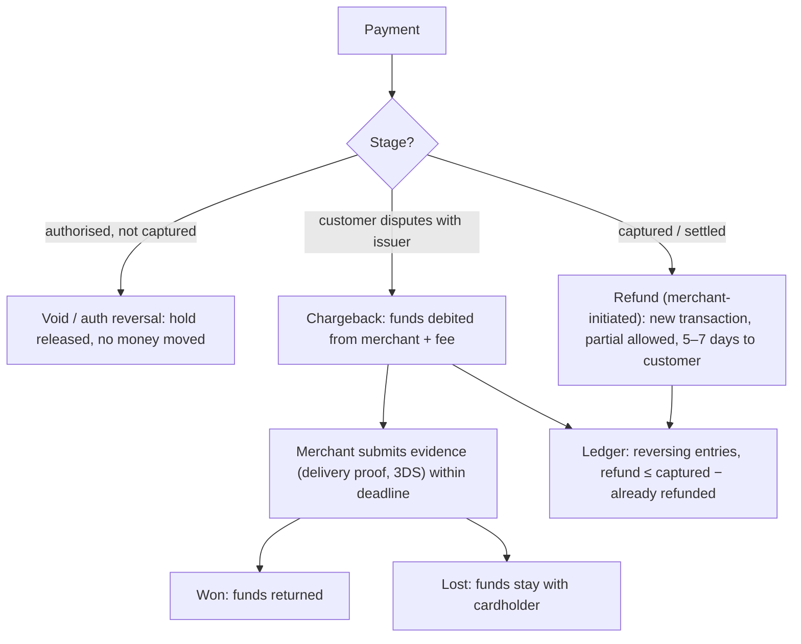

Engineering rules:
- **Refund entity** with its own id, idempotency key, state machine (REQUESTED → PROCESSING → SUCCEEDED/FAILED/UNKNOWN) and amount.
- **Invariant**: total refunded ≤ captured amount, enforced with a lock or conditional update (prevent concurrent refunds over-refunding).
- **Ledger**: post reversing entries rather than editing the original.
- **Chargebacks** arrive via PSP webhooks or reports; track deadlines, auto-gather evidence (delivery tracking, 3-D Secure liability shift), and update merchant balances.
- Refunds can fail (closed card); have fallbacks (bank transfer, wallet credit).

#### Example
A support tool let agents click "refund" twice on a slow page, and two refunds of ₹4,000 went out for a ₹4,000 order. The fix: idempotency key per refund request (generated when the form opens), a database check that `refunded_total + amount <= captured_amount` inside a transaction with a row lock on the payment, and the refund call to the PSP using the same idempotency key so PSP-level retries couldn't duplicate either.

#### Trade-offs
Correct refund and chargeback handling protects money and customer trust, but adds entities, states and reconciliation, and chargeback evidence workflows are operationally heavy.

#### Problems & fixes
| Symptom | Cause | Fix |
|---|---|---|
| Over-refunds | concurrent refund requests | lock + invariant check, idempotency keys |
| Refund stuck, customer complaining | UNKNOWN refund status | status polling, reconciliation, communication |
| Losing most chargebacks | no evidence collection | automate evidence, use 3DS for liability shift |
| Ledger doesn't balance after refunds | editing original entries | reversing entries |

#### Cheat sheet
- Void (before capture) vs refund (after) vs chargeback (customer dispute).
- Refunds are entities: idempotency, states, refunded ≤ captured.
- Reversing ledger entries; track chargeback deadlines and evidence.

#### Interview questions
<details><summary>How do you prevent over-refunding when multiple refund requests can arrive concurrently?</summary>

Serialize refunds per payment: lock the payment row (or use a conditional update on a refunded_amount column), check that captured − already refunded ≥ requested amount, create the refund record and increment refunded_amount atomically, then call the PSP with an idempotency key. Duplicate requests with the same key return the existing refund.
</details>

<details><summary>What's a chargeback and how should a system handle it?</summary>

A chargeback is a dispute raised by the cardholder with their issuer, which forcibly reverses the payment from the merchant (plus a fee). The system should ingest chargeback notifications, create a dispute record linked to the payment, debit the merchant balance in the ledger, alert operations with the deadline, assemble evidence (order, delivery proof, 3DS authentication, communications) for representment, and record the outcome with corresponding ledger entries.
</details>

#### Interview angle
> "Voids, refunds and chargebacks are separate entities with their own state machines. Refunds are idempotent and capped by refunded ≤ captured under a lock, and every reversal posts new ledger entries."

### PSP webhooks & status polling — resolving UNKNOWN payments
PSPs report final payment outcomes asynchronously via **webhooks** (HTTP callbacks), because many payments (3-D Secure, UPI, net banking) complete outside the original API call. Webhooks can be **late, duplicated, out of order or missing**, so robust systems combine them with **status polling** for payments stuck in pending/UNKNOWN, and **daily reconciliation** as the final safety net.

#### How it works
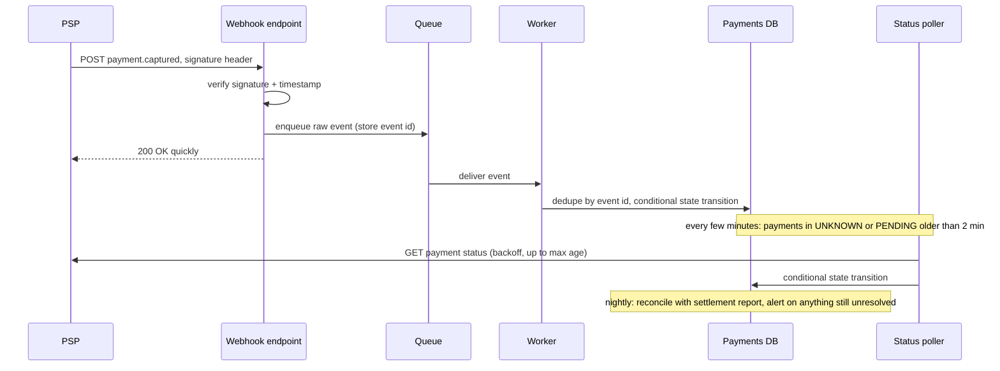

Webhook handling rules:
- **Verify signatures** (HMAC with shared secret) and timestamps; reject replays.
- **Acknowledge fast** (store and enqueue, then process asynchronously), since PSPs retry on slow or failed responses.
- **Idempotent processing** by event id and **state-guarded** transitions (ignore events that would move state backwards).
- Optionally **re-fetch** the payment from the PSP API instead of trusting payload contents.
- **Poll** pending payments with backoff; alert on payments unresolved past an SLA.

#### Example
During a PSP incident, webhooks were delayed by 3 hours. A merchant relying only on webhooks showed thousands of customers "payment pending" and some re-paid, creating duplicate payments. After adding a poller that queried status for pending payments every 2–5 minutes (with jitter, respecting rate limits), most payments resolved within minutes even with webhooks delayed, and duplicate payments were auto-refunded by a reconciliation job.

#### Trade-offs
Webhooks are efficient and timely; polling covers gaps but adds API load and rate-limit concerns; reconciliation is slowest but authoritative. All three are needed for money correctness.

#### Problems & fixes
| Symptom | Cause | Fix |
|---|---|---|
| Duplicate processing of webhook | PSP retries, duplicates | dedupe by event id, conditional transitions |
| Webhook endpoint times out, PSP retries storm | heavy processing inline | ack fast, process async via queue |
| Forged webhooks | no signature verification | HMAC verification, IP allowlists, re-fetch from API |
| Payments stuck pending for hours | webhooks lost/delayed | status poller, reconciliation, alerts |

#### Cheat sheet
- Webhook: verify signature, ack fast, process async, dedupe, guard transitions.
- Poll UNKNOWN/PENDING with backoff; alert on age.
- Reconciliation is the final authority.

#### Interview questions
<details><summary>How do you design a reliable webhook receiver for payment events?</summary>

Expose an HTTPS endpoint that verifies the HMAC signature and timestamp, persists the raw event (with the PSP's event id) and enqueues it, then returns 200 quickly. Workers process events idempotently (skip already-processed ids), apply state transitions only if valid for the current state, optionally re-fetch the payment from the PSP API, and emit downstream events via an outbox. Monitor processing lag and failures with a dead-letter queue.
</details>

<details><summary>Why poll status if you already receive webhooks?</summary>

Webhooks can be delayed, lost, misconfigured or blocked during incidents. Without polling, payments stay unresolved, customers retry and pay twice, and orders stall. Polling resolves pending or unknown payments within minutes regardless of webhook health, and reconciliation catches anything both missed.
</details>

#### Interview angle
> "Webhooks are verified, acknowledged fast and processed idempotently. A poller resolves anything pending for more than a couple of minutes, and nightly reconciliation is the final authority."

## Money correctness

### Representing money — integer minor units or BigDecimal, never float
Money must be represented **exactly**. Binary floating point (`float`, `double`, JavaScript `number` for arithmetic) can't represent most decimal fractions (0.1 + 0.2 = 0.30000000000000004), so rounding errors accumulate and totals stop matching. Use **integers in minor units** (paise, cents: ₹10.50 → 1050) or **arbitrary-precision decimals** (`BigDecimal`, Postgres `NUMERIC`) with explicit scale and rounding, and always store the **currency** alongside the amount.

#### How it works
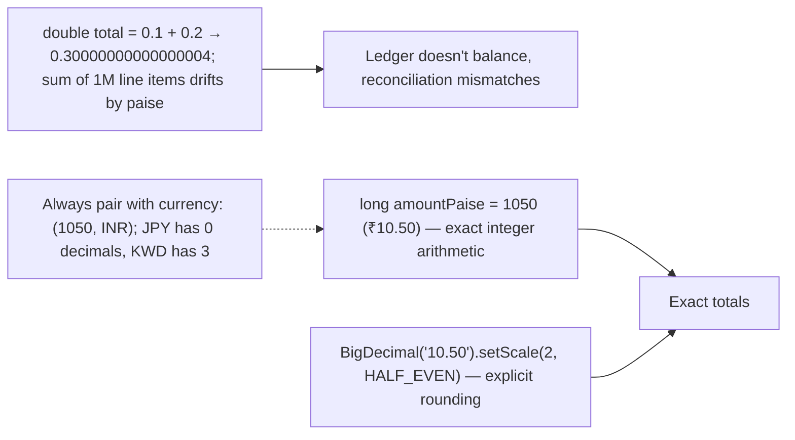

```java
record Money(long minorUnits, Currency currency) {
  Money plus(Money o) { requireSame(o); return new Money(Math.addExact(minorUnits, o.minorUnits), currency); }
}
// splitting ₹100.00 three ways without losing a paisa: 3334 + 3333 + 3333
long[] split(long total, int n) { long base = total / n, rem = total % n;
  return IntStream.range(0, n).mapToLong(i -> base + (i < rem ? 1 : 0)).toArray(); }
```

Rules:
- Minor-unit **exponent per currency** (ISO 4217): INR/USD 2, JPY 0, KWD/BHD 3.
- **Rounding**: choose explicitly (banker's rounding HALF_EVEN for many financial contexts, or as regulations dictate), round at defined points (per line vs per invoice), and document it.
- **Allocation**: when splitting (taxes, commissions, EMIs), distribute remainders so parts sum exactly to the total.
- JSON: send amounts as **integers in minor units or strings**, never floats. JavaScript clients must not do money math in `number` beyond safe integers.
- Overflow: use 64-bit integers with checked arithmetic (`Math.addExact`).

#### Example
A marketplace computed seller commissions in `double` and summed them nightly. After a few million orders, the payout total differed from the ledger by ₹1,800, and finance spent days investigating. Migrating to `long` paise with an explicit allocation function (remainders distributed deterministically) made payouts match the ledger to the paisa.

#### Trade-offs
Exact representation is non-negotiable; integer minor units are fast and simple but need per-currency exponents; decimals are flexible (fractions of minor units for FX or interest) but slower and need careful scale management.

#### Problems & fixes
| Symptom | Cause | Fix |
|---|---|---|
| Totals off by a few paise | floating-point arithmetic | integer minor units / BigDecimal |
| Split amounts don't sum to total | naive rounding of each part | allocation with remainder distribution |
| Wrong amounts for JPY/KWD | assuming 2 decimals | per-currency exponent |
| Precision lost in API clients | JSON numbers parsed as float | integers in minor units or strings |

#### Cheat sheet
- Never float. Use long minor units or BigDecimal with explicit rounding.
- Always store currency; per-currency decimal exponent.
- Allocate remainders; checked arithmetic; amounts as integers/strings in JSON.

#### Interview questions
<details><summary>Why is using double for money wrong, even if you round when displaying?</summary>

Doubles can't exactly represent most decimal fractions, so every operation introduces tiny errors that accumulate across many additions and multiplications. Comparisons fail (0.1 + 0.2 != 0.3), totals and ledger balances drift, and reconciliation with banks (which use exact decimals) produces mismatches. Rounding at display hides the problem but doesn't fix stored values.
</details>

<details><summary>How do you split ₹100 among three people exactly?</summary>

Work in paise: 10,000 / 3 = 3,333 remainder 1. Give 3,333 to each and distribute the 1-paisa remainder deterministically (e.g. to the first person), yielding 3,334 + 3,333 + 3,333 = 10,000. The parts always sum exactly to the total; the rule for who gets remainders should be documented and consistent.
</details>

#### Interview angle
> "Money is a long in minor units paired with a currency and its exponent, with explicit rounding and remainder allocation, sent over JSON as integers. Never floats."

### Idempotency at every hop — client→API, API→PSP, consumers, webhooks
In payments, every network hop can fail ambiguously (timeout after the other side succeeded), so every hop is retried, and every retried hop must be **idempotent**: the same request applied twice has the same effect as once. This means idempotency keys from **client to API**, idempotency keys passed **from your service to the PSP**, **deduplication in message consumers**, and **deduplication of webhooks**.

#### How it works
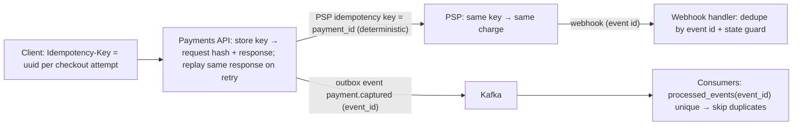

Server-side idempotency key handling:
```sql
CREATE TABLE idempotency_keys (
  key TEXT PRIMARY KEY, merchant_id TEXT, request_hash TEXT,
  status TEXT,            -- IN_PROGRESS | COMPLETED
  response JSONB, created_at TIMESTAMPTZ DEFAULT now());
-- 1. INSERT … ON CONFLICT DO NOTHING; if conflict: same hash → return stored response
--    (or 409 if still IN_PROGRESS); different hash → 422 key reuse error
-- 2. do work, 3. store response + COMPLETED in the same transaction as the business write
```

Details: scope keys per merchant or user; expire them after a window (e.g. 24 h–7 d); store the **request hash** to detect key reuse with different payloads; **derive downstream keys deterministically** (e.g. PSP key = internal payment id), so retries from any instance reuse the same key.

#### Example
A mobile app retried "pay" when the network dropped. Without idempotency, the API created a second payment and charged the card twice for ~0.1% of orders. Adding an Idempotency-Key header generated once per checkout attempt, storing results server-side, and passing the internal payment id as the PSP's idempotency key eliminated duplicate charges. A Kafka consumer that credited loyalty points also got a processed_events table after a rebalance caused double credits.

#### Trade-offs
Idempotency enables safe retries everywhere, but needs storage, careful key scoping and expiry, handling of in-progress concurrent duplicates, and discipline at every integration point.

#### Problems & fixes
| Symptom | Cause | Fix |
|---|---|---|
| Double charges on client retry | no client idempotency key | Idempotency-Key header + stored responses |
| Duplicate PSP charges from service retries | random key per attempt | deterministic key (payment id) to PSP |
| Consumers apply events twice | at-least-once delivery | processed-event table, idempotent writes |
| Concurrent duplicate requests both run | check-then-act race | unique insert of key first, IN_PROGRESS status |

#### Cheat sheet
- Every hop retries, so every hop is idempotent.
- Client key → stored response; deterministic keys to PSP; dedupe consumers and webhooks.
- Scope, expire, hash request, handle IN_PROGRESS.

#### Interview questions
<details><summary>How would you implement idempotency keys in a payments API?</summary>

Clients send an Idempotency-Key per logical operation. The server atomically inserts the key with a request hash and IN_PROGRESS status (a unique constraint prevents concurrent duplicates). If the key exists with the same hash, it returns the stored response (or 409 if still in progress); a different hash returns an error. On completion it stores the response in the same transaction as the business change. Keys are scoped per merchant and expire after a retention window.
</details>

<details><summary>Why must the key you send to the PSP be deterministic?</summary>

If your service times out calling the PSP and retries (possibly from a different instance after a crash), a new random key would look like a new charge to the PSP and charge the customer twice. Using a key derived from your internal payment id ensures any retry for the same payment is recognised by the PSP as the same request.
</details>

#### Interview angle
> "Idempotency covers every hop: a client key with stored responses, the payment id as the PSP key, and processed-event tables for consumers and webhooks. Retries are only safe end to end."

### Double-entry ledger — every transaction has balanced debits and credits
A double-entry ledger records every money movement as a **transaction with at least two entries** (debits and credits) that **sum to zero**: money is never created or destroyed, only moved between **accounts** (customer wallet, merchant payable, PSP receivable, fees revenue, tax payable). Account balances are derived from entries. This makes errors detectable (books must balance) and gives a complete audit trail.

#### How it works
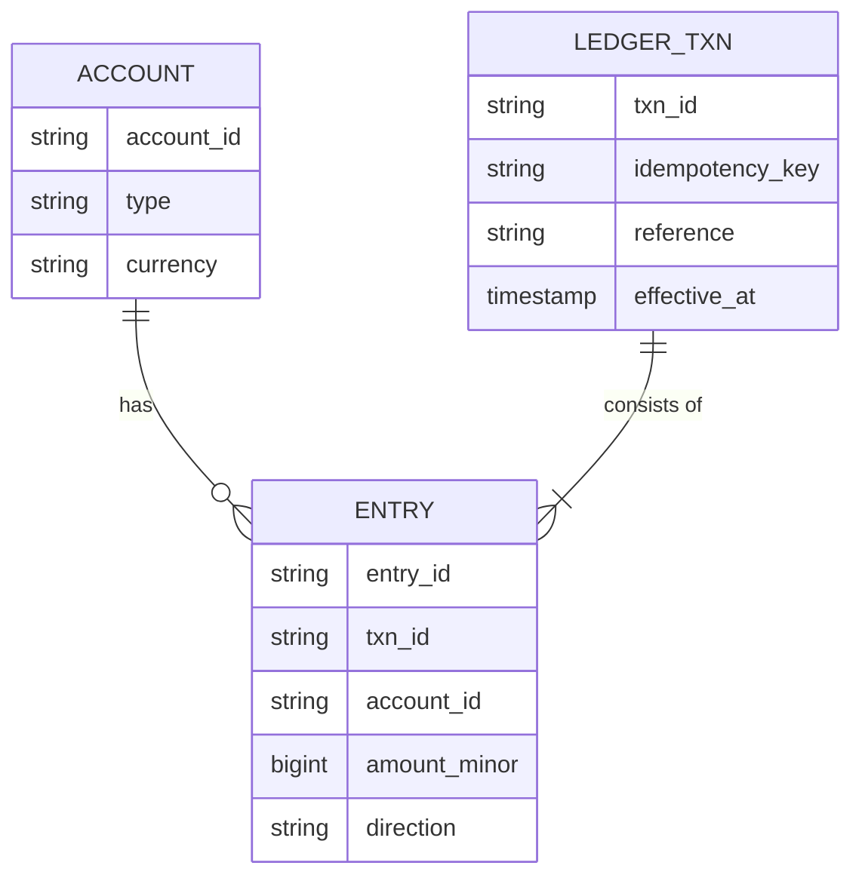

A ₹1,000 order with 2% fee and 18% GST on the fee:

| Account | Debit | Credit |
|---|---|---|
| PSP receivable (asset) | 1,000.00 | |
| Merchant payable (liability) | | 976.40 |
| Fee revenue | | 20.00 |
| GST payable | | 3.60 |
| **Total** | **1,000.00** | **1,000.00** |

Rules: entries within a transaction sum to zero per currency (enforced in code and checked by DB constraints or deferred triggers), entries are **immutable**, balances = sum of entries (cached in a balance table updated in the same transaction), and every transaction references its business event (payment id) and has an idempotency key.

#### Example
A wallet startup stored only a `balance` column per user and updated it directly. After a bug double-credited cashback, they couldn't tell which users were affected or why. Rebuilding on a double-entry ledger (user wallet, cashback expense, payment receivable, merchant payable accounts) meant every credit had a matching debit from a named source account; the cashback expense account's total could be compared with the campaign budget daily, catching anomalies within a day.

#### Trade-offs
Strong correctness, auditability and reconciliation, but more writes per business event, more design work (chart of accounts), and computing balances efficiently needs cached balances or snapshots.

#### Problems & fixes
| Symptom | Cause | Fix |
|---|---|---|
| Money "appears" or disappears | single-entry balance updates | double-entry with zero-sum transactions |
| Can't explain a balance | no entry history | balances derived from immutable entries |
| Unbalanced transactions slip in | no enforcement | validate sum = 0 in service + DB check |
| Slow balance queries | summing millions of entries | cached balances updated atomically, periodic snapshots |

#### Cheat sheet
- Every transaction: entries summing to zero across accounts.
- Immutable entries; balances derived/cached atomically.
- Chart of accounts: assets, liabilities, revenue, expenses; idempotent transactions.

#### Interview questions
<details><summary>Model a wallet top-up of ₹500 via UPI and a ₹200 payment to a merchant in a double-entry ledger.</summary>

Top-up: debit "PSP/bank receivable" ₹500, credit "user wallet" (liability to the user) ₹500. Payment: debit "user wallet" ₹200, credit "merchant payable" ₹200 (possibly splitting fee revenue). When the bank settles: debit "bank account" ₹500, credit "bank receivable" ₹500. Each transaction balances to zero, and the user's wallet balance is the sum of its entries (₹300).
</details>

<details><summary>How do you ensure ledger transactions always balance?</summary>

Construct transactions through a single ledger service API that validates that entries sum to zero per currency before writing, write all entries plus balance updates in one database transaction, add a database-level check (a deferred constraint trigger or post-commit verification job), make entries immutable, and run continuous checks that sum of all entries per currency is zero and that cached balances equal sums of entries.
</details>

#### Interview angle
> "Money lives in a double-entry ledger: zero-sum transactions of immutable entries across a chart of accounts, with balances updated atomically, so any money that appears or vanishes is caught by the books."

### Ledger immutability — append-only entries, fix with reversing entries
Ledger entries are **never updated or deleted**. Mistakes are corrected by posting **new reversing (or adjusting) entries** that offset the error, so the full history of what happened, including the mistake and its correction, is preserved. This is required for audits and regulations, and makes the ledger reproducible: replaying entries always yields the same balances.

#### How it works
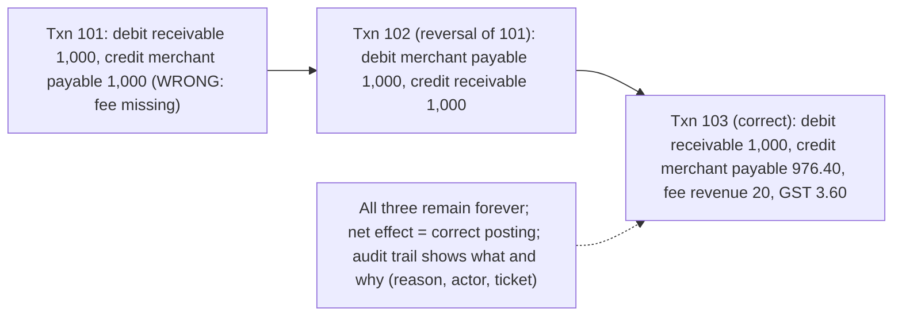

Enforcement:
- Database permissions: the ledger service's role has **INSERT only** on entries (no UPDATE/DELETE); triggers that reject updates.
- **Correction workflow**: reversal transactions reference the original (`reverses_txn_id`), with reason, approver and ticket; maker-checker for manual adjustments.
- **Tamper evidence** (optional): hash-chaining entries or periodic signed snapshots, or append-only stores (QLDB-like designs, WORM storage for exports).
- **Effective date vs recorded date**: corrections can be backdated in effect while recorded now, keeping reports reproducible "as known at time T".

#### Example
An engineer fixed a fee bug by running an UPDATE on 4,000 historical ledger entries. A month later, the auditors found that previously published merchant statements no longer matched the ledger, and nobody could reconstruct the original numbers. The company moved to INSERT-only permissions, an adjustment API that posts reversal plus corrected transactions with approval, and statements generated from immutable entries with "as-of" dates.

#### Trade-offs
Full auditability and reproducibility, but more entries over time (storage grows), corrections are more work than an UPDATE, and reports must net reversals properly.

#### Problems & fixes
| Symptom | Cause | Fix |
|---|---|---|
| Past statements don't match ledger | entries updated in place | append-only + reversals |
| Unauthorised manual corrections | direct DB access | INSERT-only role, adjustment API with maker-checker |
| Can't prove records weren't altered | no tamper evidence | hash chains, WORM exports, audit logs |

#### Cheat sheet
- No UPDATE/DELETE on entries; fix with reversal + corrected transaction.
- Reversals reference originals, carry reason and approver.
- DB permissions + optional hash chaining for tamper evidence.

#### Interview questions
<details><summary>A bug posted wrong fees on 10,000 transactions last week. How do you fix the ledger?</summary>

Don't edit entries. Write a correction job that, for each affected transaction, posts a reversal transaction referencing the original (exactly offsetting it) and a new correct transaction, or a single adjusting transaction for the difference, with a reason code and the incident ticket, approved via maker-checker. Run it idempotently (keyed by original transaction id), verify that balances and totals match the expected corrected values, and notify affected merchants with updated statements.
</details>

<details><summary>Why are reversing entries better than updates for corrections?</summary>

They preserve the complete history (what was recorded, when it was discovered and how it was fixed), which auditors and regulators require. Past reports remain reproducible as they were known at the time, balances can always be recomputed by replaying entries, and unauthorised or erroneous changes are visible rather than silently overwriting data.
</details>

#### Interview angle
> "Ledger entries are insert-only. Corrections are reversal plus corrected transactions that reference the original, with a reason and maker-checker approval, so every past statement stays reproducible."

### Reconciliation — match internal records with bank/PSP settlement files
Reconciliation compares your internal records (payments, ledger entries) with **external sources of truth**: PSP settlement reports, bank statements, card network files, payout confirmations. It finds **mismatches**: missing transactions on either side, amount or status differences, unexpected fees, duplicates. It's the final safety net that catches everything idempotency, webhooks and polling missed.

#### How it works
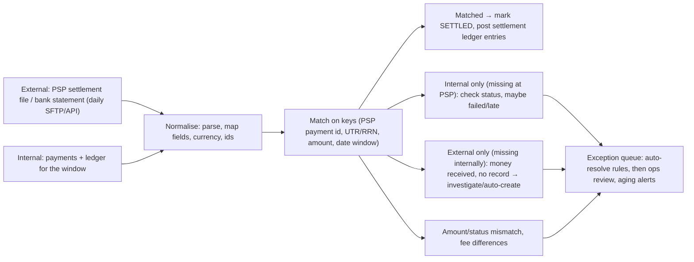

Levels: **transaction-level** (each payment matched), **settlement-level** (sum of payments − fees − refunds = amount credited to bank), and **balance-level** (ledger balances vs bank balances). Automate matching rules (exact, then fuzzy with tolerances and date windows), auto-resolve known patterns (late successes, fee rounding), and track exceptions by age with SLAs.

#### Example
A merchant's daily reconciliation found 37 payments in the PSP settlement file marked "captured" that were "FAILED" internally: UPI timeouts where the success callback never arrived. The reconciliation job auto-corrected them (UNKNOWN/FAILED → CAPTURED via a ledger adjustment) and triggered fulfilment or refunds per policy. It also flagged that the PSP had charged 2.1% instead of the contracted 1.9% on a card category, which finance used to claim back fees.

#### Trade-offs
Essential for money correctness and catching integration bugs, but requires parsing many file formats, handling timing differences (cut-offs, settlement delays), and operational teams for exceptions.

#### Problems & fixes
| Symptom | Cause | Fix |
|---|---|---|
| Many false mismatches | timing differences (cut-off times, T+1) | date windows, carry-forward unmatched items |
| Exceptions pile up unresolved | manual-only process | auto-resolution rules, aging SLAs, ownership |
| Format changes break parsing | brittle parsers | schema validation, alerts on parse failures |
| Fee overcharges unnoticed | only matching amounts | compare fees against contracts |

#### Cheat sheet
- Internal vs external (PSP, bank, network) daily: transaction, settlement, balance levels.
- Match keys + tolerances + date windows; exception queue with aging.
- Auto-resolve known patterns; reconcile fees too.

#### Interview questions
<details><summary>Design a daily reconciliation system for a payments company.</summary>

Ingest settlement files and bank statements (SFTP/API) into staging tables with schema validation. Normalise into a common format. Match against internal payments and ledger entries using provider ids and UTR/RRN with amount and date-window rules. Post settlement ledger entries for matches. Classify mismatches (missing internally, missing externally, amount, status, fee) into an exception queue with auto-resolution rules and aging SLAs. Produce settlement-level checks (net settlement = payments − refunds − fees) and dashboards, with alerts for unusual mismatch rates.
</details>

<details><summary>Your reconciliation shows money in the bank with no matching internal payment. What could cause it and what do you do?</summary>

Possible causes: a payment succeeded at the PSP after you marked it failed (missed or late callback), a duplicate payment by the customer, a manual transfer, or a bug in record creation. Look up the provider's payment and customer details, create or correct the internal record through an adjustment with an audit trail, and either fulfil the order or refund the customer per policy. Fix the root cause (callback handling, polling).
</details>

#### Interview angle
> "Daily reconciliation against PSP and bank files is the final authority. It matches by provider id and UTR within date windows, auto-resolves known patterns like late UPI successes, and checks fees against the contract."

### Exactly-once money movement — at-least-once + idempotency + state guards + reconciliation
True exactly-once delivery doesn't exist across networks. "Exactly-once" money movement is **built** from: **at-least-once** delivery and retries (never lose a request), **idempotency** at each hop (duplicates have no extra effect), **state machine guards** (transitions apply once), **atomic local writes with outbox** (state and events committed together), and **reconciliation** (detect and repair whatever slipped through).

#### How it works
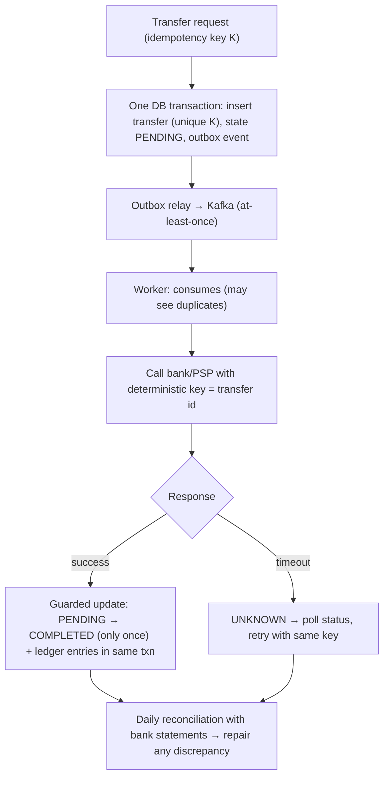

Each layer covers a failure mode:
- **Lost messages** → at-least-once delivery, retries, outbox.
- **Duplicate messages** → idempotency keys, dedupe tables, unique constraints.
- **Concurrent processing** → conditional state transitions, per-entity ordering (partition by account).
- **Ambiguous external outcomes** → UNKNOWN state, status queries with the same key.
- **Everything else** (bugs, provider errors) → reconciliation and correction entries.

#### Example
A payouts system sent money to sellers' bank accounts via a banking API. A crash between "bank call succeeded" and "mark payout complete" led a retry job to pay 120 sellers twice. The redesign: payout id as the bank's idempotency reference (the bank rejects duplicates), guarded state transitions, an outbox for events, and a daily reconciliation against bank statements that flags any payout debited twice or not at all. The next crash produced zero duplicates.

#### Trade-offs
Achieves effectively-once outcomes with standard tools, but requires discipline at every layer, more storage (keys, events), and operational processes for reconciliation exceptions.

#### Problems & fixes
| Symptom | Cause | Fix |
|---|---|---|
| Double payouts after crash | side effect done, state not saved | idempotent external call keyed by payout id |
| Lost transfers | event published outside DB transaction | outbox pattern |
| Two workers process same transfer | no state guard | conditional updates, partition by entity |
| Silent mismatches | no final check | reconciliation |

#### Cheat sheet
- Exactly-once = at-least-once + idempotency + state guards + outbox + reconciliation.
- Deterministic external keys; UNKNOWN state for ambiguous outcomes.
- Reconciliation repairs the rest.

#### Interview questions
<details><summary>How do you guarantee a bank transfer is executed exactly once?</summary>

You can't guarantee exactly-once delivery, but you can guarantee exactly-once effect: persist the transfer with a unique idempotency key and PENDING state plus an outbox event atomically; process with at-least-once workers; call the bank with a deterministic reference (the transfer id) so the bank rejects duplicates; apply state transitions conditionally; treat timeouts as UNKNOWN and resolve via status queries with the same reference; and reconcile daily against bank statements to catch and correct anything else.
</details>

<details><summary>What's the "dual write" problem and how does the outbox solve it?</summary>

Writing to the database and publishing to a message broker are two separate operations; a crash between them leaves state changed without an event (or an event without state). The outbox pattern writes the event into an outbox table in the same database transaction as the state change, and a separate relay (polling or CDC) publishes outbox rows to the broker at-least-once, with consumers deduplicating.
</details>

#### Interview angle
> "Exactly-once money movement is built in layers: outbox plus at-least-once delivery, the transfer id as the bank's idempotency reference, guarded transitions, UNKNOWN for ambiguous outcomes, and reconciliation as the backstop."

### Hot accounts — sub-accounts and batching for high-write ledger accounts
A **hot account** is a ledger account that participates in a huge share of transactions: a platform's fee revenue account, a PSP clearing account, a popular merchant's payable account during a sale. If every transaction locks and updates the same balance row, throughput collapses to the rate of serialized row updates (often a few hundred to a few thousand per second) and lock waits spike.

#### How it works
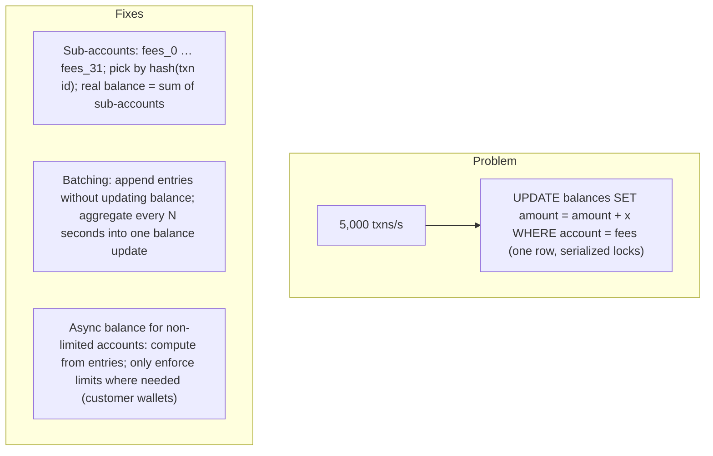

Choosing an approach:
- Accounts that **need balance checks** (customer wallet can't go negative) must update synchronously, but they're rarely hot (one user).
- Hot accounts are usually **internal** (fees, clearing, settlement) with **no overdraft check**, so they can be updated via sub-accounts or batched aggregation, while entries are still written immediately.
- **Sub-accounts**: spread writes over N rows; reading the balance sums N rows.
- **Batching**: a periodic job sums new entries per account and updates the balance once (eventually consistent balance, exact entries).
- Partition ledger processing by account to keep ordering where needed.

#### Example
During a flash sale, a payments platform's ledger slowed to 400 transactions per second with lock timeouts. Every transaction credited the single "platform fee revenue" row and debited the single "PSP clearing" row. Splitting both into 64 sub-accounts (hash of transaction id) removed contention, and throughput rose to 9,000 transactions per second. Dashboards read the summed balance, and a nightly job verified sums against entries.

#### Trade-offs
Removes contention and scales writes, but balances become sums or eventually consistent, reads get more complex, and you can't enforce strict limits on sharded or batched accounts.

#### Problems & fixes
| Symptom | Cause | Fix |
|---|---|---|
| Ledger throughput collapses under load | one hot balance row | sub-accounts / batched balance updates |
| Lock wait timeouts and deadlocks | many txns updating same rows in different orders | consistent lock ordering, fewer locked rows |
| Hot merchant during sale | high-volume payable account | sub-accounts per merchant, batch aggregation |
| Balance read is stale | batching | accept for internal accounts, sync updates where limits matter |

#### Cheat sheet
- Hot account = one balance row in most transactions.
- Sub-accounts (sum on read) or batched balance aggregation.
- Keep synchronous balance checks only where limits matter.

#### Interview questions
<details><summary>Your ledger slows down during peak because every transaction updates the platform fee account. How do you fix it?</summary>

Stop updating one row synchronously: split the fee account into N sub-accounts chosen by hashing the transaction id (balance = sum), or write entries immediately and update the fee account's balance in periodic batches. The fee account has no overdraft constraint, so eventual consistency for its balance is fine, and entries remain exact. Also lock rows in a consistent order to avoid deadlocks.
</details>

<details><summary>Why can't you use the same trick for customer wallets?</summary>

Customer wallets need synchronous balance checks to prevent overdrafts: a debit must see the current balance and reject if insufficient. Sharding the balance or updating it asynchronously would allow concurrent debits to overdraw. Fortunately, individual customer wallets are rarely hot; strict accounting applies there with row locks or conditional updates.
</details>

#### Interview angle
> "Hot internal accounts like fee revenue get split into hashed sub-accounts or batched balance updates, because they have no overdraft check. Customer wallets keep synchronous, locked balance checks."
