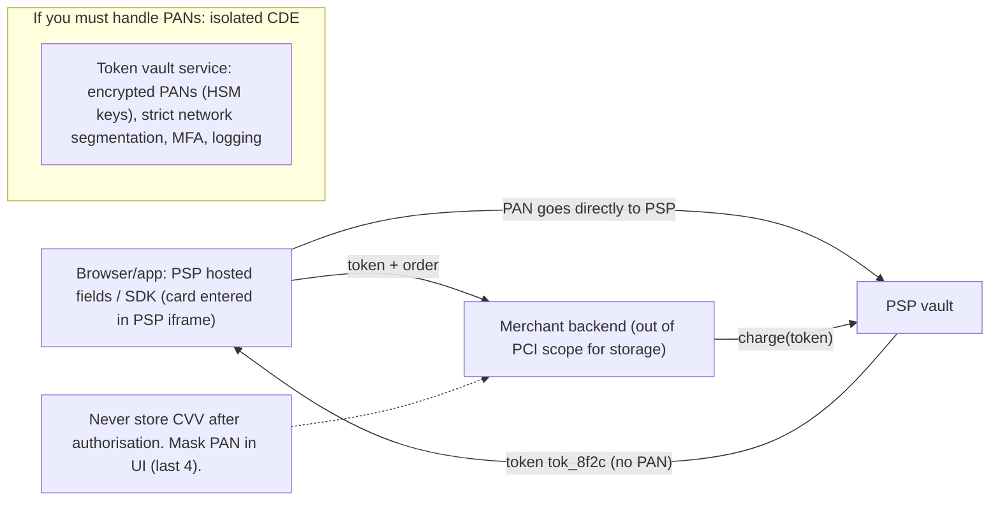
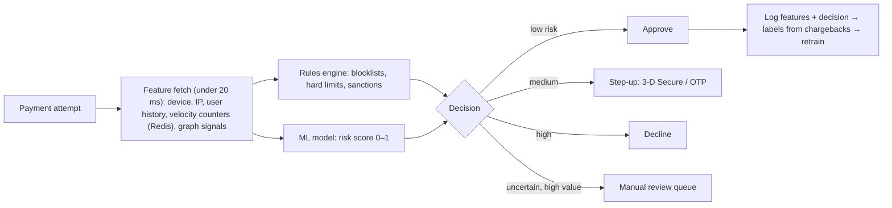
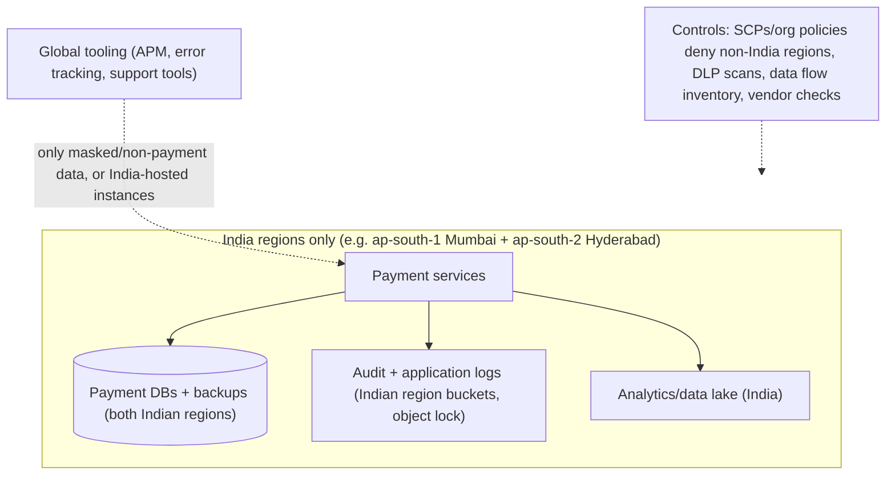
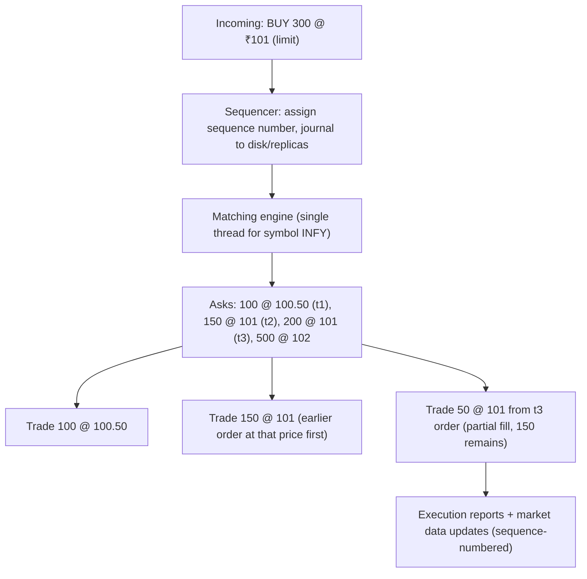
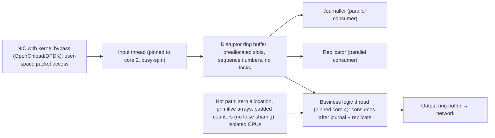
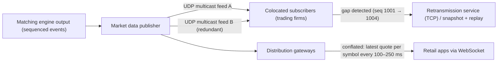

## Compliance & risk

### PCI-DSS & tokenization — keep card numbers out of most systems
**PCI-DSS** (Payment Card Industry Data Security Standard) governs any system that **stores, processes or transmits cardholder data** (PAN, expiry, CVV). Every system that touches card data is "in scope" for strict controls and audits. The core architectural strategy is **scope reduction through tokenisation**: replace the card number with a **token** as early as possible (ideally in the PSP's SDK or hosted fields, so raw PANs never reach your servers), and keep the few systems that do see PANs in an isolated, heavily controlled **cardholder data environment (CDE)**.

#### Intuition
Handling something dangerous by never touching it. The customer hands the card straight to a specialist, who gives you a numbered ticket. You work only with tickets, so only the specialist needs the vault.

#### Must know
- **PCI-DSS** applies to every system that stores, processes or transmits card data.
- Strategy: **shrink the scope**. Keep card numbers out of as many systems as possible.
- **Tokenise at the edge**: the PSP's hosted fields take the card and return a token.
- **Never store the CVV** after authorisation.
- In India, merchants may not store card numbers. Saved cards use network tokens.

#### Common mistakes
- Card details passing through your own backend, which puts all of it in scope.
- Card numbers appearing in application logs.
- Storing the CVV "encrypted".

#### How it works

Key rules:
- **Never store CVV/CVC** after authorisation (not even encrypted).
- Encrypt PAN at rest with keys in an **HSM/KMS**, rotate keys, restrict access, render PAN unreadable (truncation, tokens, hashing with care).
- **Network segmentation** so the CDE is isolated; everything connected to it is in scope.
- Logging, access control with MFA, vulnerability management, quarterly scans, annual assessment (SAQ for small merchants, ROC by a QSA for large ones).
- In India, RBI's **card-on-file tokenisation** rules prohibit merchants from storing card numbers at all; saved cards use **network tokens** issued per merchant/device.

#### Example
An e-commerce company's checkout posted card details to its own backend, which forwarded them to the PSP. That made the entire backend, its logs and its databases PCI in scope, and a security review found PANs in application debug logs. They switched to the PSP's hosted card fields (the card is entered in an iframe served by the PSP), received only tokens, purged logs, and reduced scope to the simplest self-assessment questionnaire. Saved cards were migrated to network tokens per RBI rules.

#### Trade-offs
Tokenisation dramatically reduces compliance burden and breach impact, but you depend on the PSP's vault (switching PSPs requires token migration or network tokens), and some custom flows become harder.

#### Problems & fixes
| Symptom | Cause | Fix |
|---|---|---|
| Whole platform in PCI scope | PANs pass through your servers | hosted fields/SDK tokenisation at the edge |
| PANs found in logs | logging request bodies | never log payloads, redaction filters, DLP scanning |
| PSP lock-in via tokens | PSP-specific tokens | network tokens, token portability agreements |
| CVV stored | misunderstanding rules | never store CVV after authorisation |

#### Cheat sheet
- Keep PANs out: hosted fields → tokens → backend sees only tokens.
- Never store CVV; encrypt PAN with HSM/KMS keys if you must; isolate the CDE.
- India: card-on-file tokenisation (network tokens) mandatory.

#### Interview questions

How do you design a checkout to minimise PCI-DSS scope?

Use the PSP's hosted payment fields or SDK so card data goes directly from the customer's browser or app to the PSP, which returns a token. Your backend only ever handles tokens and payment ids, so no PANs touch your servers, logs or databases. Store only masked card info (last 4, brand) for display, use network tokens for saved cards, and enforce log redaction anyway. Scope shrinks to the pages hosting the payment fields.

What's the difference between a PSP token and a network token?

A PSP token is issued by your payment provider and only usable through that provider, which creates lock-in. A network token is issued by the card network (Visa, Mastercard, RuPay) for a specific merchant (and sometimes device), replacing the PAN in transactions across acquirers; it is updated automatically when cards are reissued, and often improves authorisation rates. RBI's tokenisation rules for card-on-file rely on network tokens.

#### Interview angle
> "Card data never reaches our servers. Hosted fields return tokens, saved cards use network tokens per RBI rules, CVV is never stored, and log redaction is enforced anyway."

#### Sources
- [PCI DSS](https://www.pcisecuritystandards.org/standards/pci-dss/) — PCI Security Standards Council
- [Integration security guide](https://docs.stripe.com/security/guide) — Stripe docs

### Fraud & risk checks — rules, velocity limits, ML scoring in the payment path
Fraud and risk systems decide, **in real time within the payment flow** (tens of milliseconds), whether to **approve, decline, challenge (3-D Secure/OTP) or review** a transaction. They combine **rules** (blocklists, amount thresholds, geography mismatches), **velocity limits** (too many attempts per card, device, IP or account in a window) and **ML risk scores** built on features like device fingerprint, behaviour history and network relationships, with feedback from chargebacks and confirmed fraud.

#### Intuition
A bank teller who glances at each transaction. Most go straight through. Odd ones get an extra ID check, obviously bad ones are refused, and unclear large ones go to a supervisor.

#### Must know
- A decision made **in real time inside the payment flow**.
- Four outcomes: **approve, challenge (OTP / 3-D Secure), decline, manual review**.
- **Rules**: blocklists and hard limits. **Velocity limits**: too many attempts per card, device or IP.
- An **ML risk score** built from device, history and behaviour features.
- False positives lose good customers, so test new rules in **shadow mode** first.

#### Numbers to quote
- The risk check typically has a budget of tens of milliseconds.

#### Common mistakes
- No velocity limits on small payments, which allows card testing.
- Declining outright where a step-up challenge would do.
- No decision on what happens when the risk service is down.

#### How it works

Velocity counters in Redis (sliding windows): attempts per card per 10 min, distinct cards per device per day, failed attempts per IP per hour, amount per account per day.

Design concerns:
- **Latency budget**: features precomputed or cached; model served in-process or via a fast service; fail open or closed by policy if the risk service is down (often fail open for low amounts with stricter limits).
- **Precision vs recall**: false positives lose good customers; tune thresholds by segment and monitor approval rates.
- **Feedback loop**: chargebacks arrive weeks later; label latency affects retraining.
- **Explainability** for review teams and regulators; shadow mode before launching new rules.

#### Example
A digital goods marketplace saw card-testing attacks: bots trying thousands of stolen cards with ₹1 purchases. Velocity rules (more than 5 distinct cards per device per hour, or more than 20 failed attempts per IP per 10 minutes → block), CAPTCHA on suspicious sessions, and a model feature for BIN diversity stopped the attack within an hour. Before launching a stricter rule, they ran it in shadow mode for a week and found it would have blocked 2% of legitimate students on shared campus IPs, so they excluded known campus ranges.

#### Trade-offs
Real-time scoring reduces fraud losses and chargebacks, but false positives cost revenue and trust, adds latency and dependencies to the payment path, and fraudsters adapt.

#### Problems & fixes
| Symptom | Cause | Fix |
|---|---|---|
| Card-testing attacks | no velocity limits on small payments | per-device/IP/card velocity, CAPTCHA, BIN checks |
| Good customers declined | over-aggressive rules | shadow mode, segment thresholds, step-up instead of decline |
| Payment latency up due to risk calls | slow feature fetching | precompute features, cache, in-process models, timeouts |
| Model degrades over time | fraud patterns drift, label delay | monitoring, regular retraining, rule hotfixes |

#### Cheat sheet
- Rules + velocity limits + ML score → approve / step-up / decline / review.
- Redis sliding-window counters; tight latency budget; fail-open/closed policy.
- Shadow mode, feedback from chargebacks, monitor approval rates.

#### Interview questions

Design a real-time fraud check for a payments platform with a 50 ms budget.

On each payment, fetch precomputed features from a low-latency store (user and device history, merchant risk) and update velocity counters in Redis (attempts per card, device, IP in sliding windows). Evaluate hard rules (blocklists, limits, sanctions) and an ML model served in-process or via a fast scoring service. Map the score plus rules to approve, step-up (3DS/OTP), decline or review. Use timeouts with a defined fail-open policy for low-risk amounts. Log features and decisions for labels from chargebacks to retrain, and test new rules in shadow mode.

How do you detect card testing?

Look for patterns: many distinct cards from the same device, IP or account in a short window, many small-amount authorisations, high decline rates, sequential or same-BIN card numbers, and new accounts with no history. Velocity limits on these dimensions, CAPTCHAs and bot detection, minimum amounts, and blocking abusive IPs or devices stop most attacks.

#### Interview angle
> "Risk runs inline within about 50 ms: Redis velocity counters, hard rules and an ML score map to approve, step-up, decline or review. New rules go through shadow mode, and chargebacks feed back as labels."

#### Sources
- [Radar](https://docs.stripe.com/radar) — Stripe docs
- [A primer on machine learning for fraud detection](https://stripe.com/guides/primer-on-machine-learning-for-fraud-protection) — Stripe guide
- [Card testing](https://docs.stripe.com/disputes/prevention/card-testing) — Stripe docs

### RBI data localisation & audit trails — data stays in India, immutable logs
India's **RBI payment data localisation** directive (2018) requires that **all payment system data** (end-to-end transaction details, customer data, payment credentials) be **stored only in India**. Processing abroad is allowed in limited cases, but data must be brought back and deleted abroad within a set time (one business day or 24 hours). Combined with RBI and other regulators' **audit trail** expectations (and the DPDP Act for personal data), payment systems must control data location and keep **tamper-evident, retained logs** of transactions and access.

#### Intuition
A rule that the bank's records must stay inside the country, in a locked cabinet where pages can be added but never removed. That includes the photocopies sent to outside contractors.

#### Must know
- RBI requires **payment system data to be stored only in India**.
- That covers databases, backups, logs, analytics copies and **third-party tools**.
- Disaster recovery must also be within India.
- Enforce it with cloud policies that deny every non-India region.
- Audit trails must be **append-only, time-synced and retained** for years.

#### Common mistakes
- A foreign-hosted error tracker or log tool capturing payment payloads.
- A disaster-recovery copy in a region outside India.
- Audit logs that administrators can edit or delete.

#### How it works

Engineering implications:
- **Region restrictions**: cloud org policies deny resource creation outside Indian regions for payment accounts; DR also within India (Mumbai + Hyderabad).
- **Third-party tools**: logs, traces, error trackers, CRMs and support tools must not ship payment data abroad; use India-hosted instances or mask before sending.
- **Audit trails**: append-only, time-synced logs of transactions, configuration changes and privileged access; immutability (WORM/object lock), integrity checks, retention per regulation (often 5–10 years), and quick retrieval for audits.
- **Data inventory**: know where every payment-related field flows (including backups and analytics copies).
- Periodic **system audits** (RBI requires an audit report on compliance by CERT-In empanelled auditors for payment system operators).

#### Example
A payment aggregator discovered that its SaaS error-tracking tool (hosted in the US) captured full request payloads, including UPI VPAs and transaction details, in stack traces. This was a localisation breach. Fixes: scrubbing rules in the SDK to drop payloads, moving to a self-hosted error tracker in Mumbai, organisation-level policies blocking non-India regions in payment accounts, and quarterly data-flow audits. Audit logs moved to an S3 bucket with object lock in compliance mode, 10-year retention.

#### Trade-offs
Compliance avoids regulatory action and builds trust, but limits cloud region and SaaS choices, raises costs (DR within the country, self-hosting tools) and requires continuous governance.

#### Problems & fixes
| Symptom | Cause | Fix |
|---|---|---|
| Payment data in foreign SaaS tools | logs/traces include payloads | scrub at source, India-hosted tools |
| Resources accidentally created abroad | no guardrails | org policies (SCPs) denying non-India regions |
| Audit logs editable by admins | mutable storage | WORM/object lock, separate audit account |
| Can't answer "where does this data go" | no inventory | data flow mapping, DLP scanning |

#### Cheat sheet
- Payment system data stored only in India; DR within India.
- Guard SaaS/observability tools; region-deny policies.
- Immutable, retained, time-synced audit trails; periodic audits.

#### Interview questions

How would you ensure compliance with RBI data localisation in a cloud-native payment system?

Run payment workloads in accounts restricted by organisation policies to Indian regions, with DR between two Indian regions. Keep databases, backups, logs, analytics and message brokers in India. Audit every third-party tool and integration: use India-hosted versions or strip payment data before sending. Maintain a data-flow inventory, run DLP scans, and include localisation checks in architecture reviews and periodic audits.

What makes an audit trail trustworthy?

It's complete (all relevant actions: transactions, config changes, privileged access, data exports), immutable (append-only, WORM storage with object lock or hash chaining, so even admins can't alter it), time-synchronised (NTP, consistent timestamps), attributable (who, what, when, from where), retained for the required period, protected by separate access controls, and searchable for investigations and audits.

#### Interview angle
> "Payment data never leaves India: region-deny policies, DR between Mumbai and Hyderabad, scrubbed or India-hosted observability tools, and audit logs in object-locked buckets with long retention."

#### Sources
- [Storage of payment system data](https://www.rbi.org.in/Scripts/NotificationUser.aspx?Id=11244&Mode=0) — Reserve Bank of India
- [Storage of payment system data: frequently asked questions](https://www.rbi.org.in/Scripts/FAQView.aspx?Id=130) — Reserve Bank of India
- [Locking objects with Object Lock](https://docs.aws.amazon.com/AmazonS3/latest/userguide/object-lock.html) — Amazon S3 user guide

## Trading systems

### Order book & matching engine — price-time priority, single-threaded per symbol
An exchange's **order book** holds resting buy orders (**bids**) and sell orders (**asks**) for each instrument, sorted by **price, then time**. The **matching engine** processes incoming orders sequentially: a buy order that's at or above the best ask **trades** against the cheapest asks first (and the earliest within each price level), and any remainder rests in the book (for limit orders). Matching is usually **single-threaded per symbol** for determinism and speed, with symbols partitioned across cores or machines.

#### Intuition
An auction with two queues: buyers lined up by the highest price they will pay, sellers by the lowest they will accept. When the front of each queue agrees on a price, they trade. Among people offering the same price, whoever came first goes first.

#### Must know
- The **order book** holds resting buy orders (bids) and sell orders (asks).
- Matching uses **price-time priority**: best price first, then the earliest order.
- The engine is **single-threaded per symbol**, which makes it deterministic and fast.
- It runs in memory. Inputs are **sequenced and journaled first**, so a standby can replay them.
- Scale by spreading symbols across engines.

#### Common mistakes
- Matching through database rows and locks.
- Several threads on one book, which loses determinism and fairness.
- Finding an order to cancel by scanning the book, with no id lookup map.

#### How it works

Data structures: per side, a sorted map of price → FIFO queue of orders (e.g. a red-black tree or array indexed by price ticks for speed), plus a hash map order id → order for O(1) cancels. Best bid/ask is at the top.

Why single-threaded per symbol: matching must be **deterministic and strictly ordered** (fairness, regulatory), and locks would add latency and nondeterminism. One core can match millions of orders per second with in-memory structures. **Resilience** comes from journaling the input sequence and replicating it to hot standbys that replay the same deterministic logic (state machine replication).

Order types: market, limit, IOC (immediate-or-cancel), FOK (fill-or-kill), stop orders; plus self-trade prevention and pre-trade risk checks (limits, margin) before orders reach the engine.

#### Example
A crypto exchange's first matching engine used a relational database with row locks per order and topped out at ~2,000 orders per second, with latency spikes during volatility. The rewrite: an in-memory order book per trading pair, single-threaded matching, input commands journaled and replicated to a standby (which replays them), and market data published from the engine's output stream. It handled 1M+ orders per second per core group with microsecond-level matching latency.

#### Trade-offs
Deterministic, fast and fair, but a single hot symbol is limited by one core, recovery depends on journaling and replay, and everything around the engine (risk checks, market data, persistence) must keep up without blocking it.

#### Problems & fixes
| Symptom | Cause | Fix |
|---|---|---|
| Nondeterministic fills, fairness complaints | concurrent matching with locks | single-threaded per symbol, sequencer |
| Slow cancels | scanning book for order id | hash map id → order node |
| Data loss on crash | in-memory state only | journal inputs before processing, replicated standby |
| Engine stalls on I/O | synchronous DB writes in matching loop | async journaling, separate threads/processes for output |

#### Cheat sheet
- Bids/asks sorted by price then time; match best price, earliest first.
- Single-threaded per symbol; partition symbols across cores.
- Journal inputs, replicate, replay deterministically; id → order map for cancels.

#### Interview questions

Design a matching engine for a stock exchange.

Gateways authenticate clients and run pre-trade risk checks, then send orders to a sequencer that assigns a global sequence number and journals them (replicated). Each symbol's matching engine runs single-threaded with an in-memory order book (price levels as sorted structures with FIFO queues, plus an id → order map), applying price-time priority and generating trades and book updates. Outputs go to execution reports, a market data publisher and clearing. Standbys replay the journal deterministically for failover. Partition symbols across engines.

Why is matching usually single-threaded per symbol?

Matching requires strict ordering for fairness (price-time priority) and determinism (replays must produce the same trades). Multi-threaded matching on one book needs locks, which add latency, contention and nondeterminism. A single thread with in-memory data structures and no locks is extremely fast (millions of events per second), and scale comes from partitioning symbols across threads and machines.

#### Interview angle
> "Each symbol's book is matched single-threaded in memory with price-time priority. Inputs are sequenced and journaled first so standbys replay deterministically, and scaling means partitioning symbols across engines."

#### Sources
- [Order book](https://en.wikipedia.org/wiki/Order_book) — Wikipedia
- [Order matching system](https://en.wikipedia.org/wiki/Order_matching_system) — Wikipedia
- [The LMAX architecture](https://martinfowler.com/articles/lmax.html) — Martin Fowler

### Low-latency techniques — LMAX Disruptor, GC avoidance, kernel bypass
Trading systems compete on **microseconds**. Low-latency techniques remove every source of delay and jitter: **lock-free inter-thread messaging** (the LMAX Disruptor ring buffer), **mechanical sympathy** (cache-friendly data layouts, avoiding false sharing, pinning threads to cores), **avoiding GC pauses** (object pooling, off-heap memory, allocation-free hot paths), and **kernel bypass networking** (Solarflare/OpenOnload, DPDK, RDMA) to skip the OS network stack. FPGAs go further for the most latency-sensitive paths.

#### Intuition
A Formula 1 pit stop. Every movement is rehearsed, every tool is already in hand, nobody waits for anybody, and nothing is fetched during the stop. The aim is not only speed, but the same speed every time.

#### Must know
- Trading systems compete on **microseconds** and on consistency (low jitter).
- **Disruptor**: a preallocated ring buffer that passes messages between threads with no locks.
- **No allocation on the hot path**, so there are no garbage-collection pauses.
- Pin threads to cores, and let them **busy-spin** in place of sleeping.
- **Kernel bypass** networking skips the operating system's network stack.

#### Common mistakes
- Using these techniques where milliseconds are perfectly fine.
- Allocating objects or logging inside the hot path.
- Measuring the average and not the p99.9 and maximum.

#### How it works

Techniques:
- **Disruptor**: a preallocated ring buffer with sequence counters; producers and consumers coordinate through memory barriers rather than locks; supports dependency graphs between consumers (journal and replicate before processing).
- **Single writer principle**: each piece of data has one writing thread, avoiding contention.
- **Busy-spinning** instead of blocking (burns a core but avoids wake-up latency); **CPU isolation** (isolcpus) and **thread affinity**.
- **GC avoidance**: preallocate and reuse objects, flyweights over byte buffers, off-heap structures; or low-pause collectors; or C++/Rust.
- **Binary protocols** (SBE, FIX/FAST) instead of text; avoid syscalls and logging in the hot path (async binary logging).
- Measure with **HDR histograms**, focusing on p99.9 and max (jitter).

#### Example
A trading firm's Java order router had a median latency of 40 µs but p99.9 of 3 ms due to GC pauses and thread hand-offs through `ArrayBlockingQueue`. Rewriting the pipeline with the Disruptor, preallocated message objects, primitive collections and thread pinning, and moving to kernel-bypass networking, brought the median to 6 µs and p99.9 to 25 µs.

#### Trade-offs
Extreme performance and predictability, but much harder to write and maintain code, wasted CPU from busy-spinning, specialised hardware and expertise, and only worth it where microseconds matter.

#### Problems & fixes
| Symptom | Cause | Fix |
|---|---|---|
| Latency spikes (jitter) | GC pauses, allocation in hot path | allocation-free design, pooling, off-heap |
| Queue hand-offs slow | locks/condition variables | Disruptor ring buffer, busy-spin |
| Unexplained slowdowns | false sharing, core migration | cache-line padding, thread pinning, isolcpus |
| Network stack latency | kernel TCP/IP path | kernel bypass, tuned NICs |

#### Cheat sheet
- Disruptor ring buffer, single writer, busy-spin, pinned threads.
- Zero allocation hot path; binary protocols; async logging.
- Kernel bypass; measure p99.9/max with HDR histograms.

#### Interview questions

What makes the LMAX Disruptor faster than a standard blocking queue?

It uses a preallocated ring buffer (no allocation per message, good cache locality), coordinates producers and consumers through sequence counters with memory barriers instead of locks, avoids false sharing via padding, allows batching (consumers catch up multiple entries at once), and supports busy-spin wait strategies that avoid thread wake-up latency. Blocking queues use locks and condition variables, causing contention and context switches.

How do you avoid GC pauses in a latency-critical Java service?

Design the hot path to allocate nothing in steady state: preallocate and reuse objects (pools, ring buffer slots), use primitive collections and flyweight access over byte buffers, keep long-lived data off-heap, avoid boxing, string building and logging in the hot path, and warm up so JIT compilation completes before trading. Low-pause collectors (ZGC) help further, and some firms use C++ or Rust instead.

#### Interview angle
> "For microsecond paths I'd use Disruptor ring buffers with pinned, busy-spinning threads, an allocation-free hot path and kernel-bypass networking, measured at p99.9 with HDR histograms."

#### Sources
- [LMAX Disruptor: high performance alternative to bounded queues](https://lmax-exchange.github.io/disruptor/disruptor.html) — LMAX
- [The LMAX architecture](https://martinfowler.com/articles/lmax.html) — Martin Fowler
- [HdrHistogram](https://github.com/HdrHistogram/HdrHistogram) — HdrHistogram, GitHub

### Market data fan-out — multicast, conflation, sequence numbers
Market data (quotes, trades, order book updates) must be delivered to **many consumers fast and fairly**. Exchanges publish via **UDP multicast** (one packet reaches all subscribers on the network), with **sequence numbers** so receivers detect gaps and recover via **retransmission or snapshot** services. Downstream, distribution to slower consumers (UIs, retail apps over WebSockets) uses **conflation**: sending only the latest state per instrument at a controlled rate instead of every tick.

#### Intuition
A stadium announcer speaks once and everyone hears it together (multicast). Each announcement is numbered, so you know if you missed one. For people far away on a slow line, you send only the current score every few seconds, not every play.

#### Must know
- Exchanges publish prices over **UDP multicast**: one packet reaches every subscriber.
- UDP can drop packets, so each message has a **sequence number**.
- A gap is repaired by a retransmission request or a fresh **snapshot**.
- **Conflation** for slow consumers: send only the latest value per symbol at a fixed rate.
- A slow consumer must never slow the publisher.

#### Numbers to quote
- Retail apps typically get the latest quote per symbol every 100–250 ms.

#### Common mistakes
- Streaming every tick to mobile clients, so queues grow without limit.
- Incremental updates with no snapshot on reconnect.
- No gap detection on an unreliable feed.

#### How it works

Concepts:
- **Multicast**: efficient one-to-many delivery on LANs (colocation), no per-subscriber sending cost; unreliable (UDP), so gaps must be handled.
- **A/B feeds**: two redundant multicast streams; receivers arbitrate (take the first copy of each sequence number).
- **Sequence numbers**: per channel, to detect gaps and duplicates; recovery via retransmission requests or periodic **snapshots** plus incremental updates.
- **Conflation**: for consumers that can't keep up, keep only the latest value per key and send at a fixed rate; slow consumers never cause unbounded queues or slow the publisher.
- **Fairness**: equal-length cables and simultaneous publication for colocated participants.

#### Example
A brokerage's retail app streamed every tick for every watched symbol over WebSockets. During a volatile market open (50k updates per second), slow mobile clients built up huge per-connection queues, gateway memory exploded and prices lagged by minutes. Switching to conflation (latest quote per symbol, pushed every 200 ms, plus full snapshot on reconnect) kept all clients current within 200 ms and cut bandwidth by 90%.

#### Trade-offs
Multicast is efficient and fair for colocated consumers but unreliable and LAN-bound; conflation protects systems and slow clients but drops intermediate ticks (unsuitable for algos needing every update); gap recovery adds complexity.

#### Problems & fixes
| Symptom | Cause | Fix |
|---|---|---|
| Missing updates, stale book | UDP packet loss | sequence numbers, A/B feeds, retransmission/snapshots |
| Gateway memory explodes in volatile markets | per-client queues for slow consumers | conflation, bounded buffers, drop to snapshot |
| Clients see prices minutes late | queued backlog | conflate to latest, fixed publish rate |
| Inconsistent book after reconnect | incremental updates only | snapshot + replay from sequence |

#### Cheat sheet
- UDP multicast + sequence numbers + A/B feeds + retransmission/snapshots.
- Conflation for slow consumers: latest per key at a fixed rate.
- Snapshot on (re)connect; never let slow consumers slow the publisher.

#### Interview questions

How would you stream live stock prices to 1 million mobile users?

Consume the exchange feed in the data centre, normalise it, and publish internally (Kafka or multicast) to stateless WebSocket gateways. Each gateway holds the latest quote per symbol and pushes conflated updates for each client's subscribed symbols at a fixed interval (e.g. 250 ms), with bounded per-connection buffers that drop to the latest value. Clients get a snapshot on connect or reconnect. Scale gateways horizontally, and use a pub/sub backplane so each gateway only subscribes to the symbols its clients watch.

Why use sequence numbers in market data feeds?

UDP multicast doesn't guarantee delivery or order. Sequence numbers let receivers detect gaps (missing messages), discard duplicates (e.g. from redundant A/B feeds) and reorder. On a gap, a receiver requests retransmission or rebuilds from a snapshot plus subsequent updates, so its view of the order book stays correct.

#### Interview angle
> "Colocated consumers get sequenced UDP multicast with A/B arbitration and snapshot recovery. Retail clients get conflated latest-value updates over WebSockets, so a slow phone can never back up the publisher."

#### Sources
- [IP multicast](https://en.wikipedia.org/wiki/IP_multicast) — Wikipedia
- [Market data](https://en.wikipedia.org/wiki/Market_data) — Wikipedia

