## OOP & principles

### Four pillars — encapsulation, abstraction, inheritance, polymorphism
The four pillars of object-oriented design are: **encapsulation** (bundle state with the behaviour that guards it; hide internals behind a small API), **abstraction** (expose *what* something does, not *how*: interfaces and abstract types), **inheritance** (a subtype reuses and specialises a supertype: an is-a relationship), and **polymorphism** (code written against an abstraction works with any implementation, chosen at runtime). In LLD interviews they show up as clean class boundaries, interfaces at the seams, and no `if (type == …)` chains.

#### Intuition
A car. You drive with the pedals and wheel, not by touching the engine (encapsulation and abstraction). A sports car is still a car (inheritance). And "press the accelerator" works on any car, whatever is under the bonnet (polymorphism).

#### Must know
- **Encapsulation**: keep state private, and change it only through methods that protect its rules.
- **Abstraction**: expose what something does, not how. Interfaces do this.
- **Inheritance**: a subtype reuses and specialises a parent type (an "is-a" relationship).
- **Polymorphism**: code written against an interface works with any implementation.
- In interviews: private fields, interfaces at the boundaries, and no chains of `if (type == ...)`.

#### Common mistakes
- Public setters on everything, so callers can break the object's rules.
- The same `switch (type)` repeated in several places.
- Deep inheritance trees where a small interface would do.

#### How it works
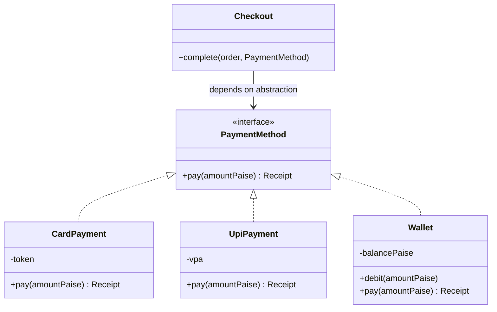

```java
class Wallet implements PaymentMethod {
  private long balancePaise;                          // encapsulation: no public setter
  public synchronized void debit(long amt) {
    if (amt <= 0 || amt > balancePaise) throw new IllegalArgumentException("invalid debit");
    balancePaise -= amt;                              // invariant guarded in one place
  }
  public Receipt pay(long amt) { debit(amt); return Receipt.of(amt); }
}
// polymorphism: Checkout calls method.pay(...) without knowing which kind it is
```

| Pillar | Interview signal | Smell when missing |
|---|---|---|
| Encapsulation | private fields, invariants enforced in methods | public setters, logic scattered in callers |
| Abstraction | interfaces at boundaries (PaymentMethod, Notifier) | callers depend on concrete classes |
| Inheritance | shallow, true is-a hierarchies | deep trees, overriding to disable behaviour |
| Polymorphism | new type = new class, no caller changes | `switch (type)` repeated in many places |

#### Example
In a parking-lot machine-coding round, a candidate wrote `if (vehicle.type.equals("CAR")) … else if ("BIKE") …` for fee calculation in three places. Adding "EV" meant editing all three. Refactoring to a `FeeStrategy` interface per vehicle type (polymorphism) and making `ParkingSpot` own its occupancy state with `park()`/`unpark()` methods that enforce "one vehicle per spot" (encapsulation) made the extension a single new class.

#### Trade-offs
Good encapsulation and abstraction make code changeable and testable, but premature abstractions (interfaces with one implementation "just in case") add indirection, and inheritance creates tight coupling between parent and child.

#### Problems & fixes
| Symptom | Cause | Fix |
|---|---|---|
| Same `switch(type)` in many places | missing polymorphism | interface + one class per type |
| Invariants broken by callers | public mutable state | private fields, behaviour methods |
| Subclass breaks when parent changes | fragile base class (inheritance) | composition, final classes |
| Too many one-implementation interfaces | speculative abstraction | add interfaces at real seams only |

#### Cheat sheet
- Encapsulation guards invariants. Abstraction hides how. Inheritance = is-a. Polymorphism = one call, many behaviours.
- Replace type switches with polymorphism.
- Prefer shallow hierarchies; interfaces at boundaries.

#### Interview questions
<details><summary>What's the difference between abstraction and encapsulation?</summary>

Abstraction is about the interface: exposing only what something does (e.g. `PaymentMethod.pay()`), so callers don't depend on details. Encapsulation is about protecting state: hiding fields and making all changes go through methods that maintain invariants (a wallet balance can only change via `debit`/`credit`). Abstraction reduces what callers need to know; encapsulation prevents them from corrupting state.
</details>

<details><summary>How does polymorphism help you follow the open/closed principle?</summary>

Callers depend on an abstraction (interface) and invoke its methods; each variant is a separate implementation. Adding a new variant means adding a class, not modifying existing callers or switch statements, so existing code stays closed for modification while the system is open for extension.
</details>

#### Interview angle
> "I keep state private behind methods that enforce invariants, put interfaces at the seams like payment methods and notifiers, and replace type switches with polymorphism so a new type is just a new class."

#### Sources
- [Object-oriented programming concepts](https://docs.oracle.com/javase/tutorial/java/concepts/index.html) — Oracle Java tutorials
- [Object-oriented programming](https://en.wikipedia.org/wiki/Object-oriented_programming) — Wikipedia

### SOLID principles — SRP, OCP, LSP, ISP, DIP
SOLID is five design principles for maintainable OO code: **S**ingle Responsibility (a class has one reason to change), **O**pen/Closed (open for extension, closed for modification), **L**iskov Substitution (subtypes must be usable wherever the base type is expected without breaking behaviour), **I**nterface Segregation (many small, client-specific interfaces over one fat interface), and **D**ependency Inversion (high-level modules depend on abstractions, not concrete low-level details; inject dependencies).

#### Intuition
Five house rules for code that will keep changing. One job per class. Add new features by adding code, not by editing old code. A stand-in must be able to do the original's job. Keep interfaces small. Depend on a socket shape, not on one brand of plug.

#### Must know
- **S**ingle responsibility: a class has **one reason to change**.
- **O**pen/closed: **extend by adding** a class, not by editing existing code.
- **L**iskov substitution: a subtype must work wherever its parent type is expected.
- **I**nterface segregation: several small interfaces beat one fat one.
- **D**ependency inversion: depend on abstractions, and **inject** the concrete implementation.

#### Common mistakes
- A "god class" that validates, saves, charges and sends email.
- A subclass that throws "not supported" for a parent method.
- Creating concrete dependencies with `new` inside business logic, which blocks testing.

#### How it works
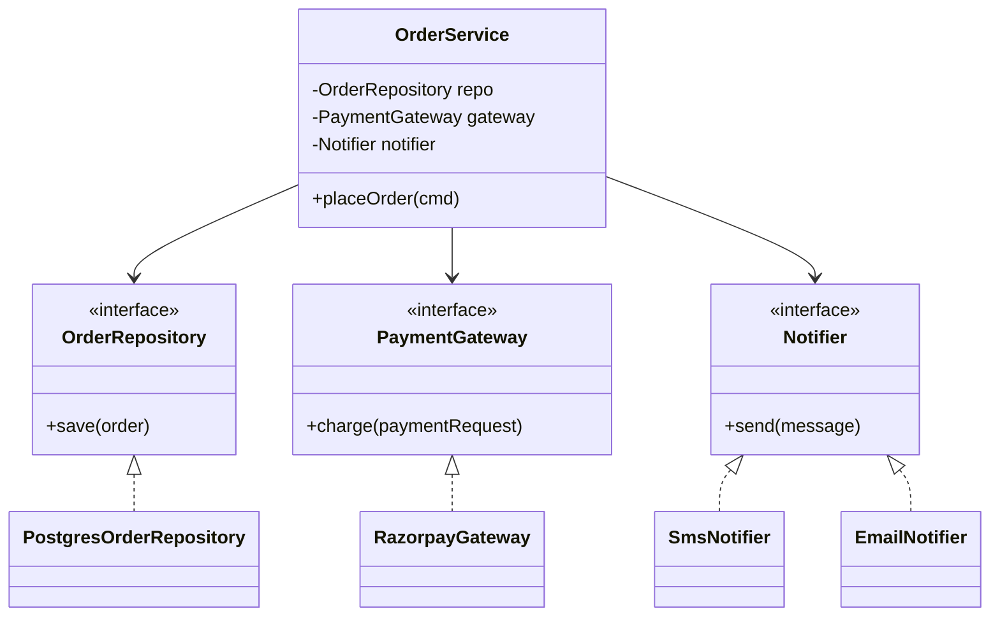

| Principle | Violation | Fix |
|---|---|---|
| SRP | `OrderService` validates, saves, charges, formats emails, writes CSV reports | split into collaborators with one job each |
| OCP | adding a discount type edits a big `if/else` | `DiscountRule` interface, new class per rule |
| LSP | `Square extends Rectangle` breaks `setWidth`; `ReadOnlyList.add()` throws | model differently; don't inherit to restrict |
| ISP | `Machine` interface with print/scan/fax forces stubs | `Printer`, `Scanner` separate interfaces |
| DIP | `new MySqlRepo()` inside business logic | depend on `OrderRepository`, inject the implementation |

#### Example
An elevator-system LLD started with one `ElevatorController` class handling requests, scheduling, door control and display updates. Applying SRP split it into `RequestDispatcher`, a `SchedulingStrategy` interface (OCP: nearest-car and zone-based strategies), `Elevator` (state and movement) and `DisplayPanel`. DIP let tests inject a fake clock and a deterministic strategy, so the scheduling logic was unit-tested without threads.

#### Trade-offs
SOLID code is easier to extend and test, but applied dogmatically it produces many tiny classes and interfaces that obscure simple logic. Apply it where change is likely.

#### Problems & fixes
| Symptom | Cause | Fix |
|---|---|---|
| God class with thousands of lines | SRP ignored | extract cohesive collaborators |
| Every feature edits the same switch | OCP ignored | strategy/polymorphism |
| Subclass throws UnsupportedOperationException | LSP violation | rethink hierarchy, composition |
| Untestable business logic | concrete dependencies created inside | constructor injection of interfaces (DIP) |

#### Cheat sheet
- SRP one reason to change; OCP extend by adding; LSP substitutable subtypes; ISP small interfaces; DIP depend on abstractions + inject.
- Use where change is likely; avoid interface explosion.
- DIP + constructor injection = testability.

#### Interview questions
<details><summary>Give an example of a Liskov Substitution violation and how to fix it.</summary>

`class Penguin extends Bird` where `Bird` has `fly()`: Penguin must throw or do nothing, so code that calls `fly()` on any Bird breaks. Fix by modelling capabilities separately (`Bird` without `fly`, plus a `Flyable` interface implemented only by flying birds), so every subtype honours the contracts of the types it claims. The test: can every caller of the base type use the subtype without special cases?
</details>

<details><summary>How does dependency inversion make code testable?</summary>

High-level logic depends on interfaces (e.g. `PaymentGateway`, `Clock`, `OrderRepository`) passed in through constructors rather than creating concrete classes internally. In tests, you inject fakes or mocks (a fake gateway that returns declines, a fixed clock), so you can test business rules quickly and deterministically without databases, networks or time.
</details>

#### Interview angle
> "I apply SOLID where change is likely: strategies for the parts that vary, small interfaces, and constructor-injected abstractions so the core logic is testable with fakes. I don't create interfaces for everything."

#### Sources
- [SOLID](https://en.wikipedia.org/wiki/SOLID) — Wikipedia
- [Solid relevance](https://blog.cleancoder.com/uncle-bob/2020/10/18/Solid-Relevance.html) — Robert C. Martin

### Composition over inheritance — has-a beats deep hierarchies
"Favour composition over inheritance" means building behaviour by **combining objects that have-a collaborator** (delegating to them) rather than **inheriting from a base class**. Composition gives looser coupling, behaviour that can change at runtime, and avoids deep, fragile hierarchies and class explosion. Inheritance is still right for genuine, stable is-a relationships.

#### Intuition
Building with LEGO bricks, not carving one statue. You snap small pieces together in any combination, and swap a piece without re-carving the whole thing.

#### Must know
- Build behaviour by **combining objects that each do one thing**, and delegating to them.
- "Has-a" is looser coupling than "is-a".
- It avoids a **class explosion** when features combine (email + retry + rate limit).
- Behaviour can be swapped at runtime.
- Inheritance is still right for a genuine, stable "is-a" relationship.

#### Common mistakes
- A new subclass for every combination of features.
- Inheriting only to reuse a few lines of code.
- A base-class change that silently breaks subclasses.

#### How it works
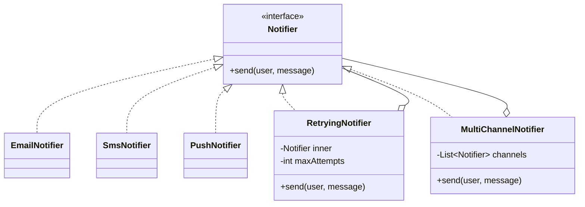

With inheritance, combining "email + retry + rate limit" needs classes like `RetryingRateLimitedEmailNotifier`: a combinatorial explosion. With composition: `new RetryingNotifier(new RateLimitedNotifier(new EmailNotifier()), 3)`, each concern a small class, combined freely, even chosen from config at runtime.

When inheritance is fine: a true is-a with a stable base contract (e.g. `abstract class Shape` with `area()`), template-method frameworks, or sealed hierarchies of value types.

#### Example
A game's character system used inheritance: `Character → Warrior → FlyingWarrior → FlyingFireWarrior`. Each new ability combination needed a new class. Rewriting with composition, a `Character` holding a list of `Ability` components (Fly, FireAttack, Heal), allowed any combination and even gaining abilities at runtime (power-ups), with no new classes for combinations.

#### Trade-offs
Composition is flexible and loosely coupled, but needs more wiring (constructing object graphs, DI) and delegation boilerplate. Inheritance is concise for true hierarchies but couples subclasses to parent internals.

#### Problems & fixes
| Symptom | Cause | Fix |
|---|---|---|
| Class explosion for feature combinations | inheritance for combining behaviours | composition / decorators |
| Parent change breaks children | fragile base class | delegate to collaborators, final classes |
| Can't change behaviour at runtime | behaviour fixed by class | inject strategy/components |

#### Cheat sheet
- Has-a + delegation beats deep is-a trees.
- Combine small behaviours (decorators, strategies, components).
- Keep inheritance for stable, genuine is-a hierarchies.

#### Interview questions
<details><summary>Why do people say "favour composition over inheritance"?</summary>

Inheritance tightly couples subclasses to the parent's implementation (changes to the base can break subclasses), behaviour is fixed at compile time, and combining features requires multiplying subclasses. Composition assembles behaviour from small, independent objects behind interfaces: they can be combined in any way, swapped at runtime and tested separately, with only the public contracts coupling them.
</details>

<details><summary>When is inheritance the better choice?</summary>

When there's a genuine, stable is-a relationship where subtypes fully honour the base contract (LSP), and you want shared behaviour or a template method defined once: an abstract `Vehicle` with common state in a closed domain, framework base classes designed for extension, or a sealed hierarchy of variants like `Shape` with pattern matching.
</details>

#### Interview angle
> "I combine behaviours by composing small objects behind an interface, like a retrying notifier wrapping an email notifier, and keep inheritance for shallow, true is-a hierarchies."

#### Sources
- [Composition over inheritance](https://en.wikipedia.org/wiki/Composition_over_inheritance) — Wikipedia
- [Decorator](https://refactoring.guru/design-patterns/decorator) — Refactoring.Guru


## Design patterns

### Creational — Singleton, Factory, Builder
Creational patterns control **how objects are created**. **Singleton** ensures exactly one instance (a config registry or ID generator), but is often overused and hurts testability. **Factory** (simple factory, factory method, abstract factory) centralises the decision of *which* concrete class to create, so callers depend on an interface. **Builder** constructs complex objects step by step with readable, validated, often immutable results, replacing telescoping constructors.

#### Intuition
Three ways of getting an object. The singleton is the one shared office printer. The factory is a counter where you say "a bike, please" and are handed the right kind. The builder is ordering a custom sandwich step by step, checked before it is wrapped.

#### Must know
- Creational patterns control **how objects get created**.
- **Singleton**: exactly one instance. Often overused, and it hurts testing.
- **Factory**: one place decides **which concrete class** to create. Callers see only the interface.
- **Builder**: constructs an object with many optional fields step by step, and validates at the end.
- Prefer one injected instance over a static singleton.

#### Common mistakes
- Singletons as global mutable state, so tests interfere with each other.
- A constructor with eight parameters, where a builder would be readable.
- `new ConcreteClass()` scattered across the code.

#### How it works
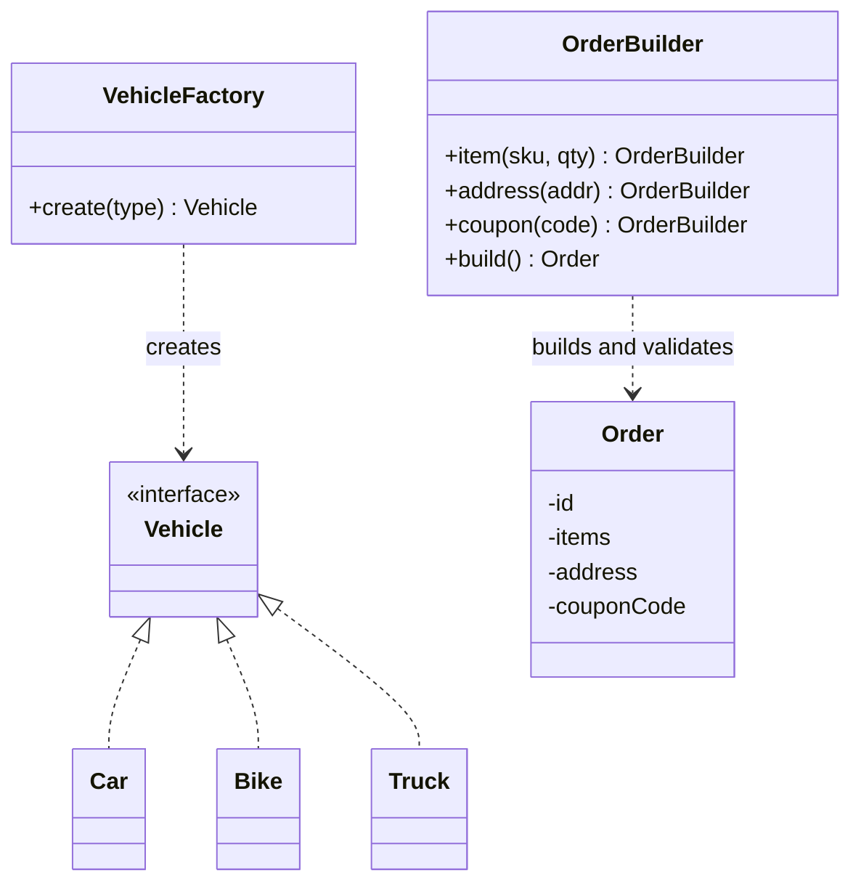

```java
Order order = Order.builder()
    .item("SKU-1", 2).item("SKU-9", 1)
    .address(addr)
    .coupon("DIWALI10")
    .build();                         // validates: at least one item, address required

class PaymentProcessorFactory {      // factory: callers never use `new RazorpayProcessor()`
  PaymentProcessor forMethod(Method m) {
    return switch (m) { case CARD -> card; case UPI -> upi; case WALLET -> wallet; };
  }
}

enum IdGenerator { INSTANCE; private final AtomicLong seq = new AtomicLong();
  long next() { return seq.incrementAndGet(); } }   // simplest thread-safe singleton
```

| Pattern | Use when | Watch out |
|---|---|---|
| Singleton | exactly one shared resource (registry, generator) | global state, hidden dependencies, hard to test; prefer DI-managed single instances |
| Factory | creation logic varies by type/config | don't add factories for trivial `new` |
| Builder | many optional params, immutability, validation | overkill for 2–3 fields |

#### Example
In a parking-lot design, `ParkingSpotFactory` creates `CompactSpot`, `LargeSpot` and `EvSpot` from a floor-plan config, so adding "handicapped spot" touches only the factory and a new class. `Ticket` is built with a builder (entry time, spot, vehicle, optional valet info) that validates required fields. The candidate avoided making `ParkingLot` a static singleton: instead it's a single instance created at startup and injected, so tests can create fresh lots.

#### Trade-offs
Factories and builders improve readability and decoupling at the cost of extra classes; singletons are convenient but introduce global state that complicates testing and concurrency.

#### Problems & fixes
| Symptom | Cause | Fix |
|---|---|---|
| Tests interfere with each other | static singleton holding state | DI-managed instance, reset or inject fakes |
| Telescoping constructors with 8 params | many optional fields | builder |
| `new ConcreteX()` scattered across code | creation logic duplicated | factory |
| Half-initialised objects | setters after construction | builder with validation in build() |

#### Cheat sheet
- Singleton: one instance (prefer enum or DI scope); beware global state.
- Factory: choose concrete class behind interface.
- Builder: readable, validated, immutable construction.

#### Interview questions
<details><summary>Why is Singleton considered an anti-pattern by many?</summary>

It introduces global mutable state accessible from anywhere, hides dependencies (classes reach for `Singleton.getInstance()` instead of declaring them), makes unit testing hard (can't easily substitute or reset it), and can cause concurrency issues. A better approach is usually a single instance managed by a DI container or created at startup and passed in explicitly.
</details>

<details><summary>When would you use a Builder instead of a constructor?</summary>

When an object has many parameters, especially optional ones (telescoping constructors become unreadable and error-prone), when you want immutability with readable construction, or when construction needs validation across fields (e.g. end date after start date) before the object exists. For small objects with 2–3 required fields, a constructor is simpler.
</details>

#### Interview angle
> "I use a factory where the concrete type depends on input, a builder for objects with many optional fields that need validation, and avoid static singletons in favour of one injected instance."

#### Sources
- [Creational design patterns](https://refactoring.guru/design-patterns/creational-patterns) — Refactoring.Guru
- [Builder pattern](https://en.wikipedia.org/wiki/Builder_pattern) — Wikipedia

### Strategy pattern — swap algorithms at runtime
The Strategy pattern defines a **family of interchangeable algorithms** behind a common interface, so the context object delegates to whichever strategy it's given, and the algorithm can be **chosen or swapped at runtime** without changing the context. It's the standard cure for `if/else` chains over algorithm types, and the most common pattern in LLD rounds (pricing, fees, routing, scheduling, matching).

#### Intuition
A sat-nav with a "route type" setting: fastest, shortest or no tolls. The app is the same. You plug in a different route-finding method.

#### Must know
- Put each **interchangeable algorithm behind one interface**.
- The context object **delegates** to whichever strategy it was given.
- The algorithm can be chosen or swapped at runtime.
- It replaces `if/else` chains over algorithm types.
- The most common pattern in LLD rounds: pricing, fee calculation, splitting, scheduling.

#### Common mistakes
- A growing `if (type == ...)` block inside the context class.
- Strategy selection duplicated across callers. Keep it in one factory.
- Using it for two trivial variants where a plain condition is clearer.

#### How it works
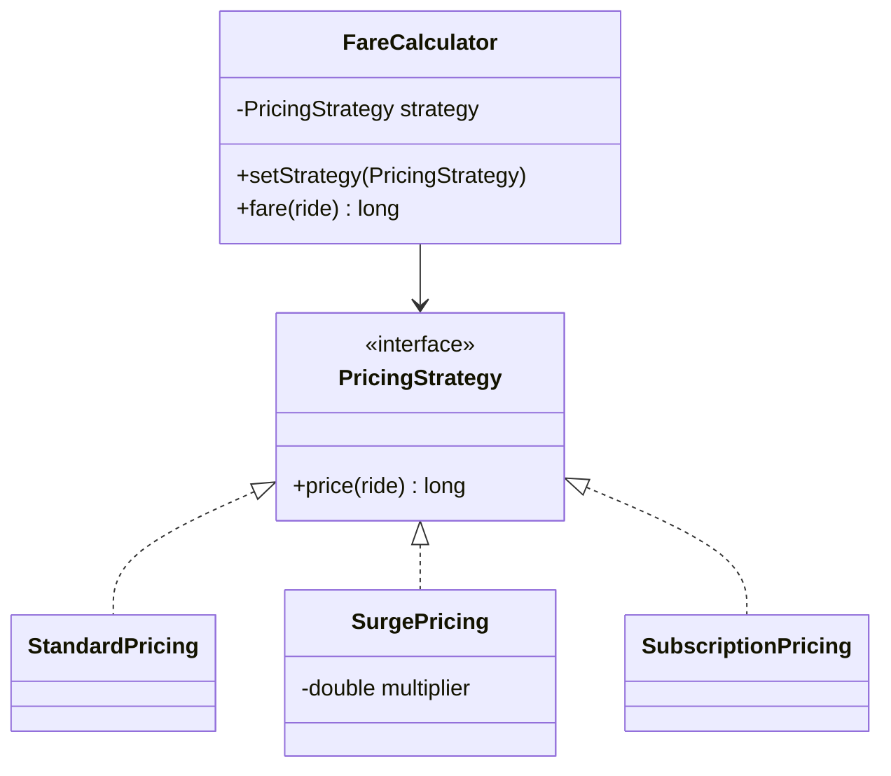

```java
interface PricingStrategy { long price(Ride r); }
class StandardPricing implements PricingStrategy {
  public long price(Ride r) { return 5000 + r.km() * 1200; }          // paise
}
class SurgePricing implements PricingStrategy {
  private final PricingStrategy base; private final double m;
  SurgePricing(PricingStrategy base, double m) { this.base = base; this.m = m; }
  public long price(Ride r) { return Math.round(base.price(r) * m); }
}
// selection lives in one place (factory/config), not spread across callers
PricingStrategy s = demandRatio > 1.5 ? new SurgePricing(standard, 1.8) : standard;
```

Common LLD uses: parking fee by vehicle type, elevator scheduling (nearest car, SCAN), rate limiting (token bucket vs sliding window), split-expense (equal, exact, percentage), cache eviction (LRU, LFU), payment routing.

#### Example
In a Splitwise-style machine coding round, the expense-split logic started as `if (type == EQUAL) … else if (EXACT) … else if (PERCENT) …` inside `addExpense`, with validation mixed in. Refactoring to a `SplitStrategy` interface with `EqualSplit`, `ExactSplit` and `PercentSplit` (each validating its own inputs, e.g. percentages sum to 100, and allocating remainders so parts sum exactly to the total) made each rule independently testable and adding "shares" splits a one-class change.

#### Trade-offs
Clean extension and testability, but more classes, and clients (or a factory) must know which strategy to pick. For two trivial variants, a simple conditional may be clearer.

#### Problems & fixes
| Symptom | Cause | Fix |
|---|---|---|
| Growing if/else on algorithm type | algorithms embedded in context | strategy interface |
| Strategy selection duplicated | callers choose individually | factory/registry keyed by type |
| Strategies need lots of context data | wide interface | pass a focused context object |

#### Cheat sheet
- Interface for the algorithm; context delegates; swap at runtime.
- Selection centralised in a factory or registry.
- Typical: pricing, splitting, scheduling, eviction, routing.

#### Interview questions
<details><summary>Strategy vs State pattern: what's the difference?</summary>

Both delegate behaviour to an interchangeable object. In Strategy, the client or configuration chooses the algorithm, and strategies are usually independent of each other (pricing rule). In State, the object's behaviour changes as its internal state changes, and states typically trigger transitions to other states themselves (vending machine moving from HasCoin to Dispensing). Strategy is about "which algorithm"; State is about "what phase am I in".
</details>

<details><summary>How would you add a new pricing rule without touching existing code?</summary>

Implement a new class of the `PricingStrategy` interface, register it in the factory or registry keyed by its type (or wire it via configuration or DI), and add its tests. The context (`FareCalculator`) and other strategies are unchanged, following the open/closed principle.
</details>

#### Interview angle
> "Whatever varies, like pricing, splitting or scheduling, goes behind a strategy interface, selected in one factory, so a new rule is a new class with its own tests."

#### Sources
- [Strategy](https://refactoring.guru/design-patterns/strategy) — Refactoring.Guru
- [Strategy pattern](https://en.wikipedia.org/wiki/Strategy_pattern) — Wikipedia

### Observer pattern — notify subscribers of changes
The Observer pattern lets a **subject** maintain a list of **observers** and **notify them automatically** when its state changes, without knowing their concrete types. It decouples the source of events from the reactions (UI updates, notifications, analytics, cache invalidation). In distributed systems the same idea becomes pub/sub and event-driven architecture.

#### Intuition
A newspaper subscription. The publisher does not know or care who the readers are. Anyone who subscribes gets each new issue, and can cancel at any time.

#### Must know
- A **subject keeps a list of observers and notifies them** when something changes.
- The subject does not know the observers' concrete types.
- It decouples the source of an event from the reactions to it.
- Decide: **synchronous or asynchronous** notification. A slow synchronous observer slows the subject.
- One failing observer must not stop the others.

#### Common mistakes
- A slow observer blocking the main operation.
- One exception aborting the rest of the notifications.
- Observers that are never unsubscribed, which leaks memory.

#### How it works
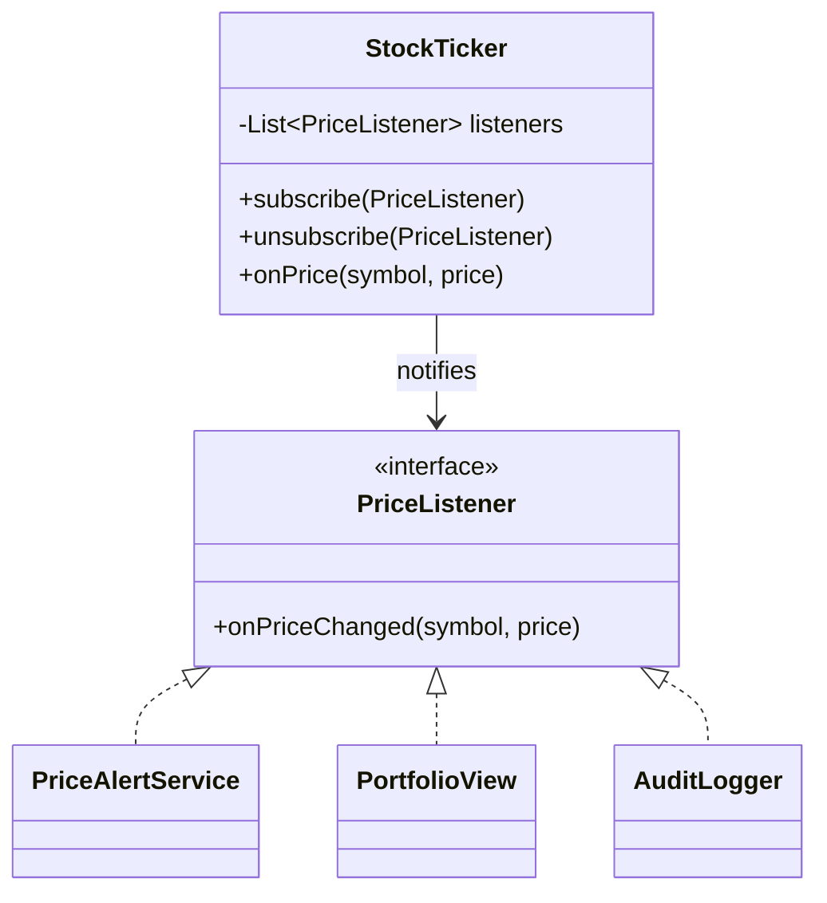

```java
class StockTicker {
  private final List<PriceListener> listeners = new CopyOnWriteArrayList<>(); // safe if (un)subscribed during notify
  void subscribe(PriceListener l) { listeners.add(l); }
  void unsubscribe(PriceListener l) { listeners.remove(l); }
  void onPrice(String sym, long pricePaise) {
    for (PriceListener l : listeners) {
      try { l.onPriceChanged(sym, pricePaise); }
      catch (RuntimeException e) { log.warn("listener failed", e); }   // one bad observer must not stop others
    }
  }
}
```

Design decisions interviewers probe:
- **Push vs pull**: send the changed data, or just notify and let observers query.
- **Sync vs async**: synchronous notification blocks the subject (slow observer = slow subject); async via executor or queue decouples but loses ordering guarantees unless designed.
- **Error isolation**: one failing observer shouldn't break others.
- **Thread safety**: copy-on-write lists or snapshots when observers are added during notification.
- **Memory leaks**: observers never unsubscribed (lapsed listener problem); weak references or explicit lifecycle.

#### Example
In an order-management LLD, `Order` status changes needed to send SMS, update inventory and push analytics. Initially `OrderService.updateStatus` called all three directly, so a slow SMS provider blocked status updates. Introducing `OrderStatusListener` observers registered with an `OrderEventPublisher` (notifying asynchronously via an executor, per-listener error handling) decoupled them; adding a "loyalty points" listener needed no changes to `OrderService`.

#### Trade-offs
Loose coupling and easy extension, but control flow becomes implicit (harder to trace), ordering and error handling need explicit design, and leaks are possible when observers aren't removed.

#### Problems & fixes
| Symptom | Cause | Fix |
|---|---|---|
| Subject slows down | slow synchronous observer | async notification, timeouts |
| One exception stops other notifications | no isolation | try/catch per observer |
| ConcurrentModificationException | subscribe during notify | CopyOnWriteArrayList / snapshot |
| Memory leak | observers never unsubscribed | unsubscribe on lifecycle end, weak refs |

#### Cheat sheet
- Subject keeps observers, notifies on change; observers implement an interface.
- Decide push vs pull, sync vs async; isolate failures; thread-safe list.
- Scales up to pub/sub and event-driven systems.

#### Interview questions
<details><summary>What problems can arise with synchronous observers, and how do you address them?</summary>

The subject waits for every observer, so one slow or blocking observer delays the state change and other observers; an exception can abort notifications; and observers re-entering the subject can cause recursion or deadlocks. Address them by notifying asynchronously (executor or queue), isolating failures per observer, adding timeouts, and documenting threading guarantees.
</details>

<details><summary>How does the Observer pattern relate to pub/sub systems like Kafka?</summary>

It's the same decoupling idea at a different scale: publishers emit events without knowing subscribers. In-process Observer keeps direct references to observers and notifies them in memory; pub/sub inserts a broker between them, adding durability, buffering, independent scaling, replay and cross-process delivery, at the cost of latency and infrastructure.
</details>

#### Interview angle
> "Order status changes publish to observers through an interface, notified asynchronously with per-observer error isolation, so adding loyalty points doesn't touch OrderService. At service scale the same idea becomes Kafka."

#### Sources
- [Observer](https://refactoring.guru/design-patterns/observer) — Refactoring.Guru
- [Observer pattern](https://en.wikipedia.org/wiki/Observer_pattern) — Wikipedia

### State pattern — behaviour changes with lifecycle state
The State pattern makes an object's behaviour depend on its **current state**, with each state implemented as its own class handling the allowed operations and **deciding transitions**. It replaces sprawling `switch (status)` blocks in every method with polymorphic state objects, making illegal operations explicit. Classic LLD uses: vending machine, ATM, order lifecycle, elevator, traffic light, document workflow.

#### Intuition
A vending machine. Pressing "select" does nothing before you pay, dispenses after you pay, and is ignored while it is dispensing. The same button behaves differently depending on which stage the machine is in.

#### Must know
- An object's behaviour depends on its **current state**.
- **Each state is its own class**, handling the operations allowed in that state.
- Each state decides the **next state**.
- It replaces `switch (status)` blocks repeated in every method.
- For a simple lifecycle, an enum plus a table of allowed transitions is often clearer.

#### Common mistakes
- The same `switch (state)` copied into every method, with one branch missing a check.
- Illegal operations silently allowed. Default them to "not allowed".
- Transitions that are not thread-safe.

#### How it works
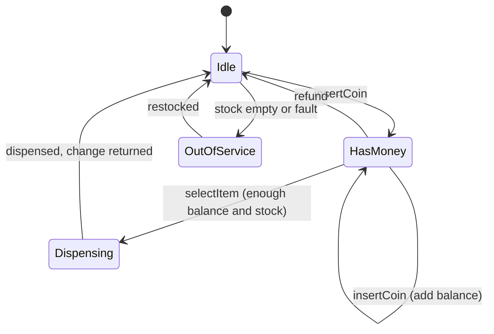

```java
interface VendingState {
  default VendingState insertCoin(Machine m, int amt) { throw new IllegalStateException("not allowed"); }
  default VendingState select(Machine m, String code)  { throw new IllegalStateException("not allowed"); }
  default VendingState refund(Machine m)               { throw new IllegalStateException("not allowed"); }
}
final class Idle implements VendingState {
  public VendingState insertCoin(Machine m, int amt) { m.addBalance(amt); return new HasMoney(); }
}
final class HasMoney implements VendingState {
  public VendingState insertCoin(Machine m, int amt) { m.addBalance(amt); return this; }
  public VendingState select(Machine m, String code) {
    if (!m.inStock(code) || m.balance() < m.price(code)) return this;   // stay, report error
    return new Dispensing(code);
  }
  public VendingState refund(Machine m) { m.returnBalance(); return new Idle(); }
}
class Machine { private VendingState state = new Idle();
  synchronized void insertCoin(int amt) { state = state.insertCoin(this, amt); } }
```

Alternatives: for simple lifecycles, an **enum + transition table** (`Map<State, Set<State>>`) is often clearer; for persisted workflows (orders, payments), states are stored as a column and transitions guarded with conditional updates.

#### Example
A candidate designing an ATM had `withdraw()`, `insertCard()` and `enterPin()` each containing `switch (state)` with five cases, with bugs like allowing withdrawal before PIN entry in one branch. Refactoring into `IdleState`, `CardInsertedState`, `AuthenticatedState` and `OutOfCashState` classes made every operation's validity per state explicit, and a test per state/operation pair caught the remaining illegal transitions.

#### Trade-offs
Clear, extensible state-specific behaviour and explicit transitions, but more classes, and transition logic distributed across states can be harder to see as a whole than a single transition table.

#### Problems & fixes
| Symptom | Cause | Fix |
|---|---|---|
| Same switch(status) in every method | state logic scattered | state classes or a transition table |
| Illegal operations allowed | missing checks in some branch | default "not allowed" in state interface |
| Hard to see the whole lifecycle | transitions spread across classes | document state diagram, transition table tests |
| Concurrent operations corrupt state | unsynchronized transitions | synchronize transitions / conditional updates |

#### Cheat sheet
- One class per state; each handles allowed operations and returns the next state.
- Default to "not allowed" for illegal operations.
- Enum + transition table for simple cases; guard concurrency.

#### Interview questions
<details><summary>When would you use the State pattern instead of an enum with a switch?</summary>

When behaviour differs substantially per state across several operations, and new states are likely: state classes keep each state's logic together and make adding a state a matter of adding a class. For a simple lifecycle with few operations, an enum with a transition table (allowed next states) is clearer and less code. Both should make illegal transitions impossible or explicit.
</details>

<details><summary>How do you make a vending machine's state transitions thread-safe?</summary>

Serialise operations on the machine: synchronise the methods that delegate to the current state (or use a lock) so a transition reads and replaces the state atomically, and keep balance and inventory changes inside the same critical section. For distributed or persisted state, use conditional updates (`WHERE state = expected`) or optimistic locking.
</details>

#### Interview angle
> "Lifecycle objects like a vending machine or ATM get a class per state that returns the next state and rejects illegal operations by default. Transitions are synchronised, and I keep the state diagram next to the code."

#### Sources
- [State](https://refactoring.guru/design-patterns/state) — Refactoring.Guru
- [State pattern](https://en.wikipedia.org/wiki/State_pattern) — Wikipedia

### Decorator & Adapter — wrap to add behaviour or translate interfaces
Both patterns **wrap** an object. A **Decorator** implements the **same interface** as the wrapped object and **adds behaviour** before or after delegating (logging, caching, retries, metrics, compression), and decorators can be stacked. An **Adapter** **converts one interface into another** that clients expect, typically to integrate a third-party or legacy API without leaking its shape into your code.

#### Intuition
A phone case and a travel plug. The case wraps the phone and adds protection while every button still works (decorator). The travel plug changes the shape of the pins so your charger fits a foreign socket (adapter).

#### Must know
- Both patterns **wrap** another object.
- **Decorator**: the **same interface**, with added behaviour such as logging, caching or retries.
- Decorators can be stacked.
- **Adapter**: **converts one interface into another** that the caller expects.
- Typical use: an adapter per vendor SDK, and decorators for cross-cutting concerns.

#### Common mistakes
- Vendor SDK types leaking through the whole codebase.
- Retry and metrics code copied into every client class.
- Forgetting that the order of the wrappers changes the behaviour.

#### How it works
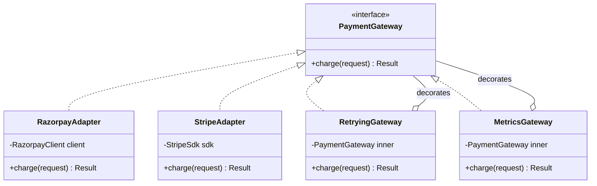

```java
// Adapter: translate our interface to a vendor SDK
class RazorpayAdapter implements PaymentGateway {
  private final RazorpayClient client;
  public Result charge(PaymentRequest r) {
    var resp = client.payments.create(Map.of("amount", r.amountPaise(), "currency", "INR",
                                             "receipt", r.idempotencyKey()));
    return Result.fromStatus(resp.get("status"));        // vendor statuses mapped to ours
  }
}
// Decorators: same interface, add behaviour, stackable
PaymentGateway gw = new MetricsGateway(new RetryingGateway(new RazorpayAdapter(client), 3));
```

| | Decorator | Adapter |
|---|---|---|
| Interface | same in and out | converts A → B |
| Purpose | add behaviour | make incompatible things fit |
| Stacking | common | rare |
| Examples | Java I/O streams, caching repository, retry wrapper | vendor SDK wrappers, legacy system facades |

#### Example
In a multi-PSP payments design, each provider's SDK has different request shapes and status names. Adapters (`RazorpayAdapter`, `StripeAdapter`) implement a common `PaymentGateway` and map statuses to the internal state machine. Cross-cutting behaviour (timeouts, retries with the same idempotency key, metrics, circuit breaking) is added once via decorators around any adapter, instead of being duplicated per provider.

#### Trade-offs
Both keep code decoupled and open for extension, but deep decorator stacks can be hard to debug (which layer did what?), and adapters can hide important vendor semantics if the mapping is lossy.

#### Problems & fixes
| Symptom | Cause | Fix |
|---|---|---|
| Vendor types leak across codebase | no adapter boundary | adapter implementing your own interface |
| Retry/metrics code duplicated per client | cross-cutting logic inside each class | decorators |
| Confusing behaviour from wrapper order | e.g. metrics outside vs inside retry | document and test decorator order |
| Lost information in mapping | lossy adapter | map explicitly, keep raw vendor response for audit |

#### Cheat sheet
- Decorator: same interface, adds behaviour, stackable.
- Adapter: converts interfaces; isolates vendor/legacy APIs.
- Combine: adapters per vendor, decorators for cross-cutting concerns.

#### Interview questions
<details><summary>What's the difference between Decorator and Adapter?</summary>

A Decorator keeps the same interface as the object it wraps and adds behaviour (caching, logging, retries); clients can't tell the difference and decorators can be stacked. An Adapter changes the interface: it makes an object with an incompatible interface (a vendor SDK, a legacy API) usable through the interface clients expect, translating calls and data.
</details>

<details><summary>How would you add caching to a repository without modifying it?</summary>

Create a `CachingProductRepository` that implements the same `ProductRepository` interface, wraps the real repository, checks the cache on reads (delegating on miss and storing the result), and invalidates or updates the cache on writes. Wire it in via DI. The original repository and its callers stay unchanged.
</details>

#### Interview angle
> "Each provider sits behind an adapter that maps it to our PaymentGateway interface, and cross-cutting concerns like retries, metrics and circuit breaking are decorators stacked once around any adapter."

#### Sources
- [Decorator](https://refactoring.guru/design-patterns/decorator) — Refactoring.Guru
- [Adapter](https://refactoring.guru/design-patterns/adapter) — Refactoring.Guru

### Chain of Responsibility — pass requests along handlers
Chain of Responsibility passes a request **along a chain of handlers**; each handler either **processes it, rejects it, or passes it to the next** handler. The sender doesn't know which handler will act. It's the structure behind middleware pipelines (HTTP filters, Express/Koa middleware, servlet filters), validation chains, approval workflows and support escalation.

#### Intuition
Airport security in stages: ticket check, passport check, bag scan. Each station either stops you or waves you on to the next. You do not know in advance which one will stop you.

#### Must know
- A request passes **along a chain of handlers**.
- Each handler **processes it, rejects it or passes it on**.
- The sender does not know which handler will act.
- It is the structure behind middleware and filter pipelines.
- **Order matters**: cheap checks first, and a final default handler at the end.

#### Common mistakes
- No terminal handler, so a request falls off the end unhandled.
- An expensive check placed before a cheap rejection.
- No logging of which handler rejected the request.

#### How it works
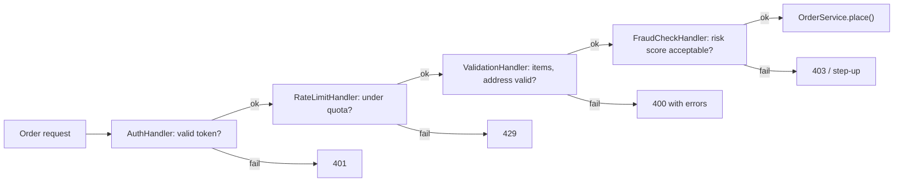

```java
abstract class Handler {
  private Handler next;
  Handler then(Handler n) { this.next = n; return n; }
  Response handle(Request r) { return next == null ? Response.ok() : next.handle(r); }
}
class RateLimitHandler extends Handler {
  Response handle(Request r) {
    if (!limiter.tryAcquire(r.userId())) return Response.status(429);
    return super.handle(r);                    // pass along
  }
}
Handler chain = new AuthHandler();
chain.then(new RateLimitHandler()).then(new ValidationHandler()).then(new FraudCheckHandler());
```

Variants: **stop at first handler that handles** (escalation: L1 → L2 → manager approval by amount), or **every handler processes and passes** (middleware pipeline). Order matters: cheap checks and rejections first (auth, rate limit) before expensive ones (fraud scoring).

#### Example
An expense-approval LLD: amounts up to ₹5,000 auto-approve, up to ₹50,000 need a manager, up to ₹5 lakh need a director, above that the CFO. Instead of nested ifs, `AutoApprover → ManagerApprover → DirectorApprover → CfoApprover` each check their limit and either approve or pass along. When finance added "travel expenses always need the travel desk", it was inserted as one new handler without touching others.

#### Trade-offs
Decouples senders from handlers and makes pipelines composable and reorderable, but requests can fall off the end unhandled, debugging which handler acted needs logging, and long chains add latency.

#### Problems & fixes
| Symptom | Cause | Fix |
|---|---|---|
| Request silently unhandled | no terminal handler | default handler at end that rejects/logs |
| Expensive checks run before cheap rejections | poor ordering | order by cost and rejection likelihood |
| Hard to know which handler rejected | no tracing | log/attach handler name to responses |
| Chain wiring scattered | built ad hoc | build chain in one place from config |

#### Cheat sheet
- Handlers in sequence; each handles, rejects or passes on.
- Middleware, validation, approvals, escalation.
- Order cheap checks first; terminal default handler; log decisions.

#### Interview questions
<details><summary>Where have you seen Chain of Responsibility in real frameworks?</summary>

HTTP middleware and filters: servlet filter chains, Spring Security's filter chain, Express/Koa middleware, ASP.NET middleware, gRPC interceptors, and Netty channel pipelines. Each component can inspect or modify the request, short-circuit with a response (e.g. 401), or call the next component.
</details>

<details><summary>How would you design an approval workflow where the approver depends on the amount?</summary>

Model approvers as a chain ordered by authority limit: each handler checks if the amount is within its limit (and any rules like category), approves if so, or forwards to the next. The last handler handles everything remaining or rejects. Adding or changing a level is inserting or reconfiguring a handler, and the chain can be built from configuration.
</details>

#### Interview angle
> "Request validation is a chain: auth, rate limit, validation, then fraud. Cheap rejections come first, a terminal handler makes sure nothing falls off the end, and each handler can be reordered or replaced."

#### Sources
- [Chain of responsibility](https://refactoring.guru/design-patterns/chain-of-responsibility) — Refactoring.Guru
- [Chain-of-responsibility pattern](https://en.wikipedia.org/wiki/Chain-of-responsibility_pattern) — Wikipedia


## Machine coding & concurrency

### Machine-coding approach — requirements, entities, classes, code, tests in 90 minutes
A machine-coding round asks you to build a **working, extensible, well-structured program** (parking lot, Splitwise, snake and ladder, rate limiter, LRU cache, elevator, BookMyShow) in 60–120 minutes. Evaluators look for **working code first**, then clean modelling (entities, responsibilities), extensibility (patterns where change is likely), correctness on edge cases, concurrency awareness, and a demo or tests. A time-boxed process keeps you from over-designing or running out of time.

#### Intuition
A timed cooking contest. A simple finished dish beats an ambitious half-cooked one. Read the brief, pick the dish, get something edible on the plate, then improve it.

#### Must know
- Goal: a **working, well-structured, extensible program** in limited time.
- **Working code comes first.** Get the main flow running end to end early.
- Order: clarify requirements → entities → core flow → features → tests or a demo.
- Add interfaces **only where the requirements are likely to vary**.
- Make shared state thread-safe, and show it with a small test.

#### Numbers to quote
- A rough 90-minute split: 10 clarifying, 10 on entities, 50 coding, 15 on tests and demo, 5 explaining.

#### Common mistakes
- A perfect class diagram and no running code at the end.
- Everything in one class or one main method.
- A pattern and an interface for every class.

#### How it works
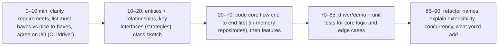

Structure that scores well:
```
model/       Vehicle, Spot, Ticket, Floor          (entities, enums, value objects)
service/     ParkingService, PricingService          (business logic)
strategy/    SpotAllocationStrategy, FeeStrategy     (variation points)
repository/  InMemoryTicketRepository                (interfaces + in-memory impls)
exception/   SpotUnavailableException
Main / Driver                                         (demo commands)
```

Checklist:
- **Clarify** scope, inputs and outputs, and which features are required; write them down.
- Model **nouns as entities**, verbs as service methods; keep entities owning their invariants.
- Introduce **interfaces only at variation points** (pricing, allocation, notification).
- Get the **happy path working end to end early**; then handle edge cases (invalid input, full lot, concurrent bookings).
- **Thread safety** where shared state is mutated (bookings, inventory).
- Meaningful exceptions, no giant main method, readable names.
- **Tests or a driver** demonstrating scenarios.

#### Example
A candidate designing BookMyShow spent 50 minutes on a perfect class diagram with 25 classes and had no running code at the end. On a retry, they spent 10 minutes on requirements (search shows, view seats, book seats with a hold, cancel), 10 minutes on entities (`Movie`, `Show`, `Screen`, `Seat`, `Booking`, `SeatLock`), and got booking working by minute 40 with an in-memory repository. They added a seat-lock with expiry (thread-safe, per-show lock) and a test showing two threads booking the same seat with only one succeeding, and finished with a demo.

#### Trade-offs
Speed versus polish: a working, reasonably structured solution beats an elegant, incomplete one. Over-engineering (abstract factories everywhere) costs time and readability; under-structuring (everything in main) fails the design criterion.

#### Problems & fixes
| Symptom | Cause | Fix |
|---|---|---|
| No working code at the end | too long designing | time-box design, code happy path by mid-round |
| Everything in one class | no modelling | entities, services, strategies separated |
| Too many patterns and interfaces | over-engineering | patterns only at variation points |
| Race conditions in booking | no concurrency handling | locks/CAS per resource, test with threads |

#### Cheat sheet
- Clarify → entities → core flow working → features → tests/demo → explain.
- Packages: model, service, strategy, repository, exception, driver.
- Working first, extensible second, concurrency where state is shared.

#### Interview questions
<details><summary>How do you structure your time in a 90-minute machine-coding round?</summary>

About 10 minutes clarifying requirements and agreeing on inputs and outputs, 10 minutes on entities, relationships and key interfaces, ~50 minutes coding (happy path end to end first with in-memory storage, then remaining features and edge cases), 15 minutes for a driver demo and tests, and the last minutes refactoring names and explaining extensibility and concurrency decisions.
</details>

<details><summary>What do interviewers look for beyond working code?</summary>

Clear domain modelling (entities with responsibilities, invariants protected), separation of concerns (services, repositories, strategies), extensibility at sensible variation points, handling of edge cases and errors, thread safety for shared state, readable naming and structure, tests or a convincing demo, and the ability to explain trade-offs and how you'd extend the system.
</details>

#### Interview angle
> "I clarify scope, sketch entities and the one or two variation points, get the happy path running end to end by mid-round, then add edge cases, thread safety and a demo or test."

#### Sources
- [Awesome low level design](https://github.com/ashishps1/awesome-low-level-design) — Ashish Pratap Singh, GitHub
- [The catalog of design patterns](https://refactoring.guru/design-patterns/catalog) — Refactoring.Guru

### Java concurrency toolkit — locks, atomics, ConcurrentHashMap, executors
Java's `java.util.concurrent` gives building blocks for safe concurrent code: **locks** (`synchronized`, `ReentrantLock`, `ReadWriteLock`, `StampedLock`), **atomics** (`AtomicLong`, `AtomicReference`, `LongAdder`) for lock-free updates via CAS, **concurrent collections** (`ConcurrentHashMap`, `CopyOnWriteArrayList`, `BlockingQueue`), **executors** (thread pools, `CompletableFuture`, virtual threads in Java 21), and **synchronizers** (`CountDownLatch`, `Semaphore`, `CyclicBarrier`). Choosing the right one is a staple of machine-coding and LLD interviews.

#### Intuition
A workshop's safety equipment. A lock is a "one person at a time" sign. An atomic is a counter that cannot be mis-clicked. A concurrent map is a shelf many people can use at once. An executor is a team of workers with a job queue.

#### Must know
- **Locks** (`synchronized`, `ReentrantLock`) protect a group of steps that must happen together.
- **Atomics** (`AtomicLong`) update a single value safely with no lock.
- **`ConcurrentHashMap`** is a thread-safe map. Use `computeIfAbsent` and `merge` for check-then-update.
- **Executors** run tasks on a pool of threads. Use a bounded queue.
- A `BlockingQueue` handles producer-consumer hand-off, and a `Semaphore` caps concurrency.

#### Common mistakes
- `if (!map.containsKey(k)) map.put(k, v)` on a concurrent map, which is still a race.
- An unbounded executor queue, which hides overload until memory runs out.
- Taking two locks in different orders in different places, which deadlocks.

#### How it works
| Need | Tool | Notes |
|---|---|---|
| Protect compound state (check-then-act) | `synchronized` / `ReentrantLock` | ReentrantLock adds tryLock, timeouts, fairness |
| Many readers, few writers | `ReadWriteLock` / `StampedLock` | optimistic reads with StampedLock |
| Single counter/reference update | `AtomicLong`, `AtomicReference` (CAS) | lock-free; `LongAdder` for hot counters |
| Shared map | `ConcurrentHashMap` | use `computeIfAbsent`, `merge`, `compute` for atomic compound ops |
| Producer-consumer | `BlockingQueue` (`ArrayBlockingQueue`, `LinkedBlockingQueue`) | bounded for backpressure |
| Run tasks | `ExecutorService`, `CompletableFuture`, virtual threads | bounded pools, shutdown properly |
| Limit concurrency | `Semaphore` | e.g. max 10 calls to a dependency |
| Wait for N tasks | `CountDownLatch` / `CompletableFuture.allOf` | tests and fan-out |

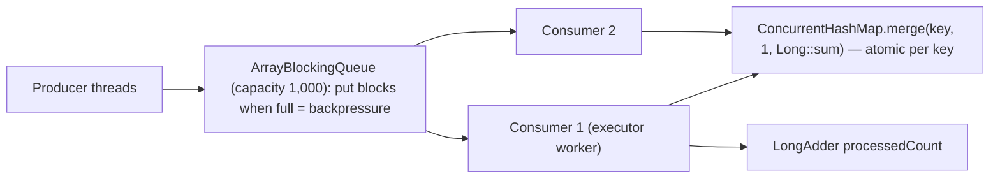

```java
// WRONG: check-then-act race even with ConcurrentHashMap
if (!map.containsKey(k)) map.put(k, new Counter());
// RIGHT: atomic compound operation
map.computeIfAbsent(k, key -> new Counter());
map.merge(word, 1L, Long::sum);

// rate-limit concurrent calls to a dependency
Semaphore permits = new Semaphore(10);
if (permits.tryAcquire(50, TimeUnit.MILLISECONDS)) { try { call(); } finally { permits.release(); } }
```

Key concepts to explain: **visibility** (`volatile`, happens-before via locks), **atomicity** of compound actions, **deadlock** (lock ordering), **livelock/starvation**, and always releasing locks in `finally`.

#### Example
A word-frequency counter processed log files with 8 threads using a `HashMap` guarded by nothing: counts came out wrong and occasionally the program hung (corrupted HashMap internals in older JDKs). Switching to `ConcurrentHashMap.merge` fixed correctness; a candidate's alternative `synchronized` method around a HashMap was correct but serialised all threads. With `merge`, throughput scaled nearly linearly up to 8 cores.

#### Trade-offs
Higher-level concurrent utilities are safer and faster than hand-rolled synchronisation, but misuse (non-atomic compound operations, unbounded queues, forgetting shutdown) still causes bugs, and lock-free code is harder to reason about.

#### Problems & fixes
| Symptom | Cause | Fix |
|---|---|---|
| Lost updates on shared map | check-then-act across calls | computeIfAbsent/merge/compute |
| Threads never see updated flag | missing visibility guarantee | volatile / proper synchronization |
| Deadlock | inconsistent lock ordering | global lock order, tryLock with timeout |
| OOM from task backlog | unbounded executor queue | bounded queue + rejection policy |

#### Cheat sheet
- Locks for compound state; atomics/CAS for single variables; LongAdder for hot counters.
- ConcurrentHashMap with atomic compound methods; BlockingQueue for producer-consumer.
- Bounded executors; Semaphore to limit concurrency; release in finally.

#### Interview questions
<details><summary>Is it safe to do `if (!map.containsKey(k)) map.put(k, v)` on a ConcurrentHashMap?</summary>

No. Each call is thread-safe on its own, but the combination is a check-then-act race: two threads can both see the key missing and both put, one overwriting the other. Use atomic compound operations: `putIfAbsent`, `computeIfAbsent`, `compute` or `merge`, which perform the check and update atomically for that key.
</details>

<details><summary>AtomicLong vs LongAdder: when would you use each?</summary>

`AtomicLong` gives a single variable updated by CAS, with exact reads at any time; under heavy contention, CAS retries make it slow. `LongAdder` spreads increments across multiple cells (summed on read), so it scales much better for high-contention counters (metrics, statistics), but `sum()` isn't an atomic snapshot and it can't do compare-and-set. Use AtomicLong for sequence ids or values needing CAS, and LongAdder for hot counters.
</details>

#### Interview angle
> "I reach for the highest-level tool that fits: ConcurrentHashMap with merge or computeIfAbsent, LongAdder for hot counters, bounded BlockingQueues for producer-consumer, and Semaphores to cap calls to a dependency."

#### Sources
- [Package java.util.concurrent](https://docs.oracle.com/en/java/javase/21/docs/api/java.base/java/util/concurrent/package-summary.html) — Java 21 API docs
- [Lesson: concurrency](https://docs.oracle.com/javase/tutorial/essential/concurrency/index.html) — Oracle Java tutorials
- [ConcurrentHashMap](https://docs.oracle.com/en/java/javase/21/docs/api/java.base/java/util/concurrent/ConcurrentHashMap.html) — Java 21 API docs

### Thread-safe singleton — holder idiom, enum, double-checked locking
A thread-safe singleton must guarantee **exactly one instance** even when multiple threads request it simultaneously, and publish it safely (other threads see a fully constructed object). Common Java approaches: **eager initialisation**, the **initialization-on-demand holder idiom** (lazy, no locking, JVM class-loading guarantees), the **enum singleton** (Effective Java's recommendation: serialisation and reflection safe), and **double-checked locking** with a `volatile` field.

#### Intuition
Two people both see the office has no coffee machine, and each goes out to buy one. You end up with two. A thread-safe singleton makes sure only one is ever bought, however many people notice at once.

#### Must know
- It must give **exactly one instance** even when many threads ask at the same moment.
- **Enum singleton**: the simplest safe form.
- **Holder idiom**: lazy and thread-safe with no locking, using class loading.
- **Double-checked locking** works only if the field is **`volatile`**.
- In real code, let the dependency-injection container own the single instance.

#### Common mistakes
- `if (instance == null) instance = new X()` with no synchronisation.
- Double-checked locking without `volatile`, which can expose a half-built object.
- A `synchronized` getter on every call, when the holder idiom has no such cost.

#### How it works
```java
// 1. Holder idiom: lazy, thread-safe via class initialisation, no synchronization cost
public final class ConfigRegistry {
  private ConfigRegistry() {}
  private static class Holder { static final ConfigRegistry INSTANCE = new ConfigRegistry(); }
  public static ConfigRegistry getInstance() { return Holder.INSTANCE; }   // Holder loaded on first call
}

// 2. Enum: simplest, safe against reflection and serialization creating a second instance
public enum IdGenerator { INSTANCE;
  private final AtomicLong seq = new AtomicLong();
  public long next() { return seq.incrementAndGet(); } }

// 3. Double-checked locking: volatile is REQUIRED
public final class Cache {
  private static volatile Cache instance;
  public static Cache getInstance() {
    Cache local = instance;
    if (local == null) {                       // 1st check, no lock
      synchronized (Cache.class) {
        local = instance;
        if (local == null) instance = local = new Cache();   // 2nd check under lock
      }
    }
    return local;
  }
}
```

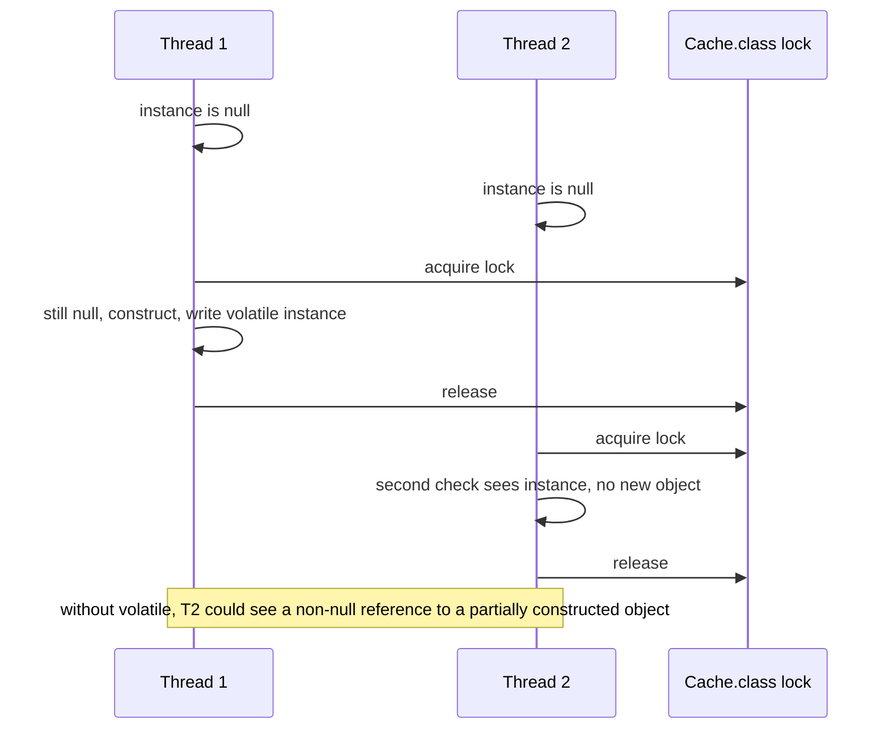

Why `volatile` matters in DCL: without it, the JVM may reorder the write of the reference before the constructor's field writes complete, so another thread can see a non-null but **partially constructed** object. `volatile` establishes happens-before.

#### Example
A candidate implemented a lazy singleton with `if (instance == null) instance = new Logger();` without synchronisation. Asked "what happens with two threads?", they realised two loggers could be created, each opening the log file. Switching to the holder idiom gave lazy, thread-safe initialisation with no locking cost; they also noted that in a real codebase they'd let the DI container manage one instance instead.

#### Trade-offs
Holder and enum are simple and safe; DCL is more complex and error-prone (only needed if you require lazy init with parameters); eager init is simplest if construction is cheap. All singletons share the downsides of global state.

#### Problems & fixes
| Symptom | Cause | Fix |
|---|---|---|
| Two instances created | unsynchronized lazy init | holder idiom / enum / synchronized |
| Partially constructed object seen | DCL without volatile | volatile field |
| Second instance via reflection or deserialisation | class-based singleton | enum singleton, readResolve |
| Slow getInstance | synchronized method on every call | holder idiom or DCL |

#### Cheat sheet
- Prefer enum or holder idiom; eager if construction is cheap.
- DCL needs volatile + two checks.
- In real systems, let DI manage single instances.

#### Interview questions
<details><summary>Why does double-checked locking need volatile?</summary>

Object construction and assignment aren't atomic: the JVM or CPU can reorder so that the reference is published before the constructor's writes are visible. Another thread passing the unsynchronised first check could see a non-null reference to a partially initialised object. Declaring the field `volatile` prevents this reordering and guarantees that a thread reading the reference sees the fully constructed object (happens-before).
</details>

<details><summary>Why is the holder idiom thread-safe without any locks?</summary>

The JVM guarantees that class initialisation happens once, under an internal lock, and that all threads see the fully initialised static fields afterwards. The nested `Holder` class isn't loaded until `getInstance()` first references it, so the instance is created lazily, exactly once, and subsequent calls just read a static final field with no synchronisation overhead.
</details>

#### Interview angle
> "I'd use the enum or holder idiom: lazy, thread-safe and lock-free. Double-checked locking needs volatile to avoid publishing a half-built object, and in real code I'd let the DI container own the single instance."

#### Sources
- [Initialization-on-demand holder idiom](https://en.wikipedia.org/wiki/Initialization-on-demand_holder_idiom) — Wikipedia
- [The "double-checked locking is broken" declaration](https://www.cs.umd.edu/~pugh/java/memoryModel/DoubleCheckedLocking.html) — Bill Pugh et al.
- [Double-checked locking](https://en.wikipedia.org/wiki/Double-checked_locking) — Wikipedia

### Per-resource locking — CAS on the resource instead of one global lock
Instead of one **global lock** that serialises all operations (e.g. `synchronized bookSeat()` on the whole theatre), **lock per resource** (per seat, per account, per show) or use **compare-and-set (CAS)** on the resource's state, so operations on different resources proceed in parallel and only conflicting operations contend. This is how booking systems, inventory, and wallet transfers scale in machine-coding rounds and in real databases (row-level locks, conditional updates).

#### Intuition
A cinema with one ticket window against a lock on every seat. With one window, everybody queues, even for different seats. With a lock per seat, only people who want the same seat have to compete.

#### Must know
- A **global lock** makes every operation wait in one queue.
- **Lock per resource** (per seat, per account), so unrelated operations run in parallel.
- Or use **compare-and-set**: change the state only if it is still what you expected.
- For several resources, lock in a **consistent order** to avoid deadlock, and roll back on failure.
- The database version: `UPDATE ... WHERE status = 'AVAILABLE'`, then check that one row changed.

#### Common mistakes
- `synchronized` on the whole booking service.
- Locking two accounts in whichever order they arrive.
- Holds with no expiry, so a crashed user keeps a seat forever.

#### How it works
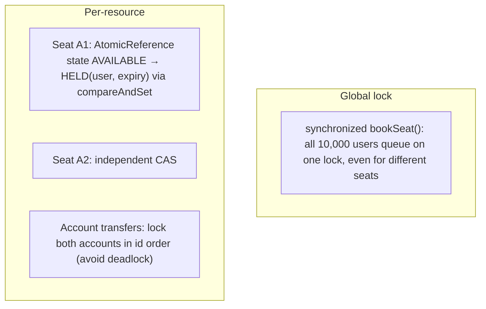

```java
enum SeatState { AVAILABLE, HELD, BOOKED }
final class Seat {
  private final AtomicReference<Hold> state = new AtomicReference<>(Hold.AVAILABLE);
  boolean tryHold(String userId, Instant now, Duration ttl) {
    while (true) {
      Hold cur = state.get();
      boolean free = cur.status() == SeatState.AVAILABLE
                  || (cur.status() == SeatState.HELD && cur.expiresAt().isBefore(now));  // expired hold
      if (!free) return false;
      if (state.compareAndSet(cur, Hold.held(userId, now.plus(ttl)))) return true;      // only one wins
    }
  }
}

// Multi-resource: lock ordering prevents deadlock
void transfer(Account a, Account b, long amt) {
  Account first = a.id() < b.id() ? a : b, second = first == a ? b : a;
  synchronized (first) { synchronized (second) { a.debit(amt); b.credit(amt); } }
}
```

Booking several seats atomically: acquire per-seat holds in a **consistent order** (sorted seat ids) and **roll back** acquired holds if any fails, or use a per-show lock if contention is low. In databases the same idea is `UPDATE seats SET status='HELD', held_by=? WHERE id=? AND status='AVAILABLE'` (affected rows = 1 means you won).

#### Example
A BookMyShow machine-coding solution used `synchronized` on the `BookingService.book()` method. It was correct, but the interviewer asked about 50k concurrent users on different shows. The candidate changed to a `ConcurrentHashMap<SeatId, Seat>` where each `Seat` held its state in an `AtomicReference` with CAS-based holds and expiry, acquired multi-seat bookings in sorted order with rollback, and wrote a test with 100 threads racing for the same seat, asserting exactly one success, while bookings on different seats ran in parallel.

#### Trade-offs
Fine-grained locking or CAS gives far more concurrency, but multi-resource operations need ordering and rollback to avoid deadlocks and partial bookings, CAS retry loops can spin under heavy contention on one resource, and the code is harder to reason about than one global lock.

#### Problems & fixes
| Symptom | Cause | Fix |
|---|---|---|
| Throughput flat as users grow | one global lock | per-resource locks / CAS |
| Deadlock in transfers | locks acquired in different orders | consistent ordering (by id) |
| Partial multi-seat booking | failure midway without rollback | sorted acquisition + release on failure |
| Seats stuck HELD forever | holder crashed | hold expiry checked in CAS, cleanup job |

#### Cheat sheet
- Lock or CAS the resource, not the world.
- Multi-resource: consistent order + rollback; holds with expiry.
- DB equivalent: conditional UPDATE … WHERE status = expected.

#### Interview questions
<details><summary>How would you make seat booking thread-safe without a global lock?</summary>

Give each seat its own state (in an `AtomicReference` or guarded by a per-seat lock) and transition AVAILABLE → HELD with compare-and-set, so only one thread can win a given seat while different seats are booked in parallel. Holds carry an expiry so abandoned ones become available again. Multi-seat bookings acquire holds in sorted seat order and release any acquired holds if one fails. Confirm payment converts HELD → BOOKED with another CAS.
</details>

<details><summary>How do you avoid deadlock when an operation needs to lock two accounts?</summary>

Always acquire locks in a global, consistent order (e.g. by account id), so two transfers between the same accounts in opposite directions request locks in the same order and can't wait on each other cyclically. Alternatives: `tryLock` with timeout and retry, or a single coordinating thread or partition per account set.
</details>

#### Interview angle
> "Seats are claimed with a CAS on per-seat state that includes hold expiry, multi-seat bookings take holds in sorted order with rollback, and transfers lock accounts in id order. No global lock."

#### Sources
- [Compare-and-swap](https://en.wikipedia.org/wiki/Compare-and-swap) — Wikipedia
- [AtomicReference](https://docs.oracle.com/en/java/javase/21/docs/api/java.base/java/util/concurrent/atomic/AtomicReference.html) — Java 21 API docs
- [Deadlock](https://docs.oracle.com/javase/tutorial/essential/concurrency/deadlock.html) — Oracle Java tutorials

