## ACID & transactions

### Atomicity — all operations in a transaction succeed or all roll back
Atomicity means a transaction is **all or nothing**. If any statement fails, or the server crashes halfway, every change made by the transaction is undone, so the database never shows a half-finished operation.

#### Intuition
An ATM transfer: either your account is debited and your friend's is credited, or the machine cancels and nothing moves. There is no outcome where the money leaves you and never arrives.

#### Must know
- A transaction is **all or nothing**: any failure or crash undoes every change it made.
- The database does this with its log: undo information for rollback, WAL replay for crash recovery.
- Auto-commit mode makes every statement its own transaction, so two statements are not atomic together.
- Atomicity **ends at the database boundary**. DB + Kafka or DB + another service needs an outbox or a saga.

#### Common mistakes
- Saying "atomic" to mean "isolated". Atomicity is about failure, not about concurrency.
- Saving to the DB and then publishing to Kafka, and assuming both always happen (dual write).
- Catching an exception inside a Spring `@Transactional` method, which makes the half-done work commit.

#### How it works
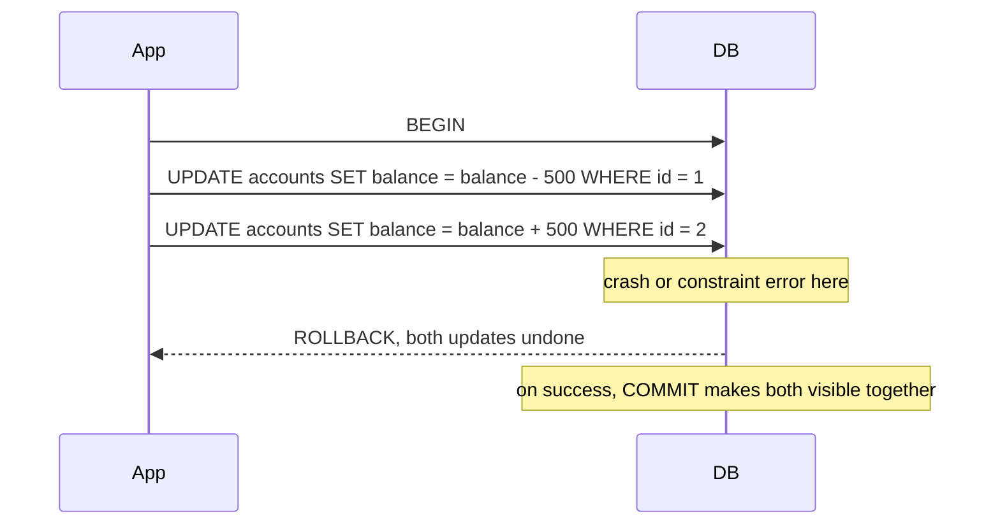

The engine records every change in a log before touching data pages. Uncommitted changes are rolled back using **undo** information (old row versions in PostgreSQL's MVCC, undo logs in InnoDB). After a crash, recovery replays committed work from the WAL and discards uncommitted work.

#### Example
A money transfer: debit A and credit B must happen together.
```sql
BEGIN;
UPDATE accounts SET balance = balance - 500 WHERE id = 1 AND balance >= 500;
-- application checks 1 row was updated, otherwise ROLLBACK (insufficient funds)
UPDATE accounts SET balance = balance + 500 WHERE id = 2;
INSERT INTO ledger_entries(txn_id, account_id, amount) VALUES ('t1', 1, -500), ('t1', 2, 500);
COMMIT;
```
If the process dies after the first UPDATE, nothing is committed and A keeps its money.

#### Trade-offs
Atomicity within one database is cheap and automatic. Across **multiple databases or services** it disappears: you need 2PC (slow, blocking) or sagas with compensations (eventual consistency).

#### Problems & fixes
| Symptom | Cause | Fix |
|---|---|---|
| Money debited but not credited | two statements in auto-commit mode (each its own transaction) | wrap in one explicit transaction |
| DB updated but event never published (or vice versa) | dual write: DB + Kafka aren't atomic together | transactional outbox: write event row in the same transaction, relay publishes |
| Partial updates across two services | no cross-service atomicity | saga with compensating actions |
| Exceptions swallowed, transaction commits anyway | `@Transactional` + caught exception | let it propagate or mark rollback-only |

#### Cheat sheet
- All or nothing, enforced by the log (undo for rollback, redo/WAL for recovery).
- Auto-commit = every statement is its own transaction.
- Atomicity stops at the database boundary: outbox / saga beyond it.

#### Interview questions
<details><summary>Your order service saves an order in Postgres and then publishes OrderCreated to Kafka. Sometimes the event is missing. Why, and how do you fix it?</summary>

The DB commit and the Kafka publish are two separate operations, so a crash or Kafka error between them loses the event (or the reverse loses the order). Use the **transactional outbox**: insert the event into an `outbox` table in the same DB transaction as the order, and have a relay (Debezium CDC or a poller) publish outbox rows to Kafka and mark them sent. Consumers dedupe by event id because delivery is at-least-once.
</details>

<details><summary>In Spring, a method annotated @Transactional catches an exception and logs it. What happens to the transaction?</summary>

If the exception is caught inside the transactional method and not rethrown, Spring sees a normal return and **commits** whatever was written before the failure, which breaks atomicity. Rethrow (runtime exceptions trigger rollback by default, checked ones only with `rollbackFor`) or call `TransactionAspectSupport.currentTransactionStatus().setRollbackOnly()`.
</details>

#### Interview angle
> "Within one database a transaction gives me atomicity. As soon as a second system is involved (Kafka, another service) I use an outbox or a saga, because there's no shared transaction."

#### Sources
- [Transactions](https://www.postgresql.org/docs/current/tutorial-transactions.html) — PostgreSQL tutorial
- [Transactional outbox](https://microservices.io/patterns/data/transactional-outbox.html) — microservices.io
- [Rolling back a declarative transaction](https://docs.spring.io/spring-framework/reference/data-access/transaction/declarative/rolling-back.html) — Spring Framework docs

### Consistency — DB moves from one valid state to another, constraints always satisfied
In ACID, consistency means a transaction takes the database from one **valid state to another valid state**: all declared rules (primary keys, foreign keys, unique, check constraints, triggers) hold after every commit. Not to be confused with the "C" in CAP, which is about replicas agreeing.

#### Intuition
A bouncer with a rulebook at the door. Any transaction that would leave the data breaking a written rule is turned away. Rules you never wrote down, the bouncer cannot enforce.

#### Must know
- ACID consistency = every commit leaves all **declared** rules true: PK, FK, UNIQUE, CHECK, NOT NULL.
- It is a different word from CAP consistency, which is about replicas returning the latest write.
- A unique constraint is the only race-free way to stop duplicates. Check-then-insert in code is a race.
- Rules the database cannot express are the application's job.

#### Common mistakes
- Mixing up the C in ACID with the C in CAP.
- Enforcing uniqueness or "balance ≥ 0" only in application code.
- Assuming constraints still hold across shards or services. They do not, the app has to enforce them.

#### How it works
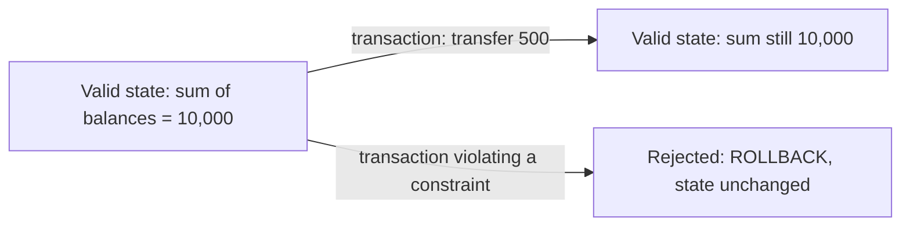

The database enforces what you **declare**. The application is responsible for rules the database can't express (or that you didn't declare).

```sql
CREATE TABLE accounts (
  id BIGINT PRIMARY KEY,
  user_id BIGINT NOT NULL REFERENCES users(id),
  balance NUMERIC(18,2) NOT NULL CHECK (balance >= 0),
  currency CHAR(3) NOT NULL
);
CREATE UNIQUE INDEX one_wallet_per_user ON accounts(user_id, currency);
```

#### Example
Two concurrent requests both try to create a wallet for user 7 in INR. Application code "checks if it exists, then inserts", and both checks pass. Only the **unique index** guarantees one wallet: the second insert fails with a unique violation, which the app maps to "already exists". Same for `CHECK (balance >= 0)`: even a buggy code path can't drive a balance negative.

#### Trade-offs
Constraints cost a little write performance and make some migrations harder, but they're the last line of defence against bugs and races. Sharded/NoSQL systems often can't enforce cross-shard constraints, so the application must.

#### Problems & fixes
| Symptom | Cause | Fix |
|---|---|---|
| Duplicate users/wallets | uniqueness checked only in code | unique constraint/index |
| Orphan rows (orders for deleted users) | no foreign keys | FK constraints, or soft deletes with checks |
| Negative balances under concurrency | check-then-update race | `CHECK (balance >= 0)` or conditional `UPDATE … WHERE balance >= x` |
| Can't add constraint: existing bad data | constraint added late | clean data, add as `NOT VALID` then `VALIDATE CONSTRAINT` (Postgres) |

#### Cheat sheet
- ACID C = constraints hold after each transaction. CAP C = replicas agree (linearizability).
- Declare invariants: PK, FK, UNIQUE, CHECK, NOT NULL.
- The app owns rules the DB can't express.

#### Interview questions
<details><summary>Why rely on a unique constraint instead of checking for duplicates in application code?</summary>

Check-then-insert is a race: two concurrent requests can both see "not found" and both insert. A unique constraint is enforced atomically by the database under concurrency, so exactly one insert wins. The app still checks first for nicer error messages, but the constraint is what guarantees correctness.
</details>

<details><summary>What does "consistency" mean in ACID versus CAP?</summary>

ACID consistency: each transaction preserves the database's integrity rules (constraints and invariants). CAP consistency: every read sees the most recent write across replicas (linearizability). A single-node database can be ACID-consistent, while a replicated system might return stale reads (CAP-inconsistent) even though each node's data satisfies its constraints.
</details>

#### Interview angle
> "I encode invariants as constraints (unique wallet per user and currency, non-negative balance), so correctness doesn't depend on every code path being bug-free or on race timing."

#### Sources
- [Constraints](https://www.postgresql.org/docs/current/ddl-constraints.html) — PostgreSQL docs
- [ACID](https://en.wikipedia.org/wiki/ACID) — Wikipedia
- [Consistency models](https://jepsen.io/consistency) — Jepsen

### Isolation — concurrent transactions don't see each other's intermediate state
Isolation controls **what a transaction can see of other concurrent transactions**. Perfect isolation (serializable) makes concurrent transactions behave as if they ran one after another. Weaker levels trade correctness anomalies for performance, and choosing the right level per operation is a classic interview topic.

#### Intuition
Several people editing one spreadsheet. Isolation decides how much of each other's unfinished typing they can see. Perfect isolation feels as if each person had the sheet alone, one after another.

#### Must know
- Four levels, weakest to strongest: Read Uncommitted → Read Committed → Repeatable Read → Serializable.
- Each level removes anomalies: dirty read, non-repeatable read, phantom, lost update, write skew.
- Defaults: **Read Committed** in PostgreSQL, Oracle and SQL Server. **Repeatable Read** in MySQL InnoDB.
- Most systems stay on the default and protect the few critical paths with a conditional `UPDATE`, `SELECT … FOR UPDATE` or a constraint.
- Serializable code must retry on serialization failure.

#### Common mistakes
- Believing the default level prevents double booking. Check-then-write is unsafe at Read Committed.
- Assuming the same level name behaves the same in every database. PG Repeatable Read is snapshot isolation, InnoDB's uses gap locks.
- Reaching for Serializable everywhere instead of fixing the one racy statement.

#### How it works
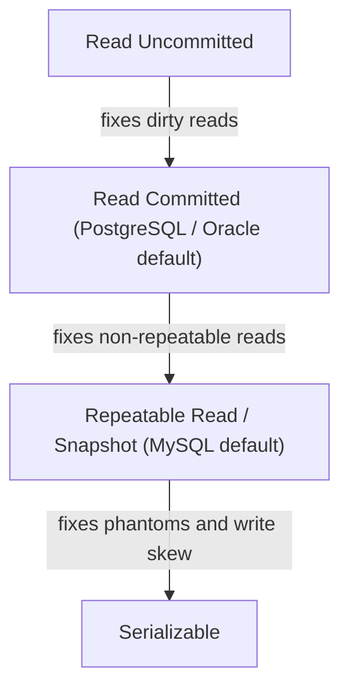

| Level | Dirty read | Non-repeatable read | Phantom | Lost update | Write skew |
|---|---|---|---|---|---|
| Read Uncommitted | possible | possible | possible | possible | possible |
| Read Committed | ✅ prevented | possible | possible | possible | possible |
| Repeatable Read (PG snapshot) | ✅ | ✅ | ✅ in PG / mostly in InnoDB | ✅ in PG (error) | possible |
| Serializable | ✅ | ✅ | ✅ | ✅ | ✅ |

Implemented with **locks** (2PL), **MVCC snapshots** (each transaction reads a consistent snapshot) or both.

#### Example
A report sums all balances while transfers are running. Under Read Committed, each statement sees data committed at its start, so a multi-statement report could count money twice (read A before a transfer, B after). Run the report in **Repeatable Read** (one snapshot for the whole transaction) to get a consistent total, without blocking writers thanks to MVCC.

#### Trade-offs
Stronger isolation means more aborts/retries (serializable), more locking or more memory for snapshots. Most OLTP systems run Read Committed and use explicit locks or optimistic versioning on the few critical paths.

#### Problems & fixes
| Symptom | Cause | Fix |
|---|---|---|
| Inconsistent totals in reports | statements see different snapshots under RC | Repeatable Read for the report transaction |
| Overselling / double booking | check-then-write under RC | `SELECT … FOR UPDATE`, conditional updates, or Serializable + retry |
| Many "could not serialize access" errors | Serializable under contention | retry loop with backoff, reduce transaction scope |

#### Cheat sheet
- Default PG/Oracle = Read Committed. MySQL InnoDB = Repeatable Read.
- Anomalies: dirty, non-repeatable, phantom, lost update, write skew.
- Serializable needs a retry loop on serialization failures.

#### Interview questions
<details><summary>Which isolation level would you run a ticket-booking service on, and how do you prevent double booking?</summary>

Keep the default Read Committed for throughput, and protect the critical section explicitly: `UPDATE seats SET status='HELD', hold_id=? WHERE id=? AND status='AVAILABLE'` and check one row was affected (an atomic conditional write), or `SELECT … FOR UPDATE` on the seat rows, plus a unique constraint on `(show_id, seat_id)` in bookings. Alternatively run that transaction under Serializable with retries.
</details>

<details><summary>Why don't all databases default to Serializable?</summary>

Serializable costs throughput: lock-based implementations block more, and SSI aborts transactions that might conflict, forcing retries. Most workloads are fine with Read Committed plus targeted locking. Defaults favour performance and leave stronger guarantees to where they're needed.
</details>

#### Interview angle
> "I run Read Committed by default and protect invariants explicitly with conditional updates, row locks or unique constraints. I'd only use Serializable with a retry loop where a rule spans multiple rows."

#### Sources
- [Transaction isolation](https://www.postgresql.org/docs/current/transaction-iso.html) — PostgreSQL docs
- [Transaction isolation levels](https://dev.mysql.com/doc/refman/8.4/en/innodb-transaction-isolation-levels.html) — MySQL reference manual
- [Hermitage: testing transaction isolation levels](https://github.com/ept/hermitage) — Martin Kleppmann

### Durability — committed data survives crashes (WAL-based)
Durability means once the database says **COMMIT succeeded, the data survives** crashes, power loss and restarts. Databases achieve it cheaply with a **write-ahead log (WAL)** that's flushed (`fsync`) to disk before acknowledging the commit. Data pages are written later.

#### Intuition
A shopkeeper writes every sale in the ledger before handing over the receipt. If the shop burns down a minute later, the ledger still proves the sale. The neat stock register can be updated later from the ledger.

#### Must know
- COMMIT returns only after the **WAL record is fsynced** to disk. Data pages are written later at checkpoints.
- After a crash, the database replays the WAL from the last checkpoint.
- One machine's disk can still die: **RPO 0 needs synchronous replication** to another node or AZ.
- Async replication loses whatever had not shipped yet (the replica lag).

#### Numbers to quote
- Local fsync on SSD: roughly 0.1–2 ms per commit.
- Synchronous standby in the same region: about +1–2 ms. Cross-region: +50–150 ms.

#### Common mistakes
- Thinking durable means "safe from everything". It survives a crash, not the loss of the only disk.
- Turning off `fsync` or `synchronous_commit` for speed on data that matters.
- Promising zero data loss on async replication.

#### How it works
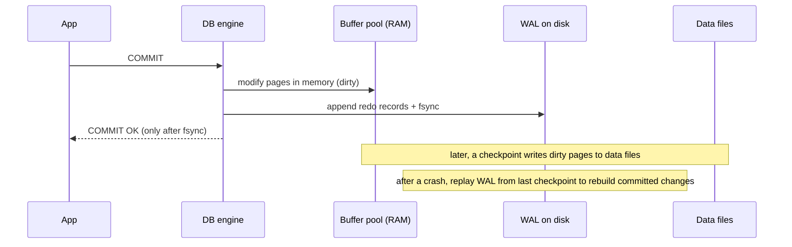

Sequential WAL appends are fast. Random page writes are deferred and batched. With **replication**, durability can also mean "written to at least one replica" (synchronous replication) to survive losing a whole machine.

#### Example
PostgreSQL settings:
- `synchronous_commit = on` (default): commit waits for the local WAL fsync.
- `synchronous_commit = off`: commit returns before the fsync, so a crash can lose the last ~few hundred ms of commits (no corruption). OK for analytics events, not for payments.
- `synchronous_standby_names = 'ANY 1 (r1, r2)'`: commit also waits for one standby, so it survives the primary's disk dying.

#### Trade-offs
Each level of durability adds commit latency: local fsync (~0.1–2 ms on SSD), synchronous replica in the same region (+1–2 ms), cross-region (+50–150 ms). Group commit batches many transactions into one fsync to keep throughput high.

#### Problems & fixes
| Symptom | Cause | Fix |
|---|---|---|
| Data lost after a crash despite "successful" writes | fsync disabled, or disk cache lying (no battery-backed cache) | keep `fsync=on`, use enterprise SSDs/cloud volumes with durable caches |
| Lost last seconds of data when the primary died | async replication, failover to a lagging replica | synchronous replica for critical data, or accept a small RPO |
| Commit latency high under load | one fsync per transaction | group commit (`commit_delay`), faster WAL disk, batch writes |

#### Cheat sheet
- Durable = WAL fsynced before COMMIT returns. Data pages written later by checkpoints.
- RPO 0 needs synchronous replication. Async replication gives RPO = replica lag.
- Never turn off `fsync` in production.

#### Interview questions
<details><summary>Your primary database's disk fails. Under async replication, what data can you lose, and how would you get to zero data loss?</summary>

With async replication you lose whatever was committed on the primary but not yet shipped to the replica: the replication lag, typically milliseconds to seconds. For zero loss (RPO = 0), use synchronous replication to at least one standby in another AZ (commit waits for its acknowledgement), accepting slightly higher commit latency. Aurora/Spanner-style quorum storage does this by design.
</details>

<details><summary>Why is writing to a WAL faster than writing data pages directly on every commit?</summary>

The WAL is an append-only sequential file, so one sequential write and fsync covers many changes. Data pages are scattered randomly across the disk and a transaction may touch many of them. Deferring page writes to checkpoints batches and coalesces them, and group commit shares one fsync among many transactions.
</details>

#### Interview angle
> "Commits are durable once the WAL is fsynced. For payment data I'd add a synchronous standby in another AZ, so losing the primary loses nothing (RPO 0), at the cost of ~1–2 ms per commit."

#### Sources
- [Write-ahead logging (WAL)](https://www.postgresql.org/docs/current/wal-intro.html) — PostgreSQL docs
- [Asynchronous commit](https://www.postgresql.org/docs/current/wal-async-commit.html) — PostgreSQL docs
- [Write-ahead logging](https://en.wikipedia.org/wiki/Write-ahead_logging) — Wikipedia

### BEGIN, COMMIT, ROLLBACK, SAVEPOINT — transaction control
These statements define transaction boundaries. `BEGIN` starts one, `COMMIT` makes its changes permanent and visible, `ROLLBACK` discards them, and `SAVEPOINT` marks a point you can roll back to **without abandoning the whole transaction**.

#### Intuition
A video game. BEGIN starts the level, COMMIT saves the game, ROLLBACK quits without saving, and SAVEPOINT is a checkpoint inside the level you can return to without restarting it.

#### Must know
- `BEGIN` … `COMMIT` or `ROLLBACK` mark the boundary. Without `BEGIN`, each statement auto-commits.
- `SAVEPOINT` + `ROLLBACK TO` undoes part of a transaction and keeps the rest.
- In PostgreSQL an error aborts the whole transaction until you roll back.
- Keep transactions **short**. No HTTP calls or user waits inside one.
- Spring `Propagation.NESTED` is a savepoint underneath.

#### Common mistakes
- Calling a remote service inside a transaction, which holds locks and a connection while it is slow.
- Leaving sessions "idle in transaction", which blocks VACUUM and causes bloat.
- Assuming the statements after a failed one still ran in PostgreSQL.

#### How it works
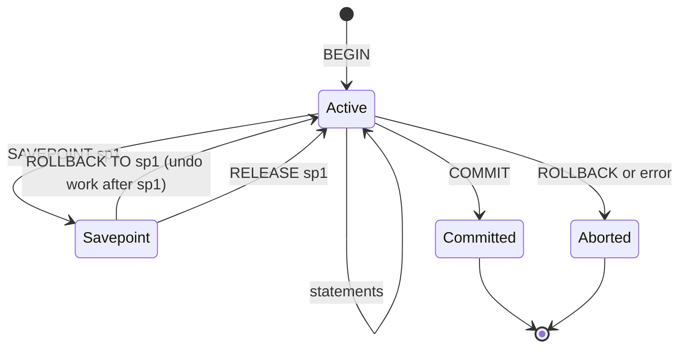

```sql
BEGIN;
INSERT INTO orders(id, user_id, total) VALUES (981, 7, 1200);
SAVEPOINT before_coupon;
UPDATE coupons SET used = true WHERE code = 'DIWALI' AND used = false;  -- may affect 0 rows
-- if coupon invalid: ROLLBACK TO before_coupon; continue without discount
COMMIT;
```

In PostgreSQL, after any error the transaction is **aborted** and every following statement fails until `ROLLBACK` (or `ROLLBACK TO SAVEPOINT`).

#### Example
Bulk import of 10,000 rows where a few may be bad: use a savepoint per row/batch. On a constraint violation, roll back to the savepoint, log the bad row, and continue. The rest commits together. (Spring: `Propagation.NESTED` uses savepoints.)

#### Trade-offs
Long transactions hold locks and (in Postgres) block VACUUM from cleaning old row versions, causing bloat. Keep transactions short and never wait for user input or remote HTTP calls inside one.

#### Problems & fixes
| Symptom | Cause | Fix |
|---|---|---|
| "current transaction is aborted, commands ignored" | error earlier in the transaction (PG) | ROLLBACK, or use savepoints around statements that may fail |
| Lock waits and table bloat | transaction left open ("idle in transaction") | short transactions, `idle_in_transaction_session_timeout` |
| HTTP call inside a transaction makes DB hang | slow remote service holds locks | do remote calls outside the transaction, use outbox/saga |
| Accidental partial commits | auto-commit mode in scripts | explicit BEGIN/COMMIT |

#### Cheat sheet
- BEGIN → statements → COMMIT / ROLLBACK. SAVEPOINT for partial rollback.
- PG: an error aborts the whole transaction until rollback.
- Keep transactions short, with no network calls inside.

#### Interview questions
<details><summary>A service shows many connections "idle in transaction" in pg_stat_activity and the database slows down. What is happening?</summary>

Code opened a transaction and didn't finish it: waiting on a remote call, a missing commit in an error path, or a connection leak. Those sessions hold locks (blocking writers) and prevent VACUUM from removing dead tuples (table bloat). Fix the code paths, set `idle_in_transaction_session_timeout`, and keep remote calls outside transactions.
</details>

<details><summary>When would you use a SAVEPOINT in application code?</summary>

When part of a larger transaction may fail and you want to recover without losing the rest: optional steps (apply a coupon if valid), batch imports that skip bad rows, or "try insert, on conflict do something else" in databases without `ON CONFLICT`. In Spring it maps to nested transactions (`Propagation.NESTED`).
</details>

#### Interview angle
> "Transactions stay short and only touch the database: no HTTP calls inside. Optional steps use savepoints, and the database kills sessions left idle in a transaction."

#### Sources
- [SAVEPOINT](https://www.postgresql.org/docs/current/sql-savepoint.html) — PostgreSQL docs
- [Transactions](https://www.postgresql.org/docs/current/tutorial-transactions.html) — PostgreSQL tutorial
- [Transaction propagation](https://docs.spring.io/spring-framework/reference/data-access/transaction/declarative/tx-propagation.html) — Spring Framework docs

### Read Uncommitted — dirty reads allowed, fastest but rarely useful
The weakest isolation level: a transaction may read rows **other transactions have changed but not committed**. If those transactions roll back, you've acted on data that never existed. Almost no production system should use it.

#### Intuition
Reading over someone's shoulder while they draft an email. You may act on a sentence they delete a second later.

#### Must know
- The weakest level: you can read data another transaction has **not committed** (a dirty read).
- PostgreSQL does not implement it. Asking for it gives you Read Committed.
- SQL Server's `WITH (NOLOCK)` is Read Uncommitted and can also skip or double-count rows.
- If readers block writers, the fix is MVCC / snapshot reads, not dirty reads.

#### Common mistakes
- Adding `NOLOCK` as a performance fix and then trusting the numbers.
- Saying it is "faster" on PostgreSQL or InnoDB, where plain reads already do not block.
- Using it for anything involving money or user-visible state.

#### How it works
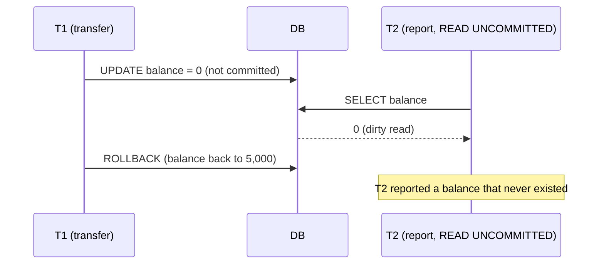

- In **PostgreSQL**, `READ UNCOMMITTED` behaves exactly like Read Committed (MVCC never exposes uncommitted data).
- In **SQL Server/MySQL** it really allows dirty reads (`WITH (NOLOCK)` hints in SQL Server).

#### Example
A team adds `WITH (NOLOCK)` to a slow SQL Server dashboard query "to avoid blocking". It now occasionally shows orders that were rolled back, double-counts rows moved by page splits, or skips rows. The proper fix is snapshot isolation (`READ_COMMITTED_SNAPSHOT ON`) so readers don't block writers and still see committed data only.

#### Trade-offs
It avoids read locks in lock-based engines, but MVCC databases already give non-blocking reads with correct data, so there's essentially no reason to use it.

#### Problems & fixes
| Symptom | Cause | Fix |
|---|---|---|
| Reports show phantom/rolled-back values | dirty reads (`NOLOCK`, READ UNCOMMITTED) | Read Committed Snapshot / MVCC |
| Readers blocked by writers in SQL Server | lock-based Read Committed | enable `READ_COMMITTED_SNAPSHOT` |
| Rows counted twice or missing | NOLOCK scan during page splits | remove NOLOCK |

#### Cheat sheet
- Allows dirty reads. Postgres silently upgrades it to Read Committed.
- `NOLOCK` = Read Uncommitted. Avoid it.
- Need non-blocking reads? Use MVCC/snapshot isolation instead.

#### Interview questions
<details><summary>Is there any legitimate use for Read Uncommitted?</summary>

Rarely: approximate monitoring queries on lock-based engines where blocking production writes is worse than occasional wrong numbers (e.g. "roughly how many rows has this long-running import inserted so far?"). For anything users or money depend on, no. MVCC snapshot isolation provides non-blocking reads without dirty data.
</details>

<details><summary>Why can't you get a dirty read in PostgreSQL even if you ask for Read Uncommitted?</summary>

PostgreSQL's MVCC only shows row versions created by committed transactions (plus your own). There's no code path that returns another transaction's uncommitted version, so it treats Read Uncommitted as Read Committed.
</details>

#### Interview angle
> "I'd never use Read Uncommitted for business data. If readers are blocking writers, the answer is MVCC or snapshot isolation, not dirty reads."

#### Sources
- [Transaction isolation](https://www.postgresql.org/docs/current/transaction-iso.html) — PostgreSQL docs
- [SET TRANSACTION ISOLATION LEVEL](https://learn.microsoft.com/en-us/sql/t-sql/statements/set-transaction-isolation-level-transact-sql) — Microsoft SQL Server docs
- [Read uncommitted](https://jepsen.io/consistency/models/read-uncommitted) — Jepsen

### Read Committed — no dirty reads, default in PostgreSQL and Oracle
Under Read Committed each **statement** sees only data committed **before that statement started**. There are no dirty reads, but two statements in the same transaction can see different data, because others committed in between. It's the default in PostgreSQL, Oracle and SQL Server.

#### Intuition
Every time you look up, you see the latest published edition of the newspaper. You never see a draft, but two looks a minute apart may show different editions.

#### Must know
- Each **statement** sees only data committed before that statement began.
- No dirty reads. Non-repeatable reads, phantoms and lost updates are still possible.
- Default in PostgreSQL, Oracle and SQL Server.
- Make check-and-change **one statement**: `UPDATE … SET stock = stock - 1 WHERE id = ? AND stock > 0`, then check rows affected.

#### Common mistakes
- Read in the app, decide, then write back. Two requests both read the old value (overselling).
- Assuming a multi-statement report sees one consistent picture.
- Forgetting to check the affected-row count after a conditional update.

#### How it works
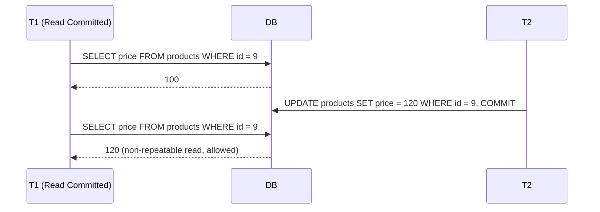

In PostgreSQL each statement takes a fresh MVCC snapshot. An `UPDATE` that finds a row locked by another transaction **waits**, then re-checks the row's latest committed version against its WHERE clause ("EvalPlanQual").

#### Example
**Safe under Read Committed** (single atomic statement):
```sql
UPDATE products SET stock = stock - 1 WHERE id = 9 AND stock > 0;   -- check rows affected = 1
```
**Unsafe under Read Committed** (read-modify-write in the app):
```sql
SELECT stock FROM products WHERE id = 9;        -- both T1 and T2 read 1
UPDATE products SET stock = 0 WHERE id = 9;     -- both write 0: two units sold, one in stock
```
Fix with the atomic form, `SELECT … FOR UPDATE`, or optimistic versioning.

#### Trade-offs
Great concurrency and few aborts. The cost is that you must recognise read-modify-write patterns and protect them yourself.

#### Problems & fixes
| Symptom | Cause | Fix |
|---|---|---|
| Overselling / negative stock | read-then-write in app code | atomic conditional UPDATE, FOR UPDATE, or version column |
| Report totals don't add up | multiple statements see different data | run in Repeatable Read for one snapshot |
| Counter increments lost | `x = read(); write(x+1)` | `UPDATE … SET n = n + 1` |

#### Cheat sheet
- Snapshot per statement. No dirty reads. Non-repeatable reads and phantoms allowed.
- Default in PG, Oracle, SQL Server.
- Push read-modify-write into a single SQL statement, or lock.

#### Interview questions
<details><summary>Two users buy the last item at the same time on a Postgres database at Read Committed. How can you guarantee only one succeeds?</summary>

Use a single conditional statement: `UPDATE inventory SET qty = qty - 1 WHERE sku = ? AND qty > 0`. Postgres serialises the two updates on the row lock. The second waits, re-evaluates `qty > 0` on the new version, and updates 0 rows, so the app reports "sold out". Alternatives are `SELECT … FOR UPDATE` then update, or optimistic locking with a version column.
</details>

<details><summary>What anomalies remain at Read Committed?</summary>

Non-repeatable reads, phantom reads, lost updates (with app-level read-modify-write) and write skew. Dirty reads and dirty writes are prevented.
</details>

#### Interview angle
> "Postgres defaults to Read Committed. I keep it and make every check-and-update a single conditional statement or an explicit row lock, which removes the races without paying for Serializable."

#### Sources
- [Read Committed isolation level](https://www.postgresql.org/docs/current/transaction-iso.html#XACT-READ-COMMITTED) — PostgreSQL docs
- [Read committed](https://jepsen.io/consistency/models/read-committed) — Jepsen
- [A Critique of ANSI SQL Isolation Levels](https://www.microsoft.com/en-us/research/publication/a-critique-of-ansi-sql-isolation-levels/) — Berenson et al., Microsoft Research

### Repeatable Read — same row read twice gives same result within transaction (MySQL default)
Under Repeatable Read, a transaction reads from **one consistent snapshot taken at its first query**: rows you read won't change underneath you, no matter what others commit. It's the MySQL/InnoDB default and is called **snapshot isolation** in PostgreSQL.

#### Intuition
You take a photo of the whiteboard when you walk in and work from the photo. People keep editing the board, but your photo does not change.

#### Must know
- The whole transaction reads from **one snapshot** taken at its first query.
- PostgreSQL: this is snapshot isolation. No phantoms, and a concurrent update to your row gives error 40001, so retry.
- MySQL InnoDB (its default): snapshot for plain SELECTs, **next-key (gap) locks** for locking reads and writes.
- It does **not** prevent write skew.
- Good for reports, exports and backups. `pg_dump` uses it.

#### Common mistakes
- Treating it as equal to Serializable.
- Running write transactions at this level in PostgreSQL without a retry loop.
- Holding a long snapshot open on the primary, which blocks cleanup and bloats tables.

#### How it works
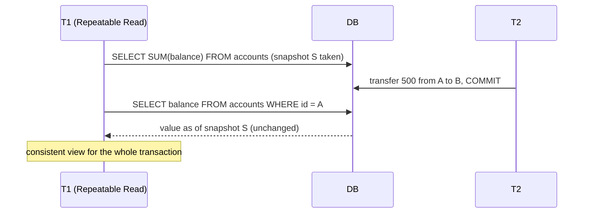

Differences between engines:
- **PostgreSQL**: true snapshot isolation, no phantoms. If T1 tries to update a row someone else changed after its snapshot, it gets `could not serialize access due to concurrent update`, so you retry. Lost updates are prevented, but **write skew is still possible**.
- **MySQL InnoDB**: plain SELECTs read the snapshot. Locking reads (`SELECT … FOR UPDATE`) and UPDATEs read the **latest** data and use next-key (gap) locks to block phantoms in locked ranges.

#### Example
Month-end report: run `BEGIN ISOLATION LEVEL REPEATABLE READ; … many queries …; COMMIT;`. Every query sees the same moment in time, so balances, ledger totals and counts reconcile, while live transfers continue without blocking (MVCC). `pg_dump` uses exactly this to take consistent backups.

#### Trade-offs
Consistent reads without blocking, at the cost of serialization errors on concurrent updates (PG) and long-running snapshots keeping old row versions alive (bloat, longer undo history in InnoDB).

#### Problems & fixes
| Symptom | Cause | Fix |
|---|---|---|
| `could not serialize access due to concurrent update` (PG) | row changed after your snapshot | catch SQLSTATE 40001 and retry the transaction |
| InnoDB deadlocks/lock waits on inserts | gap locks from locking reads under RR | narrower ranges, proper indexes, or RC for that workload |
| Table bloat / long history list | very long RR transactions | keep them short, run reports on a replica |
| On-call or booking rule violated | write skew still possible | Serializable or explicit locks on the rows that define the rule |

#### Cheat sheet
- One snapshot per transaction. Repeatable reads, no phantoms in PG.
- PG RR = snapshot isolation (retry on 40001). MySQL RR = snapshot reads + gap locks for locking reads.
- Doesn't stop write skew.

#### Interview questions
<details><summary>How does MySQL's Repeatable Read prevent phantom rows?</summary>

Plain SELECTs read a consistent MVCC snapshot, so new rows committed later are invisible. For locking reads and writes (`SELECT … FOR UPDATE`, UPDATE, DELETE), InnoDB takes **next-key locks**: row locks plus locks on the gaps between index records, so other transactions can't insert into the scanned range until you commit.
</details>

<details><summary>You run a long report on the primary under Repeatable Read and the database starts bloating. Why?</summary>

MVCC must keep every old row version that your snapshot might still need, so VACUUM (PG) or purge (InnoDB) can't clean them while the transaction is open. Under heavy writes, dead versions pile up, tables and indexes grow, and queries slow down. Run reports on a replica, break them into shorter transactions, or use a dedicated analytics store.
</details>

#### Interview angle
> "For consistent multi-query reads (reports, exports, backups) I use Repeatable Read snapshots, ideally on a replica. Write transactions at that level need a retry loop for serialization errors."

#### Sources
- [Repeatable Read isolation level](https://www.postgresql.org/docs/current/transaction-iso.html#XACT-REPEATABLE-READ) — PostgreSQL docs
- [InnoDB locking: next-key locks](https://dev.mysql.com/doc/refman/8.4/en/innodb-locking.html) — MySQL reference manual
- [Snapshot isolation](https://jepsen.io/consistency/models/snapshot-isolation) — Jepsen

### Serializable — strictest, prevents all anomalies including phantoms (SSI in PostgreSQL)
Serializable guarantees the result of concurrent transactions equals **some serial (one-at-a-time) order**. Every anomaly is impossible: lost updates, phantoms, write skew. The price is aborts or blocking, so applications must **retry** failed transactions.

#### Intuition
A single-lane bridge. However many cars arrive together, the result is the same as if they had crossed one at a time. Sometimes a car is told to reverse and try again.

#### Must know
- The outcome equals **some one-at-a-time order**. No anomaly is possible, including write skew.
- PostgreSQL uses **SSI**: optimistic, no extra blocking, aborts one transaction with SQLSTATE 40001.
- MySQL and SQL Server use locking (2PL): conflicts block and can deadlock.
- The application **must retry** the whole transaction, so keep side effects (emails, HTTP, Kafka) out of it.
- Use it for rules that span many rows or rows that do not exist yet.

#### Common mistakes
- Turning it on without a retry loop.
- Sending an email or a payment call inside the transaction, which then repeats on retry.
- Assuming Oracle's SERIALIZABLE is truly serializable. It is snapshot isolation.

#### How it works
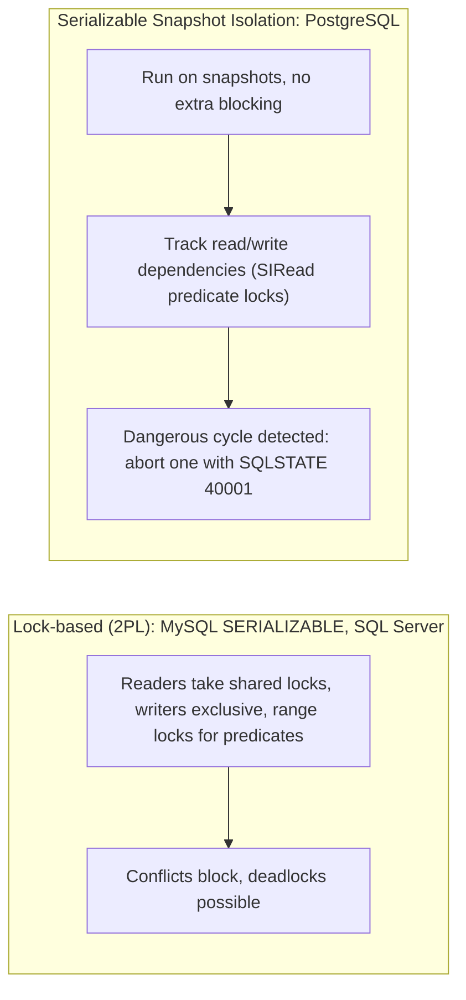

**PostgreSQL SSI** detects "dangerous structures" (two consecutive read-write dependencies forming a potential cycle) and aborts a transaction at commit or earlier. False positives happen, so retry logic is mandatory.

#### Example
On-call rule: "at least one doctor on call". Two doctors each run "if count(on_call) ≥ 2 then set me off-call" at the same moment. Under snapshot isolation both succeed (write skew), leaving zero doctors on call. Under **Serializable**, one transaction gets `could not serialize access due to read/write dependencies` and the app retries it. On retry it sees only one doctor left and refuses.

```java
for (int attempt = 1; ; attempt++) {
  try { return tx.execute(this::goOffCall); }
  catch (SerializationFailure e) { if (attempt == 3) throw e; sleep(jitter(attempt)); }
}
```

#### Trade-offs
Simplest correctness reasoning (as if single-threaded), but throughput drops under contention because of aborts and retries, and you must keep transactions short and retryable (no external side effects inside).

#### Problems & fixes
| Symptom | Cause | Fix |
|---|---|---|
| Spike in 40001 errors | high contention on the same data | retry with backoff, shrink transactions, lower contention (shard counters) |
| Duplicate emails/payments after retries | side effects inside the retried transaction | perform side effects after commit (outbox) |
| Slow under 2PL serializable | range/shared locks blocking | use SSI (PG), or targeted locks at Read Committed |

#### Cheat sheet
- Equivalent to some serial order. No anomalies.
- PG uses SSI (optimistic, aborts). Others use 2PL (pessimistic, blocks).
- Always wrap in a retry loop (SQLSTATE 40001). No side effects inside.

#### Interview questions
<details><summary>When would you use Serializable instead of row locks at Read Committed?</summary>

When the invariant depends on a **set** of rows or on rows that don't exist yet (counts, ranges, "no overlapping booking"), which simple row locks can't protect without locking whole tables. Serializable (SSI) catches those conflicts automatically. Use it for low-to-moderate contention flows where correctness matters more than peak throughput, with a retry loop.
</details>

<details><summary>What must be true of code that runs in a Serializable transaction?</summary>

It must be safe to **retry**: deterministic, no external side effects (emails, HTTP calls, Kafka publishes) inside the transaction, short-running, and wrapped in a loop that catches serialization failures (40001) and re-executes the whole transaction from the start.
</details>

#### Interview angle
> "For rules that span several rows, like on-call coverage or no overlapping bookings, I'd use Serializable with a retry loop and push side effects to an outbox. For single-row rules, a conditional update at Read Committed is cheaper."

#### Sources
- [Serializable isolation level](https://www.postgresql.org/docs/current/transaction-iso.html#XACT-SERIALIZABLE) — PostgreSQL docs
- [Serializable Snapshot Isolation (SSI)](https://wiki.postgresql.org/wiki/SSI) — PostgreSQL wiki
- [Serializability](https://jepsen.io/consistency/models/serializable) — Jepsen

### Dirty read — reading uncommitted data from a concurrent transaction
A dirty read happens when a transaction reads a value **another transaction has written but not committed**. If that writer rolls back, the reader has acted on data that never officially existed. Only Read Uncommitted allows it.

#### Intuition
A cashier hands over the goods while the card machine still says "processing". The payment then fails, and the goods are already gone.

#### Must know
- A dirty read = reading a write that another transaction has **not committed** and may roll back.
- Only Read Uncommitted allows it. Read Committed and above prevent it.
- The same bug appears outside the database: publishing an event or updating a cache **before commit**.
- Fix those with an outbox or after-commit hooks.

#### Common mistakes
- Thinking Read Committed makes the whole system safe while events are published before the commit.
- Updating the cache inside the transaction, then rolling back.
- Confusing a dirty read with a non-repeatable read. In the second one the other transaction did commit.

#### How it works
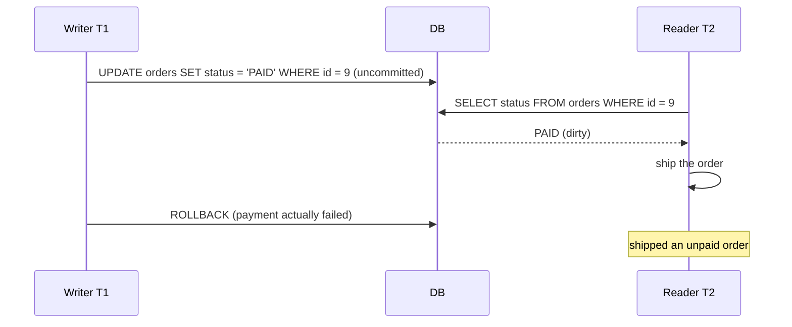

#### Example
A warehouse system polls for `status='PAID'` orders using `NOLOCK` (SQL Server) for speed. A payment transaction marks the order PAID, then fails at the bank step and rolls back, but the warehouse already picked up the order. Fix: read committed data only, and better still, react to an `OrderPaid` event emitted **after commit** (outbox) rather than polling.

#### Trade-offs
Nothing to gain on modern MVCC engines. Read Committed or snapshot reads cost almost nothing.

#### Problems & fixes
| Symptom | Cause | Fix |
|---|---|---|
| Actions taken on rolled-back data | `NOLOCK`/Read Uncommitted | Read Committed (snapshot) |
| Downstream sees events for rolled-back transactions | publishing before commit | outbox / publish after commit |
| Cache contains values from rolled-back transactions | cache updated before commit | update/invalidate cache after commit (`afterCommit` hooks) |

#### Cheat sheet
- Dirty read = reading another transaction's uncommitted write.
- Prevented by Read Committed and above.
- The same idea applies outside the DB: never publish or cache before commit.

#### Interview questions
<details><summary>Can you get "dirty read" behaviour even with Read Committed in the database?</summary>

Yes, at the system level: if the app publishes an event, updates a cache or calls another service **before** the DB transaction commits, others observe a change that may still roll back. Use transactional outbox, `TransactionSynchronization.afterCommit` hooks, or CDC so side effects only happen after commit.
</details>

<details><summary>Which isolation levels prevent dirty reads?</summary>

Read Committed, Repeatable Read and Serializable. Only Read Uncommitted allows them, and PostgreSQL doesn't allow them at all.
</details>

#### Interview angle
> "The DB already prevents dirty reads at Read Committed. The real risk is side effects before commit, so events go through an outbox and caches are invalidated in after-commit hooks."

#### Sources
- [Transaction isolation](https://www.postgresql.org/docs/current/transaction-iso.html) — PostgreSQL docs
- [Isolation (database systems)](https://en.wikipedia.org/wiki/Isolation_%28database_systems%29) — Wikipedia
- [Transactional outbox](https://microservices.io/patterns/data/transactional-outbox.html) — microservices.io

### Non-repeatable read — same row returns different value on second read in same transaction
A non-repeatable read happens when a transaction reads the **same row twice and gets different values**, because another transaction committed an update in between. It's allowed under Read Committed and prevented under Repeatable Read and Serializable.

#### Intuition
You check a price tag, walk to the counter, and the tag has been changed by the time you look again. The item is the same, the value is not.

#### Must know
- Same **row**, read twice in one transaction, two different values, because someone committed in between.
- Allowed at Read Committed. Prevented at Repeatable Read and Serializable.
- Best fix is design: **read once and carry the value** (snapshot the price onto the order).
- Or verify on write: `… WHERE price = :seen`.

#### Common mistakes
- Re-reading a mutable value later in the same request and assuming it is unchanged.
- Raising the isolation level when simply not reading twice would do.
- Mixing it up with a phantom, which is about a set of rows appearing or vanishing.

#### How it works
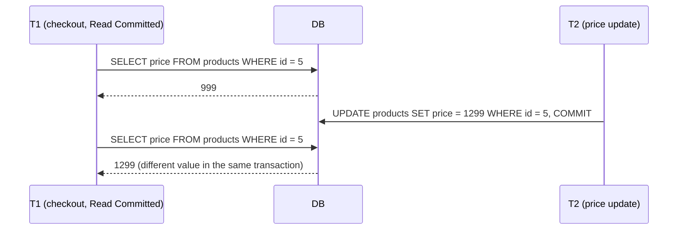

#### Example
Checkout reads the price to show the total, then reads it again to create the order line. A price update lands between the two reads, and the customer is charged 1,299 while the confirmation said 999. Fixes:
- Read once and carry the value (store `unit_price` on the order line from the first read).
- Use Repeatable Read for that transaction.
- Or lock the product row (`FOR SHARE`) if it must not change during checkout.

#### Trade-offs
Preventing it with Repeatable Read costs snapshot retention and possible serialization retries. Often the better fix is to not read twice.

#### Problems & fixes
| Symptom | Cause | Fix |
|---|---|---|
| Totals differ between steps of one request | re-reading mutable data | read once, pass values along, snapshot prices into the order |
| Validation passes, then the write uses a changed value | check and use separated | conditional write (`WHERE price = :seen`) or Repeatable Read |
| Multi-query report inconsistent | Read Committed per statement | Repeatable Read snapshot |

#### Cheat sheet
- Same row, two reads, different values. Allowed at Read Committed.
- Prevented at Repeatable Read / Serializable.
- Design fix: capture values once (price snapshot on the order).

#### Interview questions
<details><summary>How do e-commerce systems avoid charging a different price from the one shown at checkout?</summary>

They snapshot the price into the cart/order at a defined moment (with a quote id and expiry), store `unit_price` on the order line, and verify it at payment (`WHERE price_version = ?`). If the price changed, they ask the user to confirm. The order never re-reads live prices after the quote.
</details>

<details><summary>Difference between a non-repeatable read and a phantom read?</summary>

A non-repeatable read is about an **existing row** whose value changes between two reads. A phantom is about a **set** of rows: re-running a range query (`WHERE amount > 100`) returns rows that weren't there before (inserted) or misses rows that were deleted.
</details>

#### Interview angle
> "I avoid depending on re-reads: the price is snapshotted onto the order with a quote id and verified at payment, so a concurrent price change can't alter what the customer agreed to."

#### Sources
- [Transaction isolation](https://www.postgresql.org/docs/current/transaction-iso.html) — PostgreSQL docs
- [Isolation (database systems)](https://en.wikipedia.org/wiki/Isolation_%28database_systems%29) — Wikipedia
- [Repeatable read](https://jepsen.io/consistency/models/repeatable-read) — Jepsen

### Phantom read — same range query returns different set of rows in same transaction
A phantom read happens when a transaction re-runs a **query with a condition** and sees **new rows** (or misses deleted ones), because another transaction inserted or deleted matching rows and committed. Row locks can't prevent it, because the phantom row didn't exist when you locked.

#### Intuition
You count the people in a room, turn around, and count again. Someone walked in meanwhile. You could not have stopped them by watching the people who were already there.

#### Must know
- Re-running a **query with a condition** returns new rows, or misses deleted ones.
- Row locks cannot stop it, because the new row did not exist when you locked.
- Fixes: range / next-key locks (InnoDB), Serializable, locking a parent "guard" row, or a constraint.
- A **unique or exclusion constraint** is the cheapest and most reliable fix for double booking.

#### Common mistakes
- "Check there is no booking, then insert" at Read Committed.
- Locking the existing rows and thinking the range is protected.
- Forgetting that snapshot isolation hides the phantom from your reads but still lets the conflicting insert commit.

#### How it works
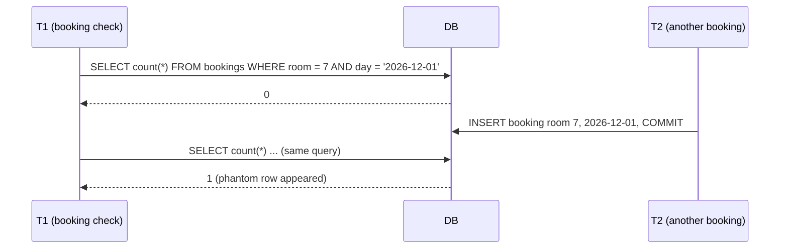

Prevention:
- **Snapshot isolation** (PG Repeatable Read): re-reads don't see the new row. But T1 might still insert a conflicting booking (write skew).
- **Range / next-key locks** (InnoDB locking reads, 2PL Serializable) block inserts into the scanned range.
- **Predicate locks** (PG SSI) detect the conflict and abort one transaction.
- **Constraints**: a unique index or **exclusion constraint** makes the conflicting insert impossible.

#### Example
Preventing double booking of a room in PostgreSQL with an exclusion constraint: no overlapping date ranges for the same room, enforced by the database:
```sql
CREATE EXTENSION btree_gist;
ALTER TABLE bookings ADD CONSTRAINT no_overlap
  EXCLUDE USING gist (room_id WITH =, stay WITH &&);   -- stay is a daterange
```
The second concurrent insert fails with a constraint violation, whatever the isolation level.

#### Trade-offs
Range locks reduce concurrency on hot ranges. Serializable needs retries. Constraints are the cheapest and most robust when the rule can be expressed as one.

#### Problems & fixes
| Symptom | Cause | Fix |
|---|---|---|
| Double booking with "check then insert" | phantom insert between check and insert | unique/exclusion constraint, or Serializable |
| InnoDB lock waits on inserts | gap locks from range-locking reads | index the predicate columns well, narrow ranges |
| Pagination shows duplicate/missing items while data changes | offset pagination over a changing set | keyset (cursor) pagination |

#### Cheat sheet
- Phantom = new/deleted rows matching a predicate on re-query.
- Fix with predicate/range locks, Serializable, or (best) constraints.
- PG exclusion constraints prevent overlapping ranges.

#### Interview questions
<details><summary>How do you prevent two meeting-room bookings overlapping in time, under concurrency?</summary>

Best: a database constraint. In PostgreSQL, an exclusion constraint on `(room_id WITH =, tstzrange(start, end) WITH &&)`. Otherwise lock a parent row (`SELECT … FROM rooms WHERE id = ? FOR UPDATE`) to serialise bookings per room before checking overlaps, or run the check+insert in Serializable with retries. A plain "check then insert" at Read Committed is unsafe.
</details>

<details><summary>Why can't row-level locks prevent phantoms?</summary>

You can only lock rows that exist. The conflicting row is inserted after your query ran, so there was nothing to lock. You need locks on the **range or predicate** (gap/next-key locks, predicate locks), a lock on a parent "guard" row, or a constraint that rejects the conflicting row.
</details>

#### Interview angle
> "For no-double-booking rules I'd let the database enforce it, with a unique or exclusion constraint, or serialise on a parent row with FOR UPDATE, rather than trusting a check-then-insert."

#### Sources
- [Transaction isolation](https://www.postgresql.org/docs/current/transaction-iso.html) — PostgreSQL docs
- [Phantom rows](https://dev.mysql.com/doc/refman/8.4/en/innodb-next-key-locking.html) — MySQL reference manual
- [Constraints on ranges (exclusion constraints)](https://www.postgresql.org/docs/current/rangetypes.html#RANGETYPES-CONSTRAINT) — PostgreSQL docs

### Lost update — two transactions read-modify-write the same row, one overwrites the other
A lost update happens when two transactions **read the same value, both modify it in application code and both write it back**. The second write silently overwrites the first, and one change disappears. It's one of the most common concurrency bugs in real applications.

#### Intuition
Two people open the same shared document, each adds a line, and each presses "save". The second save replaces the file, and the first person's line is gone.

#### Must know
- Pattern: read a value, change it in app code, write it back. Two requests doing this lose one change.
- Fix 1, atomic SQL: `UPDATE … SET likes = likes + 1`.
- Fix 2, pessimistic: `SELECT … FOR UPDATE`, then update.
- Fix 3, optimistic: `WHERE id = ? AND version = ?`, and retry when 0 rows change (JPA `@Version`).
- Over HTTP: `ETag` + `If-Match`, answering 412 on a mismatch.

#### Common mistakes
- Assuming a transaction alone prevents it. At Read Committed it does not.
- Letting the ORM save the whole entity from a stale copy, overwriting fields other requests changed.
- Using optimistic locking on a hot row, where retries keep spinning.

#### How it works
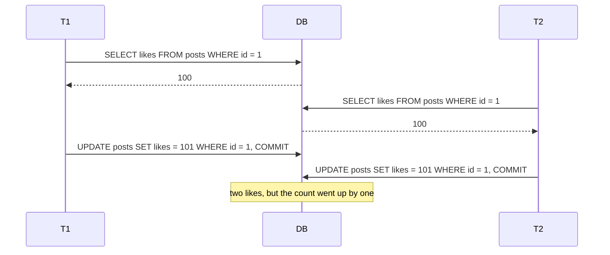

Four standard fixes:
1. **Atomic update**: `UPDATE posts SET likes = likes + 1 WHERE id = 1`.
2. **Pessimistic lock**: `SELECT … FOR UPDATE` then update.
3. **Optimistic lock**: `UPDATE … SET …, version = version + 1 WHERE id = 1 AND version = 7`. If 0 rows were updated, someone else won, so re-read and retry.
4. **Isolation**: PG Repeatable Read/Serializable detect it and abort (retry).

#### Example
JPA optimistic locking:
```java
@Entity class Wallet {
  @Id Long id;
  BigDecimal balance;
  @Version long version;      // Hibernate adds "AND version = ?" to every UPDATE
}
// concurrent update → OptimisticLockException → retry with fresh data or return 409 to the client
```
For REST, expose the version as an `ETag` and require `If-Match` on PUT/PATCH (412 on mismatch).

#### Trade-offs
| Fix | Best when | Cost |
|---|---|---|
| Atomic SQL | simple arithmetic/flags | logic must fit in SQL |
| Pessimistic lock | high contention, must not fail | blocking, deadlock risk |
| Optimistic lock | low contention, user edits | retries / 409s under contention |

#### Problems & fixes
| Symptom | Cause | Fix |
|---|---|---|
| Counters lower than expected | read-modify-write in code | atomic increment, or Redis INCR |
| Admin edits silently overwritten | last-write-wins forms | version column + If-Match, show conflict to the user |
| ORM saves entire entity, overwriting other fields | full-row UPDATE from stale entity | dynamic updates of changed fields + @Version |
| Optimistic retries spin under heavy contention | hot row | pessimistic lock, or reduce contention (sharded counters) |

#### Cheat sheet
- Read → modify in app → write = lost update risk.
- Fix: atomic SQL, FOR UPDATE, version column, or stronger isolation.
- HTTP: ETag + If-Match → 412.

#### Interview questions
<details><summary>A "likes" counter shows fewer likes than the number of like events. Diagnose it and propose fixes for different scales.</summary>

Classic lost update: concurrent requests read the count, add one in code and write it back. Fixes: `UPDATE … SET likes = likes + 1` (atomic, fine for moderate rates). At huge scale, a hot row becomes a bottleneck, so use Redis `INCR` with periodic flush to the DB, or sharded counters (N rows per post, summed on read), or event-based counting via Kafka aggregation.
</details>

<details><summary>Optimistic vs pessimistic locking: when do you choose which?</summary>

Optimistic (version column) when conflicts are rare and transactions may involve user think-time (edit forms, profile updates): no locks held, and conflicts surface as retries or 409s. Pessimistic (`FOR UPDATE`) when contention is high or failure is unacceptable (seat holds during a flash sale, ledger balance updates in short transactions), accepting blocking and managing lock order to avoid deadlocks.
</details>

#### Interview angle
> "I never read-modify-write in application code without protection: arithmetic goes into an atomic UPDATE, user edits use a version column with If-Match, and hot contended rows get FOR UPDATE inside short transactions."

#### Sources
- [Explicit locking](https://www.postgresql.org/docs/current/explicit-locking.html) — PostgreSQL docs
- [A beginner's guide to database locking and the lost update phenomena](https://vladmihalcea.com/a-beginners-guide-to-database-locking-and-the-lost-update-phenomena/) — Vlad Mihalcea
- [If-Match header](https://developer.mozilla.org/en-US/docs/Web/HTTP/Reference/Headers/If-Match) — MDN

### Write skew — two transactions read overlapping data and make conflicting writes (e.g., on-call scheduling)
Write skew is a subtle anomaly: two transactions **read the same set of rows, each decides it's safe to proceed based on what it read, then each writes to different rows**. Neither overwrote the other, but together they violate a rule that spans those rows. Snapshot isolation (PG Repeatable Read, Oracle "serializable") does **not** prevent it.

#### Intuition
Two flatmates each look in the fridge, see two cartons of milk, and each takes one to work "because one is left". Both were right when they looked, and the fridge is empty.

#### Must know
- Two transactions read the same rows, each decides it is safe, and each writes a **different** row. Together they break a rule.
- No row is written twice, so snapshot isolation (PG Repeatable Read) does **not** catch it.
- Fix 1: Serializable with a retry loop.
- Fix 2: make the conflict real. Lock the rows you read with `FOR UPDATE`, or update one shared guard row conditionally.
- Fix 3: a constraint, when the rule fits one.

#### Common mistakes
- Thinking Repeatable Read or `@Version` on the rows you write is enough.
- Summing rows to check a limit and then inserting, with nothing locked.
- Forgetting one code path that touches the same rule and does not take the lock.

#### How it works
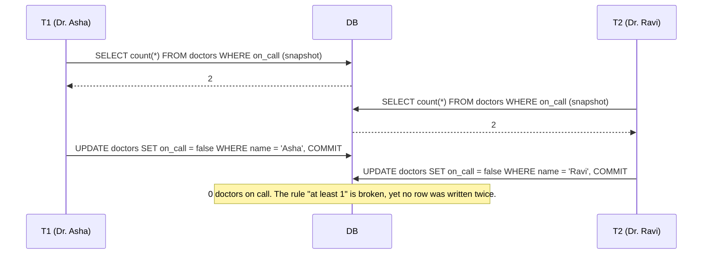

Other examples: two users claiming the same username via different rows, a meeting room double-booked, spending from a shared budget across rows, a multiplayer game placing two units on one cell.

Fixes:
- **Serializable** (SSI detects the read-write dependency cycle and aborts one).
- **Materialise the conflict**: lock a row both transactions must touch (`SELECT … FROM shifts WHERE id = ? FOR UPDATE`), or lock the rows you read (`SELECT … FOR UPDATE` on all on-call doctors).
- **Constraint**, if the rule can be expressed as one (unique, exclusion).

#### Example
```sql
BEGIN;
SELECT id FROM doctors WHERE shift_id = 42 AND on_call FOR UPDATE;   -- lock all on-call rows for the shift
-- app checks count >= 2
UPDATE doctors SET on_call = false WHERE id = :me;
COMMIT;
```
The second transaction blocks on the lock, then re-reads, sees only 1 doctor, and refuses.

#### Trade-offs
Serializable is the general fix but adds retries. Explicit locks need you to identify every transaction that touches the invariant. Constraints are ideal but only cover some rules.

#### Problems & fixes
| Symptom | Cause | Fix |
|---|---|---|
| Business rule over multiple rows occasionally broken | write skew under RC/RR | Serializable + retry, or FOR UPDATE on the read set / guard row |
| Budget overspent by concurrent purchases from shared budget | each checks remaining, each inserts | lock the budget row, or keep a single balance row with conditional update |
| Two users get the same handle via a reservation table | check-then-insert on different rows | unique constraint on the handle |

#### Cheat sheet
- Write skew = read a shared condition, write different rows, rule breaks.
- Not prevented by snapshot isolation (PG RR).
- Fix: Serializable, lock the read set / a guard row, or a constraint.

#### Interview questions
<details><summary>Explain write skew with an example and why Repeatable Read doesn't stop it.</summary>

On-call example: two doctors each check "are at least 2 on call?" (yes), and each removes only themselves. Under snapshot isolation each transaction sees a consistent snapshot and writes a **different** row, so there's no write-write conflict to detect and both commit, leaving zero on call. Repeatable Read only guarantees stable reads and detects conflicting writes to the same row, not conflicts between what one transaction read and another wrote.
</details>

<details><summary>How would you enforce "a user's total daily spend across all cards ≤ ₹50,000" under concurrent transactions?</summary>

Make the conflict explicit: keep a per-user daily `spend_limits` row and in each transaction `UPDATE spend_limits SET used = used + :amt WHERE user_id = ? AND day = ? AND used + :amt <= 50000`, checking one row was affected (an atomic conditional update that serialises on that row). Or lock that row with FOR UPDATE, or run the check+insert in Serializable with retries. Summing card transactions without a lock allows write skew.
</details>

#### Interview angle
> "When a rule spans several rows, I either give it a single guard row that every transaction updates conditionally, or run that path under Serializable with retries, because snapshot isolation lets write skew through."

#### Sources
- [Serializable isolation level](https://www.postgresql.org/docs/current/transaction-iso.html#XACT-SERIALIZABLE) — PostgreSQL docs
- [Snapshot isolation](https://en.wikipedia.org/wiki/Snapshot_isolation) — Wikipedia
- [A Critique of ANSI SQL Isolation Levels](https://www.microsoft.com/en-us/research/publication/a-critique-of-ansi-sql-isolation-levels/) — Berenson et al., Microsoft Research

