## Locking & concurrency control

### Shared lock (S) — multiple readers can hold simultaneously
A shared (read) lock lets a transaction **read** a resource while guaranteeing nobody **modifies** it until the lock is released. Many transactions can hold S locks on the same row at once, but a writer needing an exclusive lock must wait.

#### Intuition
A museum exhibit. Any number of visitors can look at it at the same time, but while anyone is looking, the curator is not allowed to swap it out.

#### Must know
- Many transactions can hold a shared lock on the same row together. A writer has to wait for all of them.
- SQL: `SELECT … FOR SHARE`.
- In MVCC databases (PostgreSQL, InnoDB) a **plain SELECT takes no row lock**. It reads a snapshot.
- Two transactions that both take S and then try to write will deadlock. If you plan to write, take `FOR UPDATE` first.

#### Common mistakes
- Saying "reads take shared locks" for PostgreSQL or InnoDB. Only explicit locking reads do.
- Read with `FOR SHARE`, then update the same row (the S → X upgrade deadlock).
- Forgetting that foreign key checks also lock the parent row.

#### How it works
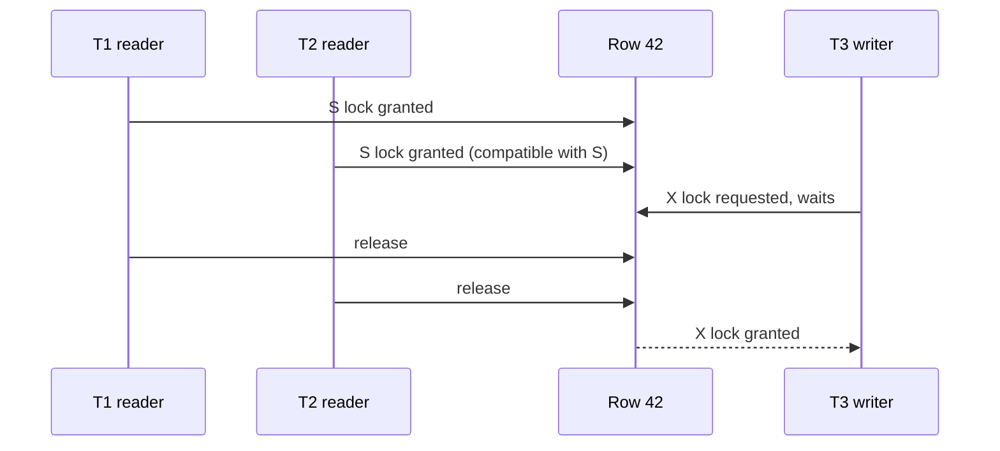

| Held \ Requested | S | X |
|---|---|---|
| **S** | ✅ compatible | ❌ wait |
| **X** | ❌ wait | ❌ wait |

SQL: PostgreSQL `SELECT … FOR SHARE`, MySQL `SELECT … LOCK IN SHARE MODE` / `FOR SHARE`. In MVCC databases **ordinary SELECTs take no row S locks**: they read snapshots.

#### Example
Creating an order line for a product that must not be deleted or have its price changed during the transaction:
```sql
BEGIN;
SELECT price FROM products WHERE id = 9 FOR SHARE;      -- others can read and share-lock, nobody can update/delete
INSERT INTO order_lines(order_id, product_id, price) VALUES (981, 9, 999);
COMMIT;
```
Foreign key checks internally take a similar lock (`FOR KEY SHARE` in PG) on the referenced parent row.

#### Trade-offs
S locks keep data stable for readers, but they block writers. Two readers that both later try to upgrade S → X can deadlock (each waits for the other's S lock).

#### Problems & fixes
| Symptom | Cause | Fix |
|---|---|---|
| Deadlocks where both transactions read then update the same row | S → X upgrade deadlock | take `FOR UPDATE` (X) up front if you'll write |
| Writers starved by long reads (lock-based engines) | S locks held for long reads | MVCC snapshot reads, shorter transactions |
| Parent row updates blocked by child inserts | FK checks take key-share locks | expected. Keep transactions short, avoid updating parent keys |

#### Cheat sheet
- S + S compatible, S + X conflict.
- `FOR SHARE` = S row lock. Plain SELECT in MVCC = no lock.
- Going to write? Take X (`FOR UPDATE`) from the start.

#### Interview questions
<details><summary>Two transactions both run SELECT … FOR SHARE on the same row and then UPDATE it. What happens?</summary>

Each holds an S lock, and each UPDATE needs an X lock that conflicts with the other's S lock. Both wait on each other, so it's a deadlock, and the database aborts one. Fix: use `SELECT … FOR UPDATE` when the intent is to modify, so the second transaction waits at the read instead of deadlocking at the write.
</details>

<details><summary>Do normal SELECTs take shared locks in PostgreSQL?</summary>

No. With MVCC, plain SELECTs read a snapshot of committed versions and take no row locks (only a light table-level ACCESS SHARE lock that conflicts with things like DROP TABLE or ALTER TABLE). That's why readers don't block writers in PostgreSQL.
</details>

#### Interview angle
> "Reads use MVCC snapshots, so they don't lock. If a transaction will read and then modify a row, it takes FOR UPDATE immediately to avoid the S-to-X upgrade deadlock."

#### Sources
- [Explicit locking: row-level locks](https://www.postgresql.org/docs/current/explicit-locking.html#LOCKING-ROWS) — PostgreSQL docs
- [InnoDB locking](https://dev.mysql.com/doc/refman/8.4/en/innodb-locking.html) — MySQL reference manual

### Exclusive lock (X) — single writer holds, blocks all readers and writers
An exclusive (write) lock gives one transaction sole right to **modify** a resource. Under pure locking it blocks both readers and writers. Under MVCC it blocks other **writers and lockers**, while plain readers keep reading the previous committed version.

#### Intuition
A fitting room with a latch. One person at a time, and everyone else who wants that room queues until the door opens.

#### Must know
- Every `UPDATE`, `DELETE` and `SELECT … FOR UPDATE` takes a row X lock, held **until commit or rollback**.
- Under MVCC it blocks other writers and lockers. Plain readers still read the old committed version.
- One hot row caps throughput at about 1 ÷ transaction time.
- DDL such as `ALTER TABLE` takes a **table-level** exclusive lock that blocks even reads.
- Run migrations with `lock_timeout` and retry.

#### Common mistakes
- Thinking the lock is released when the statement ends. It lasts for the whole transaction.
- Running `ALTER TABLE` without a lock timeout. It queues behind a long query, and every new query queues behind it.
- One global counter or "platform account" row that every request updates.

#### How it works
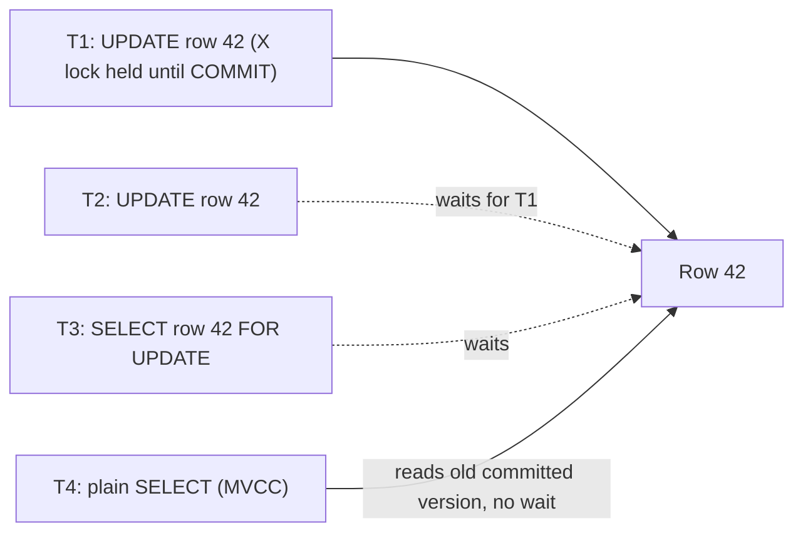

Every `UPDATE`, `DELETE` and `SELECT … FOR UPDATE` takes row X locks, held until commit or rollback. DDL (`ALTER TABLE`) takes **table-level** exclusive locks (`ACCESS EXCLUSIVE` in PG) that block even reads.

#### Example
A ledger balance update:
```sql
BEGIN;
SELECT balance FROM accounts WHERE id = 1 FOR UPDATE;    -- X lock: other transfers on account 1 wait
-- check sufficient funds in app
UPDATE accounts SET balance = balance - 500 WHERE id = 1;
COMMIT;                                                   -- lock released
```

**DDL danger**: `ALTER TABLE orders ADD COLUMN …` needs `ACCESS EXCLUSIVE`. If a long transaction holds a lock on `orders`, the ALTER waits, and **every new query on `orders` queues behind the ALTER**, so the site goes down. Use `SET lock_timeout = '3s'` for migrations and retry.

#### Trade-offs
X locks guarantee safe writes but serialize access to hot rows. Throughput on a single hot row is bounded by 1 ÷ transaction duration.

#### Problems & fixes
| Symptom | Cause | Fix |
|---|---|---|
| Whole table blocked during a migration | DDL waiting for ACCESS EXCLUSIVE, queries queue behind it | `lock_timeout` + retry, online schema change tools, avoid long transactions |
| Hot row throughput ceiling (e.g. one global counter) | every write serialised on one X lock | shard the row (N counters), batch updates, move counter to Redis |
| Lock waits pile up | long transactions holding X locks | keep transactions short, no remote calls inside |

#### Cheat sheet
- X blocks other writers/lockers. MVCC readers still read the old version.
- Held until COMMIT/ROLLBACK, so short transactions = less blocking.
- Migrations: always set `lock_timeout`.

#### Interview questions
<details><summary>A simple ALTER TABLE ADD COLUMN took the production site down for minutes. Explain why.</summary>

The ALTER needed an ACCESS EXCLUSIVE lock and queued behind a long-running transaction holding a conflicting lock (even a long SELECT). In PostgreSQL, lock requests queue in order, so every new query on that table waited behind the ALTER, and connection pools filled up, effectively blocking all traffic. Fix: `SET lock_timeout` so the ALTER gives up quickly and retries, kill or avoid long transactions before migrations, and use online schema change tools for heavier changes.
</details>

<details><summary>Your wallet service has one "platform fees" account row updated by every transaction. It becomes a bottleneck. What do you do?</summary>

The X lock on that one row serialises every transaction. Options: split it into N sub-accounts (pick one randomly or by hash, sum them for reporting), write fee entries as inserts into a ledger (inserts don't contend) and aggregate the balance asynchronously, or batch fee updates per second.
</details>

#### Interview angle
> "Writes take row X locks until commit, so I keep transactions tiny, avoid single hot rows by sharding them, and run every migration with a lock_timeout."

#### Sources
- [Explicit locking](https://www.postgresql.org/docs/current/explicit-locking.html) — PostgreSQL docs
- [When Postgres blocks: 7 tips for dealing with locks](https://www.citusdata.com/blog/2018/02/22/seven-tips-for-dealing-with-postgres-locks/) — Citus Data
- [InnoDB locking](https://dev.mysql.com/doc/refman/8.4/en/innodb-locking.html) — MySQL reference manual

### Intention locks (IS, IX, SIX) — hierarchical locking for efficiency
Databases lock at several granularities (table → page → row). Intention locks are placed on a **parent** (the table) to announce "I hold or will hold S or X locks on some children (rows)". That lets the engine check a table-level lock request in O(1) instead of scanning every row lock.

#### Intuition
A "work in progress inside" sign on a building's front door. Someone who wants to close the whole building reads the sign instead of checking every room.

#### Must know
- Before locking a row, a transaction puts an **intention lock on the table**: IS for reading rows, IX for writing rows.
- A table-level lock request then needs one check on the table instead of scanning every row lock.
- IX is compatible with IX, so many row writers run in parallel.
- IX conflicts with a table-level S or X lock.
- They are automatic. You meet them when reading lock dumps.

#### Common mistakes
- Reading `IX` in a lock dump as "the table is locked". It only announces row locks.
- Using explicit table locks in a batch job, which blocks all normal row traffic.
- Huge single-transaction batches on SQL Server, which escalate to a table lock.

#### How it works
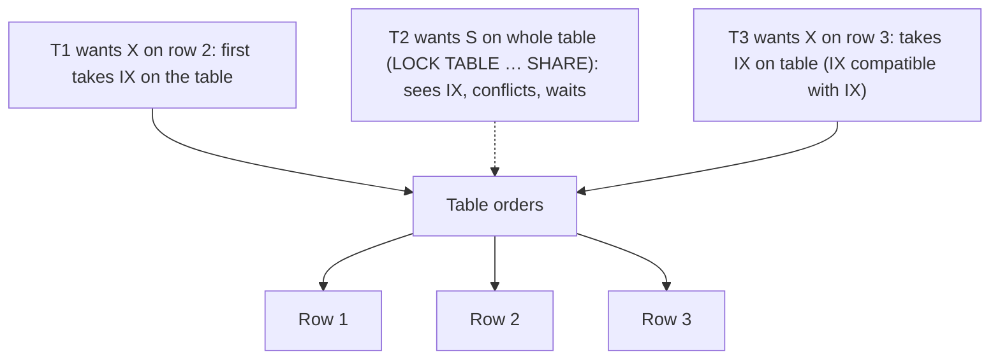

| Held \ Requested | IS | IX | S | SIX | X |
|---|---|---|---|---|---|
| **IS** | ✅ | ✅ | ✅ | ✅ | ❌ |
| **IX** | ✅ | ✅ | ❌ | ❌ | ❌ |
| **S** | ✅ | ❌ | ✅ | ❌ | ❌ |
| **SIX** | ✅ | ❌ | ❌ | ❌ | ❌ |
| **X** | ❌ | ❌ | ❌ | ❌ | ❌ |

- **IS**: will S-lock some rows. **IX**: will X-lock some rows.
- **SIX**: S on the whole table + IX (reading everything, updating a few rows).

#### Example
In MySQL InnoDB, `UPDATE orders SET … WHERE id = 5` takes IX on `orders` and X on row 5. A concurrent `LOCK TABLES orders READ` (table S) sees the IX and waits, without checking millions of row locks. Two concurrent row updates both take IX, which are compatible, so they proceed in parallel. PostgreSQL's table lock modes (ROW SHARE, ROW EXCLUSIVE, …) play the same role.

#### Trade-offs
Intention locks are automatic and cheap. You mostly meet them when reading lock-wait diagnostics (`performance_schema.data_locks`, `pg_locks`).

#### Problems & fixes
| Symptom | Cause | Fix |
|---|---|---|
| Bulk job using table locks blocks all row updates | table S/X lock conflicts with IX from normal traffic | avoid explicit table locks, batch row-level work |
| Lock escalation (SQL Server) turns many row locks into a table lock | too many row locks in one transaction | smaller batches (e.g. 5,000 rows per transaction) |
| Confusing `IX` entries in lock dumps | normal intention locks | look for the actual row/table X/S conflicts |

#### Cheat sheet
- Intention locks on parents announce child locks: IS, IX, SIX.
- IX + IX compatible (parallel row writers). IX vs table S/X conflict.
- They make table-level lock checks O(1).

#### Interview questions
<details><summary>Why do databases need intention locks at all?</summary>

Without them, granting a table-level lock would require checking every row lock in the table for conflicts, which is expensive for large tables. Intention locks on the table summarise "someone holds row locks of type S/X inside", so the conflict check is a single comparison on the table's lock entry.
</details>

<details><summary>What is lock escalation and why can it hurt?</summary>

Some engines (SQL Server, DB2) convert many fine-grained row locks into one table lock once a transaction holds too many, to save memory. A big batch update can then suddenly block every other transaction on the table. Process large updates in small batches.
</details>

#### Interview angle
> "Intention locks are what let row-level writers run in parallel while table-level operations still detect conflicts cheaply. In practice I avoid explicit table locks and big batches that cause escalation."

#### Sources
- [InnoDB locking: intention locks](https://dev.mysql.com/doc/refman/8.4/en/innodb-locking.html#innodb-intention-locks) — MySQL reference manual
- [Multiple granularity locking](https://en.wikipedia.org/wiki/Multiple_granularity_locking) — Wikipedia
- [Transaction locking and row versioning guide](https://learn.microsoft.com/en-us/sql/relational-databases/sql-server-transaction-locking-and-row-versioning-guide) — Microsoft SQL Server docs

### Two-Phase Locking (2PL) — growing phase (acquire only), shrinking phase (release only)
Two-Phase Locking is the classic protocol that guarantees **serializability** with locks: each transaction first only **acquires** locks (growing phase), and once it releases any lock it can never acquire another (shrinking phase). It's how lock-based databases implement Serializable.

#### Intuition
Packing for a trip and unpacking at home. First you only put things into the bag. Once you start taking things out, you never put anything back in.

#### Must know
- Phase 1 (growing): only acquire locks. Phase 2 (shrinking): only release them.
- That one rule guarantees **serializability**.
- It does **not** prevent deadlocks.
- Readers and writers block each other, which is why MVCC databases avoid it for plain reads.
- Not the same thing as two-phase commit (2PC), which is about distributed commit.

#### Common mistakes
- Confusing 2PL with 2PC.
- Claiming 2PL is deadlock-free.
- Forgetting that lock-based Serializable in MySQL and SQL Server is 2PL, so reads block writes there.

#### How it works
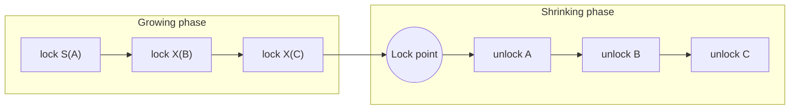

Because no transaction acquires a lock after releasing one, conflicting transactions are ordered by their **lock points**, and the outcome equals running them serially in that order.

Rule of thumb in practice: the database acquires locks as statements touch data and releases them at commit (strict 2PL, next topic).

#### Example
Transfers T1 (A → B) and T2 (B → A) under 2PL:
- T1 locks A, T2 locks B (both growing).
- T1 requests B (held by T2) and waits. T2 requests A (held by T1) and waits.
- That's a deadlock. 2PL guarantees serializability, **not** deadlock freedom, so the database detects the cycle and aborts one.

#### Trade-offs
Correct and simple to reason about, but readers and writers block each other, throughput falls under contention, and deadlocks need detection. MVCC + SSI gives serializability with less blocking.

#### Problems & fixes
| Symptom | Cause | Fix |
|---|---|---|
| Deadlocks under 2PL | lock acquisition order differs | consistent lock ordering (e.g. by account id) |
| Long read queries block writes (lock-based Serializable) | read locks held to commit | MVCC snapshot reads for reporting |
| Low throughput on hot data | locks held long | shorter transactions, smaller lock scope |

#### Cheat sheet
- Growing (acquire only) then shrinking (release only) gives serializability.
- Doesn't prevent deadlocks.
- Strict 2PL holds X locks until commit (what real DBs do).

#### Interview questions
<details><summary>Does 2PL prevent deadlocks? Why or why not?</summary>

No. 2PL constrains **when** locks may be released, not the **order** in which they're acquired. Two transactions can each hold a lock the other needs while still in their growing phases, forming a cycle. Databases add deadlock detection (wait-for graph) or prevention schemes (lock ordering, wait-die/wound-wait, timeouts).
</details>

<details><summary>How does 2PL guarantee serializability?</summary>

Each transaction has a lock point (when it holds all its locks). Any two conflicting transactions can't both be past each other's conflicting locks, so one must completely precede the other on the conflicting items. Ordering transactions by lock point yields an equivalent serial schedule.
</details>

#### Interview angle
> "2PL is how lock-based engines get serializability. Its weaknesses are blocking and deadlocks, which is why I keep lock order consistent and why MVCC databases prefer snapshot-based approaches."

#### Sources
- [Two-phase locking](https://en.wikipedia.org/wiki/Two-phase_locking) — Wikipedia
- [Two-phase locking lecture notes](https://15445.courses.cs.cmu.edu/fall2023/notes/16-twophaselocking.pdf) — CMU 15-445 Database Systems
- [InnoDB transaction isolation levels](https://dev.mysql.com/doc/refman/8.4/en/innodb-transaction-isolation-levels.html) — MySQL reference manual

### Strict 2PL — hold all exclusive locks until commit/abort (prevents cascading aborts)
Strict 2PL is 2PL with one extra rule: **exclusive (write) locks are held until the transaction commits or aborts**. Nobody can read or overwrite your uncommitted writes, which prevents dirty reads and **cascading aborts**. It's what practically every lock-based database implements. *Rigorous* 2PL holds all locks, shared too, until commit.

#### Intuition
You do not let anyone copy from your exam paper until you have handed it in. If you later tear up your draft, nobody has copied an answer that no longer exists.

#### Must know
- 2PL plus one rule: **write locks are held until commit or abort**.
- Nobody can read your uncommitted write, so no dirty reads and no cascading aborts.
- This is what real lock-based databases implement.
- Practical lesson: **lock time = transaction time**. Short transactions mean less blocking.
- Rigorous 2PL holds read locks until commit as well.

#### Common mistakes
- Thinking locks are released as soon as the statement finishes.
- Doing an HTTP call or heavy computation between the first write and the commit.
- Mixing up strict (write locks held) and rigorous (all locks held).

#### How it works
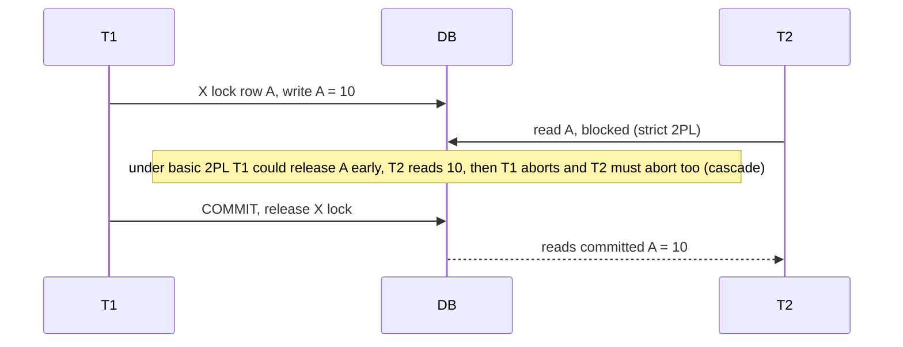

#### Example
Without strictness: T1 writes A and releases the lock early (still in its shrinking phase). T2 reads A and commits a payment based on it. Then T1 aborts. T2 depended on data that never existed and can't be undone once committed: an **unrecoverable schedule**. Strict 2PL makes this impossible because T2 waits for T1's commit.

#### Trade-offs
Locks are held longer (until commit), so there's more blocking, but schedules are recoverable and dirty reads impossible. This is why **transaction duration directly drives contention**.

#### Problems & fixes
| Symptom | Cause | Fix |
|---|---|---|
| Lock waits proportional to transaction length | X locks held to commit | keep transactions short, do slow work before BEGIN or after COMMIT |
| Users waiting on rows locked by an abandoned session | session left open with locks | statement/idle timeouts, connection pool leak detection |

#### Cheat sheet
- Strict 2PL: X locks until commit/abort, so no dirty reads, no cascading aborts.
- Rigorous 2PL: all locks until commit.
- Practical lesson: lock hold time = transaction time.

#### Interview questions
<details><summary>What is a cascading abort and how does strict 2PL prevent it?</summary>

A cascading abort occurs when T2 read T1's uncommitted write and T1 then aborts, so T2 (and anyone who read T2's writes) must abort too. Strict 2PL holds write locks until T1 commits or aborts, so T2 can't read the uncommitted value in the first place.
</details>

<details><summary>Why do we say "short transactions" is the single most effective way to reduce lock contention?</summary>

Under strict 2PL (and MVCC row locks), write locks are held until commit, so the time others wait is roughly the lifetime of your transaction. Removing network calls, user think-time and unnecessary statements from inside the transaction shrinks lock hold time and therefore contention and deadlock probability.
</details>

#### Interview angle
> "Because write locks live until commit, transaction duration is lock duration. I keep remote calls and heavy computation outside the transaction boundary."

#### Sources
- [Two-phase locking: strict and rigorous variants](https://en.wikipedia.org/wiki/Two-phase_locking) — Wikipedia
- [Two-phase locking lecture notes](https://15445.courses.cs.cmu.edu/fall2023/notes/16-twophaselocking.pdf) — CMU 15-445 Database Systems

### Deadlock — circular wait: T1 holds A waits B, T2 holds B waits A
A deadlock is a cycle of transactions each waiting for a lock held by another in the cycle. None can proceed, ever, unless the database breaks the cycle by aborting one of them.

#### Intuition
Two cars meet on a one-lane bridge, each blocking the other's way out. Neither can move until one reverses.

#### Must know
- A cycle of transactions, each waiting for a lock the next one holds.
- The database detects it and **aborts one victim**. The application must retry it.
- Main prevention: always lock rows in the **same order** (for example lowest account id first).
- Short transactions and locking up front (`FOR UPDATE`) reduce the chance.
- Error codes: PostgreSQL `40P01`, MySQL `1213`.

#### Numbers to quote
- PostgreSQL waits `deadlock_timeout` (default 1 s) before checking for a cycle.

#### Common mistakes
- Treating a deadlock error as fatal instead of retrying.
- Transfers that lock "from" then "to", so A→B and B→A cross.
- Believing deadlocks need two rows. Two S locks on one row, both upgrading, also deadlock.

#### How it works
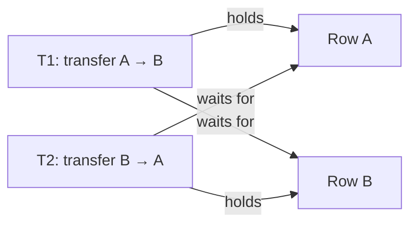

Four conditions (Coffman) must all hold: mutual exclusion, hold-and-wait, no preemption, circular wait. Break any one and deadlocks can't occur. In databases the practical lever is **circular wait** (consistent lock order).

#### Example
```sql
-- T1                                        -- T2
BEGIN;                                       BEGIN;
UPDATE accounts SET … WHERE id = 1;          UPDATE accounts SET … WHERE id = 2;
UPDATE accounts SET … WHERE id = 2;  -- waits UPDATE accounts SET … WHERE id = 1;  -- waits → deadlock
```
PostgreSQL detects it after `deadlock_timeout` (1 s) and fails one with `ERROR: deadlock detected`. Fix: always lock accounts in ascending id order:
```java
long first = Math.min(from, to), second = Math.max(from, to);
lockAccount(first); lockAccount(second);
```

#### Trade-offs
Detection plus retry is automatic but wastes work and adds latency. Prevention (ordering) needs discipline across all code paths.

#### Problems & fixes
| Symptom | Cause | Fix |
|---|---|---|
| `deadlock detected` errors on transfers | opposite lock order | lock rows in a deterministic order |
| Deadlocks between an UPDATE and a batch job | batch updates rows in a different order | sort batch keys, smaller batches |
| InnoDB deadlocks on inserts | gap/next-key locks | proper indexes, Read Committed, shorter transactions |
| S → X upgrade deadlocks | read-lock then write | lock FOR UPDATE up front |

#### Cheat sheet
- Cycle of waits. DB aborts a victim, the app must retry.
- Prevent with consistent lock order, short transactions, fewer locks.
- Diagnose: PG logs, `SHOW ENGINE INNODB STATUS` (latest deadlock).

#### Interview questions
<details><summary>Your payment service logs occasional "deadlock detected" errors. How do you investigate and fix it?</summary>

Read the deadlock report (PG server log, `SHOW ENGINE INNODB STATUS`) to see which statements and rows formed the cycle. Typically two code paths lock the same rows in different orders (A→B vs B→A), or a batch job conflicts with online traffic. Fix by ordering lock acquisition deterministically, locking up front with FOR UPDATE, reducing transaction scope, and adding an automatic retry for the deadlock error code.
</details>

<details><summary>Can deadlocks happen with a single row?</summary>

Yes. Two transactions hold S locks on the same row (`FOR SHARE`, or FK checks) and both try to upgrade to X. Each waits for the other's S lock to be released.
</details>

#### Interview angle
> "Deadlocks are inevitable at scale. I prevent most with a global lock ordering (always the lower account id first) and retry the rest automatically on the deadlock error code."

#### Sources
- [Explicit locking: deadlocks](https://www.postgresql.org/docs/current/explicit-locking.html#LOCKING-DEADLOCKS) — PostgreSQL docs
- [Deadlocks in InnoDB](https://dev.mysql.com/doc/refman/8.4/en/innodb-deadlocks.html) — MySQL reference manual
- [Deadlock](https://en.wikipedia.org/wiki/Deadlock_%28computer_science%29) — Wikipedia

### Deadlock detection — wait-for graph cycle detection
Databases detect deadlocks by building a **wait-for graph**: a node per transaction, and an edge T1 → T2 when T1 waits for a lock T2 holds. A **cycle** means deadlock, and the database picks a victim to abort.

#### Intuition
Draw an arrow from each person to the person they are waiting for. If the arrows ever form a circle, nobody in the circle can move, so someone has to be sent away.

#### Must know
- The database builds a **wait-for graph**: an edge T1 → T2 means T1 waits for a lock T2 holds.
- A cycle means deadlock. One transaction is chosen as the victim and rolled back.
- PostgreSQL checks only after a wait of `deadlock_timeout`. InnoDB checks at once.
- InnoDB picks the transaction that changed the fewest rows.
- The application retries on `40P01` (PostgreSQL) or `1213` (MySQL).

#### Numbers to quote
- PostgreSQL `deadlock_timeout` default: 1 s. InnoDB `innodb_lock_wait_timeout` default: 50 s.

#### Common mistakes
- No retry around the deadlock error, so users see a failure.
- Ignoring the deadlock report in the server log, which names the exact statements.
- Proposing a global wait-for graph for a distributed system, where timeouts or ordering are simpler.

#### How it works
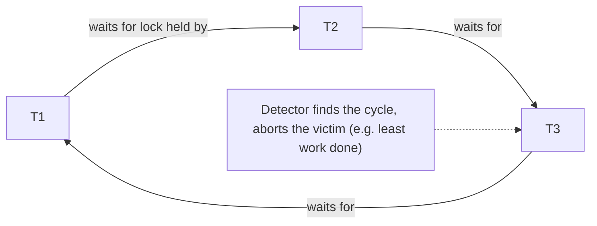

- **PostgreSQL**: a transaction that has waited longer than `deadlock_timeout` (default 1 s) runs the check, which keeps detection cheap.
- **InnoDB**: checks immediately on each wait (can be disabled under extreme concurrency with `innodb_deadlock_detect=OFF`, relying on `innodb_lock_wait_timeout`).
- **Victim choice**: InnoDB rolls back the transaction with the fewest modified rows. Others use the youngest.

#### Example
A deadlock report in the PostgreSQL log:
```text
ERROR:  deadlock detected
DETAIL: Process 4123 waits for ShareLock on transaction 9911; blocked by process 4188.
        Process 4188 waits for ShareLock on transaction 9910; blocked by process 4123.
        Process 4123: UPDATE accounts SET balance = balance - 100 WHERE id = 2
        Process 4188: UPDATE accounts SET balance = balance - 50 WHERE id = 1
```
This points straight at inconsistent ordering of account updates.

#### Trade-offs
Detection is reactive: work is wasted and latency rises by the timeout. Lowering `deadlock_timeout` detects faster but costs more checks under normal lock waits.

#### Problems & fixes
| Symptom | Cause | Fix |
|---|---|---|
| Requests stall ~1 s before failing | PG waits `deadlock_timeout` before checking | fix the lock ordering, retry quickly |
| Victims fail without retry, users see errors | no retry logic | catch deadlock codes (PG 40P01, MySQL 1213) and retry with jitter |
| Detection CPU spikes with thousands of waiters | InnoDB check cost | reduce contention, consider disabling detection with short lock wait timeout |

#### Cheat sheet
- Wait-for graph + cycle = deadlock. Abort a victim.
- PG: check after `deadlock_timeout` (1 s). InnoDB: immediate.
- Error codes: PG `40P01`, MySQL `1213`. Always retry.

#### Interview questions
<details><summary>How would you implement deadlock detection in a distributed lock manager?</summary>

Each node reports its local wait-for edges to a coordinator (or nodes exchange "probe" messages along wait edges, Chandy-Misra-Haas style). A cycle found in the global graph identifies a deadlock, and one participant is aborted. Simpler alternatives in practice: lock timeouts/leases with retry, or prevention by lock ordering, which is why most distributed systems avoid global deadlock detection.
</details>

<details><summary>Which transaction should be chosen as the deadlock victim?</summary>

The one cheapest to roll back and retry: fewest rows modified (InnoDB's choice), youngest, or lowest priority. Avoid repeatedly picking the same transaction (starvation): age-based schemes give older transactions priority.
</details>

#### Interview angle
> "The database finds deadlocks with a wait-for graph and aborts a victim. My job is to retry on the deadlock error code and remove the root cause, usually inconsistent lock ordering."

#### Sources
- [Deadlock detection](https://dev.mysql.com/doc/refman/8.4/en/innodb-deadlock-detection.html) — MySQL reference manual
- [Lock management settings (deadlock_timeout)](https://www.postgresql.org/docs/current/runtime-config-locks.html) — PostgreSQL docs
- [Wait-for graph](https://en.wikipedia.org/wiki/Wait-for_graph) — Wikipedia

### Deadlock prevention — lock ordering (always acquire in same order), timeout + retry
Instead of detecting cycles after they form, prevention makes them **impossible or short-lived**: acquire locks in a global order, acquire all locks at once, or bound waits with timeouts and retry.

#### Intuition
A rule that everyone picks up the left fork first. With one agreed order, no two people can ever each hold the fork the other needs.

#### Must know
- **One global lock order** makes a cycle impossible. This is the main technique.
- Lock a set of rows in order with one statement: `SELECT … WHERE id IN (…) ORDER BY id FOR UPDATE`.
- Bound the wait with `lock_timeout` (PostgreSQL) or `innodb_lock_wait_timeout` (MySQL), then retry.
- `NOWAIT` fails at once instead of waiting. `SKIP LOCKED` moves on to other rows.

#### Common mistakes
- Fixing the order in one code path while an ORM cascade or trigger locks in another order.
- A batch job that walks rows in random order while online traffic uses id order.
- Treating a lock timeout as proof of a deadlock. It may only be a slow transaction.

#### How it works
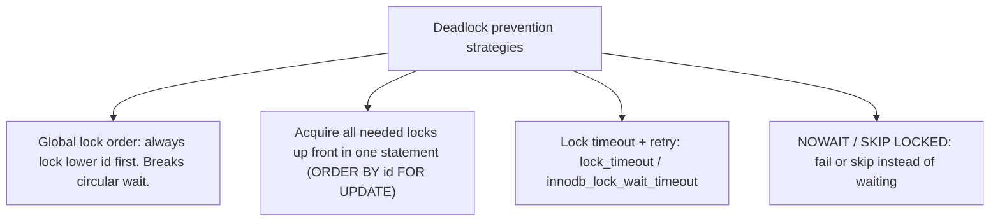

#### Example
Lock all accounts involved in a multi-leg transfer in one ordered statement:
```sql
BEGIN;
SELECT id, balance FROM accounts WHERE id IN (17, 4, 9) ORDER BY id FOR UPDATE;  -- locks 4, then 9, then 17
-- apply debits/credits
COMMIT;
```
Every transaction locks in ascending id order, so no cycle can form.

Fail fast instead of waiting:
```sql
SET lock_timeout = '2s';
SELECT * FROM seats WHERE id = 55 FOR UPDATE NOWAIT;   -- error immediately if locked: "seat being booked, try another"
```

#### Trade-offs
Ordering requires knowing all locks ahead of time and discipline across teams. Timeouts can abort transactions that weren't deadlocked (just slow). NOWAIT pushes retry decisions to the app/user.

#### Problems & fixes
| Symptom | Cause | Fix |
|---|---|---|
| Deadlocks persist after "ordering" fix | some path (ORM cascade, trigger) locks in another order | audit all paths, lock explicitly up front |
| Users wait seconds on a locked seat | blocking lock waits | `NOWAIT` / short `lock_timeout` with a friendly retry |
| Batch job deadlocks with online traffic | batch iterates in random order | sort keys, small batches |

#### Cheat sheet
- Global ordering breaks circular wait (the #1 technique).
- `ORDER BY id FOR UPDATE` locks a set in order.
- `NOWAIT`, `lock_timeout`, `SKIP LOCKED` keep waits bounded.

#### Interview questions
<details><summary>Design deadlock-free transfers between accounts in a ledger service.</summary>

In each transaction, lock both accounts in a deterministic order (ascending account id) with `SELECT … ORDER BY id FOR UPDATE`, then apply the double-entry inserts and balance updates, then commit. Keep the transaction short, with no external calls inside. Add retry on deadlock/serialization codes for safety (e.g. ORM side effects). For a hot account (like a platform fee account), split it into sub-accounts to reduce contention.
</details>

<details><summary>When would you use NOWAIT instead of waiting for a lock?</summary>

When waiting is worse than an immediate "busy" answer: interactive flows like seat selection ("someone is booking this seat"), or job workers that should move on (SKIP LOCKED). NOWAIT turns potential long waits and deadlocks into instant, handleable errors.
</details>

#### Interview angle
> "All multi-row locking goes through one ordered SELECT … ORDER BY id FOR UPDATE, so cycles can't form. Interactive paths use NOWAIT or a short lock_timeout so users never sit waiting on a lock."

#### Sources
- [Explicit locking: deadlocks](https://www.postgresql.org/docs/current/explicit-locking.html#LOCKING-DEADLOCKS) — PostgreSQL docs
- [How to minimize and handle deadlocks](https://dev.mysql.com/doc/refman/8.4/en/innodb-deadlocks-handling.html) — MySQL reference manual
- [SELECT: the locking clause](https://www.postgresql.org/docs/current/sql-select.html#SQL-FOR-UPDATE-SHARE) — PostgreSQL docs

### Deadlock resolution — abort the youngest transaction (wound-wait scheme)
When concurrency control must decide **who waits and who dies**, timestamp-based schemes give each transaction a priority by start time. **Wait-die** and **wound-wait** guarantee no cycles and no starvation, and are used in distributed databases (Spanner uses wound-wait).

#### Intuition
Seniority at a narrow door. In one version the senior person pushes through and the junior steps back to try later. In the other, the junior never waits for a senior and simply leaves. Either way people only ever wait in one direction, so a circle cannot form.

#### Must know
- Each transaction gets a timestamp. **Older = higher priority.**
- **Wait-die**: an older requester waits, a younger requester aborts.
- **Wound-wait**: an older requester aborts the younger holder, a younger requester waits.
- Waits only go one way, so no cycle and **no global detector** is needed.
- A restarted transaction keeps its original timestamp, so it cannot starve.

#### Common mistakes
- Swapping the two schemes. Name who the requester is first, then apply the rule.
- Giving a retry a fresh timestamp, which lets it lose forever.
- Saying these are what PostgreSQL or MySQL use. Those use a wait-for graph. Spanner uses wound-wait.

#### How it works
Each transaction has a timestamp (older = smaller = higher priority). When Ti requests a lock held by Tj:

| Scheme | Ti older than Tj | Ti younger than Tj |
|---|---|---|
| **Wait-die** (non-preemptive) | Ti **waits** | Ti **dies** (aborts, restarts later with same timestamp) |
| **Wound-wait** (preemptive) | Ti **wounds** Tj (Tj aborts) | Ti **waits** |

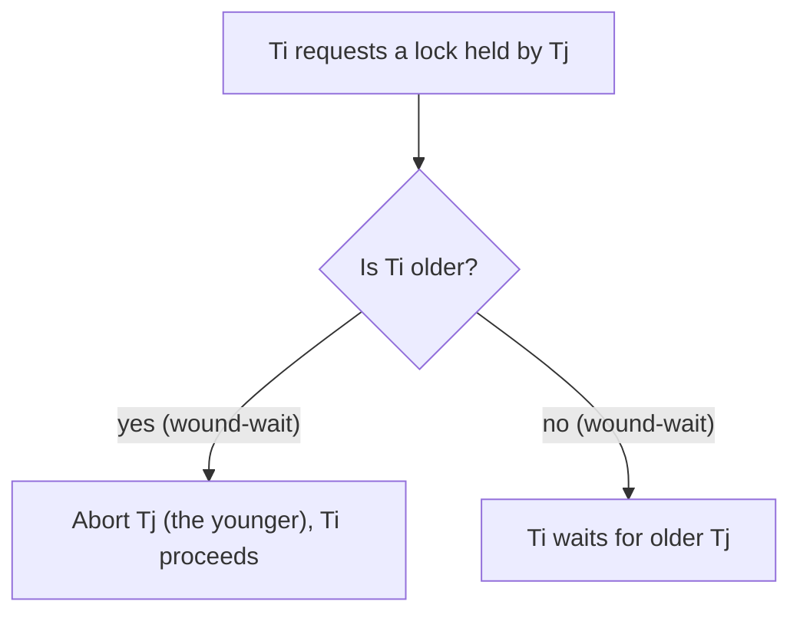

Because a restarted transaction **keeps its original timestamp**, it eventually becomes the oldest and can't starve.

#### Example
Spanner uses wound-wait for read-write transactions: an older transaction that needs a lock held by a younger one aborts the younger, which retries. Waits only happen from younger to older, so the wait-for graph can't have cycles and no global detector is needed, which matters across many machines.

#### Trade-offs
- Wait-die: younger transactions may die repeatedly (more aborts, no preemption).
- Wound-wait: fewer restarts, but preempts work in progress.
- Both may abort transactions that wouldn't actually have deadlocked (conservative).

#### Problems & fixes
| Symptom | Cause | Fix |
|---|---|---|
| Frequent aborts of short transactions in a distributed DB | wound-wait preempting younger ones under contention | reduce contention on hot keys, retry with backoff |
| Starvation of a transaction type | new timestamps on restart | keep original timestamp on retry |

#### Cheat sheet
- Older = higher priority. Waits only go one direction, so no cycles.
- Wait-die: young requester dies. Wound-wait: old requester wounds the young holder.
- Keep the original timestamp on restart to prevent starvation.

#### Interview questions
<details><summary>Why do distributed databases prefer wound-wait / wait-die over wait-for-graph detection?</summary>

Building a global wait-for graph across many nodes needs extra messaging and is slow and complex to keep accurate. Timestamp schemes decide locally at the lock request using only two timestamps, and they guarantee no cycles, so no global detector is needed.
</details>

<details><summary>In wait-die, which transaction can be restarted, and how is starvation avoided?</summary>

The younger requester dies when it asks for a lock held by an older transaction. It restarts with its original timestamp, so over time it becomes relatively older and is eventually allowed to wait rather than die, and it will complete.
</details>

#### Interview angle
> "In distributed transactions I'd rely on timestamp priorities like wound-wait, as Spanner does: waits only go one way, so there's no global deadlock detection, and retries keep their timestamp so nothing starves."

#### Sources
- [Deadlock prevention: wait-die and wound-wait](https://en.wikipedia.org/wiki/Deadlock_prevention_algorithms) — Wikipedia
- [Spanner: Google's globally distributed database](https://research.google/pubs/spanner-googles-globally-distributed-database-2/) — Google Research
- [Two-phase locking lecture notes (deadlock prevention)](https://15445.courses.cs.cmu.edu/fall2023/notes/16-twophaselocking.pdf) — CMU 15-445 Database Systems

### MVCC — Multi-Version Concurrency Control: readers don't block writers, writers don't block readers
MVCC keeps **multiple versions of each row**. A writer creates a new version instead of overwriting in place, and each reader sees the version that was committed as of its **snapshot**. Readers never wait for writers and writers never wait for readers. Writers still lock each other on the same row.

#### Intuition
Version history in a shared document. While someone is typing a new version, you keep reading the last saved one. Nobody waits, and old versions are tidied up later.

#### Must know
- A write creates a **new version** of the row. Each reader sees the version committed as of its snapshot.
- **Readers do not block writers, writers do not block readers.**
- Two writers on the same row still block each other.
- Old versions need garbage collection: VACUUM in PostgreSQL, purge of undo logs in InnoDB.
- A long transaction keeps old versions alive, which causes bloat.

#### Common mistakes
- Saying MVCC removes all locking.
- Running a long report on the primary and then wondering why tables bloat.
- Assuming all engines store versions the same way. PostgreSQL keeps them in the table, InnoDB and Oracle in undo logs.

#### How it works
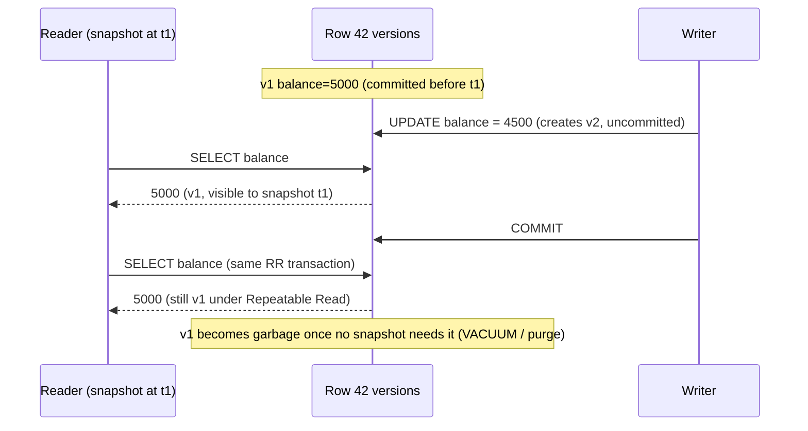

- **PostgreSQL**: new row version stored in the table itself (xmin/xmax). Old versions are cleaned by VACUUM.
- **MySQL InnoDB / Oracle**: row updated in place, old versions kept in **undo logs** and reconstructed for older snapshots. Purge threads clean up.

#### Example
An analytics query scanning 50M orders for 2 minutes on the primary doesn't block checkout writes, and checkout doesn't block it. The cost: those 2 minutes of updates leave dead versions (PG) or a growing undo history (InnoDB) that can't be cleaned until the query finishes.

#### Trade-offs
Excellent read concurrency and consistent snapshots, but extra storage for versions, garbage collection work (VACUUM/purge) and bloat from long transactions.

#### Problems & fixes
| Symptom | Cause | Fix |
|---|---|---|
| Table/index bloat, slowing queries | dead versions not vacuumed (long transactions, autovacuum lagging) | kill long transactions, tune autovacuum, run reports on replicas |
| InnoDB "history list length" growing | long-running transactions blocking purge | find and end them |
| Writers still blocking each other | same-row updates need row locks even with MVCC | expected. Reduce hot rows, short transactions |

#### Cheat sheet
- Writers create versions, readers read snapshots. R doesn't block W, W doesn't block R.
- W blocks W on the same row.
- Cost: versions + GC (VACUUM/purge). Long transactions = bloat.

#### Interview questions
<details><summary>How does MVCC let a long report run without blocking writes, and what's the hidden cost?</summary>

The report reads from a snapshot: it sees row versions committed before it started, while writers create new versions in parallel. The hidden cost is that the database must keep every old version the snapshot might need. Dead tuples (PG) or undo history (InnoDB) accumulate, causing bloat and slower queries until the long transaction ends.
</details>

<details><summary>Does MVCC eliminate all locking?</summary>

No. Reads take no row locks, but writes to the same row still take row locks (the second writer waits or, under snapshot isolation, gets a serialization error). Explicit locks (FOR UPDATE), DDL locks and constraint checks still exist.
</details>

#### Interview angle
> "MVCC is why our reads never block checkout writes. I protect it by keeping transactions short and moving long analytical queries to replicas, so old versions get cleaned up."

#### Sources
- [Concurrency control: introduction to MVCC](https://www.postgresql.org/docs/current/mvcc-intro.html) — PostgreSQL docs
- [InnoDB multi-versioning](https://dev.mysql.com/doc/refman/8.4/en/innodb-multi-versioning.html) — MySQL reference manual
- [Multiversion concurrency control](https://en.wikipedia.org/wiki/Multiversion_concurrency_control) — Wikipedia

### MVCC in PostgreSQL — each row has xmin/xmax visibility markers
PostgreSQL implements MVCC by storing **every row version (tuple) in the table**, stamped with the transaction ids that created it (`xmin`) and deleted or replaced it (`xmax`). Visibility rules compare these ids with each transaction's snapshot. Updates are effectively insert-new + mark-old-dead.

#### Intuition
Every row version carries two stamps: "created by transaction X" and "removed by transaction Y". To decide whether you can see it, PostgreSQL compares the stamps with the moment your snapshot was taken.

#### Must know
- Each tuple stores `xmin` (creating transaction) and `xmax` (deleting or replacing transaction).
- An **UPDATE writes a whole new tuple** and leaves the old one dead.
- **VACUUM / autovacuum** reclaims dead tuples. If it falls behind, tables bloat.
- A **HOT update** skips index writes when no indexed column changed and the page has room.
- Transaction ids are 32-bit, so old rows must be **frozen** to avoid wraparound.

#### Numbers to quote
- Wraparound horizon: about 2 billion transactions (2³¹).
- Autovacuum triggers by default at 20% dead rows (`autovacuum_vacuum_scale_factor = 0.2`), too lax for big hot tables.

#### Common mistakes
- Thinking an UPDATE changes the row in place in PostgreSQL.
- Indexing a column that changes on every request, which defeats HOT updates.
- Leaving an idle transaction or an unused replication slot open, so VACUUM can clean nothing.

#### How it works
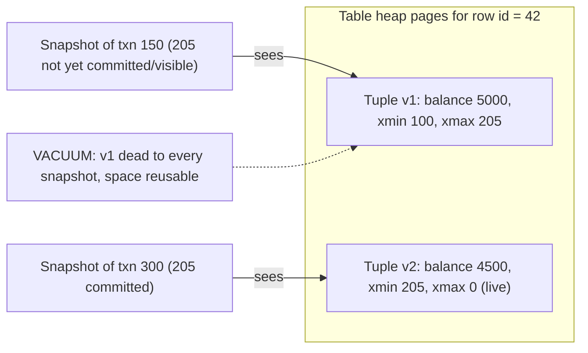

Rules (simplified): a tuple is visible if its `xmin` committed before your snapshot and its `xmax` is empty, aborted, or not yet committed in your snapshot. Hidden system columns can be inspected:
```sql
SELECT xmin, xmax, ctid, * FROM accounts WHERE id = 42;
```

Consequences:
- Every UPDATE writes a whole new tuple, plus index entries unless it's a **HOT update** (no indexed column changed and space is free on the same page).
- **VACUUM** reclaims dead tuples. **Autovacuum** runs it automatically.
- Transaction ids are 32-bit, so VACUUM must **freeze** old tuples to prevent **transaction ID wraparound**.

#### Example
A `sessions` table updated 5,000 times/s (`last_seen`): each update creates a dead tuple, so the table bloats from 2 GB to 40 GB if autovacuum can't keep up. Fixes: tune per-table autovacuum (`autovacuum_vacuum_scale_factor = 0.01`), leave free space on pages (`fillfactor = 80`) so updates are HOT, avoid indexing `last_seen`, or move such hot ephemeral data to Redis.

#### Trade-offs
Simple and fast reads, cheap rollbacks (just don't mark committed), but write amplification, bloat and vacuum tuning are the operational tax.

#### Problems & fixes
| Symptom | Cause | Fix |
|---|---|---|
| Table much larger than live data | dead tuples not reclaimed | autovacuum tuning, `pg_repack` to compact online |
| Warnings about transaction ID wraparound | freezing not keeping up | ensure autovacuum runs (no blocking long transactions), manual `VACUUM FREEZE` |
| Heavy index write amplification on updates | non-HOT updates | lower fillfactor, don't index frequently updated columns |
| VACUUM can't clean anything | long-running or idle-in-transaction session, replication slot holding xmin | find via `pg_stat_activity`/`pg_replication_slots`, end it |

#### Cheat sheet
- Tuple has `xmin` (creator), `xmax` (deleter). Visibility vs snapshot.
- UPDATE = new tuple + dead old one. HOT avoids index updates.
- VACUUM/autovacuum reclaim + freeze. Watch for wraparound.

#### Interview questions
<details><summary>Why can a heavily updated small table in PostgreSQL become huge, and how do you fix it?</summary>

Each update creates a new tuple and leaves the old one dead until VACUUM reclaims it. If autovacuum can't keep up (default thresholds too lax for that table, or long transactions/replication slots preventing cleanup), dead tuples accumulate. Fix the blockers, set aggressive per-table autovacuum settings, use fillfactor for HOT updates, compact with pg_repack, or move the hot data elsewhere.
</details>

<details><summary>What is transaction ID wraparound and why is it dangerous?</summary>

PostgreSQL transaction ids are 32-bit and compared modulo 2^32. If old tuples aren't "frozen" by VACUUM before ~2 billion newer transactions occur, they would suddenly appear to be in the future and become invisible. To prevent data loss, Postgres stops accepting writes as it approaches the limit. Autovacuum's anti-wraparound freezing must be allowed to run.
</details>

#### Interview angle
> "In Postgres every update leaves a dead tuple, so for high-churn tables I tune autovacuum per table, use fillfactor for HOT updates, and watch long transactions and replication slots that block cleanup."

#### Sources
- [Routine vacuuming](https://www.postgresql.org/docs/current/routine-vacuuming.html) — PostgreSQL docs
- [Heap-only tuples (HOT)](https://www.postgresql.org/docs/current/storage-hot.html) — PostgreSQL docs
- [System columns (xmin, xmax, ctid)](https://www.postgresql.org/docs/current/ddl-system-columns.html) — PostgreSQL docs

### Optimistic locking — read with version, update with WHERE version=N, check affected rows
Optimistic locking assumes conflicts are rare: read the row **with its version number**, do your work without holding locks, then update **only if the version is unchanged**. If someone else changed it first, your update affects 0 rows, and you retry or report a conflict.

#### Intuition
Editing a wiki page. Nobody locks the page while you type. When you press save, the wiki checks whether the page changed since you opened it, and if it did, you are asked to merge.

#### Must know
- Read the row with its `version`. Update with `WHERE id = ? AND version = ?` and set `version = version + 1`.
- **0 rows affected = someone else won.** Reload and retry, or return a conflict.
- No lock is held, so it suits rare conflicts and user think-time (forms).
- JPA `@Version` does it for you. Over HTTP it is `ETag` + `If-Match` → 412.
- Under heavy contention it wastes work. Use an atomic update or a pessimistic lock there.

#### Common mistakes
- Not checking the affected-row count.
- Using it on a hot row, such as flash-sale stock, where almost every attempt fails.
- A bulk SQL update that forgets to bump the version, so ORM users overwrite it.

#### How it works
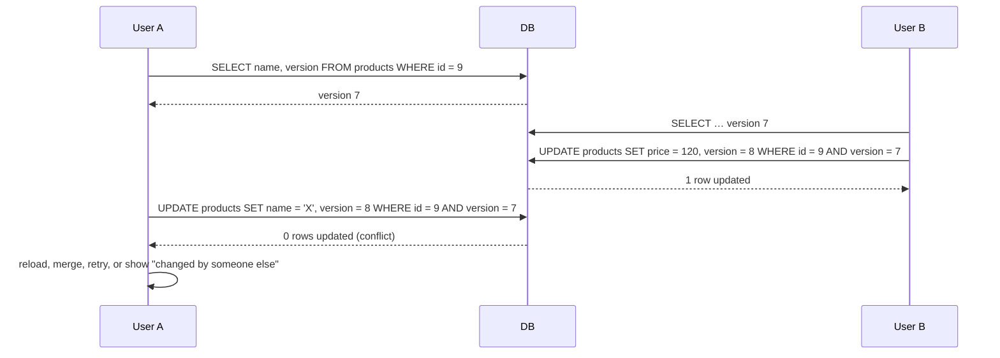

#### Example
```sql
UPDATE products
SET    price = :newPrice, version = version + 1, updated_at = now()
WHERE  id = :id AND version = :expectedVersion;
-- rowsAffected == 0 → conflict
```
JPA: `@Version` does this automatically and throws `OptimisticLockException`. REST: return `ETag: "7"`, require `If-Match: "7"`, respond **412 Precondition Failed** on mismatch. DynamoDB: `ConditionExpression: version = :v`.

#### Trade-offs
No locks held, so it's great for low-contention data and long "think time" (forms). Under high contention most attempts fail and retry, wasting work, so switch to pessimistic locking or atomic updates there.

#### Problems & fixes
| Symptom | Cause | Fix |
|---|---|---|
| Many OptimisticLockExceptions | hot row under heavy write contention | pessimistic lock or atomic SQL, reduce contention |
| Conflicts on unrelated field edits | one version for the whole row | finer-grained entities, merge non-overlapping changes |
| Version check skipped by a bulk SQL update | bulk update bypasses the ORM | include `version = version + 1` in bulk updates |

#### Cheat sheet
- Read version → `UPDATE … WHERE version = :v` → check rows affected.
- JPA `@Version`, HTTP ETag/If-Match (412), DynamoDB conditional writes.
- Low contention = optimistic. High contention = pessimistic.

#### Interview questions
<details><summary>How would you prevent two support agents from overwriting each other's edits to a customer record?</summary>

Optimistic locking: return the record's version (ETag) with the GET, and send it back with the save (`If-Match`). The UPDATE includes `WHERE version = ?`. If 0 rows were affected, return 412/409 and show the agent the latest data with a diff to merge. No locks are held while agents are typing.
</details>

<details><summary>Why is optimistic locking a bad fit for a flash-sale inventory counter?</summary>

Thousands of concurrent buyers update the same row, so nearly every optimistic attempt conflicts and retries, wasting DB work and adding latency (livelock-ish behaviour). Use an atomic conditional decrement (`UPDATE … SET qty = qty - 1 WHERE qty > 0`), a Redis Lua decrement, or a queue that serialises orders.
</details>

#### Interview angle
> "User-edited entities use a version column surfaced as an ETag. A stale save gets a 412 and a merge screen instead of silently overwriting someone else's change."

#### Sources
- [Optimistic concurrency control](https://en.wikipedia.org/wiki/Optimistic_concurrency_control) — Wikipedia
- [Optimistic locking with version number](https://docs.aws.amazon.com/amazondynamodb/latest/developerguide/DynamoDBMapper.OptimisticLocking.html) — Amazon DynamoDB developer guide
- [ETag header](https://developer.mozilla.org/en-US/docs/Web/HTTP/Reference/Headers/ETag) — MDN

### Pessimistic locking — SELECT FOR UPDATE (acquires row-level lock)
Pessimistic locking assumes conflicts are likely: **lock the row when you read it**, so nobody else can modify it (or lock it) until you commit. In SQL that's `SELECT … FOR UPDATE`. Competing transactions wait in line instead of failing at the end.

#### Intuition
Taking the only key to the meeting room before you go in. Anyone else who wants the room waits at the door until you bring the key back.

#### Must know
- `SELECT … FOR UPDATE` locks the rows it returns until commit. Others wait in line.
- Use it for **short, contended, must-not-fail** sections such as a wallet debit.
- `NOWAIT` errors at once. `SKIP LOCKED` skips locked rows.
- **Never hold it across user think-time or a remote call.** A 10-minute seat hold is a status column with an expiry, not a database lock.
- The WHERE clause needs an index, or InnoDB locks far more rows than intended.

#### Common mistakes
- Keeping the transaction open while the user pays.
- Locking several rows in different orders in different code paths (deadlock).
- Using it for low-contention edit forms, where optimistic locking is simpler.

#### How it works
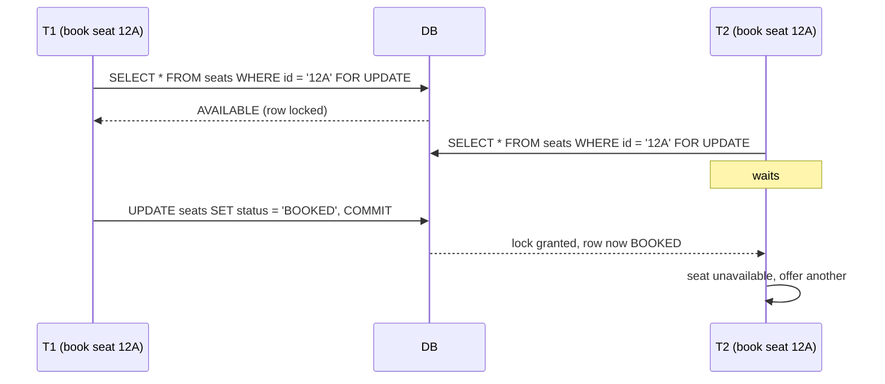

Variants (PostgreSQL): `FOR UPDATE` (strongest), `FOR NO KEY UPDATE` (UPDATE's default, lets FK checks proceed), `FOR SHARE`, `FOR KEY SHARE`. Modifiers: `NOWAIT` (error instead of waiting), `SKIP LOCKED` (skip locked rows).

#### Example
Wallet debit with balance check:
```sql
BEGIN;
SELECT balance FROM wallets WHERE user_id = 7 FOR UPDATE;
-- if balance < 500 → ROLLBACK with "insufficient funds"
UPDATE wallets SET balance = balance - 500 WHERE user_id = 7;
INSERT INTO wallet_txns(user_id, amount, ref) VALUES (7, -500, 'order-981');
COMMIT;
```
In JPA: `@Lock(LockModeType.PESSIMISTIC_WRITE)` on the repository query.

#### Trade-offs
Guarantees success for the lock holder and avoids retries, but it blocks others, risks deadlocks, and holds locks for the transaction's duration. It also needs an index on the WHERE columns, or more rows get locked than intended.

#### Problems & fixes
| Symptom | Cause | Fix |
|---|---|---|
| Requests time out waiting for locks | long transactions holding FOR UPDATE | minimal work inside, `lock_timeout`, NOWAIT for interactive flows |
| Deadlocks | different lock orders | `ORDER BY id FOR UPDATE`, consistent ordering |
| Too many rows locked (InnoDB) | WHERE not using an index, so a scan locks many rows | index the predicate |
| Lock "held" across HTTP requests | trying to hold DB locks during user think time | use optimistic locking or application-level holds with TTL |

#### Cheat sheet
- `SELECT … FOR UPDATE` locks rows until commit.
- `NOWAIT` = fail fast. `SKIP LOCKED` = take something else.
- High contention + must-not-fail + short transactions = pessimistic.

#### Interview questions
<details><summary>For seat booking with a 10-minute "hold while paying" window, would you hold a FOR UPDATE lock for 10 minutes?</summary>

No. Never hold DB locks across user think-time or external calls. Use a short transaction to atomically mark the seat `HELD` with `hold_id` and `hold_expires_at` (conditional update or FOR UPDATE + update), commit immediately, and let payment complete later. A sweeper (or the conditional check `hold_expires_at < now()`) releases expired holds. The lock lasts milliseconds, while the business hold lasts minutes.
</details>

<details><summary>Pessimistic vs optimistic locking for a bank ledger posting service?</summary>

Postings are short, high-value and must not fail spuriously, and some accounts are hot. Pessimistic row locks (ordered by account id) inside short transactions give predictable behaviour without retry storms. Optimistic locking would cause frequent conflicts on busy accounts. Many ledgers combine this with append-only entries plus conditional balance updates.
</details>

#### Interview angle
> "For short, contended critical sections like a wallet debit, I lock with FOR UPDATE in a millisecond transaction. Longer business holds become status columns with expiry, never DB locks held across user actions."

#### Sources
- [SELECT: the locking clause](https://www.postgresql.org/docs/current/sql-select.html#SQL-FOR-UPDATE-SHARE) — PostgreSQL docs
- [Locking reads](https://dev.mysql.com/doc/refman/8.4/en/innodb-locking-reads.html) — MySQL reference manual
- [Explicit locking: row-level locks](https://www.postgresql.org/docs/current/explicit-locking.html#LOCKING-ROWS) — PostgreSQL docs

### SELECT FOR UPDATE SKIP LOCKED — queue-like pattern for job workers
`SKIP LOCKED` tells the database to **ignore rows already locked by other transactions** instead of waiting. Many workers can run the same "grab the next N pending jobs" query concurrently, and each gets a different set of rows. It turns a plain table into a reliable job queue.

#### Intuition
Supermarket checkouts. A new shopper does not queue behind a busy till. They walk to the next free one, so no two cashiers ever serve the same shopper.

#### Must know
- `FOR UPDATE SKIP LOCKED` **skips rows other transactions have locked** instead of waiting.
- Many workers run the same "next N pending jobs" query and each gets different rows.
- It turns a table into a job queue that is transactional with your business data, as in an outbox relay.
- A crashed worker's transaction rolls back, so its jobs become available again.
- Jobs can still run twice, so handlers must be idempotent.

#### Numbers to quote
- Comfortable up to roughly thousands of jobs per second. Beyond that use Kafka or SQS.
- Available since PostgreSQL 9.5 and MySQL 8.0.

#### Common mistakes
- Using it for normal business queries. It silently returns incomplete results.
- No index on the pending rows, so every poll scans the table.
- Claim-and-commit with no lease timeout, leaving jobs stuck in RUNNING after a crash.

#### How it works
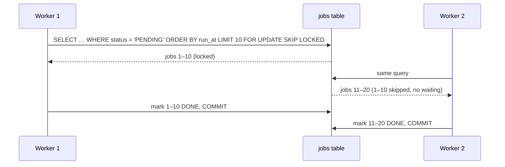

```sql
WITH next AS (
  SELECT id FROM jobs
  WHERE status = 'PENDING' AND run_at <= now()
  ORDER BY run_at
  LIMIT 10
  FOR UPDATE SKIP LOCKED
)
UPDATE jobs SET status = 'RUNNING', locked_by = :worker, locked_at = now()
FROM next WHERE jobs.id = next.id
RETURNING jobs.*;
```

#### Example
An outbox relay: `outbox` rows are written in business transactions. Several relay instances each claim 100 unpublished rows with SKIP LOCKED, publish to Kafka and mark them sent. There's no double-processing within a claim, and a crashed worker's transaction rolls back, so its rows become claimable again. Libraries like **Solid Queue**, **pg-boss**, **Oban**, **River** and **db-scheduler** (in its lock-and-fetch mode) use this pattern.

Two styles:
1. **Process inside the transaction** (lock held while working): simple, a crash auto-releases, but long jobs hold transactions open.
2. **Claim and commit** (status RUNNING + `locked_at`), process outside, then mark DONE. Needs a reaper for stuck RUNNING jobs (`locked_at < now() - interval '5 min'`).

#### Trade-offs
No extra infrastructure (just Postgres/MySQL 8), transactional with business data. Throughput tops out around thousands of jobs per second, and polling plus dead-tuple churn need indexes and vacuum tuning. For very high volume or fan-out, use Kafka/SQS.

#### Problems & fixes
| Symptom | Cause | Fix |
|---|---|---|
| Workers wait on each other | missing SKIP LOCKED | add `SKIP LOCKED` |
| Slow claim query | no index for the predicate | partial index `ON jobs(run_at) WHERE status = 'PENDING'` |
| Jobs stuck RUNNING forever after a crash | claim-and-commit with no reaper | lease timeout + reaper, idempotent jobs |
| Table bloat | constant updates/deletes | autovacuum tuning, delete or archive completed jobs, partition by day |

#### Cheat sheet
- `FOR UPDATE SKIP LOCKED LIMIT N` = concurrent workers, no overlap.
- Partial index on pending jobs. Reaper for leases. Idempotent handlers.
- Great up to ~thousands of jobs/s. Beyond that, a real queue.

#### Interview questions
<details><summary>Design a job scheduler on top of PostgreSQL that runs reminders at their scheduled time with multiple workers.</summary>

`jobs(id, run_at, status, attempts, locked_by, locked_at, payload)` with a partial index on `run_at WHERE status='PENDING'`. Workers poll every second: claim due jobs with `FOR UPDATE SKIP LOCKED LIMIT 50`, set them RUNNING with a lease, commit, execute, then mark DONE, or set PENDING with `run_at = now() + backoff` on failure. A reaper resets expired leases. Handlers are idempotent because at-least-once execution is possible. Partition or archive old rows.
</details>

<details><summary>Why is SKIP LOCKED inappropriate for general business queries?</summary>

It silently returns an incomplete result: rows locked by others are omitted. That's fine for "give me any available work item", but wrong for "show the user's orders" or "sum the balances", where you need every row.
</details>

#### Interview angle
> "For moderate job volumes I'd use a Postgres table queue with FOR UPDATE SKIP LOCKED and leases. It's transactional with the business data and needs no extra infrastructure. I'd move to Kafka or SQS only when volume demands it."

#### Sources
- [SELECT: the locking clause (SKIP LOCKED)](https://www.postgresql.org/docs/current/sql-select.html#SQL-FOR-UPDATE-SHARE) — PostgreSQL docs
- [Locking reads: NOWAIT and SKIP LOCKED](https://dev.mysql.com/doc/refman/8.4/en/innodb-locking-reads.html) — MySQL reference manual

### Predicate locks — Serializable Snapshot Isolation (SSI) in PostgreSQL 9.1+
PostgreSQL's Serializable level uses **SSI**: transactions run on snapshots as usual, but the database records **what each transaction read** (as "SIRead" predicate locks, which never block) and looks for read-write dependency patterns that could make the result non-serializable. When it finds a dangerous pattern, it aborts one transaction.

#### Intuition
A librarian who notes which shelves each reader looked at. Nobody is stopped from reading. If two readers' notes show that each changed something the other relied on, one of them is asked to start again.

#### Must know
- PostgreSQL Serializable = snapshot isolation **plus tracking of what each transaction read**.
- Those "SIRead" predicate locks **never block**. They are bookkeeping.
- When the read/write dependencies could form a cycle, one transaction is aborted with SQLSTATE 40001.
- False positives happen, so a retry loop is mandatory.
- Sequential scans lock the whole table for tracking purposes, so missing indexes mean more aborts.

#### Common mistakes
- Expecting predicate locks to make other transactions wait. They only cause aborts.
- Running Serializable with no retry on 40001.
- Running big reports at Serializable instead of `READ ONLY DEFERRABLE`.

#### How it works
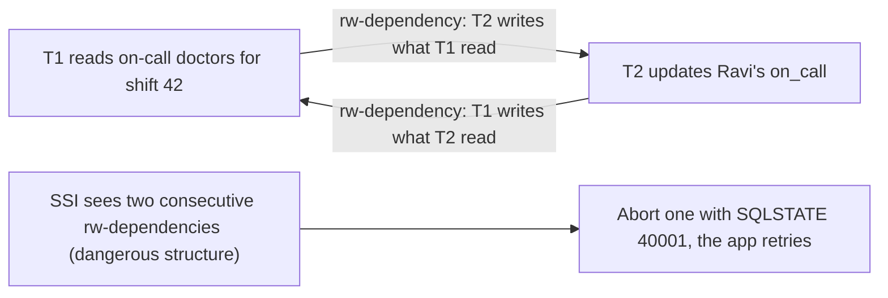

- **SIRead locks** are taken on what you read (tuples, pages or whole relations, depending on how much was scanned). They don't block anybody. They're just bookkeeping.
- Index scans give fine-grained predicate tracking, while sequential scans escalate to relation-level locks, which means more false positives.
- `SERIALIZABLE READ ONLY DEFERRABLE` lets read-only reports run without any risk of serialization failure (they wait for a safe snapshot).

#### Example
The on-call write skew from earlier: under `SET TRANSACTION ISOLATION LEVEL SERIALIZABLE`, both doctors read the on-call set and each writes their own row. SSI sees T1 → T2 → T1 rw-dependencies and aborts the second committer with:
```text
ERROR: could not serialize access due to read/write dependencies among transactions
HINT:  The transaction might succeed if retried.
```

#### Trade-offs
Full serializability without blocking reads, but it adds tracking overhead, false-positive aborts (more under seq scans or many concurrent transactions), and needs retries. Good indexes reduce false positives.

#### Problems & fixes
| Symptom | Cause | Fix |
|---|---|---|
| Many 40001 errors under Serializable | contention or coarse predicate locks from seq scans | index the predicates, smaller transactions, retry with backoff |
| Memory warnings about predicate locks | many concurrent serializable transactions | `max_pred_locks_per_transaction`, shorter transactions |
| Reports aborted at serializable | read/write conflicts | `SERIALIZABLE READ ONLY DEFERRABLE` for reports |

#### Cheat sheet
- SSI = snapshot isolation + dependency tracking + abort on dangerous structures.
- SIRead predicate locks never block.
- Index your predicates. Always retry 40001.

#### Interview questions
<details><summary>How does PostgreSQL's Serializable differ from a lock-based Serializable like MySQL's?</summary>

MySQL's SERIALIZABLE (2PL) turns plain reads into shared locking reads, so readers and writers block each other and deadlocks occur. PostgreSQL's SSI never blocks for serializability: transactions read snapshots, the engine tracks read-write dependencies with non-blocking predicate locks, and it aborts one transaction when a potential anomaly is detected. That gives better concurrency, but the app must handle retries.
</details>

<details><summary>Why can missing indexes increase serialization failures under SSI?</summary>

Predicate locks follow how data was read. An index scan locks just the relevant index ranges or tuples, but a sequential scan must lock the whole relation. Coarser locks overlap with more unrelated writes, so SSI detects more (false-positive) dangerous structures and aborts more transactions.
</details>

#### Interview angle
> "For invariants across rows I'd turn on Postgres Serializable. SSI tracks what we read without blocking, so I just need indexed predicates and a retry loop for 40001."

#### Sources
- [Serializable isolation level](https://www.postgresql.org/docs/current/transaction-iso.html#XACT-SERIALIZABLE) — PostgreSQL docs
- [Serializable Snapshot Isolation (SSI)](https://wiki.postgresql.org/wiki/SSI) — PostgreSQL wiki
- [Serializable Snapshot Isolation in PostgreSQL](https://drkp.net/papers/ssi-vldb12.pdf) — Ports and Grittner, VLDB 2012

