## Indexing & query optimization

### B+ tree index — leaf nodes contain data/row pointers linked in sorted order, O(log N) seek + range
The B+ tree is the default index in almost every relational database (PostgreSQL, MySQL, Oracle, SQL Server). It keeps keys **sorted** in a shallow, wide tree. Finding one key takes a handful of page reads, and because leaves are linked, **range scans and ORDER BY** are cheap too.

#### How it works
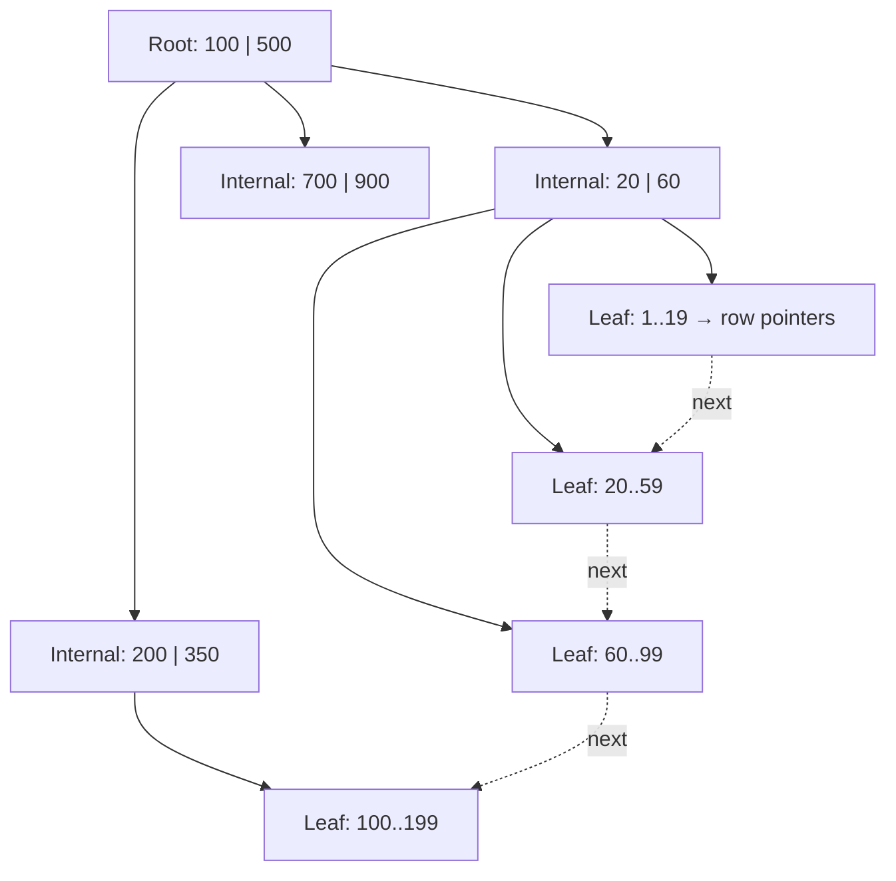

- Each node is a disk page (8 KB in PG, 16 KB in InnoDB) holding hundreds of keys (fan-out ~100–500).
- Internal nodes only hold separator keys. **Leaves** hold the keys plus row pointers (PG: TID) or the row itself (InnoDB clustered index).
- Depth ≈ log_fanout(N): with fan-out 300, 3 levels address 27M rows, 4 levels 8 billion. The top levels sit in memory, so a lookup is ~1–2 disk reads.
- Inserts split full pages, deletes merge/rebalance, so the tree stays balanced.

#### Example
`CREATE INDEX ON orders(created_at);`
```sql
SELECT * FROM orders WHERE created_at >= '2026-11-01' AND created_at < '2026-11-02' ORDER BY created_at;
```
Seek to the first leaf ≥ Nov 1 (3–4 page reads), then walk linked leaves until Nov 2. That's already sorted, so there's no separate sort step. Without the index: a full scan of 200M rows plus a sort.

#### Trade-offs
Fast reads (point + range + sorted output), but every insert/update of an indexed column must update the tree (write amplification, page splits). Random keys (UUIDv4) scatter inserts across the tree, so the cache thrashes and fragmentation grows. Sequential keys (bigserial, UUIDv7, ULID) append to the right edge.

#### Problems & fixes
| Symptom | Cause | Fix |
|---|---|---|
| Insert throughput drops as the table grows | random UUIDv4 primary keys cause page splits and cache misses | time-ordered ids (UUIDv7, ULID, Snowflake, bigserial) |
| Index not used for `LIKE '%term'` | leading wildcard can't seek in sorted order | trigram (pg_trgm GIN) or full-text search |
| Too many indexes slow writes | every index updated per write | drop unused indexes (`pg_stat_user_indexes.idx_scan = 0`) |
| Index bloated after mass deletes | dead entries/half-empty pages | `REINDEX CONCURRENTLY`, pg_repack |

#### Cheat sheet
- O(log N) seek, ~3–4 levels for billions of rows. Linked leaves give ranges and ORDER BY.
- Supports `=`, `<`, `>`, `BETWEEN`, prefix `LIKE 'abc%'`, ORDER BY.
- Sequential keys insert efficiently. Random UUIDs fragment.

#### Interview questions
<details><summary>Why do databases use B+ trees rather than binary search trees or hash tables for indexes?</summary>

Disks and SSDs read whole pages, so a B+ tree packs hundreds of keys per page, giving a very shallow tree: ~3–4 page reads for billions of rows, versus ~30 for a binary tree. Sorted, linked leaves support range queries, ORDER BY and prefix matches, which hash tables can't. Splits and merges keep it balanced under inserts and deletes.
</details>

<details><summary>Your orders table with a UUIDv4 primary key gets slower at inserting as it grows. Why?</summary>

Random keys land on random leaf pages, so each insert touches a different page. Once the index exceeds memory, inserts cause random I/O and frequent page splits, leaving pages half full (bloat). Time-ordered ids (UUIDv7/ULID/bigint sequence) append near the right edge of the tree, keeping hot pages in cache.
</details>

#### Interview angle
> "A B+ tree index on (user_id, created_at) serves the user's order history with one seek plus a sequential leaf walk, already sorted. I'd use time-ordered ids so inserts append instead of splitting random pages."

### Hash index — O(1) exact match, no range queries, used in Hash join, pg_trgm GIN
A hash index maps `hash(key) → bucket → row pointers`. It answers **exact equality** lookups in roughly constant time, but because hashing destroys order it can't do ranges, sorting or prefix matches. In practice B+ trees usually win anyway, and hashing shines more inside query execution (hash joins) and in key-value stores.

#### How it works
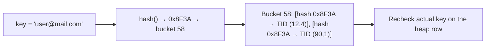

- **PostgreSQL**: `CREATE INDEX … USING hash (col)`. Crash-safe and replicated since PG 10. Can be smaller than a B+ tree for long keys (stores only the 4-byte hash).
- **MySQL InnoDB**: no user hash indexes, but an **adaptive hash index** is built automatically in memory for hot B+ tree lookups. The MEMORY engine has hash indexes.
- **Hash join**: the planner builds an in-memory hash table on the smaller input, then probes it with each row of the larger one. O(N + M) for equality joins.

#### Example
Lookup by a long API token: `SELECT * FROM api_tokens WHERE token = '…64 chars…'`. A hash index stores 4-byte hashes instead of 64-byte keys, so it's smaller and stays in cache. But `WHERE token LIKE 'abc%'` or `ORDER BY token` can't use it.

Hash join in a plan:
```text
Hash Join  (cost=... rows=...)
  Hash Cond: (o.user_id = u.id)
  ->  Seq Scan on orders o
  ->  Hash
        ->  Seq Scan on users u   (smaller side becomes the hash table)
```

#### Trade-offs
| Hash index | B+ tree |
|---|---|
| equality only | equality, range, sort, prefix |
| O(1) average | O(log N), shallow |
| can't enforce UNIQUE in PG | supports UNIQUE, multi-column |
| smaller for long keys | general purpose default |

#### Problems & fixes
| Symptom | Cause | Fix |
|---|---|---|
| Range query ignores the hash index | hash has no order | B+ tree index |
| Hash join spills to disk, slow | hash table larger than `work_mem` | raise `work_mem` for the query, filter earlier, join smaller sets |
| Need a unique constraint on hashed column | PG hash indexes can't be UNIQUE | B+ tree unique index (or unique on a hash expression) |

#### Cheat sheet
- Equality only, O(1). No range/sort/prefix.
- Default to B+ tree. Hash index for big keys with equality-only access.
- Hash join = build on the small side, probe with the big side (equi-joins).

#### Interview questions
<details><summary>When would you choose a hash index over a B-tree in PostgreSQL?</summary>

Rarely: when a column is only ever queried by exact equality, values are long (URLs, tokens) so a hash index is much smaller, and you don't need uniqueness, ranges or sorting. In most cases the B-tree's versatility outweighs the small gain.
</details>

<details><summary>How does a hash join work and when does the planner prefer it?</summary>

It builds an in-memory hash table on the join key of the smaller input, then scans the larger input once, probing the table for matches. O(N + M) for equality joins on large unsorted inputs with no useful index. If the hash table exceeds `work_mem`, it partitions to disk (batches), which slows down.
</details>

#### Interview angle
> "Hashing gives O(1) equality but loses order, so I default to B-trees for indexes. Hash joins are what the planner uses for big equality joins, as long as work_mem fits the hash table."

### Composite index — column order matters: WHERE a=1 AND b=2 uses (a,b) but not (b,a) for a-only query
A composite (multi-column) index sorts rows by the first column, then by the second within equal first values, and so on, like a phone book sorted by last name then first name. It can only be used efficiently from the **leftmost columns onward** (the **leftmost-prefix rule**).

#### How it works
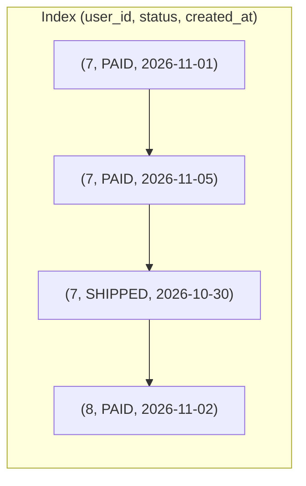

| Query | Uses (user_id, status, created_at)? |
|---|---|
| `WHERE user_id = 7` | ✅ prefix |
| `WHERE user_id = 7 AND status = 'PAID'` | ✅ |
| `WHERE user_id = 7 AND status = 'PAID' ORDER BY created_at DESC` | ✅ seek + sorted, no sort step |
| `WHERE user_id = 7 AND created_at > '2026-11-01'` | ⚠️ seeks user_id, then filters created_at (status skipped) |
| `WHERE status = 'PAID'` | ❌ not a prefix (full index scan at best) |

**Rule of thumb** for column order: equality columns first, then the range or ORDER BY column. Among equality columns, put the most commonly filtered first (selectivity matters less than prefix reuse).

#### Example
A "my orders" screen: `WHERE user_id = ? AND status = ? ORDER BY created_at DESC LIMIT 20`.
`CREATE INDEX idx_orders_user_status_created ON orders(user_id, status, created_at DESC);`
The database seeks to `(user_id, status)` and reads 20 index entries in order, so it takes about a millisecond even with 500M orders. With separate single-column indexes it would combine bitmaps or sort thousands of rows.

#### Trade-offs
One well-designed composite index can replace several single-column ones. But it serves only queries matching its prefix, and wide composite indexes are larger and costlier to maintain.

#### Problems & fixes
| Symptom | Cause | Fix |
|---|---|---|
| Index exists but query does a seq scan | query filters on a non-leading column | reorder columns or add an index for that access path |
| Slow ORDER BY despite index | index order doesn't match filter + sort | (equality cols…, sort col) order, matching direction |
| Too many overlapping indexes | (a), (a,b), (a,b,c) all exist | keep (a,b,c), which covers prefixes (a) and (a,b) |
| Range in the middle kills later columns | `a = ? AND b > ? AND c = ?` | put range column last: (a, c, b) |

#### Cheat sheet
- Leftmost prefix rule: (a,b,c) serves a, (a,b), (a,b,c).
- Order: equality columns → range/sort column.
- Range on a column stops index use for columns after it (for seeking).

#### Interview questions
<details><summary>Design the index for: SELECT * FROM txns WHERE account_id = ? AND created_at BETWEEN ? AND ? ORDER BY created_at DESC LIMIT 50.</summary>

`CREATE INDEX ON txns(account_id, created_at DESC)`. Equality column first, then the range/sort column. The database seeks to the account's latest entries in range and reads 50 in order with no sort. Adding `INCLUDE (amount, type)` (covering) can make it an index-only scan for list views.
</details>

<details><summary>You have indexes on (status) and (created_at) separately, but a query on both is slow. Why?</summary>

The planner can use one index and filter, or combine both via a bitmap AND, and both read many rows: `status` has low selectivity, and the date range may be large. A composite index `(status, created_at)` lets the database seek directly to `status = X` within the date range in order, touching only matching entries.
</details>

#### Interview angle
> "I design composite indexes from the query: equality columns first, then the range or sort column, so the hot query is a single seek plus an ordered read with no sort step."

### Covering index — index includes all queried columns, avoids table heap lookup (index-only scan)
A covering index contains **every column a query needs**, so the database can answer from the index alone without visiting the table rows. That's an **index-only scan**, which saves a random I/O per row and often speeds queries up 2–10×.

#### How it works
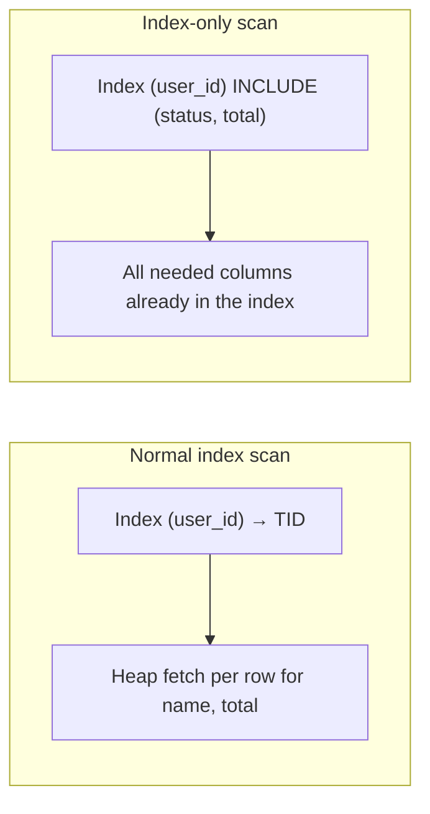

```sql
-- PostgreSQL 11+ / SQL Server: non-key payload columns
CREATE INDEX idx_orders_user_cov ON orders(user_id, created_at DESC) INCLUDE (status, total);

SELECT created_at, status, total FROM orders WHERE user_id = 7 ORDER BY created_at DESC LIMIT 20;
-- EXPLAIN: Index Only Scan using idx_orders_user_cov ... Heap Fetches: 0
```

- PostgreSQL also checks the **visibility map**. Recently modified pages still need heap fetches until VACUUM marks them all-visible.
- MySQL InnoDB: secondary indexes store the primary key, so an index on `(a)` covers `SELECT a, id`. Otherwise add columns to the index key.

#### Example
An order-list API needs `created_at, status, total` for 20 rows. A normal index scan does 20 random heap reads (cold cache: 20 × 0.1–5 ms). The covering index reads 1–2 contiguous index pages instead. At 5,000 req/s that removes ~100k random reads per second from the database.

#### Trade-offs
Bigger index (stores extra columns) and more write cost when those columns change. Don't make every index covering, only the hot read paths.

#### Problems & fixes
| Symptom | Cause | Fix |
|---|---|---|
| "Index Only Scan" but many Heap Fetches | visibility map not updated | vacuum more often (autovacuum tuning) |
| Query still hits table | `SELECT *` or a missing column | select only needed columns, add them via INCLUDE |
| Index huge, writes slower | wide INCLUDE lists | include only small, read-hot columns |

#### Cheat sheet
- Covering = all referenced columns in the index, so an index-only scan.
- PG: `INCLUDE (...)`. InnoDB: secondary indexes implicitly carry the PK.
- Avoid `SELECT *` on hot paths.

#### Interview questions
<details><summary>EXPLAIN shows "Index Only Scan … Heap Fetches: 18000". What does that mean and how do you fix it?</summary>

The planner chose an index-only scan, but for 18,000 rows Postgres still visited the heap because those pages weren't marked all-visible in the visibility map (recent updates or inserts not yet vacuumed). Make autovacuum more aggressive on that table (or run VACUUM) so pages become all-visible. Then heap fetches drop toward zero.
</details>

<details><summary>Why can SELECT * prevent an otherwise great index from being used efficiently?</summary>

The index likely doesn't contain all columns, so every matching row needs a heap lookup, and for many rows the planner may even prefer a sequential scan. Selecting only the needed columns allows an index-only scan with a covering index.
</details>

#### Interview angle
> "For the hottest list endpoint I'd add a covering index with INCLUDE for the displayed columns, so it's an index-only scan, and select only those columns instead of SELECT *."

### Partial index — index on subset of rows with WHERE clause (e.g. WHERE status='active')
A partial index only includes rows matching a predicate. When queries target a small, hot subset (pending jobs, active users, unprocessed events), the index stays **tiny**, fits in memory and costs nothing to maintain for the other rows.

#### How it works
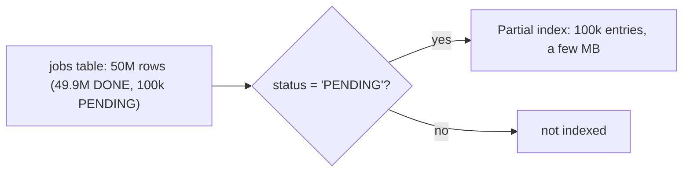

```sql
CREATE INDEX idx_jobs_pending ON jobs(run_at) WHERE status = 'PENDING';
-- used by:
SELECT id FROM jobs WHERE status = 'PENDING' AND run_at <= now() ORDER BY run_at LIMIT 50;
```
The query's WHERE clause must **imply** the index predicate for the planner to use it.

**Partial unique index** enforces a rule only on some rows:
```sql
-- each user has at most one ACTIVE subscription, unlimited cancelled ones
CREATE UNIQUE INDEX one_active_sub ON subscriptions(user_id) WHERE status = 'ACTIVE';
-- soft-deleted rows don't block re-using an email
CREATE UNIQUE INDEX uniq_email_live ON users(lower(email)) WHERE deleted_at IS NULL;
```

#### Example
The outbox table has 300M published rows and ~2,000 unpublished. A full index on `published_at` would be gigabytes. A partial index `WHERE published_at IS NULL` is a few hundred KB, and the relay's poll query stays sub-millisecond forever.

#### Trade-offs
Excellent size and write savings, but the index only helps queries whose predicates match. Parameterised predicates (`status = $1`) may not match at plan time.

#### Problems & fixes
| Symptom | Cause | Fix |
|---|---|---|
| Partial index ignored | query predicate doesn't imply index predicate (e.g. `status = $1`) | use the literal value, or separate queries per status |
| Duplicate active records despite app checks | race | partial unique index |
| Soft delete blocks re-registration with same email | full unique index | partial unique `WHERE deleted_at IS NULL` |

#### Cheat sheet
- `CREATE INDEX … WHERE <predicate>`: small, hot subset only.
- Great for queues, soft deletes, "only one active" rules.
- Query must contain the same predicate.

#### Interview questions
<details><summary>How do you enforce "a user can have only one active subscription" in the database?</summary>

A partial unique index: `CREATE UNIQUE INDEX ON subscriptions(user_id) WHERE status = 'ACTIVE'`. Inserting or activating a second active row for the same user fails atomically, regardless of race timing, while any number of cancelled or expired rows are allowed.
</details>

<details><summary>Your job table polling query slows down as completed jobs accumulate. What index helps?</summary>

A partial index on the polling columns restricted to pending rows, e.g. `ON jobs(run_at) WHERE status = 'PENDING'`. It only contains the small set of pending jobs, so it stays tiny and fast no matter how many completed rows exist. Also archive or partition old completed jobs.
</details>

#### Interview angle
> "Hot subsets get partial indexes (pending jobs, unpublished outbox rows), and business rules like one active subscription per user become partial unique indexes."

### Expression / functional index — index on LOWER(email), EXTRACT(year FROM created_at)
An expression index stores the **result of an expression** rather than a raw column, so queries that filter on that same expression can use an index. Without it, `WHERE lower(email) = ?` can't use a plain index on `email`, because the index is sorted by the raw values.

#### How it works
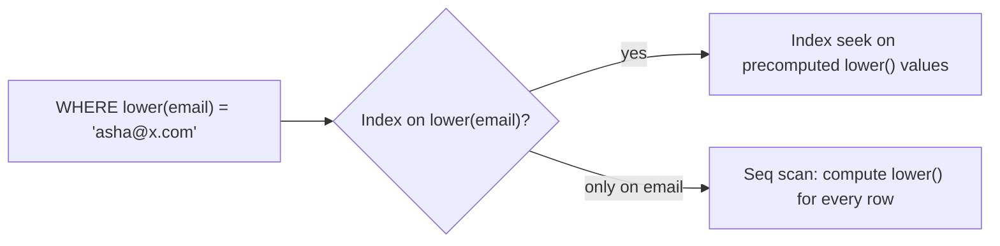

```sql
CREATE UNIQUE INDEX uniq_users_email_ci ON users (lower(email));     -- case-insensitive uniqueness too
SELECT * FROM users WHERE lower(email) = lower(:email);              -- uses the index

CREATE INDEX idx_orders_day ON orders ((created_at::date));          -- per-day lookups
CREATE INDEX idx_events_type ON events ((payload->>'type'));         -- JSON field
```

The expression must be **immutable** (same input → same output). `now()`, and timezone-dependent casts on `timestamptz`, aren't allowed.

MySQL 8: functional key parts `CREATE INDEX idx ON users((lower(email)))`, or index a generated column.

#### Example
Login by email is case-insensitive. Users signed up as `Asha@X.com` and `asha@x.com`, creating duplicate accounts. An expression unique index on `lower(email)` both speeds up login lookups and prevents the duplicates. (Alternative: the `citext` type.)

#### Trade-offs
Each write computes the expression, and queries must use exactly the same expression. Wrapping an indexed column in a function in the WHERE clause (`WHERE date(created_at) = …`) silently disables a plain index.

#### Problems & fixes
| Symptom | Cause | Fix |
|---|---|---|
| Seq scan on `WHERE lower(email) = ?` | index on raw column | expression index on `lower(email)` |
| Seq scan on `WHERE date(created_at) = '2026-11-09'` | function on indexed column | rewrite as range `created_at >= d AND created_at < d + 1`, or index the expression |
| "functions in index expression must be marked IMMUTABLE" | timezone-dependent or volatile expression | use immutable expressions or a generated column |
| Duplicate emails with different case | case-sensitive unique | unique index on `lower(email)` or citext |

#### Cheat sheet
- Index the exact expression the query uses.
- Better: rewrite predicates to keep the column bare (range instead of `date()`).
- Immutable expressions only. Generated columns are an alternative.

#### Interview questions
<details><summary>A query `WHERE DATE(created_at) = '2026-11-09'` is slow even though created_at is indexed. Why, and what are two fixes?</summary>

Applying a function to the column means the index (sorted by raw timestamps) can't be used to seek, so every row is evaluated. Fix 1: rewrite as a sargable range, `created_at >= '2026-11-09' AND created_at < '2026-11-10'`. Fix 2: create an expression index on the same expression (respecting immutability, e.g. on a `timestamp` column or a generated date column).
</details>

<details><summary>How do you make email uniqueness case-insensitive?</summary>

A unique expression index on `lower(email)` (or the `citext` type in PostgreSQL), and always query with `lower(:input)`. The DB then rejects `A@x.com` if `a@x.com` exists, atomically.
</details>

#### Interview angle
> "I keep predicates sargable (ranges instead of functions on columns). Where a function is inherent, like case-insensitive email, I index that exact expression, often as a unique index."

### Index selectivity — high cardinality = high selectivity = more useful index
Selectivity measures how much an index narrows the search: the **fraction of rows** matching a typical value. An index on a column with many distinct values (email, order id) is highly selective and very useful. An index on a boolean or a status with 3 values usually isn't, because reading half the table through an index is slower than scanning it.

#### How it works
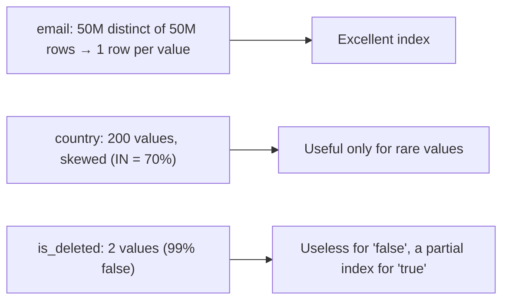

- **Cardinality** = number of distinct values. **Selectivity** = rows matched ÷ total rows (lower fraction = more selective).
- The planner estimates selectivity from statistics (n_distinct, most-common values, histograms). Above roughly **5–20% of the table**, a sequential scan (or bitmap scan) usually beats index lookups because of random I/O.
- **Skew** matters: `status = 'FAILED'` (0.1%) is selective even though `status` has low cardinality.

#### Example
`orders.status` has values PAID (85%), SHIPPED (14%), FAILED (1%). An index on `status` helps `WHERE status = 'FAILED'` (1% of rows) but the planner rightly ignores it for `'PAID'`. Better: a **partial index** `WHERE status = 'FAILED'`, or a composite index where `status` follows a selective column: `(merchant_id, status)`.

#### Trade-offs
Low-selectivity indexes cost write overhead and memory but are rarely used. They can still pay off as the second column of a composite index, or as partial indexes for rare values.

#### Problems & fixes
| Symptom | Cause | Fix |
|---|---|---|
| Planner ignores your index | predicate matches a large fraction of rows | expected. Use composite/partial index, or accept seq scan |
| Planner uses an index and it's slow | stale/misleading stats (estimate 100 rows, actual 2M) | ANALYZE, increase statistics target, extended statistics |
| Many single-column low-cardinality indexes | "index everything" approach | remove them, design composite indexes per query |

#### Cheat sheet
- High cardinality + low match fraction = good index.
- Low cardinality alone = poor index, but fine as a partial index for rare values or 2nd column in a composite.
- Planner decides from stats. Keep them fresh.

#### Interview questions
<details><summary>Should you index a `gender` or `is_active` column?</summary>

On its own, usually not: each value matches a large fraction of rows, so a sequential scan is cheaper and the index just slows writes. Exceptions: a highly skewed rare value queried often (use a partial index `WHERE is_active = false`), or as a trailing column in a composite index after a selective column.
</details>

<details><summary>The same query is fast for one customer and very slow for another. How can selectivity explain it?</summary>

Data skew: a large merchant has millions of rows while a small one has a few. A plan good for the small merchant (index nested loop) is terrible for the big one, or a cached generic plan picked for one parameter is reused for the other. Fixes: composite indexes that bound the work (`merchant_id, created_at` + LIMIT), custom plans for skewed parameters, better statistics, or separate handling for very large tenants.
</details>

#### Interview angle
> "I index columns that cut results to a small fraction. For skewed status columns I use partial indexes on the rare values, rather than a plain low-cardinality index the planner will ignore."

### Clustered index (InnoDB) vs heap storage (PostgreSQL) — physical row ordering differs
Where the actual row lives differs fundamentally between engines. **InnoDB** stores rows *inside* the primary-key B+ tree (a **clustered index**): the table *is* the index, sorted by PK. **PostgreSQL** stores rows in an unordered **heap**, and every index, including the PK, points to a row's physical location (TID).

#### How it works
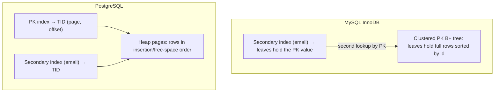

| | InnoDB clustered | PostgreSQL heap |
|---|---|---|
| Row location | in PK leaf, ordered by PK | heap page, unordered |
| PK range scans | very fast (rows contiguous) | index + scattered heap fetches (unless CLUSTERed/correlated) |
| Secondary lookup | 2 B+ tree traversals (secondary → PK → row) | 1 index + 1 heap fetch |
| Big/random PK impact | bloats every secondary index and fragments the table | less severe |
| UPDATE | in place (old version in undo) | new tuple version (HOT or not) |

#### Example
In MySQL, `orders` with PK `(customer_id, order_id)` stores each customer's orders physically together, so "last 50 orders of a customer" reads a few contiguous pages. In PostgreSQL the same data is scattered across heap pages by insertion time. You can `CLUSTER orders USING idx` once (not maintained), or rely on a covering index for list queries.

With a UUIDv4 PK in InnoDB, inserts hit random positions in the clustered tree (page splits across the **whole table**), and every secondary index stores the 16-byte PK. That's slow inserts and larger indexes, which is why InnoDB strongly favours auto-increment or time-ordered PKs.

#### Trade-offs
Clustered tables give great PK-range locality but make PK choice critical and secondary lookups costlier. Heaps make all indexes equal and updates cheaper to place, but have no physical ordering and need VACUUM.

#### Problems & fixes
| Symptom | Cause | Fix |
|---|---|---|
| InnoDB secondary indexes huge | wide PK (UUID strings, composite) copied into each | compact integer/ordered PK, store UUID as BINARY(16) |
| InnoDB insert throughput collapse | random PK causing page splits | AUTO_INCREMENT or UUIDv7 |
| PG range scans on PK slow (random heap I/O) | heap not ordered | covering index, periodic CLUSTER, or BRIN for time-correlated data |

#### Cheat sheet
- InnoDB: table = clustered PK index. Secondary → PK → row.
- PostgreSQL: heap + all indexes → TID.
- InnoDB PK should be small and increasing.

#### Interview questions
<details><summary>Why is choosing a random UUID primary key worse in MySQL InnoDB than in PostgreSQL?</summary>

In InnoDB the PK determines the physical order of the whole table (clustered index), so random UUIDs cause inserts all over the table, page splits and poor cache locality for the entire dataset. Every secondary index also stores the PK, so 16–36 byte PKs inflate all indexes. In PostgreSQL rows go to the heap wherever there's space and only the PK index suffers random inserts.
</details>

<details><summary>How does a secondary index lookup differ between InnoDB and PostgreSQL?</summary>

InnoDB: traverse the secondary B+ tree to get the PK value, then traverse the clustered PK tree to fetch the row (two lookups). PostgreSQL: traverse the index to get a TID, then fetch the heap page directly (index + heap fetch), with a visibility check.
</details>

#### Interview angle
> "In InnoDB the primary key is the physical layout, so I keep it small and increasing (bigint or UUIDv7). In Postgres I lean on covering indexes, because heap rows have no order."

### EXPLAIN / EXPLAIN ANALYZE — read execution plans: seq scan vs index scan vs bitmap
`EXPLAIN` shows the plan the database **intends** to run with estimated costs and row counts. `EXPLAIN ANALYZE` **runs** the query and adds actual times and row counts. Comparing estimated vs actual rows is the fastest way to find why a query is slow.

#### How it works
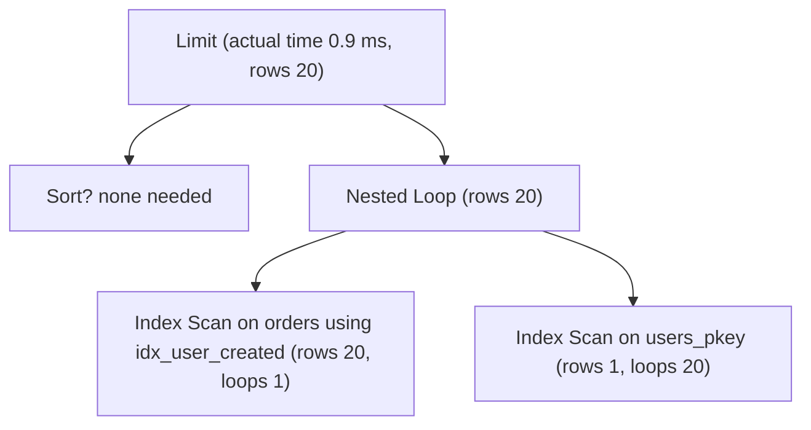

Common node types:
| Node | Meaning | Good when |
|---|---|---|
| Seq Scan | read whole table | small table, or a large fraction of rows needed |
| Index Scan | seek index, fetch each row | few rows, or ordered output needed |
| Index Only Scan | answer from index | covering index + vacuumed |
| Bitmap Index/Heap Scan | collect matching TIDs, read pages in physical order | medium number of rows, combining indexes |
| Nested Loop | for each outer row, look up inner | small outer side + indexed inner |
| Hash Join | build hash table on one side | large equi-joins |
| Merge Join | merge two sorted inputs | both sides sorted on key |

```sql
EXPLAIN (ANALYZE, BUFFERS)
SELECT o.id, o.total FROM orders o WHERE o.user_id = 7 ORDER BY o.created_at DESC LIMIT 20;
```
```text
Limit  (cost=0.57..25.1 rows=20) (actual time=0.031..0.088 rows=20 loops=1)
  ->  Index Scan using idx_orders_user_created on orders o  (cost=0.57..1820.4 rows=1480)
        (actual time=0.030..0.084 rows=20 loops=1)
        Index Cond: (user_id = 7)
        Buffers: shared hit=24
Planning Time: 0.2 ms   Execution Time: 0.11 ms
```

#### Example
A slow query shows `Seq Scan on payments (rows=48,000,000) Filter: (merchant_id = 991)` with `Rows Removed by Filter: 47,998,700`. Adding `CREATE INDEX CONCURRENTLY ON payments(merchant_id, created_at)` changes it to an Index Scan with ~1,300 rows read, and the time drops from 14 s to 4 ms.

What to look for:
1. **Estimated vs actual rows** off by 10×+ means bad statistics or correlation, so the planner made bad choices.
2. Large `Rows Removed by Filter` means a missing or poor index.
3. `Sort Method: external merge Disk` means `work_mem` is too small, or an index for ORDER BY is missing.
4. Nested Loop with a huge `loops=` count on the inner side means it should be a hash join, or estimates are wrong.
5. `Buffers: read=` (disk) vs `hit=` (cache).

#### Trade-offs
`EXPLAIN ANALYZE` actually executes the statement. Wrap DML in `BEGIN … ROLLBACK`, and be careful on production primaries with heavy queries.

#### Problems & fixes
| Symptom | Cause | Fix |
|---|---|---|
| Plan fine in staging, bad in prod | different data distribution/stats | test with prod-like data, check prod plans (auto_explain) |
| Plan changes suddenly, query slows | stats changed / generic plan | ANALYZE, pg_stat_statements to spot it, plan pinning (pg_hint_plan) as last resort |
| ANALYZE on UPDATE modified data | EXPLAIN ANALYZE executes | wrap in a transaction and roll back |

#### Cheat sheet
- `EXPLAIN (ANALYZE, BUFFERS)`: compare estimated vs actual rows first.
- Seq Scan + big "rows removed by filter" means you need an index.
- Disk sorts → work_mem or an index for ORDER BY. `auto_explain` for prod slow queries.

#### Interview questions
<details><summary>Walk me through how you would diagnose a slow SQL query in production.</summary>

Find it via `pg_stat_statements` or slow query logs (total time, mean, calls). Get the real plan (`auto_explain` or `EXPLAIN (ANALYZE, BUFFERS)` on a replica). Look for seq scans with large filtered-out row counts, estimate vs actual mismatches, disk sorts and nested loops with huge loop counts. Fix with the right index (composite/covering/partial), refreshed statistics, a query rewrite (sargable predicates, avoid OFFSET pagination), or reducing returned columns. Verify with EXPLAIN ANALYZE again and watch p99 after deploying.
</details>

<details><summary>EXPLAIN estimates 10 rows but ANALYZE shows 2 million. What are the consequences and fixes?</summary>

The planner chose operators suited for 10 rows (nested loop index lookups), which are catastrophic for 2M (millions of random lookups). Causes: stale statistics, correlated columns (planner multiplies independent selectivities), or skewed values. Fixes: ANALYZE, raise the statistics target, `CREATE STATISTICS` for correlated columns, or rewrite the query.
</details>

#### Interview angle
> "I diagnose with EXPLAIN (ANALYZE, BUFFERS): estimated vs actual rows first, then filtered-out rows and disk sorts. Most fixes are a better composite index or fresh statistics."

### Query planner statistics — ANALYZE command, pg_statistic, histograms
The planner chooses plans by **estimating how many rows each step produces**, using statistics sampled from the data: distinct counts, most-common values, histograms, null fractions and physical correlation. Wrong statistics lead to wrong plans, which is a top cause of "the query suddenly got slow".

#### How it works
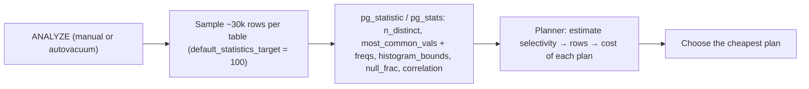

```sql
SELECT attname, n_distinct, most_common_vals, most_common_freqs, correlation
FROM pg_stats WHERE tablename = 'orders' AND attname IN ('status', 'merchant_id');

ALTER TABLE orders ALTER COLUMN merchant_id SET STATISTICS 1000;   -- finer stats for a skewed column
CREATE STATISTICS orders_city_pin (dependencies) ON city, pincode FROM orders;  -- correlated columns
ANALYZE orders;
```

- **MCV list**: frequent values with exact frequencies (handles skew).
- **Histogram**: value distribution for the remaining values (range estimates).
- **Correlation**: how well physical order matches column order (affects index vs bitmap choice).
- Planner assumes columns are **independent** unless extended statistics say otherwise.

#### Example
After a bulk import of 30M rows for a new merchant, autovacuum hasn't analyzed yet. The planner still thinks merchant 991 has ~50 rows and picks a nested loop. The job takes 40 minutes. Running `ANALYZE payments;` right after the load makes the planner pick a hash join, and it takes 30 seconds. Make `ANALYZE` part of bulk-load scripts.

MySQL equivalents: `ANALYZE TABLE`, persistent statistics, and histograms via `ANALYZE TABLE t UPDATE HISTOGRAM ON col`.

#### Trade-offs
Higher statistics targets mean better estimates but slower ANALYZE and planning. Extended statistics help correlated columns at a small cost.

#### Problems & fixes
| Symptom | Cause | Fix |
|---|---|---|
| Bad plans right after bulk loads | stale statistics | ANALYZE after loads, tune autovacuum analyze thresholds |
| Underestimates on `city = X AND pincode = Y` | independence assumption | `CREATE STATISTICS (dependencies)` |
| Skewed tenant gets terrible plan | MCV list too small | raise per-column statistics target |
| Plan flips between runs | parameter-sensitive generic plans | `plan_cache_mode = force_custom_plan` for that query |

#### Cheat sheet
- Stats = n_distinct, MCVs, histograms, correlation. Collected by ANALYZE / autovacuum.
- Bulk load → ANALYZE. Skew → higher stats target. Correlation → extended statistics.
- Inspect with `pg_stats`.

#### Interview questions
<details><summary>A nightly batch suddenly takes hours instead of minutes after a data migration. Nothing in the code changed. What do you check?</summary>

Plan regression due to statistics: compare plans (auto_explain or EXPLAIN) before and after. The migration likely changed data volume or distribution without an ANALYZE, so the planner underestimates rows and picks nested loops. Run ANALYZE on the affected tables, check estimate vs actual in EXPLAIN ANALYZE, and consider extended statistics or higher targets for skewed or correlated columns. Add ANALYZE to migration runbooks.
</details>

<details><summary>Why does the planner underestimate rows for `WHERE city = 'Bangalore' AND pincode = '560001'`?</summary>

It assumes columns are independent and multiplies their selectivities: P(city) × P(pincode). But a pincode almost determines the city, so the true selectivity is close to P(pincode) alone. The product badly underestimates. `CREATE STATISTICS … (dependencies) ON city, pincode` teaches the planner the correlation.
</details>

#### Interview angle
> "When a plan regresses with no code change, I check statistics first: ANALYZE after bulk loads, higher targets for skewed tenants, and extended statistics for correlated columns."

### N+1 query problem — fetch N parents then 1 query per parent; fix with JOIN or DataLoader batching
The N+1 problem happens when code fetches a list of N parent records with one query, then runs **one more query per parent** to load related data. 1 + N round trips instead of 1–2. It hides easily behind ORMs' lazy loading and is one of the most common causes of slow endpoints.

#### How it works
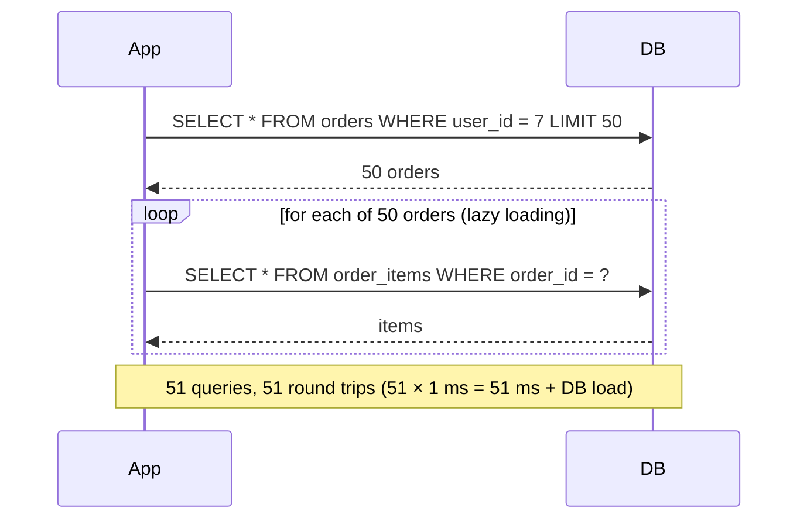

Fixes:
1. **JOIN** / fetch join: `SELECT o.*, i.* FROM orders o JOIN order_items i ON …`.
2. **Batch (IN) query**: load all children in one query with `WHERE order_id IN (…50 ids…)` (DataLoader, Hibernate `@BatchSize`, `select_related`/`prefetch_related` in Django, `includes` in Rails).
3. **Entity graphs** / fetch plans: JPA `@EntityGraph(attributePaths = "items")`.

#### Example
Spring Data JPA:
```java
// N+1: items are LAZY and accessed in the loop
List<Order> orders = orderRepo.findByUserId(7);
orders.forEach(o -> o.getItems().size());

// Fix: fetch join (careful with pagination + collections)
@Query("select distinct o from Order o left join fetch o.items where o.user.id = :uid")
List<Order> findWithItems(@Param("uid") long uid);

// Or batch fetching: 1 query for orders + 1 for all items
@BatchSize(size = 100) @OneToMany(mappedBy = "order") List<OrderItem> items;
```
Detect it with Hibernate statistics, `spring.jpa.show-sql`, p6spy, or tests asserting the query count.

#### Trade-offs
JOINs return duplicated parent columns (row explosion with several collections). Batch IN queries keep 2 round trips without duplication. Fetch-joining collections with pagination makes Hibernate paginate in memory, which is dangerous.

#### Problems & fixes
| Symptom | Cause | Fix |
|---|---|---|
| Endpoint latency grows with page size | N+1 lazy loading | fetch join / @EntityGraph / @BatchSize |
| "HHH000104: firstResult/maxResults specified with collection fetch; applying in memory" | fetch join + pagination | paginate parents first, then batch-load children by ids |
| Huge result set from multiple joined collections | cartesian product of collections | separate batch queries per collection |
| N+1 across microservices (one HTTP call per item) | per-item remote calls | batch endpoints (`GET /users?ids=…`), DataLoader |

#### Cheat sheet
- 1 query for parents + N queries for children = N+1.
- Fix: JOIN FETCH, `IN (...)` batch loading, entity graphs, DataLoader.
- Detect with SQL logs and query-count assertions in tests.

#### Interview questions
<details><summary>An order history API takes 2 seconds for users with many orders. The DB shows thousands of tiny queries per request. What is happening and how do you fix it?</summary>

N+1: the code loads orders, then lazily loads items, products or addresses per order. Fix with batch loading (`@BatchSize` or one `WHERE order_id IN (…)` query per association), or an `@EntityGraph`/fetch join for single-collection cases, and paginate the parent list first. Add a test asserting the number of queries to stop regressions.
</details>

<details><summary>How does the N+1 problem show up between microservices, and how do you solve it there?</summary>

A service that gets 50 orders then calls the user service once per order to fetch names makes 50 HTTP calls per request. Solve it with batch APIs (`POST /users:batchGet` with ids), request-scoped DataLoader-style batching and caching, or by denormalising the needed fields (user name) into the order service's read model via events.
</details>

#### Interview angle
> "I watch for N+1 in code review and tests: parents are paginated, then children loaded in one IN query. Across services the same rule means batch endpoints, not one call per item."

### JOIN types — INNER, LEFT OUTER, RIGHT OUTER, FULL OUTER, CROSS, SELF JOIN
Joins combine rows from two tables based on a condition. The type decides **what happens to rows without a match**: drop them (INNER), keep them with NULLs from one side (LEFT/RIGHT), keep both sides (FULL), or produce every combination (CROSS).

#### How it works


| Join | users (3) ⋈ orders (users 1 and 2 have orders, one orphan order) | Rows |
|---|---|---|
| INNER | users with orders | only matched |
| LEFT | every user, orders or NULL | user 3 appears with NULL order |
| RIGHT | every order, user or NULL | orphan order appears with NULL user |
| FULL | union of LEFT and RIGHT | both unmatched sides |
| CROSS | 3 × N | cartesian product |

#### Example
```sql
-- users who never ordered (anti-join)
SELECT u.id, u.email FROM users u
LEFT JOIN orders o ON o.user_id = u.id
WHERE o.id IS NULL;                     -- or: WHERE NOT EXISTS (SELECT 1 FROM orders o WHERE o.user_id = u.id)

-- employee and their manager (self join)
SELECT e.name AS employee, m.name AS manager
FROM employees e LEFT JOIN employees m ON m.id = e.manager_id;

-- calendar × rooms availability grid (cross join)
SELECT d.day, r.id FROM generate_series('2026-12-01'::date, '2026-12-07', '1 day') d(day) CROSS JOIN rooms r;
```

**Gotcha**: filtering the right table in WHERE turns a LEFT JOIN into an INNER JOIN.
```sql
-- wrong: drops users without PAID orders
SELECT … FROM users u LEFT JOIN orders o ON o.user_id = u.id WHERE o.status = 'PAID';
-- right: put the filter in ON
SELECT … FROM users u LEFT JOIN orders o ON o.user_id = u.id AND o.status = 'PAID';
```

#### Trade-offs
Joins are what relational databases are good at, with index support on join keys. Across shards or services, joins become expensive or impossible, so you denormalise or join in the application.

#### Problems & fixes
| Symptom | Cause | Fix |
|---|---|---|
| Duplicate rows / inflated SUMs | joining two one-to-many tables (fan-out) | aggregate in subqueries first, then join |
| LEFT JOIN behaves like INNER | right-side filter in WHERE | move the condition into ON |
| Slow join | no index on the foreign key column | index FK columns (Postgres doesn't do it automatically) |
| Accidental cartesian product | missing join condition | always specify ON, review row counts |

#### Cheat sheet
- INNER = matches only. LEFT = keep all left. FULL = keep all. CROSS = all combos.
- Anti-join: LEFT JOIN … WHERE right.id IS NULL, or NOT EXISTS.
- Index FK columns. Watch fan-out when joining multiple one-to-many tables.

#### Interview questions
<details><summary>A revenue report joins orders → order_items and orders → payments and the totals come out double. Why?</summary>

Each order row is multiplied by its number of items and by its number of payments (fan-out), so summing payment amounts across the joined rows counts each payment once per item. Aggregate each child table separately in subqueries or CTEs (sum of items per order, sum of payments per order) and then join the aggregates.
</details>

<details><summary>How do you find customers who placed no orders in the last 30 days, efficiently?</summary>

`SELECT c.id FROM customers c WHERE NOT EXISTS (SELECT 1 FROM orders o WHERE o.customer_id = c.id AND o.created_at >= now() - interval '30 days')`, with an index on `orders(customer_id, created_at)`. The planner runs it as an anti-join. Equivalent: LEFT JOIN with the date filter in the ON clause and `WHERE o.id IS NULL`.
</details>

#### Interview angle
> "I pick the join by what should happen to unmatched rows, index every foreign key, and aggregate child tables before joining so one-to-many fan-out doesn't inflate totals."

### Window functions — ROW_NUMBER, RANK, DENSE_RANK, LAG, LEAD, SUM/AVG OVER PARTITION
Window functions compute values **across a set of rows related to the current row** (its "window") **without collapsing rows** the way GROUP BY does. They solve ranking, running totals, moving averages, top-N per group and comparisons with the previous or next row in one pass.

#### How it works
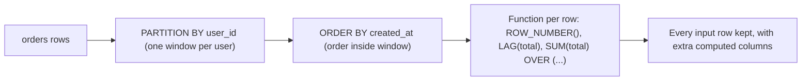

| Function | Result |
|---|---|
| `ROW_NUMBER()` | 1, 2, 3, 4 (unique) |
| `RANK()` | 1, 2, 2, 4 (gaps after ties) |
| `DENSE_RANK()` | 1, 2, 2, 3 (no gaps) |
| `LAG(x) / LEAD(x)` | previous / next row's value |
| `SUM(x) OVER (… ROWS BETWEEN UNBOUNDED PRECEDING AND CURRENT ROW)` | running total |
| `AVG(x) OVER (… ROWS BETWEEN 6 PRECEDING AND CURRENT ROW)` | 7-row moving average |

#### Example
```sql
-- latest order per user (top-1 per group)
SELECT * FROM (
  SELECT o.*, ROW_NUMBER() OVER (PARTITION BY user_id ORDER BY created_at DESC) AS rn
  FROM orders o
) t WHERE rn = 1;

-- running wallet balance and change since previous transaction
SELECT id, created_at, amount,
       SUM(amount) OVER (PARTITION BY wallet_id ORDER BY created_at, id) AS running_balance,
       amount - LAG(amount) OVER (PARTITION BY wallet_id ORDER BY created_at, id) AS delta
FROM wallet_txns WHERE wallet_id = 42;

-- top 3 products per category by revenue
SELECT * FROM (
  SELECT category, product, revenue, DENSE_RANK() OVER (PARTITION BY category ORDER BY revenue DESC) AS r
  FROM product_revenue
) x WHERE r <= 3;
```

#### Trade-offs
One scan replaces self-joins and correlated subqueries. But windows need sorting by `PARTITION BY + ORDER BY`, so an index on those columns avoids big sorts. You can't filter on a window result in the same SELECT's WHERE (wrap it in a subquery/CTE, or use `QUALIFY` where supported).

#### Problems & fixes
| Symptom | Cause | Fix |
|---|---|---|
| Large disk sort | sorting by partition/order columns | index `(partition_col, order_col)`, raise work_mem |
| Running total jumps on ties | default `RANGE` frame groups equal ORDER BY values | `ROWS BETWEEN …` and a unique tiebreaker (id) |
| "window functions are not allowed in WHERE" | filtering in same level | subquery/CTE, then filter |
| Non-deterministic top-1 | ties in ORDER BY | add a tiebreaker column |

#### Cheat sheet
- `fn() OVER (PARTITION BY … ORDER BY … ROWS …)` keeps rows.
- Top-N per group: ROW_NUMBER/DENSE_RANK in a subquery, then filter.
- LAG/LEAD for change detection. ROWS frames for running totals and moving averages.

#### Interview questions
<details><summary>Get each customer's most recent order with a single query.</summary>

Use `ROW_NUMBER() OVER (PARTITION BY customer_id ORDER BY created_at DESC, id DESC)` in a subquery and keep `rn = 1`. Index `(customer_id, created_at DESC)` so the database can read each partition in order. In Postgres, `SELECT DISTINCT ON (customer_id) … ORDER BY customer_id, created_at DESC` is an alternative.
</details>

<details><summary>Detect users whose transaction amount jumped more than 10× compared with their previous transaction.</summary>

`SELECT * FROM (SELECT t.*, LAG(amount) OVER (PARTITION BY user_id ORDER BY created_at, id) AS prev FROM txns t) x WHERE prev IS NOT NULL AND amount > 10 * prev`. One pass, no self-join. A basic fraud-signal query.
</details>

#### Interview angle
> "For top-N per group, running balances and change detection I use window functions: one ordered pass instead of self-joins, backed by an index on the partition and order columns."

### CTEs (Common Table Expressions) — WITH clause, readability, recursive CTEs for tree traversal
A CTE (`WITH name AS (…)`) names a subquery so complex SQL reads top-down like steps. A **recursive CTE** repeatedly joins a query to its own previous output, which lets SQL walk **hierarchies and graphs**: org charts, category trees, comment threads, bill of materials.

#### How it works
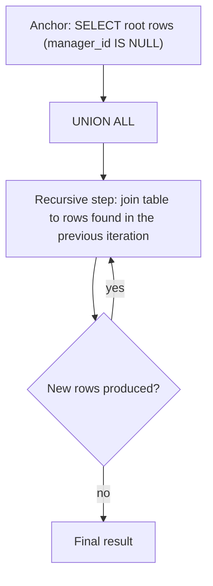

```sql
-- all reports (direct and indirect) under manager 10, with depth
WITH RECURSIVE reports AS (
  SELECT id, name, manager_id, 1 AS depth FROM employees WHERE manager_id = 10
  UNION ALL
  SELECT e.id, e.name, e.manager_id, r.depth + 1
  FROM employees e JOIN reports r ON e.manager_id = r.id
  WHERE r.depth < 20                       -- safety limit against cycles/runaway
)
SELECT * FROM reports ORDER BY depth;
```

Non-recursive CTE for readability:
```sql
WITH monthly AS (
  SELECT merchant_id, date_trunc('month', created_at) m, SUM(amount) gmv FROM payments GROUP BY 1, 2
), ranked AS (
  SELECT *, RANK() OVER (PARTITION BY m ORDER BY gmv DESC) r FROM monthly
)
SELECT * FROM ranked WHERE r <= 10;
```

#### Example
Category breadcrumb for an e-commerce product: walk from a leaf category up to the root with a recursive CTE using `parent_id`. With an index on `parent_id` (downward) or the PK (upward), it's a handful of index lookups. For deep, read-heavy trees, alternatives are a **materialised path** (`/1/7/42/`) or `ltree`, or a **closure table** (ancestor, descendant, depth) for O(1) subtree queries.

Performance note: in PostgreSQL ≤ 11 CTEs were always **materialised** (an optimisation fence). Since PG 12, non-recursive CTEs referenced once are inlined unless you write `AS MATERIALIZED`.

#### Trade-offs
Recursive CTEs are flexible and keep data normalised (just a `parent_id`), but deep or wide traversals on huge graphs get slow, and cycles in data can loop forever without a guard.

#### Problems & fixes
| Symptom | Cause | Fix |
|---|---|---|
| Recursive query never finishes | cycle in the data | depth limit, track visited path (`CYCLE` clause in PG 14+) |
| Slow tree traversal | no index on `parent_id` | index the join column |
| Old PG: CTE much slower than equivalent subquery | materialisation fence | upgrade, or `NOT MATERIALIZED` |
| Subtree queries on huge trees slow | recursion per request | closure table, ltree / materialised path |

#### Cheat sheet
- `WITH x AS (…)` for readable stepwise SQL.
- `WITH RECURSIVE`: anchor UNION ALL recursive step, plus a depth/cycle guard.
- Heavy hierarchy reads → closure table or materialised path.

#### Interview questions
<details><summary>How would you store and query a category tree with unlimited depth for an e-commerce site?</summary>

Simplest: an adjacency list (`parent_id`) plus a recursive CTE for breadcrumbs and subtrees, with an index on `parent_id`. If subtree queries are frequent (show all products in "Electronics" including descendants), add a closure table or a materialised path (`ltree`) maintained on writes, so subtree lookups are a single indexed query. Cache the tree in memory or Redis, since categories change rarely.
</details>

<details><summary>What does "CTE as an optimisation fence" mean?</summary>

Historically (PostgreSQL before 12), a CTE was computed fully and stored before the outer query ran, so filters from the outer query couldn't be pushed inside, which sometimes caused huge intermediate results. Modern Postgres inlines simple CTEs unless you request `MATERIALIZED`.
</details>

#### Interview angle
> "Hierarchies stay as a parent_id with recursive CTEs, which include a depth guard. If subtree queries get hot, I add a closure table or materialised path instead of recursing on every request."

### Lateral joins — correlated subquery in FROM clause, row-by-row evaluation
A `LATERAL` join lets a subquery in the FROM clause **refer to columns of tables listed before it**, so it's evaluated **once per outer row**, like a for-each loop. Its killer use: **top-N per group with an index**, and calling set-returning functions per row.

#### How it works
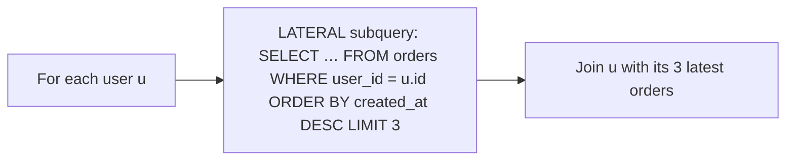

```sql
SELECT u.id, u.name, o.id AS order_id, o.total, o.created_at
FROM users u
CROSS JOIN LATERAL (
  SELECT id, total, created_at
  FROM orders
  WHERE orders.user_id = u.id
  ORDER BY created_at DESC
  LIMIT 3
) o
WHERE u.city = 'Pune';
-- LEFT JOIN LATERAL (...) o ON true  → keeps users with no orders
```
MySQL 8.0.14+ supports `LATERAL`. SQL Server's equivalent is `CROSS APPLY` / `OUTER APPLY`.

#### Example
"3 latest orders for each of 200 users on a dashboard": with an index on `orders(user_id, created_at DESC)`, the lateral subquery does 200 index seeks reading 3 entries each (~600 index entries total). The window-function alternative (`ROW_NUMBER() … WHERE rn <= 3`) may compute row numbers over **all** orders of those users. For users with thousands of orders, lateral is dramatically cheaper.

Also useful: unnesting arrays or JSON per row (`CROSS JOIN LATERAL jsonb_array_elements(o.items) AS item`).

#### Trade-offs
Effectively a nested loop: brilliant when the outer side is small and the inner side is index-backed, terrible when the outer side is large and the inner query scans.

#### Problems & fixes
| Symptom | Cause | Fix |
|---|---|---|
| LATERAL query slow | inner query lacks a supporting index | index (correlation col, order col) |
| Rows disappear for outer rows without matches | CROSS JOIN LATERAL | `LEFT JOIN LATERAL … ON true` |
| Huge runtime with large outer set | nested-loop nature | filter the outer set first, or use window functions / aggregation instead |

#### Cheat sheet
- LATERAL = subquery that sees the outer row, run per row.
- Top-N per group: LATERAL + LIMIT + index (user_id, created_at DESC).
- LEFT JOIN LATERAL … ON true keeps unmatched rows. SQL Server: CROSS/OUTER APPLY.

#### Interview questions
<details><summary>Window function vs LATERAL for "latest 3 orders per user": which is faster and when?</summary>

LATERAL + LIMIT with an index on `(user_id, created_at DESC)` reads only 3 index entries per user, best when users have many orders and you're fetching for a limited set of users. A window function must number all candidate rows per partition, fine for small partitions or when computing over all data in one pass (analytics). Check with EXPLAIN ANALYZE.
</details>

<details><summary>How would you expand a JSONB array of line items stored in each order into rows?</summary>

`SELECT o.id, item->>'sku' AS sku, (item->>'qty')::int AS qty FROM orders o CROSS JOIN LATERAL jsonb_array_elements(o.items) AS item`. The set-returning function runs per order row via LATERAL, producing one row per item.
</details>

#### Interview angle
> "For top-N per group over large partitions I use LATERAL with LIMIT on a (group, sort) index: a few index entries per group instead of ranking every row."
