## Schema design & operations

### 1NF — atomic values, no repeating groups
First Normal Form requires that every column holds a **single, atomic value**, with no lists in a cell and no repeating column groups (`phone1, phone2, phone3`), and that each row is uniquely identifiable. It's the baseline that makes data queryable and indexable.

#### How it works
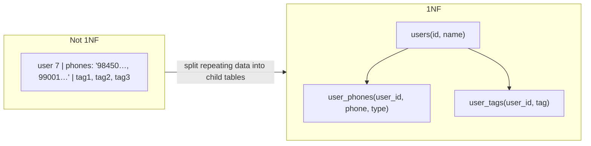

#### Example
Not 1NF: `orders(id, user_id, items = 'SKU1:2,SKU9:1')`. You can't index items, can't sum quantities in SQL, can't enforce that the SKU exists. 1NF: `order_items(order_id, sku, qty)` with an FK to `products(sku)`. Now "how many units of SKU9 sold this week" is a simple indexed query.

**Modern nuance**: Postgres arrays or JSONB in a column technically break strict 1NF, and that's acceptable when the data is read and written as a whole and rarely queried by element (e.g. a tags array with a GIN index, or a raw webhook payload).

#### Trade-offs
1NF makes data queryable, indexable and constrainable at the cost of more tables and joins. Arrays/JSON trade queryability for simplicity in specific cases.

#### Problems & fixes
| Symptom | Cause | Fix |
|---|---|---|
| Queries with `LIKE '%,9,%'` on comma lists | lists stored in a string | child table, or array with GIN index |
| Schema change needed to add a 4th phone | repeating columns | child table |
| Can't enforce referential integrity for list elements | lists in a cell | child table with FK |

#### Cheat sheet
- One value per cell, no repeating groups, a key per row.
- Lists → child tables (or arrays/JSONB with GIN when read as a unit).
- Comma-separated values in a column are a red flag.

#### Interview questions
<details><summary>A product team stores user interests as a comma-separated string. What problems will they hit?</summary>

No efficient filtering ("users interested in cricket" needs a full scan with LIKE, with false matches like "cricket-fantasy"), no referential integrity on interest values, painful updates (remove one interest = string manipulation), and no counting or joins. Move to a `user_interests(user_id, interest_id)` table, or a Postgres array with a GIN index if it's simple tags.
</details>

<details><summary>Is storing JSONB in Postgres a violation of normalization? When is it acceptable?</summary>

Strictly it breaks 1NF. It's acceptable for semi-structured, variable attributes read and written as a whole (product attributes that vary by category, external payloads, settings), with GIN indexes for the few fields you query. Core relational data (money, ownership, statuses) should stay in proper columns with constraints.
</details>

#### Interview angle
> "Core entities are normalised with child tables instead of lists in cells. JSONB is only for genuinely variable attributes, with GIN indexes on the fields we filter by."

### 2NF — full functional dependency on entire primary key (no partial dependency)
Second Normal Form applies to tables with a **composite primary key**: every non-key column must depend on the **whole key**, not just part of it. Columns that depend on only part of the key belong in another table, otherwise you get duplication and update anomalies.

#### How it works
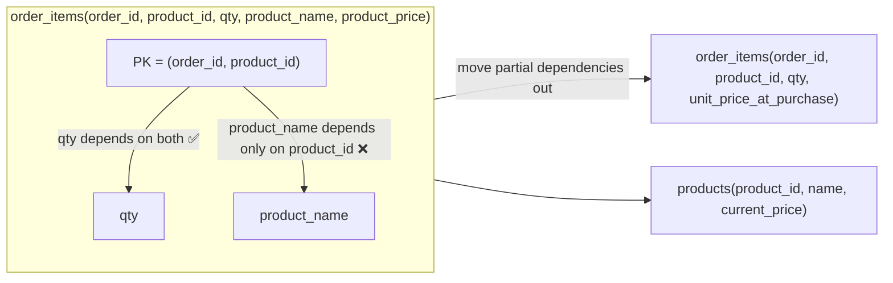

#### Example
`order_items(order_id, product_id, qty, product_name)`: renaming a product means updating millions of order rows (an **update anomaly**), and missing one leaves inconsistent names. Move `product_name` to `products`.

Careful: `unit_price_at_purchase` **does** belong in `order_items`. It's a historical fact of that order line (it depends on the order + product at that time), not a partial dependency on the product's *current* price. Snapshotting it is correct design, not denormalisation.

#### Trade-offs
Removing partial dependencies prevents anomalies but adds joins. Snapshot fields (prices, addresses at order time) are intentionally kept because they represent different facts.

#### Problems & fixes
| Symptom | Cause | Fix |
|---|---|---|
| Renaming a product requires a mass update | product attributes repeated per order line | move to products table |
| Inconsistent product names across rows | partial dependency, partially updated | normalise + FK |
| Old invoices change when price changes | invoice reads current product price | snapshot price on the order line |

#### Cheat sheet
- Only matters for composite keys: no column depending on part of the key.
- Partial dependencies → separate table.
- Historical snapshots (price at purchase) are legitimate facts, not violations.

#### Interview questions
<details><summary>Should order_items store the product price or look it up from products?</summary>

Store the **price at purchase** on the order line. It's a historical fact of that transaction, and the product's current price changes over time. Looking it up would silently change old orders and invoices. The product's name and description stay in `products` (or are also snapshotted if invoices must show the name as it was at the time).
</details>

<details><summary>What is an update anomaly and how does 2NF prevent it?</summary>

When the same fact is stored in many rows, updating it requires changing all of them. Miss one and the data contradicts itself. 2NF moves facts that depend on only part of the key (product name depends only on product_id) into their own table, so each fact is stored once.
</details>

#### Interview angle
> "Product attributes live in products, and order lines keep only facts about that line: quantity, plus the price snapshotted at purchase so invoices never change."

### 3NF — no transitive dependency (non-key → non-key)
Third Normal Form: every non-key column depends on **the key, the whole key and nothing but the key**. If column C depends on column B, which depends on the key (key → B → C), then C is **transitively dependent** and belongs in a separate table keyed by B.

#### How it works
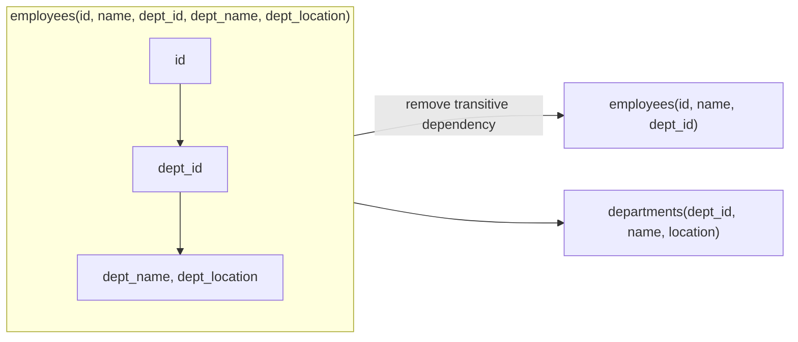

#### Example
`customers(id, name, pincode, city, state)`: city and state depend on pincode, not on the customer. Store `pincodes(pincode, city, state)` and keep only `pincode` on customers, and a city rename is one update. (In practice many systems keep the city on the address anyway, because addresses are user-entered facts and pincode data is messy, which is a deliberate choice.)

#### Trade-offs
3NF removes redundancy and anomalies, the standard target for OLTP schemas. Reads need joins. Read-heavy or analytical paths often denormalise on purpose (next topics).

#### Problems & fixes
| Symptom | Cause | Fix |
|---|---|---|
| Department rename touches thousands of employee rows | transitive dependency | departments table |
| Contradictory data (same dept_id, different names) | duplicated facts | normalise + FK |
| Read path needs 6 joins and is slow | normalised schema for a read-heavy view | read model / materialised view / denormalised projection |

#### Cheat sheet
- "The key, the whole key, nothing but the key" (1NF + 2NF + 3NF).
- Non-key → non-key dependency → separate table.
- OLTP: aim for 3NF. Read models: denormalise deliberately.

#### Interview questions
<details><summary>Give a real example of a transitive dependency and the anomaly it causes.</summary>

`orders(order_id, customer_id, customer_email)`: email depends on customer_id, not on the order. When a customer changes email, all their orders must be updated or some keep the old email, and deleting a customer's last order may lose their email entirely (a deletion anomaly). Keep email in `customers` only.
</details>

<details><summary>Do you always normalise to 3NF?</summary>

For transactional (write) models, yes as a default, because it keeps writes simple and data consistent. For read-heavy views, search indexes, analytics or cross-service data, I denormalise deliberately (materialised views, read models, caches), with a clear owner and update mechanism for the duplicated data.
</details>

#### Interview angle
> "The write model is 3NF so each fact lives in one place. Read-heavy screens get denormalised projections that are updated from events or materialised views."

### BCNF — every determinant is a candidate key
Boyce-Codd Normal Form tightens 3NF: for **every** functional dependency X → Y in a table, X must be a candidate key. It removes rare anomalies 3NF still allows, which happen when a table has overlapping composite candidate keys. It comes up rarely in interviews and in practice, but it's good to explain once.

#### How it works
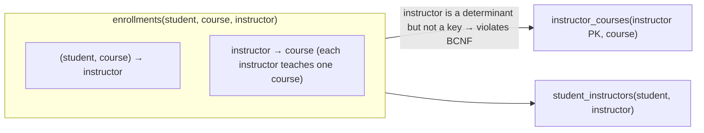

#### Example
Each instructor teaches exactly one course, and a student takes a course with one instructor. In `enrollments(student, course, instructor)`, the fact "Ravi teaches Databases" is repeated for every student. If Ravi switches course, many rows change. If his last student leaves, we lose the fact that he teaches Databases. The BCNF decomposition stores `instructor → course` once.

Cost: the rule "a student takes each course once" now spans two tables and can't be a simple unique constraint anymore. That's the classic **BCNF vs dependency preservation** trade-off.

#### Trade-offs
BCNF eliminates all redundancy from functional dependencies, but can make some constraints impossible to enforce with a single-table unique index. Most real schemas stop at 3NF.

#### Problems & fixes
| Symptom | Cause | Fix |
|---|---|---|
| Facts lost when deleting unrelated rows | determinant not a key | decompose (BCNF) |
| After decomposition, a business rule can't be a unique constraint | dependency not preserved | enforce with trigger/app logic, or stay in 3NF |

#### Cheat sheet
- Every determinant must be a candidate key.
- Differs from 3NF only with overlapping candidate keys.
- Rarely asked. Know the definition and one example, and say "rarely needed".

#### Interview questions
<details><summary>What's the difference between 3NF and BCNF?</summary>

3NF allows a dependency X → A where A is part of a candidate key (a prime attribute), even if X isn't a key. BCNF doesn't: every determinant must be a candidate key. The difference only shows up with multiple overlapping composite candidate keys, which is rare in practice.
</details>

<details><summary>Would you normalise a production schema to BCNF?</summary>

Usually no further than 3NF. BCNF decomposition can break dependency preservation (constraints spanning tables need triggers or app logic) and adds joins for little practical gain. I'd apply it only if a real update or deletion anomaly appears.
</details>

#### Interview angle
> "I know BCNF as the strict form where every determinant is a key, but production schemas usually stop at 3NF. The extra decomposition rarely pays for the constraints it makes harder to enforce."

### Denormalization — intentional redundancy to speed up reads, accept write overhead
Denormalisation deliberately **stores the same data in more than one place** (copied columns, precomputed aggregates, read-optimised tables) so reads avoid joins or expensive computations. You trade write complexity and the risk of inconsistency for read speed and scalability.

#### How it works
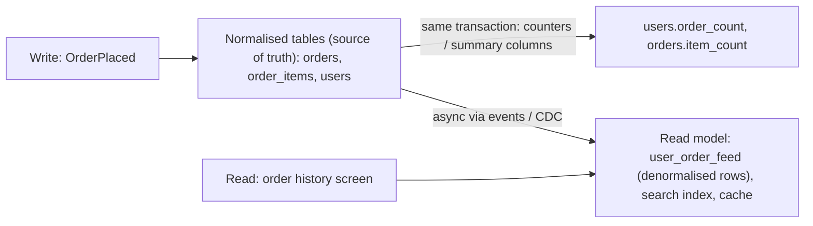

Common forms:
- **Copied attributes**: `orders.customer_name` (also a snapshot).
- **Precomputed aggregates**: `posts.like_count`, `accounts.balance` derived from ledger entries.
- **Read models / materialised views** shaped for one screen (CQRS).
- **NoSQL table per query pattern** (Cassandra/DynamoDB modelling).

#### Example
Instagram-like counts: `SELECT count(*) FROM likes WHERE post_id = ?` on a 2-billion-row table for every feed render is too slow. Keep `posts.like_count`, updated with `UPDATE posts SET like_count = like_count + 1` in the same transaction as the like insert. At very high rates, buffer increments in Redis and flush periodically, and run a nightly job that recounts and fixes drift.

#### Trade-offs
| Benefit | Cost |
|---|---|
| fast reads, fewer joins | writes touch more places |
| scales read-heavy workloads | risk of drift/inconsistency |
| enables NoSQL/sharded designs | need reconciliation and an update mechanism |

#### Problems & fixes
| Symptom | Cause | Fix |
|---|---|---|
| Counter differs from actual rows | missed/failed async updates | same-transaction updates, or periodic reconciliation jobs |
| Copied name shows old value | no propagation of changes | events/CDC to update copies, or treat it as a snapshot by design |
| Writes slow and deadlock-prone | updating many denormalised rows synchronously | async projections, fewer synchronous copies |

#### Cheat sheet
- Normalise the source of truth. Denormalise read paths.
- Synchronous (same transaction) for critical aggregates. Async (events/CDC) for read models.
- Always have a rebuild/reconcile path.

#### Interview questions
<details><summary>How would you show follower counts for celebrity accounts with 100M followers efficiently?</summary>

Don't COUNT on read. Maintain `users.follower_count`. Updating that single row per follow becomes a hot spot for celebrities, so increment a sharded counter (N rows or Redis keys per user) or aggregate follow events in a stream processor and update the count every few seconds. Users accept approximate, slightly delayed counts. Reconcile periodically from the follows table.
</details>

<details><summary>What risks come with denormalising data across microservices?</summary>

Copies go stale if events are lost or processed out of order, there's no single place to fix data, and schema changes ripple through consumers. Mitigate with a clear owner (source of truth), events with versions or sequence numbers, idempotent consumers that apply only newer versions, the ability to rebuild projections from the source, and monitoring for drift.
</details>

#### Interview angle
> "The normalised tables stay the source of truth. Hot reads like counts and feeds come from denormalised projections, updated in the same transaction or via events, with a rebuild job for drift."

### Online schema changes — gh-ost (GitHub), pt-online-schema-change (Percona), pg_repack
Large production tables can't be locked for hours while an `ALTER TABLE` rewrites them. Online schema change tools build a **new copy of the table with the new schema in the background**, keep it in sync with ongoing writes, then **swap** it in with a brief lock.

#### How it works
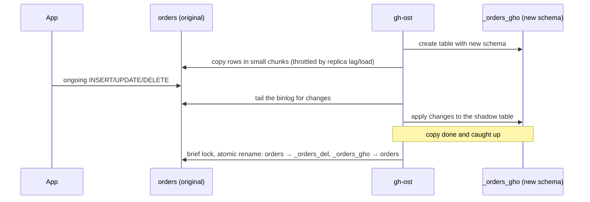

| Tool | DB | Mechanism |
|---|---|---|
| **gh-ost** | MySQL | shadow table + binlog streaming (no triggers), throttling, pausable |
| **pt-online-schema-change** | MySQL | shadow table + triggers |
| **pg_repack** | PostgreSQL | rebuild table/indexes online to remove bloat (also reorder) |
| native | PG | many ALTERs are instant (add nullable column, add column with constant default PG 11+), `CREATE INDEX CONCURRENTLY` |
| native | MySQL 8 | `ALGORITHM=INSTANT/INPLACE` for many changes |

#### Example
Adding an index to a 2 TB `payments` table in PostgreSQL:
```sql
SET lock_timeout = '5s';
CREATE INDEX CONCURRENTLY idx_payments_merchant_created ON payments(merchant_id, created_at);
-- if it fails it leaves an INVALID index: DROP INDEX CONCURRENTLY and retry
```
Changing a column type on a 500M-row MySQL table: run gh-ost with `--max-lag-millis=1500` so it throttles when replicas lag, test with `--test-on-replica`, and schedule the cut-over at low traffic.

#### Trade-offs
Online tools avoid downtime but take hours to days for huge tables, double the storage temporarily, add write load and replica lag, and need careful cut-over. Some changes (foreign keys, triggers) complicate them.

#### Problems & fixes
| Symptom | Cause | Fix |
|---|---|---|
| Site outage during migration | blocking ALTER waiting for/holding locks | `lock_timeout`, online tools, `CONCURRENTLY` |
| Replicas lag hours during copy | copy too aggressive | throttle on replica lag (gh-ost flags) |
| Disk full mid-migration | shadow table doubles size | check free space first, clean up |
| INVALID index left behind | `CREATE INDEX CONCURRENTLY` failed | drop and recreate concurrently |

#### Cheat sheet
- Never run a long blocking ALTER on a big hot table.
- PG: instant ADD COLUMN, `CREATE INDEX CONCURRENTLY`, pg_repack. MySQL: INSTANT/INPLACE, gh-ost.
- Always set `lock_timeout`. Throttle on replica lag. Check disk space.

#### Interview questions
<details><summary>You must add a NOT NULL column with a default to a 1-billion-row table in production. How?</summary>

In PG 11+ `ADD COLUMN … DEFAULT x NOT NULL` with a constant default is metadata-only, so it's instant (still set `lock_timeout`). For computed or backfilled values, use expand-contract: add a nullable column, deploy code that writes it, backfill in throttled batches, add `CHECK (col IS NOT NULL) NOT VALID`, then `VALIDATE CONSTRAINT`, and finally set NOT NULL. In MySQL use `ALGORITHM=INSTANT` where supported, or gh-ost.
</details>

<details><summary>Why can even a "fast" ALTER TABLE cause an outage?</summary>

It still needs a brief exclusive lock. If a long-running transaction holds a conflicting lock, the ALTER waits, and every subsequent query on the table queues behind it, so connection pools exhaust and the app stalls. Use a short `lock_timeout` with retries, and make sure no long transactions are running.
</details>

#### Interview angle
> "Schema changes on big tables use expand-contract and online tooling (CREATE INDEX CONCURRENTLY, gh-ost), always with a lock_timeout and throttling on replica lag."

### Expand-contract pattern — add new column nullable → backfill → add constraint → drop old
Expand-contract (parallel change) evolves a schema **without downtime and without breaking running code**: first **expand** the schema so old and new code both work, migrate the data and code gradually, then **contract** by removing the old structure once nothing uses it.

#### How it works
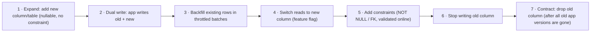

Each step is a separate deploy, and each one is **backward compatible** with the version running before it, so rolling deploys and rollbacks stay safe.

#### Example
Renaming `users.phone` to `users.mobile_e164` with normalisation:
1. `ALTER TABLE users ADD COLUMN mobile_e164 text;`
2. Deploy v2: writes both `phone` and `mobile_e164` and still reads `phone`.
3. Backfill: `UPDATE users SET mobile_e164 = normalize(phone) WHERE id BETWEEN :a AND :b AND mobile_e164 IS NULL;` in 10k-row batches with sleeps.
4. Deploy v3: reads `mobile_e164` (behind a flag), still dual-writes.
5. `ALTER TABLE users ADD CONSTRAINT mobile_nn CHECK (mobile_e164 IS NOT NULL) NOT VALID; ALTER TABLE users VALIDATE CONSTRAINT mobile_nn;`
6. Deploy v4: stops writing `phone`.
7. Later: `ALTER TABLE users DROP COLUMN phone;`

#### Trade-offs
Zero downtime and safe rollbacks, at the cost of several deploys over days or weeks, temporary dual-write code and more coordination. It's worth it for any table that matters.

#### Problems & fixes
| Symptom | Cause | Fix |
|---|---|---|
| Errors during rolling deploy after rename | old instances still query the old column | never rename in place, use expand-contract |
| Backfill overloads DB / replicas lag | single giant UPDATE | small batches, throttle, run off-peak |
| Rows written during backfill missing new value | no dual-write before backfill | enable dual-write first, then backfill |
| Can't roll back after dropping the column | contract done too early | drop only after the new path has been stable for a while |

#### Cheat sheet
- Expand (additive) → migrate (dual-write + backfill + switch reads) → contract (remove).
- Every step is backward compatible with the previous app version.
- Backfill in batches. Validate constraints online (`NOT VALID` → `VALIDATE`).

#### Interview questions
<details><summary>How do you rename a heavily used column with zero downtime?</summary>

Never `RENAME COLUMN` directly while old code is running. Add the new column, deploy dual-writing code, backfill in batches, switch reads to the new column, add constraints online, stop writing the old column, and drop it once all old versions are retired. Each step is independently deployable and reversible.
</details>

<details><summary>Why must the schema change happen before the code that uses it, and removals after?</summary>

During a rolling deploy old and new app versions run at the same time. Additive schema changes first means both versions work against the schema. Removing a column only after no running version reads or writes it means old instances never hit a missing column. That ordering keeps every intermediate state valid and makes rollbacks possible.
</details>

#### Interview angle
> "Every schema change ships as expand-contract: additive change first, dual writes and a batched backfill, reads switched behind a flag, and the old column dropped last, so rolling deploys and rollbacks never break."

### Connection pooling — PgBouncer (transaction mode), HikariCP (JVM), Sequelize pool (Node)
Opening a database connection is expensive (TCP + TLS + auth, plus a backend **process** per connection in PostgreSQL), and databases handle only a limited number of concurrent connections well. A pool keeps a small set of open connections and **lends them out** per transaction, which cuts latency and protects the database.

#### How it works
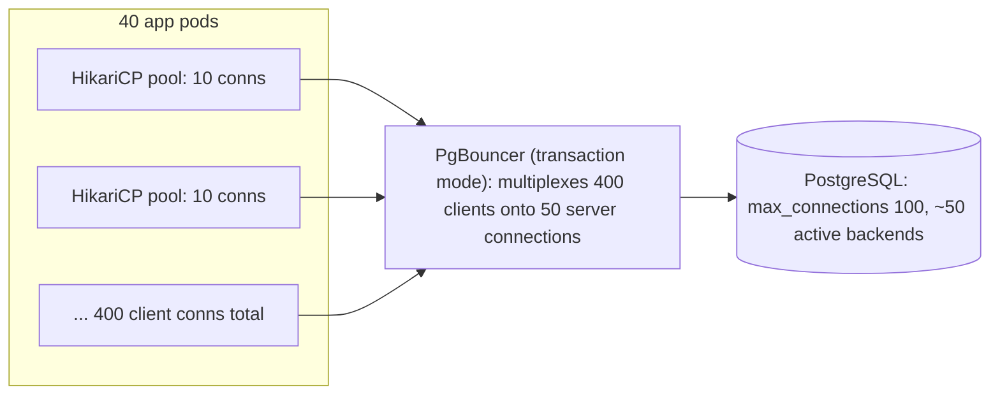

- **App-side pool** (HikariCP, the Node `pg` pool): per process.
- **External pooler** (PgBouncer, RDS Proxy, pgcat): multiplexes many clients onto few server connections.
  - *Session mode*: client keeps a server connection for its whole session.
  - *Transaction mode*: a server connection is assigned only for the duration of a transaction, giving the best multiplexing. But session state (SET, advisory locks, server-side prepared statements before PgBouncer 1.21, temp tables) doesn't persist between transactions.

**Pool sizing**: a database can only do as much work in parallel as it has CPU cores and disk. A good starting point is `connections ≈ cores × 2–4` **total**, not per pod. More connections mean more context switching and lock contention, so throughput drops.

#### Example
50 pods × HikariCP `maximumPoolSize=20` = 1,000 connections to a 16-vCPU Postgres, which runs out of memory and thrashes. Fix: Hikari 5–10 per pod, PgBouncer in transaction mode with `default_pool_size=60`. The database sees 60 busy backends and p99 drops.

```yaml
spring.datasource.hikari:
  maximum-pool-size: 10
  minimum-idle: 10
  connection-timeout: 2000      # fail fast instead of queueing forever
  max-lifetime: 1700000         # below DB/LB idle timeouts
```

#### Trade-offs
Pools massively reduce overhead and protect the DB, but a pool that's too small queues requests (latency), and one too large overloads the DB. Transaction-mode pooling breaks session-level features.

#### Problems & fixes
| Symptom | Cause | Fix |
|---|---|---|
| "FATAL: too many connections" during autoscaling | per-pod pools × many pods | PgBouncer/RDS Proxy, smaller per-pod pools |
| Requests time out waiting for a connection | pool exhausted (slow queries, leaks, long transactions) | fix slow queries/leaks, leak detection, size for actual concurrency |
| Prepared statement errors behind PgBouncer | transaction mode + server-side prepared statements | PgBouncer ≥ 1.21 prepared statement support, or disable server-side prepares |
| DB CPU high with many idle connections | huge connection counts | reduce totals, use a pooler |

#### Cheat sheet
- Total active DB connections ≈ cores × 2–4. Queue in the app, not in the DB.
- PgBouncer transaction mode for many clients. Beware session state.
- Hikari: small pools, `connection-timeout` short, `max-lifetime` below infra timeouts.

#### Interview questions
<details><summary>Your service autoscaled from 10 to 80 pods during a sale and the database fell over with connection errors. What happened and what's the fix?</summary>

Each pod opened its own pool (e.g. 20 connections), so 80 × 20 = 1,600 connections, beyond `max_connections` and the database's memory and CPU capacity. Fix: put a pooler (PgBouncer/RDS Proxy) between apps and the DB, shrink per-pod pools, cap autoscaling by DB capacity, and use read replicas or caching for read load.
</details>

<details><summary>Why can a smaller connection pool give higher throughput?</summary>

A database executes in parallel only up to its cores and I/O capacity. Beyond that, extra connections just contend for CPU, locks and buffers (context switching, cache thrashing), which slows every query. A small pool keeps the DB at its efficient concurrency and queues the excess in the application, where waiting is cheap.
</details>

#### Interview angle
> "Each pod gets a small Hikari pool, and PgBouncer in transaction mode multiplexes everything onto a few dozen server connections, sized to the database's cores, so autoscaling the app can't overwhelm the database."

### PostgreSQL-specific — VACUUM, autovacuum, TOAST (for large values), pg_stat_activity
Running PostgreSQL well means knowing its maintenance internals: **VACUUM** reclaims dead tuples created by MVCC, **autovacuum** does it automatically, **TOAST** stores large values out of line, and **pg_stat_activity** (with other `pg_stat_*` views) shows what the database is doing right now.

#### How it works
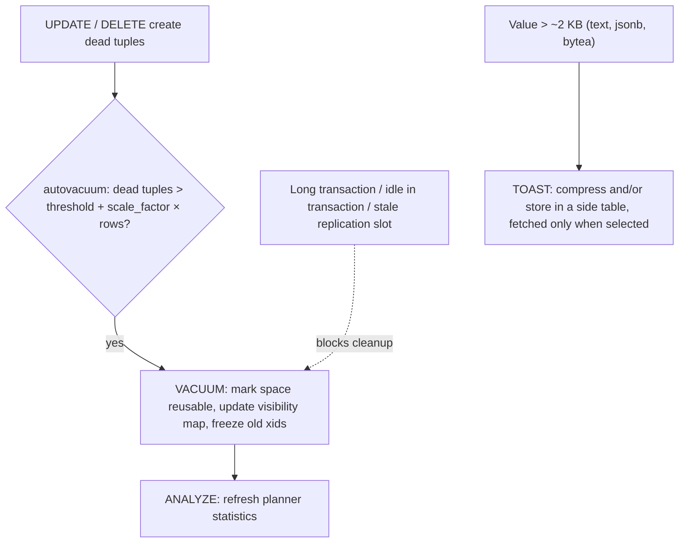

Key facts:
- `VACUUM` doesn't shrink files, it makes space reusable. `VACUUM FULL` rewrites the table but takes an exclusive lock, so use `pg_repack` instead.
- Default autovacuum thresholds (20% of rows) are too lax for big, hot tables. Tune per table.
- **TOAST** compresses and moves large column values to a separate table. `SELECT *` on wide rows fetches them all, so select only needed columns.

Diagnostic queries:
```sql
-- what's running / waiting / idle in transaction
SELECT pid, state, wait_event_type, wait_event, now() - xact_start AS xact_age, left(query, 80)
FROM pg_stat_activity WHERE state <> 'idle' ORDER BY xact_age DESC;

-- dead tuples and last autovacuum per table
SELECT relname, n_live_tup, n_dead_tup, last_autovacuum FROM pg_stat_user_tables ORDER BY n_dead_tup DESC LIMIT 10;

-- top queries by total time (needs pg_stat_statements)
SELECT calls, round(total_exec_time) total_ms, round(mean_exec_time,1) mean_ms, left(query, 80)
FROM pg_stat_statements ORDER BY total_exec_time DESC LIMIT 10;
```

#### Example
A 300M-row `events` table with heavy updates:
```sql
ALTER TABLE events SET (autovacuum_vacuum_scale_factor = 0.01, autovacuum_analyze_scale_factor = 0.005,
                        autovacuum_vacuum_cost_limit = 2000);
```
Autovacuum now runs after ~3M dead tuples instead of 60M and keeps bloat and query times stable.

#### Trade-offs
Aggressive vacuuming uses I/O but prevents bloat and wraparound emergencies. Too timid, and tables bloat until queries slow and emergency anti-wraparound vacuums kick in at the worst time.

#### Problems & fixes
| Symptom | Cause | Fix |
|---|---|---|
| Table/index bloat, slowing scans | autovacuum not keeping up or blocked | per-table tuning, remove blockers, pg_repack |
| `n_dead_tup` grows despite autovacuum | long transaction / stale replication slot holding xmin | kill it, drop unused slots |
| Wraparound warnings | freezing blocked | fix blockers, manual `VACUUM (FREEZE)` |
| Slow `SELECT *` on table with big JSON/text | TOAST fetch/decompression | select needed columns, keep big blobs in object storage |

#### Cheat sheet
- VACUUM = reclaim dead tuples + freeze. Autovacuum per-table tuning for hot tables.
- Never `VACUUM FULL` on live big tables. Use pg_repack.
- `pg_stat_activity` (now), `pg_stat_statements` (heaviest queries), `pg_stat_user_tables` (dead tuples).

#### Interview questions
<details><summary>Postgres query latency slowly degrades over weeks on a write-heavy table. What would you investigate?</summary>

Bloat: check `n_dead_tup` and `last_autovacuum` in `pg_stat_user_tables` and the table/index size vs live rows. Look for blockers of vacuum: long-running or idle-in-transaction sessions (`pg_stat_activity`), old replication slots, long-held prepared transactions. Then tune autovacuum per table (lower scale factors, higher cost limit), compact with pg_repack, and check statistics freshness for plan regressions.
</details>

<details><summary>What is TOAST and how can it affect API performance?</summary>

TOAST stores large column values (over ~2 KB) compressed and out of line in a separate table. Queries that don't select those columns never pay for them, but `SELECT *` fetches and decompresses every large value per row. List endpoints that only need a few fields should select explicit columns. Very large blobs belong in object storage, with a URL in the row.
</details>

#### Interview angle
> "For hot Postgres tables I tune autovacuum per table, watch dead tuples and long transactions in pg_stat views, and use pg_stat_statements to find the queries worth optimising."

### JSONB in PostgreSQL — binary JSON, GIN indexable, operators @>, ?, #>>
`JSONB` stores JSON in a decomposed binary format: keys are de-duplicated and sorted, so it's fast to query and indexable with **GIN**. It lets a relational database hold semi-structured data (variable attributes, external payloads, settings) next to strongly typed columns.

#### How it works
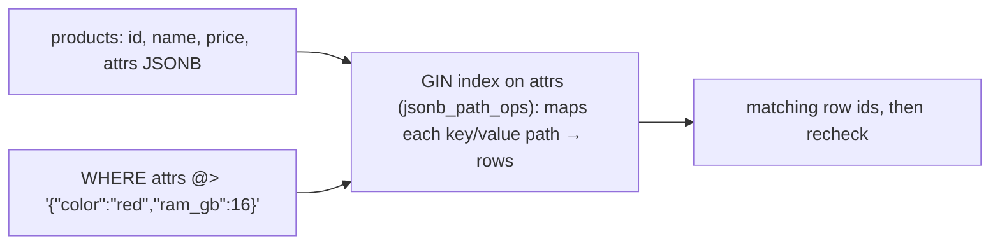

| Operator | Meaning | Example |
|---|---|---|
| `->` / `->>` | get field as JSON / text | `attrs->>'brand'` |
| `#>` / `#>>` | get by path | `payload#>>'{customer,address,city}'` |
| `@>` | contains | `attrs @> '{"color":"red"}'` |
| `?` / `?|` / `?&` | key exists / any / all | `attrs ? 'warranty'` |
| `jsonb_set`, `||`, `-` | modify, merge, delete key | `attrs || '{"sale":true}'` |

Indexes:
```sql
CREATE INDEX idx_attrs_gin ON products USING gin (attrs jsonb_path_ops);   -- fast @> containment
CREATE INDEX idx_attrs_brand ON products ((attrs->>'brand'));             -- B-tree on one hot field
```

#### Example
An electronics marketplace: phones have `ram_gb` and `camera_mp`, shoes have `size` and `material`. Core columns (`id, seller_id, price, category_id, status`) stay relational with constraints. Category-specific attributes live in `attrs JSONB`. Faceted filters use `attrs @> '{"ram_gb": 8}'` with a GIN index. The hottest attribute (`brand`) gets its own expression index or a generated column.

Webhook storage: keep the raw provider payload in `raw JSONB` for audit, and extract the fields you query (`event_type`, `payment_id`) into real columns.

#### Trade-offs
| JSONB | Columns |
|---|---|
| flexible schema, no migrations for new attributes | constraints, types, FKs |
| GIN indexing for containment | compact storage, better stats |
| whole-value rewrite on update (and TOAST) | in-place partial updates |
| planner stats weak inside JSON | accurate estimates |

#### Problems & fixes
| Symptom | Cause | Fix |
|---|---|---|
| Queries on JSON fields slow | no index | GIN (`jsonb_path_ops`) for @>, expression index for specific fields |
| Data quality issues (wrong types, misspelled keys) | no schema in JSONB | CHECK constraints (`jsonb_typeof`), validate in the app, promote stable fields to columns |
| Bloat/slow updates on big documents | each update rewrites the whole JSONB value | keep documents small, split out hot-changing fields |
| Bad estimates on JSON predicates | no statistics inside JSON | expression indexes / generated columns (they get stats) |

#### Cheat sheet
- JSONB (not JSON) for querying. GIN for @>/?. Expression index for one field.
- Core, relational, money and FK data stays in columns.
- Promote frequently queried fields to generated columns.

#### Interview questions
<details><summary>When would you use JSONB in Postgres instead of a document database like MongoDB?</summary>

When most of the data is relational (orders, users, payments with constraints and transactions) and only some attributes are semi-structured. JSONB keeps everything in one ACID database, with joins and transactions across both kinds of data. I'd choose a document DB when the whole domain is document-shaped, needs horizontal sharding natively, and rarely needs cross-document transactions.
</details>

<details><summary>How do you index a JSONB column for queries like attrs @> '{"color":"red"}'?</summary>

`CREATE INDEX ON products USING gin (attrs jsonb_path_ops)`, which is smaller and faster for containment than the default `jsonb_ops`. Use default `jsonb_ops` if you also need key-existence operators (`?`). For equality or range on a single field, use a B-tree expression index on `(attrs->>'field')`.
</details>

#### Interview angle
> "Core fields are typed columns with constraints. Category-specific attributes go in JSONB with a GIN index, and any attribute that becomes hot gets promoted to a generated column with its own index."

### Full-text search in PostgreSQL — tsvector, tsquery, GIN index, ts_rank
PostgreSQL has built-in full-text search: text is normalised into a **tsvector** (stemmed lexemes with positions), queries become a **tsquery**, a **GIN** index makes matching fast, and **ts_rank** orders results by relevance. For many apps it's good enough to skip Elasticsearch entirely.

#### How it works
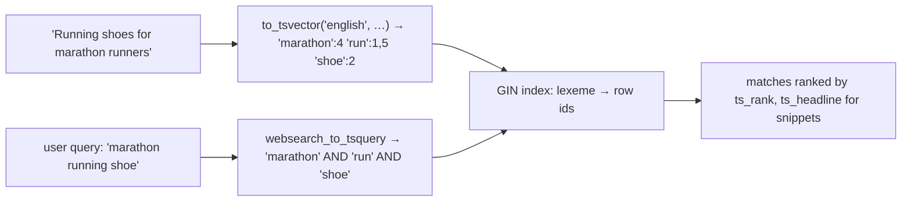

```sql
ALTER TABLE products ADD COLUMN search tsvector GENERATED ALWAYS AS (
  setweight(to_tsvector('english', coalesce(name, '')), 'A') ||
  setweight(to_tsvector('english', coalesce(description, '')), 'B')
) STORED;
CREATE INDEX idx_products_search ON products USING gin (search);

SELECT id, name, ts_rank(search, q) AS rank
FROM products, websearch_to_tsquery('english', 'marathon running shoes') q
WHERE search @@ q
ORDER BY rank DESC LIMIT 20;
```
Typos and partial words: add the `pg_trgm` extension (`similarity()`, GIN trigram index for `ILIKE '%foo%'`).

#### Example
A help-centre search over 200k articles: a generated `tsvector` column (title weighted A, body B), a GIN index, `websearch_to_tsquery` for Google-like syntax ("refund -cancelled"), and `ts_headline` for highlighted snippets. Latency is ~10 ms and there's no extra infrastructure. Results are always consistent with the data, since it's the same transaction.

#### Trade-offs
| Postgres FTS | Elasticsearch / OpenSearch |
|---|---|
| no extra system, transactional, simple ops | better relevance (BM25 tuning), fuzzy, synonyms, facets/aggregations at scale |
| great to ~millions of docs | scales horizontally to billions |
| basic ranking | rich analyzers, multi-language, autocomplete |

#### Problems & fixes
| Symptom | Cause | Fix |
|---|---|---|
| Search slow | computing to_tsvector per row at query time | stored generated tsvector + GIN index |
| No results for typos ("iphnoe") | FTS matches exact lexemes | pg_trgm similarity / fuzzy fallback, or a search engine |
| Hindi/mixed-language text badly stemmed | wrong text search config | `simple` config or language-specific dictionaries |
| Ranking feels poor | ts_rank is basic | weights, normalisation options, or move to Elasticsearch for advanced relevance |

#### Cheat sheet
- tsvector (document) @@ tsquery (query), GIN index, ts_rank for ordering.
- Stored generated tsvector column with weights (A title, B body).
- pg_trgm for typos/substring. Move to Elasticsearch when relevance, scale or facets demand it.

#### Interview questions
<details><summary>Would you add Elasticsearch to search 500k products, or use Postgres full-text search?</summary>

Start with Postgres FTS + pg_trgm: half a million documents is small, results stay transactionally consistent, and there's no sync pipeline to run. Move to Elasticsearch/OpenSearch when you need advanced relevance tuning, fuzzy matching and synonyms at scale, heavy faceted aggregations, multi-language analysis, or tens of millions of documents. Then sync from Postgres via CDC.
</details>

<details><summary>How do you make Postgres full-text search fast?</summary>

Precompute the document vector in a stored generated column (with weights), index it with GIN, use `websearch_to_tsquery` or `plainto_tsquery` for user input, and limit and rank results. Avoid calling `to_tsvector` on columns at query time, since that forces a full scan.
</details>

#### Interview angle
> "For a moderate catalogue I'd start with Postgres full-text search plus pg_trgm. I'd move to Elasticsearch via CDC only once relevance tuning, facets or scale require it."

### Write-Ahead Log (WAL) — every change written to log before applied, enables crash recovery and replication
The write-ahead log is an append-only record of every change. The rule: **log the change durably before modifying data pages**. That single rule gives databases crash recovery, durability, physical replication, point-in-time recovery and change data capture.

#### How it works
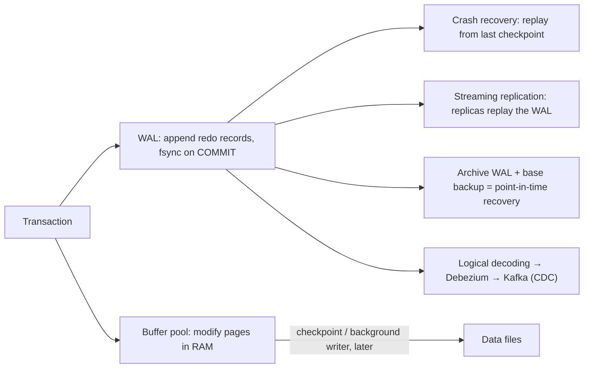

- **Postgres**: WAL segments (16 MB files) in `pg_wal/`. `wal_level = replica | logical`.
- **MySQL InnoDB**: the **redo log** (crash recovery) plus the **binlog** (replication, CDC). Two-phase commit between them keeps them consistent.
- Every log record has an **LSN** (log sequence number), a position used to measure replication lag and recovery progress.

#### Example
- **Point-in-time recovery**: someone ran `DELETE FROM orders` without WHERE at 14:32. Restore last night's base backup and replay archived WAL up to `recovery_target_time = '…14:31:59'`. You lose nothing before the mistake.
- **CDC**: Debezium reads Postgres's logical WAL stream and publishes every row change to Kafka, feeding a search index and a data warehouse without dual writes.

#### Trade-offs
WAL makes commits cheap (sequential writes) and enables replication and recovery, but it generates a lot of I/O (full-page writes after checkpoints), needs disk space and archiving, and an unconsumed replication slot can fill the disk.

#### Problems & fixes
| Symptom | Cause | Fix |
|---|---|---|
| `pg_wal` fills the disk | inactive replication slot (dead CDC connector/replica) retaining WAL | monitor slot lag, drop dead slots, `max_slot_wal_keep_size` |
| Huge WAL volume after checkpoints | full-page writes + frequent checkpoints | longer `checkpoint_timeout`, larger `max_wal_size`, `wal_compression` |
| Can't recover to before a bad deploy | no WAL archiving | continuous archiving (pgBackRest, WAL-G), test restores |
| Replica far behind | replay slower than primary writes | faster replica storage, fewer heavy writes, monitor LSN lag |

#### Cheat sheet
- Log first, data later. Sequential WAL fsync at commit.
- WAL powers recovery, replication, PITR and CDC. LSN = position.
- Watch replication slots and archive WAL. Test restores.

#### Interview questions
<details><summary>How does a database recover after a power failure without losing committed transactions?</summary>

On restart it reads the WAL from the last checkpoint and redoes every logged change (committed transactions' changes are guaranteed to be in the WAL because COMMIT waited for its fsync). Changes from uncommitted transactions are ignored or rolled back. Data pages written before the crash are brought up to date, and the database is consistent as of the last commit.
</details>

<details><summary>Your Postgres disk suddenly filled up with WAL files. What is the likely cause?</summary>

A replication slot whose consumer stopped (a dead Debezium connector, a removed replica) keeps Postgres from recycling WAL, so segments accumulate until the disk is full. Check `pg_replication_slots` for inactive slots with large retained lag, fix or drop them, set `max_slot_wal_keep_size`, and alert on slot lag.
</details>

#### Interview angle
> "The WAL is the database's source of truth for changes. It gives us durability and replicas, point-in-time recovery from archived WAL, and Debezium CDC into Kafka without dual writes."

### Checkpointing — periodically flush dirty pages to disk, bound WAL replay on restart
A checkpoint flushes all modified ("dirty") pages from memory to the data files and records a point in the WAL from which recovery would start. Checkpoints **bound crash-recovery time** and let old WAL be recycled, but they're a burst of I/O that has to be smoothed out.

#### How it works
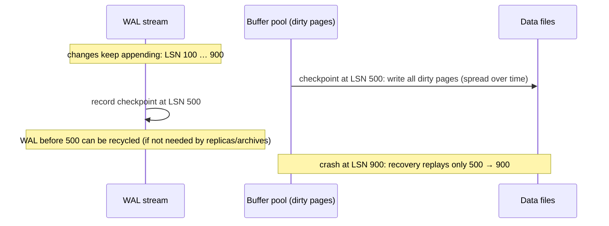

Postgres knobs:
- `checkpoint_timeout` (default 5 min): time-based checkpoints.
- `max_wal_size`: WAL volume that triggers a checkpoint early.
- `checkpoint_completion_target = 0.9`: spread writes over 90% of the interval to avoid I/O spikes.
- After each checkpoint, the **first** change to a page writes a **full page image** into the WAL (torn-page protection), so frequent checkpoints mean more WAL.

#### Example
A database with `max_wal_size = 1GB` under heavy load logs "checkpoints are occurring too frequently (12 seconds apart)", with constant I/O and WAL bloat from full-page writes. Raising `max_wal_size` to 16 GB and `checkpoint_timeout` to 15 min smooths I/O and cuts WAL volume. The trade-off: crash recovery may now replay up to ~15 minutes of WAL (minutes, not seconds).

#### Trade-offs
| Frequent checkpoints | Infrequent checkpoints |
|---|---|
| faster crash recovery | longer recovery |
| more I/O, more full-page WAL | smoother I/O, less WAL |
| less WAL disk needed | more WAL retained |

#### Problems & fixes
| Symptom | Cause | Fix |
|---|---|---|
| Periodic latency spikes every few minutes | checkpoint I/O bursts | `checkpoint_completion_target` 0.9, faster storage, tune bgwriter |
| "checkpoints are occurring too frequently" | `max_wal_size` too small | raise `max_wal_size` |
| Very long restart after crash | huge interval between checkpoints | balance timeout vs recovery-time objective |

#### Cheat sheet
- Checkpoint = flush dirty pages + mark WAL position. Recovery starts there.
- Spread writes (`completion_target 0.9`). Size `max_wal_size` so checkpoints are time-based.
- More frequent = faster recovery but more I/O and WAL.

#### Interview questions
<details><summary>Why does the database need checkpoints if everything is already in the WAL?</summary>

Without checkpoints, recovery would have to replay the WAL from the very beginning, and the WAL could never be recycled. Checkpoints guarantee that all changes up to a certain LSN are in the data files, so recovery only replays from there and older WAL can be removed (once replicas and archives no longer need it).
</details>

<details><summary>You see p99 write latency spikes every 5 minutes on Postgres. What's your hypothesis?</summary>

Checkpoint I/O bursts: every `checkpoint_timeout` the database flushes many dirty pages, saturating disk I/O and slowing WAL fsyncs and queries. Confirm with checkpoint logs (`log_checkpoints`) and I/O metrics. Fix by spreading the checkpoint (`checkpoint_completion_target`), sizing `max_wal_size` appropriately, tuning the background writer, or provisioning more IOPS.
</details>

#### Interview angle
> "Checkpoints trade recovery time against I/O. I size max_wal_size so checkpoints are time-based and spread their writes, which keeps latency smooth while bounding crash recovery to a few minutes."
