## Replication

### Read replicas — offload read traffic, replicate asynchronously from primary
A read replica is a copy of the primary database that **continuously applies the primary's changes** (WAL/binlog) and serves **read-only** queries. Most applications read far more than they write, so adding replicas scales reads horizontally and isolates heavy queries from the write path.

#### How it works
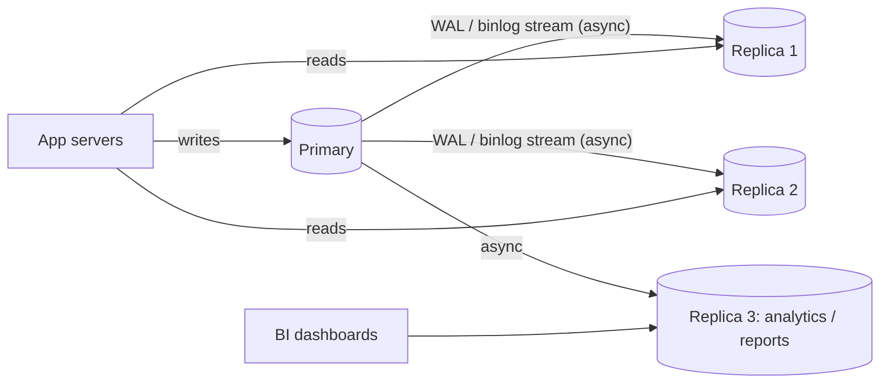

- Postgres streaming replication (physical) or logical replication. MySQL binlog replication. RDS/Aurora "read replicas".
- Routing: the app uses two datasources (writer/reader), or a proxy (ProxySQL, pgpool, RDS Proxy reader endpoint) splits traffic.
- Replicas can also be failover candidates and the source for backups.

#### Example
An e-commerce catalogue sees 20k reads/s and 500 writes/s. A single primary is at 80% CPU. Adding 3 replicas behind a reader endpoint moves product listing and search reads off the primary (now 25% CPU), and a 4th replica dedicated to reporting stops month-end reports from slowing checkout.

In Spring: route `@Transactional(readOnly = true)` methods to the reader datasource with `AbstractRoutingDataSource`.

#### Trade-offs
- Cheap read scaling and workload isolation.
- **Replication lag**: replicas are slightly behind, so reads can be stale (next topic). Replicas don't help write throughput. Each replica adds load on the primary (WAL sending) and costs money.

#### Problems & fixes
| Symptom | Cause | Fix |
|---|---|---|
| User updates profile, refresh shows old data | read from lagging replica | read-your-writes routing (primary for a few seconds after a write) |
| Writes still slow after adding replicas | write-bound primary | replicas don't help: optimise writes, partition/shard, queue writes |
| Replica crashes queries with "canceling statement due to conflict with recovery" (PG) | long queries conflict with WAL replay | `hot_standby_feedback`, `max_standby_streaming_delay`, dedicated reporting replica |
| One replica overloaded | uneven routing | load-balance across replicas, remove lagging ones from rotation |

#### Cheat sheet
- Replicas scale reads, not writes. Async by default, so they can be stale.
- Route read-only transactions to replicas, and anything that must be fresh to the primary.
- Dedicated replica for analytics and reports.

#### Interview questions
<details><summary>Your database CPU is at 90%, mostly from reads. Walk through your options in order.</summary>

1) Find and fix expensive queries (indexes, N+1, SELECT *). 2) Add caching for hot, read-mostly data (Redis/CDN). 3) Add read replicas and route read-only traffic to them, keeping read-your-writes paths on the primary. 4) Move analytics to a separate replica or warehouse. Sharding comes only when writes or data size outgrow one primary.
</details>

<details><summary>How do you route reads to replicas in a Spring Boot service without breaking consistency?</summary>

Configure writer and reader datasources behind an `AbstractRoutingDataSource` (or use a proxy such as an RDS reader endpoint) and route `@Transactional(readOnly = true)` to readers. Keep reads that immediately follow the user's own writes (post-checkout order page, profile after edit) on the primary, or route by a "last write timestamp" in the session for a few seconds. Exclude lagging replicas using lag metrics.
</details>

#### Interview angle
> "Reads go to a pool of async replicas behind a reader endpoint, and analytics gets its own replica. Flows that must show the user's own fresh writes stay on the primary."

### Replication lag — async replica may be seconds behind; affects read-your-writes
Replication lag is the delay between a commit on the primary and that change becoming visible on a replica. Normally milliseconds, it can grow to seconds or minutes under heavy writes, long transactions or replica resource limits, and it produces confusing **stale reads**.

#### How it works
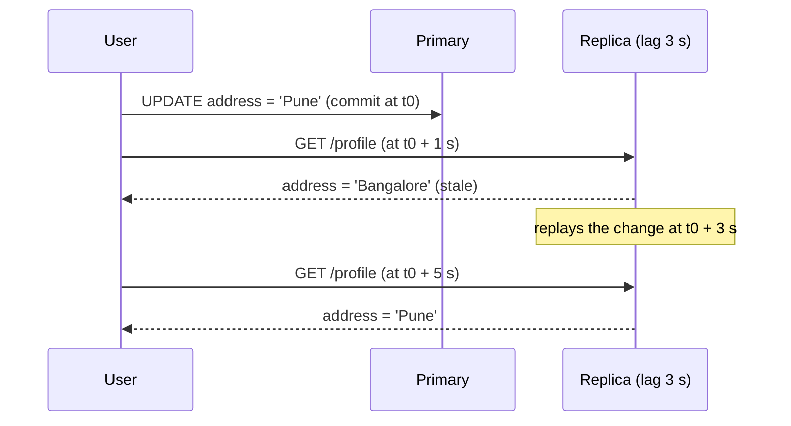

Causes of lag: write bursts (bulk imports, backfills), large transactions (the replica applies them as one unit), single-threaded apply (older MySQL), slower replica hardware, network issues, and long queries on the replica conflicting with replay.

Monitoring:
```sql
-- PostgreSQL on primary
SELECT client_addr, state, replay_lag, pg_wal_lsn_diff(pg_current_wal_lsn(), replay_lsn) AS bytes_behind
FROM pg_stat_replication;
-- MySQL on replica
SHOW REPLICA STATUS\G   -- Seconds_Behind_Source
```

#### Example
A backfill job updates 50M rows in one transaction. Replicas apply it only after the commit and fall 10 minutes behind, so all reads from replicas show 10-minute-old data, including order statuses customers are checking. Fix: backfill in 5k-row batches with pauses, monitor lag, and pause the job when lag exceeds 5 s.

#### Trade-offs
Async replication keeps primary commits fast, but you must design every replica read to tolerate lag or route it elsewhere.

#### Problems & fixes
| Symptom | Cause | Fix |
|---|---|---|
| "My update disappeared" complaints | stale read after own write | read-your-writes routing, session stickiness to primary for N seconds |
| Lag spikes during batch jobs | huge transactions / write bursts | batch and throttle on lag |
| Failover loses recent writes | promoted replica was behind | sync/semi-sync replica as failover target, check lag before promotion |
| Lag grows steadily | replica under-provisioned / single-threaded apply | bigger replica, parallel apply (MySQL `replica_parallel_workers`) |

#### Cheat sheet
- Lag = commit on primary → visible on replica. Monitor `replay_lag` / `Seconds_Behind_Source`.
- Throttle batch jobs on lag. Remove lagging replicas from rotation.
- Lag on the failover target = data lost on failover (RPO).

#### Interview questions
<details><summary>After placing an order, users sometimes see "no orders found" on the confirmation page. Diagnose and fix.</summary>

The order is written to the primary, but the confirmation page reads from a lagging replica. Fixes: read the confirmation from the primary (or return the created order in the POST response and render from it), route a user's reads to the primary for a few seconds after any write (store last-write time in the session/cookie), or wait for the replica to reach the commit LSN before reading (LSN-aware reads).
</details>

<details><summary>How would you make a large data migration safe for replicas?</summary>

Process in small batches (thousands of rows per transaction), sleep between batches, monitor replica lag continuously and pause when it exceeds a threshold, run off-peak, and avoid long transactions. Tools like gh-ost do this automatically with `--max-lag-millis`.
</details>

#### Interview angle
> "Replica reads must tolerate a few seconds of lag. Flows that show a user their own write read from the primary, and batch jobs throttle themselves on replication lag."

### Synchronous replication — write not confirmed until replica acks (low lag, higher latency)
With synchronous replication, a commit returns to the client **only after at least one replica has durably received (or applied) the change**. If the primary dies, a synchronous replica has every acknowledged transaction, so **RPO = 0**. The price is added commit latency, and availability depends on the replica.

#### How it works
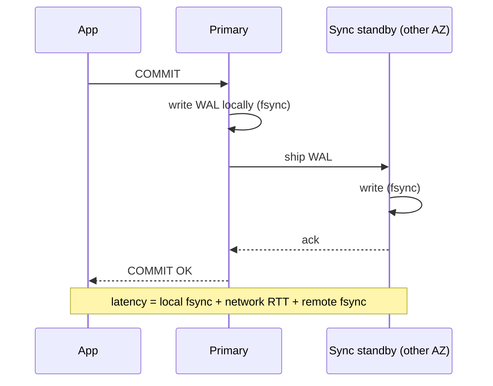

PostgreSQL:
```text
synchronous_standby_names = 'ANY 1 (standby_a, standby_b)'   # quorum: any one of two
synchronous_commit = on | remote_write | remote_apply
```
`remote_apply` also makes the change **visible** on the standby, so reads there are consistent.

#### Example
A payments ledger in AWS: the primary is in AZ-a, synchronous standbys are in AZ-b and AZ-c (`ANY 1`). Commit latency rises ~1–2 ms (cross-AZ RTT), and losing a whole AZ loses zero committed payments. Cross-region synchronous replication would add ~50–150 ms per commit, so cross-region copies stay async (for disaster recovery).

#### Trade-offs
| | Synchronous | Asynchronous |
|---|---|---|
| Data loss on primary failure | none (RPO 0) | up to the replication lag |
| Commit latency | + network RTT + remote fsync | local only |
| Availability | writes block if no sync replica acks | unaffected by replicas |

With a single sync standby, if it goes down **writes stall**. Use a quorum (`ANY 1 of 2`) so one replica failure doesn't block.

#### Problems & fixes
| Symptom | Cause | Fix |
|---|---|---|
| All writes hang | the only sync standby is down/unreachable | quorum of 2+ candidates, monitoring, automated fallback policy |
| Commit latency jumped | sync standby in a far region or slow disk | keep sync replicas in nearby AZs, async for remote regions |
| Stale reads even from sync standby | `synchronous_commit = on` (flush only) | `remote_apply` if standby reads must be fresh |

#### Cheat sheet
- Sync = commit waits for replica ack, so RPO 0. Costs RTT per commit.
- Use quorum sync (`ANY 1 (a, b)`) across AZs. Async across regions.
- `remote_apply` for read-your-writes on standbys.

#### Interview questions
<details><summary>Design database replication for a payments system that must never lose an acknowledged transaction.</summary>

Primary in one AZ with quorum synchronous replication to standbys in two other AZs (commit waits for one ack), automated failover (Patroni, or RDS Multi-AZ / Aurora, which replicates storage 6 ways across 3 AZs), plus async replicas in a second region for DR with a documented, small RPO. Acknowledge payments only after commit, and keep idempotency keys so clients can safely retry during failovers.
</details>

<details><summary>Why not make cross-region replication synchronous for zero data loss?</summary>

Every commit would wait a cross-region round trip (50–150+ ms), cutting throughput for sequential writes and adding latency to every user action. A regional network issue would also block all writes. Most systems use sync within a region (across AZs) and async across regions, accepting a small regional-disaster RPO, or use consensus databases (Spanner) designed for it.
</details>

#### Interview angle
> "Inside a region I'd use quorum synchronous replication across AZs, which gives zero data loss for about a millisecond per commit. Cross-region stays async for disaster recovery, with a documented RPO."

### Semi-synchronous replication — at least one replica must ack (MySQL)
MySQL's semi-synchronous replication sits between async and fully synchronous: the primary waits until **at least one replica has received and logged** the transaction (in its relay log) before acknowledging the commit, but doesn't wait for the replica to **apply** it. If no replica answers within a timeout, it **falls back to async**.

#### How it works
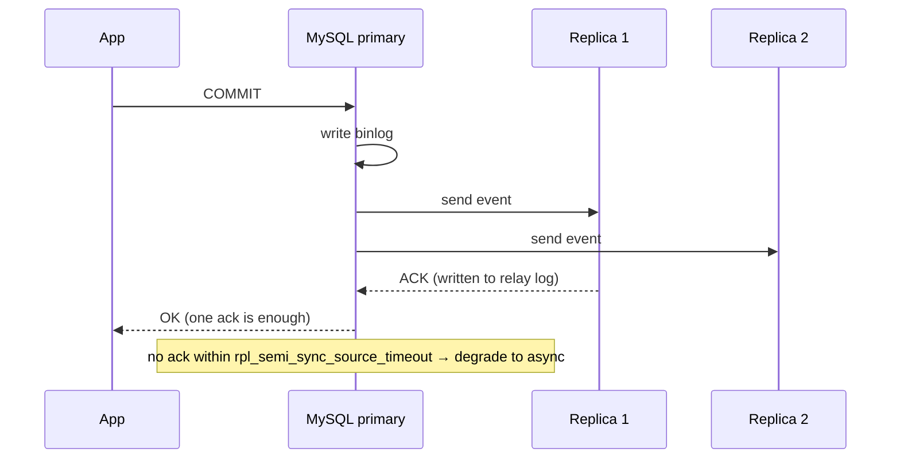

Settings: `rpl_semi_sync_source_enabled=1`, `rpl_semi_sync_source_wait_for_replica_count=1`, `rpl_semi_sync_source_timeout=1000` (ms), `rpl_semi_sync_source_wait_point=AFTER_SYNC` (the "lossless" mode: wait for the ack before committing in the storage engine, so other clients never see data a replica doesn't have).

#### Example
A MySQL cluster (orchestrator / MHA managed) with semi-sync: when the primary's host dies, failover promotes the replica that acknowledged the latest transactions, so no acknowledged write is lost, as long as semi-sync hadn't silently degraded to async during a network blip. Monitor `Rpl_semi_sync_source_status`.

#### Trade-offs
Most of synchronous replication's durability with less latency (the replica only receives, it doesn't apply), and it keeps availability via the timeout fallback. But the fallback means durability guarantees disappear exactly when the network misbehaves.

#### Problems & fixes
| Symptom | Cause | Fix |
|---|---|---|
| Data lost on failover despite semi-sync | silently degraded to async after timeout | alert on `Rpl_semi_sync_source_status = OFF`, consider larger timeout |
| Commit latency spikes | waiting for a slow replica ack | ack count 1 with multiple semi-sync replicas, keep them close |
| Phantom reads of data that's later lost | AFTER_COMMIT wait point | use `AFTER_SYNC` (lossless semi-sync) |

#### Cheat sheet
- Wait for ≥ 1 replica to **receive** (not apply), then ack.
- Falls back to async after a timeout, so monitor it.
- `AFTER_SYNC` = lossless semi-sync (MySQL 5.7+).

#### Interview questions
<details><summary>Semi-synchronous vs fully synchronous replication: what's the practical difference?</summary>

Semi-sync waits only for a replica to receive and log the change, not to apply it, and degrades to async if replicas don't respond within a timeout, which favours availability. Fully synchronous waits for durability (and possibly application) on replicas and blocks writes rather than degrading, which favours consistency. Semi-sync is cheaper but its guarantee can quietly lapse.
</details>

<details><summary>Why is AFTER_SYNC safer than AFTER_COMMIT in MySQL semi-sync?</summary>

With AFTER_COMMIT, the primary commits in InnoDB (other sessions can already see the change) and then waits for the replica's ack. If the primary crashes before the ack, other clients may have read data that no replica has, and it's lost on failover. AFTER_SYNC waits for the ack before the storage-engine commit, so no client can observe data that a replica doesn't also have.
</details>

#### Interview angle
> "On MySQL I'd run lossless semi-sync (AFTER_SYNC) with an alert on fallback to async, so failover to the acknowledging replica loses nothing that was confirmed to users."

### Single-leader replication — all writes go to leader, replicated to followers
In single-leader (primary-replica, master-slave) replication, **one node accepts all writes** and streams changes to followers, which serve reads. It's the default model for PostgreSQL, MySQL, MongoDB replica sets and Redis. It's simple and there are no write conflicts, but the leader is a write bottleneck and failover needs care.

#### How it works
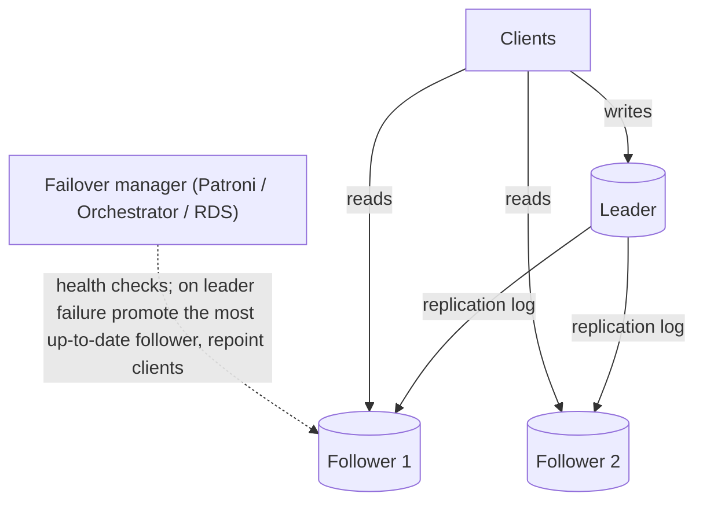

Failover steps: detect failure (heartbeat timeouts), choose the most up-to-date follower, promote it, reconfigure other followers, **fence** the old leader (so it can't keep accepting writes), and repoint clients (DNS/VIP/proxy).

#### Example
Postgres + Patroni + etcd: Patroni holds a leader lock in etcd with a TTL. If the leader's node stops renewing it (crash, network partition), a replica acquires the lock and promotes itself. The old leader, unable to renew, demotes itself, preventing **split brain**. HAProxy/pgbouncer checks Patroni's REST API to route writes to the current leader. Failover takes ~30 s.

#### Trade-offs
- No write conflicts, a simple mental model, strong consistency on the leader.
- Write throughput is bounded by one node. Failover risks lost writes (async lag) and split brain if fencing fails. Cross-region writes pay latency to the leader's region.

#### Problems & fixes
| Symptom | Cause | Fix |
|---|---|---|
| Two leaders accepting writes after a network split | failover without fencing | consensus-based leader lock (etcd/ZooKeeper), STONITH, demote on lock loss |
| Writes lost after failover | async follower promoted with lag | sync/semi-sync candidate, compare LSNs before promotion |
| Writes from far regions slow | single leader in one region | regional data ownership, multi-region DB designed for it |
| Failover takes minutes | slow detection / DNS TTLs | tuned timeouts, VIP or proxy-based routing |

#### Cheat sheet
- One writer, many readers. No conflicts.
- Failover = detect → promote most current → fence old leader → repoint.
- Split brain is the classic risk. Use a consensus-based leader lock.

#### Interview questions
<details><summary>What is split brain in single-leader replication and how do you prevent it?</summary>

After a network partition, the old leader keeps accepting writes while a follower is promoted on the other side. Two leaders diverge and data conflicts or is lost. Prevent it with a leader lease held in a consensus store (etcd/ZooKeeper) that the leader must renew. A leader that can't renew demotes itself (or is fenced via STONITH, revoked storage access or a fencing token), and only the lock holder accepts writes.
</details>

<details><summary>How would you minimise data loss and downtime during an unplanned primary failure?</summary>

Keep at least one synchronous (or semi-sync) replica in another AZ as the preferred failover target. Use automated failover (Patroni, RDS Multi-AZ) with fast health detection. Fence the old primary. Route clients through a proxy or VIP for quick repointing. Clients retry idempotent requests with backoff during the ~10–30 s switchover.
</details>

#### Interview angle
> "A single leader with followers handles most systems. I'd automate failover through a consensus-held leader lock so the old primary is fenced, and keep a synchronous replica as the failover target so no acknowledged write is lost."

### Multi-leader replication — writes to any datacenter, conflicts must be resolved
In multi-leader (active-active) replication, **several nodes, usually one per region, accept writes** and replicate them to each other asynchronously. Users write to their nearest region with low latency, and regions survive each other's outages, but **concurrent writes to the same data conflict** and must be resolved.

#### How it works
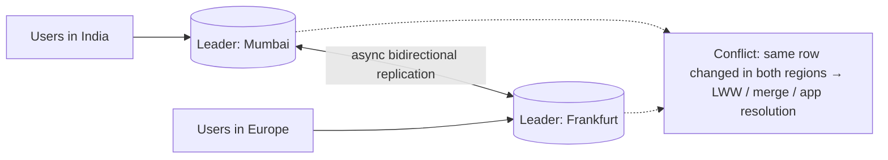

Examples: MySQL Group Replication multi-primary, Postgres BDR/pgEdge, CouchDB, DynamoDB Global Tables, Cassandra multi-DC (leaderless, similar issues), collaborative editors (each client is effectively a leader).

Ways to handle conflicts:
- **Avoid them**: route each record's writes to a home region (user data homed in their region).
- **Last-write-wins** by timestamp: simple, silently drops one write.
- **Merge**: CRDTs, field-level merges, application callbacks.

#### Example
A global SaaS with DynamoDB Global Tables: each user's profile is written mostly in their home region, so conflicts are rare and resolved by last-writer-wins. For a shopping cart, use add/remove sets (CRDT-like), so an item added in Mumbai and another added in Frankfurt during a partition are both kept. Money balances never use multi-leader LWW. They're homed in one region or kept in a consensus database.

#### Trade-offs
- Low write latency everywhere and regional outage tolerance.
- Conflict handling complexity, no global constraints (unique usernames across regions get hard), and harder reasoning about consistency.

#### Problems & fixes
| Symptom | Cause | Fix |
|---|---|---|
| Updates silently lost | LWW resolution on concurrent edits | home-region routing, CRDTs, or field-level merges |
| Duplicate unique values (same username in two regions) | uniqueness can't be checked globally | single-region authority for unique claims, or consensus DB |
| Clock skew picks the wrong "latest" write | LWW on wall clocks | hybrid logical clocks, version vectors |
| Replication loops / conflicts on auto-increment ids | id collisions across leaders | UUIDs/Snowflake, per-region id offsets |

#### Cheat sheet
- Many writers (usually per region), async between them, so conflicts happen.
- Best strategy: avoid conflicts via per-record home region.
- LWW loses data. CRDTs/merges keep it. Never LWW for money.

#### Interview questions
<details><summary>You're building a global app with users in India, the US and Europe. Would you use multi-leader replication?</summary>

Only where the data tolerates it. I'd home each user's data in their region (single writer per record), so writes are local and conflict-free, and replicate asynchronously for reads and disaster recovery. For truly shared mutable data (inventory, balances, unique handles) I'd use a single authority region or a globally consistent database (Spanner/CockroachDB), accepting cross-region latency for those writes.
</details>

<details><summary>Explain why last-write-wins can lose data even when clocks are perfectly synchronised.</summary>

LWW keeps only one of two concurrent writes. If user A changes the phone number in Mumbai and user B changes the email in Frankfurt at nearly the same time on the same record, whole-record LWW keeps only one record version and drops the other change, even with perfect clocks. Concurrent intent is lost, not just ordered. Field-level merges or CRDTs preserve both.
</details>

#### Interview angle
> "I avoid multi-leader conflicts by giving each record a home region. Where concurrent edits are inherent, like carts or collaborative docs, I use merge-friendly structures (CRDTs) rather than last-write-wins."

### Leaderless replication — Dynamo style (Cassandra, Riak), any node accepts writes
In leaderless replication there's no primary: the client (or a coordinator node) sends each write to **N replicas** and considers it successful when **W** acknowledge, and reads query **R** replicas, taking the newest version. With **W + R > N**, read and write sets overlap, so a read sees the latest acknowledged write (with caveats).

#### How it works
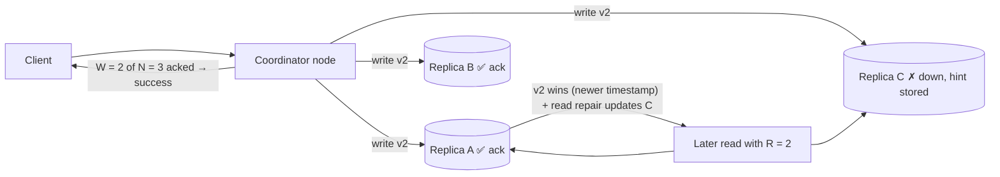

Mechanisms that keep replicas converging:
- **Hinted handoff**: another node stores writes for a down replica and replays them later.
- **Read repair**: stale replicas found during reads are updated.
- **Anti-entropy**: background Merkle-tree comparison and repair.
- **Sloppy quorum**: write to any healthy N nodes when home replicas are unreachable (higher availability, weaker guarantees).

#### Example
Cassandra with RF=3 for a messaging app: writes at `LOCAL_QUORUM` (2 of 3 in the local DC) and reads at `LOCAL_QUORUM` (2 of 3), so W + R = 4 > 3. Users read their latest messages, and the cluster tolerates one node down per DC for both reads and writes. Analytics reads use `ONE` for speed, accepting staleness.

#### Trade-offs
- High availability and write throughput, no failover needed, tunable consistency per query.
- No transactions across keys, conflicts resolved by timestamps (LWW) or version vectors, and "W + R > N" isn't linearizable under concurrent writes or sloppy quorums. Repairs are operational work.

#### Problems & fixes
| Symptom | Cause | Fix |
|---|---|---|
| Reads occasionally return stale data | R + W ≤ N, or sloppy quorum | QUORUM/QUORUM (LOCAL_QUORUM), avoid ONE for critical reads |
| Deleted data reappears ("zombie") | replica missed delete, tombstone GC'd before repair | run repairs within `gc_grace_seconds` |
| Concurrent updates lost | LWW timestamps | design immutable/append-only data, or use LWT for compare-and-set |
| Replicas drift after outages | hints expired | regular anti-entropy repair (Reaper) |

#### Cheat sheet
- N replicas, W write acks, R read replies. W + R > N means overlapping quorums.
- Convergence: hinted handoff + read repair + anti-entropy.
- Great for availability and write scale. No multi-key transactions.

#### Interview questions
<details><summary>Explain N, W, R and how you'd tune them for a write-heavy, availability-critical system.</summary>

N = number of replicas, W = acks required for a write, R = replicas consulted for a read. For write-heavy plus highly available: N=3, W=1 or 2, R chosen per query. QUORUM/QUORUM (2/2) gives read-your-latest for important reads, while W=1 maximises write availability at the risk of reading stale data with R=1. Most production setups use LOCAL_QUORUM for both in each datacenter.
</details>

<details><summary>Does W + R > N guarantee linearizability?</summary>

No. With concurrent writes, LWW conflict resolution, sloppy quorums, partially failed writes (succeeded on fewer than W replicas but not rolled back), or clock skew, a read can still see older data or values can flip. It gives "probably the latest" under normal conditions. Linearizable operations need consensus (e.g. Cassandra's Paxos-based lightweight transactions).
</details>

#### Interview angle
> "For a high-volume, always-writable store like chat messages I'd use leaderless Cassandra with RF 3 and LOCAL_QUORUM reads and writes, with regular repairs. I wouldn't use it where I need transactions or compare-and-set on money."

### Conflict resolution — last-write-wins (LWW), merge functions, custom CRDT
When replicas accept writes independently (multi-leader, leaderless, offline-first apps), the same data can be changed concurrently in two places. Conflict resolution decides the converged value: **pick one** (LWW), **merge** them with app logic, or use data types whose merges are **mathematically conflict-free** (CRDTs).

#### How it works
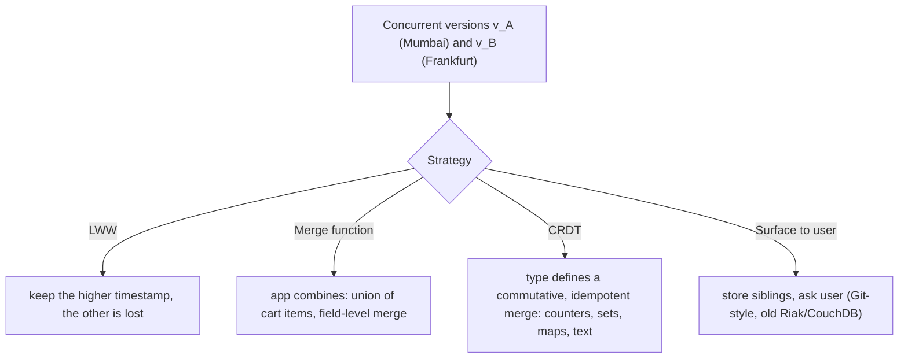

Common CRDTs:
| CRDT | Use |
|---|---|
| G-Counter / PN-Counter | likes, views (per-replica counts summed) |
| OR-Set (observed-remove set) | carts, tags, followers |
| LWW-Register / LWW-Map | profile fields (per-field LWW) |
| Sequence CRDTs (RGA, Yjs, Automerge) | collaborative text editing |

Detecting concurrency needs **version vectors** (per-replica counters): if neither version's vector dominates the other, the writes were concurrent.

#### Example
A PN-counter for likes across 3 regions: each region keeps its own increment and decrement counts. Merge takes the per-region **max** of each, and value = Σ increments − Σ decrements. No matter the order or number of merges, all regions converge to the same total, with no lost likes. A plain LWW integer counter would lose concurrent increments.

#### Trade-offs
| Strategy | Pros | Cons |
|---|---|---|
| LWW | trivial, automatic | silently loses writes, depends on clocks |
| App merge | domain-correct | custom code per type, edge cases |
| CRDT | automatic, provably convergent | metadata overhead, limited semantics (can't express "balance ≥ 0") |
| User resolution | no wrong guesses | bad UX |

#### Problems & fixes
| Symptom | Cause | Fix |
|---|---|---|
| Items reappear in a cart after removal | naive set union merge | OR-Set (tracks add/remove tags) |
| Counter undercounts across regions | LWW on a number | PN-counter, or per-region counters summed |
| Wrong winner with LWW | clock skew | HLC timestamps, per-field LWW, avoid concurrent-write designs |
| Invariant broken (overdraft) after merge | CRDTs can't enforce global constraints | route such operations to a single authority / consensus |

#### Cheat sheet
- LWW = simple, lossy. Merge = custom. CRDT = automatic convergence.
- Version vectors detect concurrent updates.
- Invariants (balance ≥ 0, unique) need coordination, not CRDTs.

#### Interview questions
<details><summary>How would you design a shopping cart that works across regions during a network partition?</summary>

Model the cart as an OR-Set of line items (adds and removes tagged with unique ids), with quantity as a per-item counter or an LWW register. Each region accepts changes locally. On reconnection, merging both sets keeps all adds and applies removes that observed the add, so nothing a user added is lost (Amazon's Dynamo paper's motivating example). At checkout, the order service re-validates against a single source of truth.
</details>

<details><summary>Why can't you use a CRDT for a bank account balance?</summary>

CRDTs guarantee convergence, not invariants. Two regions could each approve a ₹800 withdrawal from a ₹1,000 balance during a partition, and the merged result is −₹600, which is valid as a CRDT merge but violates "balance ≥ 0". Enforcing such constraints needs coordination: a single authoritative region, consensus or escrow-style quotas split between regions.
</details>

#### Interview angle
> "I decide resolution per data type: counters and carts use CRDTs, profile fields use per-field last-write-wins, and anything with an invariant, like balances or unique handles, goes through a single authority."

### Replication factor — number of replicas (typically 3 for fault tolerance)
The replication factor (RF) is **how many copies** of each piece of data the system keeps. RF determines how many failures you can survive for reads, writes and durability, and how much storage and write traffic you pay. **RF = 3 across 3 failure domains** is the industry default.

#### How it works
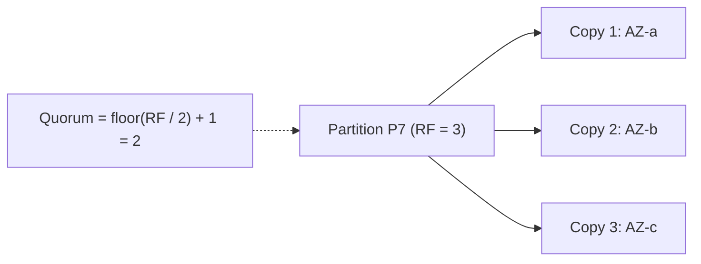

| RF | Quorum | Failures tolerated with quorum reads/writes | Notes |
|---|---|---|---|
| 1 | 1 | 0 | no redundancy |
| 2 | 2 | 0 for quorum (1 for ONE) | can't have a majority after 1 failure |
| **3** | **2** | **1** | standard |
| 5 | 3 | 2 | critical metadata (etcd/ZooKeeper clusters), multi-region |

Odd numbers matter for majority-based systems: RF 4 tolerates the same single failure as RF 3, at higher cost.

#### Example
Kafka topic `payments` with `replication.factor=3` and `min.insync.replicas=2`, producers with `acks=all`: writes succeed while at least 2 replicas are in sync, so one broker can fail without losing data or availability. Cassandra RF=3 per DC, with racks mapped to AZs, so no two copies share an AZ. S3 stores data across ≥ 3 AZs (with erasure coding rather than plain copies).

Storage estimate: 50 TB of raw data × RF 3 = 150 TB, plus ~30% headroom for compaction = ~200 TB provisioned.

#### Trade-offs
Higher RF means more durability, more read capacity and failure tolerance, but proportionally more storage and write amplification (each write goes to RF nodes). Erasure coding (e.g. 6+3) achieves similar durability with ~1.5× overhead instead of 3×, at the cost of rebuild CPU.

#### Problems & fixes
| Symptom | Cause | Fix |
|---|---|---|
| All replicas lost when one AZ failed | replicas placed in the same failure domain | rack/AZ-aware placement |
| Writes fail with one node down (Kafka) | RF=2 with min.insync=2 | RF=3, min.insync=2 |
| Storage costs too high | RF 3 on cold data | erasure coding / tiered storage for cold data |

#### Cheat sheet
- RF 3 across 3 AZs, quorum 2, survives 1 failure.
- Use odd RF for majority quorums. RF 5 for 2 failures.
- Storage = data × RF (+ compaction headroom).

#### Interview questions
<details><summary>Why is a replication factor of 3 so common rather than 2 or 4?</summary>

With RF 2 a majority (quorum) needs both copies, so any single failure blocks quorum operations. RF 3 lets majority operations continue with one node down and survives an AZ outage when copies sit in 3 AZs. RF 4 still only tolerates one failure for majority (needs 3 of 4) while costing 33% more. RF 3 is the sweet spot of fault tolerance versus cost.
</details>

<details><summary>Configure Kafka so that acknowledged messages survive a broker failure without blocking producers.</summary>

`replication.factor=3`, `min.insync.replicas=2`, producers with `acks=all` and idempotence enabled, `unclean.leader.election.enable=false`. Writes are acknowledged once 2 in-sync replicas have them. Losing one broker leaves 2 in sync, so producers continue and no acknowledged data is lost.
</details>

#### Interview angle
> "Default is replication factor 3 across three AZs with majority quorums: one AZ can fail with no data loss and no downtime, and storage is planned as raw data × 3 plus headroom."

### Read-your-writes consistency — user always sees their own writes, route writes and reads to same node
Read-your-writes (read-after-write) consistency guarantees that **after a user writes something, that same user's subsequent reads reflect it**. Other users may still see stale data. It's the minimum guarantee users expect ("I just changed my name, why is the old one showing?"), and async replicas or caches break it unless you design for it.

#### How it works
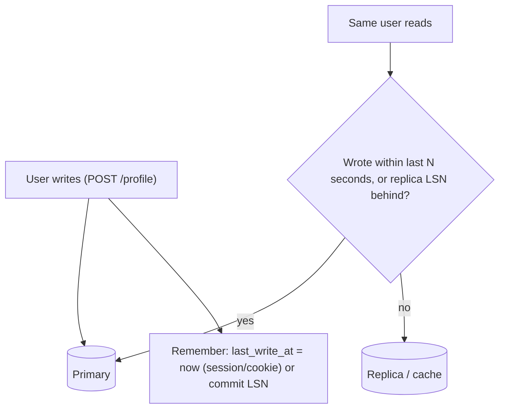

Techniques:
- **Read own data from the primary** (e.g. your profile always from the leader, others' profiles from replicas).
- **Time-based stickiness**: after a write, route that user's reads to the primary for ~(max lag) seconds.
- **LSN/version tracking**: the client remembers the commit position, and a replica serves the read only once it has replayed past it (Aurora, MongoDB causal sessions).
- **Return the written state** in the write response and update the client cache optimistically.
- **Caches**: update or invalidate the cache on write before acknowledging.

#### Example
A social app: after posting a comment, the client inserts the returned comment into the UI immediately, and the API sets a `rw_until=now+5s` cookie. The gateway routes requests carrying that cookie to the primary, while everyone else reads comments from replicas. MongoDB alternative: a causally consistent session with `readConcern: majority` ensures the user's reads observe their writes even on secondaries.

#### Trade-offs
Cheap to implement per user and preserves most replica offloading. Cross-device cases (write on phone, read on laptop) need server-side tracking (per-user last-write timestamp in Redis) rather than cookies.

#### Problems & fixes
| Symptom | Cause | Fix |
|---|---|---|
| Updated data missing right after save | read from lagging replica | primary reads for a window after writes |
| Works on one device, stale on another | cookie-based stickiness | track last-write per user server-side |
| Stale data from cache after update | cache not invalidated on write | write-through or invalidate before responding |

#### Cheat sheet
- Your own writes must be visible to you. Others may lag.
- Primary for own data / recent writers. LSN-aware replica reads.
- Return written state in the response. Invalidate caches on write.

#### Interview questions
<details><summary>Implement read-your-writes for a service that uses read replicas and a Redis cache.</summary>

On write, commit to the primary, then update or invalidate the Redis entry before responding, and record `last_write_at` for the user (session plus a Redis key for cross-device). On read, if the user wrote within the last ~5 s (more than the max replica lag), read from the primary (bypassing replicas). Otherwise use cache, then replica. Also return the updated entity in the write response so the client shows it immediately.
</details>

<details><summary>Why do users perceive a lack of read-your-writes as a bug even though the system is "eventually consistent"?</summary>

From the user's perspective the action failed: they saved something and it isn't there, so they retry (creating duplicates) or lose trust. Eventual consistency between different users is invisible, but within one user's own session it violates causality they directly observe.
</details>

#### Interview angle
> "Replicas can lag, but a user must always see their own changes. So I route a user's reads to the primary for a few seconds after they write, invalidate caches before responding, and return the saved state in the response."

### Monotonic reads — user never reads older data after reading newer data
Monotonic reads guarantees that once a user has seen a value, **later reads never show an older value**: time doesn't go backwards. Without it, a user refreshing a page can see a comment appear, disappear, then appear again, because successive requests hit replicas with different lag.

#### How it works
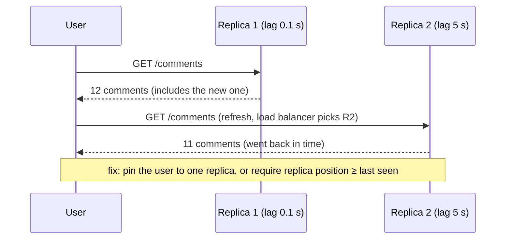

Techniques:
- **Sticky routing**: hash the user id to a specific replica (fall back on failure).
- **Version/LSN tokens**: the client sends the highest version it has seen, and the server serves only from replicas that have caught up (or waits briefly).
- **Session guarantees** in databases: MongoDB causal consistency, Cosmos DB "session" consistency.

#### Example
A news feed served from 5 Cassandra/Postgres replicas behind a round-robin balancer: users saw like counts jump down and up on refresh. Switching to consistent-hash routing by `user_id` to a replica (with failover) made each user's view monotonic, while load stayed balanced across users.

#### Trade-offs
Stickiness reduces load-balancing flexibility (a hot user stays on one replica) and needs a failover fallback, where the guarantee briefly weakens unless you use version tokens.

#### Problems & fixes
| Symptom | Cause | Fix |
|---|---|---|
| Data flickers between refreshes | round-robin across replicas with different lag | sticky routing per user/session |
| Flicker after replica failover | new replica further behind | version token check / wait-for-LSN |
| Counts move backwards | reading counts from different caches/replicas | monotonic version on the client, ignore older responses |

#### Cheat sheet
- Never show older data after newer data to the same user.
- Sticky replica per user, or "replica must be ≥ my last seen version".
- Part of session guarantees: read-your-writes, monotonic reads, monotonic writes, writes-follow-reads.

#### Interview questions
<details><summary>What's the difference between read-your-writes and monotonic reads?</summary>

Read-your-writes: after **I write**, I see my write. Monotonic reads: after **I read** some state (written by anyone), I never later see an older state. You can have one without the other: sticky routing to a lagging replica gives monotonic reads but not read-your-writes, and primary-after-write routing gives read-your-writes but other data may still flicker.
</details>

<details><summary>How can a client help guarantee monotonic reads across many stateless API servers?</summary>

The client stores the highest data version or LSN it has seen (in a header or cookie) and sends it with each request. The API routes to, or waits for, a replica that has caught up to that version, or falls back to the primary. Stateless servers can then enforce the guarantee without server-side session affinity.
</details>

#### Interview angle
> "To stop data jumping back in time on refresh, I pin each user to one replica by consistent hashing, or pass a version token so only caught-up replicas answer."
