## Sharding strategies

### Horizontal sharding — distribute rows of a table across multiple DB instances
Horizontal sharding splits **one table's rows across several independent databases** (shards) by a shard key. Each shard holds a subset of the data and handles that subset's reads and writes, so storage and **write throughput** scale beyond one machine.

#### How it works
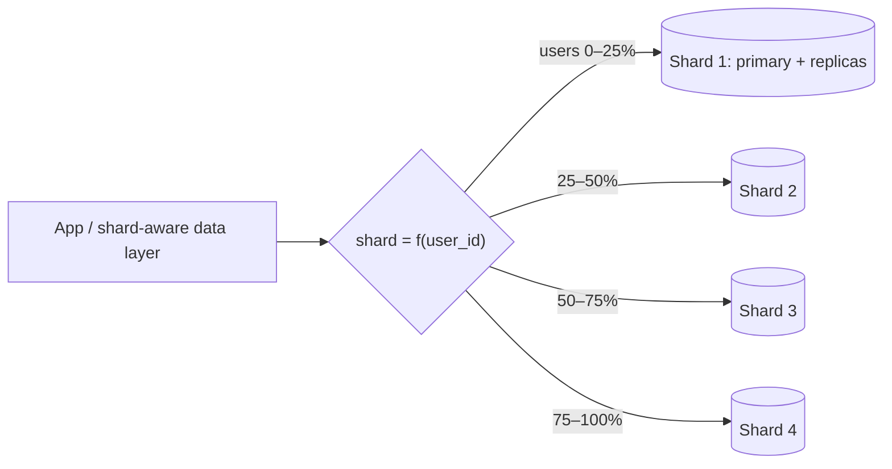

- Routing lives in the app library, a proxy (Vitess, Citus coordinator, ProxySQL, mongos) or the database itself (distributed SQL).
- Related data shares the shard key so it lands on the same shard (user's orders, payments, addresses), which keeps most queries and transactions single-shard.

#### Example
A wallet service with 200M users and 30k writes/s outgrows one Postgres primary. Shard by `user_id` into 16 shards (each a primary + 2 replicas). All of a user's wallets and transactions live together, so a debit is a local ACID transaction. Admin "find by phone number" queries use a global lookup table `phone → user_id` and then route to the shard.

#### Trade-offs
- Scales writes and storage nearly linearly. Smaller shards mean faster backups and less blast radius.
- Cross-shard joins/transactions get hard. Rebalancing is a project. Operations multiply (N databases). Uniqueness across shards needs global id generation.

#### Problems & fixes
| Symptom | Cause | Fix |
|---|---|---|
| One shard much hotter than others | poor shard key / celebrity tenant | better key, split hot tenant, add salt |
| Queries fan out to all shards | query doesn't include the shard key | include shard key, add lookup tables / secondary index service |
| Duplicate ids across shards | per-shard auto-increment | Snowflake/UUIDv7 ids |
| Shard full, rebalance needed | fixed modulo sharding | logical shards (many more than nodes), consistent hashing, directory |

#### Cheat sheet
- Shard only after vertical scaling, replicas, caching and archiving are exhausted.
- Co-locate related data by shard key. Most queries hit one shard.
- Plan ids, rebalancing and cross-shard queries from day one.

#### Interview questions

When should you shard a relational database, and what would you try first?

Shard when write throughput or dataset size exceeds what one well-tuned primary can handle (CPU, IOPS, storage, backup and restore times). Before that: optimise queries and indexes, scale up the instance, add read replicas and caching, archive or partition old data (table partitioning), and split by domain (vertical partitioning). Sharding is a one-way door with lasting complexity.

How do you handle a query like "find user by email" when users are sharded by user_id?

Maintain a global lookup (secondary index) table `email → user_id`, either a small unsharded table, a separate service, or a sharded-by-email table, updated in the same flow as user creation. Then route to the user's shard. Alternatives: scatter-gather to all shards (OK only for rare admin queries) or a search index (Elasticsearch) fed by CDC.

#### Interview angle
> "I'd shard by user_id so each user's data and transactions stay on one shard, with global lookup tables for other access paths and globally unique ids. I'd only shard after replicas, caching and partitioning stop being enough."

### Vertical partitioning — split different tables into different DBs by domain
Vertical partitioning splits a database **by tables or columns** instead of by rows: different domains (users, orders, payments, analytics) move to separate databases, or rarely used wide columns move to a side table. It's usually the first scaling step, and it naturally aligns with microservice boundaries.

#### How it works
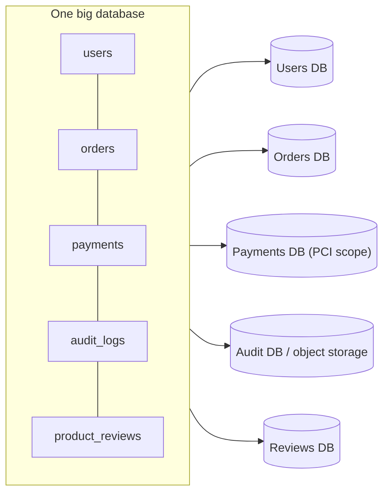

Column-level variant: `users(id, name, email, …)` + `user_profiles_ext(user_id, bio, preferences_json, avatar_blob)`, so hot rows stay small and cache well.

#### Example
A monolith's single Postgres hits IOPS limits. Analysis shows `audit_logs` writes are 60% of I/O and `payments` must be isolated for PCI compliance. Moving audit logs to a separate cluster (later S3 + Athena) and payments to its own database owned by the payments service halves the primary's load and shrinks PCI scope, without sharding any table.

#### Trade-offs
- Simple, big wins, aligns with team/service ownership, isolates workloads and compliance scope.
- Joins across partitions move into the application. Cross-database transactions become sagas. Each domain can still outgrow its database (and then needs horizontal sharding).

#### Problems & fixes
| Symptom | Cause | Fix |
|---|---|---|
| Reports need joins across now-separate DBs | data split by domain | warehouse/lake fed by CDC for analytics |
| Lost atomicity between orders and payments | separate databases | saga + outbox, idempotent consumers |
| Hot rows bloated by rarely used columns | wide table | move cold columns to side table |

#### Cheat sheet
- Split by table/domain (or by column) rather than by row.
- First step before sharding. Matches microservice boundaries.
- Cross-domain joins → app or warehouse. Cross-domain transactions → sagas.

#### Interview questions

Vertical partitioning vs horizontal sharding: when do you use each?

Vertical partitioning when different tables or domains have different load profiles, ownership or compliance needs. It's easy and often enough. Horizontal sharding when a single table or domain is itself too large or write-heavy for one database. Typical path: monolith DB → split by domain (vertical) → shard the hottest domain (horizontal).

After splitting orders and payments into separate databases, how do you keep them consistent?

Use a saga: the order service creates a PENDING order and publishes an event (via outbox), the payment service processes it and publishes PaymentSucceeded or PaymentFailed, and the order service confirms or cancels. Messages are idempotent and at-least-once. A reconciliation job compares orders and payments for drift.

#### Interview angle
> "I'd first split the database by domain so each service owns its tables, with payments isolated for PCI. Horizontal sharding comes later, only for the domain that outgrows a single node."

### Range-based sharding — shard by key range (user_id 1–1M on shard 1), easy range queries but hotspots
Range sharding assigns **contiguous key ranges** to shards: A–F on shard 1, G–M on shard 2, or by time (January on shard 1). Range queries and ordered scans stay on one or few shards, but **sequential or popular keys concentrate load** on the shard owning the "current" range.

#### How it works
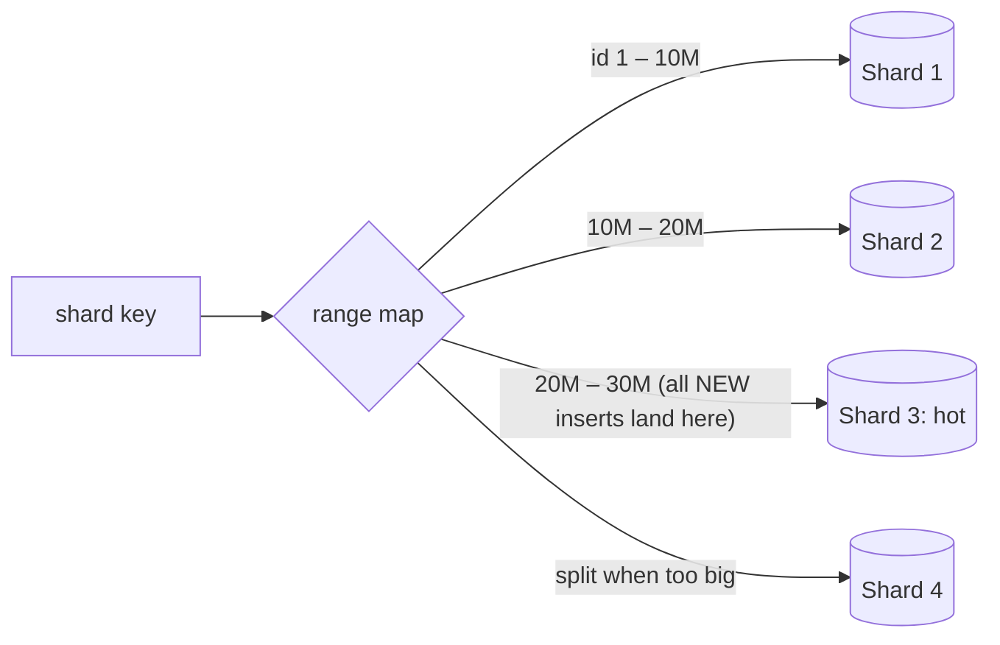

Systems: HBase/Bigtable (row-key ranges called regions/tablets), MongoDB ranged sharding, CockroachDB/TiDB/Spanner (ranges auto-split and move), time-partitioned tables.

#### Example
- **Good**: `(tenant_id, created_at)` ranges for a reporting system. "All invoices for tenant 42 in November" reads one contiguous range on one shard.
- **Bad**: shard key = `created_at` or auto-increment `order_id`. Every new order goes to the last range, so one shard takes 100% of writes while the others sit idle.

Fix for sequential keys: prefix with a well-distributed component (`tenant_id`, hashed bucket), or let the system auto-split ranges and spread them (CockroachDB still struggles with strictly increasing keys: use hash-sharded indexes).

#### Trade-offs
| Pros | Cons |
|---|---|
| efficient range scans, ordered pagination | hotspots for monotonic keys |
| easy to split a range when it grows | uneven sizes need rebalancing |
| locality for related keys | needs a range map (metadata service) |

#### Problems & fixes
| Symptom | Cause | Fix |
|---|---|---|
| One shard takes all inserts | monotonically increasing shard key | composite key with a distributed prefix, hash-sharding |
| A range becomes huge | popular prefix | auto-split ranges, finer ranges |
| Old ranges idle, new ones hot (time series) | time-based ranges | combine time with a hashed bucket, tiered storage |

#### Cheat sheet
- Contiguous ranges, so range scans are local and splits are easy.
- Monotonic keys = write hotspot.
- Used by HBase, Bigtable, Spanner, CockroachDB, TiKV.

#### Interview questions

Why is sharding orders by order_id ranges a bad idea if order_id is auto-increment?

All new orders have the highest ids, so every insert goes to the shard owning the latest range. One shard takes the entire write load and becomes the bottleneck, while older shards only serve occasional reads. Use hash-based sharding, or a key like `(customer_id, order_id)` that spreads writes.

When would range sharding be the better choice over hash sharding?

When the dominant queries are range scans or ordered reads on the key (time ranges per tenant, alphabetical listings, sorted pagination), and the key isn't monotonic or can be prefixed to spread writes. Range sharding keeps those queries on one shard, where hash sharding would scatter them across all shards.

#### Interview angle
> "Range sharding suits range scans like a tenant's invoices by date, but I'd never range-shard on a monotonically increasing key. New writes would all hit the last shard."

### Hash-based sharding — hash(key) % N, even distribution, range queries hard
Hash sharding applies a hash function to the shard key and maps the result to a shard. Good hashes spread keys **uniformly**, eliminating sequential-key hotspots. The cost: **range queries scatter** across all shards, and naive `hash % N` reshuffles almost everything when N changes.

#### How it works
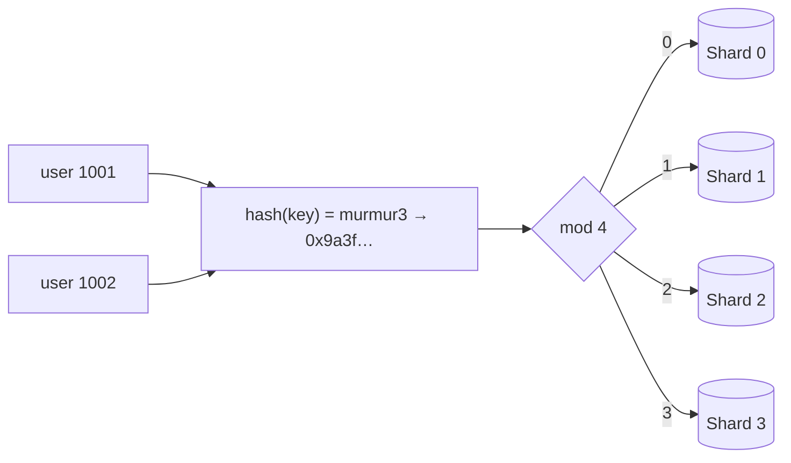

The resharding problem with modulo: going from 4 to 5 shards changes `hash % N` for ~80% of keys, which is a massive migration. Fixes:
- **Consistent hashing** (next topic): only ~1/N of keys move.
- **Logical shards / buckets**: hash into a fixed large number of virtual shards (e.g. 1,024), and map virtual shards to physical nodes. Rebalancing moves whole buckets, and the hash never changes. (Redis Cluster's 16,384 slots, Vitess keyspace ids, Citus shards.)

#### Example
Chat messages sharded by `conversation_id` via `hash(conversation_id) % 1024 → bucket`, with `bucket → node` in a small config table. Adding 4 nodes to 8 means moving ~half the buckets, one at a time, with dual writes during each move. "Messages of conversation X ordered by time" stays on one shard (the clustering order is within the shard). "All messages sent yesterday across all conversations" is a scatter-gather, so serve it from an analytics store instead.

#### Trade-offs
| Pros | Cons |
|---|---|
| uniform load, no sequential hotspot | range queries hit all shards |
| no range map maintenance (with fixed buckets) | naive modulo makes resharding painful |
| simple routing | a single hot key still hot (hashing doesn't split one key) |

#### Problems & fixes
| Symptom | Cause | Fix |
|---|---|---|
| Adding a shard requires moving most data | `hash % N` with physical N | fixed virtual buckets or consistent hashing |
| Range reports are slow | scatter-gather | secondary store (warehouse/search) for cross-shard analytics |
| One shard still hot | single celebrity key | key splitting (salt), caching, dedicated shard |

#### Cheat sheet
- hash(key) → even spread. Ranges scatter.
- Never `% physicalNodes`. Use fixed virtual buckets (e.g. 1,024/16,384) or a consistent hash ring.
- Hashing can't fix a single hot key.

#### Interview questions

You shard users with hash(user_id) % 8. Traffic doubles and you need 16 shards. What's the problem and a better design?

With modulo, changing 8 → 16 changes the target shard for ~50% of keys (and for non-multiples like 8 → 10, ~80%), so huge amounts of data move and routing must change atomically. Better: hash into many fixed logical buckets (e.g. 4,096) mapped to physical shards through a config table. Scaling moves whole buckets incrementally (copy, dual-write, cut over per bucket) while the hash function never changes.

Does hash sharding solve hot partitions?

It solves hotspots caused by **many** sequential or clustered keys, but not a single extremely hot key (a celebrity's profile, a flash-sale product). All traffic for that key still goes to one shard. You need caching, read replicas, splitting the key with suffixes, or special handling for that entity.

#### Interview angle
> "I'd hash the shard key into a fixed set of virtual buckets mapped to physical shards. Load stays even and adding capacity moves buckets, not the whole keyspace."

### Consistent hashing for sharding — only K/N keys migrate when adding/removing nodes
Consistent hashing places both **nodes and keys on a hash ring** (0 … 2³²−1). Each key belongs to the next node clockwise. Adding or removing a node only moves the keys in that node's arc, about **K/N keys** instead of nearly all of them. Virtual nodes smooth out the distribution.

#### How it works
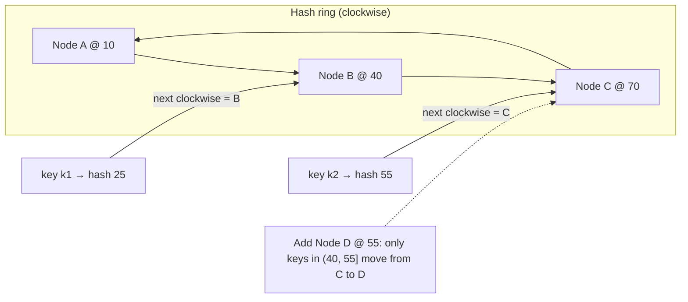

- **Virtual nodes**: each physical node owns many points (e.g. 100–256) on the ring, so load evens out, and when a node leaves its load spreads over many others instead of one neighbour.
- **Replication**: store each key on the next RF distinct physical nodes clockwise (Cassandra, Dynamo).
- Variants: **rendezvous (HRW) hashing**, **jump consistent hash**, **Maglev** hashing (load balancers).

#### Example
A distributed cache of 10 nodes holds 100M keys. With `hash % N`, adding an 11th node invalidates ~91% of keys, and the miss storm hits the database. With consistent hashing, only ~9% of keys (1/11) move, so the hit rate dips briefly. Memcached clients (ketama), Cassandra token ranges, DynamoDB and Discord's routing use this idea.

#### Trade-offs
Minimal movement on topology changes, decentralised routing (every client can compute it). Without virtual nodes the distribution is uneven, and it still doesn't fix single hot keys.

#### Problems & fixes
| Symptom | Cause | Fix |
|---|---|---|
| Uneven load across nodes | few ring positions per node | 100+ virtual nodes per physical node, weighted vnodes for bigger machines |
| A node's failure overloads its neighbour | load moves to the next node only | virtual nodes spread it across many nodes |
| Clients disagree on placement | different ring membership views | central membership (ZooKeeper/etcd) or gossip, versioned ring |

#### Cheat sheet
- Ring of nodes and keys. A key goes to the next node clockwise.
- Add/remove node moves ~K/N keys. Virtual nodes give balance.
- Replicas = next RF distinct nodes clockwise.

#### Interview questions

Explain consistent hashing and why virtual nodes are needed.

Nodes and keys hash onto a ring, and each key is owned by the first node clockwise. When a node joins, it takes only the keys between its predecessor and itself. When one leaves, its keys go to its successor. So only ~1/N of keys move. With few nodes, random positions create very uneven arcs, and a leaving node dumps all its load on one neighbour. Giving each node many virtual positions averages out arc sizes and spreads redistribution across all nodes.

How would you use consistent hashing to route WebSocket users to chat servers?

Put the chat servers on a ring with virtual nodes and route each user (or conversation) by hashing its id, so the same user consistently lands on the same server and per-user state is local. When servers scale up or down, only ~1/N of users reconnect elsewhere. A shared membership view (from service discovery) keeps all gateways computing the same mapping.

#### Interview angle
> "For cache and storage nodes I'd use consistent hashing with virtual nodes. Scaling from 10 to 11 nodes moves about 9% of keys instead of 90%, so there's no miss storm."

### Directory-based sharding — lookup service maps key to shard, flexible but single point of failure
Directory-based sharding stores an explicit **mapping from key (or key range, or tenant) to shard** in a lookup service. Any placement policy is possible: move one big tenant to a dedicated shard, rebalance gradually, co-locate related keys. But the directory is critical and must be fast and highly available.

#### How it works
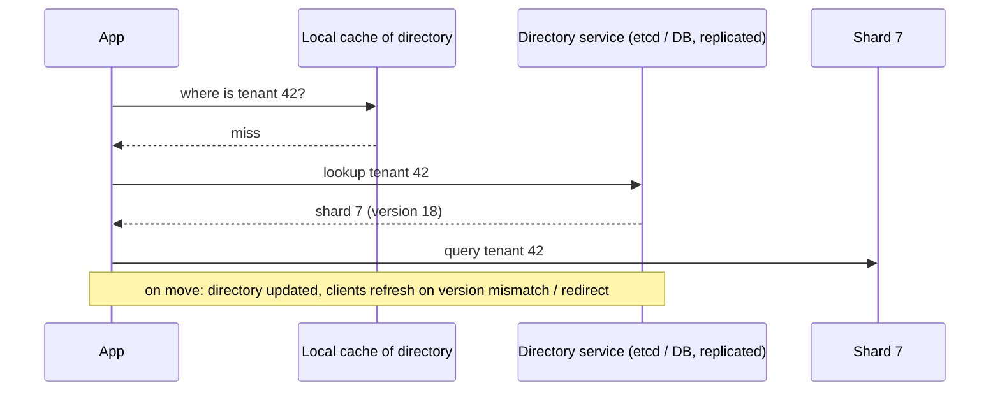

#### Example
A B2B SaaS where tenants vary 1,000× in size: small tenants share shards (50 per shard), while the three largest enterprises get dedicated shards. The directory maps `tenant_id → shard`. Moving a tenant: copy data, dual-write or replay changes, flip the directory entry, then drain. Slack, Notion and Shopify-style multi-tenant platforms use variations of this pattern ("pods", "cells").

#### Trade-offs
| Pros | Cons |
|---|---|
| arbitrary placement, per-tenant moves | extra lookup per request (cache it) |
| isolate noisy tenants | directory must be HA and consistent |
| gradual rebalancing | stale cached mappings during moves |

#### Problems & fixes
| Symptom | Cause | Fix |
|---|---|---|
| Whole platform down when directory down | SPOF lookup | replicate (etcd/ZooKeeper/DB replicas), aggressive client caching |
| Requests go to old shard after a move | stale cache | versioned mappings, shard rejects with "moved" + new location |
| Directory becomes a hotspot | every request looks up | cache in-process with TTL/push invalidation |

#### Cheat sheet
- Explicit key → shard map in a lookup service.
- Most flexible: tenant isolation, gradual moves.
- Cache the map, version it, keep the directory highly available.

#### Interview questions

Design sharding for a multi-tenant SaaS where a few tenants are 100× bigger than the rest.

Directory-based (cell/pod) sharding by tenant: a directory maps tenant → cell, where each cell is a DB cluster plus its services. Small tenants are packed into shared cells, and large tenants get dedicated cells to avoid noisy neighbours. The directory is replicated and heavily cached. Tenant migration copies data, catches up changes, flips the mapping and drains. Cells also limit blast radius during incidents.

How do you move a tenant from shard A to shard B with minimal downtime?

1) Bulk copy the tenant's data to B. 2) Stream ongoing changes (CDC from A) to B until caught up. 3) Briefly block writes for that tenant (seconds), apply the last changes, and verify counts or checksums. 4) Flip the directory entry (new version). 5) Unblock, with clients routed to B. 6) Keep A's copy for rollback, then delete it.

#### Interview angle
> "For multi-tenant SaaS I'd use a directory mapping each tenant to a cell. Big tenants get isolated cells, and moves are copy, catch up, flip the entry. The directory is replicated and cached everywhere."

### Resharding — data migration challenge, double-write period, consistent hashing minimizes movement
Resharding changes how data is split: adding shards, splitting a hot shard, or changing the shard key. Data must move **while the system keeps serving traffic** without loss or double-counting. It's one of the riskiest operations in a sharded system, so design for it up front.

#### How it works
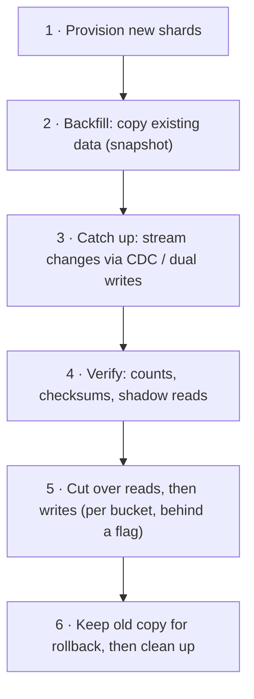

**Dual-write pattern**: during migration, the app writes to both old and new locations. Reads stay on the old location until the new one is verified. Then reads switch, then the old writes stop. Dual writes need idempotency and ordering care (or use CDC from the old location as the single source).

#### Example
Splitting shard 3 of a 1,024-bucket design: buckets 384–447 move to the new shard 9. For each bucket, snapshot-copy its rows, start Debezium CDC from shard 3 filtered to that bucket into shard 9, verify row counts and per-bucket checksums, pause writes for that bucket for ~1 s, update `bucket → shard` in the config (versioned), and resume. Each bucket is ~1/64 of the shard, so risk and pause time stay tiny. Vitess (`MoveTables`/`Reshard` with VReplication) automates exactly this flow.

#### Trade-offs
Moving in small units reduces risk but stretches the migration over days. Dual writes are simpler to build but risk divergence. CDC-based copying is more robust.

#### Problems & fixes
| Symptom | Cause | Fix |
|---|---|---|
| Rows missing after cut-over | writes during copy not captured | CDC catch-up / dual writes started before backfill |
| Divergence between old and new | dual-write partial failures | single source of truth + CDC, reconciliation checksums |
| Migration overloads production | aggressive copy | throttle, off-peak, monitor replica lag |
| Can't roll back | old data deleted immediately | keep old copy and reverse replication until confident |

#### Cheat sheet
- Copy → catch up (CDC/dual-write) → verify → cut over (small units) → clean up.
- Fixed virtual buckets make resharding incremental.
- Always keep a rollback path.

#### Interview questions

Your 4-shard MySQL setup needs to become 8 shards with no downtime. Describe the plan.

If routing is `hash % 4`, first introduce logical buckets (e.g. 1,024 mapped onto 4 shards) as a routing-only change. Then for each bucket moving to a new shard: provision the target, backfill a snapshot, replicate changes via binlog CDC, verify with counts and checksums, briefly block writes to that bucket, flip its mapping, and resume. Repeat bucket by bucket with throttling. Keep reverse replication for rollback. Vitess VReplication or gh-ost-style tooling helps.

Why are dual writes risky during migrations?

The two writes aren't atomic: one can succeed and the other fail, or they can land in a different order on each side under concurrency, so the copies diverge silently. Prefer a single write path plus CDC replication to the new location, or use dual writes with idempotent upserts, versioning and a reconciliation job that detects and fixes mismatches.

#### Interview angle
> "I design for resharding up front with fixed virtual buckets. Each move is copy, CDC catch-up, verify, then flip that bucket's mapping, done in small throttled steps with a rollback path."

### Hot spots — celebrity rows, popular keys hitting same shard; solution: add random suffix
A hot spot is a shard, partition or key receiving **disproportionate traffic**: a celebrity's profile, a viral post's like counter, a flash-sale product, "today's" partition in time-based keys. Because a key lives on one shard, adding more shards doesn't help. You have to **spread or absorb** the load for that key.

#### How it works
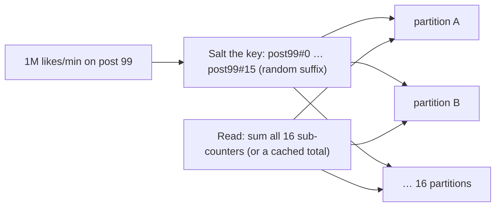

Techniques:
- **Key salting / write sharding**: append a random or round-robin suffix (0–N) to spread writes. Reads aggregate over N keys.
- **Caching** hot reads (CDN, Redis, in-process) with request coalescing.
- **Buffer and batch** writes (count in memory/Redis, flush periodically).
- **Dedicated capacity**: put the known-hot entity on its own shard.
- **Detect** hot keys (Redis `--hotkeys`, DynamoDB CloudWatch Contributor Insights, per-key metrics).

#### Example
DynamoDB table `post_counters` with partition key `post_id`: a viral post exceeds a partition's ~1,000 WCU limit and gets throttled. Fix: write to `post_id#rand(0..19)` and read by querying all 20 suffixes (or keep an aggregate updated every few seconds by a stream consumer). Writes now spread over 20 partitions.

Celebrity reads (a profile fetched 500k times/s) go to an in-memory cache with a short TTL, plus a CDN for public data.

#### Trade-offs
Salting multiplies read cost (N lookups) and complicates queries. Caching adds staleness. Batching adds delay. Apply them only to keys known or detected to be hot.

#### Problems & fixes
| Symptom | Cause | Fix |
|---|---|---|
| One partition throttled while others idle | hot key | write sharding (salting), cache, batch |
| Time-series writes all hit "today" | time-based partition key | prefix with hashed bucket + time |
| Cache key for trending item overloads one Redis node | hot key in cache cluster | local in-process cache, replicate the hot key across nodes |
| Unknown which keys are hot | no visibility | key-level metrics, sampling, Contributor Insights |

#### Cheat sheet
- One key = one shard. More shards don't help.
- Salt writes (key#0..N), aggregate on read. Cache hot reads. Batch hot counters.
- Detect hot keys continuously.

#### Interview questions

A celebrity with 100M followers posts and the post's like counter shard melts down. How do you fix it?

Don't increment a single row per like. Buffer likes in a stream (Kafka) or Redis and aggregate per post every second or so, or shard the counter into N sub-counters (post#0..N) with random selection on write and summing on read. Serve the displayed count from a cache that tolerates slight staleness. Record individual likes idempotently in a separate, well-distributed table (keyed by user+post) for dedupe.

How do you detect hot partitions before they cause an outage?

Emit per-key or per-partition request metrics (sampled), use database features (DynamoDB Contributor Insights, Redis `--hotkeys` / LFU stats, Kafka partition byte rates), set alerts on skew (max partition load vs average), and load-test with realistic key distributions (Zipfian), not uniform random keys.

#### Interview angle
> "Hot keys can't be fixed by adding shards. I salt writes across sub-keys, buffer counters in Redis or Kafka, and cache hot reads, and I monitor per-key traffic so we spot them early."

### Cross-shard queries — scatter-gather (fan out to all shards), expensive, avoid in hot paths
A cross-shard query needs data from more than one shard: it **fans out** to all relevant shards in parallel, then **merges** results (sort, aggregate, limit) in a coordinator. Latency equals the **slowest shard**, cost grows with shard count, and one slow shard degrades everything.

#### How it works
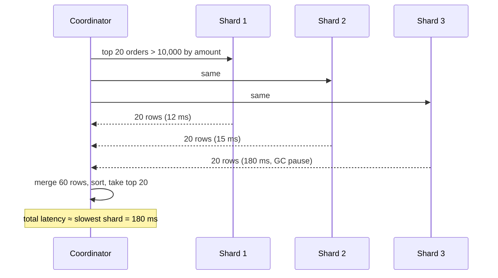

The tail-latency math: if each shard has a 1% chance of a slow response, a 100-shard fan-out hits at least one slow shard 63% of the time.

Alternatives:
- Include the **shard key** in queries (design access patterns around it).
- **Global secondary indexes** / lookup tables (email → user_id).
- **Denormalised read models** keyed for the query.
- **Analytics stores** (warehouse, Elasticsearch) fed by CDC for cross-cutting queries.

#### Example
"Admin: search orders by coupon code across 64 shards" runs as scatter-gather. Fine for a rare admin page with a timeout and partial results. "Customer: my orders" must never fan out, so orders are sharded by `customer_id`. "Merchant: all orders containing my products" goes to a separate merchant-keyed read model built from order events.

#### Trade-offs
Scatter-gather needs no extra infrastructure, but it's expensive and unpredictable at scale. Secondary stores add pipelines and eventual consistency, but give fast, isolated queries.

#### Problems & fixes
| Symptom | Cause | Fix |
|---|---|---|
| Query p99 grows with shard count | fan-out tail latency | avoid fan-out on hot paths, hedged requests, timeouts with partial results |
| Deep pagination across shards slow | each shard returns offset+limit rows | keyset pagination, search index |
| All shards loaded by one expensive query | broad scatter-gather | move to warehouse/search, rate-limit admin queries |

#### Cheat sheet
- Fan-out latency = slowest shard. Cost grows with N.
- Hot paths must hit one shard (query by shard key).
- Cross-shard needs → lookup tables, read models, search/warehouse.

#### Interview questions

Orders are sharded by customer_id. Merchants now need a dashboard of their orders. What do you do?

Don't scatter-gather 64 shards per dashboard load. Build a merchant-keyed read model: order events (via outbox/CDC to Kafka) feed a `merchant_orders` table sharded by merchant_id, or an Elasticsearch index. The dashboard queries it directly, accepting a few seconds of eventual consistency.

Why does fan-out across many shards hurt tail latency even if each shard is fast on average?

The response waits for the slowest shard. With N shards each having probability p of a slow response, the chance at least one is slow is 1 − (1 − p)^N, which approaches 1 as N grows. So p99 of the fan-out tends toward the per-shard p99.9 or worse. Mitigate with hedged or backup requests, strict timeouts with partial results, and avoiding fan-out on hot paths.

#### Interview angle
> "Hot queries must include the shard key. Anything that cuts across shards is served from a purpose-built read model or a search or warehouse store fed by CDC, not a scatter-gather on every request."

### Cross-shard transactions — two-phase commit risk, prefer Saga pattern instead
When one business operation must update rows on **different shards**, you lose single-database ACID. Options: **two-phase commit** (atomic, but blocking and fragile), **sagas** (a series of local transactions with compensations, eventually consistent), or **avoiding the problem** by choosing shard keys that co-locate the data that changes together.

#### How it works
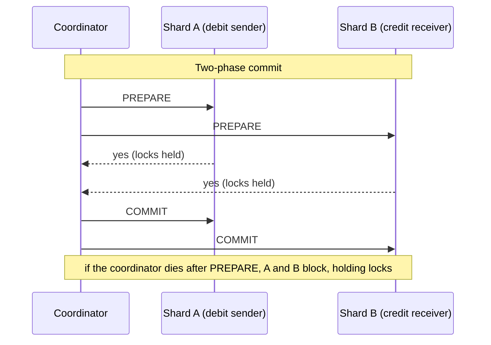

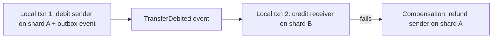

#### Example
P2P wallet transfer between users on different shards, as a saga: 1) debit the sender and record `transfer(id, PENDING)` plus an outbox event in one local transaction on shard A. 2) A consumer credits the receiver on shard B **idempotently** (unique transfer_id). 3) Mark the transfer COMPLETED. If the credit fails permanently (account closed), run a compensating refund on shard A. Users see "processing" for a moment, and the money is never lost or duplicated, as a ledger reconciliation confirms.

#### Trade-offs
| 2PC | Saga |
|---|---|
| atomic, isolated | eventual consistency, intermediate states visible |
| blocking if coordinator fails, locks held | non-blocking, each step commits locally |
| all participants must support XA | works across any DBs/services |
| lower throughput | needs compensations + idempotency |

#### Problems & fixes
| Symptom | Cause | Fix |
|---|---|---|
| Locks held indefinitely, DB stuck | 2PC coordinator crashed after prepare | avoid 2PC, or use a consensus-backed coordinator with recovery |
| Money debited but never credited | saga step lost | outbox + at-least-once delivery + retries + reconciliation |
| Double credit | retried saga step | idempotency key per step (unique transfer_id) |
| Users see inconsistent intermediate state | saga's non-isolation | explicit PENDING states in UI, semantic locks |

#### Cheat sheet
- Best: co-locate data that changes together (shard key choice).
- 2PC = atomic but blocking. Avoid across services.
- Saga = local transactions + events + compensations + idempotency + reconciliation.

#### Interview questions

Transfers between wallets on different shards: 2PC or saga? Justify.

Saga, for most systems. 2PC holds locks across shards during network round trips, blocks if the coordinator fails, and couples availability of both shards. A saga debits locally with an outbox event, credits idempotently on the other shard, and compensates on failure. With a PENDING state shown to users and nightly ledger reconciliation, it's robust and scalable. Distributed SQL databases (Spanner, CockroachDB) do give you atomic cross-shard transactions with consensus, at higher latency.

Why is 2PC called a "blocking" protocol?

After participants vote YES in the prepare phase, they can't unilaterally commit or abort, because they must wait for the coordinator's decision. If the coordinator crashes at that point, participants stay in doubt, holding locks, until it recovers. Other transactions touching those rows block meanwhile.

#### Interview angle
> "I pick shard keys so most transactions stay on one shard. The rest run as sagas, with an outbox, idempotent steps, compensations and reconciliation, rather than 2PC across shards."

### Shard key selection — high cardinality, even distribution, matches query pattern
The shard key decides where every row lives, and it's very hard to change later. A good key has **high cardinality** (many distinct values), spreads **reads and writes evenly**, and **matches the main access pattern**, so the hottest queries and transactions touch a single shard.

#### How it works
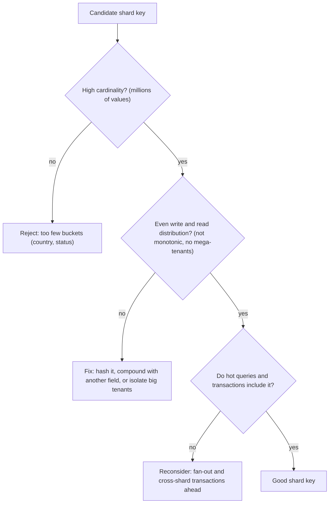

| Candidate | Verdict |
|---|---|
| `country` | low cardinality, skewed (India ≫ others) |
| `created_at` | monotonic, so all writes go to one shard |
| `order_id` (random UUID) | even, but "my orders" fans out to all shards |
| `user_id` / `customer_id` | high cardinality, even, matches most queries ✅ |
| `tenant_id` (B2B) | matches queries, but skew from huge tenants (directory + isolate big ones) |
| `(tenant_id, hash(entity_id))` | spreads big tenants, keeps tenant queries targeted to a subset |

#### Example
Ride-hailing: trips are queried by rider ("my trips"), by driver ("my earnings") and by city (ops dashboards). Shard trips by `rider_id` for the rider-facing hot path. Maintain a driver-keyed projection for earnings, and stream to an analytics store for city dashboards. Live trip state for matching lives in a separate geo-sharded system (by city/geohash), because its access pattern differs.

#### Trade-offs
No key fits every query. Optimise for the dominant, latency-critical path and build secondary access paths (projections, lookup tables, search) for the rest.

#### Problems & fixes
| Symptom | Cause | Fix |
|---|---|---|
| Hot shard from day one | low-cardinality or monotonic key | high-cardinality, non-monotonic key, or hashed |
| Most queries fan out | key doesn't match access pattern | choose key from top queries, add projections |
| Transactions span shards | entities that change together have different keys | co-locate by a shared key (all of a user's data by user_id) |
| A few tenants overload shards | tenant skew | isolate big tenants, compound key |

#### Cheat sheet
- High cardinality + even spread + matches hot queries and transactions.
- Avoid low-cardinality, monotonic or skewed keys.
- Design secondary access paths for other queries.

#### Interview questions

Choose a shard key for a chat application's messages table.

`conversation_id`: messages are always read by conversation (latest N, paginate back), writes spread across millions of conversations, and ordering within a conversation stays on one shard (clustering by message time/id). A user's conversation list is a separate per-user table keyed by `user_id`. Huge group or broadcast channels may need bucketing by time (`conversation_id + month`) to avoid giant partitions.

Why not shard an e-commerce orders table by order_id?

It distributes evenly, but the dominant queries are "orders for customer X" and "orders for merchant Y", which would fan out to every shard. Sharding by customer_id keeps the customer's view single-shard and co-locates their orders, payments and returns. Merchant views come from a separate merchant-keyed projection.

#### Interview angle
> "I pick the shard key from the hottest access path and the transaction boundary: high-cardinality, non-monotonic and evenly loaded, usually user_id. Other access patterns get their own projections."
