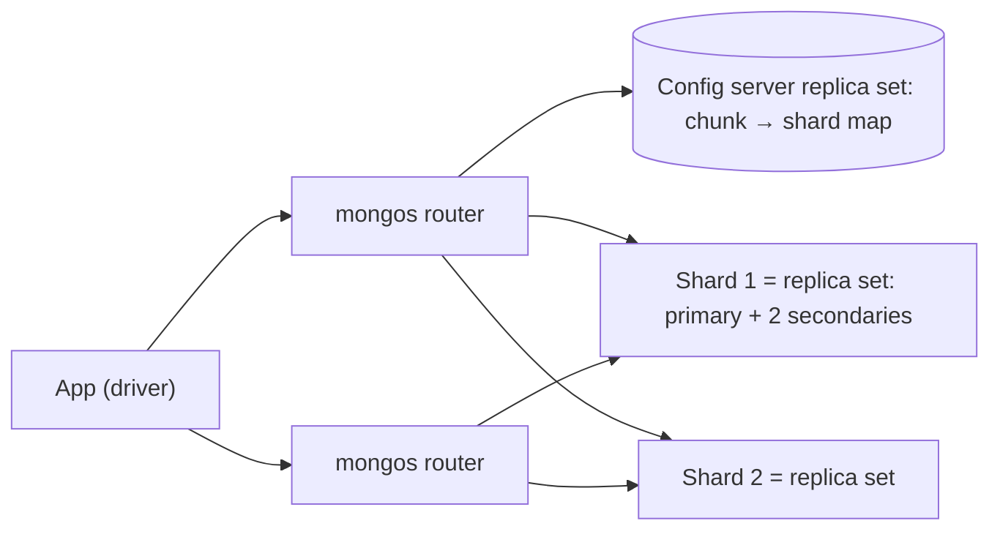
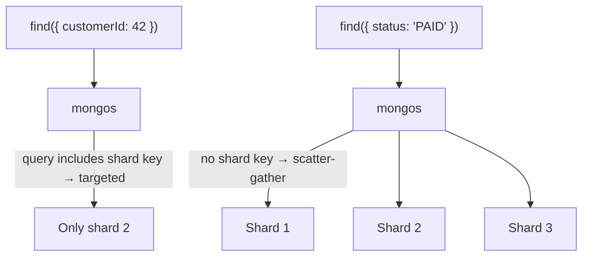
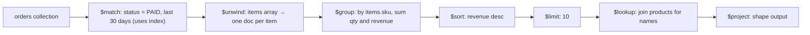
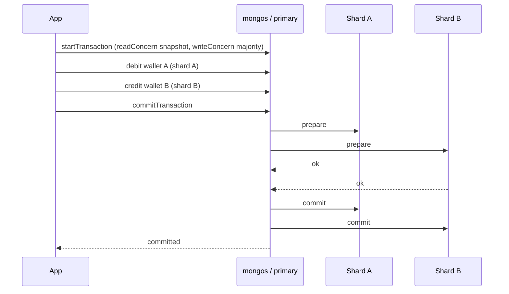
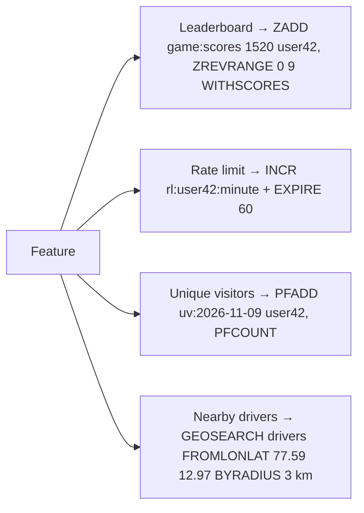
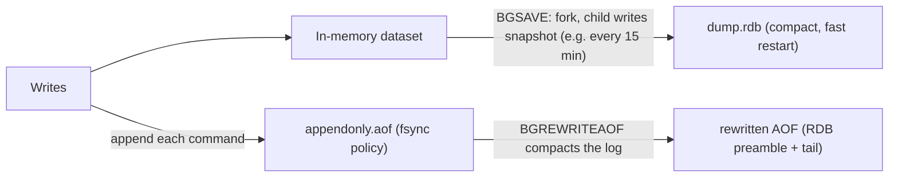
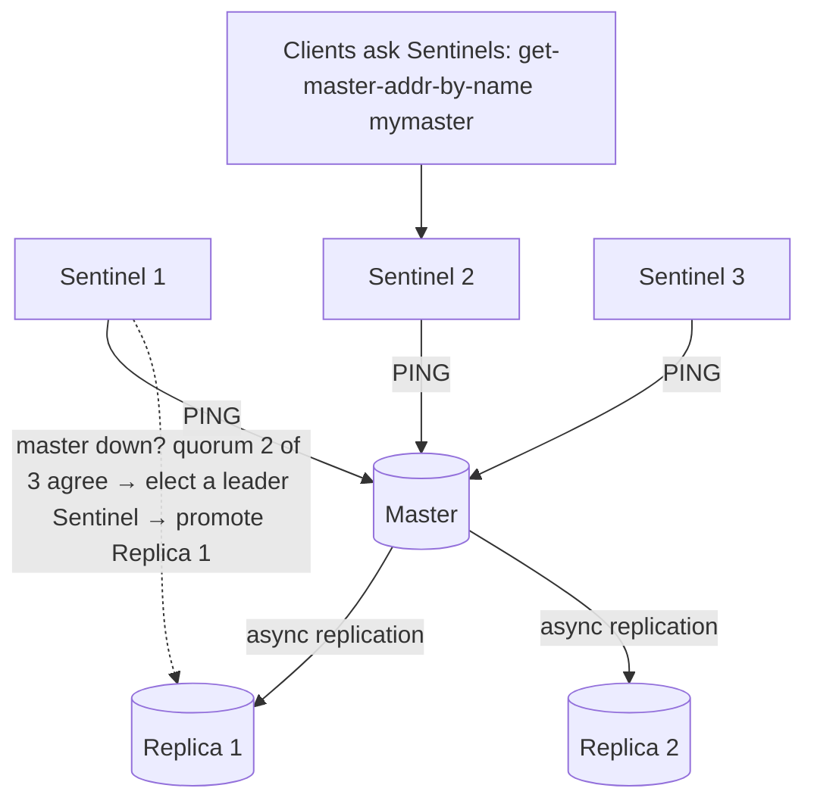
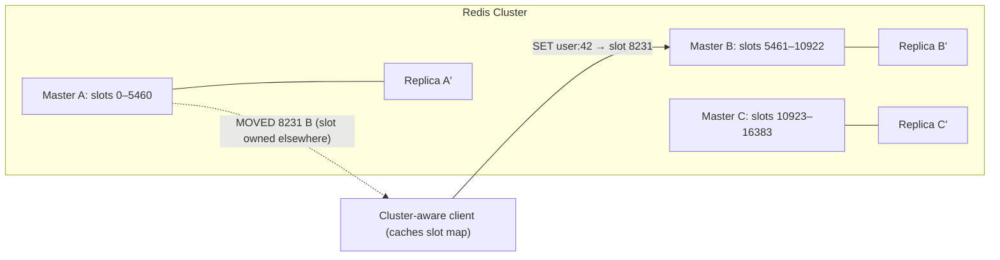
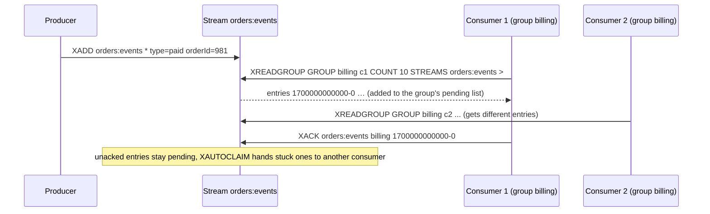
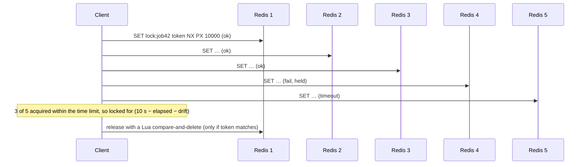

## NoSQL databases

### MongoDB — documents, collections, BSON, replica sets, sharding (mongos + config servers)
MongoDB is a document database: records are **JSON-like documents (stored as BSON)** in **collections**, with flexible schemas, rich secondary indexes and a powerful query language. It scales with **replica sets** (HA) and **sharding** (horizontal scale) coordinated by `mongos` routers and config servers.

#### Intuition
A filing cabinet of folders, where each folder holds everything about one thing: the product, its specs and its seller details together. You pull one folder and have the whole picture, with no need to collect pages from five drawers.

#### Must know
- Data is stored as **JSON-like documents** (BSON) in collections, with a flexible schema and secondary indexes.
- **Model for your queries**: embed what is read together and bounded, reference what is large or unbounded.
- A **replica set** (one primary, secondaries) gives high availability with automatic election.
- A **sharded cluster** = `mongos` routers + config servers + several replica sets.
- A single-document update is atomic. Use `w: "majority"` for writes you cannot lose.

#### Numbers to quote
- Maximum document size: 16 MB.
- A replica set elects a new primary in roughly 10–12 seconds.

#### Common mistakes
- Embedding an unbounded array, such as every comment inside the post.
- Saying MongoDB has "no schema". The schema simply moves into the application.
- Using `w: 1` for important writes and losing them on failover.

#### How it works


- **Document**: nested objects and arrays, up to 16 MB, `_id` primary key (ObjectId is time-ordered).
- **Replica set**: one primary (writes), secondaries replicate the oplog, automatic election on failure (~10 s).
- **Write concern** (`w: 1 | majority`) and **read concern / read preference** tune durability and consistency.
- **Sharding**: the collection is split into **chunks** by shard key, and the balancer moves chunks between shards.

#### Example
Product catalogue with category-specific attributes:
```javascript
db.products.insertOne({
  _id: ObjectId(), sku: "PHN-123", name: "Pixel 9", price: 69999, category: "phones",
  attrs: { ram_gb: 12, storage_gb: 256, colors: ["black", "mint"] },
  seller: { id: 881, name: "TechWorld" }, updatedAt: new Date()
});
db.products.createIndex({ category: 1, price: 1 });
db.products.find({ category: "phones", "attrs.ram_gb": { $gte: 8 } }).sort({ price: 1 }).limit(20);
```
Design rule: **model for your queries**. Embed data that's read together and bounded in size (seller summary). Reference data that's large, unbounded or shared (reviews in their own collection).

#### Trade-offs
| Pros | Cons |
|---|---|
| flexible schema, natural JSON mapping | no joins across shards (limited `$lookup`) |
| rich queries + secondary indexes | schema discipline moves into the app |
| built-in replication and sharding | multi-document transactions cost more than single-doc ops |
| atomic single-document updates | 16 MB document limit, unbounded arrays hurt |

#### Problems & fixes
| Symptom | Cause | Fix |
|---|---|---|
| Documents grow huge, updates slow | unbounded embedded arrays (all comments inside a post) | reference pattern / bucket pattern |
| Lost writes after failover | `w: 1` acknowledged before replication | `w: "majority"` for important writes |
| Stale reads from secondaries | `readPreference: secondary` | primary or causal sessions for read-your-writes |
| Collection scans | missing indexes | indexes per query shape, `explain()` |

#### Cheat sheet
- Documents (BSON) in collections. Embed what's read together, reference what's unbounded.
- Replica set = HA. Sharded cluster = mongos + config servers + shard replica sets.
- `w: majority` + `readConcern: majority` for safety.

#### Interview questions
<details><summary>When would you choose MongoDB over PostgreSQL?</summary>

When the data is naturally document-shaped with varying structure (catalogues, CMS content, user-generated profiles), most reads fetch a whole aggregate by id, and you expect to scale horizontally with built-in sharding. PostgreSQL is better when you need complex joins, strong relational constraints and multi-entity transactions (payments, ledgers). Postgres JSONB also covers moderate flexibility needs.
</details>

<details><summary>How would you model blog posts with comments in MongoDB?</summary>

Embed only a bounded summary (comment count, maybe the latest 3 comments) in the post document, and store comments in a separate `comments` collection keyed by `postId`, indexed on `(postId, createdAt)`. Embedding all comments creates unbounded documents that hit the 16 MB limit and make every update rewrite a huge document.
</details>

#### Interview angle
> "I'd use MongoDB for document-shaped aggregates like the catalogue: embed what's read together, reference unbounded collections, majority write concern, and pick the shard key from the main query."

#### Sources
- [Replication](https://www.mongodb.com/docs/manual/replication/) — MongoDB manual
- [Sharding](https://www.mongodb.com/docs/manual/sharding/) — MongoDB manual
- [Data modeling](https://www.mongodb.com/docs/manual/data-modeling/) — MongoDB manual

### MongoDB shard key selection — cardinality, write distribution, query isolation
In MongoDB the shard key determines **which shard owns each document** (via chunks), so it drives write scalability, query routing and future pain. A good shard key has **high cardinality**, **spreads writes**, and lets common queries target **one shard** instead of broadcasting.

#### Intuition
Choosing which counter each customer queues at. Send them by city and the Bangalore counter is swamped. Send them by arrival time and only the newest counter is busy. Send them by customer number and the queues stay even.

#### Must know
- The shard key decides which shard owns each document, and it is on every routing decision.
- Good key: **high cardinality, no dominant value, not monotonic, present in the hot queries**.
- A query that includes the shard key is **targeted** to one shard. One that does not is broadcast to all.
- Hashed key = even writes, no range targeting. Compound ranged key = locality plus spread.
- A timestamp or plain ObjectId as a ranged key sends every insert to one shard.

#### Common mistakes
- Sharding on `createdAt` or on `_id` (ObjectId) as a range.
- A low-cardinality key such as country, which produces chunks too big to split.
- Picking the key before knowing the top queries.

#### How it works


| Property | Why | Bad example |
|---|---|---|
| Cardinality | chunks can only split at distinct key values | `country` (few values, jumbo chunks) |
| Frequency | no single value dominating | `status: "ACTIVE"` for 95% of docs |
| Monotonicity | all new writes would land in the max chunk | `createdAt`, ObjectId alone |
| Query isolation | targeted queries scale, broadcasts don't | key absent from main queries |

Options: **ranged** keys (good for range queries), **hashed** keys (`{ userId: "hashed" }`, even writes, no range targeting), and **compound** keys (`{ customerId: 1, orderDate: 1 }`). MongoDB 5.0+ can **reshard** a collection online, but it's heavy.

#### Example
Orders collection: `{ customerId: "hashed" }` gives even writes, and "orders for customer X" is targeted. Or a compound `{ customerId: 1, _id: 1 }` (ranged) keeps a customer's orders contiguous for range scans while new customers spread out. Avoid `{ orderDate: 1 }`, where every insert hits the last chunk (one hot shard).

IoT telemetry: `{ deviceId: 1, ts: 1 }`. Writes spread over millions of devices, and "device X in the last hour" hits one shard and reads one contiguous range.

#### Trade-offs
Hashed keys give the best write spread but lose range locality. Ranged compound keys keep locality but need a well-distributed prefix.

#### Problems & fixes
| Symptom | Cause | Fix |
|---|---|---|
| One shard hot on inserts | monotonic key (date, ObjectId) | hashed key or compound with high-cardinality prefix |
| "jumbo chunks" can't be split/moved | low cardinality key | higher-cardinality compound key, reshard |
| Most queries broadcast | shard key absent from queries | redesign key around main access pattern |
| Uneven data per shard | skewed key values | hashed or compound key, isolate big tenants with zones |

#### Cheat sheet
- High cardinality, low frequency, non-monotonic, present in hot queries.
- Hashed = even writes. Ranged compound = locality + spread.
- Targeted queries include the shard key prefix. Others scatter.

#### Interview questions
<details><summary>Why is using ObjectId (_id) as a ranged shard key a bad idea?</summary>

ObjectIds start with a timestamp, so they increase monotonically. Every new document goes to the chunk with the highest values on a single shard, concentrating all inserts there, while the balancer constantly migrates chunks behind it. Use a hashed `_id` or a compound key starting with a well-distributed field.
</details>

<details><summary>Pick a shard key for a multi-tenant SaaS events collection where some tenants are huge.</summary>

A compound key like `{ tenantId: 1, eventId: "hashed" }` (compound hashed, MongoDB 4.4+) or `{ tenantId: 1, bucket: 1, ts: 1 }` with a computed bucket. Tenant queries still target a subset of shards, while big tenants spread across chunks and shards. Zones can pin regulated tenants to specific shards or regions.
</details>

#### Interview angle
> "I pick the MongoDB shard key so hot queries are targeted and writes spread evenly. A hashed or compound key with a high-cardinality prefix, never a timestamp alone."

#### Sources
- [Choose a shard key](https://www.mongodb.com/docs/manual/core/sharding-choose-a-shard-key/) — MongoDB manual
- [Shard keys](https://www.mongodb.com/docs/manual/core/sharding-shard-key/) — MongoDB manual

### MongoDB aggregation pipeline — $match, $group, $sort, $lookup, $project, $unwind
The aggregation pipeline processes documents through a sequence of **stages**, each transforming the stream: filter, reshape, unwind arrays, group, join and sort. It's MongoDB's equivalent of SQL's `WHERE … GROUP BY … JOIN … ORDER BY`, and it runs inside the database, close to the data.

#### Intuition
A factory conveyor belt. Documents pass through stations in order: one throws out what you do not need, one splits bundles apart, one groups and adds up, one sorts. The earlier you discard, the less every later station has to handle.

#### Must know
- Documents flow through **stages in order**. It is MongoDB's WHERE / GROUP BY / JOIN / ORDER BY.
- Core stages: `$match` filter, `$group` aggregate, `$sort`, `$project` reshape, `$unwind` one document per array element, `$lookup` join.
- Put **`$match` first** so it can use an index and shrink the stream.
- `$limit` right after `$sort` lets the engine keep only the top rows.
- For dashboards, precompute with `$merge` instead of aggregating on every view.

#### Common mistakes
- A `$match` placed after `$unwind` or `$group`, which forces a full collection scan.
- Heavy pipelines on the primary competing with user traffic.
- `$lookup` on a field with no index.

#### How it works


```javascript
db.orders.aggregate([
  { $match: { status: "PAID", createdAt: { $gte: ISODate("2026-10-10") } } },
  { $unwind: "$items" },
  { $group: { _id: "$items.sku", units: { $sum: "$items.qty" },
              revenue: { $sum: { $multiply: ["$items.qty", "$items.price"] } } } },
  { $sort: { revenue: -1 } },
  { $limit: 10 },
  { $lookup: { from: "products", localField: "_id", foreignField: "sku", as: "product" } },
  { $project: { _id: 0, sku: "$_id", units: 1, revenue: 1, name: { $first: "$product.name" } } }
]);
```

Other useful stages: `$facet` (multiple aggregations in one pass, for faceted search), `$bucket`, `$setWindowFields` (window functions), `$merge`/`$out` (materialise results), `$graphLookup` (recursive).

#### Example
A seller dashboard's "top products last 30 days" runs the pipeline above. With an index on `{ status: 1, createdAt: 1 }`, `$match` uses the index and only the matching docs flow through. For a dashboard viewed thousands of times a day, precompute it hourly with `$merge` into a `seller_stats` collection instead of aggregating on every view.

#### Trade-offs
Powerful in-database analytics with no data movement, but heavy pipelines on the primary compete with OLTP traffic. Stages have a 100 MB memory limit (use `allowDiskUse`). `$lookup` across sharded collections is limited and slow.

#### Problems & fixes
| Symptom | Cause | Fix |
|---|---|---|
| Pipeline scans whole collection | `$match` not first / not indexed | put `$match` (and `$sort` on indexed field) first |
| "exceeded memory limit" | big `$group`/`$sort` | `allowDiskUse: true`, filter earlier, precompute |
| `$lookup` slow | unindexed foreignField / large joins | index foreignField, denormalise, precompute |
| Dashboards hammer primary | live aggregation per view | `$merge` into summary collections, read from secondaries |

#### Cheat sheet
- Order matters: `$match` → `$project` early, `$group` later, `$limit` after `$sort`.
- `$unwind` arrays before grouping by element.
- `$merge` to materialise. Run analytics on secondaries.

#### Interview questions
<details><summary>How do you make an aggregation pipeline efficient?</summary>

Start with `$match` (and `$sort`) on indexed fields so the index filters early. Project away unneeded fields early to shrink documents. Avoid `$unwind` on huge arrays unless needed. Put `$limit` right after `$sort` so it can use a top-k sort. Index `$lookup` foreign fields. Use `allowDiskUse` for large groups. Precompute heavy, frequently requested aggregations with `$merge` instead of running them per request.
</details>

<details><summary>How would you implement faceted search counts (by brand, price range, rating) in MongoDB?</summary>

A `$match` for the search filters followed by `$facet` with sub-pipelines: `{ brands: [{ $group: { _id: "$brand", n: { $sum: 1 } } }], price: [{ $bucket: { groupBy: "$price", boundaries: [0, 1000, 5000, 20000, 100000] } }], rating: [...] }`. One pass, multiple facet counts. At large scale a search engine (Atlas Search / Elasticsearch) handles facets better.
</details>

#### Interview angle
> "For seller analytics I'd run an aggregation pipeline that filters on an index first, and materialise the results hourly with $merge, so dashboards never aggregate live on the primary."

#### Sources
- [Aggregation pipeline](https://www.mongodb.com/docs/manual/core/aggregation-pipeline/) — MongoDB manual
- [Aggregation pipeline optimization](https://www.mongodb.com/docs/manual/core/aggregation-pipeline-optimization/) — MongoDB manual

### MongoDB transactions — multi-document ACID since v4.0 (distributed since v4.2)
MongoDB was originally atomic only **per document**. Since 4.0 it supports **multi-document ACID transactions** on replica sets, and since 4.2 across **sharded clusters** (distributed transactions using two-phase commit internally). They work, but they cost more than single-document operations, so schema design should still make most operations single-document.

#### Intuition
Paying for one item is a single tap. Paying for a basket from two shops needs both to agree before the money moves, which takes longer. MongoDB can do the second kind, but it is built to be fastest at the first.

#### Must know
- A **single-document write is always atomic** and is the cheap path.
- Multi-document ACID transactions exist: replica sets since 4.0, sharded clusters since 4.2.
- They cost more, especially across shards, where a two-phase commit runs underneath.
- Design so that what must change together **lives in one document**.
- Prevent overselling with a conditional update and no transaction: filter `stock >= qty`, `$inc` by `-qty`, check that one document changed.

#### Numbers to quote
- Default transaction lifetime limit: 60 seconds.

#### Common mistakes
- Saying "MongoDB has no transactions". That stopped being true in 2018.
- Using transactions everywhere, as if it were a relational schema.
- No retry on transient transaction errors. `withTransaction` handles that.

#### How it works


```javascript
const session = client.startSession();
await session.withTransaction(async () => {
  await wallets.updateOne({ _id: from, balance: { $gte: 500 } }, { $inc: { balance: -500 } }, { session });
  await wallets.updateOne({ _id: to }, { $inc: { balance: 500 } }, { session });
  await ledger.insertOne({ from, to, amount: 500, at: new Date() }, { session });
}, { readConcern: { level: "snapshot" }, writeConcern: { w: "majority" } });
```
`withTransaction` automatically retries on `TransientTransactionError` and `UnknownTransactionCommitResult`.

Limits: default 60 s maximum transaction lifetime, write conflicts abort (optimistic), and large transactions hurt replication.

#### Example
An order placement that must decrement inventory (product doc) and create the order (orders collection) atomically uses a transaction. But a single-document design often avoids it: an order document that embeds its line items and payment status is updated atomically on its own with `findOneAndUpdate`.

#### Trade-offs
ACID across documents when needed, at the cost of latency (especially cross-shard 2PC), write-conflict retries and a lifetime limit. Prefer single-document atomic operations (`$inc`, conditional filters) where possible.

#### Problems & fixes
| Symptom | Cause | Fix |
|---|---|---|
| `WriteConflict` errors | concurrent transactions touching same docs | retry (withTransaction), reduce contention |
| Transactions aborted after 60 s | long-running transaction | keep them short, batch outside the transaction |
| Slow cross-shard transactions | distributed 2PC | co-locate related docs by shard key, single-doc design |
| Inconsistent reads inside transaction | wrong read concern | `readConcern: snapshot`, `w: majority` |

#### Cheat sheet
- Single-doc ops are atomic and cheapest. Design for them first.
- Multi-doc transactions: replica sets (4.0), sharded (4.2). Use `withTransaction` for retries.
- Keep them short. `snapshot` + `majority`.

#### Interview questions
<details><summary>Does MongoDB support ACID transactions, and should you design around them?</summary>

Yes: multi-document ACID transactions on replica sets since 4.0 and sharded clusters since 4.2, with snapshot isolation. But they're slower than single-document operations (especially cross-shard). Good MongoDB design embeds data that must change atomically in one document and uses transactions only for the remaining cases (like transfers between two accounts).
</details>

<details><summary>How do you prevent overselling in MongoDB without a transaction?</summary>

A conditional atomic update on the product document: `updateOne({ _id: sku, stock: { $gte: qty } }, { $inc: { stock: -qty } })`, then check `modifiedCount === 1`. The filter and update are atomic on that single document, so concurrent buyers can't both succeed when stock runs out.
</details>

#### Interview angle
> "In MongoDB I design so critical updates are single-document atomic operations. Multi-document transactions are reserved for genuine cross-entity cases, with withTransaction retries and majority write concern."

#### Sources
- [Transactions](https://www.mongodb.com/docs/manual/core/transactions/) — MongoDB manual
- [Production considerations for transactions](https://www.mongodb.com/docs/manual/core/transactions-production-consideration/) — MongoDB manual

### Redis data structures — string, list, hash, set, sorted set, stream, HyperLogLog, bitmap, geo
Redis is an in-memory data-structure server: beyond plain key-value strings it offers **lists, hashes, sets, sorted sets, streams, HyperLogLog, bitmaps and geo indexes**, each with atomic O(1)/O(log N) operations. Picking the right structure turns many system-design features into a few commands.

#### Intuition
A toolbox, not a single tool. A scoreboard, a to-do queue, a guest list and a map of nearby shops are each one ready-made tool, kept in memory so every operation is instant.

#### Must know
- **String**: cache values, counters (`INCR`), rate limits, simple locks.
- **Hash**: an object's fields. **Set**: unique members. **List**: a simple queue.
- **Sorted set**: leaderboards, timelines, delay queues, sliding-window rate limits.
- **HyperLogLog**: approximate unique counts. **Bitmap**: one bit per user. **Geo**: nearby search.
- Each command is atomic, because commands run one at a time.

#### Numbers to quote
- A HyperLogLog uses about 12 KB with roughly 0.81% error.
- Sorted set insert and rank are O(log N).

#### Common mistakes
- Using only strings and re-implementing a sorted set in application code.
- Big keys and `KEYS *`, which block every other client.
- A separate GET then SET, which is a race. Use an atomic command or a Lua script.

#### How it works
| Structure | Commands | Use case |
|---|---|---|
| **String** | `GET/SET/INCR/SETNX/EXPIRE` | cache values, counters, rate limits, locks |
| **List** | `LPUSH/RPOP/LRANGE/BRPOP` | simple queues, recent activity (capped with `LTRIM`) |
| **Hash** | `HSET/HGET/HINCRBY` | object fields (user session, cart) |
| **Set** | `SADD/SISMEMBER/SINTER` | unique members, tags, mutual friends |
| **Sorted set** | `ZADD/ZRANGE/ZRANK/ZREVRANGEBYSCORE` | leaderboards, timelines, delay queues, sliding windows |
| **Stream** | `XADD/XREADGROUP/XACK` | durable event log with consumer groups |
| **HyperLogLog** | `PFADD/PFCOUNT` | approximate unique counts (12 KB, ~0.81% error) |
| **Bitmap** | `SETBIT/BITCOUNT/BITOP` | daily active flags per user id, feature flags |
| **Geo** | `GEOADD/GEOSEARCH` | nearby drivers/stores |



#### Example
A gaming leaderboard for 10M players: `ZADD leaderboard 98250 player:881` on every score update (O(log N)). Top 100 is `ZREVRANGE leaderboard 0 99 WITHSCORES`, and a player's rank is `ZREVRANK leaderboard player:881`, both in microseconds. Doing the same in SQL needs ORDER BY over millions of rows or complex rank maintenance.

DAU with bitmaps: `SETBIT dau:2026-11-09 <userId> 1`. 100M users take ~12 MB per day. `BITOP AND` across days gives "active on all 7 days" retention.

#### Trade-offs
Microsecond operations and expressive structures, but all data must fit in memory (cost), persistence is optional, and big keys (huge sets or lists) block the single-threaded command loop.

#### Problems & fixes
| Symptom | Cause | Fix |
|---|---|---|
| Latency spikes | big keys (`DEL` of a million-member set, `KEYS *`, `SMEMBERS` on huge sets) | `UNLINK`, `SCAN`/`SSCAN`, split big keys |
| Memory grows unbounded | no TTLs / capped structures | `EXPIRE`, `LTRIM`, maxmemory + eviction policy |
| Counting uniques uses GBs | storing all ids in sets | HyperLogLog when approximate is fine |
| Race in read-modify-write | separate GET/SET | atomic commands, `MULTI`, Lua scripts |

#### Cheat sheet
- Sorted set: leaderboards, timelines, delay queues. Hash: objects. Set: uniqueness.
- HLL: approximate uniques in 12 KB. Bitmap: per-user daily flags. Geo: radius search.
- Avoid big keys and `KEYS *`. Use Lua for atomic multi-step logic.

#### Interview questions
<details><summary>Design a real-time leaderboard for a game with 50M players.</summary>

A Redis sorted set per leaderboard (global, weekly, per region) with `ZADD`/`ZINCRBY` on score events, `ZREVRANGE` for top N and `ZREVRANK` for a player's rank, all O(log N). Shard very large or many leaderboards across Redis Cluster by leaderboard key. Persist score events to a durable store (Kafka → DB) so leaderboards can be rebuilt. Weekly boards get a TTL or are archived at rollover.
</details>

<details><summary>How would you count unique daily visitors for 1,000 pages cheaply?</summary>

One HyperLogLog per page per day: `PFADD uv:{page}:{date} {visitorId}` and `PFCOUNT` for the estimate, about 12 KB per key with ~0.8% error, versus potentially gigabytes with sets. `PFMERGE` combines days into weekly or monthly uniques.
</details>

#### Interview angle
> "I reach for Redis structures directly: sorted sets for leaderboards and timelines, HyperLogLog for unique counts, geo sets for nearby search, and Lua scripts when a multi-step update must be atomic."

#### Sources
- [Redis data types](https://redis.io/docs/latest/develop/data-types/) — Redis docs
- [Sorted sets](https://redis.io/docs/latest/develop/data-types/sorted-sets/) — Redis docs

### Redis persistence — RDB (point-in-time snapshot) vs AOF (append-only log, fsync: always/everysec/no)
Redis keeps data in memory but can persist it to disk two ways: **RDB** snapshots (compact point-in-time dumps) and **AOF** (an append-only log of every write). They can be combined. The choice sets how much data you can lose on a crash and how fast restarts are.

#### Intuition
RDB is a photo of the whiteboard taken every few minutes. AOF is a diary that records every stroke. After a crash, the photo restores quickly but misses the latest minutes. The diary replays everything but takes longer.

#### Must know
- **RDB**: periodic snapshot. Compact and fast to restart, but you lose everything since the last one.
- **AOF**: a log of every write. With `appendfsync everysec` you lose at most about one second.
- For data you care about, use both (AOF with an RDB preamble).
- For a pure cache, no persistence or RDB only.
- A snapshot **forks** the process, so leave memory headroom for copy-on-write.

#### Common mistakes
- Treating Redis with AOF as a safe primary store for money. Replication is still asynchronous.
- Running at 95% memory and being OOM-killed during a snapshot.
- Enabling `appendfsync always` on a cache and wondering where the throughput went.

#### How it works


| | RDB | AOF |
|---|---|---|
| Data loss on crash | everything since the last snapshot (minutes) | `always`: ~none, `everysec`: ≤ 1 s, `no`: OS-dependent |
| File size | compact | larger (rewritten periodically) |
| Restart speed | fast | slower (replay), faster with RDB preamble |
| Runtime cost | fork + copy-on-write memory spikes | fsync cost per policy |

Recommended for data you care about: **AOF with `appendfsync everysec` + RDB snapshots** (hybrid `aof-use-rdb-preamble yes`). For pure caches: often no persistence, or RDB only.

#### Example
Rate-limit counters and session caches: losing a few seconds is fine, so RDB only (or none). A Redis-backed job queue or leaderboard you can't easily rebuild: AOF everysec. On a 25 GB instance, `BGSAVE` forks, and with heavy writes copy-on-write can temporarily need significant extra RAM. Leave headroom (`maxmemory` at ~60–70% of RAM) or snapshots can OOM-kill Redis.

#### Trade-offs
Durability vs throughput vs memory headroom. Even with AOF always, Redis isn't a replacement for a primary database for critical financial data (replication is async, failover can lose writes).

#### Problems & fixes
| Symptom | Cause | Fix |
|---|---|---|
| Redis OOM-killed during snapshot | fork + copy-on-write under write load | memory headroom, schedule snapshots, disable THP |
| Latency spikes every few minutes | fork of a large dataset / AOF fsync | smaller shards, `everysec`, fast disks |
| Lost minutes of data after crash | RDB only | AOF everysec |
| Slow restart | huge AOF replay | AOF rewrite with RDB preamble |

#### Cheat sheet
- RDB = snapshots (fast restart, lose minutes). AOF = log (lose ≤ 1 s with everysec).
- Hybrid AOF + RDB preamble for important data. No persistence for pure caches.
- Leave memory headroom for fork/copy-on-write.

#### Interview questions
<details><summary>You're using Redis as a cache in front of Postgres. Which persistence do you configure?</summary>

Often none, or RDB only. The cache can be rebuilt from Postgres, and persistence adds fork and fsync overhead. RDB can still help warm restarts so the database isn't hit with a cold-cache stampede. Pair it with replicas for availability rather than relying on disk.
</details>

<details><summary>Can you use Redis as the primary store for wallet balances?</summary>

Risky. Even with AOF `always`, replication to replicas is asynchronous, so a failover can lose acknowledged writes. There are no rich transactions or constraints, and memory cost limits size. Use a durable ACID database as the source of truth. Redis can cache balances or enforce rate limits around it.
</details>

#### Interview angle
> "As a pure cache, Redis runs with no persistence or RDB only. For state we can't cheaply rebuild, I'd use AOF everysec plus RDB and leave memory headroom for forks. The source of truth stays in the database."

#### Sources
- [Redis persistence](https://redis.io/docs/latest/operate/oss_and_stack/management/persistence/) — Redis docs
- [Redis replication](https://redis.io/docs/latest/operate/oss_and_stack/management/replication/) — Redis docs

### Redis Sentinel — HA: monitors master, auto-failover to replica on failure
Redis Sentinel provides **high availability for non-clustered Redis**: a group of Sentinel processes monitors a master and its replicas, agrees (by quorum) when the master is down, **promotes a replica**, reconfigures the others, and tells clients where the new master is.

#### Intuition
Three watchmen keep an eye on the main gate. If one thinks the gatekeeper has collapsed, he checks with the others. Once two agree, they appoint a deputy and tell everyone which gate to use.

#### Must know
- Sentinel gives **high availability to non-clustered Redis**: monitoring, automatic failover and discovery of the current master.
- A failover starts only when a **quorum** of Sentinels agrees the master is down.
- Run **at least 3 Sentinels** in separate failure domains.
- Clients must be Sentinel-aware to find the new master.
- It does **not shard**, and async replication means a failover can lose recent writes.

#### Common mistakes
- Two Sentinels, or all of them on one host.
- Confusing Sentinel with Redis Cluster. Cluster shards and has its own failover.
- Assuming a failover loses nothing.

#### How it works


- **SDOWN** (subjectively down): one Sentinel can't reach the master for `down-after-milliseconds`.
- **ODOWN** (objectively down): `quorum` Sentinels agree. Then a Sentinel leader is elected (majority) to perform the failover.
- Clients use Sentinel-aware drivers (Lettuce, Jedis, redis-py) to discover the current master.

Deploy **at least 3 Sentinels** on separate hosts/AZs.

#### Example
Session store: one master + 2 replicas across 3 AZs, a Sentinel on each node, `quorum 2`, `down-after-milliseconds 5000`. When the master's AZ fails, two Sentinels agree within ~5 s and promote a replica, and Lettuce clients reconnect to the new master. Some writes acknowledged by the old master just before the crash may be lost (async replication). `min-replicas-to-write 1` limits that window.

#### Trade-offs
Simple HA for a single dataset that fits on one node. Doesn't shard (use Redis Cluster for that). Async replication means possible write loss, and network partitions can briefly cause two masters.

#### Problems & fixes
| Symptom | Cause | Fix |
|---|---|---|
| Failover never happens | only 1–2 Sentinels, or quorum unreachable | 3+ Sentinels in separate failure domains |
| Clients keep writing to old master after failover | client not Sentinel-aware / cached address | Sentinel-aware driver, short connection timeouts |
| Lost writes after failover | async replication | `min-replicas-to-write`, accept loss or don't store critical data |
| Split brain during partition | isolated old master still accepts writes | `min-replicas-to-write 1` + `min-replicas-max-lag` makes isolated master refuse writes |

#### Cheat sheet
- Sentinel = monitoring + quorum failure detection + auto-failover + discovery.
- 3+ Sentinels, quorum 2. Sentinel-aware clients.
- No sharding. Async replication can lose writes.

#### Interview questions
<details><summary>Redis Sentinel vs Redis Cluster: when do you use which?</summary>

Sentinel when the dataset and throughput fit on one master and you only need HA (automatic failover). Cluster when you need to shard data and load across multiple masters (each with replicas). Cluster includes its own failover, so Sentinel isn't used with it. Cluster also adds constraints (multi-key operations only within one hash slot).
</details>

<details><summary>How does Redis limit split-brain write loss with Sentinel?</summary>

`min-replicas-to-write N` and `min-replicas-max-lag S`: the master refuses writes if fewer than N replicas are connected with lag under S seconds. A master isolated by a partition (with no replicas reachable) stops accepting writes after a few seconds, which bounds how much data can diverge before Sentinels promote a new master on the majority side.
</details>

#### Interview angle
> "For a single-node-sized Redis I'd run one master and two replicas across AZs with three Sentinels and Sentinel-aware clients, plus min-replicas-to-write to limit write loss in a partition."

#### Sources
- [High availability with Redis Sentinel](https://redis.io/docs/latest/operate/oss_and_stack/management/sentinel/) — Redis docs
- [Redis replication](https://redis.io/docs/latest/operate/oss_and_stack/management/replication/) — Redis docs

### Redis Cluster — shards data across 16384 hash slots, each node owns a range
Redis Cluster shards the keyspace into **16,384 hash slots** (`CRC16(key) mod 16384`). Each master owns a subset of slots, and each master has replicas for failover. Clients route commands directly to the node owning the key's slot, and nodes redirect clients when slots move.

#### Intuition
A post office with 16,384 numbered pigeonholes shared out among several clerks. A key's hash says which pigeonhole it belongs to, and the pigeonhole says which clerk has it. To add a clerk, you hand over some pigeonholes.

#### Must know
- The key space is split into **16,384 hash slots**: `CRC16(key) mod 16384`.
- Each master owns a set of slots and has replicas for failover.
- Clients route directly to the right node and follow `MOVED` / `ASK` redirects.
- Multi-key commands work only when all keys are in **one slot**. A hash tag `{user:42}` forces that.
- A hot key still sits on one node.

#### Common mistakes
- `CROSSSLOT` errors from a multi-key command or Lua script with no hash tags.
- Putting everything under one hash tag, which creates a hot slot.
- Using a client that is not cluster-aware.

#### How it works


- **Hash tags**: only the part inside `{}` is hashed. `{user:42}:cart` and `{user:42}:profile` land in the same slot, which enables multi-key ops and transactions on them.
- Multi-key commands (`MGET`, `MULTI`, Lua) only work when all keys share a slot.
- **Resharding** moves slots between nodes online (`redis-cli --cluster reshard`), with `ASK` redirects during migration.
- Failover: masters' replicas are promoted by majority vote of masters (gossip-based, no Sentinel).

#### Example
A 300 GB session and cart store: 6 masters × 50 GB with 1 replica each. Cart keys use `{user:<id>}` hash tags so `MULTI` across a user's cart and session works. Scaling to 9 masters moves ~1/3 of slots to new nodes online, while clients follow `MOVED` redirects and refresh their slot maps.

#### Trade-offs
Horizontal scale for memory and throughput with built-in failover, but cross-slot operations are restricted, hot keys still sit on one node, and clients must be cluster-aware.

#### Problems & fixes
| Symptom | Cause | Fix |
|---|---|---|
| `CROSSSLOT Keys in request don't hash to the same slot` | multi-key op across slots | hash tags `{…}` to co-locate related keys |
| One node overloaded | hot key or hot hash tag | avoid giant tags, cache hot keys locally, split keys |
| Uneven memory per node | uneven slot data | rebalance slots |
| Client errors after scaling | client not refreshing slot map | cluster-aware client handling MOVED/ASK |

#### Cheat sheet
- 16,384 slots, `CRC16(key) % 16384`. Masters own slot ranges, replicas for failover.
- Hash tags `{id}` to co-locate keys for multi-key ops.
- MOVED = permanent redirect, ASK = during migration.

#### Interview questions
<details><summary>Why does Redis Cluster use 16,384 fixed hash slots instead of consistent hashing?</summary>

Fixed slots give a simple, explicit mapping that's easy to move incrementally (move slot by slot) and cheap to gossip (the slot bitmap fits in heartbeat messages). Clients cache a small slot → node table. Rebalancing means reassigning slots, without rehashing keys or maintaining a ring with virtual nodes.
</details>

<details><summary>Your Lua script touching user:42:cart and user:42:profile fails with CROSSSLOT. How do you fix it?</summary>

Rename the keys with a hash tag so they hash to the same slot: `{user:42}:cart` and `{user:42}:profile`. Only the `{user:42}` part is hashed, so both keys live on the same node and multi-key Lua, MULTI or MGET work. Don't put everything under one tag, or you create a hot slot.
</details>

#### Interview angle
> "For a large Redis I'd use Cluster: 16,384 slots spread over masters with replicas, hash tags to co-locate a user's keys for atomic multi-key operations, and cluster-aware clients."

#### Sources
- [Scale with Redis Cluster](https://redis.io/docs/latest/operate/oss_and_stack/management/scaling/) — Redis docs
- [Redis cluster specification](https://redis.io/docs/latest/operate/oss_and_stack/reference/cluster-spec/) — Redis docs

### Redis Streams — persistent ordered log with consumer groups (Kafka-lite)
Redis Streams (`XADD`, `XREADGROUP`) are an **append-only log** with ids, **consumer groups**, acknowledgements and pending-entry tracking, a lightweight Kafka-like model inside Redis. It's good for moderate-volume event processing and task queues when you already run Redis.

#### Intuition
A ticket-numbered order rail in a restaurant kitchen. Orders hang in sequence, each cook takes a different ticket, and a ticket stays "in progress" until the cook marks it done. If a cook walks out, someone else picks up their unfinished tickets.

#### Must know
- An **append-only log** with ordered ids: `XADD` to write, `XREADGROUP` to read, `XACK` to acknowledge.
- A **consumer group** gives each entry to one consumer and tracks what is still unacknowledged.
- A crashed consumer's entries are reclaimed with `XAUTOCLAIM`.
- Delivery is **at-least-once**, so handlers must be idempotent.
- It is memory-bound. Trim with `MAXLEN`. For long retention or very high volume, use Kafka.

#### Common mistakes
- Never trimming the stream, so memory grows without limit.
- No reclaim job, so entries from a dead consumer stay pending forever.
- Treating it as equal to Kafka for durability. Redis replication is asynchronous.

#### How it works


- Entry id = `<ms timestamp>-<seq>`, ordered.
- Each consumer group tracks its own last-delivered id. Within a group, each entry goes to one consumer.
- **PEL** (pending entries list) tracks delivered-but-unacked entries, so crashed consumers' messages can be reclaimed (`XAUTOCLAIM`).
- Cap memory with `XADD … MAXLEN ~ 1000000` or `MINID`.

#### Example
A notification service already uses Redis. Order events are `XADD`ed to `notify:stream`, and 4 workers in group `push` process them, `XACK` on success, while a janitor runs `XAUTOCLAIM` for entries pending longer than 60 s (worker crashed) and moves entries delivered more than 5 times to a dead-letter stream. Throughput is tens of thousands per second, with no Kafka cluster to operate.

#### Trade-offs
| Redis Streams | Kafka |
|---|---|
| simple, low latency, already in your stack | massive throughput, disk-based retention for days or weeks |
| memory-bound retention | partition-based scaling, replay at scale |
| async replication (possible loss on failover) | replicated durable log (acks=all) |
| no partitions, so ordering per stream key | ordering per partition |

#### Problems & fixes
| Symptom | Cause | Fix |
|---|---|---|
| Memory keeps growing | no trimming | `MAXLEN ~ N` or `XTRIM`, consume and ack promptly |
| Messages stuck forever | consumer died before ack | `XAUTOCLAIM`, dead-letter after N deliveries |
| Duplicate processing | at-least-once redelivery | idempotent handlers |
| One stream bottleneck | single key on one node | multiple streams (sharded by key) |

#### Cheat sheet
- XADD / XREADGROUP / XACK / XAUTOCLAIM. Consumer groups + pending list.
- At-least-once, ordered per stream, memory-bound.
- Moderate volume and short retention, otherwise Kafka.

#### Interview questions
<details><summary>When would you use Redis Streams instead of Kafka?</summary>

When volumes are moderate, retention is short (hours, not weeks), you already operate Redis, and you want low latency and simplicity: background jobs, notifications, small event pipelines. Choose Kafka for high throughput, long retention and replay, many independent consumer groups at scale, and stronger durability guarantees.
</details>

<details><summary>How do you handle a consumer crashing mid-processing with Redis Streams?</summary>

The entry stays in the group's pending entries list (unacked). Another consumer or a janitor periodically runs `XAUTOCLAIM` for entries idle longer than a threshold and reprocesses them. Track the delivery count and move poison messages to a dead-letter stream after N attempts. Handlers must be idempotent because entries can be processed more than once.
</details>

#### Interview angle
> "For moderate-volume async work where Redis is already in the stack, Streams with consumer groups give at-least-once processing with acks and reclaiming. I'd move to Kafka when we need long retention, replay or very high throughput."

#### Sources
- [Redis Streams](https://redis.io/docs/latest/develop/data-types/streams/) — Redis docs
- [XREADGROUP command](https://redis.io/docs/latest/commands/xreadgroup/) — Redis docs

### Distributed lock with Redlock — acquire lock on N/2+1 nodes with short TTL, quorum-based safety
A distributed lock ensures only one process across many machines performs an action at a time. The simple Redis lock is `SET key token NX PX ttl`. **Redlock** extends it across N (usually 5) independent Redis masters: you hold the lock only if you acquire it on a **majority** within a time bound. Its safety under clock jumps and GC pauses is debated, so for correctness-critical locks use **fencing tokens** or a consensus system.

#### Intuition
A meeting-room booking that expires after 30 minutes. If you nod off and wake late, you may still believe the room is yours while the next group is already inside. A numbered pass that the door checks stops the older pass from getting back in.

#### Must know
- Basic lock: `SET key token NX PX ttl`. Release with a Lua script that deletes only if the token matches.
- **Redlock**: take the lock on a majority of N independent Redis nodes within a time limit.
- A lock holder can pause (GC, network) past the TTL, so **two clients can both believe they hold it**.
- Correctness needs a **fencing token**: an increasing number that the protected resource checks.
- Use Redis locks to avoid duplicate work. For money, rely on database constraints and idempotency keys.

#### Common mistakes
- No TTL, so a crashed holder blocks everyone forever.
- Releasing with a plain `DEL`, which can delete someone else's lock.
- Relying on a Redis lock alone to guarantee a payment happens once.

#### How it works


Single-node lock (good enough for efficiency locks, like avoiding duplicate work):
```text
SET lock:report token123 NX PX 30000
-- release (atomic check-and-delete):
if redis.call("get", KEYS[1]) == ARGV[1] then return redis.call("del", KEYS[1]) else return 0 end
```

**Why fencing tokens matter**: client A gets the lock, then pauses for 15 s (GC). The lock expires, B acquires it and writes. A wakes up and writes too, and both "held" the lock. Fix: the lock service issues a **monotonically increasing token** with each grant, and the protected resource rejects writes with a token lower than one it has already seen. ZooKeeper (zxid / sequential znodes) and etcd (revision) provide this, while Redis doesn't natively.

#### Example
- **Efficiency lock**: "only one instance should run the nightly report". A single Redis `SET NX PX` is fine, since a rare double run is harmless.
- **Correctness lock**: "only one worker may charge this order". Don't rely on a Redis lock alone. Use DB-level guarantees (unique constraint on the charge's idempotency key, conditional status transition `PENDING → CHARGING`), or an etcd/ZooKeeper lock with fencing tokens checked by the storage layer.

#### Trade-offs
Redis locks are fast and simple. Redlock adds tolerance to single-node failure but still assumes bounded clock drift and pauses. Consensus-based locks (etcd, ZooKeeper) are safer with fencing but slower and heavier.

#### Problems & fixes
| Symptom | Cause | Fix |
|---|---|---|
| Two workers both did the "exclusive" job | lock expired during GC pause / long task | fencing tokens, extend lease (watchdog), idempotent work |
| Lock deleted by the wrong client | plain `DEL` without token check | Lua compare-and-delete |
| Lock never released after crash | no TTL | always set a TTL |
| Lock lost on Redis failover | async replication of the lock key | Redlock / consensus store, or design for idempotency |

#### Cheat sheet
- `SET key token NX PX ttl`, release with Lua compare-and-delete.
- Redlock = majority of N independent masters within a time bound.
- Correctness needs fencing tokens (etcd/ZooKeeper) + idempotent, constrained writes.

#### Interview questions
<details><summary>Is a Redis lock safe to guarantee that a payment is processed only once?</summary>

Not by itself. A lock holder can pause (GC, network) past the TTL while another process acquires the lock, so both act. Also the lock can be lost on async failover. Guarantee exactly-once effects with database constraints (unique idempotency key, conditional state transitions) or a lock service with fencing tokens validated by the resource. Use the Redis lock only to reduce duplicate work.
</details>

<details><summary>What is a fencing token and how does it prevent stale lock holders from causing damage?</summary>

Each time the lock is granted, the lock service returns an increasing number. The client passes it with every write to the protected resource, which records the highest token seen and rejects writes with lower tokens. A paused client with an expired lock (token 33) is rejected after a newer holder (token 34) has written, even though the old client believes it still holds the lock.
</details>

#### Interview angle
> "Redis locks are fine for avoiding duplicate work. For correctness I rely on idempotency keys and conditional writes in the database, or an etcd lock with fencing tokens that the storage layer checks."

#### Sources
- [Distributed locks with Redis](https://redis.io/docs/latest/develop/clients/patterns/distributed-locks/) — Redis docs
- [How to do distributed locking](https://martin.kleppmann.com/2016/02/08/how-to-do-distributed-locking.html) — Martin Kleppmann

