## NoSQL databases (Cassandra, DynamoDB, graph, time-series)

### Cassandra data model — keyspace, table, partition key (distributes data), clustering key (orders within partition)
Cassandra is a wide-column, leaderless database built for massive write throughput and always-on availability. Its data model is **query-first**: you design one table per query pattern. The **partition key** decides which nodes store the data, and **clustering columns** decide the sort order of rows inside a partition.

#### Intuition
A filing room where the label on a folder decides which cabinet it goes in, and the pages inside are kept in date order. You can fetch a folder and read its latest pages instantly. You cannot ask the room "which folders mention X" without opening all of them.

#### Must know
- **Query-first modelling**: design one table per query, and denormalise.
- Primary key = ((partition key), clustering columns).
- The **partition key** decides which nodes hold the data. **Clustering columns** set the sort order inside a partition.
- Every query must give the full partition key. There are no joins.
- **Bound the partition size** by adding a time bucket to the partition key.

#### Numbers to quote
- Keep a partition under roughly 100 MB.

#### Common mistakes
- Modelling tables as in SQL and then needing `ALLOW FILTERING`.
- An unbounded partition, such as every message of a channel for all time.
- A low-cardinality partition key, which creates a hot node.

#### How it works
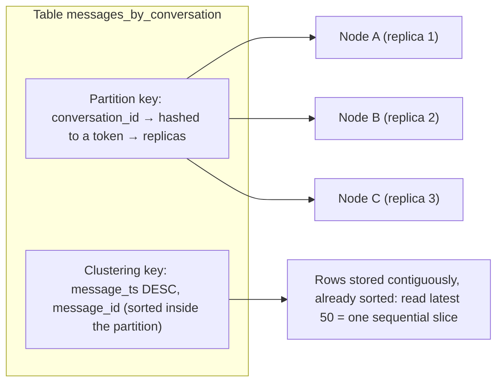

```sql
CREATE KEYSPACE chat WITH replication = {'class': 'NetworkTopologyStrategy', 'ap-south': 3};

CREATE TABLE chat.messages_by_conversation (
  conversation_id uuid,
  bucket          text,          -- e.g. '2026-11' to bound partition size
  message_ts      timeuuid,
  sender_id       uuid,
  body            text,
  PRIMARY KEY ((conversation_id, bucket), message_ts)
) WITH CLUSTERING ORDER BY (message_ts DESC);

SELECT * FROM chat.messages_by_conversation
WHERE conversation_id = ? AND bucket = '2026-11' LIMIT 50;
```

Rules: queries must specify the full partition key. Filter or sort only by clustering columns, in order. No joins. Denormalise into multiple tables (`messages_by_user`, `conversations_by_user`).

#### Example
Discord-style messaging: partition by `(channel_id, time bucket)` so no partition grows beyond ~100 MB, cluster by message id descending. "Load latest messages" is a single-partition slice read in milliseconds, at millions of writes per second across the cluster.

#### Trade-offs
| Pros | Cons |
|---|---|
| linear write scaling, no single point of failure | must know queries up front, one table per query |
| tunable consistency, multi-DC | no joins, limited secondary indexes, no ad-hoc queries |
| predictable latency for partition reads | large partitions and tombstones hurt |

#### Problems & fixes
| Symptom | Cause | Fix |
|---|---|---|
| Queries rejected without `ALLOW FILTERING` | query not by partition key | new table modelled for that query |
| Huge partitions (GBs), slow reads, GC pressure | unbounded partition (all messages of a channel forever) | time bucket in the partition key |
| Hot node | low-cardinality partition key | higher-cardinality / composite partition key |
| Secondary index queries slow | Cassandra 2i fans out to all nodes | denormalised table or SAI (Cassandra 5) with care |

#### Cheat sheet
- Primary key = ((partition key), clustering columns). Partition → nodes, clustering → sort order.
- One table per query. Denormalise. Bound partition size (< ~100 MB).
- Always query by full partition key.

#### Interview questions
<details><summary>Model "show a user's 20 most recent orders" and "show an order by id" in Cassandra.</summary>

Two tables: `orders_by_user` with `PRIMARY KEY ((user_id), created_at, order_id)` and `CLUSTERING ORDER BY (created_at DESC)`, so the query is `WHERE user_id = ? LIMIT 20`. And `orders_by_id` with `PRIMARY KEY (order_id)`. Writes go to both (batch with a logged batch, or consume events). For very active users add a time bucket to the partition key.
</details>

<details><summary>Why must partitions be bounded in Cassandra?</summary>

A partition lives entirely on its replica nodes. Huge partitions (millions of rows, GBs) cause slow reads, heavy compaction, memory pressure and GC pauses, uneven load, and repair problems. Bounding by adding a time bucket or other component to the partition key keeps each partition manageable.
</details>

#### Interview angle
> "In Cassandra I model one table per query, partitioned by something like (conversation_id, month) to bound partition size and clustered by time descending, so every read is one partition slice."

#### Sources
- [Data modeling](https://cassandra.apache.org/doc/latest/cassandra/developing/data-modeling/index.html) — Apache Cassandra docs
- [How Discord stores billions of messages](https://discord.com/blog/how-discord-stores-billions-of-messages) — Discord engineering

### Cassandra write path — commit log → memtable → SSTable flush (LSM tree)
Cassandra writes are extremely fast because they never update data in place. Each write is appended to a **commit log** (durability), applied to an in-memory **memtable**, and acknowledged. Memtables are later flushed to immutable on-disk **SSTables**, merged over time by compaction. This is the **LSM-tree** design.

#### Intuition
A busy shopkeeper jots every sale at the end of a notebook and keeps today's sales sorted on a slate. When the slate fills, it is copied neatly onto a page that is never edited again. Nothing is looked up or corrected while customers are waiting.

#### Must know
- A write is an **append to the commit log** plus an **insert into the in-memory memtable**. Then it is acknowledged.
- A full memtable is flushed to an immutable **SSTable** on disk.
- **No read before write** and no in-place update, which is why writes are so fast.
- An update is a new version with a newer timestamp. A delete writes a tombstone.
- The cost is paid later: compaction, and reads that must merge several SSTables.

#### Common mistakes
- Saying Cassandra updates rows in place.
- Forgetting that the default commit log sync is periodic, so durability comes from replication.
- Ignoring the read-side cost of an append-only design.

#### How it works
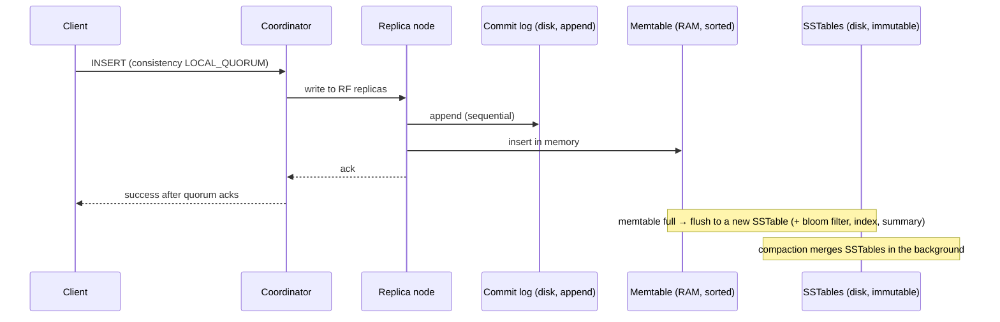

- Writes are sequential I/O only: commit log append + memtable insert. No read-before-write.
- Updates and deletes are just new writes with newer timestamps (deletes write **tombstones**).
- `commitlog_sync: periodic` (default, fsync every 10 s, relying on replicas for durability) vs `batch` (fsync before ack).

#### Example
An IoT platform ingesting 1M sensor readings/s across 30 nodes: each node takes ~100k writes/s (with RF 3) as commit-log appends and memtable inserts, which commodity SSDs handle easily because nothing is read or rewritten on the write path. A B-tree database would need random page updates and index maintenance per write.

#### Trade-offs
Excellent write throughput and latency, at the cost of **read amplification** (data spread over several SSTables) and **write amplification** from compaction, plus tombstone handling.

#### Problems & fixes
| Symptom | Cause | Fix |
|---|---|---|
| Write latency spikes | memtable flush/compaction falling behind, disk saturated | faster disks, tune compaction throughput, more nodes |
| Data loss on node crash | periodic commit log sync | rely on RF + quorum writes, or `batch` sync for stricter needs |
| Disk usage double during compaction | STCS needs free space | keep ~50% headroom (STCS), use LCS/TWCS where appropriate |

#### Cheat sheet
- Commit log (append) → memtable (RAM) → flush → immutable SSTable.
- No read-before-write. Updates and deletes are new versions and tombstones.
- Compaction merges SSTables later.

#### Interview questions
<details><summary>Why are writes in Cassandra faster than in a traditional B-tree database?</summary>

Cassandra only appends to a commit log and inserts into an in-memory memtable, both sequential and cheap, and never reads or modifies existing on-disk data during a write. B-tree databases update pages in place (random I/O), maintain indexes and often read before writing. Cassandra defers the merging work to background compaction.
</details>

<details><summary>What happens to an UPDATE in Cassandra at the storage level?</summary>

It's an insert of new cell values with a newer timestamp, so there's no in-place modification. On reads, the newest timestamp wins across memtable and SSTables. Old versions are discarded later during compaction.
</details>

#### Interview angle
> "Cassandra's write path is append-only (commit log plus memtable, flushed to immutable SSTables), so it absorbs huge write volumes. The cost is paid later in compaction and on reads."

#### Sources
- [Storage engine](https://cassandra.apache.org/doc/latest/cassandra/architecture/storage-engine.html) — Apache Cassandra docs
- [Log-structured merge-tree](https://en.wikipedia.org/wiki/Log-structured_merge-tree) — Wikipedia

### Cassandra read path — bloom filter check → SSTable cache → data files (from multiple SSTables)
Because a row's data may be spread over the memtable and several SSTables, a Cassandra read must **find and merge** all versions. It uses in-memory structures (bloom filters, partition summaries and indexes, caches) to skip SSTables and seek directly, then merges cells by timestamp.

#### Intuition
Your notes on one topic are spread across several notebooks. Each notebook has a quick checklist on its cover saying "definitely not in here" or "maybe". You skip most of them, open the few that might have it, and keep the newest version of each line.

#### Must know
- One row's data can sit in the memtable and in several SSTables, so a read must **find and merge** them.
- A **bloom filter** per SSTable says "definitely not here", so most files are skipped without touching disk.
- The newest timestamp wins when versions are merged.
- Read latency depends on SSTables touched, tombstones scanned and partition size.
- Reads are slower and less predictable than writes.

#### Common mistakes
- Assuming reads are as cheap as writes.
- Size-tiered compaction on a read-heavy, frequently updated table.
- Delete-heavy patterns, which make every read scan tombstones.

#### How it works
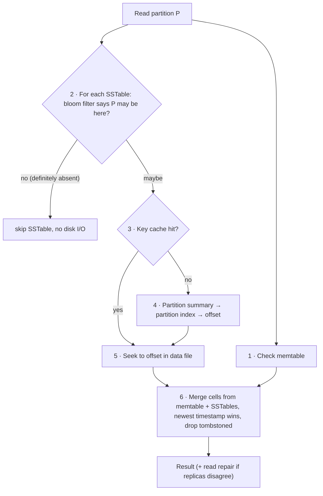

At the cluster level, the coordinator sends a full data request to the fastest replica and **digest** requests to others (per consistency level). If digests mismatch, it fetches full data, resolves, returns the newest and repairs stale replicas.

#### Example
A user's timeline partition written over months is spread over 12 SSTables under STCS. Each read checks 12 bloom filters (RAM) and may seek several files, so p99 is 40 ms. Switching that table to **Leveled Compaction** (most reads touch ~1–2 SSTables) or bucketing the partition by month drops p99 to ~5 ms.

#### Trade-offs
Reads are slower and less predictable than writes. Compaction strategy, partition design and tombstone volume dominate read latency.

#### Problems & fixes
| Symptom | Cause | Fix |
|---|---|---|
| Slow reads, many SSTables per read | STCS on read-heavy table | LCS, better partitioning |
| Reads time out with "tombstone_failure_threshold" | scanning many tombstones | avoid delete-heavy patterns, TWCS + TTL, shorter `gc_grace` with regular repairs |
| High read latency across the board | large partitions | bound partition size |
| Bloom filter false positives high | low `bloom_filter_fp_chance` memory trade-off | tune per table |

#### Cheat sheet
- Memtable + SSTables, bloom filters skip files, index/summary to seek, merge by timestamp.
- Read latency ∝ SSTables touched + tombstones + partition size.
- Read-heavy tables → LCS.

#### Interview questions
<details><summary>How does Cassandra avoid reading every SSTable on disk for a single key lookup?</summary>

Each SSTable has an in-memory bloom filter that says whether a partition key is definitely not present (no false negatives), so most SSTables are skipped without disk I/O. For candidates, the key cache or partition summary plus index give the exact offset in the data file, usually one seek per relevant SSTable. Compaction keeps the number of SSTables per partition low.
</details>

<details><summary>Reads on a Cassandra table got slower over time even though data volume is stable. Why?</summary>

Likely tombstones accumulating (frequent deletes or TTL expiry, especially with queue-like access patterns), or compaction falling behind so a partition spans many SSTables. Check `nodetool tablestats` (SSTables per read, tombstones scanned) and fix the data model (avoid delete-heavy queues), compaction strategy and repair cadence.
</details>

#### Interview angle
> "Cassandra reads merge the memtable and SSTables, with bloom filters skipping most files. Read latency comes down to partition size, SSTables per read and tombstones, so I pick the compaction strategy per table."

#### Sources
- [Storage engine](https://cassandra.apache.org/doc/latest/cassandra/architecture/storage-engine.html) — Apache Cassandra docs
- [Bloom filters](https://cassandra.apache.org/doc/latest/cassandra/managing/operating/bloom_filters.html) — Apache Cassandra docs

### Cassandra consistency levels — ONE, QUORUM, ALL, LOCAL_QUORUM, LOCAL_ONE
Cassandra lets each query choose **how many replicas must respond** for it to succeed: its consistency level (CL). That trades consistency against latency and availability per operation. With replication factor RF, choosing read CL + write CL > RF gives overlapping quorums (strong-ish reads).

#### Intuition
Asking three friends for a fact. Trust the first to answer (fast, sometimes outdated), wait for two to agree (reliable), or insist on all three (and if one is asleep you get no answer at all).

#### Must know
- Each query chooses **how many replicas must respond**.
- `ONE` is fastest and may be stale. `QUORUM` is a majority. `ALL` fails if any replica is down.
- **`LOCAL_QUORUM`** (a majority in the local datacenter) is the standard choice.
- Read level + write level > replication factor means the read overlaps the latest write.
- A quorum write is still a blind write. Compare-and-set needs a **lightweight transaction** (`IF …`).

#### Numbers to quote
- RF 3 with `LOCAL_QUORUM` needs 2 replicas and tolerates 1 node down.

#### Common mistakes
- Using `QUORUM` in a multi-datacenter cluster and paying cross-datacenter latency.
- Using `ALL` "for safety", which makes one down node an outage.
- Reserving a seat with a quorum write. Two writers both succeed.

#### How it works
| CL | Replicas required (RF = 3) | Notes |
|---|---|---|
| ONE / LOCAL_ONE | 1 | fastest, most available, may read stale |
| TWO / THREE | 2 / 3 | rarely used |
| **QUORUM** | 2 of 3 (across all DCs: majority of total RF) | cross-DC latency in multi-DC setups |
| **LOCAL_QUORUM** | majority within the local DC | standard for multi-DC apps |
| EACH_QUORUM | quorum in every DC (writes) | strong multi-DC writes, slow |
| ALL | all replicas | any one replica down means failure |
| SERIAL / LOCAL_SERIAL | Paxos for lightweight transactions | compare-and-set |

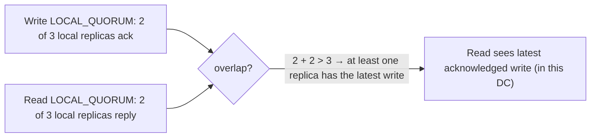

#### Example
A payments metadata table in 2 DCs (RF 3 each): writes and reads at `LOCAL_QUORUM`. Each region gets low latency and read-your-writes within the region, and it tolerates one node down per DC. Cross-DC replication is async. A "username claim" needs global uniqueness, so it uses a lightweight transaction (`INSERT … IF NOT EXISTS` at `SERIAL`), accepting ~4 round trips.

#### Trade-offs
Higher CL means stronger consistency but higher latency and less availability. `ONE` is fine for idempotent metrics or logs. `LOCAL_QUORUM` is the usual balance. `ALL` reduces availability to the weakest replica.

#### Problems & fixes
| Symptom | Cause | Fix |
|---|---|---|
| Stale reads after write | ONE/ONE (R + W ≤ RF) | LOCAL_QUORUM for both |
| `UnavailableException` with one node down | CL ALL or QUORUM with RF 2 | RF 3 + LOCAL_QUORUM |
| High latency in multi-DC | QUORUM (cross-DC) | LOCAL_QUORUM |
| Race conditions on uniqueness | quorum isn't compare-and-set | LWT (`IF NOT EXISTS`) at SERIAL |

#### Cheat sheet
- CL per query. R + W > RF means overlapping replicas.
- Default: RF 3, LOCAL_QUORUM reads and writes.
- Compare-and-set needs LWT (Paxos), not just QUORUM.

#### Interview questions
<details><summary>With RF = 3, which consistency levels give you read-your-writes, and what's the cost?</summary>

Any combination where R + W > 3: QUORUM/QUORUM (2+2), ONE writes with ALL reads (1+3), or ALL writes with ONE reads. QUORUM/QUORUM (or LOCAL_QUORUM in multi-DC) is the usual choice: each operation waits for the 2nd fastest replica and tolerates one replica down. ALL-based combinations fail whenever any replica is unavailable.
</details>

<details><summary>Can you implement "reserve this seat only if free" with QUORUM writes?</summary>

No. QUORUM writes are blind writes with last-write-wins. Two concurrent reservations at QUORUM both succeed and one silently overwrites the other. You need a lightweight transaction (`UPDATE … IF status = 'FREE'`), which runs Paxos for linearizable compare-and-set, or a different datastore for that operation.
</details>

#### Interview angle
> "Reads and writes run at LOCAL_QUORUM with RF 3 per region, which gives read-your-writes locally and tolerates a node failure. Uniqueness or compare-and-set uses lightweight transactions."

#### Sources
- [Dynamo architecture: tunable consistency](https://cassandra.apache.org/doc/latest/cassandra/architecture/dynamo.html) — Apache Cassandra docs
- [Guarantees](https://cassandra.apache.org/doc/latest/cassandra/architecture/guarantees.html) — Apache Cassandra docs

### Cassandra gossip protocol — peer-to-peer O(log N) node state propagation
Cassandra has no master node. Each node learns about the cluster through **gossip**: every second it exchanges state (who's up, load, schema version, tokens) with a few random peers. Information spreads epidemically and reaches all N nodes in about **O(log N)** rounds.

#### Intuition
Office gossip. Each person tells a couple of colleagues what they know, those colleagues tell a couple more, and within a few rounds the whole office has heard, with no announcement from the boss.

#### Must know
- There is no master. Every second each node swaps state with a few random peers.
- News reaches all N nodes in about **O(log N) rounds**.
- The state carries version numbers, so newer information wins.
- Seed nodes only help new nodes find the cluster.
- Failure detection uses a suspicion level (phi accrual), not a fixed timeout.

#### Common mistakes
- Thinking seed nodes are leaders.
- Expecting every node to have the same view at every instant. Membership is eventually consistent.
- Confusing gossip, which spreads cluster state, with replication of data.

#### How it works
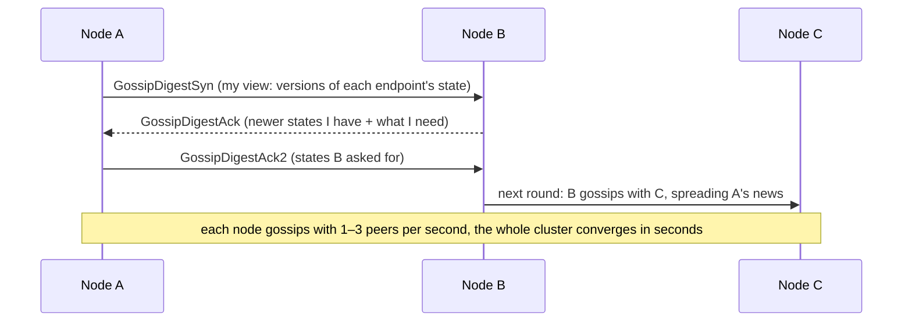

- State carries **heartbeat generation + version**, so newer information wins.
- **Seed nodes** help new nodes bootstrap (they're not special otherwise).
- **Failure detection**: the phi accrual detector turns heartbeat arrival history into a suspicion level (φ) instead of a fixed timeout. When it crosses `phi_convict_threshold`, the node is marked down locally.

#### Example
A 300-node cluster: a node restarts with a new schema version. Within a few seconds gossip spreads its status and schema to all nodes (log₂300 ≈ 8 rounds), with each node only talking to a few peers per second. There's no central coordinator to overload or fail. Consul/Serf (SWIM), Redis Cluster and DynamoDB-style systems use similar gossip.

#### Trade-offs
Scalable, decentralised and fault-tolerant, but eventually consistent membership (nodes may briefly disagree) and some background chatter. Misconfigured seeds or network partitions can cause confusing views.

#### Problems & fixes
| Symptom | Cause | Fix |
|---|---|---|
| Nodes flapping UP/DOWN | network jitter / GC pauses with low phi threshold | tune `phi_convict_threshold`, fix GC pauses |
| New node can't join | seeds unreachable/misconfigured | 2–3 seeds per DC, consistent seed lists |
| Schema disagreement | gossip not converged after DDL | wait for agreement (`nodetool describecluster`), avoid concurrent DDL |

#### Cheat sheet
- Peer-to-peer state exchange every second, converges in O(log N) rounds.
- Versioned state, seed nodes for bootstrap.
- Phi accrual failure detection instead of fixed timeouts.

#### Interview questions
<details><summary>Why use gossip instead of a central membership service?</summary>

No single point of failure or bottleneck: each node does constant, small work regardless of cluster size, and information still reaches everyone in O(log N) rounds. It tolerates partitions and node churn gracefully. The trade-off is that membership views are eventually consistent, which works because Cassandra's data operations tolerate that.
</details>

<details><summary>What is a phi accrual failure detector?</summary>

Instead of a binary "no heartbeat for X seconds means dead", it models the statistical distribution of heartbeat inter-arrival times and computes φ, a suspicion level for how unlikely the current silence is. Nodes are declared down when φ exceeds a threshold. That adapts automatically to network conditions and reduces false positives from normal jitter.
</details>

#### Interview angle
> "Cassandra nodes gossip their state peer to peer and converge in O(log N) rounds, with phi accrual failure detection, so there's no master to fail or overload."

#### Sources
- [Dynamo architecture: gossip](https://cassandra.apache.org/doc/latest/cassandra/architecture/dynamo.html) — Apache Cassandra docs
- [Gossip protocol](https://en.wikipedia.org/wiki/Gossip_protocol) — Wikipedia

### Cassandra hinted handoff — store writes for down nodes, replay when node recovers
When a replica is down during a write, the coordinator stores a **hint**: the write plus its intended target. When the replica comes back, the coordinator **replays the hints** to it. This lets writes succeed during short outages and speeds up convergence without waiting for a full repair.

#### Intuition
A neighbour takes in your parcels while you are away and hands them over when you return. If you are away too long, they stop collecting, and you must go to the depot and check everything yourself.

#### Must know
- When a replica is down, the coordinator **stores the write as a hint** and replays it when the replica returns.
- It covers **short outages**, such as rolling restarts.
- Hints are kept only for a limited window. After that the node needs a **repair**.
- A hint does **not** count toward the consistency level.
- It is best-effort. It does not replace repair.

#### Numbers to quote
- Default hint window: 3 hours.

#### Common mistakes
- Relying on hints after a node was down for half a day.
- Thinking hints help a QUORUM write succeed.
- Bringing back a node that was down longer than `gc_grace_seconds`. Replace it.

#### How it works
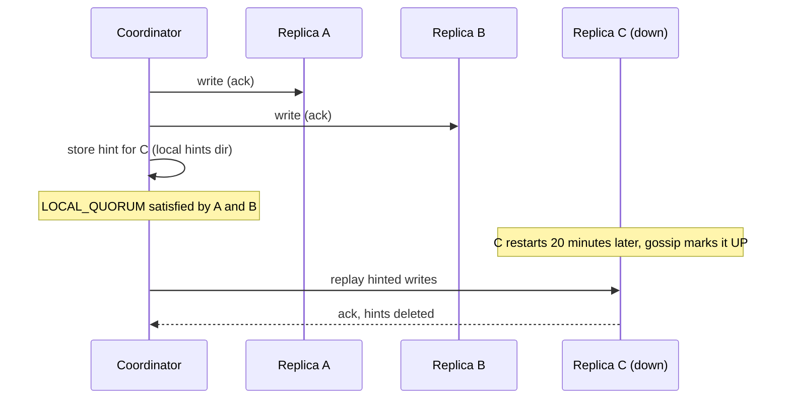

- Hints are kept for `max_hint_window_in_ms` (default 3 h). Beyond that the node needs **repair**.
- Hints **don't count toward the consistency level** (except CL ANY, which is rarely appropriate).

#### Example
A rolling restart for an upgrade takes each node down for ~5 minutes. Hinted handoff catches each node up on restart, so subsequent quorum reads are consistent without running a full repair after every restart. But if a node is down for 6 hours (beyond the hint window), it misses writes and must be repaired before rejoining, or reads at ONE may return stale or zombie data.

#### Trade-offs
Fast recovery for short outages, but hints consume coordinator disk and replay bandwidth, and they're best-effort: anti-entropy repair is still required for guarantees.

#### Problems & fixes
| Symptom | Cause | Fix |
|---|---|---|
| Node returns stale data after long outage | outage > hint window, hints dropped | run `nodetool repair` before serving / regular repairs |
| Coordinators' disks fill with hints | long outage of a busy node | cap hints, repair instead, replace the node |
| Overload when node returns | massive hint replay | throttle `hinted_handoff_throttle_in_kb` |

#### Cheat sheet
- Coordinator stores writes for down replicas, replays on recovery.
- Window ~3 h. After that, repair.
- Doesn't satisfy consistency levels. Repair is still mandatory.

#### Interview questions
<details><summary>A Cassandra node was down for 8 hours. What do you do before putting it back into service?</summary>

Hints only cover the hint window (3 h by default), so the node has missed writes. Bring it up and run a repair (incremental or full, e.g. via Reaper) to sync it with its peers before relying on it for low-CL reads. If downtime exceeded `gc_grace_seconds`, replace the node instead of rejoining it, to avoid resurrecting deleted data.
</details>

<details><summary>Do hints help meet a QUORUM write?</summary>

No. Hints are stored for replicas that didn't acknowledge, so they don't count toward QUORUM or LOCAL_QUORUM (only CL ANY accepts a hint as success). If too few real replicas acknowledge, the write fails with UnavailableException or a timeout regardless of hints.
</details>

#### Interview angle
> "Hinted handoff covers short replica outages during restarts. Anything longer than the hint window needs a repair before the node serves reads again."

#### Sources
- [Hints](https://cassandra.apache.org/doc/latest/cassandra/managing/operating/hints.html) — Apache Cassandra docs
- [Dynamo: Amazon's highly available key-value store](https://www.allthingsdistributed.com/files/amazon-dynamo-sosp2007.pdf) — DeCandia et al., SOSP 2007

### Cassandra read repair — detect and fix stale replicas on read path
Read repair fixes inconsistencies **opportunistically during reads**: when the coordinator queries multiple replicas (per the consistency level) and their responses disagree, it returns the newest data and writes it back to the stale replicas, so frequently read data converges quickly.

#### Intuition
You ask two colleagues for a phone number and get two different answers. You go with the more recently updated one, and tell the other colleague to correct their notes.

#### Must know
- On a read that consults several replicas, a mismatch is detected and the **newest version is written back** to the stale replica.
- It fixes **only data that is actually read**, and only at a consistency level above ONE.
- The coordinator requests full data from one replica and a hash (digest) from the others.
- Cold data still needs scheduled anti-entropy repair.

#### Common mistakes
- Treating read repair as enough to keep replicas consistent.
- Reading at ONE and expecting any repair to happen.
- Quoting `read_repair_chance`. It was removed in Cassandra 4.0.

#### How it works
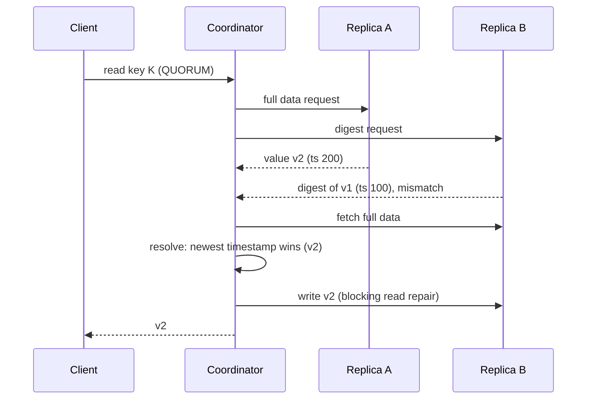

- **Blocking read repair** (in the request path at QUORUM): ensures monotonic quorum reads.
- Probabilistic background read repair (`read_repair_chance`) was removed in Cassandra 4.0. Regular **anti-entropy repair** handles data that's rarely read.

#### Example
After a brief network partition, replica B missed some updates for popular user profiles. Since profiles are read at LOCAL_QUORUM thousands of times per minute, mismatches are detected and fixed within minutes of the partition healing. Cold data that's never read stays inconsistent until the scheduled repair runs.

#### Trade-offs
Free convergence for hot data, at the cost of extra latency on reads that trigger repair. It doesn't help cold data or fix missing deletes reliably.

#### Problems & fixes
| Symptom | Cause | Fix |
|---|---|---|
| Read latency spikes after outages | many reads triggering blocking repairs | expected briefly. Run anti-entropy repair to fix bulk inconsistency |
| Cold data still inconsistent | read repair only on accessed data | scheduled repairs (Reaper) within gc_grace |
| Stale reads at ONE | single replica consulted, no comparison | LOCAL_QUORUM for important reads |

#### Cheat sheet
- Compare replica responses on read, write back the newest.
- Only for data that's read, at CL > ONE.
- Complements, not replaces, anti-entropy repair.

#### Interview questions
<details><summary>Why isn't read repair enough to keep Cassandra replicas consistent?</summary>

It only fixes data that's read at a consistency level involving multiple replicas. Rarely read or never read data, and data read only at ONE, never gets compared. Deletes are especially dangerous: if a tombstone is missing on one replica and gets garbage-collected elsewhere, deleted data can reappear. Scheduled anti-entropy repair is required.
</details>

<details><summary>How do digest reads reduce the cost of read repair?</summary>

The coordinator asks one replica for the full data and the others only for a hash (digest) of their version. If the digests match, no extra data crosses the network. Only on a mismatch does it fetch full data from the others to resolve and repair.
</details>

#### Interview angle
> "Read repair converges hot data at quorum reads. Cold data relies on scheduled anti-entropy repairs within gc_grace_seconds."

#### Sources
- [Read repair](https://cassandra.apache.org/doc/latest/cassandra/managing/operating/read_repair.html) — Apache Cassandra docs
- [Dynamo architecture](https://cassandra.apache.org/doc/latest/cassandra/architecture/dynamo.html) — Apache Cassandra docs

### Cassandra anti-entropy — periodic Merkle tree comparison between replicas
Anti-entropy repair (`nodetool repair`) systematically synchronises replicas: each replica builds a **Merkle tree** (a hash tree) over its data for a token range, the trees are compared, and only the **ranges whose hashes differ** are streamed between replicas. It's the guarantee that all replicas eventually match, including data that's never read.

#### Intuition
Two librarians checking that their catalogues match. They do not read out every entry. They compare one checksum per shelf, and only where a checksum differs do they go through that shelf book by book.

#### Must know
- `nodetool repair` compares replicas with **Merkle trees** (trees of hashes) and streams only the ranges that differ.
- It is the only mechanism that fixes data nobody reads.
- It must finish on every node **within `gc_grace_seconds`**, or deleted data can come back.
- It is I/O-heavy, so run it in small throttled sub-ranges with a scheduler such as Reaper.

#### Numbers to quote
- `gc_grace_seconds` default: 10 days.

#### Common mistakes
- Never scheduling repairs.
- One huge full repair at peak time.
- Thinking hints and read repair make repair optional.

#### How it works
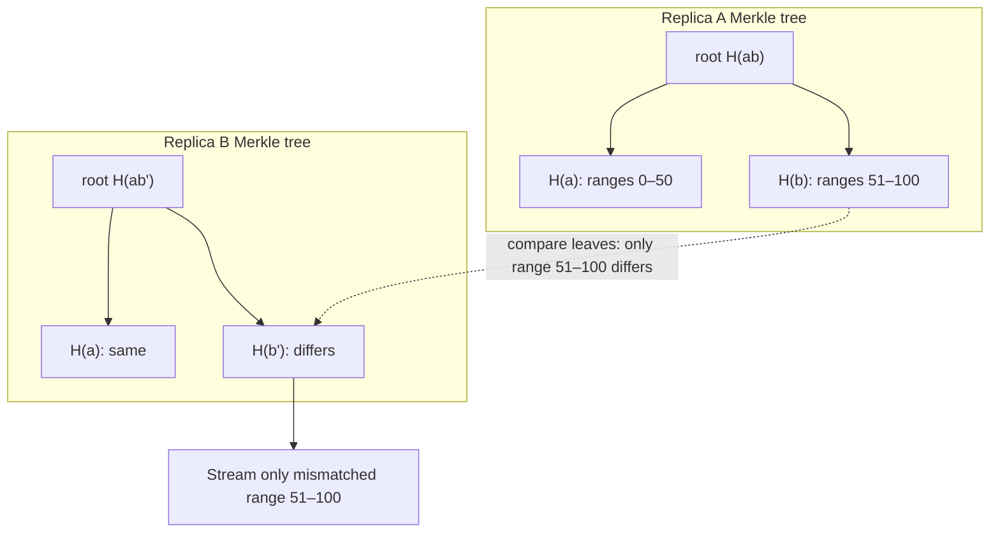

- **Full repair**: build trees over all data (expensive I/O and CPU).
- **Incremental repair**: only repair data written since the last repair (marks SSTables repaired), so it's cheaper but needs careful operation.
- **Subrange repair** with schedulers like **Cassandra Reaper** splits the work into small chunks over days.
- **Must complete on every node within `gc_grace_seconds`** (default 10 days), otherwise deleted data can resurrect.

#### Example
A 60-node cluster runs Reaper with subrange incremental repairs continuously, finishing a full cycle every 5 days (half of gc_grace). Repairs are throttled to off-peak hours. Merkle trees mean that after a minor incident only a few MB of mismatched ranges are streamed instead of terabytes.

#### Trade-offs
Strong eventual guarantees and efficient diffing, but repairs are I/O-heavy, can impact latency, and are operationally fiddly (scheduling, failures, overstreaming).

#### Problems & fixes
| Symptom | Cause | Fix |
|---|---|---|
| Deleted rows reappear | repair didn't run within gc_grace_seconds | schedule repairs < gc_grace, monitor completion |
| Repair causes latency spikes | full repairs on whole ranges | subrange + throttling via Reaper, off-peak |
| Huge streaming during repair (overstreaming) | coarse Merkle tree leaves | subrange repairs |

#### Cheat sheet
- Merkle trees per token range, compare, stream only differences.
- Run on every node within gc_grace_seconds (10 days default).
- Use Reaper: subrange, incremental, throttled.

#### Interview questions
<details><summary>Why use Merkle trees for replica synchronisation?</summary>

Comparing two replicas' data directly would require shipping all of it. Merkle trees summarise data hierarchically with hashes. Comparing the roots tells you if anything differs, and descending only into mismatched subtrees pinpoints the differing ranges with logarithmic comparisons, so only those small ranges are streamed.
</details>

<details><summary>What can go wrong if you never run repairs on a Cassandra cluster?</summary>

Replicas drift (missed writes beyond the hint window are never fixed for unread data), and worse, deletes can be undone: if a replica missed a tombstone and the other replicas garbage-collect it after gc_grace_seconds, the stale replica's old value becomes the only version and the data resurrects ("zombie" data).
</details>

#### Interview angle
> "Repairs are non-negotiable in Cassandra. Reaper runs throttled subrange repairs so every node completes a cycle inside gc_grace_seconds, otherwise deletes can come back from the dead."

#### Sources
- [Repair](https://cassandra.apache.org/doc/latest/cassandra/managing/operating/repair.html) — Apache Cassandra docs
- [Merkle tree](https://en.wikipedia.org/wiki/Merkle_tree) — Wikipedia

### Cassandra compaction — SizeTiered (write-heavy), Leveled (read-heavy), TWCS (time-series)
Compaction merges immutable SSTables: it combines versions of the same partition, drops overwritten cells and expired tombstones, and keeps the number of SSTables per read low. The **compaction strategy** is a per-table choice that trades write cost, read latency and disk space.

#### Intuition
Merging many scribbled notebooks into fewer clean ones. You can merge rarely (cheap to write, slow to look things up), keep everything in tidy levels (fast to look up, lots of rewriting), or keep one notebook per day and throw old days away whole.

#### Must know
- Compaction merges immutable SSTables, drops overwritten data and expired tombstones, and keeps reads fast.
- **STCS** (size-tiered): write-heavy tables. Cheap writes, reads touch many SSTables.
- **LCS** (leveled): read-heavy or frequently updated tables. Fast reads, heavy rewriting.
- **TWCS** (time-window): time series with TTL. A whole expired window is dropped at once.
- The strategy is chosen **per table**.

#### Numbers to quote
- STCS can need up to about 50% free disk during a merge. LCS rewrites data roughly 10×.

#### Common mistakes
- LCS on a write-heavy table, so compaction never catches up.
- STCS on an update-heavy, read-heavy table.
- Updates or deletes on a TWCS table, which stop old windows from being dropped.

#### How it works
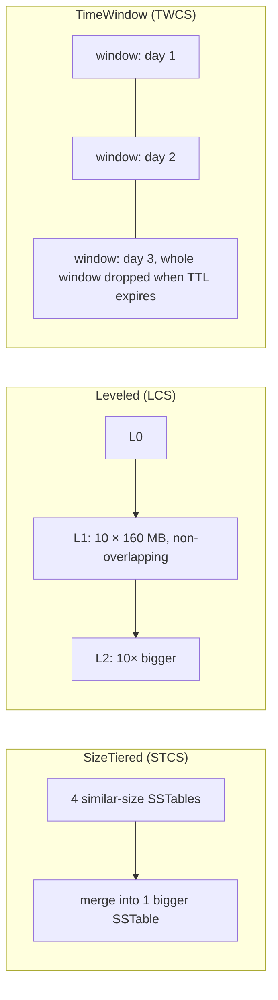

| Strategy | Best for | Reads touch | Write amplification | Space overhead |
|---|---|---|---|---|
| **STCS** (default) | write-heavy, insert-mostly | many SSTables | low | up to 50% free space needed |
| **LCS** | read-heavy, updates | ~1 SSTable per level (≈ 90% of reads hit one) | high (~10×) | ~10% |
| **TWCS** | time-series with TTL, no updates | few (by time window) | low | low, expired windows dropped whole |
| UCS (Cassandra 5) | adaptive unified | tunable | tunable | tunable |

#### Example
- Sensor readings with a 30-day TTL → TWCS with 1-day windows. Each day's data is compacted into one SSTable, and after 30 days the whole SSTable is dropped without tombstone scanning.
- User profiles (frequent updates, read-heavy) → LCS for predictable low read latency.
- Click logs (write-once, rare reads) → STCS.

#### Trade-offs
Each strategy optimises one dimension. Picking the wrong one causes slow reads (STCS on update-heavy tables), disk-full events (STCS space needs), or wasted I/O (LCS on write-heavy append data).

#### Problems & fixes
| Symptom | Cause | Fix |
|---|---|---|
| Disk fills during compaction | STCS needs space for merge output | headroom, or LCS/TWCS |
| Read latency high on update-heavy table | STCS spreading partitions across SSTables | LCS |
| Compaction pending grows, CPU/disk saturated | LCS on write-heavy table | STCS/TWCS, more nodes, compaction throughput |
| Tombstones not purged with TWCS | out-of-order writes / updates across windows | write in time order, avoid updates/deletes with TWCS |

#### Cheat sheet
- STCS = write-heavy (default). LCS = read-heavy/updates. TWCS = time-series + TTL.
- Watch pending compactions and SSTables per read.
- Choose per table.

#### Interview questions
<details><summary>Which compaction strategy for a metrics table that stores data points with a 14-day TTL?</summary>

TimeWindowCompactionStrategy with windows sized so there are ~20–40 windows over the TTL (e.g. 12-hour windows). Data is written in time order and never updated, each window compacts into a single SSTable, and expired windows are dropped wholesale, avoiding tombstone overhead and repeated compaction of old data.
</details>

<details><summary>Why can Leveled Compaction hurt a write-heavy workload?</summary>

LCS keeps SSTables non-overlapping within each level, so new data is repeatedly rewritten as it's promoted through levels: write amplification of ~10× or more. Under heavy writes, compaction can't keep up (pending compactions grow, disk I/O saturates) and latency suffers. STCS or TWCS rewrites data fewer times.
</details>

#### Interview angle
> "I choose compaction per table: TWCS for TTL'd time series, LCS for read-heavy updated data, and STCS for write-mostly logs, and I monitor pending compactions and SSTables per read."

#### Sources
- [Compaction overview](https://cassandra.apache.org/doc/latest/cassandra/managing/operating/compaction/index.html) — Apache Cassandra docs
- [TWCS part 1: how does it work and when should you use it?](https://thelastpickle.com/blog/2016/12/08/TWCS-part1.html) — The Last Pickle

### Cassandra tombstones — deleted data marked with timestamp, GC after gc_grace_seconds
Cassandra can't delete in place: SSTables are immutable, and other replicas may still hold the data. A delete writes a **tombstone**, a marker with a timestamp that shadows older data. Tombstones are only purged by compaction after **`gc_grace_seconds`** (default 10 days), so every replica has a chance to learn about the delete through repair.

#### Intuition
You cannot erase a line in a notebook that has been photocopied to three offices. So you write "line 12 is cancelled" and send that note round. The note has to stay until every office has seen it. Throw it away too early and one office still believes line 12.

#### Must know
- A delete writes a **tombstone**: a timestamped marker that hides older data.
- Tombstones are purged only after **`gc_grace_seconds`** plus a compaction.
- If a replica misses the tombstone and it is purged elsewhere, the deleted data **comes back**.
- Reads must scan past tombstones, so many of them make reads slow and eventually fail.
- TTL expiry and writing `null` also create tombstones.

#### Numbers to quote
- `gc_grace_seconds` default: 10 days.
- A query warns at 1,000 tombstones scanned and fails at 100,000.

#### Common mistakes
- Using a Cassandra table as a queue (insert, read the oldest, delete).
- An ORM writing nulls for unset fields on every insert.
- Lowering `gc_grace_seconds` without making repairs faster.

#### How it works
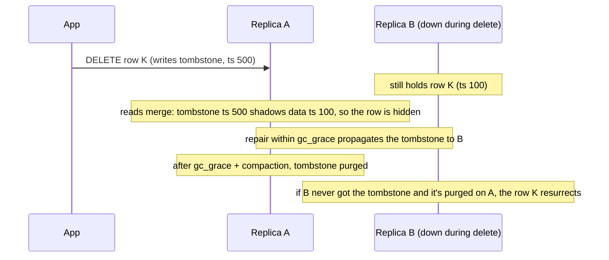

Tombstones are created by: DELETE, TTL expiry, inserting `null` values, collection overwrites, and range deletes.

Reads must scan past tombstones: `tombstone_warn_threshold` (1,000) and `tombstone_failure_threshold` (100,000) per query protect the node.

#### Example
A team used a Cassandra table as a **job queue**: insert jobs, workers read the oldest and delete them. Every read scans thousands of tombstones from processed jobs at the head of the partition, so queries slow down and then fail with `TombstoneOverwhelmingException`. Fix: use a real queue (Kafka/SQS), or partition by time bucket and drop whole buckets (TWCS + TTL) instead of deleting rows.

Inserting with null columns from an ORM (writing `null` for unset fields) silently creates tombstones on every insert. Use unset values (driver `UNSET`) instead.

#### Trade-offs
Tombstones are necessary for correct deletes in an eventually consistent, immutable-storage system, but they cost reads and storage until purged, and gc_grace sets how often repairs must run.

#### Problems & fixes
| Symptom | Cause | Fix |
|---|---|---|
| `TombstoneOverwhelmingException`, slow reads | delete-heavy / queue-like patterns | avoid queues in Cassandra, time-bucketed partitions + TWCS |
| Deleted data reappears | repair not done within gc_grace | repairs < gc_grace, never restore old backups into live cluster blindly |
| Unexpected tombstones on inserts | writing nulls | use unset/omit columns |
| Disk not freed after deletes | tombstones wait gc_grace + compaction | expected. TTL with TWCS frees space by dropping whole SSTables |

#### Cheat sheet
- Delete = tombstone (timestamped marker). Purged after gc_grace_seconds + compaction.
- Sources: DELETE, TTL, null writes, collection overwrites.
- Never use Cassandra as a queue. Repair within gc_grace.

#### Interview questions
<details><summary>Why is using Cassandra as a queue an anti-pattern?</summary>

Queue consumption means constant deletes at the head of a partition. Each delete is a tombstone that remains for gc_grace_seconds (days), so reads for the next items must scan through ever-growing tombstones, becoming slow and eventually failing past the threshold. Use Kafka/SQS/Redis Streams, or design with time-bucketed partitions that expire wholesale.
</details>

<details><summary>What is gc_grace_seconds and what's the risk of lowering it?</summary>

It's how long a tombstone must be kept before compaction can purge it (default 10 days), giving repairs time to propagate the delete to all replicas. If you lower it but repairs don't complete within the new window, a replica that missed the delete can bring the data back after tombstones are purged elsewhere. Lower it only with frequent, reliable repairs (or on tables with no deletes and only TTLs under TWCS, carefully).
</details>

#### Interview angle
> "Deletes in Cassandra are tombstones that live for gc_grace_seconds, so I avoid delete-heavy and queue-like models, expire time series with TTL plus TWCS, and repair inside the grace window."

#### Sources
- [About deletes and tombstones in Cassandra](https://thelastpickle.com/blog/2016/07/27/about-deletes-and-tombstones.html) — The Last Pickle
- [Tombstones](https://cassandra.apache.org/doc/latest/cassandra/managing/operating/compaction/tombstones.html) — Apache Cassandra docs

### DynamoDB — AWS managed, key-value + document, single-table design pattern
DynamoDB is AWS's fully managed key-value and document database: single-digit-millisecond latency at any scale, automatic partitioning, multi-AZ replication and serverless pricing. You design around **access patterns** with partition and sort keys, often putting multiple entity types in **one table** ("single-table design") so related items can be fetched in one query.

#### Intuition
A valet key cabinet run by someone else. Hand over a ticket number and the key comes back immediately, however many cars there are. But you can only ask by ticket number, so you must decide in advance how you will ask.

#### Must know
- A fully managed key-value and document store with single-digit-millisecond reads at any scale.
- **List the access patterns first**, then design the partition key and sort key around them.
- `Query` by key is cheap. `Scan` reads the whole table and is expensive.
- **Single-table design**: several entity types share one table, so one Query returns an item and its related items.
- Conditional writes handle concurrency. Streams provide change data capture.

#### Numbers to quote
- Maximum item size: 400 KB.
- A transaction can cover up to 100 items.

#### Common mistakes
- Designing the table like a relational schema and then needing joins.
- Using `Scan` with a filter for a regular query.
- Choosing it when access patterns are still unknown or reporting is ad hoc.

#### How it works
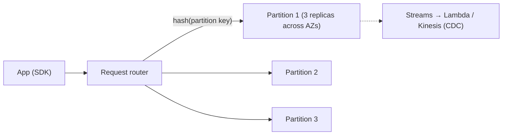

Single-table example for an e-commerce app:
| PK | SK | Attributes |
|---|---|---|
| `USER#42` | `PROFILE` | name, email |
| `USER#42` | `ORDER#2026-11-09#981` | total, status |
| `USER#42` | `ORDER#2026-11-01#955` | total, status |
| `ORDER#981` | `ITEM#1` | sku, qty, price |

- `Query(PK = USER#42, SK begins_with ORDER#)` → the user's orders, newest first with `ScanIndexForward=false`.
- `GetItem(PK = USER#42, SK = PROFILE)` → profile.

Capacity: **on-demand** (pay per request) or **provisioned** (RCU/WCU with autoscaling). Features: TTL, Streams, transactions (`TransactWriteItems`, up to 100 items), conditional writes, Global Tables (multi-region active-active), PITR backups.

#### Example
A serverless order system: API Gateway → Lambda → DynamoDB single table. User profile and recent orders come back in one query. DynamoDB Streams trigger a Lambda that updates an OpenSearch index for search and sends confirmation emails. Prime Day traffic scales automatically on on-demand capacity.

#### Trade-offs
| Pros | Cons |
|---|---|
| zero ops, scales to millions of req/s | must know access patterns upfront, rigid queries |
| predictable low latency | no joins/aggregations (Scan is expensive), limited ad-hoc |
| conditional writes, transactions, streams | 400 KB item limit, hot partitions |
| Global Tables | costs can surprise (scans, GSIs, on-demand at scale) |

#### Problems & fixes
| Symptom | Cause | Fix |
|---|---|---|
| Bills explode | Scans / filter-after-read | Query by keys, design GSIs for access patterns |
| Throttling on one key | hot partition | write sharding, better partition key, caching (DAX) |
| New query pattern impossible | not modelled | add GSI, or stream to OpenSearch/analytics store |
| Lost updates | blind PutItem overwrites | conditional writes with version attribute |

#### Cheat sheet
- Model access patterns first. PK + SK. Single-table for related entities.
- Query (keys) good, Scan bad. GSIs for alternate access patterns.
- Conditional writes for concurrency. Streams for CDC. TTL for expiry.

#### Interview questions
<details><summary>When would you choose DynamoDB over PostgreSQL for a new service?</summary>

When access patterns are well known and key-based (get by id, list by owner sorted by time), traffic is spiky or massive, and you want zero database operations on AWS (serverless). I'd choose PostgreSQL for complex relational queries, ad-hoc reporting, joins, evolving access patterns or multi-entity constraints. Many systems use both: DynamoDB for the high-scale key-value path, Postgres or analytics stores for the rest.
</details>

<details><summary>Explain single-table design and why it's used.</summary>

Store multiple entity types (users, orders, items) in one table with generic `PK`/`SK` attributes structured so related items share a partition key and sort together. One Query then fetches an entity and its related items (a user and their recent orders) without joins or multiple round trips. The cost: harder to understand and evolve, and analytics usually need exports to another store.
</details>

#### Interview angle
> "In DynamoDB I list access patterns first, then design PK/SK and GSIs so each pattern is a single Query. Conditional writes handle concurrency, and Streams feed search and analytics."

#### Sources
- [Core components of Amazon DynamoDB](https://docs.aws.amazon.com/amazondynamodb/latest/developerguide/HowItWorks.CoreComponents.html) — Amazon DynamoDB developer guide
- [The what, why, and when of single-table design with DynamoDB](https://www.alexdebrie.com/posts/dynamodb-single-table/) — Alex DeBrie

### DynamoDB partition key + sort key, GSI (Global Secondary Index), LSI (Local)
DynamoDB's primary key is either a **partition key** alone or **partition key + sort key**. The partition key picks the partition (hashed), and the sort key orders items within it and enables range queries. **GSIs** create alternate keys for other access patterns (asynchronously maintained), while **LSIs** offer an alternate sort key within the same partition.

#### Intuition
A library shelves books by author (partition key) and then by year (sort key). To find books by subject, the library keeps a second catalogue arranged by subject. That second catalogue is updated a moment after the shelves are.

#### Must know
- **Partition key**: hashed to pick the partition. **Sort key**: orders items inside it and allows range queries (`BETWEEN`, `begins_with`).
- **GSI**: an index with completely different keys, for another access pattern. Maintained asynchronously, so reads are eventually consistent.
- **LSI**: same partition key, different sort key. Must be created with the table.
- Each GSI costs extra write capacity. A starved GSI throttles writes to the base table.
- A **sparse GSI** contains only items that have the indexed attribute.

#### Numbers to quote
- Default limits: 20 GSIs and 5 LSIs per table. An LSI caps each partition key at 10 GB.

#### Common mistakes
- Reading from a GSI immediately after a write and expecting to see it.
- A low-cardinality GSI key such as status, which creates a hot index partition.
- Planning to add an LSI later. It cannot be added after table creation.

#### How it works
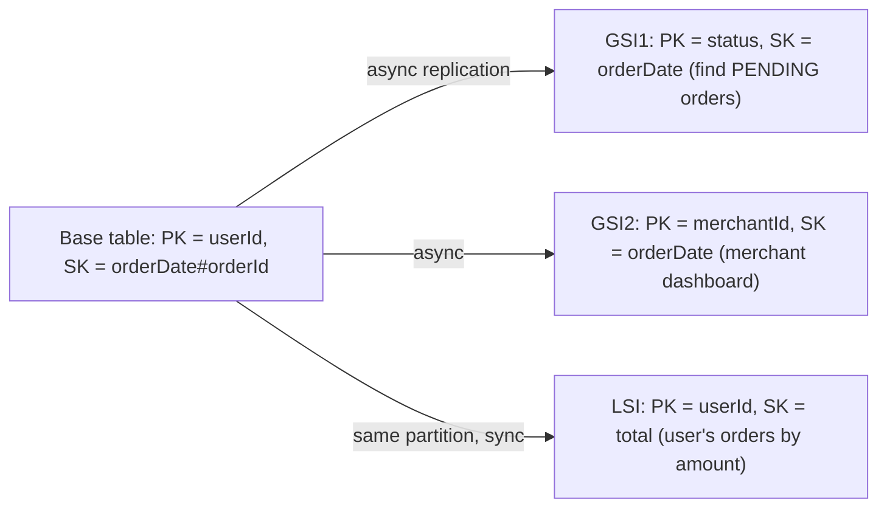

| | GSI | LSI |
|---|---|---|
| Keys | any partition + sort key | same partition key, different sort key |
| Created | anytime | only at table creation |
| Consistency | eventually consistent only | strongly consistent reads possible |
| Capacity | its own throughput | shares the table's |
| Limits | 20 per table | 5, and a 10 GB per partition-key limit |

Query capabilities with a sort key: `=`, `<`, `<=`, `>`, `>=`, `BETWEEN`, `begins_with`, ordered ascending or descending, with `Limit` and pagination (`LastEvaluatedKey`).

#### Example
Ride-hailing trips table: `PK = riderId, SK = tripStart#tripId` (rider history). GSI1 `PK = driverId, SK = tripStart` (driver earnings). GSI2 sparse index `PK = status` only on items where `status = ACTIVE` (attribute removed when completed), so the "active trips" query only touches active items. Sparse GSIs are a powerful trick.

#### Trade-offs
GSIs enable more access patterns but each one costs write capacity (every base write that changes indexed attributes writes to the GSI) and adds eventual consistency. A throttled GSI can **back-pressure writes on the base table**.

#### Problems & fixes
| Symptom | Cause | Fix |
|---|---|---|
| Base table writes throttled though base has capacity | GSI under-provisioned | provision/scale GSI capacity, on-demand |
| Read after write on GSI misses item | GSIs are eventually consistent | read from base table when freshness needed |
| GSI hot partition | low-cardinality GSI key (status) | sparse index, or shard the GSI key (status#0..9) |
| ItemCollectionSizeLimitExceeded | LSI 10 GB per partition key limit | avoid LSIs for large collections, use GSIs |

#### Cheat sheet
- PK hashed for distribution. SK sorted for ranges (begins_with, BETWEEN).
- GSI = new keys, eventual, own capacity. LSI = alternate sort, creation-time only, 10 GB limit.
- Sparse GSI for "only items with attribute X".

#### Interview questions
<details><summary>How would you support "list a merchant's orders by date" in a table keyed by customer?</summary>

Add a GSI with `PK = merchantId` and `SK = orderDate#orderId`, projecting only the attributes the dashboard needs (to save capacity). For very large merchants, shard the GSI partition key (`merchantId#bucket`) and query buckets in parallel. Remember GSI reads are eventually consistent.
</details>

<details><summary>Why can a GSI throttle writes to the base table?</summary>

Every base-table write that touches indexed attributes must also be written to the GSI. If the GSI lacks write capacity (or has a hot partition), DynamoDB throttles the base write to keep the index from falling too far behind. Provision GSIs adequately and avoid low-cardinality GSI keys.
</details>

#### Interview angle
> "The base key serves the main access pattern. Each extra pattern gets a projected, sometimes sparse, GSI, with capacity planned for it and eventual consistency accepted."

#### Sources
- [Using global secondary indexes in DynamoDB](https://docs.aws.amazon.com/amazondynamodb/latest/developerguide/GSI.html) — Amazon DynamoDB developer guide
- [Local secondary indexes](https://docs.aws.amazon.com/amazondynamodb/latest/developerguide/LSI.html) — Amazon DynamoDB developer guide

### DynamoDB hot partition — high-cardinality partition key is essential; write sharding for counters
DynamoDB spreads data across partitions by hashing the partition key. Each partition has limits (about **3,000 RCU and 1,000 WCU per second**, and 10 GB). If many requests target one key, that partition throttles even though the table has plenty of total capacity. **Adaptive capacity** helps somewhat, but key design is the real fix.

#### Intuition
A toll plaza with twenty lanes where every car insists on lane 3. Building more lanes changes nothing. You have to send the cars to different lanes.

#### Must know
- All traffic for one partition key lands on **one partition**, which has a fixed ceiling.
- Raising table capacity does not help a single hot key.
- Use a **high-cardinality partition key** (userId, orderId), not status, date or country.
- **Write sharding**: add a suffix (`key#0…N`) and sum on read, or aggregate through Streams.
- Cache hot reads, and use CloudWatch Contributor Insights to find hot keys.

#### Numbers to quote
- Per-partition ceiling: about 1,000 write units and 3,000 read units per second, and 10 GB.

#### Common mistakes
- A partition key of `"GLOBAL_COUNTER"` or today's date.
- Answering throttling with "increase provisioned capacity".
- Relying on adaptive capacity to rescue a bad key design.

#### How it works
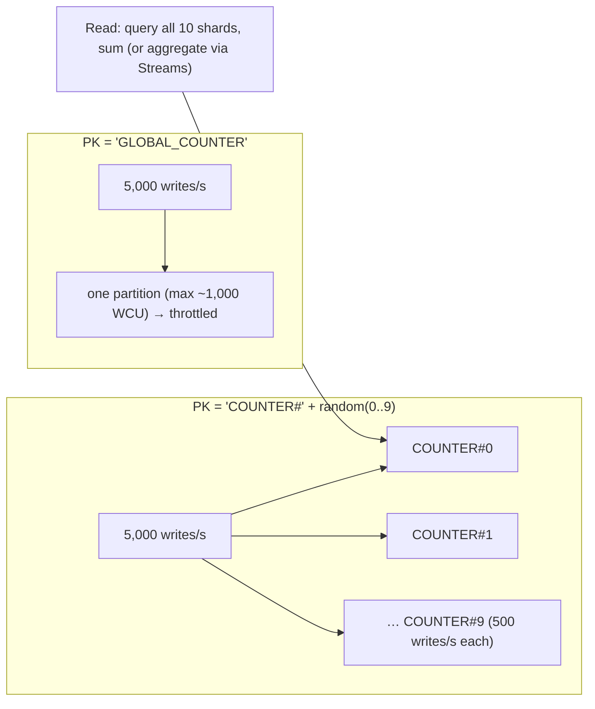

Patterns:
- **High-cardinality partition keys** (userId, orderId), not status, date or country.
- **Write sharding**: append a random or calculated suffix. Reads scatter over N suffixes.
- **Time-bucketed keys** for time series: `deviceId#2026-11-09`.
- **Cache** hot reads with DAX/ElastiCache.
- **Aggregate via Streams**: write raw events, have a Lambda maintain the totals.

#### Example
A voting app for a TV show: `PK = candidateId` gives 5 candidates and millions of votes per minute, so it throttles immediately. Redesign: write each vote as `PK = candidateId#shard(0..99), SK = voteId` (with idempotency on voterId via a separate conditional item), and have a Streams-driven aggregator update `candidateTotals` every second. Reads show the aggregated totals.

#### Trade-offs
Sharding spreads load but multiplies read work and complexity. Choose the shard count from peak write rate ÷ ~1,000 WCU, with headroom.

#### Problems & fixes
| Symptom | Cause | Fix |
|---|---|---|
| `ProvisionedThroughputExceededException` with low table usage | hot key | write sharding, better key |
| Time-series writes all to "today" key | date as partition key | `deviceId#date` composite keys |
| Hot reads on a popular item | celebrity item | DAX / cache, replicate item copies |
| Can't find the hot key | no visibility | CloudWatch Contributor Insights |

#### Cheat sheet
- Per partition ≈ 1,000 WCU / 3,000 RCU / 10 GB.
- High-cardinality PK. Shard hot keys (`key#0..N`). Aggregate via Streams.
- Use Contributor Insights to find hot keys.

#### Interview questions
<details><summary>Design a DynamoDB-backed "likes" counter for posts that can go viral.</summary>

Record each like as its own item (`PK = POST#id#shard(n), SK = USER#uid`, with a conditional put for dedupe), spreading viral posts across N shards. DynamoDB Streams feed a Lambda that batches increments into a `POST#id / COUNT` item every second or so. Readers fetch the aggregate (cache it). Normal posts use few shards, and N can grow dynamically for hot posts.
</details>

<details><summary>Why doesn't increasing table capacity fix a hot partition?</summary>

Capacity is spread across partitions, and a single partition key maps to one partition with fixed per-partition limits. Adding table capacity adds partitions, but the hot key's traffic still lands on its one partition. Adaptive capacity can shift some unused capacity, but beyond ~1,000 WCU/s per key you must spread the key itself.
</details>

#### Interview angle
> "In DynamoDB the partition key must have high cardinality. Known-hot keys like counters get write-sharded suffixes, with totals aggregated through Streams, and Contributor Insights shows where the hot keys are."

#### Sources
- [Using write sharding to distribute workloads evenly](https://docs.aws.amazon.com/amazondynamodb/latest/developerguide/bp-partition-key-sharding.html) — Amazon DynamoDB developer guide
- [Best practices for designing and using partition keys effectively](https://docs.aws.amazon.com/amazondynamodb/latest/developerguide/bp-partition-key-design.html) — Amazon DynamoDB developer guide

### Graph DB (Neo4j) — nodes, relationships, properties, Cypher query language
A graph database stores **nodes** (entities), **relationships** (typed, directed edges) and **properties** on both, with relationships as first-class stored pointers (**index-free adjacency**). Multi-hop traversals ("friends of friends who bought X") stay fast regardless of total data size, which is where relational joins struggle.

#### Intuition
A map of who knows whom drawn with string between pins. To find friends of friends you follow the strings from one pin. You do not search a list of every friendship in the city.

#### Must know
- Data is **nodes, typed relationships and properties**. Relationships are stored as direct links.
- Following a link costs the same however big the database is, so **multi-hop queries stay fast**.
- Cypher pattern: `MATCH (a)-[:FRIEND*1..3]->(b)`.
- Good for fraud rings, recommendations, social graphs and dependency or permission graphs.
- Hard to shard, and weak at bulk aggregation. Usually fed from the system of record.

#### Common mistakes
- Choosing a graph database for ordinary CRUD with one-hop joins.
- Ignoring **super nodes** (a celebrity with millions of edges), which make traversals explode.
- Making it the transactional source of truth for money.

#### How it works
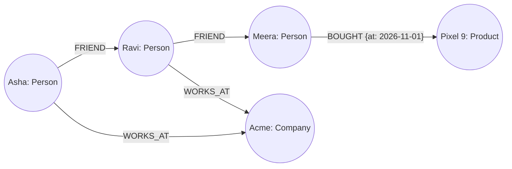

```cypher
// friends-of-friends of Asha who bought a phone, not already her friends
MATCH (a:Person {name:'Asha'})-[:FRIEND]->()-[:FRIEND]->(fof)-[:BOUGHT]->(p:Product {category:'phone'})
WHERE NOT (a)-[:FRIEND]->(fof) AND fof <> a
RETURN fof.name, p.name, count(*) AS strength ORDER BY strength DESC LIMIT 10;

// shortest path between two accounts (fraud rings / money flow)
MATCH path = shortestPath((x:Account {id:'A1'})-[:TRANSFERRED*..6]-(y:Account {id:'Z9'})) RETURN path;
```

#### Example
**Fraud detection** at a fintech: accounts, devices, phone numbers, addresses and cards are nodes, and shared usage creates relationships. A new account sharing a device with 3 accounts that were previously charged back is found with a 2–3 hop query in milliseconds, which would be a chain of self-joins on huge tables in SQL. Other uses: recommendations, social graphs, knowledge graphs, network/IT dependency mapping, access-control graphs.

#### Trade-offs
| Pros | Cons |
|---|---|
| fast deep traversals, natural modelling of connected data | harder to shard horizontally (graph partitioning is hard) |
| expressive pattern queries (Cypher) | not great for bulk aggregations / simple CRUD at huge scale |
| schema flexibility | smaller ecosystem, specialised ops |

#### Problems & fixes
| Symptom | Cause | Fix |
|---|---|---|
| Traversal explodes in time | super nodes (a node with millions of edges, like a celebrity) | relationship types/properties to filter, cap depth, model super nodes differently |
| Slow start of queries | no index on lookup property | index/constraint on `:Person(id)` |
| Graph too big for one machine | Neo4j primarily scales reads via replicas | sharding (composite databases, formerly Fabric), or a distributed graph DB (JanusGraph, Neptune, TigerGraph) |

#### Cheat sheet
- Nodes + typed relationships + properties. Index-free adjacency means fast hops.
- Cypher: `MATCH (a)-[:REL*1..3]->(b)`.
- Use for fraud rings, recommendations, social, dependencies. Beware super nodes.

#### Interview questions
<details><summary>When would you add a graph database to your architecture?</summary>

When core queries are about relationships several hops deep, with variable depth: fraud ring detection, "people you may know", recommendation paths, permission inheritance graphs, network topology. Those queries become many recursive self-joins in SQL that slow down as data grows. Typically the graph DB is fed from the system of record via CDC/events and used for those specific queries.
</details>

<details><summary>What is the "super node" problem in graph databases?</summary>

A node with an enormous number of relationships (a celebrity followed by 50M people, or a popular product). Traversals that pass through it fan out massively, so queries slow or time out. Mitigations: filter by relationship type or properties early, cap traversal depth, avoid traversing through such nodes, or model them differently (bucketed intermediate nodes).
</details>

#### Interview angle
> "For fraud-ring detection I'd stream accounts, devices and cards into a graph database and run bounded multi-hop pattern queries, while the transactional source of truth stays relational."

#### Sources
- [What is a graph database?](https://neo4j.com/docs/getting-started/graph-database/) — Neo4j docs
- [Cypher manual: introduction](https://neo4j.com/docs/cypher-manual/current/introduction/) — Neo4j docs

### Time-series DB — InfluxDB, TimescaleDB (Postgres extension), Prometheus TSDB
Time-series databases are optimised for **timestamped measurements**: heavy append-only writes, queries over time ranges with aggregations (avg per minute, p99 per hour), downsampling and retention-based deletion. Compression exploits the regularity of time series, often reaching 10–20× smaller than generic storage.

#### Intuition
A hospital chart that records temperature every few minutes. Nobody edits old readings. People ask "what was the average this morning?", last year's minute-by-minute detail is summarised to hourly, and very old charts are shredded by the boxful.

#### Must know
- Built for **timestamped, append-only data** queried by time range with aggregation.
- Three core features: **compression, downsampling (rollups) and retention**.
- Prometheus: pull-based metrics with labels. InfluxDB: push-based. TimescaleDB: SQL on PostgreSQL.
- **High cardinality kills them**: every unique label combination is a separate series.
- Old data is dropped a whole chunk at a time, which is cheap.

#### Numbers to quote
- Compression brings a data point down to roughly 1–2 bytes, often 10× or more smaller than raw.

#### Common mistakes
- Putting `user_id` or `request_id` in a metric label.
- Querying months of raw points for a dashboard when a rollup would do.
- Using a time-series database as a general-purpose store with updates.

#### How it works
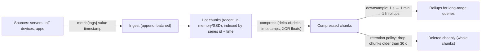

| System | Model | Notes |
|---|---|---|
| **Prometheus** | pull-based metrics, labels, PromQL | local TSDB (2 h blocks), long-term storage via Thanos/Mimir/Cortex |
| **InfluxDB** | measurements, tags, fields, line protocol | push-based, retention policies, SQL and InfluxQL in InfluxDB 3 (Flux is in maintenance mode) |
| **TimescaleDB** | Postgres extension: hypertables auto-partitioned by time | full SQL + joins, continuous aggregates, compression |
| Others | ClickHouse, QuestDB, Druid, VictoriaMetrics | analytics-oriented / very high ingest |

```sql
-- TimescaleDB
SELECT create_hypertable('sensor_readings', 'ts', chunk_time_interval => interval '1 day');
SELECT time_bucket('5 minutes', ts) AS bucket, device_id, avg(temp), max(temp)
FROM sensor_readings WHERE ts > now() - interval '24 hours'
GROUP BY bucket, device_id ORDER BY bucket;
SELECT add_retention_policy('sensor_readings', interval '90 days');
```

#### Example
An EV-charging company stores 50k chargers × 1 reading per 10 s = 5k writes/s. TimescaleDB hypertables with daily chunks, native compression after 7 days (~15× smaller), continuous aggregates for hourly energy per station, and 1-year retention of raw data. Dashboards query the aggregates in milliseconds, and it still joins with the relational `stations` table in the same Postgres.

#### Trade-offs
Excellent ingest, compression and time-range queries, but **high cardinality** (too many unique tag combinations, like per-user-id labels) kills most TSDBs. Updates and deletes of individual points are slow or unsupported, and they're not general-purpose databases.

#### Problems & fixes
| Symptom | Cause | Fix |
|---|---|---|
| Memory explodes, ingestion slows | high cardinality labels (user_id, request_id as tags) | keep labels low-cardinality, put ids in logs/traces |
| Long-range dashboards slow | querying raw data over months | downsampled rollups / continuous aggregates |
| Disk grows forever | no retention | retention policies, tiered storage |
| Prometheus data lost on restart / short retention | local TSDB only | remote write to Thanos/Mimir |

#### Cheat sheet
- Append-heavy, time-range aggregations, compression, retention, downsampling.
- Prometheus (metrics, pull), InfluxDB (push), TimescaleDB (SQL on Postgres).
- Watch cardinality. Pre-aggregate for long ranges.

#### Interview questions
<details><summary>Design storage for metrics from 100k servers, each emitting 200 metrics every 10 seconds.</summary>

That's 2M points/s. Use a horizontally scalable TSDB (Prometheus agents with remote write into Mimir/Thanos/VictoriaMetrics, or M3) with low-cardinality labels (host, service, region, not request ids). Keep raw data 15 days, 1-minute rollups for 90 days and 1-hour for 2 years. Compression of ~1–2 bytes per point gives roughly 2M × 86,400 × 15 days × 1.5 B ≈ 4 TB for raw retention, sharded across ingesters with replication factor 3.
</details>

<details><summary>Why is high cardinality a problem for time-series databases?</summary>

Each unique combination of metric name and label values is a separate series with its own index entries and in-memory buffers. Adding a label like `user_id` with millions of values multiplies series count by millions, exhausting memory and index size and slowing queries. Keep high-cardinality data in logs or traces, and use exemplars to link metrics to traces.
</details>

#### Interview angle
> "Metrics go into a TSDB with low-cardinality labels, compression, retention and rollups, which is Prometheus with Mimir for infrastructure metrics. For device telemetry that needs joins, I'd use TimescaleDB on Postgres."

#### Sources
- [Storage](https://prometheus.io/docs/prometheus/latest/storage/) — Prometheus docs
- [Gorilla: a fast, scalable, in-memory time series database](https://www.vldb.org/pvldb/vol8/p1816-teller.pdf) — Pelkonen et al., VLDB 2015
- [Metric and label naming](https://prometheus.io/docs/practices/naming/) — Prometheus docs

