## NewSQL & cloud databases

### Google Spanner — globally distributed, external consistency, TrueTime (GPS + atomic clocks)
Spanner is Google's globally distributed relational database: SQL, schemas and ACID transactions **across regions**, with **external consistency** (the strongest guarantee: if transaction T1 commits before T2 starts, T2 sees T1's effects everywhere). It combines Paxos-replicated data splits with **TrueTime**, a clock API with bounded uncertainty.

#### Intuition
A bank with branches on every continent that behaves like one branch with one ledger. Wherever you deposit, anyone anywhere who checks afterwards sees it. The trick is that every branch has a very accurate clock and knows exactly how inaccurate it might be.

#### Must know
- A relational database with SQL and **ACID transactions across regions**, scaled horizontally.
- Data is split into ranges. Each range is a **Paxos group** replicated across zones or regions.
- A transaction across ranges uses **2PC on top of those Paxos groups**, so a participant failure does not block it.
- **External consistency**: if T1 commits before T2 starts, T2 sees T1. TrueTime plus commit wait gives this.
- Avoid monotonically increasing primary keys. They put every insert on one range.

#### Numbers to quote
- Multi-region availability SLA: 99.999%.
- TrueTime uncertainty is typically a few milliseconds (1–7 ms in the paper).

#### Common mistakes
- Saying Spanner "beats CAP". It chooses consistency and relies on a very reliable network to stay available.
- A timestamp or sequence as the primary key.
- Expecting single-region latency from a multi-region configuration. Every write waits for a cross-region quorum.

#### How it works
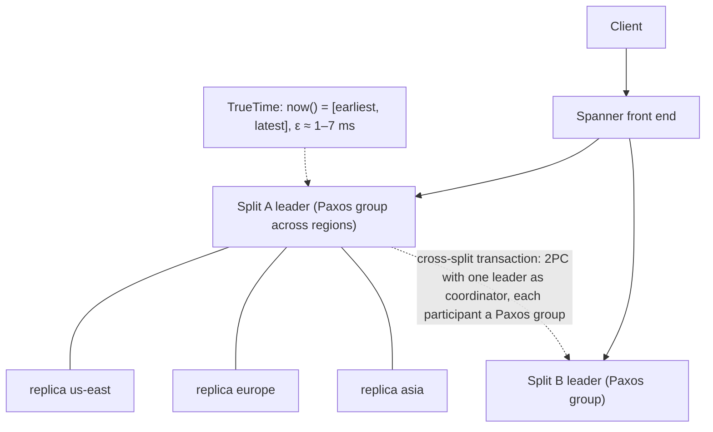

- Data is split into ranges (**splits**). Each split is a **Paxos group** of replicas across zones and regions, with a leader.
- Writes take locks at the leaders. Cross-split transactions use **2PC over Paxos groups** (so participants themselves are fault-tolerant, which avoids classic 2PC blocking).
- Commit timestamps come from TrueTime plus **commit wait** (next topic), which gives external consistency.
- Reads can be **strong** (latest) or **stale** at a timestamp (lock-free, served by any replica).

#### Example
A global ledger for a payments company: accounts in Mumbai and Frankfurt, and a transfer between them is a single ACID transaction. Commit latency is tens to hundreds of ms because Paxos quorums span regions (configure regional instances when users are mostly local). Balance reads for dashboards use stale reads (`exact_staleness = 10s`) from the nearest replica, fast and lock-free.

#### Trade-offs
Strong global consistency and SQL with horizontal scale and high availability (99.999% multi-region SLA), at the cost of higher write latency for cross-region quorums, GCP lock-in and cost. Schema design needs care to avoid hotspots (monotonic keys).

#### Problems & fixes
| Symptom | Cause | Fix |
|---|---|---|
| Write hotspot on one split | monotonically increasing primary key (timestamp, sequence) | UUIDv4 / bit-reversed sequences, hash prefix |
| High commit latency | multi-region quorum on every write | regional config for local workloads, batch writes |
| Read latency high for global users | strong reads go to leaders | stale reads / bounded staleness from nearest replica |
| Lock contention aborts | long read-write transactions | short transactions, read-only transactions for reads |

#### Cheat sheet
- Global SQL + ACID + external consistency. Paxos per split, 2PC across splits.
- TrueTime + commit wait gives timestamps that respect real-time order.
- Avoid monotonic keys. Stale reads for low-latency reads.

#### Interview questions

How does Spanner provide external consistency across data centers?

Each transaction gets a commit timestamp from TrueTime, which returns an interval guaranteed to contain true time. The leader picks a timestamp at least TrueTime's latest bound and then waits until TrueTime's earliest bound has passed that timestamp (commit wait, a few ms) before making the commit visible. So any transaction starting after the commit is acknowledged gets a strictly larger timestamp, and timestamp order matches real-time order globally. Paxos replicates each split and 2PC coordinates multi-split transactions.

Why is a monotonically increasing primary key bad in Spanner?

Spanner range-partitions by primary key, so increasing keys (timestamps, sequences) send all new inserts to the last split, one server's leader, creating a write hotspot that no amount of splitting fixes. Use UUIDv4, a hashed prefix, or bit-reversed sequences to spread inserts.

#### Interview angle
> "For a globally consistent ledger I'd consider Spanner: Paxos per split, 2PC across splits and TrueTime commit wait give external consistency. I'd pay the cross-region write latency and use stale reads for dashboards."

#### Sources
- [Spanner: Google's globally distributed database](https://research.google/pubs/spanner-googles-globally-distributed-database-2/) — Google Research
- [Spanner: TrueTime and external consistency](https://cloud.google.com/spanner/docs/true-time-external-consistency) — Google Cloud docs
- [Schema design best practices](https://cloud.google.com/spanner/docs/schema-design) — Google Cloud Spanner docs

### TrueTime — returns [earliest, latest] time interval, commit wait ensures monotonicity
TrueTime is Google's clock API that admits uncertainty: `TT.now()` returns an interval **[earliest, latest]** guaranteed to contain the true absolute time. GPS receivers and atomic clocks in every data centre keep the uncertainty ε small (typically 1–7 ms). Spanner uses it to assign commit timestamps that respect real-time order.

#### Intuition
An honest watch that says "it is between 10:00:00 and 10:00:04" instead of pretending to know the exact second. If you wait those four seconds before announcing something, nobody anywhere can later claim it happened before your announcement.

#### Must know
- `TT.now()` returns an **interval [earliest, latest]** that is guaranteed to contain the true time.
- GPS receivers and atomic clocks in each datacenter keep the interval small.
- **Commit wait**: choose a timestamp, then wait until that timestamp is definitely in the past everywhere before acknowledging.
- Result: timestamp order matches real-time order across the globe, with no central sequencer.
- Without bounded clocks you need logical clocks or a central timestamp oracle (as TiDB does).

#### Numbers to quote
- Commit wait costs about twice the clock uncertainty, a few milliseconds per write transaction.

#### Common mistakes
- Saying TrueTime gives perfectly synchronised clocks. It gives a bounded error.
- Using NTP wall-clock timestamps to order events across machines.
- Forgetting that the wait is added to every read-write commit.

#### How it works
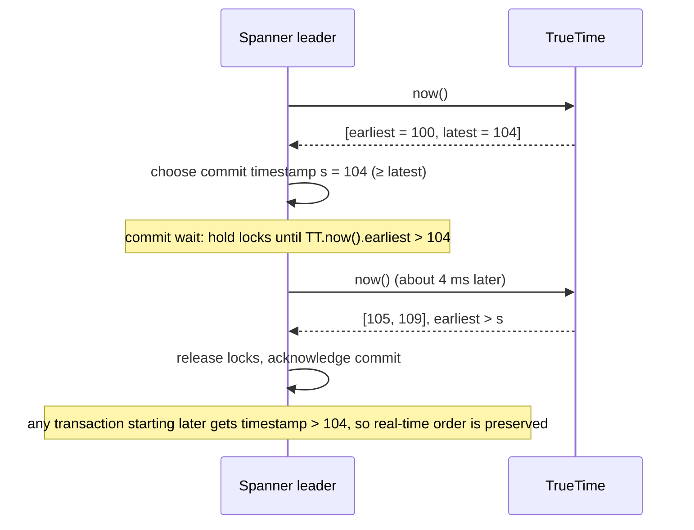

- **Commit wait** costs ≈ 2ε per write transaction (a few ms), which is why keeping ε small with GPS and atomic clocks matters.
- Without bounded uncertainty, timestamps from different machines can't be safely compared, and systems fall back to logical clocks or a central timestamp oracle (TiDB's PD, Percolator).
- CockroachDB uses **hybrid logical clocks** and a max clock offset (default 500 ms) with uncertainty restarts instead of hardware clocks.

#### Example
Two transactions on different continents: T1 commits in Iowa at timestamp 104 after commit wait. T2 starts in Belgium 1 ms after T1's acknowledgement. TrueTime guarantees T2's timestamp is > 104, so a snapshot read at T2's timestamp includes T1's write, which is exactly the external consistency guarantee, with no coordination between the two regions beyond clocks.

#### Trade-offs
Delivers global ordering with no central coordinator, but requires special hardware and clock infrastructure, and every write pays commit wait.

#### Problems & fixes
| Symptom | Cause | Fix |
|---|---|---|
| (in your own system) inconsistent ordering across servers | comparing NTP wall clocks with unknown skew | hybrid logical clocks, central timestamp oracle, or consensus |
| Large uncertainty → slow commits | poor clock sync | better time sync (PTP, Amazon Time Sync / ClockBound) |

#### Cheat sheet
- `TT.now()` = interval containing true time, ε ≈ few ms.
- Commit timestamp ≥ latest, then wait until earliest > timestamp (commit wait).
- Gives external consistency without a central timestamp server.

#### Interview questions

Why can't we just use NTP timestamps to order transactions across data centres?

NTP clocks have unknown and variable skew (milliseconds to seconds, and jumps), so a later transaction on a lagging machine can get a smaller timestamp than an earlier one elsewhere, which breaks ordering and snapshot consistency. TrueTime makes the uncertainty explicit and bounded, and commit wait outlasts it. Without that, you need logical clocks or a central timestamp oracle.

What is commit wait and what does it cost?

After choosing a commit timestamp s (at least TrueTime's upper bound), the leader waits until TrueTime's lower bound exceeds s before releasing locks and acknowledging. That guarantees s is in the past everywhere when clients learn of the commit. It costs about twice the clock uncertainty (a few ms) of added latency per read-write transaction.

#### Interview angle
> "TrueTime turns clock uncertainty into a bounded interval, and commit wait outlasts that interval, so timestamp order matches real-time order across continents without a central sequencer."

#### Sources
- [Spanner: TrueTime and external consistency](https://cloud.google.com/spanner/docs/true-time-external-consistency) — Google Cloud docs
- [Spanner: Google's globally distributed database](https://research.google/pubs/spanner-googles-globally-distributed-database-2/) — Google Research

### CockroachDB — distributed Postgres-compatible, Raft consensus per range
CockroachDB is a source-available distributed SQL database (its free open-source Core edition was retired in November 2024) that speaks the **PostgreSQL wire protocol**. Data is split into ~512 MB **ranges**, each replicated (default 3×) with **Raft**. Transactions are serializable by default and span ranges and regions, using hybrid logical clocks instead of special hardware.

#### Intuition
A PostgreSQL that has been cut into many small chunks, with every chunk copied to three machines that vote on each change. Any machine can take your query, and the cluster keeps working when one machine or one region disappears.

#### Must know
- Distributed SQL that speaks the **PostgreSQL wire protocol**.
- Data is split into **ranges**, each replicated with **Raft**. Ranges split and rebalance automatically.
- **Serializable** isolation by default, so clients must retry on error `40001`.
- It uses hybrid logical clocks, with no special clock hardware.
- Multi-region controls: home each row in a region, and choose to survive a zone or a region failure.

#### Numbers to quote
- Default replication factor 3. Default range size 512 MB.

#### Common mistakes
- No client-side retry loop for serialization errors.
- Sequential primary keys (`SERIAL`), which create a hot range.
- Assuming every PostgreSQL extension and feature works.

#### How it works
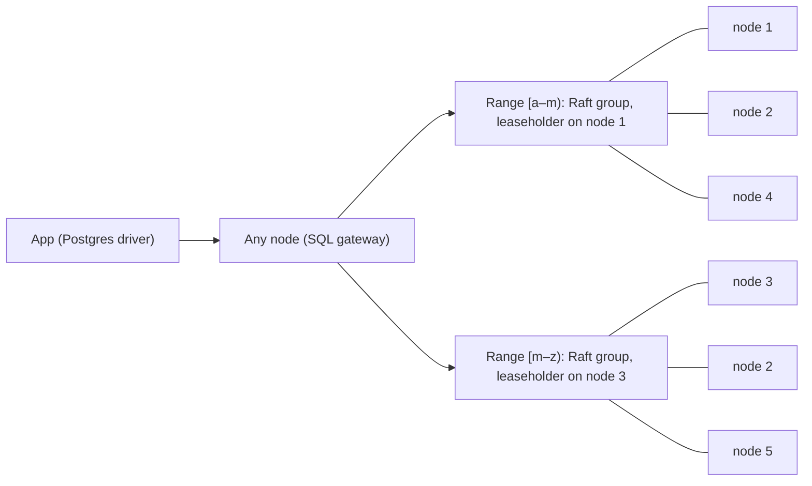

- Every node can accept SQL. A **leaseholder** per range serves reads and coordinates writes, and Raft replicates them.
- Ranges split and rebalance automatically as data grows.
- **Serializable** isolation by default (Read Committed also available in newer versions), with transaction retries on contention (error `40001`).
- Multi-region features: `REGIONAL BY ROW` tables (each row homed in a region), `GLOBAL` tables (fast reads everywhere), and survival goals (zone or region failure).

#### Example
A fintech needs Postgres semantics but must survive a full AWS region loss: a CockroachDB cluster across `ap-south-1`, `ap-southeast-1` and `ap-northeast-1` with `SURVIVE REGION FAILURE`. User rows are `REGIONAL BY ROW` homed by user region (low-latency local reads and writes). Reference data (currencies, fees) is `GLOBAL`. Losing Mumbai entirely keeps the database available with no data loss.

#### Trade-offs
Horizontal scale, automatic rebalancing and strong consistency with Postgres compatibility. But per-transaction latency is higher than single-node Postgres (consensus round trips), and compatibility isn't complete (some extensions or features are missing). Contention leads to retries.

#### Problems & fixes
| Symptom | Cause | Fix |
|---|---|---|
| Frequent `40001` retry errors | serializable contention | client-side retry loops, smaller transactions, `SELECT FOR UPDATE` |
| Hotspot range | sequential primary keys (SERIAL) | UUIDs or hash-sharded indexes |
| Slow cross-region transactions | rows homed far away | REGIONAL BY ROW homing, follower reads for stale-OK queries |
| Feature missing vs Postgres | partial compatibility | check docs, adapt (e.g. no some extensions) |

#### Cheat sheet
- Postgres-wire distributed SQL. Ranges with Raft (RF 3+), leaseholders.
- Serializable by default. Implement retry loops.
- Multi-region: REGIONAL BY ROW, GLOBAL tables, survival goals.

#### Interview questions

When would you choose CockroachDB over sharded PostgreSQL?

When you need horizontal scale and multi-region resilience with strong consistency and cross-shard ACID transactions, without building sharding logic yourself, and you can accept higher per-transaction latency and some Postgres feature gaps. Sharded Postgres (Citus or app-level) gives lower latency and full Postgres features, but cross-shard transactions, rebalancing and failover become your job.

Why does CockroachDB tell clients to retry transactions?

It runs serializable isolation optimistically. When concurrent transactions conflict, or a read encounters a value within the clock-uncertainty window, one transaction must restart to preserve serializability, and the error (40001) is sent to the client. Applications wrap transactions in retry loops (the drivers and ORMs provide helpers).

#### Interview angle
> "If we need Postgres semantics with region-failure survival, I'd use CockroachDB, homing rows to regions with REGIONAL BY ROW and wrapping transactions in retry loops."

#### Sources
- [Architecture overview](https://www.cockroachlabs.com/docs/stable/architecture/overview) — CockroachDB docs
- [Transaction retry error reference](https://www.cockroachlabs.com/docs/stable/transaction-retry-error-reference) — CockroachDB docs

### TiDB — MySQL-compatible, separates compute (TiDB) from storage (TiKV with Raft)
TiDB is an open-source distributed SQL database compatible with the **MySQL protocol**. It separates stateless **SQL compute nodes** (TiDB) from distributed transactional **storage** (TiKV, a Raft-replicated key-value store on RocksDB), plus a **Placement Driver (PD)** for metadata and timestamps. It optionally adds **TiFlash** columnar replicas for analytics (HTAP).

#### Intuition
A restaurant with separate front and back of house. Waiters (the SQL layer) take orders and can be added or removed freely. The kitchen (the storage layer) keeps the food, in triplicate. A manager hands out numbered tickets so every order has a clear sequence.

#### Must know
- Distributed SQL that speaks the **MySQL protocol**.
- Three parts: **TiDB** (stateless SQL nodes), **TiKV** (Raft-replicated key-value storage), **PD** (metadata and timestamps).
- Compute and storage scale independently.
- Timestamps come from PD's **central timestamp oracle**, so no special clocks, but one extra round trip per transaction.
- **TiFlash** adds columnar replicas for analytics on the same live data (HTAP).

#### Common mistakes
- `AUTO_INCREMENT` keys, which create a write hotspot. Use `AUTO_RANDOM`.
- Running heavy analytics on the row store when TiFlash exists.
- Forgetting the timestamp oracle when asked about cross-region latency.

#### How it works
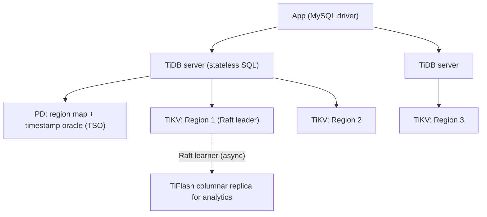

- Data is split into **Regions** (256 MB by default in recent versions, 96 MB in older ones), each a Raft group (3 replicas).
- Transactions use a **Percolator**-style 2PC with timestamps from PD's **TSO** (a central timestamp oracle).
- Scale SQL and storage independently. Add TiFlash for real-time analytics on the same data without ETL.

#### Example
An Indian e-commerce company outgrows sharded MySQL (manual shard routing, painful resharding). Migrating to TiDB keeps the MySQL protocol and most SQL. Data auto-splits across TiKV nodes, and TiFlash serves the merchant analytics dashboards (aggregations over billions of rows) on fresh data without affecting OLTP queries.

#### Trade-offs
MySQL compatibility, horizontal scale and HTAP, but the central TSO adds a dependency (highly available but a cross-zone round trip per transaction), latency is higher than single-node MySQL, and it's another complex system to operate (or pay for TiDB Cloud).

#### Problems & fixes
| Symptom | Cause | Fix |
|---|---|---|
| Write hotspot | AUTO_INCREMENT / sequential keys | `AUTO_RANDOM`, `SHARD_ROW_ID_BITS` |
| Analytics hurting OLTP | heavy scans on TiKV | TiFlash replicas, route analytics there |
| Large transaction failures | transaction size limits / memory | batch DML, use `BATCH` statements |

#### Cheat sheet
- MySQL-compatible distributed SQL: TiDB (SQL) + TiKV (Raft KV) + PD (metadata, TSO).
- Percolator-style 2PC with a central timestamp oracle.
- TiFlash = columnar replica for HTAP. Use AUTO_RANDOM against hotspots.

#### Interview questions

How does TiDB generate transaction timestamps, and what's the trade-off versus Spanner?

TiDB gets start and commit timestamps from PD's centralised timestamp oracle (TSO), a highly available Raft-backed service that hands out monotonically increasing timestamps (batched). It needs no special clocks, unlike Spanner's TrueTime, but every transaction needs a round trip to PD, which adds latency and makes cross-region deployments slower.

What is HTAP and how does TiDB implement it?

Hybrid Transactional/Analytical Processing: running OLTP and OLAP on the same fresh data. TiDB keeps row-based TiKV replicas for transactions and asynchronously replicated columnar TiFlash replicas (Raft learners) for analytics. The optimizer can route analytical queries to TiFlash, so dashboards query live data without ETL or hurting OLTP latency.

#### Interview angle
> "To escape manually sharded MySQL, TiDB keeps the MySQL protocol while splitting data into Raft regions automatically, and TiFlash replicas give real-time analytics without ETL."

#### Sources
- [TiDB architecture](https://docs.pingcap.com/tidb/stable/tidb-architecture/) — PingCAP docs
- [TiDB storage](https://docs.pingcap.com/tidb/stable/tidb-storage/) — PingCAP docs

### YugabyteDB — PostgreSQL-compatible distributed SQL, uses DocDB storage engine
YugabyteDB is a distributed SQL database that **reuses PostgreSQL's query layer** (YSQL), for high compatibility (many extensions, stored procedures, triggers), on top of **DocDB**, a distributed document store derived from RocksDB with Raft replication per tablet. It also offers a Cassandra-compatible API (YCQL).

#### Intuition
The familiar PostgreSQL front desk, kept almost unchanged, placed on top of a new warehouse that splits and copies the stock across many buildings.

#### Must know
- It **reuses PostgreSQL's own query layer**, so compatibility with procedures, triggers and extensions is high.
- Storage is **DocDB**: tables are split into tablets, each a Raft group.
- A table is sharded by **hash** (the default) or by **range**.
- Small tables can be **colocated** in one tablet to avoid thousands of tiny Raft groups.
- It also offers a Cassandra-compatible API.

#### Common mistakes
- Expecting single-node PostgreSQL latency. Every write is a consensus round.
- Range scans on a hash-sharded table.
- Hundreds of small tables with no colocation.

#### How it works
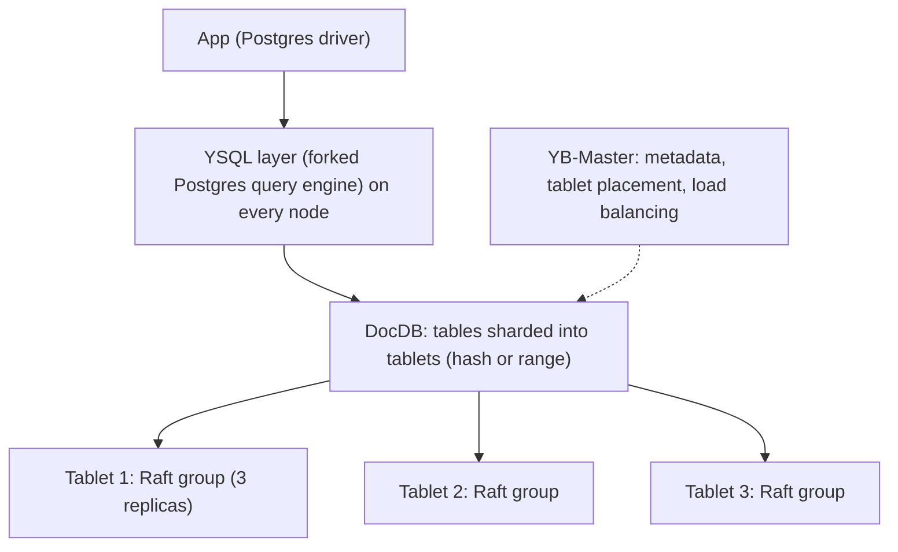

- Tables shard automatically into tablets by **hash** (default) or **range** of the primary key.
- Raft per tablet. Hybrid logical clocks for distributed transactions (snapshot and serializable isolation, plus read committed).
- Geo features: tablespaces pinned to regions, read replicas, xCluster async replication between clusters.

#### Example
A bank modernising a monolithic Oracle/Postgres app wants horizontal scale without rewriting SQL-heavy code (stored procedures, triggers, partial indexes). YugabyteDB's Postgres-derived query layer runs most of it unchanged, while tablets spread across 3 AZs give zone-failure tolerance and online scaling.

#### Trade-offs
The highest Postgres feature compatibility among distributed SQL options, but performance characteristics differ from single-node Postgres (distributed joins, per-row network hops), and tuning (colocation, tablet splitting) is needed.

#### Problems & fixes
| Symptom | Cause | Fix |
|---|---|---|
| Many small tables cause too many tablets | each table split into tablets | colocated tables (small tables share a tablet) |
| Range queries slow on hash-sharded table | hash sharding scatters ranges | range sharding for that table/index |
| Latency higher than old Postgres | distributed reads/writes | colocate related data, follower reads, batch |

#### Cheat sheet
- Postgres-compatible query layer (YSQL) on DocDB (RocksDB + Raft tablets).
- Hash or range sharding per table. Colocation for small tables.
- Strong Postgres compatibility (extensions, triggers, procedures).

#### Interview questions

CockroachDB vs YugabyteDB: how do they differ for a Postgres shop?

Both are Raft-based distributed SQL with Postgres wire compatibility. YugabyteDB reuses the actual Postgres query layer, so feature compatibility (extensions, stored procedures, triggers) is higher. CockroachDB reimplemented SQL in Go with its own optimizer, a strong multi-region feature set and serializable-first semantics. Pick based on which features your app relies on and on operational preferences.

Why does YugabyteDB offer colocated tables?

Each table is normally split into multiple tablets, each its own Raft group. A schema with hundreds of small tables would create thousands of tablets, wasting resources and adding overhead. Colocation stores many small tables in one tablet, while large tables still shard across the cluster.

#### Interview angle
> "To scale a Postgres app with lots of stored procedures and extensions, YugabyteDB keeps the real Postgres query layer over Raft-replicated tablets, so far less code needs rewriting."

#### Sources
- [Architecture](https://docs.yugabyte.com/preview/architecture/) — YugabyteDB docs
- [DocDB sharding](https://docs.yugabyte.com/preview/architecture/docdb-sharding/) — YugabyteDB docs

### Aurora — MySQL/Postgres-compatible, shared distributed storage (6-way replication across 3 AZs)
Amazon Aurora keeps the familiar MySQL/PostgreSQL engines but replaces their storage with a **distributed, log-structured storage service**: data is stored in 10 GB segments, **6 copies across 3 AZs**, and the database ships only **redo log records** to storage. That gives fast, durable commits, quick failover and up to 15 low-lag replicas sharing the same storage.

#### Intuition
An ordinary MySQL or PostgreSQL engine whose hard disk has been replaced by a storage service that keeps six copies in three buildings. The engine only sends the small "what changed" notes, and the storage service rebuilds the pages itself.

#### Must know
- MySQL- or PostgreSQL-compatible engine on a **shared, distributed storage layer**.
- **Six copies across three AZs.** A write needs 4 of 6, a read needs 3 of 6.
- The writer ships only **redo log records**. Storage nodes build the pages.
- Up to 15 readers share the same storage, so replica lag is very low.
- A standard cluster still has **one writer**. Write scaling is vertical.

#### Numbers to quote
- Replica lag is typically under 100 ms. Failover takes around 30 seconds.
- Storage grows automatically, up to 256 TiB on current engine versions.

#### Common mistakes
- Claiming Aurora scales writes horizontally.
- Forgetting that I/O is billed and can dominate the cost.
- Clients caching the old writer's address after a failover.

#### How it works
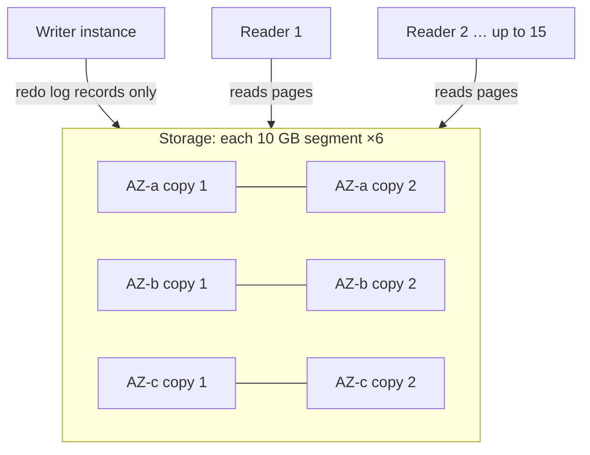

- **Write quorum 4/6, read quorum 3/6**: survives losing an entire AZ plus one more copy without data loss, and keeps writing after losing an AZ.
- Storage nodes apply redo to pages themselves ("the log is the database"), so there are no full-page writes from the instance.
- Readers share the storage, so replica lag is typically well under 100 ms, and failover promotes a reader in ~30 s or less.
- Extras: Aurora Serverless v2 (autoscaling capacity), Global Database (cross-region storage replication < 1 s lag, fast regional failover), fast cloning (copy-on-write), backtrack (MySQL).

#### Example
An Indian fintech on RDS PostgreSQL struggles with replica lag during batch jobs and slow failovers. Moving to Aurora PostgreSQL: 3 readers at single-digit ms lag behind a reader endpoint, ~30 s automated failover, storage durable across 3 AZs, and Aurora Global Database to a DR region with an RPO around 1 s. Fast clones give the QA team production-sized copies in minutes.

#### Trade-offs
Managed durability, low-lag replicas and fast recovery, but still a **single writer** (write scaling is vertical), I/O-based pricing can surprise (Aurora I/O-Optimized helps), and it's AWS-only.

#### Problems & fixes
| Symptom | Cause | Fix |
|---|---|---|
| Write throughput ceiling | single writer instance | bigger instance, shard by domain, or distributed SQL |
| High bill from I/O | I/O-heavy workload on standard pricing | Aurora I/O-Optimized, reduce I/O (indexes, caching) |
| Clients stuck on old writer after failover | cached DNS / connections | cluster endpoint with short TTL, RDS Proxy, driver failover support |
| Reader overload | uneven routing | reader endpoint / custom endpoints, auto scaling replicas |

#### Cheat sheet
- Compute/storage separation: redo log shipped to 6 copies across 3 AZs (4/6 write, 3/6 read quorum).
- Up to 15 low-lag readers. ~30 s failover. Global Database for DR.
- Still a single writer.

#### Interview questions

How does Aurora achieve durability across AZs without the latency of full synchronous replication of pages?

The writer sends only small redo log records (not full pages) to six storage nodes across three AZs in parallel, and commits once 4 of 6 acknowledge. Storage nodes materialise pages from the log asynchronously. Network traffic per write is much smaller than shipping pages, and the quorum tolerates an AZ failure with no data loss.

Does Aurora solve write scaling?

Not a standard Aurora cluster. It has a single writer instance (Aurora multi-master for MySQL was deprecated). It scales reads via up to 15 replicas and storage automatically to 256 TiB on current engine versions (128 TiB on older ones). Write scaling still means a bigger instance, splitting by domain, or sharding. AWS's own answers are separate products: Aurora PostgreSQL Limitless Database (managed sharding) and Aurora DSQL (distributed SQL).

#### Interview angle
> "On AWS I'd default to Aurora: quorum storage across three AZs, readers with single-digit-millisecond lag, about 30-second failover and a Global Database for DR. Write scaling is still single-writer, so plan around that."

#### Sources
- [Amazon Aurora storage](https://docs.aws.amazon.com/AmazonRDS/latest/AuroraUserGuide/Aurora.Overview.StorageReliability.html) — Amazon Aurora user guide
- [Amazon Aurora: design considerations for high throughput cloud-native relational databases](https://www.amazon.science/publications/amazon-aurora-design-considerations-for-high-throughput-cloud-native-relational-databases) — Verbitski et al., SIGMOD 2017

### Columnar storage — Parquet, ORC, Apache Arrow — for analytics, 10–100× faster than row stores
Columnar storage stores **each column's values together** instead of each row's values together. Analytical queries read a few columns across millions of rows, so a columnar layout reads only the needed columns, compresses extremely well (similar values sit together) and enables vectorised CPU processing.

#### Intuition
A class marksheet stored subject by subject instead of student by student. To find the average maths score you read one strip of numbers, not every student's whole row.

#### Must know
- Values of **each column are stored together**, not each row together.
- An analytical query reads only the columns it needs, so far fewer bytes.
- Similar values side by side **compress very well** (dictionary, run-length).
- Min/max statistics per block let the engine skip blocks that cannot match.
- Bad at single-row inserts and updates. OLTP stays in row stores and feeds a columnar store.

#### Numbers to quote
- Compression of 5–10× is typical.
- Aim for Parquet files of roughly 128 MB to 1 GB. Many tiny files are slow.

#### Common mistakes
- Running analytics on the production row store.
- `SELECT *` on a columnar table, which throws the benefit away.
- Unpartitioned, unsorted data, so nothing can be skipped.

#### How it works
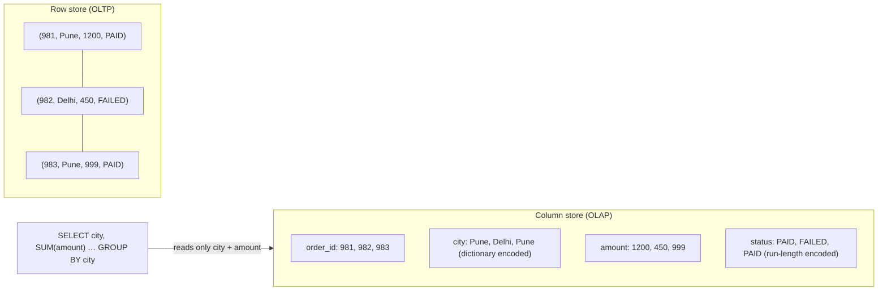

| Format / engine | Role |
|---|---|
| **Parquet** | open columnar file format (row groups → column chunks → pages, with min/max stats) for data lakes (S3) |
| **ORC** | columnar format from the Hive ecosystem, similar ideas |
| **Apache Arrow** | in-memory columnar format for zero-copy exchange between engines (Pandas, Spark, DuckDB) |
| Warehouses | BigQuery, Snowflake, Redshift, ClickHouse, Druid, DuckDB use columnar storage internally |

#### Example
Orders table: 2 billion rows × 40 columns ≈ 2 TB row-oriented. "Revenue per city last quarter" touches 3 columns. A row store reads all 2 TB. Parquet reads only those columns (~150 GB raw, ~20 GB compressed), and min/max statistics skip row groups outside the quarter. The query takes 15 seconds in Athena/Trino instead of hours, and costs much less.

#### Trade-offs
| Columnar | Row |
|---|---|
| fast scans and aggregations over few columns | fast point lookups/updates of whole rows |
| 5–10× compression | less compression |
| slow single-row inserts/updates (batch loads) | efficient transactional writes |

Hence OLTP in row stores (Postgres/MySQL) feeding OLAP in columnar warehouses via CDC/ETL.

#### Problems & fixes
| Symptom | Cause | Fix |
|---|---|---|
| Slow queries on data lake | many tiny Parquet files | compaction into ~128 MB–1 GB files |
| Full scans despite filters | no partitioning / unsorted data, so stats can't prune | partition by date, sort/cluster by common filters |
| Poor compression | high-cardinality unsorted columns | sort by low-cardinality columns first |
| Analytics hurting production DB | OLAP queries on row-store OLTP | replicate to a warehouse / columnar store |

#### Cheat sheet
- Store columns together: read fewer bytes, compress more, vectorise.
- Parquet/ORC on disk, Arrow in memory. Warehouses are columnar.
- Partition + sort for pruning. Avoid tiny files.

#### Interview questions

Why are analytical queries much faster on columnar storage?

They read only the referenced columns rather than whole rows, so I/O drops by the fraction of columns used. Values in a column share a type and are often repetitive, so they compress very well (dictionary, run-length, delta encoding), meaning even fewer bytes are read. Engines process column batches with SIMD (vectorised execution), and min/max statistics per block let them skip irrelevant data entirely.

Design analytics for an e-commerce company whose dashboards are slowing down the production Postgres.

Stream changes from Postgres via CDC (Debezium → Kafka) into a columnar store: Parquet on S3 queried by Athena/Trino (or Iceberg tables), or a warehouse like BigQuery/Snowflake/Redshift, or ClickHouse for real-time dashboards. Partition by date, sort by common filters, and precompute heavy aggregates. Production Postgres serves only OLTP.

#### Interview angle
> "Analytics never runs on the OLTP database. CDC streams changes into partitioned, sorted Parquet or a columnar warehouse, where a dashboard query reads three columns instead of whole rows."

#### Sources
- [Apache Parquet documentation](https://parquet.apache.org/docs/) — Apache Parquet
- [Apache Arrow: overview](https://arrow.apache.org/overview/) — Apache Arrow
- [Column-oriented DBMS](https://en.wikipedia.org/wiki/Column-oriented_DBMS) — Wikipedia

### Column-oriented query execution — predicate pushdown, vectorized processing, compression
Columnar engines aren't fast only because of storage layout. Their **execution** is designed around it: **push filters down** to skip data before reading, **process batches of values with SIMD** instead of row by row, and **operate directly on compressed data** where possible.

#### Intuition
Looking for one receipt in a warehouse of boxes. First skip every box labelled with the wrong month, then open only the right folder in each remaining box, and check receipts a handful at a time and not one by one.

#### Must know
- **Predicate pushdown**: apply filters at the storage layer, so non-matching partitions and blocks are never read.
- **Projection pushdown**: read only the columns the query mentions.
- **Vectorised execution**: operate on batches of values in tight loops with SIMD.
- Engines can compare dictionary codes without decompressing strings.
- It only works if partition and sort keys **match the common filters**.

#### Common mistakes
- Filtering on a column the data is not partitioned or sorted by, then blaming the engine.
- Wrapping the filter column in a function, which defeats pruning.
- Thinking columnar speed comes only from the file layout.

#### How it works
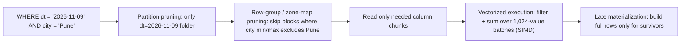

Techniques:
- **Predicate pushdown**: filters evaluated at the storage or file layer (Parquet stats, ORC indexes, bloom filters) so non-matching blocks are never read.
- **Projection pushdown**: read only referenced columns.
- **Vectorised processing**: operators work on arrays of values (cache-friendly, SIMD), as in ClickHouse, DuckDB, Velox, Photon.
- **Operating on compressed data**: e.g. comparing dictionary codes instead of strings, summing run-length runs.
- **Late materialisation**: carry row positions, and assemble other columns only for rows that survive filters.

#### Example
ClickHouse table `events` ordered by `(event_date, user_id)`. "Daily active users for the last 7 days" prunes to 7 days of parts via the primary index (sparse index on the sort key), reads only `event_date` and `user_id`, and computes `uniq(user_id)` with vectorised HLL. It scans billions of rows per second on a few servers.

#### Trade-offs
Massive scan throughput for analytics, but point lookups and frequent updates are inefficient, and data layout (sort keys, partitioning) must match query patterns or pruning won't help.

#### Problems & fixes
| Symptom | Cause | Fix |
|---|---|---|
| Query scans everything despite WHERE | filter on non-sort/partition column, functions on columns | align sort/partition keys with filters, keep predicates simple |
| Poor performance with `SELECT *` | projection pushdown defeated | select needed columns |
| Slow joins on huge tables | big shuffles | pre-join/denormalise, broadcast small tables |

#### Cheat sheet
- Prune early: partitions → row groups (min/max, bloom) → columns.
- Vectorised batches + SIMD. Work on compressed data. Late materialisation.
- Sort and partition keys must match common filters.

#### Interview questions

What is predicate pushdown and why does it matter in a data lake?

Pushing filter conditions down to the storage layer, so the engine uses partition folders, file and row-group statistics (min/max, bloom filters) to skip data that can't match before reading or decompressing it. In data lakes, where I/O from S3 dominates cost and latency, this can cut bytes scanned by orders of magnitude.

Why is vectorised execution faster than row-at-a-time execution?

Row-at-a-time (Volcano model) calls virtual functions per row per operator, which costs heavy interpretation overhead and poor CPU cache use. Vectorised engines process batches of a column in tight loops: fewer function calls, values contiguous in cache, and SIMD instructions handle several values per instruction, often a 5–10× speedup.

#### Interview angle
> "I lay analytical tables out so filters prune early: partition by date, sort by the common filters, and select few columns. The engine then scans only surviving blocks in vectorised batches."

#### Sources
- [Why is ClickHouse so fast?](https://clickhouse.com/docs/concepts/why-clickhouse-is-so-fast) — ClickHouse docs
- [MonetDB/X100: hyper-pipelining query execution](https://www.cidrdb.org/cidr2005/papers/P19.pdf) — Boncz, Zukowski and Nes, CIDR 2005

### B-tree vs LSM-tree — B-tree: read-optimized (database indexes); LSM: write-optimized (Cassandra, RocksDB)
The two dominant storage engine designs. **B-trees** update fixed-size pages **in place** (PostgreSQL, MySQL InnoDB, Oracle), which is good for reads and predictable latency. **LSM-trees** buffer writes in memory and **append sorted immutable files**, merged by compaction (Cassandra, RocksDB, LevelDB, ScyllaDB, HBase), which is good for write-heavy workloads.

#### Intuition
A B-tree is a filing cabinet: every new paper goes straight into its exact folder, so finding it later is quick. An LSM-tree is an inbox tray: drop papers on top as they arrive and sort them into folders in bulk later, so filing is instant and finding takes more looking.

#### Must know
- **B-tree**: updates pages **in place**. Fast, predictable reads. PostgreSQL, MySQL InnoDB.
- **LSM-tree**: buffer in memory, **append** immutable sorted files, merge them later. Very fast writes. Cassandra, RocksDB, HBase.
- B-tree for read-heavy OLTP. LSM for ingest-heavy workloads.
- LSM reads check several files, with bloom filters to skip most.
- Three costs trade off: read, write and space amplification. You cannot minimise all three.

#### Common mistakes
- Saying LSM is simply "faster". It is faster at writes and pays on reads and compaction.
- Forgetting that B-trees also have write amplification (a whole page for a small change).
- Not knowing which engine a given database uses.

#### How it works
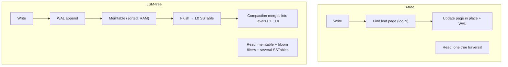

| | B-tree | LSM-tree |
|---|---|---|
| Write pattern | random in-place page writes | sequential appends + background compaction |
| Write throughput | moderate | high |
| Read latency | low, predictable (one path) | higher / variable (multiple levels), helped by bloom filters |
| Write amplification | page rewrites (whole page per small change) | compaction rewrites data multiple times |
| Space amplification | fragmentation (half-empty pages) | obsolete versions until compaction |
| Typical | OLTP relational databases | time series, logs, messaging, KV at scale |

#### Example
- An order database with many reads by key and range plus moderate writes → B-tree (Postgres/InnoDB).
- A metrics or event store ingesting 500k writes/s → LSM (Cassandra/ScyllaDB/RocksDB-based stores), or a TSDB.
- Many modern systems embed RocksDB (an LSM): Kafka Streams state stores, CockroachDB (Pebble), TiKV, MyRocks (an LSM engine for MySQL, used by Facebook to save storage).

#### Trade-offs
B-trees favour read latency and update-in-place semantics. LSMs favour write throughput and compression. Both depend heavily on caching and workload.

#### Problems & fixes
| Symptom | Cause | Fix |
|---|---|---|
| B-tree insert throughput drops (random keys) | page splits, random I/O | sequential keys, fillfactor |
| LSM read latency spikes | compaction backlog, many levels | tune compaction, bloom filters, more IOPS |
| LSM disk usage spikes | space amplification during compaction | headroom, leveled compaction |
| SSD wear | write amplification | engine/compaction tuning, appropriate design choice |

#### Cheat sheet
- B-tree: in-place pages, fast predictable reads (OLTP).
- LSM: memtable + immutable SSTables + compaction, fast writes (ingest-heavy).
- Amplification triangle: read vs write vs space. You can't minimise all three.

#### Interview questions

Your service ingests 300k events/s and reads are mostly by key for recent data. B-tree or LSM, and why?

LSM. Writes become sequential appends and memtable inserts, with no random page updates, which sustains very high ingest on commodity disks. Reads of recent data often hit the memtable or recent SSTables, and bloom filters avoid unnecessary disk reads. Choose a compaction strategy suited to time-ordered data (e.g. TWCS). A B-tree would bottleneck on random page writes and index maintenance.

What are read, write and space amplification, and how do B-trees and LSMs trade them?

Read amplification is how many disk reads per logical read. Write amplification is how many bytes are written to disk per byte of user data. Space amplification is disk used relative to live data. B-trees have low read amplification but write whole pages per small change and fragment space. LSMs have low write cost per insert but rewrite data during compaction (write amplification), read multiple levels (read amplification) and keep stale versions until compaction (space amplification). Compaction strategies move the balance between them.

#### Interview angle
> "B-trees for read-heavy OLTP, LSM engines for ingest-heavy workloads. I can explain the read, write and space amplification trade-offs and tune compaction to match."

#### Sources
- [Log-structured merge-tree](https://en.wikipedia.org/wiki/Log-structured_merge-tree) — Wikipedia
- [RocksDB overview](https://github.com/facebook/rocksdb/wiki/RocksDB-Overview) — RocksDB wiki
- [B-tree](https://en.wikipedia.org/wiki/B-tree) — Wikipedia

### Write amplification in LSM trees — compaction rewrites data multiple times
Write amplification (WA) is the ratio of **bytes physically written to disk** to **bytes written by the application**. In LSM trees, every piece of data is written to the WAL, flushed to an SSTable, then **rewritten repeatedly** as compaction merges it into lower levels, so WA of 10–30× is common with leveled compaction.

#### Intuition
Tidying a bookshelf by repeatedly merging small piles into bigger ones. Each book gets picked up and put down again every time its pile is merged, so you handle it many more times than you bought it.

#### Must know
- Write amplification = bytes written to disk ÷ bytes the application wrote.
- In an LSM, data is written to the log, flushed, then **rewritten at every compaction level**.
- **Leveled** compaction: high write amplification, but good reads and space use.
- **Tiered** compaction: lower write amplification, worse reads and space use.
- It consumes disk bandwidth and wears out SSDs.

#### Numbers to quote
- Leveled compaction commonly reaches 10–30×.

#### Common mistakes
- Ignoring compaction when sizing disks for a write-heavy store.
- Leveled compaction on an ingest-heavy workload.
- Large values stored inside the LSM, so every compaction rewrites them.

#### How it works
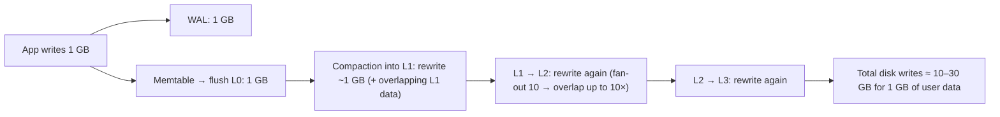

- **Leveled compaction**: low space and read amplification, high WA (each level merge can rewrite ~fan-out × data).
- **Tiered / size-tiered**: lower WA (data rewritten fewer times), higher read and space amplification.
- WA consumes disk bandwidth (competing with foreground I/O) and wears out SSDs (limited write endurance).

#### Example
A RocksDB-backed service writes 50 MB/s of user data. With leveled compaction WA ≈ 20, so the disk sustains ~1 GB/s of writes. It saturates during peaks (write stalls) and wears SSDs within months. Switching to **universal (tiered) compaction** cut WA to ~6, with slightly higher read latency, which was acceptable for that workload. Alternatives: bigger memtables, larger L1, key-value separation (WiscKey/BlobDB stores large values outside the LSM so compaction moves only keys).

#### Trade-offs
Lower WA means more read and space amplification. The right setting depends on whether the workload is write-heavy, read-heavy or storage-constrained.

#### Problems & fixes
| Symptom | Cause | Fix |
|---|---|---|
| Write stalls ("compaction pending too large") | compaction can't keep up with WA × ingest | tiered compaction, more disk bandwidth, rate-limit ingest |
| SSDs wearing out fast | high WA | tiered compaction, blob separation for large values |
| Disk bandwidth saturated, read latency up | compaction I/O | compaction rate limiter, off-peak tuning |

#### Cheat sheet
- WA = disk bytes written ÷ user bytes written. Leveled ≈ 10–30×, tiered lower.
- Costs disk bandwidth and SSD life.
- Reduce with tiered compaction, bigger memtables/levels, value separation.

#### Interview questions

Why does leveled compaction have higher write amplification than size-tiered?

Leveled compaction keeps each level's SSTables non-overlapping, so moving data from level N to N+1 means merging it with all overlapping files in N+1 (about fan-out × as much data) and rewriting them. Data passes through every level, rewritten each time. Size-tiered merges similar-sized files only occasionally, rewriting each byte fewer times, at the cost of more overlapping files (read amplification) and temporary space.

How would you reduce write amplification for a key-value store holding large values (10 KB+)?

Separate values from keys (WiscKey / RocksDB BlobDB / Titan): keep keys and small pointers in the LSM, and store values in append-only blob files with their own garbage collection. Compaction then rewrites only small key entries. Also consider tiered compaction and larger memtables.

#### Interview angle
> "LSM engines pay for fast writes with compaction rewrites. I'd tune the compaction style and value separation to the workload so write amplification doesn't saturate disks or wear out SSDs."

#### Sources
- [Compaction](https://github.com/facebook/rocksdb/wiki/Compaction) — RocksDB wiki
- [WiscKey: separating keys from values in SSD-conscious storage](https://www.usenix.org/conference/fast16/technical-sessions/presentation/lu) — Lu et al., USENIX FAST 2016

### Read amplification mitigated — bloom filter per SSTable level avoids unnecessary disk seeks
In an LSM tree a key may live in the memtable or in any of several SSTables, so a naive read checks many files: **read amplification**. Engines cut it with **bloom filters** (skip files that definitely don't have the key), **sparse indexes and block caches**, **fence pointers**, and compaction that keeps levels non-overlapping.

#### Intuition
A bouncer with a guest list for each room. He can say for certain "that person is not in this room", so you skip it. Occasionally he says "maybe" and you look inside for nothing. He never tells you someone is absent when they are in there.

#### Must know
- In an LSM a key could be in the memtable or any SSTable, so a naive read checks many files.
- A **bloom filter** per SSTable answers "definitely not here" or "maybe here".
- **No false negatives**, only a small rate of false positives.
- Most files are skipped without touching disk, so a point lookup costs about one block read.
- Bloom filters do **not** help range scans.

#### Numbers to quote
- About 10 bits per key gives roughly a 1% false-positive rate.

#### Common mistakes
- Saying a bloom filter can tell you a key is present. It can only rule it out.
- Expecting it to speed up range queries.
- Forgetting the memory cost with billions of keys.

#### How it works
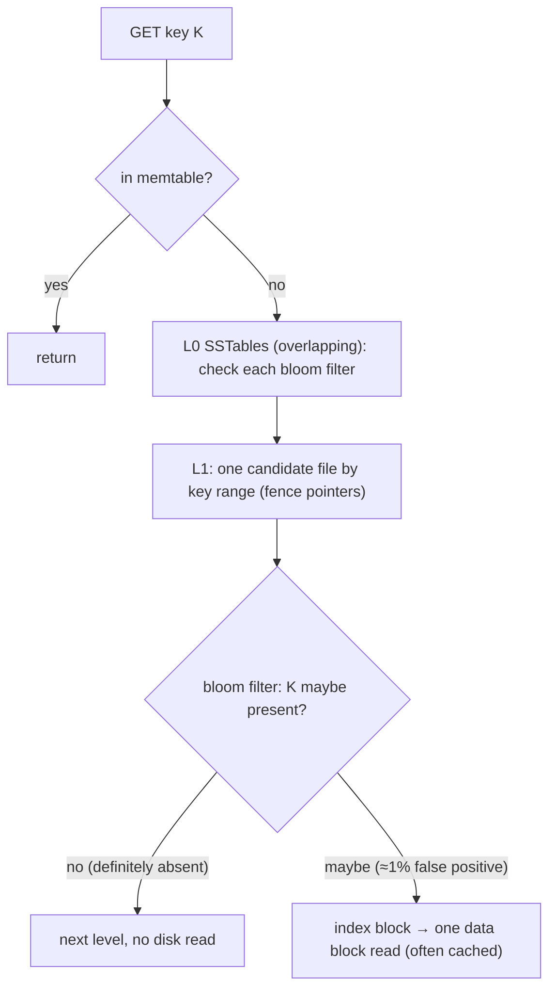

- **Bloom filter**: a bit array plus k hashes. "Not present" is certain, "present" might be a false positive. ~10 bits per key gives a ~1% false-positive rate.
- **Partitioned/ribbon filters** and **prefix bloom filters** (for prefix scans) are refinements.
- **Block cache** keeps hot data and index blocks in memory. **Leveled compaction** ensures ≤ 1 candidate file per level (except L0).

#### Example
A user-profile store with 7 LSM levels: without bloom filters a miss checks ~7+ files on disk. With 10-bit-per-key filters in memory, a lookup for a non-existent key touches disk with probability ~7 × 1% ≈ 7%. Existing keys need ~1 data block read, usually from cache. That's why Cassandra, HBase and RocksDB keep filters resident in memory (memory cost ≈ 1.25 bytes per key at 10 bits).

#### Trade-offs
Bloom filters cost memory (bits per key) and don't help range scans (which must merge all levels). Fewer levels and better compaction reduce read amplification at the cost of write amplification.

#### Problems & fixes
| Symptom | Cause | Fix |
|---|---|---|
| Point reads hit disk too often | bloom filters disabled/too small, low cache hit | ~10 bits/key, keep filters + index in block cache |
| Range scans slow | bloom filters don't help ranges | prefix bloom filters, better clustering, leveled compaction |
| Memory pressure from filters | billions of keys | partitioned filters, tune bits/key per level |

#### Cheat sheet
- Bloom filter per SSTable: certain "no", probable "yes". ~10 bits/key ≈ 1% false positives.
- Fence pointers + block cache = ~1 disk read per hit.
- Range scans still touch every level.

#### Interview questions

How do bloom filters reduce read latency in LSM-based databases?

Each SSTable has an in-memory bloom filter of its keys. Before reading a file, the engine checks the filter. If it says the key is absent (no false negatives), the file is skipped with no disk I/O. Only files whose filter says "maybe" are read, and with ~1% false positives most unnecessary reads are eliminated, so a point lookup usually costs one data-block read.

Why don't bloom filters help range queries?

A bloom filter answers membership for specific keys. It can't say whether any key within a range exists in a file. Range scans must open iterators on the memtable and on every overlapping SSTable and merge them. Prefix bloom filters help only when scans share a fixed key prefix.

#### Interview angle
> "LSM reads stay fast because each SSTable's bloom filter rules out files that can't hold the key. A point lookup usually costs one data block read, while range scans still pay to merge every level."

#### Sources
- [RocksDB bloom filter](https://github.com/facebook/rocksdb/wiki/RocksDB-Bloom-Filter) — RocksDB wiki
- [Bloom filter](https://en.wikipedia.org/wiki/Bloom_filter) — Wikipedia

