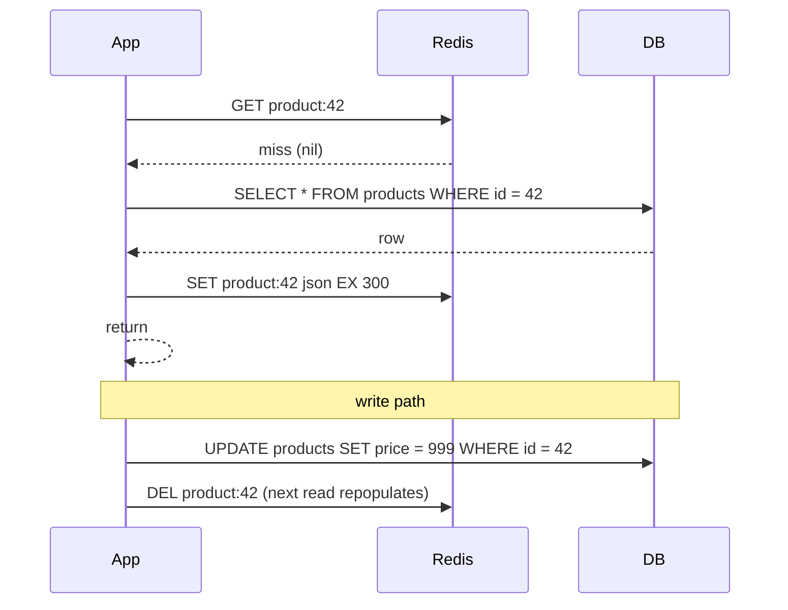
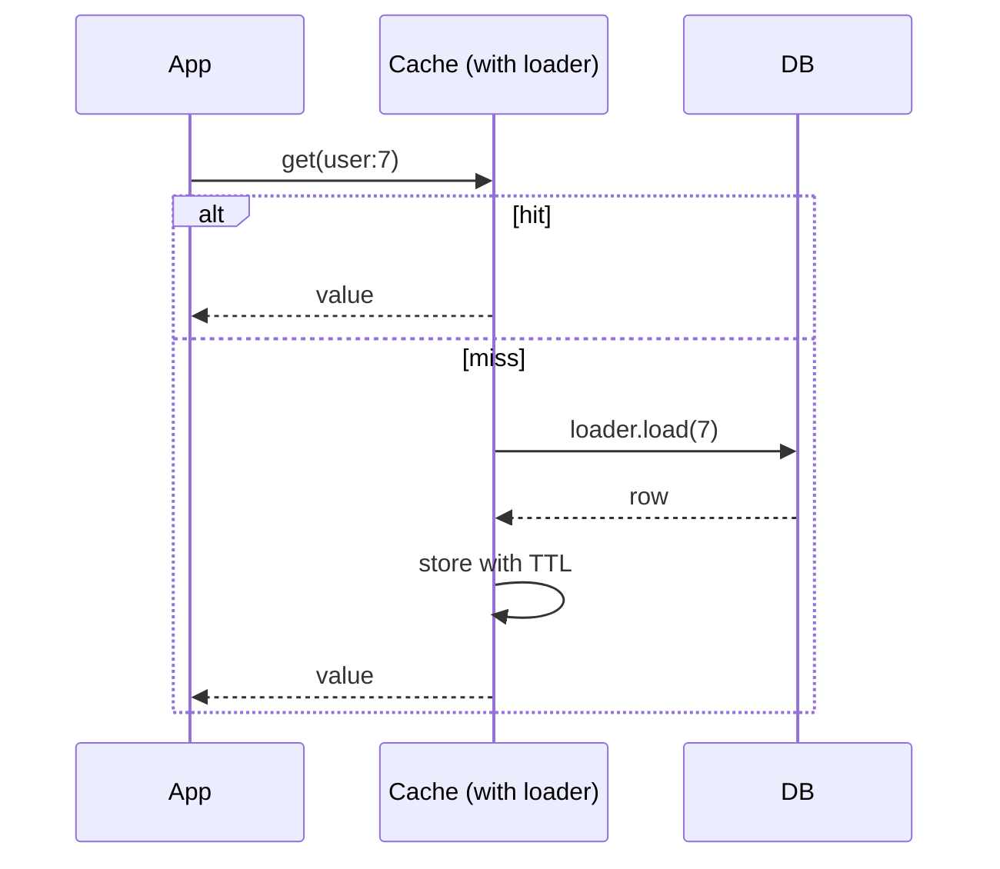
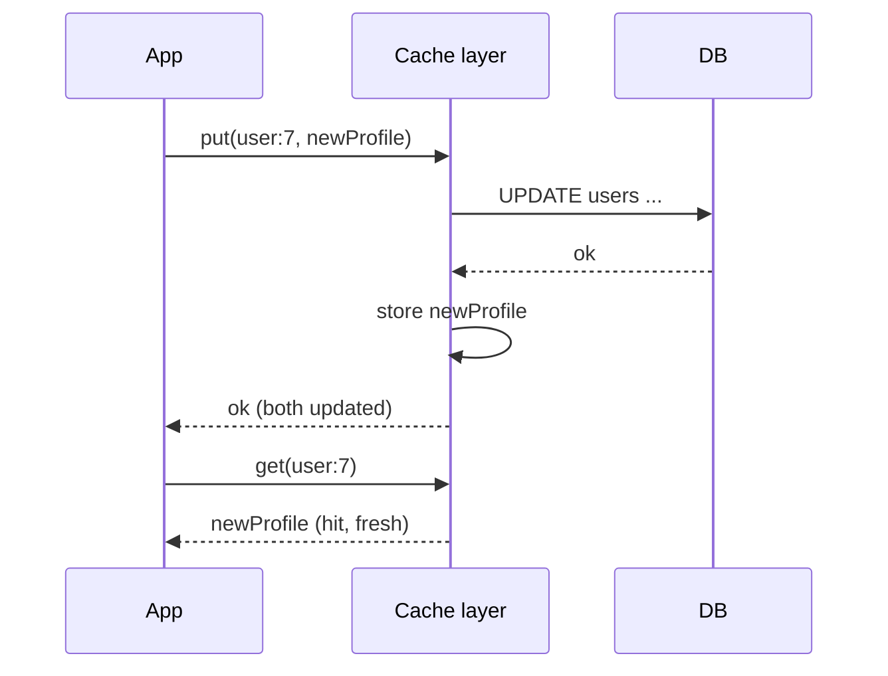
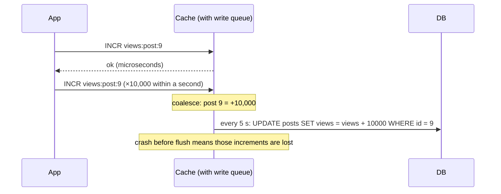
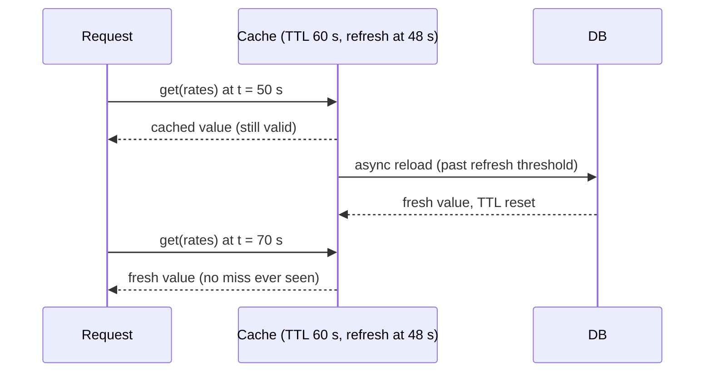
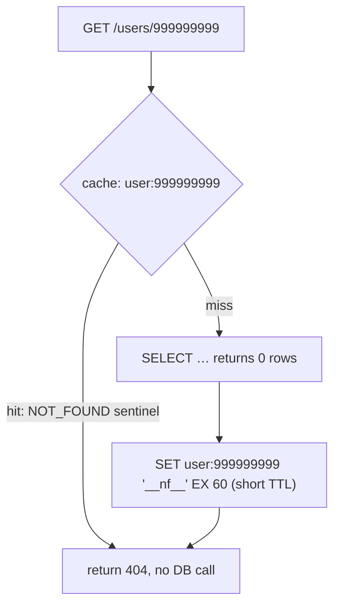
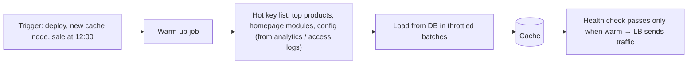
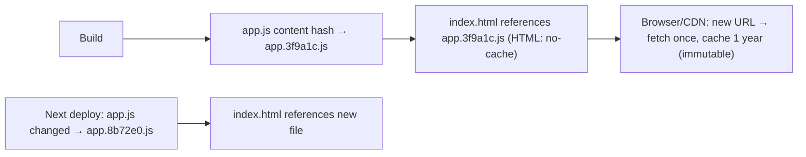

## Caching strategies

### Cache-aside (lazy loading) — app checks cache, fetches DB on miss, populates cache
Cache-aside is the most common caching pattern: the **application** owns the logic. It reads from the cache first. On a miss it reads the database, stores the result in the cache with a TTL, and returns it. On writes it updates the database and **deletes** (invalidates) the cache entry.

#### How it works


```java
Product get(long id) {
  String key = "product:" + id;
  Product p = cache.get(key);
  if (p != null) return p;
  p = repo.findById(id).orElseThrow();
  cache.set(key, p, Duration.ofMinutes(5).plusSeconds(rnd.nextInt(60)));  // TTL + jitter
  return p;
}
@Transactional void updatePrice(long id, BigDecimal price) {
  repo.updatePrice(id, price);
  afterCommit(() -> cache.delete("product:" + id));   // invalidate only after the DB commit
}
```

#### Example
A product-detail API at 30k req/s with a 97% hit rate: the database sees ~900 req/s instead of 30k. Only requested products are cached (memory-efficient), and if Redis goes down the app falls back to the database (degraded, not broken), provided the database can take the load or a circuit breaker limits it.

#### Trade-offs
| Pros | Cons |
|---|---|
| simple, only caches what's used | first request after expiry/invalidation is slow (miss) |
| cache failure ≠ outage (fallback to DB) | stale data possible (race between read-fill and invalidate) |
| works with any datastore | cache logic spread through app code |

**Why delete instead of update on write?** Updating the cache on write risks out-of-order updates leaving an old value. Deleting means the next read loads the fresh value.

#### Problems & fixes
| Symptom | Cause | Fix |
|---|---|---|
| Stale value persists after update | race: reader fetched old row, writer deleted cache, reader then SET the old value | short TTL, delete after commit, delayed double-delete, or versioned values |
| DB overwhelmed when a hot key expires | many concurrent misses (stampede) | single-flight lock, stale-while-revalidate, early refresh |
| Cache full of rarely used keys | no TTL | always TTL + eviction policy |
| Invalidation missed for some code paths | writes outside the service | CDC-based invalidation |

#### Cheat sheet
- Read: cache → miss → DB → SET with TTL. Write: DB → DEL cache (after commit).
- Always TTL (+ jitter). Delete, don't update, on writes.
- Protect against stampedes on hot keys.

#### Interview questions
<details><summary>Describe a race condition in cache-aside that leaves stale data, and how to mitigate it.</summary>

Reader A misses and reads the row (old value) from the DB. Writer B updates the DB and deletes the cache key. Reader A then writes the old value into the cache, which stays stale until TTL. Mitigations: short TTLs, delete after commit plus a delayed second delete (~500 ms later), store a version with the value and only SET if the version is newer (Lua compare), or invalidate via CDC events, which arrive after commit in order.
</details>

<details><summary>Why do most systems invalidate (delete) the cache on writes rather than updating it?</summary>

Concurrent writes can reach the cache in a different order than the DB commits, leaving an older value cached. Updating also means computing the cached representation on every write even if nobody reads it. Deleting is idempotent and order-insensitive: the next read loads whatever the DB currently holds.
</details>

#### Interview angle
> "I'd use cache-aside with Redis: read-through-on-miss with TTL and jitter, delete after DB commit on writes, and single-flight protection for hot keys. Redis failing degrades to DB reads behind a circuit breaker."

### Read-through — cache layer fetches from DB on miss transparently to application
In read-through caching the **cache itself** (or a caching library wrapping the data source) loads missing entries from the database. The application only talks to the cache, so loading logic lives in one place, configured as a **loader**.

#### How it works


```java
// Caffeine LoadingCache: the cache calls the loader on a miss; concurrent misses for a key share one load
LoadingCache<Long, User> users = Caffeine.newBuilder()
    .maximumSize(100_000)
    .expireAfterWrite(Duration.ofMinutes(10))
    .refreshAfterWrite(Duration.ofMinutes(5))     // async refresh keeps hot keys warm
    .build(id -> userRepo.findById(id).orElse(null));
User u = users.get(7L);
```
Spring's `@Cacheable` is read-through-style from the app's perspective. Products like NCache, Hazelcast/Ignite MapLoader and DAX (for DynamoDB) implement it at the cache layer.

#### Example
DynamoDB Accelerator (DAX) is a read-through/write-through cache in front of DynamoDB: the app uses the DAX client with the same API, and misses go to DynamoDB transparently, cutting read latency from ~5 ms to microseconds for hot items with no cache code in the app.

#### Trade-offs
Cleaner app code and built-in single-flight loading (many libraries dedupe concurrent loads), but the cache must know how to reach the data source, and it's less flexible than hand-written cache-aside (complex keys, multiple sources).

#### Problems & fixes
| Symptom | Cause | Fix |
|---|---|---|
| Stampede on miss | loader without per-key coalescing | libraries with single-flight (Caffeine, Guava), or a lock |
| Cache returns stale data after writes | read-through only handles reads | pair with write-through or explicit invalidation |
| Null results reloaded constantly | loader returns null, not cached | negative caching with short TTL |

#### Cheat sheet
- The app reads only from the cache, and the cache loads from the DB on a miss.
- Loader centralises fetch logic. Good libraries coalesce concurrent loads.
- Combine with write-through or invalidation for freshness.

#### Interview questions
<details><summary>Cache-aside vs read-through: what's the difference and when would you prefer read-through?</summary>

In cache-aside the application fetches from the DB on a miss and populates the cache. In read-through the cache (library or service) does that via a configured loader. Prefer read-through when many code paths read the same entities and you want consistent loading, single-flight deduplication and refresh policies in one place, typically with in-process caches like Caffeine or managed caches like DAX.
</details>

<details><summary>How does Caffeine's refreshAfterWrite differ from expireAfterWrite?</summary>

`expireAfterWrite` removes the entry after the duration, so the next read blocks on a reload. `refreshAfterWrite` keeps serving the existing value after the duration and triggers an asynchronous reload on the next access, so callers rarely see miss latency, though they may get a slightly stale value briefly.
</details>

#### Interview angle
> "For hot reference data I'd use a read-through Caffeine LoadingCache: one loader, deduplicated concurrent loads, and refreshAfterWrite so hot keys never block on a reload."

### Write-through — write to cache and DB synchronously; reads always hit cache
With write-through, every write goes **through the cache to the database synchronously**: the write completes only when both are updated. The cache always holds the latest data for written keys, so reads right after writes hit fresh cache entries.

#### How it works


Often implemented by the app as "write DB, then SET the cache (not DEL)", or by a cache product with a writer (Hazelcast MapStore, DAX writes, Ignite write-through).

#### Example
A user session/profile service: profile edits write through to Postgres and Redis together. Profile reads (very frequent) always hit Redis with fresh data. Combined with read-through for keys not yet cached, the cache stays warm for active users.

#### Trade-offs
| Pros | Cons |
|---|---|
| reads after writes are fresh and fast | every write pays both latencies |
| cache never stale for written keys (barring failures) | caches data that may never be read (write-heavy, read-rarely) |
| simple read path | partial failure: DB ok, cache SET failed (or vice versa) |

#### Problems & fixes
| Symptom | Cause | Fix |
|---|---|---|
| Cache and DB disagree after errors | non-atomic dual write | DB first, then cache. On cache failure delete key / short TTL. Reconcile with CDC |
| Out-of-order concurrent writes leave old value cached | two writers SET in different order than DB commit | version numbers + compare-and-set in cache, or invalidate instead |
| Cache bloated with cold written data | caching every write | TTL, or only write-through for hot entity types |

#### Cheat sheet
- Write = DB + cache synchronously, so cached reads are fresh.
- Higher write latency. Caches unread data.
- Still a dual write: handle partial failure and ordering.

#### Interview questions
<details><summary>When would you choose write-through over cache-aside?</summary>

When data is read frequently right after being written and stale reads are unacceptable, e.g. user profile or settings, or shopping cart contents, and the write rate is moderate. Write-through keeps the cache fresh for those keys. For write-heavy data that's rarely read, cache-aside with invalidation avoids caching useless values.
</details>

<details><summary>What happens in write-through if the DB write succeeds but the cache update fails?</summary>

The cache holds the old value, which is stale until TTL. Mitigate by deleting the key on failure (or retrying), using short TTLs, and having CDC-based invalidation as a safety net. Never write the cache first then the DB, because a DB failure would leave the cache holding data that was never committed.
</details>

#### Interview angle
> "Write-through suits read-after-write-heavy data like profiles: write the DB, then the cache, with versioned values and CDC invalidation as a safety net for partial failures."

### Write-behind (write-back) — write to cache only, async flush to DB later; risk of data loss
In write-behind, writes go to the cache and are **acknowledged immediately**. The cache flushes them to the database **asynchronously**, often batched and coalesced. Write latency is excellent and the DB sees far fewer writes, but if the cache loses data before flushing, those writes are gone.

#### How it works


#### Example
View counters for videos: incrementing a database row per view (100k views/s on a viral video) would crush the DB. Increment Redis counters, and a flusher job every few seconds writes aggregated deltas to the DB (`GETDEL`/`HGETALL` + reset atomically via Lua). Losing a few seconds of view counts on a crash is acceptable. The same pattern applies to "last seen" timestamps, analytics events and game state checkpoints.

Never for money, orders or anything you can't afford to lose or can't reconstruct.

#### Trade-offs
| Pros | Cons |
|---|---|
| fastest writes | data loss window on cache failure |
| massive DB write reduction (batching, coalescing) | DB temporarily stale. Other readers of DB see old data |
| absorbs write spikes | complex: ordering, retries, flush failures |

#### Problems & fixes
| Symptom | Cause | Fix |
|---|---|---|
| Lost writes after Redis failover | async flush + async replication | only use for loss-tolerant data, AOF everysec, frequent flushes |
| Double-counting after flush retry | flush not idempotent | atomic read-and-reset (Lua), idempotent batch ids |
| DB readers see stale values | DB lags cache | read from cache for that data, or accept delay |
| Flush backlog grows | DB slower than incoming writes | bigger batches, more flushers, backpressure |

#### Cheat sheet
- Ack after cache write, persist later in batches.
- Great for counters, metrics, last-seen. Never for money.
- Make flushes atomic and idempotent. Size the loss window consciously.

#### Interview questions
<details><summary>Design a view counter for a video platform with viral spikes.</summary>

Increment per-video counters in Redis (sharded keys for hot videos), never the DB per view. A flusher every few seconds atomically reads and resets the deltas (Lua `GETSET`/`HGETALL`+`DEL`) and applies them to the DB with batched `UPDATE … SET views = views + ?`. The displayed count = DB value + pending Redis delta. Accept losing a few seconds of counts on a failure. For billing-grade counts, write view events to Kafka and aggregate them instead.
</details>

<details><summary>Why is write-behind risky for an orders table?</summary>

The order is acknowledged to the customer before it's durable in the database. If the cache node fails (or fails over with async replication) before flushing, the order disappears even though the customer was told it succeeded. Ordering and constraints (inventory, uniqueness) also aren't enforced until the flush. Orders need durable, synchronous writes.
</details>

#### Interview angle
> "Write-behind is only for loss-tolerant, high-frequency writes like view counters: increment in Redis, flush aggregated deltas atomically every few seconds. Anything financial goes straight to the database."

### Refresh-ahead — cache proactively refreshes keys before they expire based on access patterns
Refresh-ahead reloads **hot entries before they expire**, so users almost never hit a miss on popular data. When an entry is accessed after a refresh threshold (say 80% of its TTL), the cache asynchronously reloads it while continuing to serve the current value.

#### How it works


Implementations: Caffeine `refreshAfterWrite`, Spring Cache with custom refreshers, scheduled jobs refreshing a known set of hot keys, or a "soft TTL" stored inside the value (`{data, refreshAt}`) checked by readers.

#### Example
Currency exchange rates used on every checkout page: a 60 s TTL with refresh at 45 s. Rates are reloaded in the background by one request, while all checkouts keep reading cached values. There's no latency spike every minute and no stampede on the rates provider.

#### Trade-offs
Hides miss latency for hot keys and smooths load on the source, but wastes reloads on keys that would have gone cold, needs good prediction of what's hot, and adds complexity.

#### Problems & fixes
| Symptom | Cause | Fix |
|---|---|---|
| Periodic latency spikes when popular keys expire | plain TTL expiry | refresh-ahead / stale-while-revalidate |
| Source overloaded by refreshes | refreshing many cold keys | refresh only on access (access-triggered), or top-N hot keys |
| Many instances refresh the same key simultaneously | no coordination | single-flight lock per key, jitter |

#### Cheat sheet
- Reload before expiry, keep serving the current value meanwhile.
- Access-triggered (refreshAfterWrite) or scheduled for known hot keys.
- Combine with single-flight to avoid duplicate refreshes.

#### Interview questions
<details><summary>How is refresh-ahead different from stale-while-revalidate?</summary>

Both serve a cached value while fetching a new one asynchronously. Refresh-ahead triggers the reload **before** expiry (at a threshold), so the value never actually goes stale. Stale-while-revalidate lets the value expire but allows serving it stale for a grace period while revalidating. In practice they're implemented similarly with soft and hard TTLs.
</details>

<details><summary>Which keys would you apply refresh-ahead to?</summary>

Hot, expensive-to-compute keys where miss latency hurts and slight staleness is fine: homepage modules, exchange rates, configuration, top-N lists, popular product pages. Not long-tail keys, where proactive refreshes waste resources.
</details>

#### Interview angle
> "Hot, expensive keys like exchange rates get refresh-ahead: one background reload at about 80% of the TTL while readers keep getting the cached value, so there's never a miss spike."

### Negative caching — cache "not found" result with short TTL to prevent DB hammering on missing keys
Negative caching stores the fact that **something doesn't exist** (or a request failed), so repeated lookups for missing keys don't hit the database every time. Without it, every request for a non-existent id is a cache miss that reaches the DB, which is exploitable by attackers and painful for buggy clients.

#### How it works


DNS does this too (NXDOMAIN answers cached for the SOA negative TTL). CDNs cache 404s for a short time.

#### Example
A scraping bot requests random product ids (`/products/8473625`) at 5,000 req/s, 99% non-existent. Each one missed the cache and queried Postgres. Caching a `__nf__` sentinel for 60 s per missing id, plus a **bloom filter** of valid ids in front of it, cut DB queries from that traffic to near zero.

Careful: when the item is later **created**, delete the negative entry (or keep the TTL short) or users will get 404s for something that now exists.

#### Trade-offs
Cheap protection, but memory use grows with many distinct missing keys (attackers can flood random ids, so use short TTLs, a bloom filter and rate limiting), and there's a staleness risk when items are created.

#### Problems & fixes
| Symptom | Cause | Fix |
|---|---|---|
| DB load from requests for missing ids | no negative caching | cache sentinel with short TTL |
| New item shows 404 for a minute | negative entry cached | delete negative key on create, short TTL |
| Cache memory flooded by random missing keys | attack with unique ids | bloom filter pre-check, rate limit, small TTL |

#### Cheat sheet
- Cache "not found" as a sentinel with a short TTL (30–120 s).
- Invalidate on creation.
- Pair with a bloom filter and rate limiting against enumeration attacks.

#### Interview questions
<details><summary>What is cache penetration and how does negative caching help?</summary>

Cache penetration is when requests for keys that don't exist always miss the cache and hit the database, either accidentally or as an attack. Negative caching stores a "not found" marker for those keys with a short TTL, so repeats are answered from cache. For large numbers of unique random keys, add a bloom filter of existing keys to reject impossible ids before cache or DB.
</details>

<details><summary>What's the risk of a long TTL on negative cache entries?</summary>

If the entity is created after the negative entry was cached (a user signs up, a product is published), clients keep getting "not found" until the TTL expires. Keep negative TTLs short and explicitly delete the negative entry in the creation path.
</details>

#### Interview angle
> "Lookups that miss cache a not-found sentinel for about a minute. Creation deletes it, and a bloom filter plus rate limiting stop random-id enumeration from reaching the database."

### Cache warming / pre-warming — populate cache before traffic spike (cold start problem)
An empty cache is a hazard: after a deploy, failover, scale-out or flush, every request misses and hits the database at once. **Cache warming** populates the cache with the hot working set **before** real traffic arrives (or before a known spike like a sale), so the database never sees cold-start load.

#### How it works


Approaches:
- **Scripted warm-up** from known hot keys (top 10k products, today's deals).
- **Replay** recent access logs against a new cache.
- **Persisted cache** (Redis RDB) so restarts come back warm.
- **Gradual traffic shift** (slow start in the load balancer) to new instances so in-process caches fill.

#### Example
Big Billion Day sale at midnight: an hour before, a job loads the 50k sale products, their prices and inventory snapshots, and the homepage and category modules into Redis and the CDN (by requesting the URLs). At 00:00, 2M users arrive and the hit rate is 98% from the first second. Without warming, the first minute would send millions of misses to the database.

#### Trade-offs
Prevents cold-start storms, but needs knowledge of the hot set, adds load on the DB during warming (throttle it), and pre-warmed data can go stale before the event (refresh close to start).

#### Problems & fixes
| Symptom | Cause | Fix |
|---|---|---|
| DB spike after every deploy | in-process caches start empty | slow-start traffic shifting, warm on startup before readiness |
| New Redis node causes miss storm | empty node after scaling | consistent hashing (fewer moved keys) + warming |
| Warm-up itself overloads DB | unthrottled bulk loading | batch + rate limit, use replicas for warming reads |

#### Cheat sheet
- Warm the hot set before traffic: scripts, log replay, persisted snapshots.
- Readiness probe only after warm-up. LB slow start.
- Throttle warm-up, read from replicas.

#### Interview questions
<details><summary>Your Redis cluster restarted and the database went down from the load. How do you prevent a repeat?</summary>

Enable persistence (RDB snapshots) so restarts reload data. Add replicas so failover keeps a warm copy. Protect the DB with request coalescing and circuit breakers or load shedding on misses. On planned restarts, run a warm-up job for the hot keys (from analytics or access logs) before sending traffic. Use stale-while-revalidate where acceptable.
</details>

<details><summary>How would you warm in-process caches when deploying new application instances?</summary>

Run a warm-up step during startup (load config, top-N entities) before the readiness probe passes, and use load-balancer slow start so new instances receive a gradually increasing share of traffic, filling their caches without overloading downstream systems.
</details>

#### Interview angle
> "Before known spikes, a throttled job warms Redis and the CDN with the hot set. New instances warm up before passing readiness and get slow-start traffic, so the database never sees a cold-cache storm."

### Cache busting — append content hash to URLs to force new cache entries on deploy
Cache busting forces clients and CDNs to fetch a new version of a resource by **changing its URL** whenever its content changes, typically by putting a **content hash** in the filename (`app.3f9a1c.js`). Old URLs keep their long-lived cache entries, and new URLs are simply new cache entries, so no purge is needed.

#### How it works


Headers:
- Hashed assets: `Cache-Control: public, max-age=31536000, immutable`.
- HTML / entry points: `Cache-Control: no-cache` (always revalidate, cheap 304s).

Bundlers do this automatically (webpack `[contenthash]`, Vite, Next.js `/_next/static/…`).

#### Example
A team served `app.js` with `max-age=86400`. After a deploy with a breaking API change, users kept running yesterday's JS against the new backend for up to a day, and checkout broke for many. Switching to content-hashed filenames and a `no-cache` HTML made every deploy take effect on the next page load, while unchanged chunks stayed cached.

Query strings (`app.js?v=42`) also work, but some proxies don't cache URLs with query strings, so filename hashing is preferred.

#### Trade-offs
Perfect caching and instant updates. Needs a build step, and old asset versions must remain available for a while (users with old HTML still request old chunks), so don't delete previous builds immediately.

#### Problems & fixes
| Symptom | Cause | Fix |
|---|---|---|
| Users on old JS after deploy | long TTL on non-versioned filenames | content-hashed names, HTML no-cache |
| "ChunkLoadError" after deploy | old HTML requests chunks deleted from the server | keep previous builds' assets for days |
| Low cache efficiency | version bump changes every file | content hashes (only changed files get new names) |

#### Cheat sheet
- Content hash in filename + `immutable` 1-year cache. HTML `no-cache`.
- Keep old assets for a while after deploy.
- Prefer filename hashing to `?v=` query strings.

#### Interview questions
<details><summary>How do you guarantee users get new frontend code immediately after a deploy while keeping long caching for assets?</summary>

Fingerprint every static asset with a content hash and cache those for a year with `immutable`. Serve the HTML entry point with `no-cache` so browsers revalidate it on every load. A deploy produces new HTML referencing new hashed files, so clients fetch only what changed. Keep old assets available so users mid-session don't hit missing chunks.
</details>

<details><summary>Why is a content hash better than a build number for cache busting?</summary>

A build number changes every file's URL on every deploy, so users redownload everything even if most files are unchanged. A content hash changes only when that file's content changes, so unchanged files stay cached across deploys.
</details>

#### Interview angle
> "Static assets carry content hashes and a one-year immutable cache, and HTML is no-cache, so deploys reach users on the next load without any CDN purge."
