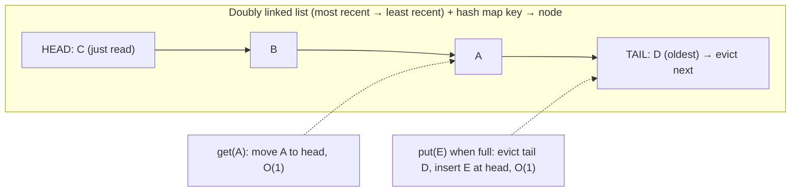
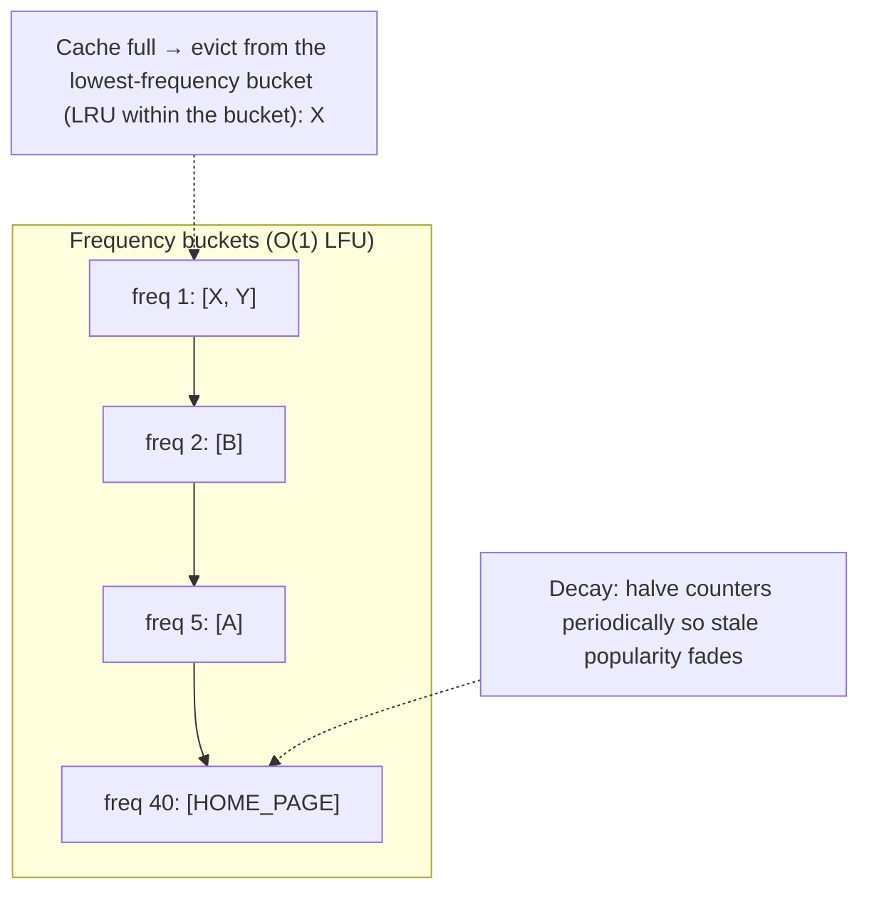
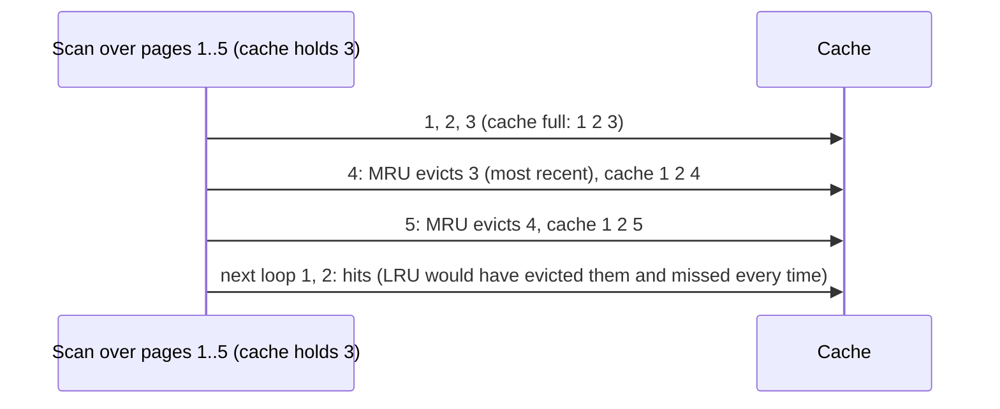
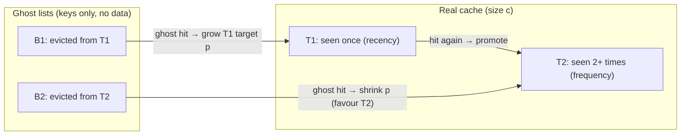
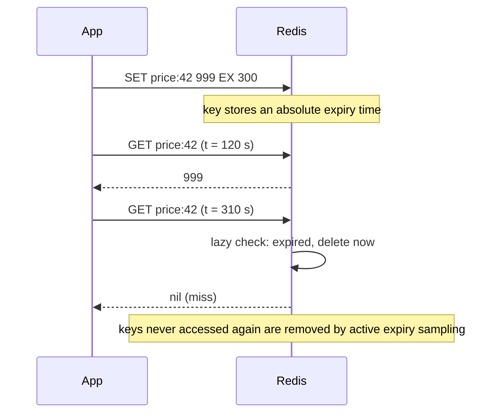
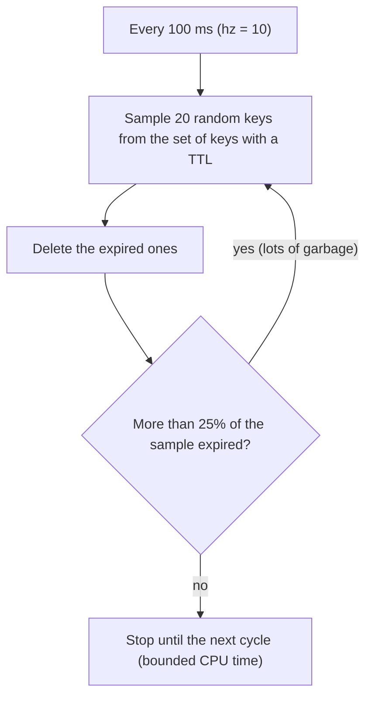
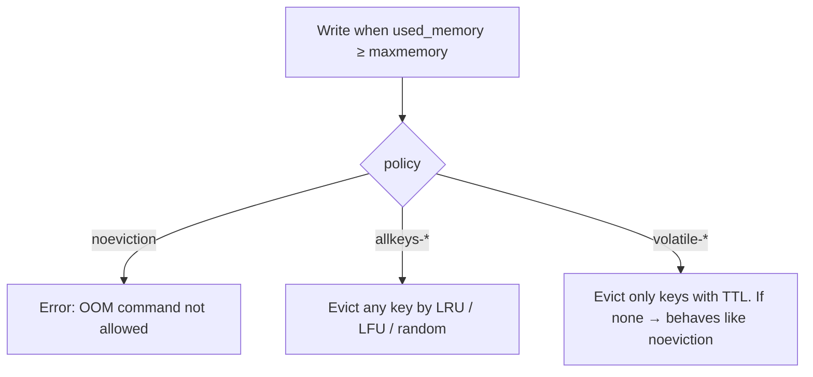
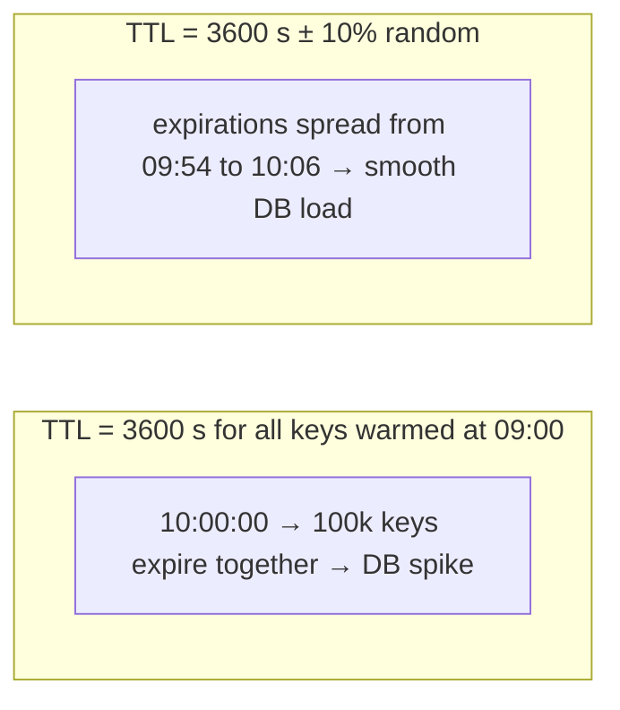

## Eviction policies & expiry

### LRU — Least Recently Used: evict the least recently accessed item (most common default)
When a cache is full, LRU evicts the item **not accessed for the longest time**, betting that recently used items will be used again soon (temporal locality). It's simple, effective for most workloads and the default in many caches.

#### How it works


The classic O(1) implementation is a **hash map + doubly linked list**. Java's `LinkedHashMap` with `accessOrder=true` and `removeEldestEntry` gives it in a few lines:

```java
class LruCache<K, V> extends LinkedHashMap<K, V> {
  private final int capacity;
  LruCache(int capacity) { super(16, 0.75f, true); this.capacity = capacity; }   // accessOrder = true
  @Override protected boolean removeEldestEntry(Map.Entry<K, V> e) { return size() > capacity; }
}
```
Redis approximates LRU by sampling a few keys (`maxmemory-samples 5`) and evicting the oldest of the sample, which is cheap with no global list.

#### Example
A session cache holding 1M entries: active users keep touching their sessions so they stay near the head, and users who left drift to the tail and get evicted first. That's exactly the desired behaviour.

**Weakness: scan pollution.** A nightly job reads 5M product records once each, pushing every hot item out of an LRU cache. The morning traffic then misses everything. LFU, ARC, W-TinyLFU or segmented LRU resist this.

#### Trade-offs
Simple and good for recency-heavy workloads, but vulnerable to one-off scans, and it ignores frequency (an item read 1,000 times yesterday can be evicted by one read of a new item).

#### Problems & fixes
| Symptom | Cause | Fix |
|---|---|---|
| Hit rate collapses after batch jobs | scan pollution | bypass cache for scans, scan-resistant policy (W-TinyLFU, SLRU) |
| Concurrency bottleneck in LRU cache | global lock on list updates | concurrent caches (Caffeine), sharded LRUs, sampled LRU |
| Popular-but-bursty items evicted | recency-only policy | LFU / W-TinyLFU |

#### Cheat sheet
- Evict least recently used. HashMap + doubly linked list = O(1).
- Java: `LinkedHashMap(accessOrder=true)`. Redis: sampled approximate LRU.
- Weak against scans. Caffeine's W-TinyLFU is better in practice.

#### Interview questions
<details><summary>Implement an LRU cache with O(1) get and put.</summary>

Combine a hash map (key → node) with a doubly linked list ordered by recency. `get`: look up the node, move it to the head, return its value. `put`: if the key exists, update and move it to the head. Otherwise create a node at the head, and if over capacity remove the tail node and its map entry. Every operation is O(1). For concurrency, use a lock (or striped locks), or a library like Caffeine.
</details>

<details><summary>Why does Redis use an approximated LRU instead of exact LRU?</summary>

Exact LRU needs a global linked list updated on every access, which means extra memory per key and pointer manipulation on every read. Redis samples a handful of random keys and evicts the least recently used among them (with an eviction pool for better accuracy). That gets close to true LRU behaviour at a fraction of the memory and CPU cost.
</details>

#### Interview angle
> "LRU is the sensible default, and I can implement it in O(1) with a hash map plus doubly linked list. For in-process caches I'd use Caffeine's W-TinyLFU, which keeps LRU's strengths but resists scans."

### LFU — Least Frequently Used: evict item with fewest accesses in time window
LFU evicts the item with the **fewest accesses**, keeping consistently popular items even if they weren't touched in the last few seconds. To avoid old popularity sticking forever, practical LFU uses **decay** or windowed counts.

#### How it works


- O(1) LFU: a hash map key → node plus a map frequency → doubly linked list, tracking the min frequency.
- **Redis LFU** (`allkeys-lfu`, `volatile-lfu`): an 8-bit logarithmic counter per key with time-based decay (`lfu-log-factor`, `lfu-decay-time`).
- **TinyLFU / W-TinyLFU** (Caffeine): a compact count-min sketch estimates frequency and only admits a new item if it's more popular than the eviction victim, plus a small LRU "window" for bursts.

#### Example
A news site cache: evergreen pages (home, top categories) are accessed constantly, while a breaking story spikes then fades. With LRU a burst of one-off article reads could evict the home page. With LFU and decay, the home page's high count protects it, and the breaking story enters, stays while hot, then decays out.

#### Trade-offs
Excellent for stable popularity distributions (Zipfian), but naive LFU adapts slowly to changing popularity (old hits linger), new items struggle to stay (cache pollution resistance becomes newcomer starvation), and it costs more bookkeeping.

#### Problems & fixes
| Symptom | Cause | Fix |
|---|---|---|
| Yesterday's popular items never leave | counts without decay | aging/decay (Redis lfu-decay-time), windowed counts |
| New hot items evicted immediately | low initial frequency | windowed LRU admission (W-TinyLFU), initial count boost |
| Memory overhead of counters | per-key counters | sketch-based approximations (TinyLFU) |

#### Cheat sheet
- Evict least frequently used. Needs decay to adapt.
- Redis `allkeys-lfu` uses a log counter + decay.
- W-TinyLFU (Caffeine) = frequency sketch + recency window, often the best hit rate.

#### Interview questions
<details><summary>When does LFU outperform LRU?</summary>

When popularity is stable and skewed (a Zipf distribution: a few items get most requests) and there are occasional scans or bursts of one-time accesses. LFU keeps the consistently hot items, whereas LRU lets one-off accesses push them out. With rapidly shifting popularity, plain LFU adapts poorly unless counts decay.
</details>

<details><summary>Which Redis eviction policy would you choose for a general cache of product pages?</summary>

`allkeys-lfu`: product popularity is skewed and relatively stable, so frequency-based eviction keeps best-sellers resident and resists scans from crawlers or batch jobs. Redis's decaying logarithmic counters adapt to changing popularity over time. `allkeys-lru` is a reasonable default if access is more recency-driven.
</details>

#### Interview angle
> "For skewed, fairly stable popularity like product pages, I'd use LFU with decay (Redis allkeys-lfu) or W-TinyLFU in-process. Best-sellers stay resident even when crawlers sweep the catalogue."

### MRU — Most Recently Used: evict most recently accessed (good for sequential scans)
MRU evicts the **most recently used** item, the opposite of LRU. It sounds odd, but it's optimal for **cyclic or sequential access patterns larger than the cache**, where the item just used is the one you'll need **last** in the next pass.

#### How it works


With LRU, a loop over N+1 pages with a cache of N misses on **every** access, because each page is evicted just before it's needed again. MRU keeps the start of the loop resident and gets hits on most of it.

#### Example
Database buffer pools face this with large sequential scans. PostgreSQL uses a **ring buffer** for big sequential scans and VACUUM (a small private set of buffers) so a full-table scan doesn't evict the hot working set. That's the same goal achieved differently. MRU-like policies also suit repeatedly looping media playback or batch jobs iterating a dataset larger than memory.

#### Trade-offs
Great for cyclic scans, terrible for typical recency-driven workloads. It's almost never a general-purpose default, more of a specialised or hybrid component.

#### Problems & fixes
| Symptom | Cause | Fix |
|---|---|---|
| LRU cache 0% hit rate on looping job | cyclic scan larger than cache | MRU for that workload, or bypass cache |
| Batch scans evict hot OLTP data | shared LRU buffer | ring buffers / separate pools for scans |

#### Cheat sheet
- Evict the most recent item. Best for loops/sequential scans bigger than the cache.
- LRU worst case = cyclic scan of N+1 items.
- DBs use scan ring buffers to protect hot pages.

#### Interview questions
<details><summary>Give a workload where LRU performs worst and MRU performs well.</summary>

A repeated sequential loop over N+1 items with a cache of size N. LRU always evicts the item needed next, so every access misses. MRU evicts the item just used (which won't be needed again until the end of the next loop), keeping most of the dataset resident and turning most accesses into hits.
</details>

<details><summary>How do databases prevent large table scans from wiping out their buffer cache?</summary>

They isolate scans: PostgreSQL uses small ring buffers for large sequential scans, VACUUM and bulk writes, so those operations recycle a few buffers instead of evicting the shared working set. InnoDB inserts newly read pages at the midpoint of its LRU list (an "old" sublist) and only promotes them to "young" if accessed again after a delay.
</details>

#### Interview angle
> "MRU only makes sense for cyclic scans bigger than the cache. The general lesson is to keep bulk scans from polluting a shared LRU, which is why databases use scan ring buffers or midpoint insertion."

### ARC — Adaptive Replacement Cache: dynamically balances LRU and LFU based on workload
ARC (IBM, used in ZFS) keeps two LRU lists, one for items seen **once recently** (recency) and one for items seen **at least twice** (frequency), plus "ghost" lists remembering recently evicted keys. Ghost hits tell ARC which side deserves more space, so it **self-tunes** between recency and frequency with no parameters.

#### How it works


- The target size `p` for T1 adapts: hits in ghost B1 mean "we evicted recency items too early", so give T1 more room. Hits in B2 do the opposite.
- Scan-resistant: a one-time scan only churns T1 and never displaces T2's frequent items.

#### Example
ZFS uses ARC (plus L2ARC on SSD) as its file cache. A file server with a mix of hot repeatedly read files (T2) and backup jobs streaming through large files once (T1) keeps the hot files cached, because the streaming data only cycles through T1. A plain LRU page cache would be flushed by every backup.

#### Trade-offs
Self-tuning and scan-resistant with good hit rates, but more complex and more metadata (ghost lists) than LRU. The original ARC had patent constraints, which is why many projects adopted CAR, 2Q or W-TinyLFU instead.

#### Problems & fixes
| Symptom | Cause | Fix |
|---|---|---|
| Hit rate swings with workload mix | fixed-policy cache (pure LRU/LFU) | adaptive policy (ARC, W-TinyLFU) |
| ZFS ARC consumes too much RAM | ARC grows to use free memory | cap `zfs_arc_max` on mixed-use hosts |

#### Cheat sheet
- Two LRU lists (once / many) + two ghost lists, adaptive split.
- Scan-resistant, parameter-free.
- Used in ZFS. In JVM apps W-TinyLFU (Caffeine) is the practical equivalent.

#### Interview questions
<details><summary>What problem does ARC solve compared with LRU and LFU?</summary>

LRU handles recency but is wrecked by scans. LFU handles frequency but adapts slowly. Each wins on different workloads. ARC keeps separate recency and frequency lists and uses ghost entries of recently evicted keys to learn which list deserves more capacity, adapting continuously to the workload without manual tuning.
</details>

<details><summary>What are ghost entries in ARC?</summary>

Keys (no values) of items recently evicted from each list. If a request hits a ghost key, the cache evicted that kind of item too early, so ARC shifts capacity toward that list. They're cheap feedback signals for the adaptive split.
</details>

#### Interview angle
> "Adaptive policies like ARC, or W-TinyLFU in Caffeine, learn whether recency or frequency pays off for the current workload, so I don't have to choose a fixed policy and live with its worst case."

### TTL (Time To Live) — key expires after fixed duration, lazy deletion on access
A TTL makes a cache entry **expire automatically after a duration**. It bounds staleness (no entry is older than its TTL), and reclaims memory from keys nobody uses. Most caches delete expired keys **lazily** when they're accessed, plus a background sweep.

#### How it works


Choosing TTLs:
| Data | Typical TTL |
|---|---|
| Static config, feature flags | minutes (plus push invalidation) |
| Product details | 5–60 min (+ invalidation on change) |
| Prices / inventory | seconds to 1 min, or event-invalidated |
| Session | sliding 15–30 min idle |
| Negative "not found" | 30–120 s |

#### Example
A "trending products" list recomputed every few minutes: `SET trending EX 120`. Staleness is bounded at 2 minutes with no invalidation logic needed. For product details, where staleness matters on price change, use a longer TTL **plus** explicit invalidation, with the TTL as a safety net if an invalidation is missed.

**Sliding expiration** (sessions): refresh the TTL on each access (`EXPIRE session:abc 1800` in the read path, or `GETEX`).

#### Trade-offs
Short TTLs mean fresher data but more misses and DB load. Long TTLs mean better hit rates but staler data. Same-TTL keys set together expire together (avalanche), so add jitter.

#### Problems & fixes
| Symptom | Cause | Fix |
|---|---|---|
| Stale data visible too long | TTL too long, no invalidation | invalidate on change, TTL as backstop |
| DB load spikes periodically | many keys with identical TTL set at the same time | jitter (±10–20%) |
| Memory full of dead keys | no TTL on cache keys | always set TTL for cache data |
| Hot key expiry causes stampede | synchronous reload on expiry | refresh-ahead, single-flight |

#### Cheat sheet
- TTL bounds staleness and reclaims memory. Lazy + active expiry.
- TTL is the safety net. Invalidation handles freshness.
- Add jitter. Sliding TTL for sessions.

#### Interview questions
<details><summary>How do you choose a TTL for cached product prices?</summary>

Base it on the business tolerance for stale prices and on change frequency. If displaying a price a minute old is acceptable (with the final price re-validated at checkout), use ~60 s with jitter. If prices must update immediately on change, use event-driven invalidation (CDC/price-change events) with a longer TTL as a safety net. Always validate the price against the source of truth when the order is placed.
</details>

<details><summary>Why use both TTL and explicit invalidation?</summary>

Explicit invalidation keeps data fresh when changes happen, but invalidations can be missed (bugs, failures, writes from other systems). TTL guarantees that any missed invalidation self-heals within a bounded time and also cleans up unused keys.
</details>

#### Interview angle
> "Every cache key gets a TTL with jitter as a safety net, sized to how stale the business can tolerate. Freshness itself comes from invalidation on change, and checkout always re-validates against the source."

### Active expiry — background thread scans for expired keys (Redis probabilistic scan)
Lazy expiry only deletes a key when someone touches it, so keys never read again would sit in memory forever. **Active expiry** runs in the background to find and delete expired keys. Redis does this **probabilistically**: sample random keys that have TTLs, delete the expired ones, and repeat if many were expired.

#### How it works


- Keeps the fraction of expired-but-present keys low (statistically below ~25%) without scanning everything.
- Time-bounded per cycle so it never blocks the server for long.
- Redis 6+ improved the algorithm (`active-expire-effort` tunable).
- Replicas don't expire keys themselves: the master sends `DEL` when keys expire, which keeps replicas consistent.

#### Example
A rate limiter creates millions of short-lived keys (`rl:user:minute`, TTL 60 s), and most are never read again after their window. Without active expiry, memory would fill with dead keys. With it, Redis reclaims them continuously. If you see memory higher than expected with many expiring keys, check `expired_keys`, `expired_stale_perc` in `INFO stats`, and consider raising `active-expire-effort` or `hz`.

#### Trade-offs
Background CPU for memory reclamation. It's probabilistic, so some expired keys linger briefly, which is invisible to clients since lazy checks hide them.

#### Problems & fixes
| Symptom | Cause | Fix |
|---|---|---|
| Memory higher than live data | expired keys not yet collected under heavy key churn | raise `active-expire-effort` / `hz`, check expired_stale_perc |
| Latency spikes from expiry | massive simultaneous expirations | jitter TTLs, avoid huge keys expiring at once |
| Replica shows stale TTL'd keys briefly | replicas wait for master DEL | read with TTL semantics in mind (Redis hides logically expired keys on replicas since 3.2) |

#### Cheat sheet
- Lazy expiry on access + active probabilistic sampling in the background.
- Redis: 20 samples per round, repeat while > 25% expired, time-bounded.
- Jitter TTLs to avoid mass expiry bursts.

#### Interview questions
<details><summary>How does Redis delete expired keys that are never accessed again?</summary>

Through active expiry: about 10 times per second it samples random keys from those with TTLs and deletes any that have expired. If more than 25% of a sample was expired, it repeats immediately, within a time budget. Combined with lazy deletion on access, memory from dead keys is reclaimed without full scans.
</details>

<details><summary>Why not just scan all keys periodically to find expired ones?</summary>

With millions or billions of keys, a full scan would take significant CPU time and, in single-threaded Redis, block all requests. Random sampling with adaptive repetition keeps expired keys to a small fraction at a predictable, bounded cost.
</details>

#### Interview angle
> "Redis reclaims expired keys lazily on access plus a time-bounded random sampling sweep, so short-lived rate-limit keys clean themselves up. I jitter TTLs so mass expiry doesn't cause spikes."

### Redis maxmemory-policy — allkeys-lru, volatile-lru, allkeys-random, noeviction
When Redis reaches `maxmemory`, its **eviction policy** decides what happens to new writes: evict some keys (by LRU, LFU, random or TTL) or **refuse writes**. Picking the right policy depends on whether Redis is a pure cache or holds data you must not lose.

#### How it works
| Policy | Evicts from | Use when |
|---|---|---|
| `noeviction` | nothing, writes return OOM errors | Redis holds primary data (queues, locks, sessions you can't lose) |
| `allkeys-lru` | any key, least recently used | pure cache (common default for caches) |
| `allkeys-lfu` | any key, least frequently used | cache with skewed, stable popularity |
| `volatile-lru` / `volatile-lfu` | only keys **with a TTL** | mixed: cache keys have TTLs, persistent keys don't |
| `allkeys-random` / `volatile-random` | random | uniform access patterns |
| `volatile-ttl` | keys with TTL, nearest expiry first | evict what's about to expire anyway |



```text
maxmemory 12gb            # leave headroom below instance RAM (fork, fragmentation, buffers)
maxmemory-policy allkeys-lfu
```

#### Example
A team ran sessions, rate-limit counters **and** a job queue in one Redis with `allkeys-lru`. Under memory pressure Redis evicted queue entries, and jobs vanished. Fix: separate instances, a cache instance with `allkeys-lfu` and a durable data instance with `noeviction` plus alerts at 80% memory. If they must share, use `volatile-lru` with TTLs only on cache keys.

#### Trade-offs
Eviction keeps a cache available under pressure but silently drops data. `noeviction` protects data but turns memory exhaustion into write failures.

#### Problems & fixes
| Symptom | Cause | Fix |
|---|---|---|
| `OOM command not allowed` errors | `noeviction` (default) at maxmemory | set an eviction policy for caches, or add memory |
| Important non-cache keys disappeared | `allkeys-*` evicting persistent data | separate instances or `volatile-*` with TTL only on cache keys |
| `volatile-*` still errors | no keys with TTL to evict | ensure cache keys have TTLs |
| Redis killed by OS | maxmemory too close to RAM (fork/fragmentation) | maxmemory ~60–75% of RAM |

#### Cheat sheet
- Pure cache → `allkeys-lfu` / `allkeys-lru`. Primary data → `noeviction` + alerts.
- Mixed → `volatile-*` (only TTL keys evicted), or better, separate instances.
- Monitor `evicted_keys`. Leave memory headroom.

#### Interview questions
<details><summary>Which maxmemory-policy for a Redis that's both a cache and holds distributed locks and job queues?</summary>

Ideally split them: a cache instance with `allkeys-lfu`/`allkeys-lru` and a separate data instance with `noeviction` and memory alerts. If they must share, use `volatile-lru`/`volatile-lfu` and put TTLs only on cache keys, so locks without TTLs and queue entries are never evicted (lock keys usually do have TTLs, so namespacing and separation are cleaner).
</details>

<details><summary>What happens when Redis hits maxmemory with the default policy?</summary>

The default is `noeviction`: reads keep working, but commands that would increase memory fail with an OOM error, which surfaces as application errors on writes. For a cache that's usually wrong. Configure an eviction policy explicitly.
</details>

#### Interview angle
> "A cache Redis runs allkeys-lfu with maxmemory well below RAM. Anything that's real state (queues, locks) lives on a separate noeviction instance with memory alerts, so eviction can never silently drop it."

### Staggered TTLs — add small random jitter to TTL to prevent cache avalanche
If many keys are cached at the same moment with the same TTL (after a deploy, a warm-up job or a bulk load), they **all expire at the same moment**, and the resulting wave of misses hits the database together: a **cache avalanche**. Adding random jitter to each TTL spreads expirations over time.

#### How it works


```java
Duration ttl(Duration base) {
  long jitter = (long) (base.toSeconds() * 0.1 * ThreadLocalRandom.current().nextDouble());   // up to +10%
  return base.plusSeconds(jitter);
}
cache.set(key, value, ttl(Duration.ofHours(1)));
```

#### Example
A catalogue warm-up job loads 200k products into Redis at 06:00 with `EX 3600`. Every hour on the hour the DB CPU spikes to 100% for a minute as all products expire and reload. Changing the TTL to `3600 + rand(0, 600)` flattened the curve, and DB CPU stayed under 40%.

#### Trade-offs
A trivial change with a big effect. The only cost is slightly less predictable expiry times (irrelevant for most caches).

#### Problems & fixes
| Symptom | Cause | Fix |
|---|---|---|
| Periodic DB spikes aligned with cache TTL | synchronised expirations | random jitter on TTL |
| Spike after every deploy/warm-up | bulk-loaded keys share TTL | jitter at load time, stagger warm-up |
| Spike when a cache node restarts | many keys missing at once | warming, request coalescing, persistence |

#### Cheat sheet
- TTL = base + random(0..10–20% of base).
- Apply everywhere keys are bulk-loaded.
- Combine with single-flight and stale-while-revalidate for hot keys.

#### Interview questions
<details><summary>What is a cache avalanche and how do you prevent it?</summary>

A large fraction of cache entries expire or disappear at the same time (identical TTLs from a bulk load, or a cache node or cluster restart), sending a flood of misses to the database. Prevent it with TTL jitter, cache warming, persistence and replicas for the cache, request coalescing per key, and circuit breakers or rate limits protecting the database.
</details>

<details><summary>Why does jitter help even if total misses per hour stay the same?</summary>

Databases fail on peak concurrency, not average load. Jitter keeps the same number of reloads but spreads them across a window, keeping peak DB load within capacity instead of concentrating it into one burst.
</details>

#### Interview angle
> "Every TTL gets random jitter, especially for bulk-loaded keys, so expirations spread out instead of hitting the database all at once."
