## Cache failure modes & solutions

### Cache stampede / thundering herd — mass cache miss triggers simultaneous DB requests
A cache stampede happens when a **popular key expires (or is evicted) and many concurrent requests miss at the same moment**. They all go to the database to rebuild the same value. One key can turn into thousands of identical expensive queries, overloading the DB just when traffic is highest.

#### Intuition
The office coffee pot runs empty and fifty people all walk to the kitchen to brew a new one at the same time. One pot was needed. Fifty people now block the kitchen.

#### Must know
- A **hot key expires** and many concurrent requests miss together, so all of them rebuild the same value from the database.
- One key becomes thousands of identical expensive queries.
- Fix 1: **single-flight / mutex**. One request rebuilds and the others wait.
- Fix 2: **stale-while-revalidate**. Keep serving the old value while one worker refreshes.
- Fix 3: refresh before expiry (probabilistic early refresh or a background job).

#### Common mistakes
- Thinking a higher hit rate fixes it. The damage happens in the instant of expiry.
- A lock with no timeout, so a crashed holder blocks everyone.
- Confusing it with an avalanche, which is many keys or the whole cache.

#### How it works
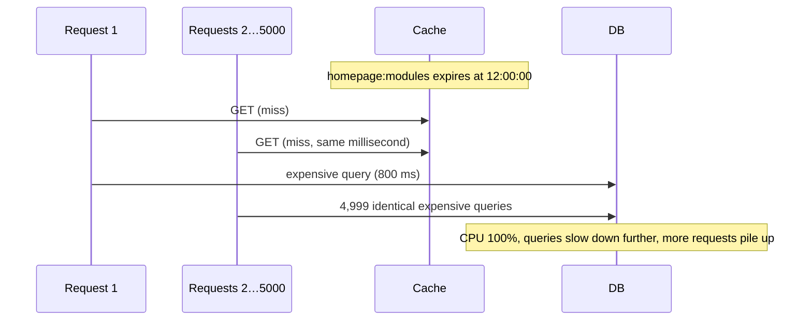

Fixes (often combined):
1. **Single-flight / mutex**: only one request recomputes, the others wait or get stale data.
2. **Stale-while-revalidate / soft TTL**: serve the stale value while one worker refreshes.
3. **Probabilistic early refresh** (XFetch): recompute slightly before expiry with rising probability.
4. **Refresh-ahead / background refresh** for known hot keys (never expire them during traffic).
5. **Request coalescing** at the CDN / proxy (`proxy_cache_lock` in NGINX).

#### Example
A sale homepage cached for 60 s and requested 20k times/s. Each expiry sent thousands of 800 ms queries to Postgres, and p99 jumped to 10 s every minute. Fix: store `{value, softExpiry}` with a hard TTL of 5 minutes. When the soft expiry passes, the first request acquires `SET lock:homepage NX PX 5000` and recomputes while everyone else keeps serving the existing value. DB load dropped to one query per minute.

#### Trade-offs
Locks add complexity and a lock-holder failure path (lock TTL). Serving stale data needs business tolerance. Background refresh costs work for keys that may go cold.

#### Problems & fixes
| Symptom | Cause | Fix |
|---|---|---|
| DB spikes exactly at cache expiry | simultaneous misses on hot keys | single-flight + stale-while-revalidate |
| Requests hang waiting for lock holder | lock holder crashed | lock TTL, fallback to stale or direct read after timeout |
| Spike after cache restart | many keys missing at once | warming, coalescing, DB circuit breaker |

#### Cheat sheet
- One hot key expiring means N concurrent recomputations.
- Fix: single-flight lock, serve stale while revalidating, early probabilistic refresh, background refresh.
- CDN/NGINX: enable request collapsing (`proxy_cache_lock`, `proxy_cache_use_stale updating`).

#### Interview questions
<details><summary>A hot key's expiry takes the database down every few minutes. Give three solutions and their trade-offs.</summary>

1) Mutex/single-flight: the first miss takes a short Redis lock and recomputes while others wait briefly or read stale data. Simple, but needs lock-timeout handling. 2) Soft TTL / stale-while-revalidate: keep serving the old value past its logical expiry while one refresher updates it. No user-visible miss, but data is briefly stale. 3) Probabilistic early expiration or background refresh: refresh before expiry so it never expires under load. That costs extra recomputations. Often 2 and 1 are combined.
</details>

<details><summary>How do CDNs and NGINX prevent stampedes on the origin?</summary>

Request collapsing: when many requests for the same uncached object arrive at once, only the first goes to the origin and the rest wait for its response (NGINX `proxy_cache_lock`). Plus `stale-while-revalidate` / `proxy_cache_use_stale updating` to serve the stale copy while one background request refreshes it.
</details>

#### Interview angle
> "Hot keys use a soft TTL with a single-flight lock: one request refreshes while everyone else gets the slightly stale value, so an expiry never multiplies into thousands of DB queries."

#### Sources
- [Cache stampede](https://en.wikipedia.org/wiki/Cache_stampede) — Wikipedia
- [Scaling Memcache at Facebook](https://www.usenix.org/conference/nsdi13/technical-sessions/presentation/nishtala) — Nishtala et al., USENIX NSDI 2013
- [ngx_http_proxy_module: proxy_cache_lock](https://nginx.org/en/docs/http/ngx_http_proxy_module.html#proxy_cache_lock) — NGINX docs

### Mutex lock to prevent stampede — only one request fetches, others wait and read populated cache
The mutex approach serialises cache rebuilding per key: on a miss, a request tries to acquire a short-lived lock for that key. The **winner** loads from the database and fills the cache. **Losers** wait briefly and re-read the cache (or return stale or default data). One DB query instead of thousands.

#### Intuition
One person goes to brew the coffee and puts a "brewing" sign on the kitchen door. Everyone else waits a minute and then pours from the fresh pot.

#### Must know
- On a miss, try `SET lock:key token NX PX <ttl>`. Only one request wins.
- The **winner** loads from the database and fills the cache. **Losers** wait briefly and re-read, or serve stale data.
- The lock needs a **TTL**, and release must check the token.
- Inside one process, use single-flight first (Caffeine loader, Go `singleflight`). The distributed lock is for across instances.
- Cap the waiting time below the request timeout, then fall back.

#### Common mistakes
- Losers waiting forever when the winner is slow or dead.
- Releasing with a plain `DEL`, which can remove another request's lock.
- Taking the Redis lock on every miss from every thread, with no in-process coalescing.

#### How it works
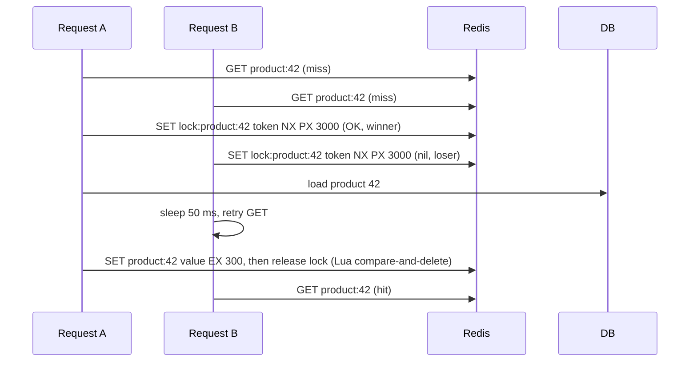

```java
Product get(long id) {
  String key = "product:" + id, lock = "lock:" + key;
  for (int i = 0; i < 20; i++) {
    Product p = cache.get(key);
    if (p != null) return p;
    String token = UUID.randomUUID().toString();
    if (redis.set(lock, token, SetParams.setParams().nx().px(3000)) != null) {   // winner
      try { p = repo.load(id); cache.set(key, p, ttlWithJitter()); return p; }
      finally { redis.eval(UNLOCK_IF_TOKEN_MATCHES, List.of(lock), List.of(token)); }
    }
    sleepMillis(50);   // loser: wait for the winner to fill the cache
  }
  return repo.load(id);   // fallback after ~1 s: degrade rather than fail
}
```

Within one JVM, Caffeine's `LoadingCache`/`AsyncLoadingCache` already coalesces concurrent loads per key, and Go has `singleflight`. A distributed lock is needed only across instances.

#### Example
Product pages across 50 app instances: without the lock a hot product's expiry caused 50 × (concurrent requests) DB loads. With the Redis lock, exactly one instance reloads, and the others' requests wait ~50–200 ms and then hit the refreshed cache.

#### Trade-offs
Strongly reduces DB load, but waiters add latency, lock bookkeeping costs Redis calls, and a slow loader holds everyone up. Combine with serving stale data to avoid waiting.

#### Problems & fixes
| Symptom | Cause | Fix |
|---|---|---|
| Requests time out waiting | loader slower than wait budget | serve stale value / default, increase lock TTL sensibly |
| Lock never released | holder crashed | PX TTL on the lock |
| Wrong client deletes lock | plain DEL | token + Lua compare-and-delete |
| Redis round trips add latency | lock on every miss | local single-flight first (per instance), then distributed lock |

#### Cheat sheet
- Miss → `SET lock NX PX` → winner loads + fills, losers wait/retry or serve stale.
- Token-checked release. Lock TTL ≥ typical load time.
- In-process: Caffeine LoadingCache / singleflight already coalesces.

#### Interview questions
<details><summary>What should losers do while the winner rebuilds the cache?</summary>

Options: spin-wait with short sleeps and re-read the cache (bounded, then fall back to a DB read or an error), serve a stale copy if one exists (best UX), or return a degraded default (an empty recommendation list). Never wait indefinitely, and cap total wait time below the request timeout.
</details>

<details><summary>Why combine an in-process single-flight with the distributed lock?</summary>

Within one instance, dozens of threads may miss the same key at once. A local single-flight (Caffeine loader, Guava, Go singleflight) collapses them into one attempt, so only one Redis lock request per instance is made. The distributed lock then collapses attempts across instances. That reduces both DB and Redis load.
</details>

#### Interview angle
> "On a miss for a hot key, one caller wins a short token-checked Redis lock and rebuilds. Others briefly wait or serve stale, and per-instance single-flight means each pod asks for the lock only once."

#### Sources
- [singleflight package](https://pkg.go.dev/golang.org/x/sync/singleflight) — Go docs
- [SET command (NX and PX options)](https://redis.io/docs/latest/commands/set/) — Redis docs
- [Cache stampede: locking](https://en.wikipedia.org/wiki/Cache_stampede) — Wikipedia

### Probabilistic early re-expiration (PER) — randomly refresh before TTL expires to prevent stampede
Probabilistic early recomputation (the "XFetch" algorithm) has each reader decide **randomly** whether to refresh a value **before** it expires. The probability rises sharply as expiry approaches and scales with how long the value takes to compute. Usually exactly one request refreshes early, and the key never actually expires under load. No locks required.

#### Intuition
As the milk gets close to its date, each person who opens the fridge rolls a dice to decide whether to buy more. Far from the date almost nobody does. On the last day someone almost certainly will, so the fridge never actually runs out.

#### Must know
- Each reader decides **at random** whether to refresh the value **before** it expires.
- The probability rises sharply as expiry approaches.
- It also scales with how long the value takes to compute, so expensive values refresh earlier.
- Under load, one reader refreshes early and the key never expires. **No lock is needed.**
- It does not help when the key is missing entirely (cold start).

#### Common mistakes
- Claiming exactly one refresh. Occasionally two happen.
- Forgetting to store the compute time with the value.
- Using it alone, with nothing for cold or evicted keys.

#### How it works
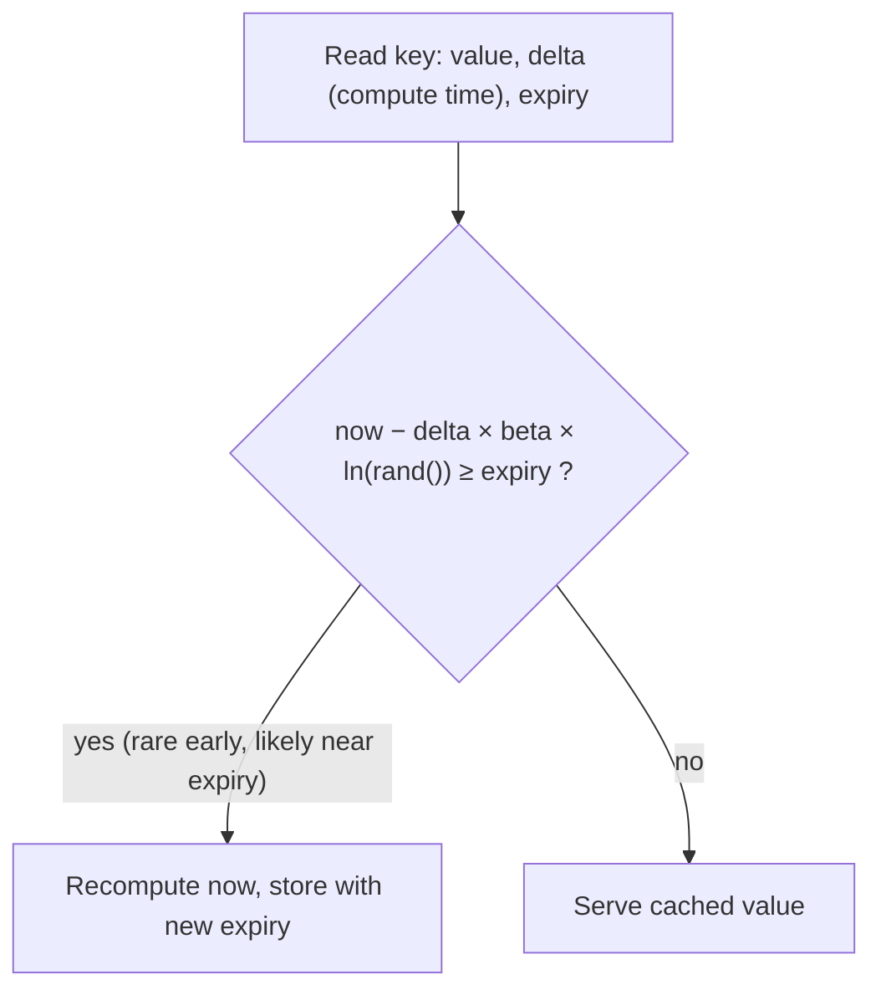

```python
def fetch(key, ttl, beta=1.0):
    value, delta, expiry = cache.get(key) or (None, 0, 0)
    # ln(rand) is negative, so the subtraction pushes "now" forward by a random amount scaled by delta
    if value is None or time.time() - delta * beta * math.log(random.random()) >= expiry:
        start = time.time()
        value = recompute(key)
        delta = time.time() - start
        cache.set(key, (value, delta, time.time() + ttl), ex=ttl)
    return value
```

- `delta`: how long recomputation takes. Expensive values start refreshing earlier.
- `beta`: aggressiveness (>1 refreshes earlier, <1 later).

#### Example
A leaderboard computation takes 2 s, TTL 60 s, read 5,000 times/s. Starting a few seconds before expiry, each read has a small and growing chance to trigger recomputation. In practice one or two requests refresh it around 2–4 s before expiry, and nobody ever sees a miss or a DB spike, with no lock infrastructure involved.

#### Trade-offs
Lock-free and elegant, with no coordination, but occasionally more than one request recomputes (tunable), and it needs the compute time stored with the value. It doesn't help when a key is completely absent (cold start).

#### Problems & fixes
| Symptom | Cause | Fix |
|---|---|---|
| Still occasional duplicate recomputations | probabilistic nature | lower beta, or combine with a lightweight lock |
| Stampede on cold start / eviction | key absent, no early signal | warm-up, single-flight for absent keys |
| Refreshes too early, wasting work | beta too high / delta overestimated | tune beta, measure delta per key |

#### Cheat sheet
- Refresh early with probability rising toward expiry, scaled by compute time.
- `now − delta·beta·ln(rand) ≥ expiry` → recompute.
- Lock-free. Pair with warming/single-flight for absent keys.

#### Interview questions
<details><summary>How does probabilistic early expiration prevent a stampede without locks?</summary>

Each reader independently rolls a random number weighted by time-to-expiry and recomputation cost. Far from expiry the chance is near zero. Close to it, it rises steeply, so with high traffic one reader almost certainly refreshes the value slightly before it expires, and the rest keep reading the valid cached value. The key never expires under load, so there's no synchronised miss.
</details>

<details><summary>Why does the formula include the recomputation time (delta)?</summary>

Values that take long to compute must start refreshing earlier, so the new value is ready before the old one expires. Scaling the random early window by delta makes expensive keys refresh proportionally earlier than cheap ones.
</details>

#### Interview angle
> "For expensive hot values I'd use probabilistic early recomputation: readers occasionally refresh just before expiry, weighted by compute time, so the key never expires under load and no lock is needed."

#### Sources
- [Optimal probabilistic cache stampede prevention](https://www.vldb.org/pvldb/vol8/p886-vattani.pdf) — Vattani, Chierichetti and Lowenstein, VLDB 2015
- [Cache stampede: probabilistic early expiration](https://en.wikipedia.org/wiki/Cache_stampede) — Wikipedia

### Hot key problem — single key overwhelms one Redis node (e.g., celebrity tweet)
In a sharded cache, each key lives on **one node**. When a single key gets enormous traffic (a celebrity's post, a flash-sale product, a global config), that node's CPU or network saturates while others idle, and adding nodes doesn't help. Hot keys cause latency spikes, timeouts and cascading failures.

#### Intuition
A ten-counter bank where everyone queues at counter 4 because that is where one celebrity teller sits. Nine counters are idle and counter 4 collapses.

#### Must know
- In a sharded cache, **one key lives on one node**.
- A viral key saturates that node's CPU or network while the rest sit idle.
- **Adding nodes does not help.**
- Everything else on that node suffers too, and retries make it worse.
- Detect it with per-node imbalance alerts, `redis-cli --hotkeys` and key-level client metrics.

#### Numbers to quote
- One Redis node handles roughly 100,000+ simple operations per second, and bandwidth is often the first limit for large values.

#### Common mistakes
- Proposing "scale out the cluster" for a single hot key.
- Running `MONITOR` in production to find it.
- Ignoring **big keys** (a huge hash or list), which cause the same pain with one command.

#### How it works
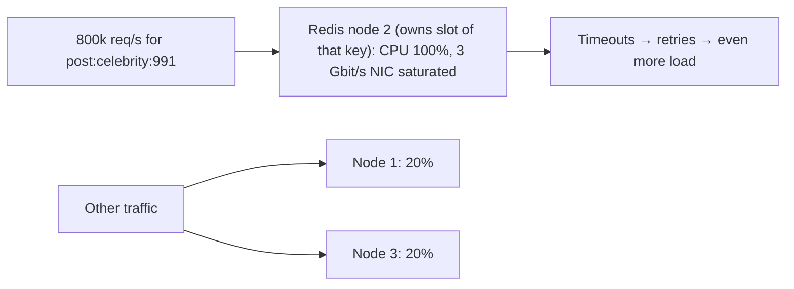

Detection: `redis-cli --hotkeys` (with LFU policy), `MONITOR` sampling (careful in production), client-side key metrics, per-node CPU/network imbalance, cloud provider hot-key reports.

Also watch for **big keys** (a 50 MB hash, a list with 5M items): single commands on them block Redis and saturate bandwidth.

#### Example
A celebrity's post goes viral: 500k reads/s on `post:991`. A single Redis node handles maybe ~100–200k simple ops/s, and returning a 5 KB value 500k times/s is ~20 Gbit/s, far beyond one node's NIC. The node falls over, and every request hashing to that node (not only the hot key) times out.

#### Trade-offs
Hot-key mitigations (local caching, replication, splitting) add staleness and complexity, so apply them selectively to detected or predicted hot keys.

#### Problems & fixes
| Symptom | Cause | Fix |
|---|---|---|
| One Redis node maxed, others idle | hot key | L1 in-process cache, replicate key across N slots, read replicas |
| Node bandwidth saturated | large hot value | compress, slim the value, cache at CDN/edge |
| Latency spikes from single commands | big keys (huge hash/list) | split big keys, avoid O(N) commands on them |
| Hot keys only found after outage | no monitoring | hotkey detection, key-level metrics, alerts on node imbalance |

#### Cheat sheet
- One key = one node, so more nodes don't help.
- Detect: `--hotkeys`, node imbalance, client metrics.
- Fix: local L1 cache, key replication (`key#1..N`), CDN, smaller values.

#### Interview questions
<details><summary>How would you detect hot keys in a Redis Cluster in production?</summary>

Watch for per-node imbalance in CPU, ops/s and network. Use `redis-cli --hotkeys` (requires an LFU maxmemory policy) or cloud provider hot-key analytics. Instrument clients to sample and count keys per second. Set alerts when one node's ops exceed the cluster average by a large factor. Avoid running MONITOR long in production because it's expensive.
</details>

<details><summary>Why doesn't adding more Redis nodes fix a hot key?</summary>

Sharding distributes keys, not requests for a single key. All traffic for that key still goes to the one node owning its slot. More nodes only help if the hot key is replicated or split across them, or if reads are absorbed earlier (local caches, CDN).
</details>

#### Interview angle
> "A hot key pins one Redis node no matter how big the cluster is. I detect hot keys with node-imbalance alerts and hotkey sampling, then absorb them with an in-process L1 cache or by replicating the key."

#### Sources
- [Redis CLI: scanning for hot and big keys](https://redis.io/docs/latest/develop/tools/cli/) — Redis docs
- [Redis cluster specification](https://redis.io/docs/latest/operate/oss_and_stack/reference/cluster-spec/) — Redis docs

### Hot key solution — local in-process L1 cache (Caffeine/Guava) + L2 Redis; key replication to N slots
The standard fixes for hot keys spread or absorb the load: an **in-process L1 cache** in every app instance (each instance serves the hot key from its own memory), and/or **replicating the key** across N copies on different Redis nodes so reads spread out. For static or public data, push it further out to the **CDN**.

#### Intuition
Give every branch a photocopy of the notice everyone keeps asking about, so nobody phones head office for it. And keep several copies at head office, so the callers who do ring are spread over several desks.

#### Must know
- **L1 in-process cache** with a TTL of a few seconds in every app instance absorbs the hot key.
- Redis then sees at most about (instances ÷ TTL) reads per second for that key.
- **Replicate the key** as `key#0 … key#N` across slots, and read a random copy.
- Public content can go out to the CDN.
- Invalidate by pub/sub or Redis client-side caching, or accept the short TTL as the staleness bound.

#### Numbers to quote
- 200 instances with a 5-second L1 TTL turn 500,000 reads per second into about 40 Redis reads per second.

#### Common mistakes
- An L1 cache with a long TTL and no invalidation, so instances disagree for minutes.
- Caching everything in L1 and running the JVM out of memory.
- Updating only one of the N replica keys on a write.

#### How it works
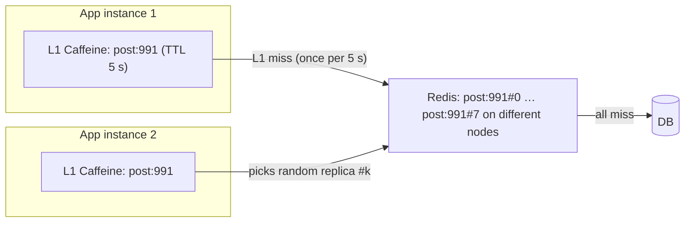

```java
// L1: tiny, short TTL, only for detected/declared hot keys
Cache<String, Post> l1 = Caffeine.newBuilder().maximumSize(10_000).expireAfterWrite(Duration.ofSeconds(5)).build();

Post getPost(long id) {
  String key = "post:" + id;
  Post p = l1.getIfPresent(key);
  if (p != null) return p;
  String replicaKey = hotKeys.contains(key) ? key + "#" + ThreadLocalRandom.current().nextInt(8) : key;
  p = redis.get(replicaKey);                 // replicas live in different slots → different nodes
  if (p == null) { p = db.load(id); writeAllReplicas(key, p); }
  l1.put(key, p);
  return p;
}
```

Invalidation: on update, delete all N Redis replicas and broadcast an L1 eviction (Redis pub/sub, Kafka) or accept the short L1 TTL as the staleness bound.

#### Example
With 200 app instances and a 5 s L1 TTL, a key read 500k times/s generates at most ~40 Redis reads per second (200 instances ÷ 5 s) instead of 500k. Redis load for the hot key effectively disappears. Twitter, Weibo and e-commerce flash sales use this layered approach. Redis 6 client-side caching ("tracking") gives server-assisted L1 invalidation.

#### Trade-offs
Massive load reduction, but L1 copies are slightly stale (bounded by TTL or invalidation lag), memory is duplicated in every instance, and replica fan-out on writes adds complexity.

#### Problems & fixes
| Symptom | Cause | Fix |
|---|---|---|
| Users see different values across instances | L1 staleness | short TTL (1–5 s), pub/sub invalidation, Redis client tracking |
| JVM memory pressure | L1 too large | small max size, only hot keys, weigher by size |
| Updates not reflected in replicas | missed replica writes | write/delete all replicas, TTL backstop |

#### Cheat sheet
- L1 in-process (ms TTL) + L2 Redis + DB.
- Replicate hot keys as `key#0..N` across slots, and read a random replica.
- Invalidate via pub/sub or Redis client tracking, or accept short-TTL staleness.

#### Interview questions
<details><summary>Design caching for a celebrity post receiving 1M reads per second.</summary>

Serve public post content from the CDN where possible (short TTL). In app instances, a small Caffeine L1 cache with a 1–5 s TTL for detected hot keys, so Redis sees at most instances ÷ TTL requests per second. Behind it, store the post in Redis as N replicas across different slots and read a random replica on L1 miss. Updates delete or overwrite all replicas and broadcast an L1 invalidation. Counters (likes) use sharded counters, not a single key.
</details>

<details><summary>How do you keep L1 caches across 200 instances consistent enough?</summary>

Keep L1 TTLs short so staleness is bounded by seconds. For faster convergence, publish invalidation messages on update (Redis pub/sub or Kafka topic) that each instance consumes to evict the key, or use Redis 6 server-assisted client-side caching (tracking), where Redis notifies clients when keys they cached change.
</details>

#### Interview angle
> "Hot keys get an in-process L1 with a seconds-long TTL plus N replicas in Redis, so a million reads a second turns into a few dozen Redis reads. Updates broadcast an invalidation."

#### Sources
- [Client-side caching](https://redis.io/docs/latest/develop/reference/client-side-caching/) — Redis docs
- [Caffeine](https://github.com/ben-manes/caffeine/wiki) — Caffeine wiki

### Cache penetration — query for non-existent key repeatedly bypasses cache and hammers DB
Cache penetration is when requests ask for data that **doesn't exist**, so it's never cached, and **every request falls through to the database**. It happens with buggy clients, enumeration attacks (random ids) or deleted content still being linked. The cache provides zero protection for those keys.

#### Intuition
A prank caller keeps ringing the hospital asking for patients who were never admitted. Reception has no note for them, so every call triggers a full search of the records room.

#### Must know
- Requests for data that **does not exist** are never cached, so every one reaches the database.
- Causes: enumeration attacks with random ids, buggy clients, links to deleted content.
- Defence 1: **validate** the id format and range.
- Defence 2: a **bloom filter** of valid ids in front of the cache.
- Defence 3: **negative caching** with a short TTL, plus rate limiting.

#### Common mistakes
- Mixing up the three cache failures. Penetration = missing keys. Stampede = one hot key expires. Avalanche = many keys or the whole cache.
- Negative caching alone against unique random ids, which fills the cache with junk.
- Sequential public ids, which are easy to enumerate.

#### How it works
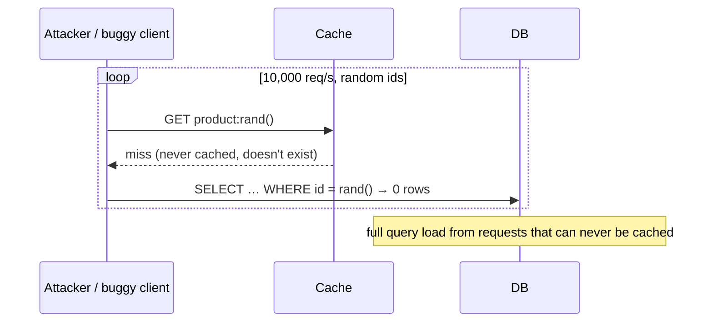

Defences:
1. **Negative caching**: cache a "not found" sentinel with a short TTL.
2. **Bloom filter** of all valid ids: reject impossible ids before cache or DB.
3. **Input validation**: id format, ranges, signed or opaque ids (hard to enumerate).
4. **Rate limiting** per client/IP and bot detection.

#### Example
An API with sequential product ids up to 5M gets requests for ids up to 2^63. Validating the id range at the gateway rejects most of them instantly, negative caching absorbs repeated valid-format misses, and a bloom filter (5M ids, 1% false positives ≈ 6 MB) catches the rest in microseconds. DB load from that traffic drops to ~1% of what it was.

#### Trade-offs
Negative caching uses cache memory per distinct missing key. Bloom filters need rebuilding or updating as items are added (and can't delete without counting variants). Validation is cheapest but only catches malformed ids.

#### Problems & fixes
| Symptom | Cause | Fix |
|---|---|---|
| DB load high, cache hit rate low, many 404s | penetration | negative cache + bloom filter + validation |
| Negative cache floods memory | attacker uses unique random ids | bloom filter first, short negative TTL, rate limiting |
| Newly created item returns 404 | negative entry / bloom filter not updated | delete negative key + add to bloom filter on create |

#### Cheat sheet
- Missing keys bypass the cache, so the DB takes the load.
- Validate input → bloom filter → negative cache (short TTL) → DB.
- Rate-limit enumerators. Use non-sequential public ids.

#### Interview questions
<details><summary>Distinguish cache penetration, cache breakdown (stampede) and cache avalanche.</summary>

Penetration: requests for keys that don't exist, so they always miss and hit the DB (fix: negative caching, bloom filter, validation). Breakdown/stampede: a single hot key expires and many concurrent requests rebuild it at once (fix: single-flight, stale-while-revalidate, early refresh). Avalanche: many keys expire or the cache fails at the same time, so mass misses hit the DB (fix: TTL jitter, cache HA, warming, circuit breakers).
</details>

<details><summary>An attacker is requesting random user ids to overload your DB. What layers of defence do you add?</summary>

At the edge: rate limiting per IP/token, WAF bot rules, auth required for user lookups. In the API: id format validation, opaque or non-sequential ids. Then a bloom filter of valid ids to reject impossible ones, negative caching for misses, and a DB circuit breaker or load shedding as the last line.
</details>

#### Interview angle
> "Requests for things that don't exist never hit the DB repeatedly: format validation and a bloom filter reject impossible ids, misses are negatively cached briefly, and enumerators get rate-limited."

#### Sources
- [Bloom filter](https://redis.io/docs/latest/develop/data-types/probabilistic/bloom-filter/) — Redis docs
- [Caching challenges and strategies](https://aws.amazon.com/builders-library/caching-challenges-and-strategies/) — Amazon Builders' Library

### Bloom filter for cache penetration — reject requests for keys known not to exist
A bloom filter is a compact probabilistic set: it can say "**definitely not present**" or "**possibly present**". Loaded with all valid keys and checked **before** cache and database, it rejects requests for non-existent ids in microseconds with a tiny memory footprint, at the cost of a small false-positive rate.

#### Intuition
A guard with a compact guest checklist. If your name is not on it, you are certainly not invited. If it seems to be on it, you are probably invited, and the desk inside confirms.

#### Must know
- A compact probabilistic set that answers "**definitely not present**" or "**possibly present**".
- Load it with every valid id and check it **before** the cache and the database.
- No false negatives. A small false-positive rate still reaches the database.
- **Add the id on create**, or new items are rejected.
- A standard filter cannot delete. Rebuild it periodically or use a cuckoo or counting filter.

#### Numbers to quote
- About 10 bits per key gives a 1% false-positive rate.
- 10 million ids at 1% need about 12 MB. 100 million need about 120 MB.

#### Common mistakes
- Saying the filter confirms that a key exists.
- Sizing for today's count, so the false-positive rate climbs as the data grows.
- A separate local filter per instance that is never synchronised.

#### How it works
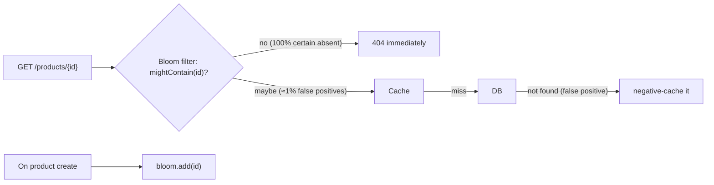

Sizing: for n items and false-positive rate p, bits m = −n·ln(p) / (ln 2)², hash functions k = (m/n)·ln 2.
- 10M ids at 1% → ~96 Mbit ≈ 12 MB, k ≈ 7.
- 10M ids at 0.1% → ~18 MB.

Implementations: Guava `BloomFilter`, RedisBloom (`BF.ADD`, `BF.EXISTS`) shared across instances, Redis bitmaps with custom hashing.

```java
BloomFilter<Long> validIds = BloomFilter.create(Funnels.longFunnel(), 10_000_000, 0.01);
productRepo.streamAllIds().forEach(validIds::put);   // rebuild on startup / periodically
if (!validIds.mightContain(id)) return notFound();
```

#### Example
A short-link service gets heavy traffic for random, never-issued codes (scanners). RedisBloom with 2B issued codes at 0.1% false positives (~3.6 GB) answers "never issued" instantly. Real codes and the rare false positives continue to cache and DB. DB queries from scanners drop by ~99.9%.

#### Trade-offs
Very memory-efficient, but no deletions in a standard filter (deleted items stay "maybe present" until rebuild; use counting or cuckoo filters if deletions matter), it must be kept in sync with creates, and false positives still reach the DB.

#### Problems & fixes
| Symptom | Cause | Fix |
|---|---|---|
| New items rejected as non-existent | filter not updated on create | add to filter in the create path (and on rebuild) |
| False-positive rate higher than planned | more items than sized for | size for growth, rebuild larger filter (or scalable bloom filters) |
| Deleted items still pass the filter | standard bloom can't delete | periodic rebuild, cuckoo/counting filters |
| Each instance has a different filter | local filters not synced | shared RedisBloom, or rebuild from DB on a schedule |

#### Cheat sheet
- "Definitely not" or "maybe". ~10 bits/key ≈ 1% false positives.
- Check filter → cache → DB. Add on create. Rebuild periodically.
- Need deletes → cuckoo/counting filter.

#### Interview questions
<details><summary>Size a bloom filter for 100M valid user ids with a 1% false-positive rate.</summary>

m ≈ −n·ln(p)/(ln 2)² = 100M × 4.6 / 0.48 ≈ 958M bits ≈ 120 MB, with k ≈ (m/n)·ln 2 ≈ 7 hash functions. That fits easily in Redis (RedisBloom) or even in each app instance's memory.
</details>

<details><summary>Why can't you remove an item from a standard bloom filter?</summary>

Each item sets k bits that may be shared with other items. Clearing them on removal could clear bits belonging to other items, causing false negatives ("definitely not present" for items that exist), which breaks the filter's guarantee. Counting bloom filters (counters instead of bits) or cuckoo filters support deletion.
</details>

#### Interview angle
> "A RedisBloom filter of every valid id sits in front of the cache. Impossible ids are rejected in microseconds, new ids are added on create, and the filter is rebuilt periodically."

#### Sources
- [Bloom filter](https://en.wikipedia.org/wiki/Bloom_filter) — Wikipedia
- [Bloom filter](https://redis.io/docs/latest/develop/data-types/probabilistic/bloom-filter/) — Redis docs

### Cache avalanche — mass TTL expiry at the same time causes thundering herd on DB
A cache avalanche is a **large-scale** miss event: many keys expire simultaneously (same TTL set during a bulk load), or the cache tier itself fails or restarts, so a flood of requests goes to the database at once. Unlike a stampede (one hot key), an avalanche affects a big share of the keyspace and can take down the database and everything behind it.

#### Intuition
A dam that has been holding back the river gives way all at once. The town downstream was built for the trickle that normally gets through, not for the whole river.

#### Must know
- A **large share of the cache disappears at once**: many keys with the same TTL, or the cache tier fails or restarts.
- The database suddenly receives many times its normal load and can go down.
- Prevent: **TTL jitter**, a replicated cache across AZs, persistence, warming.
- Contain: a **circuit breaker and rate limit** on database fallback, an in-process L1, serving stale data.
- Know how much fallback traffic the database can actually take.

#### Common mistakes
- Assuming "fall back to the database" is safe. The database is sized for cache-hit traffic.
- Retrying immediately after the cache returns, which keeps the database down.
- Treating it like a stampede and adding only a per-key lock.

#### How it works
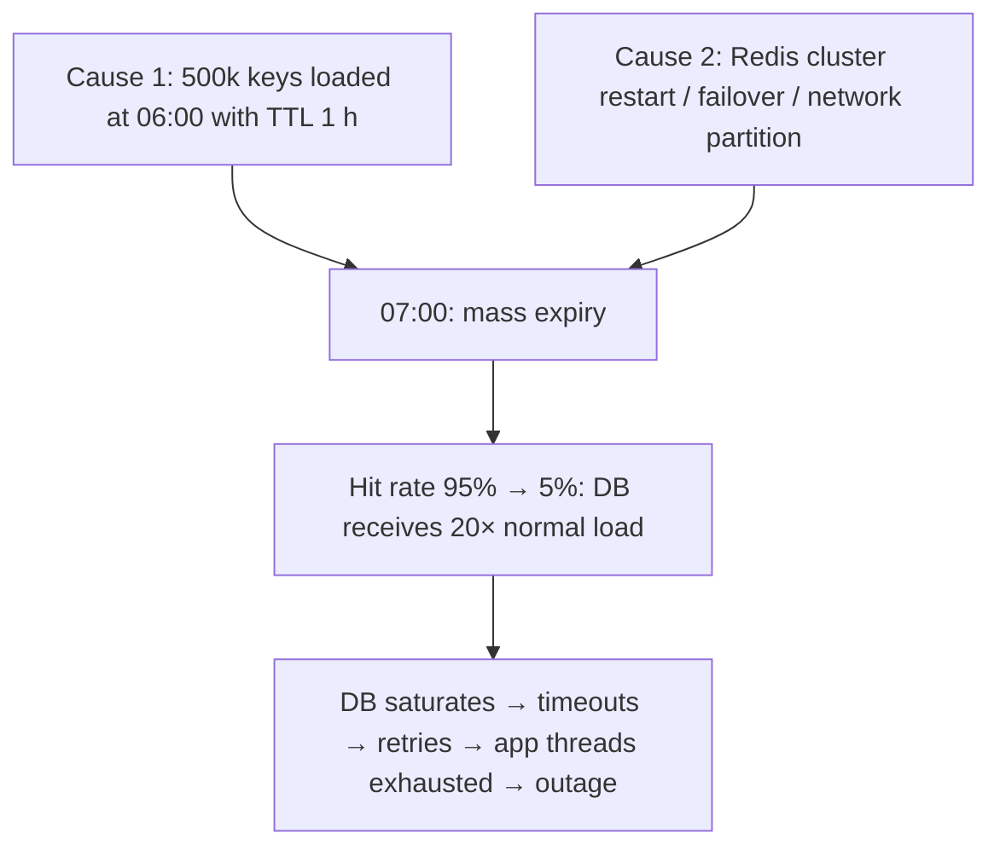

Defences:
- **TTL jitter** (prevent synchronised expiry).
- **Cache HA**: replicas, Redis Cluster across AZs, persistence for warm restarts.
- **Multi-level caches**: L1 in-process keeps serving if Redis is down.
- **Circuit breaker / bulkhead** on DB access, plus **load shedding** and **rate limiting** so the DB survives.
- **Stale-while-revalidate / serving stale on error**.
- **Warming** after planned restarts.

#### Example
A Redis primary in one AZ failed. Failover took 20 s, and during it the app fell back to Postgres for everything (40k req/s against capacity for 5k). Postgres went down, then stayed down because retries kept hammering it after Redis was back. Fixes: a circuit breaker allowing at most ~4k req/s of fallback DB reads (the rest get degraded responses), Caffeine L1 for the hottest data, jittered TTLs, and retries with backoff.

#### Trade-offs
Resilience features (circuit breakers, degraded modes, L1) add complexity and require product decisions about what to show when data is unavailable.

#### Problems & fixes
| Symptom | Cause | Fix |
|---|---|---|
| DB overload after cache failover | all reads fall back to DB | circuit breaker + load shedding, L1 cache, cache HA |
| Periodic large DB spikes | synchronised TTLs | jitter |
| Outage persists after cache recovers | retry storms | exponential backoff + jitter, retry budgets |
| Cold cache after restart | no persistence/warming | RDB persistence, warm-up job |

#### Cheat sheet
- Avalanche = many keys or the whole cache gone at once.
- Jitter + cache HA + L1 + circuit breaker / load shedding on DB + stale-on-error.
- Size the DB fallback capacity explicitly.

#### Interview questions
<details><summary>Your Redis cluster goes down for 2 minutes. How should the system behave?</summary>

Stay up in a degraded mode: in-process L1 caches keep serving hot data, and DB access goes through a circuit breaker or rate limiter sized to what the DB can actually handle, so excess requests get degraded responses (cached defaults, "try again" for non-critical features) instead of overwhelming it. Critical flows (checkout) get priority (bulkheads). When Redis returns, warm it gradually and use backoff so retries don't stampede.
</details>

<details><summary>Stampede vs avalanche: what's the difference in mitigation?</summary>

A stampede is one hot key: fix it with per-key single-flight, stale-while-revalidate or early refresh. An avalanche is many keys or the entire cache tier: fix it with TTL jitter, cache high availability and persistence, multi-level caching, and protecting the database with circuit breakers, load shedding and rate limits.
</details>

#### Interview angle
> "I assume the cache will fail. TTLs are jittered, Redis is replicated across AZs, an in-process L1 serves the hottest data, and database fallback goes through a circuit breaker sized to what the DB can survive."

#### Sources
- [Caching challenges and strategies](https://aws.amazon.com/builders-library/caching-challenges-and-strategies/) — Amazon Builders' Library
- [Circuit breaker](https://martinfowler.com/bliki/CircuitBreaker.html) — Martin Fowler

### Staggered TTL + circuit breaker to handle cache avalanche
The practical recipe against avalanches combines **prevention** (staggered/jittered TTLs so keys don't expire together) with **containment** (a circuit breaker and rate limiter in front of the database so that, when the cache does fail, only as much traffic as the DB can survive gets through, and the rest degrades gracefully).

#### Intuition
Two safety measures for a building. Stagger closing times so the whole crowd does not leave by one door together. And fit a fuse, so if the wiring overloads anyway, the fuse trips before the building burns.

#### Must know
- **Prevention**: jittered TTLs, so keys do not expire together.
- **Containment**: a rate limiter and **circuit breaker** in front of database fallback.
- Breaker states: closed → open (fail fast) → half-open (trial requests) → closed.
- When the breaker is open, return stale data or a placeholder, not an error page.
- Reserve capacity for critical flows with bulkheads, and set limits from load tests.

#### Common mistakes
- A timeout only. It still sends every request to the struggling database.
- One shared connection pool, so checkout starves along with everything else.
- A rate limit picked by guess, above what the database can survive.

#### How it works
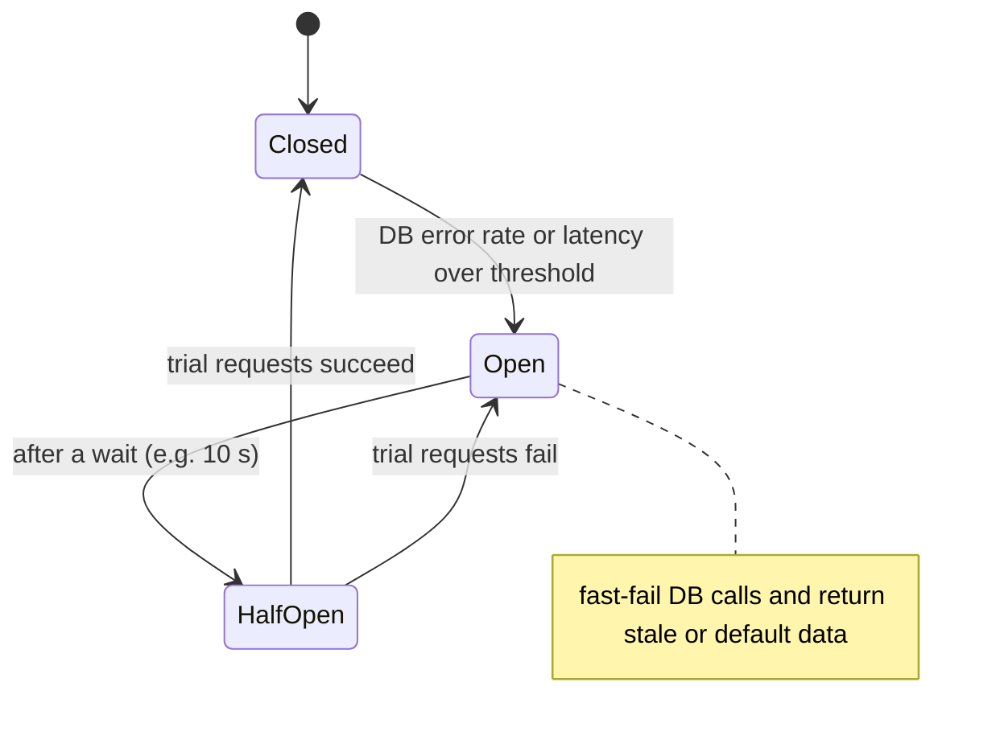

```java
// Resilience4j: protect DB fallback reads behind the cache
CircuitBreaker cb = CircuitBreaker.of("productDb", CircuitBreakerConfig.custom()
    .failureRateThreshold(50).slowCallDurationThreshold(Duration.ofMillis(500)).slowCallRateThreshold(50)
    .waitDurationInOpenState(Duration.ofSeconds(10)).build());
RateLimiter rl = RateLimiter.of("productDbRate", RateLimiterConfig.custom()
    .limitForPeriod(4000).limitRefreshPeriod(Duration.ofSeconds(1)).timeoutDuration(Duration.ZERO).build());

Product load(long id) {
  Supplier<Product> dbCall = RateLimiter.decorateSupplier(rl, CircuitBreaker.decorateSupplier(cb, () -> repo.load(id)));
  return Try.ofSupplier(dbCall).recover(ex -> staleCache.getOrDefault(id, Product.placeholder(id))).get();
}
```

TTL: `base + random(0, base × 0.2)`.

#### Example
During a Redis outage, the product service allows at most 4,000 DB reads/s (measured DB capacity minus headroom). Excess requests get the last known value from an in-process stale map or a placeholder ("price loading"). Checkout's price validation has a separate bulkhead with guaranteed DB capacity. Customers see slightly degraded pages instead of a full outage.

#### Trade-offs
Degraded responses need product agreement (what can be stale or hidden?). Thresholds need tuning from load tests.

#### Problems & fixes
| Symptom | Cause | Fix |
|---|---|---|
| Breaker flaps open/closed | thresholds too sensitive, small sample windows | larger windows, minimum calls, slow-call thresholds |
| Critical paths starved during degradation | shared DB pool | bulkheads: separate pools/limits per criticality |
| DB still overwhelmed | rate limit above true capacity | load-test to find capacity, limit below it |

#### Cheat sheet
- Prevent: TTL jitter. Contain: rate limiter + circuit breaker on DB fallback.
- Degrade: stale data / placeholders. Prioritise critical flows with bulkheads.
- Set limits from load tests, not guesses.

#### Interview questions
<details><summary>What does the circuit breaker achieve that a timeout alone doesn't?</summary>

A timeout bounds each request's wait but still sends every request to the struggling database, so it stays overloaded and threads pile up waiting. A circuit breaker notices the failure rate and stops sending requests for a while (fast-fail), giving the DB room to recover and freeing app threads, then probes with a few trial requests before closing again.
</details>

<details><summary>How do you decide what to serve when the breaker is open?</summary>

Per feature, with product input: serve last-known (stale) data where slightly old is fine (product descriptions, recommendations), hide non-essential widgets, show placeholders, or queue the action for later. Keep critical correctness paths (payment, final price check) on reserved capacity rather than degraded data.
</details>

#### Interview angle
> "Jittered TTLs prevent synchronised expiry. If the cache fails anyway, a rate limiter and circuit breaker only let through what the database can survive, and everything else gets stale or placeholder data."

#### Sources
- [CircuitBreaker](https://resilience4j.readme.io/docs/circuitbreaker) — Resilience4j docs
- [Circuit breaker pattern](https://learn.microsoft.com/en-us/azure/architecture/patterns/circuit-breaker) — Azure Architecture Center
- [Timeouts, retries, and backoff with jitter](https://aws.amazon.com/builders-library/timeouts-retries-and-backoff-with-jitter/) — Amazon Builders' Library

### Cache consistency — dual write problem: cache + DB atomicity impossible without distributed transaction
Keeping a cache consistent with the database is fundamentally a **dual-write problem**: there's no atomic transaction spanning Redis and Postgres. Any sequence of "update DB, update or delete cache" can be interrupted or reordered by concurrency, leaving stale data. The goal is **bounded staleness**, not perfection.

#### Intuition
Updating a price in the ledger and on the shelf tag. They are two separate actions, so there is always a moment when they disagree, and if you are interrupted in between they stay that way.

#### Must know
- No transaction spans the cache and the database, so this is a **dual-write problem**.
- Aim for **bounded staleness**, not perfection.
- Rules: commit to the database first, **delete** the cache key afterwards, always keep a TTL.
- A race remains (a reader can put the old value back just after the delete). Stronger options are versioned cache writes or CDC-driven invalidation.
- Decisions about money read the source of truth.

#### Common mistakes
- Updating the cache before the commit, then rolling back.
- "Set the new value" on write, which concurrent writers can reorder.
- Promising that the cache and database are always consistent.

#### How it works
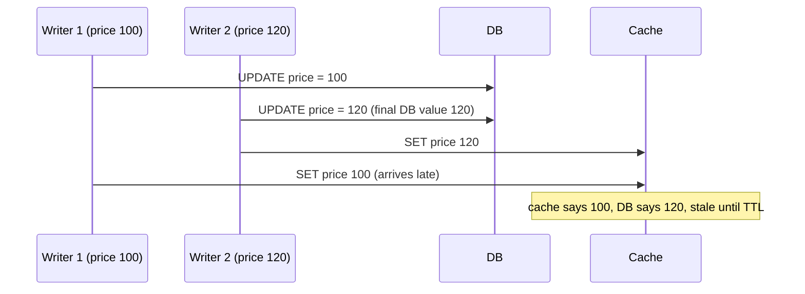

Strategies, from simple to robust:
| Strategy | Staleness risk |
|---|---|
| TTL only | up to TTL |
| Update DB → **delete** cache (cache-aside) | small race window (old value repopulated by a concurrent reader) |
| Delete → update DB → delayed second delete | narrows the race |
| Versioned values + compare-and-set in cache (Lua: only write if version newer) | ordering-safe |
| **CDC-driven invalidation** (DB log → Kafka → invalidator) | ordered and reliable, small lag |
| Write-through via a single writer per key | ordering serialised |

Golden rules: never update the cache **before** the DB commits, prefer **delete** over **set** on writes, always keep a **TTL** as a safety net.

#### Example
A pricing service uses update-DB-then-delete-cache plus a Debezium consumer that also deletes on every `products` change event (catching writes made by other services or manual SQL). TTL is 10 minutes as a backstop. Checkout re-reads the price from the DB, so even rare staleness on product pages never affects the amount charged.

#### Trade-offs
Stronger consistency mechanisms (CDC, versioning) add infrastructure and lag. Simpler ones accept small windows of staleness. Decide per data type what staleness is tolerable.

#### Problems & fixes
| Symptom | Cause | Fix |
|---|---|---|
| Cache shows value from a rolled-back transaction | cache updated before commit | update/delete only after commit (afterCommit hooks) |
| Occasional long-lived stale entries | reader repopulates old value after delete | delayed double delete, versioned SET, short TTL |
| Writes from other services never invalidate | invalidation only in one code path | CDC-based invalidation |
| Stale price charged | trusting cache for critical decision | read source of truth at decision points |

#### Cheat sheet
- No atomic cache + DB write, so design for bounded staleness.
- DB commit → delete cache. Keep a TTL backstop. CDC for robustness. Versioning for ordering.
- Critical decisions read the source of truth.

#### Interview questions
<details><summary>Why is "update the cache, then the database" dangerous?</summary>

If the DB update fails or the transaction rolls back, the cache holds a value that was never committed, and every reader sees data that doesn't exist. Concurrent writers can also interleave so the cache and DB end up with different "last" values. Always commit to the DB first, then delete (or carefully update) the cache.
</details>

<details><summary>How would you guarantee cache invalidation even for writes made outside your service?</summary>

Use change data capture on the database: Debezium reads the WAL or binlog and publishes row-change events to Kafka, and an invalidation consumer deletes or updates the corresponding cache keys. Every committed change, from any writer including manual SQL and other services, triggers invalidation in commit order, with TTL as a final safety net.
</details>

#### Interview angle
> "Cache and DB can't be updated atomically, so I aim for bounded staleness: commit first, then delete the key, with CDC invalidation as a backstop, TTLs everywhere, and money decisions always read the source of truth."

#### Sources
- [Scaling Memcache at Facebook](https://www.usenix.org/conference/nsdi13/technical-sessions/presentation/nishtala) — Nishtala et al., USENIX NSDI 2013
- [Cache-aside pattern](https://learn.microsoft.com/en-us/azure/architecture/patterns/cache-aside) — Azure Architecture Center

### Event-driven cache invalidation — use CDC (Debezium → Kafka) to invalidate on DB change
Instead of relying on every code path to remember to invalidate the cache, **watch the database itself**. CDC tools read the transaction log and emit an event for every committed change, and a consumer invalidates or updates the cache keys affected. Invalidation becomes reliable, ordered and independent of who wrote the data.

#### Intuition
Stop asking every employee to remember to tell the noticeboard when something changes. Put a clerk beside the official record book who updates the noticeboard whenever a new line is written, whoever wrote it.

#### Must know
- CDC reads the database's **commit log** and emits an event for every committed change.
- A consumer deletes or updates the affected cache keys.
- It catches **every writer**: other services, admin SQL, batch jobs.
- Events come after commit and in order per key, when the topic is partitioned by primary key.
- It adds a small lag, so the writer may also delete the key directly. Keep a TTL as the backstop.

#### Numbers to quote
- Typical end-to-end lag: tens to hundreds of milliseconds.

#### Common mistakes
- A stopped connector holding a replication slot until the database disk fills.
- Invalidating only the entity key and forgetting list or aggregate caches built from it.
- Expecting read-your-writes from CDC alone.

#### How it works
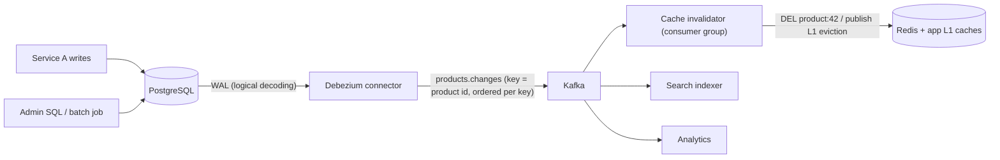

- Events arrive **after commit** in **commit order per key** (Kafka partition by primary key), so there's no invalidation for rolled-back writes.
- The consumer can **delete** keys (simple) or **update** them with the new row (if the full row is in the event), and fan out to L1 caches via pub/sub.
- Lag is typically tens to hundreds of ms. Monitor connector lag and replication slot size.

#### Example
A product catalogue edited by 3 services, an admin UI and nightly import jobs. Developers kept forgetting invalidation in new code paths, so stale prices stayed visible for up to the 1-hour TTL. Adding Debezium → Kafka → an invalidator that deletes `product:{id}` and the related listing keys fixed staleness to under a second for **every** writer, and the same event stream also updates the Elasticsearch index.

#### Trade-offs
Reliable and decoupled, but needs Kafka + Debezium infrastructure, adds a small lag (not read-your-writes for the writer unless the writer also invalidates directly), and an unconsumed replication slot can fill the DB disk.

#### Problems & fixes
| Symptom | Cause | Fix |
|---|---|---|
| Postgres disk filling with WAL | stopped Debezium connector holding slot | monitor slot lag, alerts, `max_slot_wal_keep_size` |
| Writer sees own stale data briefly | CDC lag | writer also deletes cache directly after commit (belt and braces) |
| Derived cache keys not invalidated (lists, aggregates) | event maps to one key only | maintain mapping entity → dependent keys, or use cache tags |
| Out-of-order updates | events partitioned wrongly | partition by primary key |

#### Cheat sheet
- DB log → Debezium → Kafka → invalidator → cache. After-commit, ordered per key.
- Catches every writer. Lag ~100 ms. Monitor replication slots.
- Combine with direct delete in the writer + TTL backstop.

#### Interview questions
<details><summary>Why is CDC-based invalidation more reliable than invalidating in application code?</summary>

Application invalidation depends on every write path (other services, admin tools, migrations, manual fixes) remembering to do it, and a crash between commit and invalidation skips it. CDC reads the database's commit log, so every committed change produces an event regardless of who made it, in commit order, and it can be replayed after consumer failures.
</details>

<details><summary>How do you invalidate list or aggregate caches (like a "category page") on a single product change via CDC?</summary>

Maintain a mapping from entities to dependent cache keys (product → its category pages and search result keys), or tag cache entries (`tag:category:7`) and invalidate by tag, or key list caches by version (`category:7:v{n}`) and bump the version on any member change. For CDNs, use surrogate-key purges from the invalidator.
</details>

#### Interview angle
> "Invalidation is driven by CDC: Debezium streams committed changes through Kafka to an invalidator, so every writer, even manual SQL, clears the cache in commit order within about 100 ms."

#### Sources
- [Automating cache invalidation with change data capture](https://debezium.io/blog/2018/12/05/automating-cache-invalidation-with-change-data-capture/) — Debezium blog
- [Debezium connector for PostgreSQL](https://debezium.io/documentation/reference/stable/connectors/postgresql.html) — Debezium docs

