## Caching layers & tools

### Client-side cache — browser cache, service worker, localStorage (for static assets)
The fastest request is the one never sent. Client-side caches (the **browser HTTP cache**, **service workers** and **storage APIs** like localStorage and IndexedDB, plus mobile app caches) keep data on the user's device, eliminating network round trips for repeat visits.

#### How it works
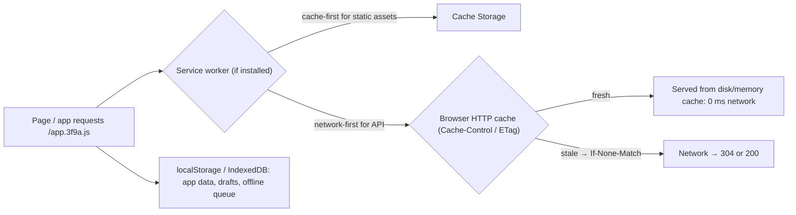

| Layer | Controlled by | Good for |
|---|---|---|
| HTTP cache | server headers | static assets, cacheable GETs |
| Service worker + Cache Storage | your JS | offline support, custom strategies (cache-first, stale-while-revalidate) |
| localStorage | your JS (sync, ~5 MB, strings) | small preferences, feature flags |
| IndexedDB | your JS (async, large, structured) | offline data, queues of pending actions |
| Mobile (OkHttp cache, Room, Core Data) | app | API responses, offline-first data |

#### Example
A PWA for field sales agents with poor connectivity: a service worker caches the app shell (cache-first) and product catalogue API responses (stale-while-revalidate). Orders taken offline are stored in IndexedDB and synced in the background when connectivity returns (Background Sync), with idempotency keys so retries don't duplicate orders.

#### Trade-offs
Zero-latency repeat loads and offline capability, but you can't force-invalidate a user's cache from the server (only via versioned URLs and headers). Stale clients, storage limits and security (never store tokens or PII in localStorage, which XSS can read) need care.

#### Problems & fixes
| Symptom | Cause | Fix |
|---|---|---|
| Users stuck on old version | aggressive SW cache / long max-age on HTML | versioned assets, SW update flow (skipWaiting + prompt), HTML no-cache |
| Tokens stolen via XSS | auth token in localStorage | HttpOnly cookies |
| Offline actions duplicated on sync | retries without dedupe | idempotency keys per queued action |
| QuotaExceededError | storage limits | evict old data, use IndexedDB with limits |

#### Cheat sheet
- HTTP cache via headers. Service worker for offline and strategies. IndexedDB for data.
- Invalidate via versioned URLs, since you can't purge a user's device.
- No secrets in localStorage. Idempotent offline sync.

#### Interview questions
<details><summary>How would you make a web app usable offline for field workers?</summary>

A service worker caches the app shell (cache-first) and key API data (stale-while-revalidate). User actions taken offline are stored in IndexedDB as a queue with client-generated idempotency keys and synced via Background Sync or on reconnect. The server dedupes by key. Show sync status in the UI and handle conflicts (server wins, or merge) for edits made by others meanwhile.
</details>

<details><summary>Why can't the server invalidate content cached in users' browsers, and how do you cope?</summary>

The browser cache is local to each device, and HTTP has no push-invalidation for it. The server only controls caching through headers at the time of the response. Cope with short or `no-cache` policies for mutable resources (HTML, APIs) and long-lived caching only for content-addressed (hashed) URLs that never change.
</details>

#### Interview angle
> "Static assets live in the browser cache via hashed URLs. For offline needs, a service worker serves the shell and queues writes in IndexedDB with idempotency keys. Tokens never go in localStorage."

### In-process cache — Caffeine (JVM), Guava Cache, Node.js Map/LRU cache
An in-process cache lives **inside the application's memory**: a lookup is a hash-map access taking nanoseconds, with no network hop or serialisation. It's ideal for small, hot, read-mostly data (config, reference data, hot entities), but every instance has its own copy, so consistency and memory need care.

#### How it works
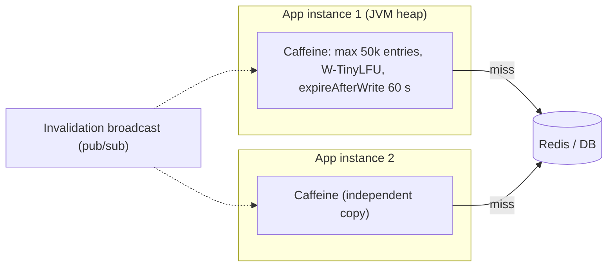

```java
LoadingCache<String, FeatureFlags> flags = Caffeine.newBuilder()
    .maximumSize(1_000)
    .refreshAfterWrite(Duration.ofSeconds(30))     // async refresh, callers never block after the first load
    .recordStats()                                 // hit rate metrics via Micrometer
    .build(tenant -> flagService.load(tenant));
```
Node.js: `lru-cache` package. Python: `functools.lru_cache`, `cachetools`. Go: `ristretto`, `bigcache`.

#### Example
A pricing service evaluates discount rules on every request, and the rules change a few times a day. Caching the rule set in Caffeine with a 30 s refresh removes ~20k Redis reads/s and ~1 ms per request. A pub/sub "rules-updated" message triggers immediate refresh on all instances.

#### Trade-offs
| Pros | Cons |
|---|---|
| nanosecond reads, no network, no serialisation | duplicated per instance (memory × N pods) |
| survives Redis outages | inconsistent across instances until TTL / invalidation |
| simple | GC pressure for large caches in JVM, lost on restart |

#### Problems & fixes
| Symptom | Cause | Fix |
|---|---|---|
| Instances return different values | independent caches, no invalidation | short TTL, pub/sub invalidation |
| Long GC pauses / OOM | huge in-heap cache | size limits by weight, off-heap (Caffeine + Ehcache off-heap, Chronicle Map) |
| Stampede on each pod start | cold caches | warm on startup before readiness |
| Hit rate unknown | no stats | `recordStats()` + metrics export |

#### Cheat sheet
- Caffeine (W-TinyLFU) is the JVM default. Bound by size or weight. TTL or refresh.
- Best for small hot read-mostly data. Per-instance copies.
- Invalidate via pub/sub. Export hit-rate metrics.

#### Interview questions
<details><summary>When would you use an in-process cache instead of Redis?</summary>

For small, very hot, read-mostly data where nanosecond access matters and slight staleness across instances is acceptable: config, feature flags, reference data (currencies, categories), hot keys absorbed in front of Redis. Use Redis when data must be shared and consistent across instances, is larger than an instance's memory budget, or needs to survive restarts.
</details>

<details><summary>How do you keep in-process caches consistent across 50 pods?</summary>

Bound staleness with short TTLs or refreshAfterWrite, and push invalidations: publish a message (Redis pub/sub, Kafka) on change that every pod consumes to evict or refresh the key. Alternatively, use Redis client-side caching with tracking, which notifies clients of changes. Critical correctness checks still read the source of truth.
</details>

#### Interview angle
> "Hot reference data like flags and pricing rules sits in Caffeine with refreshAfterWrite and pub/sub invalidation: nanosecond reads, and it keeps working when Redis is down."

### Distributed cache — Redis, Memcached, Apache Ignite
A distributed cache is a **separate, shared caching tier** (a cluster of nodes holding key-value data in memory) that all application instances use over the network. It gives every instance the same view, scales beyond one machine's memory and survives app restarts, at the cost of a network round trip (~0.2–1 ms).

#### How it works
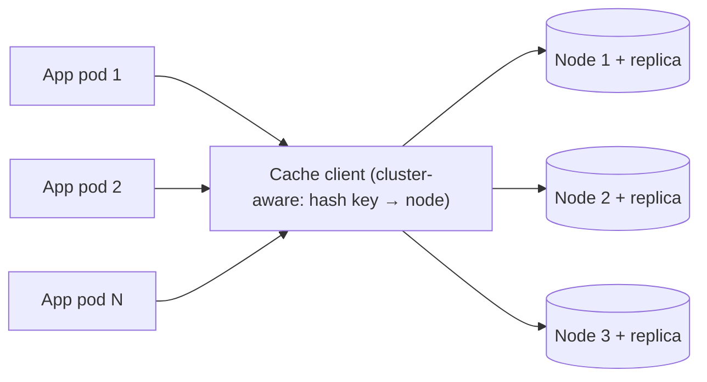

| | Redis | Memcached | Apache Ignite / Hazelcast |
|---|---|---|---|
| Model | data structures, Lua, streams, pub/sub | plain key-value strings | distributed maps, SQL, compute grid |
| Persistence | RDB/AOF | none | native persistence |
| HA | replicas, Sentinel, Cluster | client-side sharding, no replication | partitions with backups |
| Typical use | general cache + rate limits + leaderboards | simple, huge, multi-threaded cache | in-memory data grid, near-cache, compute close to data |

Managed options: ElastiCache / MemoryDB (AWS), Memorystore (GCP), Azure Cache for Redis.

#### Example
A ride-hailing backend: sessions, rider and driver profiles, surge multipliers per geohash, and rate-limit counters all in a Redis Cluster (6 shards × 1 replica across 3 AZs). 300k ops/s at sub-ms latency is shared by 400 service pods, so every pod sees the same surge value at the same time, which an in-process cache can't guarantee.

#### Trade-offs
Shared and consistent across instances, large capacity, rich features, but there's a network hop, another critical system to run (its failure must not cascade), and serialisation costs.

#### Problems & fixes
| Symptom | Cause | Fix |
|---|---|---|
| Cache outage cascades to DB outage | no fallback limits | circuit breakers, L1 cache, cache HA |
| High latency to cache | cross-AZ calls, big values, connection churn | same-AZ reads (replicas), smaller values, pooled connections |
| Memory full / evictions | under-sized cluster | capacity planning, eviction monitoring |
| Hot node | hot key | L1 + key replication |

#### Cheat sheet
- Shared cache tier: consistent view for all pods, scales out, ~sub-ms.
- Redis (features) vs Memcached (simple, multi-threaded) vs Ignite/Hazelcast (data grid).
- Plan for its failure: replicas, L1, circuit breakers.

#### Interview questions
<details><summary>Why use a distributed cache instead of each instance caching locally?</summary>

All instances share one consistent copy, so an update or invalidation is visible to all immediately. Total capacity scales across nodes rather than being limited to (and duplicated in) each pod's memory. Data survives app restarts and deploys. And it supports shared-state features like rate limiting, sessions and locks that require a single view.
</details>

<details><summary>What would you put in the distributed cache for an e-commerce site?</summary>

Product details and pricing (with TTL plus invalidation), session and cart data, rendered fragments of hot pages, rate-limit counters, inventory hints for display (not for final checks), feature flags (or L1 for these), recently viewed items lists, and search autocomplete results for popular prefixes.
</details>

#### Interview angle
> "Shared state like sessions, rate limits and surge values lives in a Redis Cluster across AZs, with an in-process L1 in front for hot keys and circuit breakers so a cache outage can't cascade to the database."

### Memcached vs Redis — Memcached: multi-threaded, pure cache; Redis: rich data types, persistence, Lua
Both are in-memory key-value caches with sub-millisecond latency. **Memcached** is deliberately simple: strings only, multi-threaded, no persistence, no replication. **Redis** is a data-structure server with persistence, replication, clustering, scripting, pub/sub and streams. Today Redis (or Valkey, its open-source fork) is the default, and Memcached still shines for huge, simple object caching.

#### How it works
| | Memcached | Redis |
|---|---|---|
| Data model | opaque strings (≤ 1 MB by default) | strings, hashes, lists, sets, sorted sets, streams, HLL, geo, bitmaps |
| Threading | multi-threaded (scales on many cores) | single-threaded command execution (I/O threads since 6.0), scale by sharding |
| Persistence | none | RDB / AOF |
| Replication / HA | none built-in (client-side sharding) | replicas, Sentinel, Cluster |
| Eviction | LRU (segmented, slab-based) | 8 policies incl. LFU |
| Atomic ops | `incr/decr`, CAS | many atomic commands, transactions, Lua |
| Memory efficiency | slab allocator, good for uniform object sizes | per-key overhead, compact encodings for small structures |

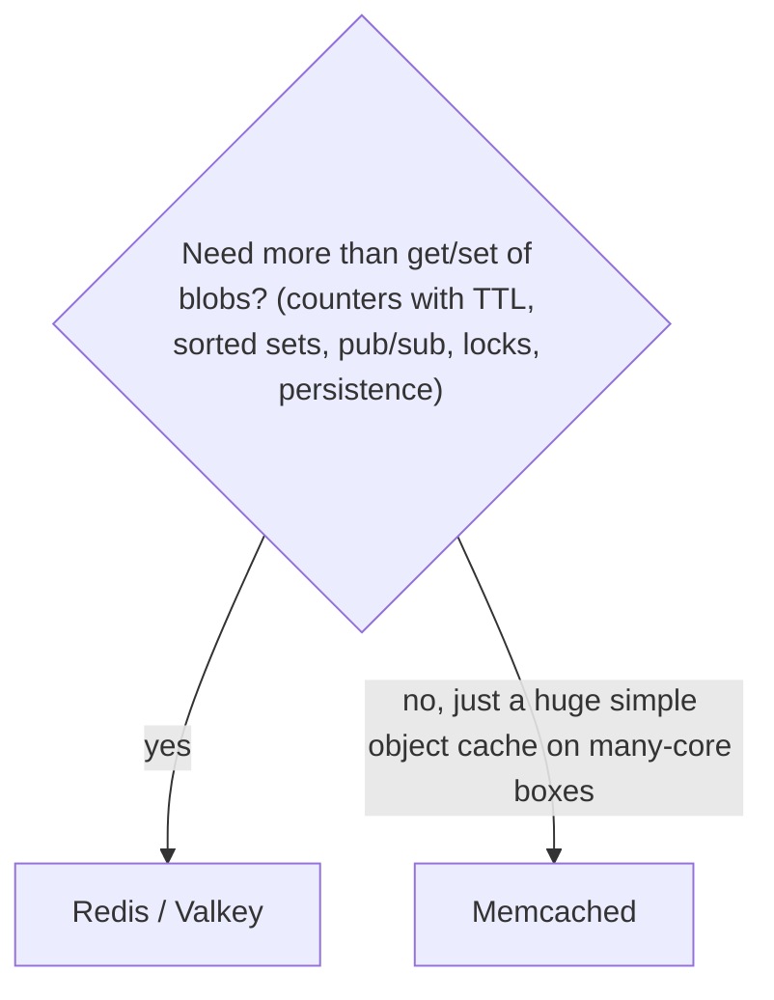

#### Example
Facebook famously runs Memcached at massive scale as a look-aside cache for rendered objects (with its own tooling for invalidation and leases). A typical startup or product company uses Redis for everything (cache, sessions, rate limiting, leaderboards, queues), because one system with rich types beats two.

#### Trade-offs
Memcached: simpler, multi-threaded vertical scaling, predictable, but no HA or persistence (node loss = cache misses). Redis: versatile and HA, but heavier per-key memory overhead, and single-threaded command execution means sharding to scale CPU.

#### Problems & fixes
| Symptom | Cause | Fix |
|---|---|---|
| Memcached node loss → miss storm | no replication | consistent hashing, warm-up, DB protection |
| Redis CPU-bound on one core | single-threaded execution | shard (Cluster), I/O threads, avoid heavy commands |
| Memcached memory wasted | slab class mismatch with object sizes | tune slab growth factor, slab rebalancing |

#### Cheat sheet
- Memcached = simple, multi-threaded, volatile blob cache.
- Redis = data structures + persistence + HA + scripting.
- Default to Redis/Valkey unless you need only massive simple caching.

#### Interview questions
<details><summary>Your team wants rate limiting, leaderboards and caching. Memcached or Redis?</summary>

Redis: rate limiting needs atomic counters with expiry (or Lua token buckets), leaderboards need sorted sets, and caching works in both. Memcached offers only string get/set and incr without rich structures, persistence or replication, so it would need extra systems for the other features.
</details>

<details><summary>When could Memcached still be the better choice?</summary>

For a very large, simple object cache (serialised blobs) on many-core machines where multi-threaded throughput per node matters, no persistence or HA is needed (the cache is fully rebuildable), and operational simplicity is valued, e.g. caching rendered page fragments or query results at huge scale.
</details>

#### Interview angle
> "I'd default to Redis or Valkey because one system covers caching, counters, leaderboards and locks. Memcached only makes sense as a huge, simple, multi-threaded blob cache that's fully rebuildable."

### Two-level cache architecture — L1 in-process (nanoseconds) + L2 Redis (microseconds)
A two-level cache puts a small **in-process L1** (Caffeine) in front of a shared **L2** (Redis) in front of the database. Hot keys are served from local memory in nanoseconds, the shared L2 keeps instances mostly consistent and absorbs L1 misses, and the database sees very little traffic.

#### How it works
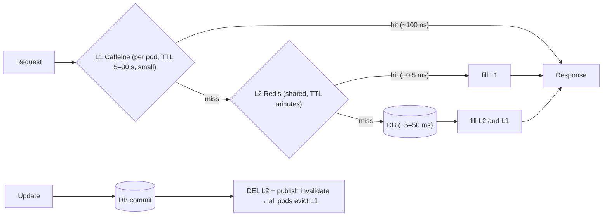

Design choices:
- L1 holds only hot keys, a small size and a **short TTL** (it bounds cross-instance staleness).
- Invalidation: delete L2, then broadcast an L1 eviction (Redis pub/sub or Kafka), or use Redis 6 client-side caching (`CLIENT TRACKING`), where Redis notifies clients.
- Libraries: Spring `CompositeCacheManager`, JetCache, Redisson local cached maps, Hazelcast near-cache.

#### Example
A product-detail service at 80k req/s across 40 pods: L1 hit rate 70% (hot products), L2 hit rate 28%, DB 2%. Redis traffic is cut to ~24k ops/s and the DB to ~1.6k QPS. p50 latency drops from 1.2 ms to 0.2 ms. On product update the writer deletes the Redis key and publishes `invalidate:product:42`, and each pod evicts it from L1 within ~10 ms.

#### Trade-offs
Best latency and resilience (L1 serves during Redis blips), but there are two places to invalidate, memory per pod, and possible brief inconsistency between pods.

#### Problems & fixes
| Symptom | Cause | Fix |
|---|---|---|
| Pods disagree on a value for seconds | L1 not invalidated | pub/sub invalidation, shorter L1 TTL |
| Missed invalidation message | pub/sub is fire-and-forget | short L1 TTL as backstop, or Kafka with offsets |
| L1 memory pressure | caching too much locally | L1 only for hot keys, size limits |
| Stampede at L2 when L1 expires across all pods | synchronised L1 TTL | jitter, refreshAfterWrite |

#### Cheat sheet
- L1 (local, tiny, short TTL) → L2 (Redis, shared) → DB.
- Invalidate: DEL L2 + broadcast L1 evict (or Redis client tracking).
- L1 TTL bounds cross-pod staleness.

#### Interview questions
<details><summary>How do you invalidate a two-level cache correctly on update?</summary>

After the DB commit, delete the key from L2 (Redis), then broadcast an invalidation (pub/sub or Kafka) that each instance consumes to evict the key from its L1. Keep L1 TTLs short so a lost message only causes brief staleness. Order matters: commit first, then L2, then L1, so instances that reload don't repopulate L1 from a stale L2.
</details>

<details><summary>Why not make the L1 cache large with long TTLs?</summary>

Each pod holds its own copy, so memory multiplies by the pod count, long TTLs extend the window during which pods serve different or stale values when invalidation fails, and large heaps increase GC pressure. L1 should hold only the hottest keys briefly. L2 holds the broad working set.
</details>

#### Interview angle
> "Hot paths use a two-level cache: a tiny short-TTL Caffeine L1 per pod, a shared Redis L2, and invalidation by deleting from L2 and broadcasting an L1 eviction after the DB commit."

### CDN edge cache — CloudFront, Fastly, Cloudflare cache static and semi-static content
A CDN edge cache stores HTTP responses at points of presence near users. It's the outermost and highest-leverage cache layer: hits are served in ~10–30 ms from a nearby city without touching your infrastructure, and it absorbs global traffic spikes and DDoS attacks.

#### How it works
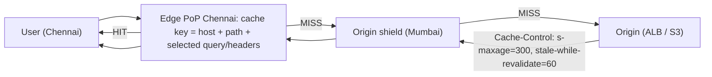

What to cache at the edge:
| Content | Policy |
|---|---|
| Hashed JS/CSS/images/fonts | 1 year, immutable |
| Product images, video segments | long TTL |
| Product/category pages, public API GETs | short `s-maxage` (30–300 s) + SWR + tag purge |
| Personalised pages, account APIs | don't cache (`private, no-store`), or edge-compose |

Key settings: **cache key normalisation** (ignore tracking params like `utm_*`, sort query params, whitelist headers), **origin shield**, **stale-if-error** for origin outages, **purge by tag** for instant updates.

#### Example
A sale event: category pages are cached at the edge with `s-maxage=60, stale-while-revalidate=300` and tagged by category. 3M users browsing generate ~95% edge hits, so the origin sees ~150k req/min instead of 3M. A price update triggers a tag purge for the affected product and categories, visible globally in seconds.

#### Trade-offs
Massive scale and latency gains, but there's a risk of caching personalised data (leaks), stale content between purges, cache-key mistakes (low hit ratio or wrong variants), and per-request costs.

#### Problems & fixes
| Symptom | Cause | Fix |
|---|---|---|
| Hit ratio low | cache key includes cookies/all query params | normalise key, strip cookies for static paths |
| User sees another user's data | personalised response cached as public | `private, no-store`, bypass rules for authenticated requests |
| Origin overwhelmed after purge | everyone misses at once | origin shield, request collapsing, targeted tag purges |
| Site down when origin down | no stale serving | `stale-if-error`, long TTL for static |

#### Cheat sheet
- Outermost cache: static long TTL, semi-static short `s-maxage` + SWR + tag purge.
- Normalise cache keys. Shield the origin. Serve stale on error.
- Never cache personalised responses publicly.

#### Interview questions
<details><summary>How do you cache a product page at the CDN when the header shows the logged-in user's name and cart count?</summary>

Make the page itself anonymous and cacheable (`s-maxage` + tags), and load the personal parts (name, cart count) client-side from a small uncached API (`private`), or compose them at the edge via ESI or edge functions. The page cache key excludes cookies, while the personal API is never cached publicly.
</details>

<details><summary>How do you improve a CDN's cache hit ratio from 60% to 95%?</summary>

Normalise cache keys (drop irrelevant query params like utm tags, sort params, ignore cookies and headers that don't change content), lengthen TTLs for immutable content with hashed URLs, add `stale-while-revalidate`, enable an origin shield or tiered caching, and avoid `Vary` on high-cardinality headers. Then measure hit ratio per path to find the remaining misses.
</details>

#### Interview angle
> "The CDN is my biggest cache: hashed assets cached for a year, public pages with short s-maxage plus stale-while-revalidate and tag purges, normalised cache keys and an origin shield. Personalised data is never cached publicly."

### Reverse proxy cache — Nginx proxy_cache, Varnish Cache for HTTP response caching
A reverse proxy cache sits in your own infrastructure in front of application servers and stores HTTP responses (by URL plus a selected key), serving repeats without touching the app. It's like a private CDN layer: great for caching expensive pages or API responses close to the app, with full control over rules.

#### How it works
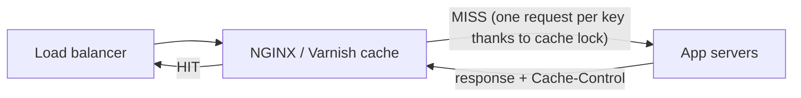

```nginx
proxy_cache_path /var/cache/nginx levels=1:2 keys_zone=api:200m max_size=20g inactive=60m;
server {
  location /api/catalog/ {
    proxy_cache api;
    proxy_cache_key "$scheme$host$uri$is_args$args";
    proxy_cache_valid 200 60s;
    proxy_cache_lock on;                                   # collapse concurrent misses
    proxy_cache_use_stale error timeout updating http_500 http_502 http_503;
    proxy_cache_background_update on;                      # stale-while-revalidate
    add_header X-Cache-Status $upstream_cache_status;
    proxy_pass http://app;
  }
}
```

Varnish uses VCL for programmable caching (grace mode, bans for invalidation, ESI).

#### Example
A news site's article pages take 300 ms to render (templates plus several queries). Varnish caches rendered HTML for 2 minutes, with grace mode serving stale for up to 1 hour if the app is down. 98% of requests are served from Varnish in under 1 ms. A "ban" on article id on edit refreshes it instantly.

#### Trade-offs
Cheap, controllable and very fast, without CDN costs, but it's another tier to scale and keep consistent, each proxy node has its own cache (consistency across nodes, purges must hit all), and it doesn't help latency for distant users like a CDN does.

#### Problems & fixes
| Symptom | Cause | Fix |
|---|---|---|
| Responses with Set-Cookie cached | proxy caches personalised responses | skip cache when Set-Cookie/Authorization present |
| Purge only cleared one node | multiple proxy nodes | broadcast purges / bans to all nodes |
| Stampede on expiry | no lock/background update | `proxy_cache_lock`, `use_stale updating`, Varnish grace |
| Disk cache thrashing | max_size too small | size for working set, monitor hit ratio |

#### Cheat sheet
- NGINX `proxy_cache` / Varnish in front of app servers.
- Use cache lock + stale-while-updating + stale-on-error.
- Never cache responses with Set-Cookie/Authorization. Purge all nodes.

#### Interview questions
<details><summary>When would you add a reverse proxy cache if you already have a CDN?</summary>

For content the CDN can't or shouldn't cache (internal APIs, authenticated-but-shared responses with custom keys), to shield the app from CDN misses (acting as an origin shield), for very fine-grained control over cache rules and invalidation (Varnish VCL), or when you don't use a CDN for certain traffic (internal services, B2B APIs).
</details>

<details><summary>How does NGINX prevent many concurrent requests for an uncached page from all hitting the app?</summary>

`proxy_cache_lock on` lets only the first request for a missing key go upstream while others wait for its response to be cached. `proxy_cache_use_stale updating` with `proxy_cache_background_update` serves the stale copy while one request refreshes it in the background.
</details>

#### Interview angle
> "In front of expensive renders I'd put NGINX or Varnish caching with cache lock, stale-while-updating and stale-on-error, skipping anything with cookies or auth headers."

### Database query result cache — application-level, careful with invalidation
Caching the **result of a query** (keyed by the query and its parameters) avoids re-running expensive SQL. Built-in DB query caches have largely disappeared (MySQL removed its query cache in 8.0 because invalidation was too coarse). The modern approach is **application-level caching** of results in Redis or in-process, with explicit invalidation logic.

#### How it works
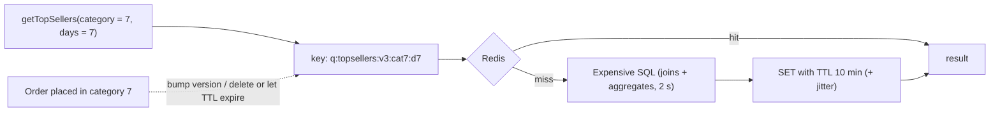

Key design:
- **Key** = query name + **version** + normalised parameters (bump the version when the query logic changes).
- **Invalidation**: TTL for aggregates that tolerate delay. For entity queries, invalidate on change (by tag or version key: `category:7:ver` incremented on change, included in the key).
- **Don't** cache per-user ad-hoc queries with huge cardinality. Hit rates will be low.

#### Example
"Top sellers in category last 7 days" scans millions of order rows (2 s). Cached with a 10-minute TTL, each category page serves it instantly, and the business accepts 10-minute freshness. A user's own order list isn't query-cached (high cardinality, must be fresh), and it's served by a good index instead.

Hibernate's second-level and query caches exist, but the query cache is invalidated whenever any involved table changes, so it rarely pays off on write-heavy tables.

#### Trade-offs
Huge savings for expensive, reusable, staleness-tolerant queries. Poor for fresh or per-user results, and invalidation by "which queries does this write affect?" is hard. Prefer TTLs or versioned keys.

#### Problems & fixes
| Symptom | Cause | Fix |
|---|---|---|
| Stale results after logic change | key lacks version | include a version in keys |
| Low hit rate, high memory | caching high-cardinality per-user queries | cache only shared expensive queries, fix with indexes instead |
| Results wrong after writes | no invalidation, long TTL | tag/version invalidation, shorter TTL |
| Huge cached result sets | caching full lists | cache ids/pages, paginate |

#### Cheat sheet
- Cache expensive, shared, staleness-tolerant query results in Redis.
- Key = name + version + params. TTL or version bump to invalidate.
- Prefer materialised views or precomputed tables for heavy aggregates.

#### Interview questions
<details><summary>Why did MySQL remove its built-in query cache?</summary>

It invalidated all cached results for a table whenever any row in that table changed, so on write-heavy tables entries were thrown away constantly. It used a global mutex that became a contention bottleneck on multi-core servers. And it only matched byte-identical queries. Application-level caching with explicit keys and TTLs gives better control and scalability.
</details>

<details><summary>How would you cache a dashboard query that aggregates the last 30 days of orders?</summary>

Precompute rather than cache ad hoc: a scheduled job or stream processor maintains daily aggregates (materialised view or summary table), and the dashboard sums 30 daily rows. On top, cache the final result in Redis with a TTL of a few minutes keyed by filter parameters plus a version. Invalidation is just TTL, since the dashboard tolerates minutes of delay.
</details>

#### Interview angle
> "I cache only expensive, shared, staleness-tolerant query results, with versioned keys and TTLs. Per-user queries get proper indexes, and heavy aggregates get precomputed summary tables."

### Redis Cluster for horizontal cache scaling — 16384 hash slots, add nodes to expand
When one Redis node's memory or CPU isn't enough, Redis Cluster spreads the keyspace over many masters using **16,384 hash slots**. You scale capacity by **adding nodes and moving slots** to them online, while each master's replica provides failover.

#### How it works
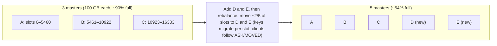

```bash
redis-cli --cluster add-node 10.0.5.21:6379 10.0.5.11:6379
redis-cli --cluster add-node 10.0.5.22:6379 10.0.5.21:6379 --cluster-slave   # replica for the new master
redis-cli --cluster rebalance 10.0.5.11:6379 --cluster-use-empty-masters
```

Managed services (ElastiCache cluster mode, MemoryDB) automate online resharding.

#### Example
A cache grows from 250 GB to 400 GB over a quarter. Adding 2 shards (each with a replica in another AZ) and rebalancing online keeps memory under 70% per node. Throughput scales too: 5 masters handle ~5× the single-node ops/s for well-distributed keys.

#### Trade-offs
Near-linear scale for memory and throughput, but cross-slot multi-key operations are restricted (use hash tags), clients must handle redirects, resharding adds temporary latency, and hot keys still don't spread.

#### Problems & fixes
| Symptom | Cause | Fix |
|---|---|---|
| Latency spikes during resharding | migrating big keys | avoid big keys, reshard off-peak, smaller batches |
| CROSSSLOT errors after moving to Cluster | multi-key commands across slots | hash tags, restructure commands |
| One node much fuller | uneven key sizes per slot | rebalance by weight, split big keys |
| Not enough headroom | resharding when already 95% full | scale at ~70%, alert on memory |

#### Cheat sheet
- Scale out by adding masters + replicas, then moving slots online.
- Scale at ~70% memory. Avoid big keys.
- Hash tags for multi-key ops. Hot keys need L1/replication.

#### Interview questions
<details><summary>How do you scale a Redis cache from 3 to 6 shards without downtime?</summary>

Add the new masters (and their replicas in other AZs) to the cluster, then rebalance hash slots onto them. Redis migrates keys slot by slot while serving traffic, and clients follow MOVED/ASK redirects and refresh their slot maps. Do it before memory gets tight, off-peak, and watch latency and big-key migrations. Managed services do this via an online resharding API.
</details>

<details><summary>Estimate how many Redis shards you need for 600 GB of cache data with replicas.</summary>

Assume ~50 GB usable per node to leave headroom (e.g. a 64 GB instance with maxmemory ~45–50 GB), so 600 / 50 = 12 masters, and with one replica each, 24 nodes. Then check throughput: if peak is 1.2M ops/s and each master handles ~100k ops/s comfortably, 12 masters also fit. Add 20–30% growth headroom.
</details>

#### Interview angle
> "I size the Redis Cluster for memory with headroom and for ops per second, scale out at about 70% memory by adding shards and rebalancing slots online, and avoid big keys that make migration slow."

### Cache sizing estimation — working set size (hottest 20% of data), benchmark hit rate target >95%
Sizing a cache means estimating the **working set**, the portion of data that receives most requests (often ~20% of keys serve ~80% or more of reads under a skewed distribution), multiplying by the size per entry plus overhead, and validating the **hit rate** you get at that size.

#### How it works
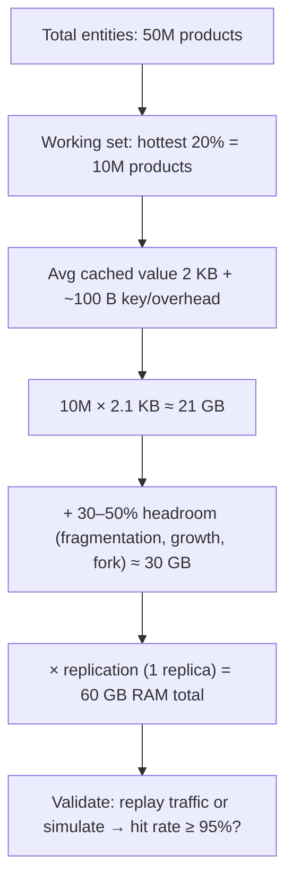

Steps:
1. **Requests/s and target hit rate** set DB load: at 50k req/s, a 95% hit rate means 2.5k DB QPS and 99% means 500. Each extra "9" can matter enormously.
2. **Working set** from access logs or analytics (unique keys accessed per hour or day, distribution skew).
3. **Bytes per entry**: serialised value + key + Redis overhead (~50–100 B per key, more for structures). Use `MEMORY USAGE key` on samples.
4. **Headroom** for fragmentation (`mem_fragmentation_ratio`), replication buffers, fork copy-on-write and growth.
5. **Validate** with a hit-rate curve (cache size vs hit rate) from log replay or a simulator.

#### Example
A news site: 2M articles, but 95% of reads hit articles from the last 3 days (~30k articles × 40 KB of rendered HTML ≈ 1.2 GB). Caching 3 GB (with headroom) gives a ~97% hit rate, while caching all 2M articles (80 GB) would only raise it to ~99%. The decision: 3 GB in Redis + CDN, and accept the long tail going to the DB, which handles it easily.

#### Trade-offs
Bigger caches raise hit rates with diminishing returns (the long tail). Cost vs DB load vs latency decides where to stop. Revisit as traffic patterns shift.

#### Problems & fixes
| Symptom | Cause | Fix |
|---|---|---|
| High eviction rate, low hit ratio | cache smaller than working set | grow cache, compress values, shrink payloads |
| Memory far above estimate | per-key overhead, fragmentation | measure with MEMORY USAGE, use hashes for small objects, activedefrag |
| Hit rate fine on average, bad at peak | working set grows at peak (sales) | size for peak working set, warm before events |
| Paying for cache that barely helps | long-tail content cached | cache only the hot set, rely on DB/CDN for tail |

#### Cheat sheet
- Size = working set × (value + key + overhead) × headroom × replicas.
- Target ≥ 95% hit rate. Compute DB load = req/s × miss rate.
- Validate with measurements (MEMORY USAGE, hit-rate curves).

#### Interview questions
<details><summary>Estimate the Redis memory needed to cache user profiles for an app with 100M users, of whom 10M are daily active.</summary>

The working set is roughly the daily actives, 10M. Profile JSON ~1 KB + key and overhead ~100 B ≈ 1.1 KB, so ~11 GB. Add ~40% headroom for fragmentation and growth (~15 GB), and double for a replica: ~30 GB total, e.g. 2 shards of ~8 GB maxmemory each plus replicas, or a single larger node pair. Validate the hit rate (expect 95%+ since DAUs re-read their own profiles).
</details>

<details><summary>Why does going from a 95% to a 99% hit rate matter so much?</summary>

DB load is proportional to the miss rate: 5% vs 1% is a 5× difference in database traffic. At 100k req/s that's 5,000 vs 1,000 DB queries/s, which may be the difference between needing a bigger or sharded database and not.
</details>

#### Interview angle
> "I size the cache from the working set (hot keys × bytes per entry × headroom × replicas) and target a 95%+ hit rate, because database load is request rate times miss rate. Then I validate with real measurements."

### Cache eviction monitoring — track eviction rate; high eviction means cache is too small
A cache you don't measure is a cache you can't trust. Key signals: **hit ratio**, **eviction rate**, **memory usage**, **latency**, **expired vs evicted keys** and **per-node imbalance**. A rising eviction rate with a falling hit ratio means the cache is too small for the working set, or something is polluting it.

#### How it works
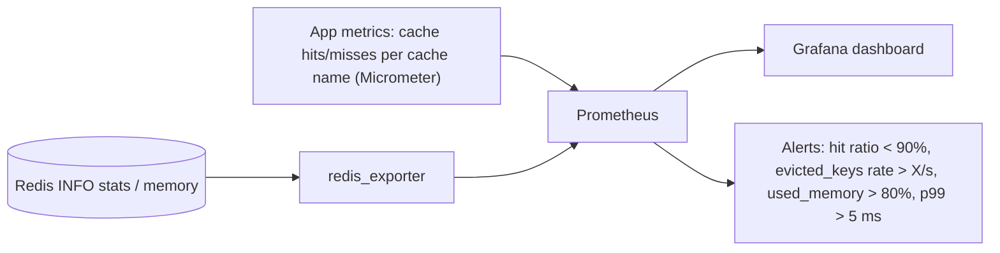

| Metric | Source | Meaning |
|---|---|---|
| `keyspace_hits / (hits + misses)` | Redis INFO | server-side hit ratio |
| `evicted_keys` (rate) | Redis INFO | keys removed due to maxmemory pressure |
| `expired_keys` (rate) | Redis INFO | keys removed by TTL (normal) |
| `used_memory` vs `maxmemory`, `mem_fragmentation_ratio` | Redis INFO | capacity and fragmentation |
| per-cache hit/miss, load time | app (Caffeine `recordStats`, Micrometer) | which cache is misbehaving |
| command latency, slowlog | Redis | big keys / heavy commands |

#### Example
A dashboard shows the product cache hit ratio dropping from 96% to 82% over a week while `evicted_keys` climbs from ~0 to 2,000/s. Investigation: a new feature stores full product JSON with reviews (5× larger values). Fixes: store reviews separately, compress values and add a shard. The hit ratio recovers to 96% and DB CPU drops by half.

#### Trade-offs
Monitoring is cheap. The main pitfall is looking only at the server-wide hit ratio. Per-cache and per-key-prefix metrics are needed to find the culprit.

#### Problems & fixes
| Symptom | Cause | Fix |
|---|---|---|
| Evictions rising, hit ratio falling | working set > memory, or bigger values | add memory/shards, slim values, better eviction policy |
| Hit ratio low but no evictions | TTLs too short, or keys rarely reused | longer TTLs, rethink what's cached |
| Memory high, few keys | big keys / fragmentation | `--bigkeys`, activedefrag, restructure |
| Can't tell which feature hurts | no per-cache metrics | instrument by cache name / key prefix |

#### Cheat sheet
- Watch hit ratio, evicted_keys rate, memory %, fragmentation, latency.
- Evictions > 0 steadily means too small (or polluted).
- Instrument per cache and prefix. Alert before users notice.

#### Interview questions
<details><summary>What metrics would you alert on for a production Redis cache?</summary>

Hit ratio below a threshold (e.g. under 90% for 10 minutes), a sustained evicted_keys rate, used memory above ~80% of maxmemory, replication lag or broken replication, latency p99 and slowlog entries, connected clients near the limit, and node imbalance in CPU or ops (hot keys). Pair them with app-side per-cache hit and miss metrics.
</details>

<details><summary>Hit ratio dropped suddenly after a deploy. How do you investigate?</summary>

Compare per-cache and per-prefix metrics before and after: did key naming change (new keys mean a cold cache), TTLs shorten, value sizes grow (more evictions), or a new feature start caching high-cardinality data (polluting the cache)? Check `evicted_keys`, memory usage, `--bigkeys` and sample keys with `MEMORY USAGE`. Roll back or fix the culprit, then warm the cache if needed.
</details>

#### Interview angle
> "Every cache exports hit ratio, eviction rate and memory per cache name. Sustained evictions with a falling hit ratio is my signal to resize, slim values or stop caching low-value keys."
