## Scalability fundamentals

### Vertical scaling — bigger machine (more CPU, RAM, faster disk); simple but has hard limits and is expensive
Vertical scaling (scaling up) means giving a single machine more resources: more cores, more memory, faster disks and network. No code changes are needed, which makes it the quickest fix. But there's a ceiling (the biggest instance available), cost grows faster than capacity, and one machine is still a single point of failure.

#### How it works
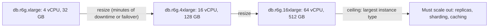

#### Example
A Postgres primary at 85% CPU during peaks: resizing from 8 to 32 vCPUs (via a Multi-AZ failover, about 1 minute of blip) buys a year of growth in an afternoon. Compare: sharding would take months of engineering. Vertical first is the pragmatic default for **databases**, because stateful systems are hardest to scale out.

#### Trade-offs
| Pros | Cons |
|---|---|
| zero code change, simplest | hard ceiling, single point of failure |
| strong consistency stays trivial | cost rises superlinearly at the high end |
| fewer moving parts | resizing may need downtime/failover |
| great for stateful systems (DBs) | doesn't help geographic latency |

#### Problems & fixes
| Symptom | Cause | Fix |
|---|---|---|
| Bigger box, same latency | bottleneck isn't the resource you added (locks, single-threaded code, I/O) | profile first: CPU vs I/O vs lock contention |
| Resize causes outage | single instance, no failover | Multi-AZ / replica promotion for resizes |
| Approaching the largest instance | growth outpacing vertical headroom | plan horizontal path early: replicas, caching, partitioning |

#### Cheat sheet
- Scale up first for stateful components (databases). It buys time cheaply.
- Know the ceiling and the cost curve. Keep a failover path for resizes.
- Profile before scaling: more CPU won't fix lock contention.

#### Interview questions
<details><summary>Your database is CPU-bound at peak. Would you scale vertically or horizontally first?</summary>

Usually vertically first: it's fast and needs no application changes, while sharding a database is complex and permanent. At the same time I'd optimise queries and indexes, add read replicas and caching for read load, and plan the horizontal path (partitioning or sharding) for when the largest instance is in sight.
</details>

<details><summary>Why can doubling CPU cores fail to double throughput?</summary>

The bottleneck may be elsewhere: lock or latch contention, a single-threaded component, disk or network I/O, or a serial portion of the work (Amdahl's law). Extra cores then sit idle or just contend more. Measure the actual bottleneck before scaling.
</details>

#### Interview angle
> "For the database I'd scale up first since it's simplest and keeps strong consistency, while profiling and planning replicas and partitioning for when we approach the largest instance size."

### Horizontal scaling — more machines; requires stateless design and coordination layer
Horizontal scaling (scaling out) adds more machines and spreads load across them. It has no hard ceiling, gives fault tolerance (one machine dying is fine) and uses commodity hardware. But the application must be designed for it: stateless instances behind a load balancer, and state moved to shared or partitioned stores.

#### How it works
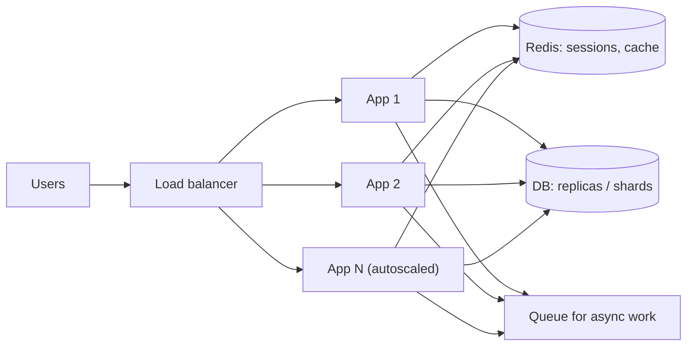

Requirements:
- **Stateless app tier**: no local sessions or uploads, so any instance can serve any request.
- **Shared or partitioned state**: DB (replicas, shards), cache, object storage, queues.
- **Coordination** where needed: leader election, distributed locks, idempotency.
- **Automation**: autoscaling, health checks, service discovery.

#### Example
An API from 2 to 40 instances during a sale: sessions live in Redis, uploads go straight to S3 via pre-signed URLs, background jobs go to SQS. The ALB spreads requests, the ASG/HPA adds instances based on CPU and request count, and losing one instance just drops its share of in-flight requests (clients retry idempotently).

#### Trade-offs
| Pros | Cons |
|---|---|
| near-unlimited scale, fault tolerance | distributed-systems complexity (consistency, coordination) |
| commodity hardware, elastic | state must be externalised |
| rolling deploys without downtime | more network hops, partial failures |

#### Problems & fixes
| Symptom | Cause | Fix |
|---|---|---|
| Users logged out randomly behind the LB | sessions in instance memory | external session store or JWT |
| Adding instances doesn't help | shared bottleneck (DB, lock, single queue partition) | scale the bottleneck: cache, replicas, partitioning |
| Duplicate cron jobs | every instance runs scheduled tasks | leader election / distributed scheduler / ShedLock |
| Uploaded files missing on other instances | local disk storage | object storage (S3) |

#### Cheat sheet
- Stateless app + shared or partitioned state + LB + autoscaling.
- The bottleneck moves to shared components: cache, DB, queues.
- Watch for local state: sessions, files, in-memory caches, cron.

#### Interview questions
<details><summary>What must change in a monolith running on one server before it can scale horizontally?</summary>

Move sessions to Redis or tokens, files to object storage, and in-memory caches to a shared cache (or accept per-instance caches with invalidation). Make scheduled jobs run once (leader election or a scheduler service), use a shared or replicated database, make request handling idempotent for retries, and add health checks plus a load balancer. Config comes from the environment so instances are identical.
</details>

<details><summary>You scaled the app tier from 10 to 50 instances, but throughput only increased 20%. Why?</summary>

The bottleneck is downstream: the database (CPU, connections, locks), a shared cache hot key, an external API rate limit, or a single queue partition. More app instances may even make it worse (connection storms). Find the saturated resource with metrics and tracing, then scale or optimise that component.
</details>

#### Interview angle
> "The app tier is stateless behind a load balancer with autoscaling. Sessions, files and jobs live in Redis, S3 and queues, so scaling out is just adding instances, and the real work becomes scaling the data layer."

### Stateless services — no local state, any instance can serve any request; scale with load balancer
A stateless service keeps **no client-specific state in its memory or disk between requests**. Everything a request needs comes with it (token, ids) or lives in shared stores. Instances become interchangeable "cattle": you can add, remove, restart or replace any of them at any time.

#### How it works
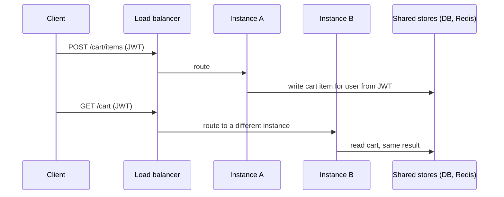

#### Example
Kubernetes deployment of an orders API: 12 replicas, any of which can be killed during a node drain or rolling update without user impact. Graceful shutdown finishes in-flight requests, the readiness probe removes the pod from the Service first, and clients retry idempotent requests. Scaling from 12 to 40 under load is a single HPA decision.

#### Trade-offs
Trivial scaling and resilience, but state moves to shared stores (which must scale and be highly available), and every request may need to fetch context (latency, so cache it).

#### Problems & fixes
| Symptom | Cause | Fix |
|---|---|---|
| Errors during deploys | in-flight requests killed | graceful shutdown + readiness probe + preStop delay |
| Hidden state: local file uploads, in-memory rate limits | "stateless" in theory only | object storage, Redis-based limits |
| Each request slow due to state lookups | fetching session/profile from DB every time | cache in Redis, carry claims in JWT |

#### Cheat sheet
- No per-client state in instance memory or disk between requests.
- Context in the request (token) or in shared stores.
- Graceful shutdown + readiness probes make instances disposable.

#### Interview questions
<details><summary>What hidden state commonly breaks "stateless" services?</summary>

In-memory sessions, local file uploads or temp files used across requests, in-memory rate-limit counters, local caches assumed to be authoritative, WebSocket connections (inherently stateful), scheduled jobs running on every instance, and in-flight work lost on shutdown. Each needs externalising or explicit handling.
</details>

<details><summary>How do you make deploys of a stateless service zero-downtime?</summary>

Rolling updates with readiness probes (new pods receive traffic only when ready), a preStop hook or delay so the load balancer stops routing before shutdown, graceful shutdown that finishes in-flight requests within a timeout, connection draining at the LB, and idempotent client retries for anything that still fails.
</details>

#### Interview angle
> "Services are stateless: identity comes in the JWT and state lives in Redis, the database and S3. Any pod can serve any request, and pods can be killed or added freely."

### Stateful services — session affinity or external state store required
Some services must keep state per client or per partition: WebSocket gateways (open connections), game servers (match state), stream processors (windowed aggregates), databases. They can't be load-balanced arbitrarily. You need **affinity** (route a client to the same instance), **partition ownership** (each instance owns a subset of keys), or **externalised state** with fast recovery.

#### How it works
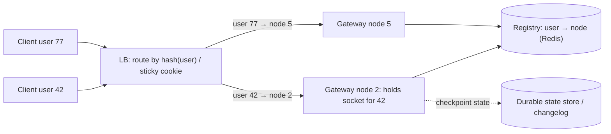

Approaches:
- **Sticky sessions** (cookie or IP-based affinity at the LB): simple, but uneven load and lost state on instance death.
- **Partitioned ownership** (consistent hashing, Kafka consumer partitions, Orleans actors, Akka Cluster sharding): each key has one owner, which is rebalanced on membership change.
- **State in a fast external store** (Redis) with local caching, which turns the service effectively stateless.
- **Checkpointing** (Flink, Kafka Streams changelog topics) so a replacement instance restores state.

#### Example
Multiplayer game servers: each match lives on one server process for its duration (stateful by nature). A matchmaker assigns matches to servers and keeps a registry, and clients connect directly to their assigned server. On a server crash, the match is lost or restored from the last checkpoint, which is an accepted trade-off. Scaling is by match count, not requests.

#### Trade-offs
Stateful designs give low latency (state in memory) and natural ordering per key, but make scaling, deploys and failover harder (rebalancing, warm-up, state transfer).

#### Problems & fixes
| Symptom | Cause | Fix |
|---|---|---|
| Uneven load across sticky instances | affinity pins heavy users | consistent hashing with vnodes, rebalance, cap per node |
| Users lose session on instance crash | state only in memory | replicate or checkpoint state, external store |
| Deploys disconnect everyone | stateful instances restarted together | drain gradually, reconnect with resume tokens |
| Two instances think they own a key | split-brain during rebalancing | leases/fencing, partition assignment via coordinator (Kafka, ZK) |

#### Cheat sheet
- Stateful = affinity or partition ownership + recovery plan.
- Prefer externalising state. If it must stay local: checkpoint, replicate, rebalance.
- Deploy by draining. Clients reconnect and resume.

#### Interview questions
<details><summary>How do you scale a WebSocket chat gateway, which is inherently stateful?</summary>

Accept that each connection is pinned to one gateway node. Keep the gateways thin (no business state), maintain a registry (user → node) in Redis, and route messages via pub/sub or direct RPC to the node holding the recipient. Scale by adding nodes (new connections spread out). Drain nodes gradually on deploy, and clients reconnect with a resume token to fetch missed messages from the durable store.
</details>

<details><summary>Sticky sessions vs external session store: which do you prefer and why?</summary>

An external session store (Redis) or stateless tokens. Sticky sessions create uneven load, lose sessions when an instance dies, complicate autoscaling and deploys, and break if the LB changes affinity. Use stickiness only where the state is inherently local and expensive to move (WebSockets, large in-memory working sets), with a recovery plan.
</details>

#### Interview angle
> "Where state is inherent, like sockets or game matches, I pin keys to owners with consistent hashing and a registry, checkpoint state, and drain on deploy. Everything else I keep stateless."

### Distributed session — store sessions in Redis with TTL, enables stateless web servers
A distributed session store keeps server-side session data (logged-in user, cart, CSRF token, preferences) in a shared store, usually **Redis with a TTL**, keyed by an opaque session id in a cookie. Any app instance can read the session, so web servers become stateless, and sessions can be revoked instantly by deleting the key.

#### How it works
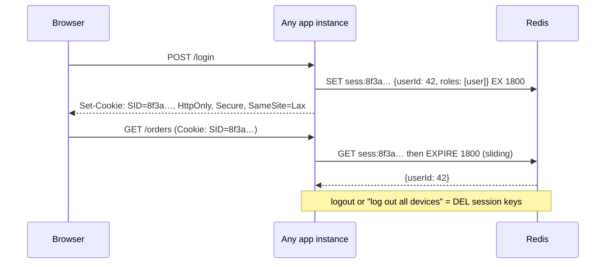

Spring: `spring-session-data-redis` (`@EnableRedisHttpSession`) moves `HttpSession` into Redis transparently.

#### Example
A banking web app: a session id cookie (`__Host-SID`, HttpOnly, Secure, SameSite=Strict) maps to a Redis hash with the user id, auth level (OTP verified?) and a CSRF token, with a 10-minute sliding idle timeout and a 12-hour absolute limit. "Log out of all devices" deletes all keys in a `user:42:sessions` set. A Redis replica across AZs plus persistence avoids logging everyone out on failover.

#### Trade-offs
| Server sessions in Redis | JWT (stateless tokens) |
|---|---|
| instant revocation, small cookie | revocation is hard until expiry |
| Redis lookup per request (~0.5 ms) | no lookup, verify signature locally |
| session data can change server-side | claims fixed until token refresh |
| Redis must be highly available | no shared store needed |

#### Problems & fixes
| Symptom | Cause | Fix |
|---|---|---|
| Everyone logged out after Redis restart | no persistence / replica | replicas + AOF/RDB, or accept and keep sessions short |
| Session fixation attack | session id not rotated at login | regenerate session id on authentication |
| Redis memory growing | sessions without TTL / huge session objects | TTL always, keep sessions small |
| Hot Redis node | all sessions on one node | Redis Cluster, keys spread by session id |

#### Cheat sheet
- Opaque session id cookie + Redis value with sliding TTL.
- Rotate the id on login. HttpOnly, Secure, SameSite. Delete keys to revoke.
- Replicate Redis. Keep session data small.

#### Interview questions
<details><summary>Server-side sessions in Redis or JWTs for a banking web app?</summary>

Server-side sessions in Redis: the bank needs instant revocation (logout, fraud response, password change), short idle timeouts, step-up authentication state, and minimal data exposure in the browser. The extra Redis lookup is trivial. JWTs fit better for stateless service-to-service auth or mobile APIs, using short-lived access tokens plus refresh tokens.
</details>

<details><summary>How do you implement "log out from all devices"?</summary>

Track each user's session ids in a Redis set (`user:{id}:sessions`). On "log out everywhere", delete every session key in the set and the set itself. With JWTs, you'd instead bump a per-user token version stored server-side and reject tokens with an older version (or revoke refresh tokens and wait out short access-token lifetimes).
</details>

#### Interview angle
> "Web sessions are opaque ids in HttpOnly cookies backed by Redis with a sliding TTL. Any pod can serve any user, and revocation is a key delete."

### JWT for stateless auth — token carries identity, no server-side session store needed
A JSON Web Token is a signed token carrying **claims** (user id, roles, expiry) that any service can **verify locally** with a key, with no session lookup. It enables stateless authentication across many services. The catches are revocation, token size and key management.

#### How it works
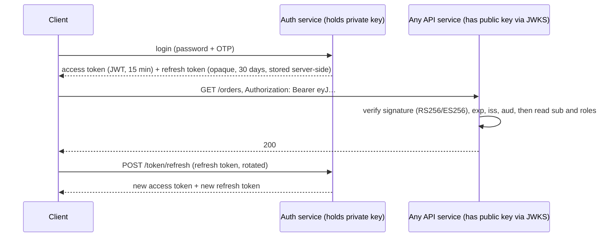

JWT structure: `base64url(header).base64url(payload).signature`. Payload example:
```json
{ "sub": "user_42", "roles": ["customer"], "iss": "https://auth.shop.com", "aud": "orders-api",
  "iat": 1762680000, "exp": 1762680900, "jti": "c1f3…" }
```

Rules:
- Use **asymmetric** signing (RS256/ES256) so services only need the public key (JWKS endpoint, cached).
- Always verify `exp`, `iss`, `aud` and the algorithm. Reject `alg: none`, and pin the expected algorithm.
- Keep access tokens **short-lived** (5–15 min). Use **refresh tokens** (rotated, revocable) for longevity.
- Payloads are **signed, not encrypted**: no secrets or PII.

#### Example
A microservices platform: the API gateway validates JWTs from the identity provider (Keycloak/Auth0/Cognito) and forwards them, and downstream services verify locally and authorise by roles and scopes. To force logout of a compromised account, the auth service revokes refresh tokens, and access tokens die within 15 minutes. High-risk actions (payouts) check a small deny-list (`jti` or user token version) in Redis.

#### Trade-offs
Stateless, fast verification and cross-service identity propagation, but revocation is hard before expiry, tokens are large (sent with every request), claims can go stale (role changes) and key rotation needs care.

#### Problems & fixes
| Symptom | Cause | Fix |
|---|---|---|
| Can't log out a stolen token | long-lived JWT | short expiry + refresh token rotation, deny-list for critical cases |
| Forged tokens accepted | `alg` confusion / not verifying signature or audience | pin algorithm, verify iss/aud/exp, use well-tested libraries |
| Token stolen via XSS | stored in localStorage | HttpOnly cookie (web) or secure storage (mobile) |
| Requests rejected after key rotation | services cached old keys only | JWKS with `kid`, overlap old and new keys |
| Huge headers (431 errors) | too many claims | minimal claims, fetch details server-side |

#### Cheat sheet
- Signed claims, local verification, no session store.
- Short access token (≤ 15 min) + rotating refresh token. Verify alg/iss/aud/exp.
- Not encrypted: no secrets. JWKS + `kid` for key rotation.

#### Interview questions
<details><summary>How do you revoke a JWT before it expires?</summary>

You can't "un-sign" it, so keep access tokens short-lived and revoke the refresh token (stored server-side), so no new access tokens are issued. For immediate revocation on sensitive paths, check a deny-list of token ids (`jti`) or a per-user token version in Redis (a lightweight lookup only where needed). Changing the signing key revokes everything, which is a last resort.
</details>

<details><summary>Why use RS256/ES256 instead of HS256 in a microservices architecture?</summary>

With HS256 every verifying service needs the shared secret, which can also mint tokens, so a compromise of any service compromises authentication. With asymmetric algorithms only the auth server holds the private key, and services verify with the public key (distributed via JWKS), which limits the blast radius and simplifies key rotation.
</details>

#### Interview angle
> "Services verify short-lived RS256 JWTs locally via a cached JWKS, and refresh tokens are rotated and revocable server-side. High-risk actions also check a revocation list."

### Twelve-factor app — config in env, statelessness, logs as streams, disposability
The Twelve-Factor App is a methodology (from Heroku) for building services that deploy cleanly to cloud platforms and scale horizontally. Most of its 12 rules are now baseline expectations for containers and Kubernetes.

#### How it works
| # | Factor | In practice |
|---|---|---|
| 1 | Codebase | one repo per app, many deploys |
| 2 | Dependencies | declared and isolated (Maven/Gradle, lockfiles, container image) |
| 3 | **Config** | in environment variables / injected secrets, never in code |
| 4 | Backing services | DB, cache, queue as attached resources via URLs |
| 5 | Build, release, run | immutable build artifact + config = release |
| 6 | **Processes** | stateless, share-nothing |
| 7 | Port binding | self-contained service exports HTTP on a port |
| 8 | Concurrency | scale out via process types (web, worker) |
| 9 | **Disposability** | fast startup, graceful shutdown |
| 10 | Dev/prod parity | same backing services and versions everywhere |
| 11 | **Logs** | write to stdout as event streams, the platform aggregates |
| 12 | Admin processes | one-off tasks (migrations) run as the same release |

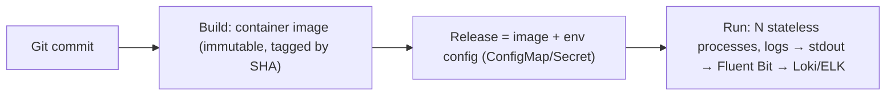

#### Example
A Spring Boot service: config via `SPRING_DATASOURCE_URL` and Kubernetes Secrets (no `application-prod.yml` with passwords in git). The same image runs in dev, staging and prod with different env. Logs are JSON to stdout, collected by a DaemonSet. Startup takes under 10 s, and it handles SIGTERM by draining. Database migrations run as a Kubernetes Job using the same image tag.

#### Trade-offs
Portable, scalable and operable services. A few factors need nuance today: secrets belong in a secret manager rather than raw env vars where possible, and stateful workloads (databases) don't fit the stateless model.

#### Problems & fixes
| Symptom | Cause | Fix |
|---|---|---|
| Different behaviour in prod vs staging | config baked into builds / env drift | same image, env-specific config only |
| Secrets leaked in git | config in code | env/secret manager (Vault, AWS Secrets Manager) |
| Logs lost when pods die | writing to local files | stdout + log aggregation |
| Pods killed mid-request on scale-in | no graceful shutdown | handle SIGTERM, drain, preStop |

#### Cheat sheet
- Config in env, stateless processes, logs to stdout, fast start and graceful stop.
- One immutable build promoted through environments.
- Migrations and admin tasks run as one-off processes with the same release.

#### Interview questions
<details><summary>Which twelve-factor principles matter most for running on Kubernetes?</summary>

Config via environment and Secrets (same image everywhere), stateless processes (pods are disposable), disposability (fast start, graceful SIGTERM handling with readiness and preStop), logs to stdout (collected by node agents), port binding (container exposes a port), and build/release/run separation (immutable images tagged by commit, promoted across environments).
</details>

<details><summary>Why should you build one artifact and promote it rather than building per environment?</summary>

It guarantees that what you tested is exactly what runs in production. Per-environment builds can pull different dependency versions or bake in environment-specific settings, causing "works in staging, fails in prod". Config differences live only in the environment.
</details>

#### Interview angle
> "Services follow twelve-factor: one immutable image promoted across environments, config and secrets injected, stateless pods, JSON logs to stdout, and graceful SIGTERM handling."

### Back-of-envelope estimation — QPS, storage, bandwidth, memory: always show arithmetic
Back-of-envelope estimation turns vague requirements into numbers that drive design decisions: do we need sharding? a cache? how many servers? Interviewers care more about **clear assumptions and visible arithmetic** than precise answers. Round aggressively, state assumptions, and sanity-check.

#### How it works
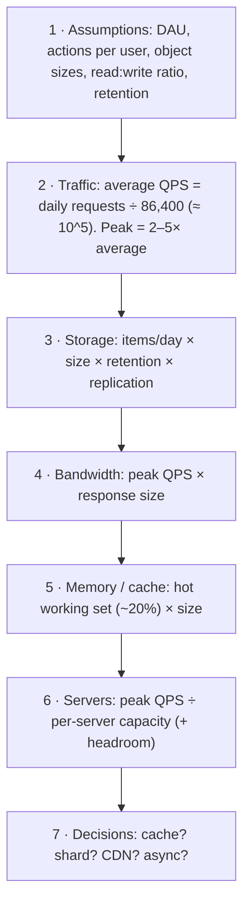

Numbers worth memorising:
| Quantity | Value |
|---|---|
| seconds/day | 86,400 ≈ 10^5 |
| 1M req/day | ≈ 12 req/s |
| 100M req/day | ≈ 1,200 req/s |
| L1 / RAM / SSD read / HDD seek | 1 ns / 100 ns / 100 µs / 10 ms |
| same-DC RTT / cross-continent RTT | 0.5 ms / 150 ms |
| one app server (simple API) | 1k–10k req/s |
| Postgres primary (simple queries) | ~10k–50k QPS |
| Redis node | ~100k+ ops/s |

#### Example
**URL shortener**: 100M new URLs/month, read:write 100:1.
- Writes: 100M ÷ (30 × 86,400) ≈ **40/s**, peak ~200/s.
- Reads: 40 × 100 = **4,000/s**, peak ~20k/s.
- Storage: 100M × 12 months × 5 years × 500 B ≈ **3 TB** (× 3 replicas ≈ 9 TB).
- Cache: 20% of the daily reads' unique URLs. Say 20M hot URLs × 500 B ≈ **10 GB** of Redis.
- Bandwidth: 20k/s × 500 B ≈ 10 MB/s, which is trivial.

Decisions: a single primary handles writes, so no sharding is needed for years. Reads need a cache plus replicas. 3 TB over 5 years fits on a modern DB with partitioning or a KV store.

#### Trade-offs
Estimates are rough. Errors of 2× don't matter, but 100× errors change architecture. Spend 3–5 minutes in interviews, then move on.

#### Problems & fixes
| Symptom | Cause | Fix |
|---|---|---|
| Interviewer loses track | arithmetic in your head | write numbers down step by step |
| Over-engineering (sharding at 50 QPS) | skipping estimation | let numbers justify components |
| Under-provisioned at launch | using averages only | apply peak factor (2–5×, more for events) |
| Wrong order of magnitude | unit slips (KB vs MB, per day vs per second) | sanity-check with known references |

#### Cheat sheet
- 86,400 s/day ≈ 10^5. 1M/day ≈ 12/s. Peak = 2–5× average.
- Storage = count × size × retention × replication.
- Use numbers to justify each component, and say the arithmetic out loud.

#### Interview questions
<details><summary>Estimate QPS and storage for a photo-sharing app with 50M DAU, each viewing 50 photos and uploading 1 per day (avg 2 MB).</summary>

Views: 50M × 50 = 2.5B/day ÷ 10^5 ≈ 25k/s average, ~75k/s peak, so a CDN is essential. Uploads: 50M/day ÷ 10^5 ≈ 500/s average, ~1.5k/s peak. Storage: 50M × 2 MB = 100 TB/day, ≈ 36 PB/year raw, plus thumbnails and replication (object storage with erasure coding, lifecycle tiers). Metadata: 50M rows/day × ~500 B ≈ 25 GB/day, which needs partitioning or sharding over the years.
</details>

<details><summary>Why do interviewers care about estimation at all?</summary>

The numbers decide the architecture: whether a single database suffices or sharding is needed, whether caching or a CDN is required, how much storage and bandwidth cost, and where the bottlenecks will be. Showing structured estimation proves you design from requirements rather than reciting patterns.
</details>

#### Interview angle
> "Before drawing boxes I write down DAU, actions per user, sizes and peak factor, then derive QPS, storage, bandwidth and cache size. Every component in my design is justified by those numbers."

### QPS estimation — DAU × actions_per_day / 86400 seconds
Queries per second is the core load number: **average QPS = DAU × actions per user per day ÷ 86,400**, then apply a **peak multiplier** (2–5× for daily peaks, 10×+ for events), and split by **read vs write**, because they scale differently.

#### How it works
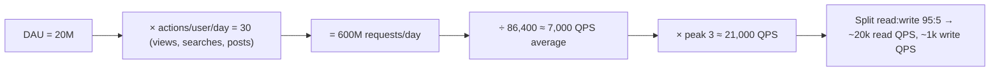

Tips:
- Use 10^5 s/day for quick math (overestimates by ~15%, which is fine).
- Break actions down (feed loads, each fanning out to N API calls, background syncs).
- **Internal QPS** can be far higher than external: one page load may trigger 5–20 internal calls (fan-out).
- Mind time zones: an India-only app's traffic concentrates in ~16 waking hours with evening peaks.

#### Example
A food delivery app in India: 5M DAU, average 3 sessions × 15 API calls = 45 calls/user/day gives 225M/day ≈ **2,600 QPS** average. Dinner peak (7–10 pm) carries ~25% of daily traffic in 3 hours: 56M ÷ 10,800 s ≈ **5,200 QPS**, and with an IPL-final spike ×2 ≈ **10k QPS**. Writes (orders) are 5M × 0.3 orders ≈ 1.5M/day, ~17/s average, ~100/s peak. The read path needs caching. The write path fits one well-tuned primary.

#### Trade-offs
Rough but decisive. Always show peak, not just average, because systems fail at peak.

#### Problems & fixes
| Symptom | Cause | Fix |
|---|---|---|
| System falls over at launch / events | sized for average QPS | peak multipliers, event-specific estimates, load tests |
| Internal services overloaded unexpectedly | ignored fan-out | multiply by internal calls per request |
| Write path ignored | lumped reads and writes | split read/write QPS |

#### Cheat sheet
- QPS = DAU × actions ÷ 86,400 (≈ 10^5).
- Peak ×2–5 (events ×10+). Split read/write. Include fan-out.
- 1M/day ≈ 12/s. 1B/day ≈ 12k/s.

#### Interview questions
<details><summary>Estimate peak QPS for a ride-hailing app's location update endpoint: 1M active drivers sending a location every 4 seconds during peak.</summary>

1M ÷ 4 s = **250k writes/s** at peak. That's far beyond a relational DB per-write approach: use an in-memory geo store (Redis GEO sharded by city/geohash) holding only the latest location, batching or downsampling history into Kafka → cold storage. Riders' map polling adds read QPS (e.g. 2M riders × 1 per 5 s = 400k reads/s), so serve from the same in-memory store or push via WebSockets.
</details>

<details><summary>Why should you separate read and write QPS in an estimate?</summary>

They scale with different tools: reads with caches, CDNs and replicas, writes with sharding, partitioning, batching and queues. A 100:1 read-heavy system needs very different architecture from a 1:1 write-heavy one, even at the same total QPS.
</details>

#### Interview angle
> "QPS is DAU times actions over 86,400, then times a peak factor, split into reads and writes, with internal fan-out added. Reads get caches and replicas, writes get partitioning and queues."

### Storage estimation — rows/day × row_size × retention_days × replication_factor
Storage estimation tells you whether data fits on one node, how fast it grows, what it costs and when you'll need partitioning, archiving or sharding. Formula: **items per day × size per item × retention × replication factor**, plus indexes and overhead.

#### How it works
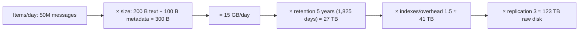

Remember:
- **Media dominates**: images and video sizes dwarf text, so put them in object storage, with only metadata in the DB.
- **Indexes** often add 30–100% to table size.
- **Replication** (×3) or erasure coding (×1.4–1.5) for durable stores.
- **Hot vs cold tiers**: last 90 days on SSD, older data on cheap storage (S3 IA/Glacier, compressed Parquet).
- Units: 1 KB = 10^3, 1 MB = 10^6, 1 GB = 10^9, 1 TB = 10^12, 1 PB = 10^15.

#### Example
A payments platform: 10M transactions/day × 1 KB (row + indexes + audit fields) = 10 GB/day ≈ 3.6 TB/year. Regulation requires 10 years: 36 TB of primary data. Keep 13 months in Postgres (partitioned by month, ~4.7 TB), archive older partitions to S3 as Parquet (compressed ~5×, so ~6 TB for the remaining 9 years) queryable via Athena. The OLTP database stays small and fast while staying compliant.

#### Trade-offs
Storage is cheap per GB, but large hot datasets slow backups, restores, replicas and queries. Lifecycle tiering and archiving keep the hot set small.

#### Problems & fixes
| Symptom | Cause | Fix |
|---|---|---|
| DB disk filling faster than expected | forgot indexes / audit / soft-deleted rows | include overhead, monitor growth, purge or archive |
| Backups/restores take hours | huge hot DB | partitioning + archiving cold data |
| Storage bill explodes | media in DB / no lifecycle policies | object storage + lifecycle tiers (IA, Glacier) |

#### Cheat sheet
- Storage = items/day × size × retention × replication (+ index overhead).
- Media in object storage, metadata in the DB.
- Tier: hot (SSD DB) → warm → cold (S3/Glacier, Parquet).

#### Interview questions
<details><summary>Estimate storage for a chat app: 100M DAU, 40 messages per user per day, 100 bytes average, kept forever.</summary>

100M × 40 = 4B messages/day × ~150 B with metadata ≈ 600 GB/day ≈ 220 TB/year, × 3 replication ≈ 660 TB/year. That clearly needs a horizontally scalable store (Cassandra/ScyllaDB/HBase) partitioned by conversation and time bucket, with compression (often 2–4× for text) and possibly tiering old messages to cheaper storage. Attachments go to object storage separately.
</details>

<details><summary>Why keep hot and cold data in different stores?</summary>

Hot data (recent, frequently accessed) needs low latency and indexes, which is expensive per GB. Cold data is rarely read and can live compressed on cheap object storage. Splitting keeps the operational database small (fast queries, backups, restores, failover) and cuts cost dramatically, while cold data stays queryable via Athena/Trino.
</details>

#### Interview angle
> "Storage is items per day times size times retention times replication, plus index overhead. Media goes to S3 and old partitions get archived to Parquet, so the hot database stays small."

### Bandwidth estimation — peak_QPS × average_response_size × peak_multiplier (×3–5)
Bandwidth estimation checks whether network capacity, load balancers and egress costs can handle traffic: **bandwidth = QPS × response size** (ingress uses request size). Do it at peak. Large payloads (images, video, file downloads) usually dominate and push you toward CDNs and object storage.

#### How it works
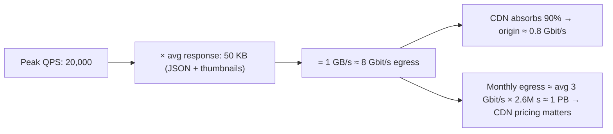

Conversions: 1 byte = 8 bits. 1 Gbit/s ≈ 125 MB/s. 1 MB/s for a month ≈ 2.6 TB.

#### Example
Video streaming: 1M concurrent viewers at 3 Mbit/s (720p) = **3 Tbit/s**. No origin can serve that, so a CDN with many edge PoPs is mandatory, and the origin only serves cache fills (~1–5%). Upload side: 10k creators uploading 1 GB each per day = 10 TB/day of ingress ≈ 1 Gbit/s average, so direct-to-S3 multipart uploads (pre-signed URLs) keep it off app servers.

API service: 5k QPS × 2 KB = 10 MB/s = 80 Mbit/s, which is trivial. Bandwidth isn't the concern there, CPU and the DB are.

#### Trade-offs
Bandwidth is often cheap internally but expensive for internet egress and cross-AZ/cross-region traffic (cloud charges per GB). Compression, CDNs and keeping chatty traffic within an AZ cut costs.

#### Problems & fixes
| Symptom | Cause | Fix |
|---|---|---|
| Huge egress bill | serving media from origin/S3 directly | CDN, compression, right-sized images (WebP/AVIF) |
| Cross-AZ data transfer costs | chatty services across AZs | AZ-aware routing, colocate, compress |
| LB/NIC saturation | large payloads through app tier | direct-to-object-storage up/download with pre-signed URLs |
| Mobile users slow | big responses | pagination, field selection, compression |

#### Cheat sheet
- Bandwidth = QPS × size (at peak). 1 Gbit/s ≈ 125 MB/s.
- Media → CDN + object storage, bypassing app servers.
- Watch egress and cross-AZ costs. Compress text.

#### Interview questions
<details><summary>Estimate egress bandwidth for an image feed: 30k peak requests/s, each returning 10 images of 100 KB.</summary>

30k × 10 × 100 KB = 30 GB/s ≈ 240 Gbit/s at peak. That must come from a CDN (multiple PoPs) with a high hit ratio, and images should be resized and modern formats (WebP/AVIF) to cut size 30–50%. The origin then serves only cache fills, say 5% ≈ 12 Gbit/s, from object storage behind an origin shield.
</details>

<details><summary>Why use pre-signed URLs for file uploads rather than uploading through your API servers?</summary>

Large uploads would consume API servers' bandwidth, memory and connections and tie up threads for minutes. Pre-signed URLs let clients upload directly to object storage (S3), which scales bandwidth independently and supports multipart and resumable uploads, while the API only issues the URL and records metadata afterwards (S3 event notification).
</details>

#### Interview angle
> "Bandwidth is peak QPS times payload. Anything media-heavy goes through a CDN, with direct-to-S3 uploads and downloads via pre-signed URLs, so app servers only move small JSON."

### Amdahl's Law — serial fraction limits maximum speedup: max = 1 / (S + (1-S)/N)
Amdahl's Law: if a fraction **S** of a task is inherently serial, then with N parallel workers the speedup is at most **1 / (S + (1 − S)/N)**, and never more than **1/S** no matter how many workers you add. Serial bottlenecks (a single lock, a single leader, a single partition) cap scalability.

#### How it works
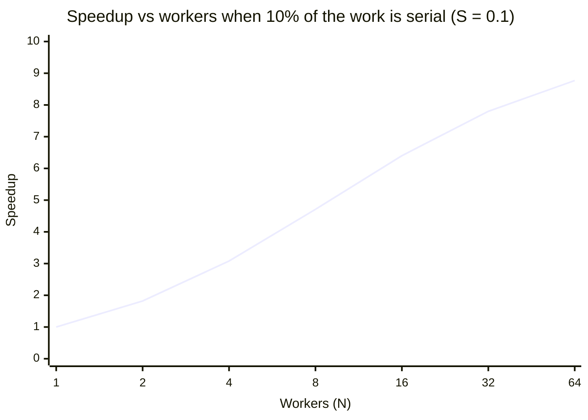

| S (serial fraction) | N = 16 | N = 64 | N = ∞ |
|---|---|---|---|
| 1% | 13.9× | 39× | 100× |
| 5% | 9.1× | 15.4× | 20× |
| 10% | 6.4× | 8.8× | 10× |
| 25% | 3.4× | 3.8× | 4× |

#### Example
A batch job processes 1M records: parsing and enrichment parallelise, but every record updates one global counter row under a lock (≈ 10% of time). Going from 8 to 64 workers only takes the speedup from ~4.7× to ~8.8×, and beyond that nothing. Removing the serial part (per-worker counters merged at the end) made the job scale almost linearly.

System-design equivalents of the "serial fraction": a single DB primary for writes, a global lock, a single Kafka partition (ordering), a leader-based coordinator, a single hot key.

#### Trade-offs
Some serialisation buys correctness (ordering, consistency). The art is shrinking it (partitioned locks, per-key ordering instead of global ordering) rather than eliminating it.

#### Problems & fixes
| Symptom | Cause | Fix |
|---|---|---|
| Adding workers/pods stops helping | serial bottleneck (lock, single partition, single writer) | partition the serial part (per-key locks, more partitions, sharding) |
| Throughput even drops with more workers | contention overhead on the serial resource | reduce contention, batch, lock-free structures |
| Global ordering requirement limits scale | everything in one sequence | order per key (user, account) instead |

#### Cheat sheet
- Speedup ≤ 1 / (S + (1−S)/N), and max 1/S.
- Find and shrink the serial fraction: global locks, single writer, single partition.
- Order per key, not globally.

#### Interview questions
<details><summary>Your parallel job uses 32 threads but only gets a 5× speedup. What does Amdahl's law suggest?</summary>

Solving 5 = 1 / (S + (1−S)/32) gives S ≈ 17%: about a sixth of the work is effectively serial (lock contention, a shared counter, sequential I/O, a single output writer, GC). Profile to find that portion. Partition it (per-thread accumulators, sharded locks, parallel writers) or overlap it with other work. More threads won't help until it shrinks.
</details>

<details><summary>How does Amdahl's law relate to Kafka partition counts?</summary>

Within a consumer group, a partition is consumed by one consumer at a time, so ordering per partition is serial. With P partitions, at most P consumers work in parallel. If one partition is hot (skewed keys), its single consumer becomes the serial bottleneck regardless of how many consumers you add. Choose enough partitions and well-distributed keys.
</details>

#### Interview angle
> "Amdahl's law tells me to hunt the serial fraction, like a global lock, a single writer or a hot partition. I partition that piece, for example by ordering per account instead of globally, before adding more machines."

### Little's Law — L = λW: avg items in system = arrival rate × avg time in system
Little's Law: in a stable system, the **average number of items in the system (L)** equals the **arrival rate (λ)** times the **average time each item spends in the system (W)**. It's a simple, universal tool for sizing thread pools, connection pools, queues and concurrency limits.

#### How it works
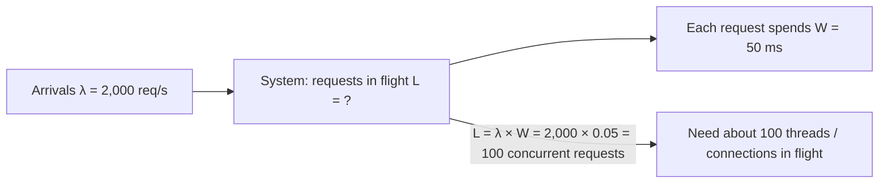

Uses:
- **Thread pool size**: concurrent requests = RPS × latency.
- **DB connection pool**: queries/s × query time = connections busy on average.
- **Queue backlog**: if consumers fall behind, W grows, and so does L (backlog).
- **Latency under load**: with fixed concurrency limit L, max throughput = L / W.

#### Example
A service calls a payment provider: 300 req/s, provider latency 400 ms. Concurrent outbound calls = 300 × 0.4 = **120**. With an HTTP client pool of 50 connections, requests queue, latency balloons, then timeouts. Size the pool to ~150 (headroom), or use async non-blocking I/O.

When the provider slows to 2 s, the same 300 req/s means 600 concurrent calls, so threads run out and the service collapses. Hence **bulkheads and timeouts**: cap concurrency for that dependency (e.g. 150) and fail fast beyond it.

DB pool: 2,000 queries/s × 5 ms = 10 busy connections on average, so a pool of ~20 suffices. A pool of 200 just adds contention.

#### Trade-offs
Little's Law uses averages over stable periods. Bursts need headroom, and tail latency (p99) matters for sizing safety margins.

#### Problems & fixes
| Symptom | Cause | Fix |
|---|---|---|
| Thread pool exhaustion when a dependency slows | W rises, so L rises past pool size | timeouts, bulkhead (cap concurrency), circuit breaker |
| Over-sized DB pools hurting DB | L ≫ needed | size pools ≈ QPS × query time × ~2 |
| Queue backlog keeps growing | arrival rate > service rate (unstable) | add consumers, speed processing, shed load |

#### Cheat sheet
- L = λ × W (in-flight = rate × time).
- Size pools: RPS × latency (+ headroom).
- Slow dependency means more in-flight requests and exhaustion: timeouts + bulkheads.

#### Interview questions
<details><summary>Your API handles 1,000 req/s with 200 ms average latency on a Tomcat pool of 200 threads. A downstream service slows to 1 s. What happens?</summary>

By Little's law, in-flight requests rise from 1,000 × 0.2 = 200 to 1,000 × 1 = 1,000, but only 200 threads exist. Requests queue, latency grows further, timeouts and client retries add load, and the service effectively goes down, even for endpoints not using that dependency. Fix: timeouts on the downstream call, a bulkhead limiting its concurrency, a circuit breaker, and async/non-blocking I/O where appropriate.
</details>

<details><summary>Use Little's law to size a Kafka consumer group processing 5,000 msgs/s, where each message takes 20 ms to process.</summary>

In-flight work L = 5,000 × 0.02 = 100 concurrent message processings. If each consumer processes sequentially, you need ~100 consumer threads (and at least that many partitions if each partition is consumed sequentially), or fewer consumers processing messages concurrently within partitions where ordering allows. Add headroom (×1.5–2) for bursts and slow messages.
</details>

#### Interview angle
> "I size thread and connection pools with Little's law, in-flight equals rate times latency. Because a slow dependency multiplies in-flight requests, every outbound call gets a timeout and a bulkhead."
