## Load balancing

### Round robin — equal distribution ignoring server load or capacity
Round robin sends each new request (or connection) to the **next server in a rotating list**: 1, 2, 3, 1, 2, 3… It's simple, stateless and fair when all servers are identical and requests cost about the same. It ignores how busy each server actually is.

#### How it works
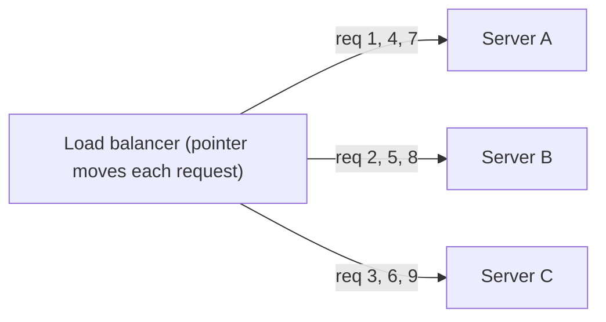

#### Example
A fleet of identical stateless API pods behind NGINX (`upstream api { server a; server b; server c; }`, round robin by default) serving uniform ~20 ms requests: load spreads evenly and works well. It breaks down when request costs vary wildly (some requests take 5 s exports while others take 5 ms) or servers differ in capacity: one server can pile up slow requests while round robin keeps sending it more.

#### Trade-offs
Zero state and trivially predictable, but blind to server load, capacity differences and request cost variance.

#### Problems & fixes
| Symptom | Cause | Fix |
|---|---|---|
| One server overloaded while others idle | heterogeneous request durations | least connections / least outstanding requests / P2C |
| Bigger instances underused | equal distribution across unequal capacity | weighted round robin |
| Uneven load with long-lived connections (gRPC, WebSockets) | balancing per connection, not per request | L7 per-request balancing, connection recycling |

#### Cheat sheet
- Rotate through servers. Stateless and simple.
- Good: identical servers, uniform requests.
- Bad: variable request cost, mixed instance sizes, long-lived connections.

#### Interview questions

When is round robin a poor choice?

When request costs vary a lot (mixing cheap reads and heavy exports), when servers have different capacities, or when connections are long-lived and carry many requests (HTTP/2, gRPC, WebSockets): load ends up unevenly distributed because round robin doesn't look at actual work in progress. Least-outstanding-requests or power-of-two-choices adapt to real load.

Round robin is stateless; why is that an advantage?

The balancer doesn't need to track per-server load, so it's cheap, easy to replicate across many LB nodes (each keeps its own rotation) and has no coordination overhead. That makes it a fine default for homogeneous, short, uniform requests.

#### Interview angle
> "Round robin is fine for identical stateless pods with uniform requests. Once request cost varies, I switch to least outstanding requests or power-of-two-choices."

### Weighted round robin — proportional to server CPU/memory/capacity
Weighted round robin gives each server a **weight** proportional to its capacity: a server with weight 3 receives three times as many requests as one with weight 1. It handles mixed instance sizes, gradual migrations and canary traffic splits.

#### How it works
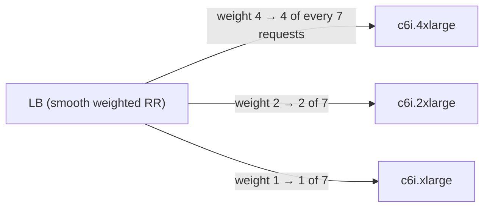

NGINX: `server a weight=4; server b weight=2; server c weight=1;`. "Smooth" weighted RR interleaves picks (A, B, A, C, A, B, A) instead of bursts (A, A, A, A, B, B, C).

#### Example
- **Mixed fleet** during an instance-type migration: old c5 nodes at weight 2, new c7g nodes at weight 3, so each gets load proportional to measured capacity.
- **Canary**: route 5% of traffic to v2 with weights 95/5 (ALB weighted target groups, Istio VirtualService), watch error rate and latency, then shift 25 → 50 → 100%.
- **Blue/green migration** between data centres with weights 90/10 → 0/100.

#### Trade-offs
Handles known capacity differences, but weights are static guesses: they don't react to real-time load, GC pauses or noisy neighbours.

#### Problems & fixes
| Symptom | Cause | Fix |
|---|---|---|
| Big server still overloaded | weights don't match real capacity | load-test to calibrate, or use least-connections weighted |
| Canary gets too little traffic to judge | weight too small, low traffic | larger weight, longer bake time, synthetic traffic |
| Bursty distribution | naive weighted RR | smooth weighted RR |

#### Cheat sheet
- Requests ∝ weight. Calibrate weights from benchmarks.
- Used for mixed instance types, canaries and migrations.
- Static, so combine with health checks and load-aware methods.

#### Interview questions

How would you roll out a new service version to 5% of users using load balancer weights?

Deploy v2 alongside v1 as a separate target group or subset. Configure weighted routing 95/5 (ALB weighted target groups, Istio/Envoy weights, Argo Rollouts). Monitor error rates, latency and business metrics for v2 vs v1. Increase gradually (5 → 25 → 50 → 100%), and roll back instantly by setting the v2 weight to 0. For sticky user experience, route by a user hash rather than per request.

Why aren't static weights enough in a cloud environment?

Actual capacity varies with noisy neighbours, CPU throttling, GC pauses, cache warmness and request mix. Static weights can't react, so a degraded server keeps getting its full share. Load-aware algorithms (least outstanding requests, P2C with latency) adapt in real time.

#### Interview angle
> "Weights handle known capacity differences and canary splits like 95/5. For runtime load I rely on least-outstanding-requests plus health checks."

### Least connections — route to server with fewest active connections (best for variable request duration)
Least connections sends each new request to the server with the **fewest active connections** (or outstanding requests). Servers stuck on slow requests naturally get fewer new ones, so load follows actual work in progress. That makes it ideal when request durations vary.

#### How it works
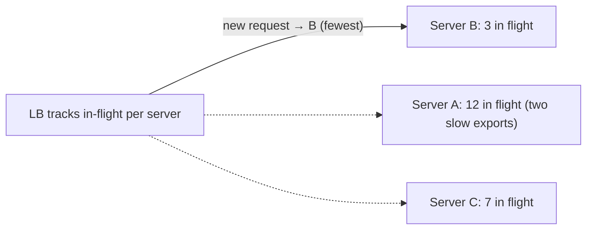

Variants: **weighted least connections** (connections ÷ weight), **least outstanding requests** (ALB's algorithm), **least response time** (connections × latency).

#### Example
A reporting API mixes 10 ms lookups with 30 s exports. With round robin, a server that received two exports still gets its full share of new traffic, and its queue grows. With least connections, it gets fewer new requests until exports finish. AWS ALB "least outstanding requests" mode and NGINX `least_conn` handle this.

Caveat: newly added servers with zero connections can get flooded at once, so combine with **slow start**.

#### Trade-offs
Adapts to real load, but needs per-server state at the balancer (harder across many LB nodes, since each sees only its own connections), and connection count isn't always a perfect proxy for load.

#### Problems & fixes
| Symptom | Cause | Fix |
|---|---|---|
| New instance flooded right after joining | zero connections looks "least loaded" | slow-start ramp-up |
| Uneven load across multiple LB nodes | each LB sees only its own connections | P2C, shared/approximate state, or accept |
| Poor balancing with HTTP/2 multiplexing | few connections carry many requests | least outstanding *requests* (L7) |

#### Cheat sheet
- Pick the server with the fewest in-flight requests or connections.
- Best when request durations vary.
- Pair with slow start. At L7 prefer least outstanding *requests*.

#### Interview questions

Round robin vs least connections for an API with highly variable response times?

Least connections (or least outstanding requests): it routes away from servers busy with slow requests, keeping queues short and tail latency lower. Round robin keeps sending equal shares, so servers that happen to get slow requests accumulate backlogs.

Why can least connections misbehave when a new server joins?

The new server has zero connections, so the balancer sends it most new requests at once before its caches, JIT and connection pools are warm. It becomes overloaded, slow, maybe fails health checks and flaps. Slow-start mode ramps its share gradually.

#### Interview angle
> "For mixed fast and slow requests I'd use least outstanding requests, which ALB supports, plus slow start, so new instances aren't flooded."

### IP hash — same client IP always routes to same server (sticky sessions without cookies)
IP hash routes each request based on a hash of the **client's IP address**, so a given client consistently lands on the same server: session affinity without cookies. It's simple, but the distribution follows IP populations, which are often very skewed, and affinity breaks when clients change IPs or servers change.

#### How it works
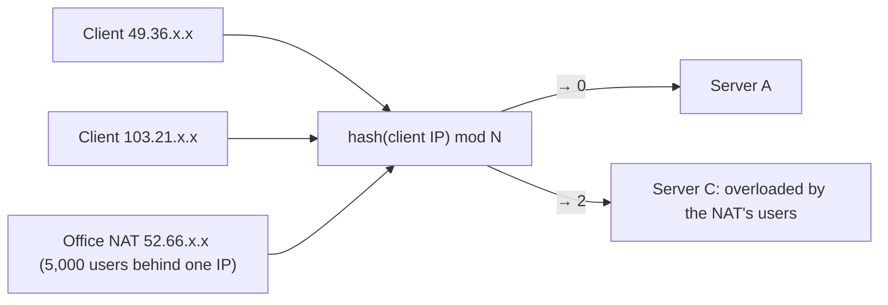

NGINX: `ip_hash;` or the more flexible `hash $remote_addr consistent;` (consistent hashing so adding a server moves only ~1/N of clients).

#### Example
A legacy app stores sessions in server memory and can't be changed quickly, so IP hash keeps users on their server. Problems seen: a large corporate customer's 5,000 employees behind one NAT IP all land on one server. Mobile users switching from Wi-Fi to 4G change IP and lose their sessions. A server restart logs out a third of users. The proper fix: externalise sessions (Redis) and use a load-aware algorithm.

Legit uses: L4 balancing where cookies aren't visible, keeping a client on the same cache node (locality), and UDP protocols.

#### Trade-offs
No cookies or state needed, works at L4, but uneven load (NAT, CGNAT on mobile networks), affinity lost on IP change, and rebalancing on server changes (unless consistent hashing).

#### Problems & fixes
| Symptom | Cause | Fix |
|---|---|---|
| One server overloaded | many users behind one NAT/CGNAT IP | cookie-based affinity or no affinity + external sessions |
| Users lose sessions on network switch | IP changed | external session store |
| Adding a server reshuffles everyone | `hash mod N` | consistent hashing (`hash … consistent`) |

#### Cheat sheet
- Affinity by client IP hash. Works at L4, no cookies.
- Skewed by NAT/CGNAT. Breaks on IP change.
- Prefer stateless servers. If affinity is required, consistent hashing or cookies.

#### Interview questions

Why is IP-hash affinity problematic for mobile apps in India?

Mobile carriers use carrier-grade NAT, so thousands of users share a few public IPs, which concentrates load on a few servers. Users also hop between networks (Wi-Fi ↔ 4G), changing IPs and losing affinity mid-session. External session storage with load-aware balancing avoids both problems.

Cookie-based stickiness vs IP hash: which is better and why?

Cookie-based (LB-generated or app cookie) identifies the actual client regardless of IP changes or shared NATs, so distribution is fairer and affinity more stable. It requires L7 (HTTP) and cookie support. IP hash works at L4 and for non-HTTP traffic, but is skewed and fragile. Best of all is avoiding affinity by making servers stateless.

#### Interview angle
> "I avoid IP-hash stickiness because NAT skews load and IPs change. Sessions live in Redis so any server works, and where locality matters I use consistent hashing on a stable key like the user id."

### Random with power of two choices — pick 2 random servers, route to least loaded (better than random)
Power of two choices (P2C): for each request, pick **two servers at random** and send the request to the **less loaded** of the two. It's almost as good as checking every server, but it needs only two load lookups and no global coordination, which is why it's used in Envoy, Linkerd, Finagle, NGINX (`random two least_conn`) and gRPC.

#### How it works
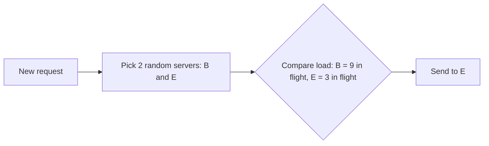

Why it works: with pure random choice the maximum load grows like log N / log log N. With two choices it drops to log log N, an exponential improvement. And unlike "pick the global least loaded", multiple independent balancers don't all herd onto the same server based on stale data.

#### Example
A service mesh with 300 client pods and 50 backend pods: each client-side Envoy keeps its own view of outstanding requests per backend. "Least loaded globally" would make all clients pile onto whichever backend looked idle a moment ago (herding). P2C spreads choices randomly while avoiding obviously busy servers, giving low, stable tail latency. Envoy's `LEAST_REQUEST` uses P2C by default.

#### Trade-offs
Near-optimal balance with little state and no herd effect. Slightly worse than perfect least-loaded with full fresh information (rarely available in distributed settings).

#### Problems & fixes
| Symptom | Cause | Fix |
|---|---|---|
| Herding onto one "idle" backend | many balancers using stale global least-loaded | P2C instead of global minimum |
| Uneven load with plain random | random variance | P2C |
| Load metric misleading | counting connections in multiplexed protocols | use outstanding requests or latency-weighted (EWMA) |

#### Cheat sheet
- Pick 2 at random, choose the less loaded.
- Exponentially better than random, avoids herding.
- Default in Envoy LEAST_REQUEST, Linkerd (EWMA), NGINX `random two`.

#### Interview questions

Why not always send requests to the globally least-loaded server?

In distributed setups each balancer has stale or partial information. If they all pick the server that looked least loaded, they simultaneously flood it (herding), it becomes the most loaded, and the pattern oscillates. Finding the global minimum also requires state about every server. P2C needs only two samples and randomness, which avoids herding.

What load metric would you combine with P2C for latency-sensitive services?

Outstanding (in-flight) requests per backend, or a latency-weighted score such as Linkerd's EWMA of response times multiplied by outstanding requests. Both capture a backend that is slow (GC, noisy neighbour) better than connection counts, especially with HTTP/2 multiplexing.

#### Interview angle
> "Client-side balancing uses power-of-two-choices on outstanding requests: near-optimal spread with no global state and no herding onto one server, which is how Envoy and Linkerd do it."

### Layer 4 LB — operates on TCP/UDP, fast, no HTTP awareness, no SSL termination
A Layer 4 load balancer routes based on **IP addresses and ports** (the transport layer). It forwards TCP connections or UDP datagrams to backends **without parsing application data**. It's extremely fast, handles any protocol and scales to millions of connections, but can't route by URL, header or cookie.

#### How it works
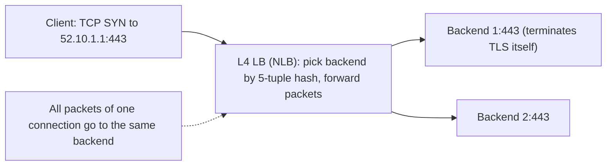

Modes: NAT (rewrite destination), DSR (direct server return, where responses bypass the LB), or pass-through with client IP preserved (AWS NLB preserves source IP, or uses the PROXY protocol).

Examples: AWS NLB, GCP TCP/UDP LB, HAProxy in TCP mode, LVS/IPVS, Maglev, Katran (Facebook's XDP-based L4 LB), kube-proxy (iptables/IPVS) for Kubernetes Services.

#### Example
- **Databases, MQTT, game servers, custom TCP protocols**: an NLB in front of an MQTT broker cluster handling 2M persistent IoT connections. Only L4 makes sense, since there's no HTTP.
- **End-to-end TLS / mTLS** where the backend must see the client certificate: L4 passes encrypted bytes through untouched.
- **Static IPs** for partner allow-lists: NLB provides fixed Elastic IPs per AZ.
- **In front of L7 proxies**: NLB → fleet of Envoy/NGINX (L7) for DDoS absorption and static IPs.

#### Trade-offs
| L4 | L7 |
|---|---|
| very fast, millions of conns, low latency | more CPU per request |
| any TCP/UDP protocol | HTTP(S)/gRPC/WebSocket aware |
| no TLS termination (or optional) | TLS termination, routing by path/host/header |
| balances connections | balances requests, retries, rewrites |

#### Problems & fixes
| Symptom | Cause | Fix |
|---|---|---|
| gRPC/HTTP2 traffic stuck to one backend | L4 balances connections, not requests | L7 balancing or connection recycling |
| Backend sees LB IP, not client IP | NAT mode | client IP preservation / PROXY protocol |
| Can't route /api vs /static | no HTTP awareness | L7 LB |

#### Cheat sheet
- Routes on IP:port, forwards connections, protocol-agnostic.
- Fast, scales to huge connection counts, static IPs (NLB).
- Can't route by path/headers. Balances per connection.

#### Interview questions

When would you choose an L4 load balancer over L7?

For non-HTTP protocols (databases, MQTT, game/UDP traffic), when you need end-to-end encryption or client-certificate visibility at the backend (TLS pass-through), extreme connection counts or ultra-low latency, static IPs for allow-listing, or as the first tier in front of a fleet of L7 proxies.

How does an L4 balancer keep a TCP connection going to the same backend?

It hashes the connection 5-tuple (source IP and port, destination IP and port, protocol), or tracks connections in a table, so all packets of a flow map to the same backend. Consistent hashing (Maglev) keeps most existing flows on their backend even when backends are added or removed.

#### Interview angle
> "L4 balancers like NLB are for raw TCP and UDP: IoT MQTT, databases, TLS pass-through and static IPs. HTTP routing, retries and TLS termination belong at L7."

### Layer 7 LB — operates on HTTP, content-aware routing, SSL termination, rewrites
A Layer 7 load balancer understands the application protocol (HTTP/1.1, HTTP/2, gRPC, WebSocket). It terminates TLS, parses requests and routes **each request** based on host, path, headers, cookies or query. It can also retry, rewrite, compress, authenticate and observe at request granularity.

#### How it works
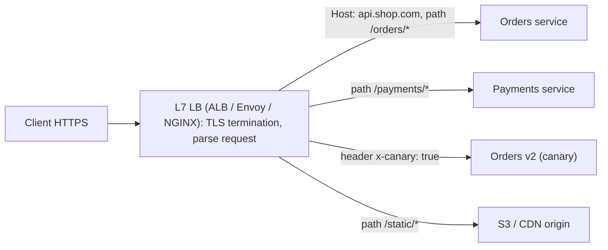

Capabilities: path/host routing, header/cookie-based canaries, request-level balancing (great for HTTP/2/gRPC), retries and timeouts, redirects (HTTP→HTTPS), WebSocket upgrades, authentication (OIDC on ALB), WAF integration, access logs with request details.

#### Example
One AWS ALB for an e-commerce platform: `api.shop.com/orders/*` → orders target group, `/payments/*` → payments, `/ws` → WebSocket gateway, `admin.shop.com` → admin service with Cognito OIDC auth at the ALB. TLS certificates come from ACM, and a WAF blocks SQLi/XSS and bad bots. Inside Kubernetes, an Ingress controller (or Gateway API with Envoy) does the same per cluster.

#### Trade-offs
Rich routing and visibility, but higher latency and CPU per request (parsing, TLS), HTTP-family protocols only, and the LB becomes a critical, more complex component.

#### Problems & fixes
| Symptom | Cause | Fix |
|---|---|---|
| 502/504 errors | backend resets / timeouts mismatched with LB | align keep-alive and timeouts, check health |
| Large uploads fail | request size/time limits | direct-to-S3 uploads, raise limits for that route |
| WebSocket drops after idle period | LB idle timeout | heartbeats, raise idle timeout |
| Retry storms through the LB | LB + client + mesh all retrying | retry at one layer, budgets |

#### Cheat sheet
- Request-aware: host/path/header routing, TLS termination, retries, WAF, auth.
- Balances per request (good for HTTP/2 and gRPC).
- More CPU and latency than L4. HTTP-family only.

#### Interview questions

What can an L7 load balancer do that an L4 one cannot?

Route individual requests by host, path, headers or cookies (microservice routing, canaries, A/B tests). Terminate TLS and inspect traffic (WAF, auth). Balance HTTP/2 and gRPC per request rather than per connection. Rewrite or redirect URLs, add headers, retry failed requests, compress responses, and produce per-request logs and metrics.

Your gRPC services are behind a Kubernetes ClusterIP Service and load is uneven. Why, and how does L7 help?

ClusterIP Services are L4 (kube-proxy): each long-lived HTTP/2 connection is pinned to one pod, and all requests on it go there. An L7 proxy (Envoy sidecar or mesh, or gRPC client-side LB with a headless service) balances each request across pods, evening out load.

#### Interview angle
> "At the edge an L7 ALB or Envoy terminates TLS and routes by host and path, with WAF and per-request balancing, so gRPC and HTTP/2 spread evenly across pods."

### DNS load balancing — multiple A records for same domain, TTL-based, no health checks
DNS load balancing returns **several IP addresses** (multiple A/AAAA records) for one hostname, often rotated (round-robin DNS), so different clients connect to different servers. It's free and simple, but coarse: DNS caching, clients picking the first IP, and **no built-in health awareness** make it unreliable as the only balancing layer.

#### How it works
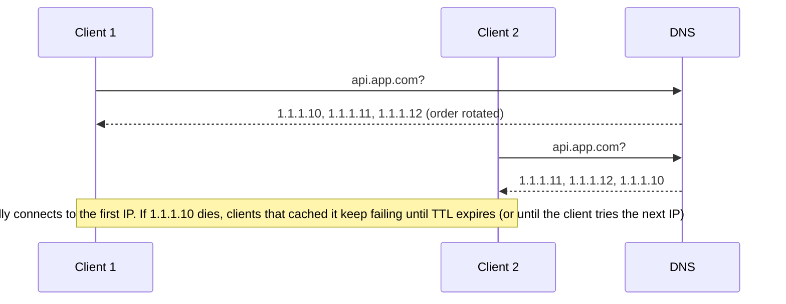

Managed DNS (Route 53, Cloudflare) adds health checks, weighted, latency and geo routing, and failover records, which turns DNS into a coarse global traffic manager.

#### Example
Small deployments put 3 NGINX servers behind round-robin DNS. When one server failed, ~1/3 of users got errors for the TTL duration plus resolver and browser caching (sometimes much longer). Moving to a cloud L4/L7 LB with health checks made the failure invisible. DNS is still used one level up: Route 53 latency-based records point at regional load balancers, with health checks for regional failover.

#### Trade-offs
No extra infrastructure and works globally, but changes propagate slowly (TTL), there's no per-request load awareness, and plain DNS has no health checks. Clients and resolvers behave inconsistently.

#### Problems & fixes
| Symptom | Cause | Fix |
|---|---|---|
| Users hit a dead server | plain RR DNS has no health checks | health-checked DNS (Route 53) + real LBs behind |
| Uneven load | caching resolvers (big ISPs) pin many users to one IP | short TTL, more IPs, LB tier |
| Slow failover | TTL + client caching | low TTL, anycast or global LB |

#### Cheat sheet
- Multiple A records, rotated. Clients pick, caches pin.
- No health checks in plain DNS. Use managed DNS health checks.
- Use DNS to pick a region, and real LBs inside it.

#### Interview questions

Why isn't round-robin DNS enough to load balance a production web app?

There are no health checks (dead servers keep receiving traffic), TTL and client caching slow down changes and failover, distribution is uneven (large resolvers cache one answer for many users), and there's no awareness of server load. It's best used to choose among highly available endpoints (regional load balancers), not individual servers.

How do large systems combine DNS with load balancers?

DNS (GeoDNS/latency-based with health checks, or anycast) directs users to the nearest healthy region or edge. Inside each region, L4/L7 load balancers with active health checks distribute requests across instances and handle instance failures in seconds.

#### Interview angle
> "DNS only picks the region, using health-checked latency records. Inside a region, real load balancers handle instance health and per-request distribution."

### GSLB — Global Server Load Balancing, routes users to closest healthy datacenter
Global Server Load Balancing distributes users across **multiple data centres or regions**, considering proximity (latency/geo), health, capacity and policy. It's the top layer of a multi-region architecture, implemented with smart DNS, anycast, or global proxy networks.

#### How it works
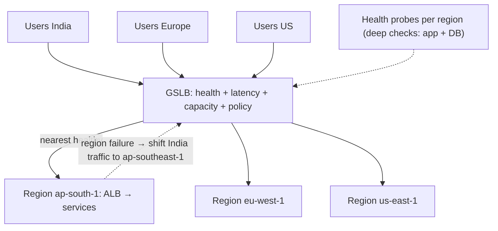

Implementations:
- **DNS-based**: Route 53 latency/geo/failover routing, NS1, Akamai GTM, F5 GTM.
- **Anycast-based**: AWS Global Accelerator, Cloudflare Load Balancing, Google Cloud global LB (one anycast IP, routing at the edge with fast failover).

#### Example
An active-active payments API in Mumbai and Singapore: Global Accelerator anycast IPs route users to the nearest healthy regional ALB. Health checks hit `/health/deep` (verifying DB connectivity). When Mumbai's DB has issues, its endpoint fails health checks and traffic shifts to Singapore within ~30 s. Users are homed by region in the data layer, so writes for Mumbai-homed users go cross-region during the incident, which is accepted (more latency, still correct).

#### Trade-offs
Lower latency and region-level resilience, but multi-region data consistency (replication, conflict handling, data residency) is the hard part, and failover capacity must be pre-provisioned in each region.

#### Problems & fixes
| Symptom | Cause | Fix |
|---|---|---|
| Failover overloads the surviving region | not provisioned for 2× load | capacity headroom / fast autoscaling, shed non-critical traffic |
| Traffic shifted but region's DB still down | shallow health checks | deep health checks including critical dependencies |
| Flapping between regions | aggressive health thresholds | hysteresis, multiple failures before failover |
| Data residency violations on failover | traffic moved to non-compliant region | residency-aware failover targets |

#### Cheat sheet
- Routes users to the best healthy region: latency, health, capacity, policy.
- DNS-based (slower) or anycast-based (fast failover).
- The data layer and capacity headroom are what make it actually work.

#### Interview questions

Design global traffic routing for an app with users in India, Europe and the US.

Deploy the stack in three regions behind regional ALBs. Use anycast (Global Accelerator / Cloudflare) or latency-based DNS with health checks to send users to the nearest healthy region. Home each user's data to a region (with async replication for DR), route their writes to the home region, serve reads locally where staleness is acceptable, keep capacity headroom for failover, and keep data residency constraints in failover policies.

Why are deep health checks important for GSLB?

A region whose load balancer and web servers respond but whose database or core dependency is down will still pass shallow checks, so the GSLB keeps sending users there and they get errors. Deep checks exercise critical dependencies so the region is taken out of rotation when it can't actually serve requests, with care to avoid flapping on minor issues.

#### Interview angle
> "Anycast global routing sends each user to the nearest healthy region using deep health checks, and each region has headroom to absorb a neighbour's traffic. User data is homed per region, so failover stays correct."

### AWS ALB (L7) vs NLB (L4) vs Classic LB — ALB for HTTP/WebSocket, NLB for ultra-low latency TCP
AWS offers three Elastic Load Balancers: **ALB** (Application, L7: HTTP/HTTPS/gRPC/WebSocket with rich routing), **NLB** (Network, L4: TCP/UDP/TLS with ultra-low latency, static IPs and millions of connections) and the legacy **Classic LB** (old, avoid). Plus **Gateway LB** for inline security appliances.

#### How it works
| | ALB | NLB | Classic (legacy) |
|---|---|---|---|
| Layer | 7 (HTTP/1.1, HTTP/2, gRPC, WebSocket) | 4 (TCP, UDP, TLS) | 4/7 basic |
| Routing | host, path, header, query, method, source IP. Weighted target groups | port-based | none |
| TLS | termination, SNI multi-cert | optional termination or pass-through | basic |
| IPs | dynamic (use DNS name) | static IP / Elastic IP per AZ | dynamic |
| Client IP | `X-Forwarded-For` | preserved | XFF / proxy protocol |
| Extras | WAF, OIDC/Cognito auth, Lambda targets, slow start | PrivateLink endpoint services, huge scale | — |
| Latency | ~ms | ~100 µs | — |

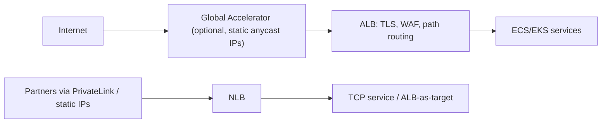

#### Example
A fintech: public web and API traffic goes through the ALB (path routing to microservices, WAF, ACM certificates). The card-network connection, a TCP ISO 8583 protocol with partners requiring static IPs, goes through an NLB. Internal services are exposed to another AWS account through an NLB-backed **PrivateLink** endpoint. Classic LBs from 2015 are migrated to ALB/NLB.

#### Trade-offs
ALB: features over raw speed, and dynamic IPs. NLB: speed, static IPs and protocol flexibility, without L7 features. You can chain them (NLB → ALB target) to get static IPs plus L7 routing.

#### Problems & fixes
| Symptom | Cause | Fix |
|---|---|---|
| Partner needs fixed IPs but you use ALB | ALB IPs change | NLB with EIPs in front (ALB as target) or Global Accelerator |
| gRPC load uneven behind NLB | L4 per-connection | ALB (supports gRPC) or Envoy |
| 504s on long requests via ALB | 60 s default idle timeout | raise idle timeout or go async |
| Still on Classic LB | legacy | migrate to ALB/NLB |

#### Cheat sheet
- ALB = L7 HTTP/gRPC/WebSocket routing + WAF + auth.
- NLB = L4 TCP/UDP, static IPs, ultra-low latency, PrivateLink.
- Classic = legacy. NLB → ALB chaining for static IPs + L7.

#### Interview questions

Which AWS load balancer for: (a) a REST API with microservices, (b) an MQTT broker, (c) a service exposed privately to another AWS account?

(a) ALB: host and path routing to services, TLS termination, WAF. (b) NLB: MQTT is TCP with millions of long-lived connections, and NLB handles that at L4 with low latency. (c) NLB fronting the service as a PrivateLink endpoint service, which the other account consumes via an interface VPC endpoint.

How do you give an ALB-based application static IP addresses?

Put AWS Global Accelerator in front (two static anycast IPs routing to the ALB), or put an NLB with Elastic IPs in front and register the ALB as its target. Both keep ALB's L7 features while exposing fixed IPs for allow-listing.

#### Interview angle
> "On AWS: ALB for HTTP, gRPC and WebSockets with path routing and WAF. NLB for raw TCP, static IPs and PrivateLink. Global Accelerator in front when partners need fixed IPs."

### Health checks — active (periodic HTTP probe) vs passive (monitor real traffic error rates)
Health checks tell load balancers and orchestrators which instances should receive traffic. **Active** checks probe each instance periodically (`GET /health`). **Passive** checks (outlier detection) watch real traffic and eject instances that return errors or time out. Good systems use both, with carefully designed endpoints.

#### How it works
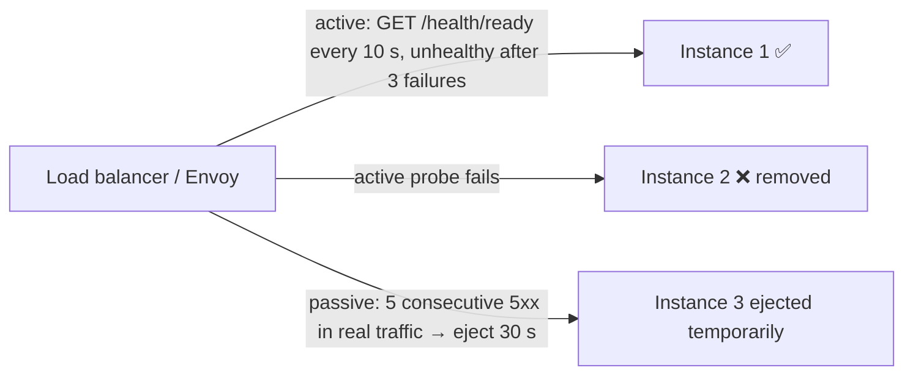

| Probe | Purpose | Should check |
|---|---|---|
| **Liveness** (K8s) | is the process stuck? restart if failing | only the process itself (event loop, deadlock), never dependencies |
| **Readiness** | can it take traffic now? | initialised, warmed, critical local resources ready |
| **Startup** | slow-starting apps | finished boot (protects from liveness kills) |
| LB health check | include in rotation? | readiness-like |
| Deep health | region/GSLB-level decisions | critical dependencies (DB reachable) |

Passive (Envoy outlier detection): consecutive 5xx, gateway failures, success-rate deviation, ejection with exponential backoff, and a max-ejection percentage so not everything is ejected.

#### Example
A service's liveness probe called the database. During a brief DB failover, every pod's liveness failed, and Kubernetes restarted **all** pods simultaneously, turning a 20 s DB blip into a 5-minute outage with cold caches. Fix: liveness checks only the process, and readiness may reflect dependency health (or degrade gracefully), with thresholds tolerating short blips.

#### Trade-offs
Aggressive checks detect failures fast but cause flapping and false ejections. Lenient checks are stable but slow to react. Dependency-aware checks risk cascading removals.

#### Problems & fixes
| Symptom | Cause | Fix |
|---|---|---|
| Mass restarts during dependency outage | liveness checks dependencies | liveness = process only |
| Instances flapping in/out | thresholds too tight, GC pauses | healthy/unhealthy thresholds, longer intervals |
| Traffic to "healthy" but broken instance | shallow check (returns 200 always) | readiness reflects real ability. Passive outlier detection |
| All instances ejected | outlier detection without limits | max ejection percent, panic threshold |

#### Cheat sheet
- Active probes + passive outlier detection.
- Liveness = process alive (no dependencies). Readiness = ready for traffic.
- Thresholds with hysteresis. Cap the ejection percentage.

#### Interview questions

What's the difference between Kubernetes liveness and readiness probes, and what should each check?

Liveness answers "is this process broken beyond recovery?". Failing it restarts the container, so it must only check the process itself (responsive, not deadlocked), never external dependencies. Readiness answers "should this pod receive traffic right now?". Failing it removes the pod from Service endpoints without restarting, so it can reflect warm-up state and whether it can usefully serve.

Why combine active health checks with passive outlier detection?

Active checks probe a lightweight endpoint, which may pass while real requests fail (a broken dependency path, a bad deploy affecting some endpoints). Passive detection observes real traffic outcomes and ejects instances returning errors or timeouts within seconds. Active checks also cover idle periods and help re-admit instances.

#### Interview angle
> "Liveness checks only the process, readiness gates traffic, and Envoy outlier detection ejects instances failing real requests, capped so a dependency blip can't eject everything."

### Connection draining — grace period to complete in-flight requests before removing instance
Connection draining (deregistration delay) lets an instance that's being removed (scale-in, deploy, maintenance) **finish its in-flight requests** while the load balancer stops sending it new ones. Without it, every deploy or scale-in drops active requests and users see errors.

#### How it works
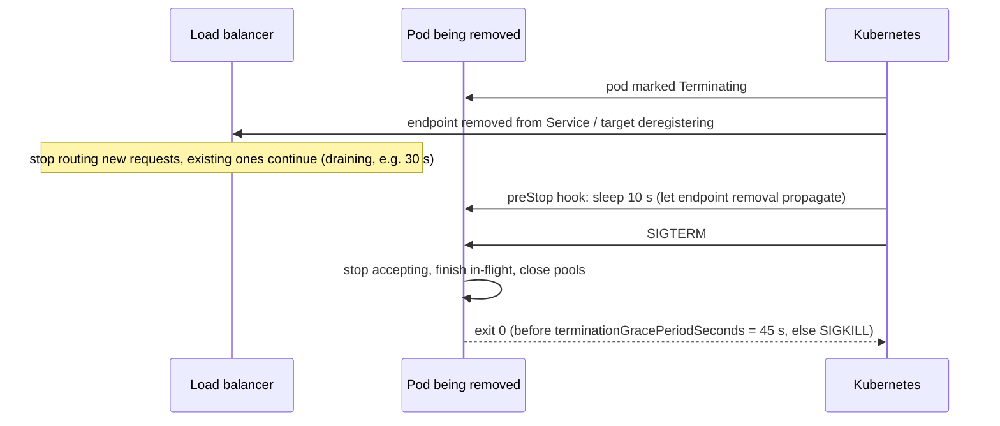

Settings to align:
- ALB/NLB `deregistration_delay` (default 300 s, often lowered to 30–60 s).
- K8s `preStop` sleep (endpoint propagation race) + `terminationGracePeriodSeconds`.
- App graceful shutdown timeout (Spring Boot `server.shutdown=graceful`, `spring.lifecycle.timeout-per-shutdown-phase=30s`).
- Long-lived connections (WebSockets, gRPC streams): send "go away" or close gracefully so clients reconnect elsewhere.

#### Example
Every deploy produced a burst of 502s. Cause: Kubernetes sent SIGTERM at the same moment it started removing the pod from endpoints, so the ingress kept routing to the pod for a few seconds after it stopped accepting connections. Adding `preStop: sleep 10` plus Spring graceful shutdown and a 45 s grace period eliminated the errors.

#### Trade-offs
Longer draining is safer for long requests but slows deploys and scale-in. Very long requests should become async jobs anyway.

#### Problems & fixes
| Symptom | Cause | Fix |
|---|---|---|
| 502s during every deploy | SIGTERM before LB stops routing | preStop sleep, readiness fail on shutdown |
| Deploys take 5+ minutes | default 300 s deregistration delay | tune to longest typical request (30–60 s) |
| Long uploads/exports killed | longer than drain window | async jobs, resumable uploads |
| WebSocket users all disconnect at once | hard close on shutdown | graceful close in batches, client reconnect with backoff |

#### Cheat sheet
- Stop new traffic, finish in-flight, then exit.
- preStop sleep + graceful shutdown + grace period > drain time.
- Tune the deregistration delay. Make long work async.

#### Interview questions

How do you achieve zero-error deploys for an HTTP service on Kubernetes behind an ingress?

Rolling updates with readiness probes, so new pods get traffic only when ready. On termination: a `preStop` sleep (5–15 s) so endpoint removal propagates to the ingress/LB, then SIGTERM triggers graceful shutdown (stop accepting new requests, finish in-flight ones, close pools) within `terminationGracePeriodSeconds`. Align the LB deregistration delay, and make clients retry idempotent requests.

Why is a preStop sleep needed if the pod is already removed from the Service?

Endpoint removal propagates asynchronously to kube-proxy, ingress controllers and cloud LBs, which takes a few seconds, while SIGTERM is sent immediately. Without the delay, the app may stop accepting connections while proxies still route to it, causing connection errors. The sleep bridges that propagation gap.

#### Interview angle
> "Every service drains: a preStop sleep for endpoint propagation, graceful shutdown on SIGTERM, a grace period longer than the drain window, and a tuned LB deregistration delay, so deploys cause zero errors."

### Slow-start mode — gradually ramp up traffic to newly added instances to warm caches
Slow start gives a newly added (or recovered) instance a **gradually increasing share of traffic** over a warm-up window (say 30–120 s) instead of its full share immediately. Cold instances (empty caches, JVM not JIT-compiled, connection pools not established) are slow at first, and flooding them causes timeouts and flapping.

#### How it works
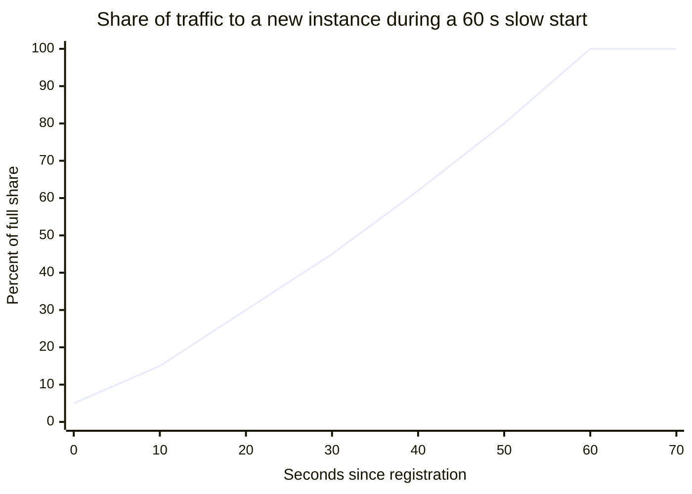

Support: AWS ALB target group `slow_start.duration_seconds`, NGINX Plus `slow_start=30s`, Envoy `slow_start_config`, HAProxy `slowstart`. Combine with app-level warm-up (preload caches, warm JIT with synthetic requests before readiness).

#### Example
A Java service scales out during a traffic spike. New pods initially take ~800 ms per request (cold JIT, empty Caffeine caches, Hikari pool not filled) versus 40 ms when warm. With least-outstanding-requests and no slow start, new pods got flooded, timed out, failed readiness and were removed, so the autoscaler added more cold pods: a death spiral. A 60 s ALB slow start plus a startup warm-up routine fixed it.

#### Trade-offs
Protects new instances, but delays when added capacity fully helps, so scale out earlier (predictive scaling, lower thresholds).

#### Problems & fixes
| Symptom | Cause | Fix |
|---|---|---|
| New instances time out right after scale-out | cold start + full traffic share | slow start + warm-up before readiness |
| Autoscaling "death spiral" | cold instances failing health checks | slow start, startup probes, less aggressive health thresholds |
| Capacity arrives too late | slow start delays benefit | scale earlier / predictive scaling |

#### Cheat sheet
- Ramp traffic to new instances over 30–120 s.
- Warm caches/JIT/pools before readiness.
- Scale earlier to compensate for warm-up time.

#### Interview questions

Why do JVM services in particular benefit from slow start?

At startup the JVM interprets bytecode until hot paths are JIT-compiled, classes load lazily, connection pools and in-process caches are empty, and the first GCs size the heap. Early requests can be 10× slower. Ramping traffic lets the JIT and caches warm up without timeouts. Alternatives include warm-up requests before readiness, CDS/AppCDS, or GraalVM native images.

How can autoscaling make an overload worse without slow start?

Newly launched instances immediately receive their full share of an already overloaded system. Being cold, they're slow and fail health checks, so they're removed or restarted, the remaining instances get even more load, and the autoscaler launches more cold instances that also fail. Slow start, warm-up and sensible health thresholds break this loop.

#### Interview angle
> "New instances warm their caches and JIT before readiness and get a 60-second slow-start ramp at the load balancer, so scale-outs add capacity instead of a wave of timeouts."
