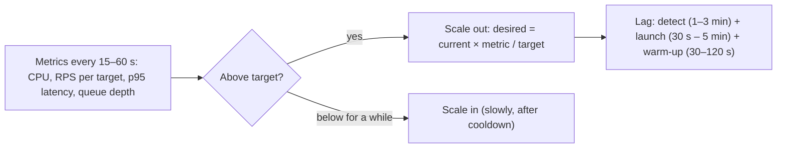
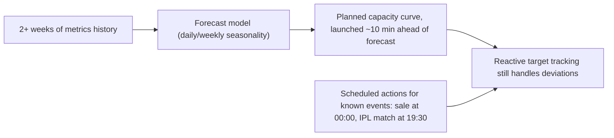
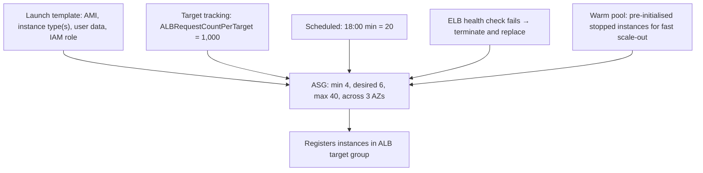
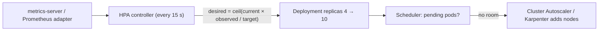
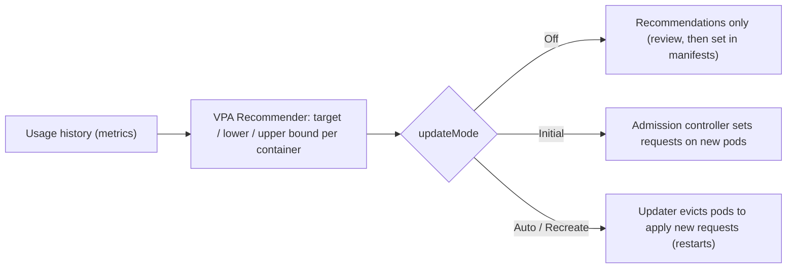
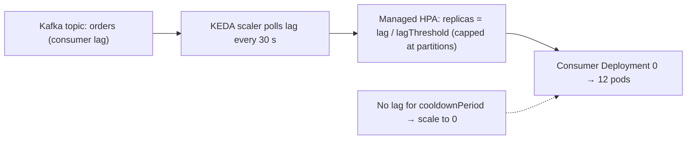
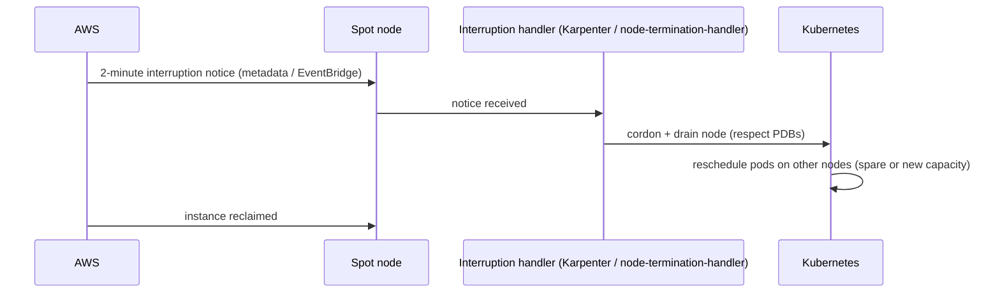
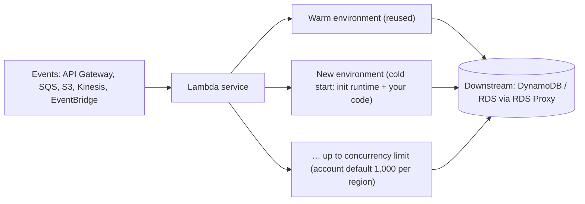
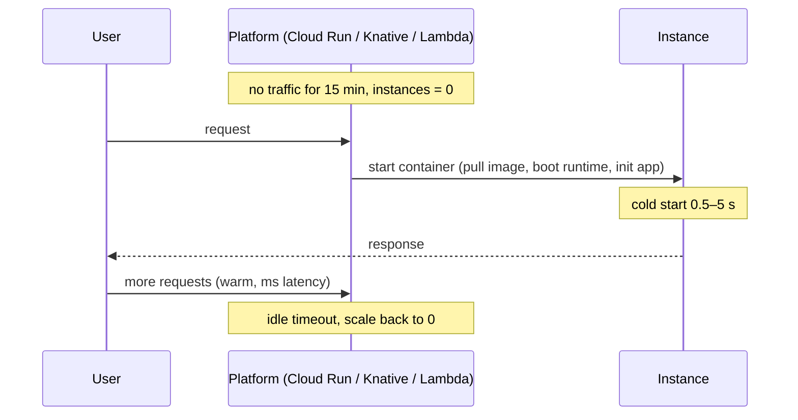

## Auto-scaling & compute

### Reactive auto-scaling — scale based on current CPU%, memory%, request count, queue depth
Reactive autoscaling watches live metrics and adds or removes capacity when they cross targets: CPU above 60%, more than 1,000 requests per instance, queue depth above 10k. It's the standard approach (AWS target tracking, Kubernetes HPA), but it always **lags** demand by detection + provisioning + warm-up time.

#### Intuition
A thermostat. It switches the heater on after the room has already turned cold, so there is always a short chilly spell before the warmth arrives.

#### Must know
- Watch a live metric and add or remove capacity when it crosses a target.
- Formula: **desired = current × (observed metric ÷ target metric)**, rounded up.
- It always **lags**: time to detect + time to launch + time to warm up.
- Scale on the metric that actually saturates: CPU for CPU-bound work, requests per instance for I/O-bound work, queue depth for workers.
- **Scale out fast, scale in slowly**, and keep headroom.

#### Numbers to quote
- A common CPU target is 50–65%, which leaves headroom for the lag.
- Total lag is typically a few minutes on VMs and about a minute on containers.

#### Common mistakes
- Scaling an I/O-bound service on CPU, which stays low while latency climbs.
- Aggressive scale-in, which causes flapping.
- Autoscaling the app tier into a database that cannot take the extra connections.

#### How it works


Target tracking formula (HPA-style): `desired = ceil(current × currentMetric / targetMetric)`.

Choosing the metric:
| Workload | Good metric |
|---|---|
| CPU-bound API | CPU utilisation (target 50–65%) |
| I/O-bound API | requests per target, or concurrency / latency |
| Queue workers | queue depth or lag per worker / age of oldest message |
| Memory-bound | memory (rarely scales well, fix leaks first) |

#### Example
An API on ECS with target tracking at 60% CPU: a marketing push doubles traffic in 2 minutes. CPU hits 90% within a minute, the scale-out triggers at minute 2, tasks start at minute 3 and are warm at minute 4. For about 3 minutes, latency rises. Mitigations: a lower target (50%) for headroom, step scaling for big jumps, a faster-starting image, and predictive or scheduled scaling for known peaks.

#### Trade-offs
Simple and automatic, and cost-efficient for gradual changes. Too slow for sudden spikes, and it can oscillate (flap) if scale-in is too aggressive.

#### Problems & fixes
| Symptom | Cause | Fix |
|---|---|---|
| Latency spikes before scaling kicks in | provisioning lag | headroom (lower targets), faster boot, predictive/scheduled scaling |
| Scaling oscillates up and down | aggressive scale-in, short windows | scale-in cooldown/stabilisation window, scale in slowly |
| CPU low but latency high, no scaling | wrong metric (I/O-bound) | scale on RPS/concurrency/latency/queue depth |
| Scaled app overwhelms DB | downstream limits ignored | cap max instances, pool via PgBouncer, scale DB tier |

#### Cheat sheet
- Target tracking on the metric that actually saturates.
- Scale out fast, scale in slow. Keep headroom (CPU target ~50–60%).
- Lag = detect + launch + warm-up. Pre-scale for known spikes.

#### Interview questions
<details><summary>Your service autoscales on CPU but still has latency spikes during sudden traffic surges. What do you change?</summary>

Reduce lag and add headroom: a lower CPU target (more spare capacity), step scaling for big jumps, faster instance start (smaller images, pre-baked AMIs, warm pools), and scheduled or predictive scaling for known patterns. If the service is I/O-bound, scale on RPS or concurrency instead of CPU. Also shed load or queue non-critical work during the ramp.
</details>

<details><summary>Why should scale-in be slower than scale-out?</summary>

Under-capacity hurts users immediately, while over-capacity only costs money for a few minutes. Aggressive scale-in also causes flapping: remove instances, load rises, add them back, paying warm-up costs repeatedly. Stabilisation windows (e.g. 5–10 minutes of low load before scaling in) keep capacity steady.
</details>

#### Interview angle
> "I autoscale on the metric that actually saturates, CPU or requests per target or queue lag, scaling out fast and in slowly with headroom, plus scheduled or predictive scaling for known peaks."

#### Sources
- [Target tracking scaling policies for Amazon EC2 Auto Scaling](https://docs.aws.amazon.com/autoscaling/ec2/userguide/as-scaling-target-tracking.html) — Amazon EC2 Auto Scaling user guide
- [Horizontal pod autoscaling](https://kubernetes.io/docs/concepts/workloads/autoscaling/horizontal-pod-autoscale/) — Kubernetes docs

### Predictive auto-scaling — pre-scale based on historical patterns (Black Friday, match kicks off)
Predictive autoscaling forecasts demand from historical patterns (daily and weekly cycles, recurring events) and **provisions capacity before the load arrives**, removing the reactive lag. Scheduled scaling is the manual version: "at 19:30 on match days, set minimum to 80".

#### Intuition
A restaurant that brings in extra staff before the Friday dinner rush because it happens every Friday. It does not wait for the queue to reach the door.

#### Must know
- Forecast load from history and **add capacity before it arrives**, which removes the reactive lag.
- **Scheduled scaling** is the manual form: raise the minimum before a known event.
- Keep reactive scaling switched on as the safety net.
- Warm caches and the CDN as well, not only the servers.
- It cannot foresee viral or unplanned spikes.

#### Common mistakes
- Relying on reactive scaling for a flash sale or a match start.
- Scheduled scale-ups that nobody ever removes, so you pay for idle capacity.
- Assuming the cloud will have the instances at peak. Reserve capacity for big events.

#### How it works


- AWS **Predictive Scaling** policies for ASGs (forecast + schedule-ahead buffer).
- Kubernetes: scheduled scaling via KEDA cron scaler or CronJobs adjusting HPA minimums.
- Always keep reactive scaling as a safety net, because forecasts miss unexpected spikes.

#### Example
A cricket streaming app: concurrency jumps from 2M to 20M within minutes of a key innings starting. Reactive scaling can't launch hundreds of nodes fast enough. The team scales origin and API tiers to forecast peak an hour before the match (scheduled), pre-warms caches and CDN, and keeps reactive policies for surprises (a super over). Daily commute-hour patterns are handled by predictive scaling.

#### Trade-offs
Removes lag for predictable load, but costs extra capacity when forecasts overshoot, needs history, and can't foresee viral or unplanned events.

#### Problems & fixes
| Symptom | Cause | Fix |
|---|---|---|
| Event spike still overwhelms the system | reactive scaling only | scheduled pre-scaling + warm-up before the event |
| Paying for idle capacity | forecast too high / schedules never removed | review forecasts, auto-expire scheduled actions |
| Forecast wrong after product change | patterns shifted | combine with reactive, re-evaluate models |
| Cloud capacity unavailable at peak | instance type shortages | capacity reservations, diverse instance types |

#### Cheat sheet
- Forecast + launch ahead. Scheduled scaling for known events.
- Keep reactive scaling as a backup.
- Reserve capacity for huge events. Warm caches and CDN too.

#### Interview questions
<details><summary>How would you prepare infrastructure for a flash sale starting at midnight?</summary>

Load-test to know capacity per instance. Schedule scale-out (minimums raised) 30–60 minutes before, including DB read replicas and cache shards. Warm caches and CDN with sale products. Reserve cloud capacity if needed. Enable rate limiting or a waiting room for overflow. Keep reactive autoscaling and circuit breakers as a safety net, and have engineers on call watching dashboards.
</details>

<details><summary>When is predictive scaling not enough?</summary>

For unpredictable spikes (viral content, breaking news, incidents causing retries) and for components that can't scale quickly at all (databases). You still need reactive scaling, headroom, load shedding and graceful degradation for the unforeseen.
</details>

#### Interview angle
> "For predictable peaks like evening commutes or match starts, I pre-scale on forecasts and schedules, warm caches and the CDN, and keep reactive autoscaling plus load shedding for surprises."

#### Sources
- [Predictive scaling for Amazon EC2 Auto Scaling](https://docs.aws.amazon.com/autoscaling/ec2/userguide/ec2-auto-scaling-predictive-scaling.html) — Amazon EC2 Auto Scaling user guide
- [Scheduled scaling for Amazon EC2 Auto Scaling](https://docs.aws.amazon.com/autoscaling/ec2/userguide/ec2-auto-scaling-scheduled-scaling.html) — Amazon EC2 Auto Scaling user guide

### AWS Auto Scaling Groups — min/desired/max, scale-out fast, scale-in slow (cooldown)
An AWS Auto Scaling Group (ASG) manages a fleet of EC2 instances from a **launch template**, keeping the count between **min** and **max** at a **desired** value adjusted by scaling policies. It replaces unhealthy instances, spreads across AZs and integrates with load balancers.

#### Intuition
A staffing agency with a contract: never fewer than four workers, never more than forty, and replace anyone who falls ill. The number on shift today moves between those limits with demand.

#### Must know
- An ASG runs a fleet of EC2 instances from a **launch template**, between **min** and **max**, at a **desired** count.
- It replaces unhealthy instances and spreads them across AZs.
- Use the **load balancer's health check**, not only the EC2 status check.
- Size **min** so that losing one AZ still leaves enough capacity.
- Speed up scale-out with pre-baked images and warm pools. Drain on termination with lifecycle hooks.

#### Common mistakes
- EC2 status checks only, so an instance with a crashed app is never replaced.
- A minimum too low to survive an AZ outage.
- A long bootstrap script at launch, which makes scale-out take minutes.

#### How it works


Key settings:
- **Health checks**: use ELB health checks (not just EC2 status) so app-level failures trigger replacement.
- **Instance warm-up / default cooldown**: avoid triggering more scaling before new instances report metrics.
- **Mixed instances policy**: multiple types plus On-Demand/Spot split for resilience and cost.
- **Lifecycle hooks**: run scripts on launch (register, warm) or termination (drain, upload logs).
- **Instance refresh**: rolling replacement for new AMIs.

#### Example
A web tier: min 6 (2 per AZ, for AZ-failure tolerance), max 60. Target tracking at 800 requests/target. A mixed-instances policy with 30% On-Demand base and 70% Spot across 4 instance types. A warm pool of 10 stopped instances, pre-baked with the app, cuts scale-out from ~4 min to ~40 s. A termination lifecycle hook deregisters from the ALB and waits for draining.

#### Trade-offs
Mature and reliable for VM fleets, but slower than containers (instance boot), AMI baking takes effort, and per-instance granularity is coarse compared with pods.

#### Problems & fixes
| Symptom | Cause | Fix |
|---|---|---|
| Broken app instances never replaced | EC2 status checks only | ELB health checks + grace period |
| Slow scale-out | long boot/config at launch | pre-baked AMIs, warm pools |
| Losing an AZ halves capacity below need | min too low / unbalanced | min sized for AZ failure, AZ rebalancing |
| Spot interruptions drop capacity | single Spot pool | diversified types, capacity-rebalance, On-Demand base |

#### Cheat sheet
- Launch template + min/desired/max + policies + ELB health checks.
- Warm pools and pre-baked AMIs speed scale-out. Lifecycle hooks drain cleanly.
- Mixed instances + Spot for cost. Size min for AZ loss.

#### Interview questions
<details><summary>How would you configure an ASG for a stateless web tier that must survive an AZ failure?</summary>

Span 3 AZs. Set min so that losing one AZ still leaves enough capacity (e.g. desired load needs 8 instances, so run at least 12 = 4 per AZ, or rely on fast scale-out with headroom). Use ELB health checks with a grace period, target tracking on requests per target, a termination lifecycle hook with connection draining, and AZ rebalancing enabled. Optionally use a mixed On-Demand/Spot policy with an On-Demand base.
</details>

<details><summary>What is an ASG warm pool and when is it worth it?</summary>

A set of pre-initialised instances kept stopped (or hibernated, or running) alongside the ASG. On scale-out they join in seconds instead of booting and configuring from scratch. It's worth it when launch time is long (large apps, heavy bootstrapping) and traffic surges are sudden.
</details>

#### Interview angle
> "The ASG spans three AZs sized to survive losing one, uses ELB health checks, target tracking on requests per target, warm pools for fast scale-out, and drain hooks on termination."

#### Sources
- [What is Amazon EC2 Auto Scaling?](https://docs.aws.amazon.com/autoscaling/ec2/userguide/what-is-amazon-ec2-auto-scaling.html) — Amazon EC2 Auto Scaling user guide
- [Warm pools for Amazon EC2 Auto Scaling](https://docs.aws.amazon.com/autoscaling/ec2/userguide/ec2-auto-scaling-warm-pools.html) — Amazon EC2 Auto Scaling user guide

### Kubernetes HPA — Horizontal Pod Autoscaler based on CPU/memory or custom metrics
The Horizontal Pod Autoscaler adjusts a Deployment's **replica count** based on observed metrics: CPU and memory utilisation relative to requests, or custom and external metrics (RPS, queue lag) via the metrics APIs. It's the default pod-level autoscaler, working alongside the Cluster Autoscaler or Karpenter, which add nodes when pods can't be scheduled.

#### Intuition
A shop manager who opens more tills when queues grow and closes them when it is quiet. Opening is quick. Closing is done cautiously in case the rush returns.

#### Must know
- HPA changes the **number of pods** from observed metrics.
- **desired = ceil(current replicas × observed ÷ target)**.
- CPU utilisation is measured **against the pod's CPU request**. No request, no CPU-based scaling.
- It can scale on custom metrics such as requests per second or queue lag.
- Pods need nodes to run on: pair it with the Cluster Autoscaler or Karpenter.

#### Numbers to quote
- The controller evaluates every 15 seconds. The default scale-down stabilisation window is 5 minutes.

#### Common mistakes
- No resource requests, so HPA shows `<unknown>`.
- HPA and VPA both acting on CPU, which fight each other.
- Forgetting node capacity, so new pods sit Pending.

#### How it works


```yaml
apiVersion: autoscaling/v2
kind: HorizontalPodAutoscaler
metadata: { name: orders-api }
spec:
  scaleTargetRef: { apiVersion: apps/v1, kind: Deployment, name: orders-api }
  minReplicas: 4
  maxReplicas: 60
  metrics:
    - type: Resource
      resource: { name: cpu, target: { type: Utilization, averageUtilization: 60 } }
    - type: Pods
      pods: { metric: { name: http_requests_per_second }, target: { type: AverageValue, averageValue: "200" } }
  behavior:
    scaleUp:   { stabilizationWindowSeconds: 0,   policies: [{ type: Percent, value: 100, periodSeconds: 30 }] }
    scaleDown: { stabilizationWindowSeconds: 300, policies: [{ type: Percent, value: 10,  periodSeconds: 60 }] }
```

CPU utilisation is relative to **requests**, so without CPU requests set, CPU-based HPA doesn't work.

#### Example
An orders API scales on CPU (60%) and RPS per pod (200). A sale doubles traffic: HPA doubles replicas within ~1 minute (scaleUp 100% per 30 s), Karpenter launches nodes for pending pods in ~60 s, and scale-down removes at most 10% per minute after 5 calm minutes, so there's no flapping.

#### Trade-offs
Native, flexible and metric-driven, but it depends on correct resource requests, scales only as fast as pods start (and nodes, if the cluster is full), and conflicts with VPA on the same CPU/memory metrics.

#### Problems & fixes
| Symptom | Cause | Fix |
|---|---|---|
| HPA shows `<unknown>` | no metrics-server / no resource requests | install metrics-server, set requests |
| Pods pending after scale-up | cluster out of nodes | Cluster Autoscaler/Karpenter, overprovisioning (pause pods) |
| Flapping replicas | short stabilisation | scaleDown stabilizationWindow 300 s+ |
| Scaling on CPU doesn't track load | I/O-bound service | custom metrics (RPS, concurrency) via Prometheus adapter, or KEDA |

#### Cheat sheet
- desired = ceil(current × observed / target). Utilisation is relative to requests.
- Use custom metrics for I/O-bound services. `behavior` to tune speed and stability.
- Pair with Cluster Autoscaler/Karpenter. Don't combine with VPA on the same metric.

#### Interview questions
<details><summary>Your HPA scales pods, but new pods stay Pending for minutes during spikes. What's missing?</summary>

Node capacity: the cluster has no room, so pods wait for the Cluster Autoscaler or Karpenter to provision nodes (1–3+ minutes). Mitigate with faster node provisioning (Karpenter, pre-pulled images, smaller images), overprovisioning with low-priority placeholder pods that get preempted instantly, keeping headroom nodes, and scheduled scaling for known peaks.
</details>

<details><summary>Why does CPU-based HPA require resource requests?</summary>

HPA computes CPU utilisation as usage divided by the pod's CPU request. Without a request there's no denominator, so the metric is unknown and HPA can't act. Requests also need to be realistic: too high and HPA scales late, too low and it scales early.
</details>

#### Interview angle
> "HPA scales on CPU against realistic requests, plus RPS per pod from Prometheus. It scales up fast and down slowly with stabilisation windows, and Karpenter adds nodes quickly enough that pods don't sit pending."

#### Sources
- [Horizontal pod autoscaling](https://kubernetes.io/docs/concepts/workloads/autoscaling/horizontal-pod-autoscale/) — Kubernetes docs
- [HorizontalPodAutoscaler walkthrough](https://kubernetes.io/docs/tasks/run-application/horizontal-pod-autoscale-walkthrough/) — Kubernetes docs

### Kubernetes VPA — Vertical Pod Autoscaler: right-sizes CPU/memory requests automatically
The Vertical Pod Autoscaler observes actual CPU and memory usage over time and **recommends or applies better resource requests and limits** for pods. It fixes the common problem of guessed requests: over-provisioning wastes money, under-provisioning causes throttling, OOM kills and bad scheduling.

#### Intuition
A tailor who watches how you actually move for a month and then adjusts the suit. Until then you were wearing a size somebody guessed.

#### Must know
- VPA observes real usage and **recommends or applies CPU and memory requests** for each pod.
- It fixes guessed requests: too high wastes money, too low causes throttling and OOM kills.
- Modes: `Off` (recommend only), `Initial` (set on new pods), `Auto` (may evict pods to resize).
- **Do not combine it with HPA on the same CPU or memory metric.**
- Safest start: run it in `Off` mode and apply the recommendations yourself.

#### Common mistakes
- Turning on `Auto` in production and being surprised by pod restarts.
- HPA on CPU together with VPA on CPU.
- Confusing it with HPA. HPA changes how many pods. VPA changes how big each one is.

#### How it works


```yaml
apiVersion: autoscaling.k8s.io/v1
kind: VerticalPodAutoscaler
metadata: { name: orders-api }
spec:
  targetRef: { apiVersion: apps/v1, kind: Deployment, name: orders-api }
  updatePolicy: { updateMode: "Off" }       # start with recommendations only
  resourcePolicy:
    containerPolicies:
      - containerName: "*"
        minAllowed: { cpu: 100m, memory: 256Mi }
        maxAllowed: { cpu: "2",  memory: 4Gi }
```

Note: in-place pod resizing (alpha in 1.27, stable since Kubernetes 1.35) lets CPU and memory change without recreating the pod, and VPA's `InPlaceOrRecreate` mode uses it, which reduces the need for evictions.

#### Example
A platform team runs VPA in recommendation mode across 300 services: many requested 2 CPU / 4 GiB while using 0.3 CPU / 700 MiB. Right-sizing from recommendations cut cluster cost ~35%. For a memory-hungry batch worker with variable inputs, `Auto` mode raises memory requests after OOM kills, which stabilised it.

#### Trade-offs
Better bin-packing and fewer OOMs, but applying changes may restart pods (disruptive), it conflicts with HPA on the same CPU/memory metrics, and it reacts to history, not sudden changes.

#### Problems & fixes
| Symptom | Cause | Fix |
|---|---|---|
| Pods restarting unexpectedly | VPA Auto evicting to resize | use Off/Initial mode + PodDisruptionBudgets, in-place resize |
| HPA and VPA fighting | both on CPU/memory | HPA on custom metrics (RPS) + VPA on resources, or VPA Off |
| Recommendations too low after quiet period | short history | min bounds, longer history, review before applying |

#### Cheat sheet
- Recommends/applies requests from real usage. Modes Off / Initial / Auto.
- Start with Off (recommendations), apply via manifests.
- Don't combine with HPA on CPU/memory. HPA on custom metrics works.

#### Interview questions
<details><summary>How do HPA and VPA differ, and can you use both?</summary>

HPA changes the number of pods based on load. VPA changes each pod's CPU and memory requests based on usage. Using both on the same CPU/memory metrics creates a feedback conflict (VPA raises requests, which lowers utilisation, so HPA scales in). A common combination: HPA scaling on custom metrics like RPS or queue lag, and VPA (or its recommendations) right-sizing resources.
</details>

<details><summary>Why do wrong resource requests cost money and reliability?</summary>

Requests drive scheduling. Over-requesting reserves capacity that's never used, so more nodes and more cost (low bin-packing). Under-requesting packs pods too tightly: CPU throttling (with limits), memory OOM kills and noisy-neighbour latency. VPA recommendations ground requests in real usage.
</details>

#### Interview angle
> "I run VPA in recommendation mode to right-size requests, which typically cuts cost a lot, and scale replicas with HPA on request-rate metrics so the two never fight over CPU."

#### Sources
- [Vertical pod autoscaling](https://kubernetes.io/docs/concepts/workloads/autoscaling/vertical-pod-autoscale/) — Kubernetes docs
- [Resize CPU and memory resources assigned to containers](https://kubernetes.io/docs/tasks/configure-pod-container/resize-container-resources/) — Kubernetes docs

### KEDA — Kubernetes Event-Driven Autoscaling: scale on Kafka lag, SQS queue depth, etc.
KEDA (Kubernetes Event-Driven Autoscaler) scales workloads based on **external event sources** (Kafka consumer lag, SQS/RabbitMQ queue length, Redis lists, Prometheus queries, cron schedules), including **scaling to zero** when there's no work. It feeds an HPA under the hood and activates or deactivates deployments.

#### Intuition
A post office that opens counters according to the pile of unsorted mail, not according to how tired the clerks look. With no mail at all, it sends everyone home.

#### Must know
- KEDA scales workloads on **external event sources**: Kafka lag, SQS depth, a Prometheus query, a cron schedule.
- It can **scale to zero** when there is no work.
- Backlog is the right signal for async workers. CPU is not.
- Kafka consumers are capped at the **number of partitions**. Extra consumers sit idle.
- Under the hood it drives an ordinary HPA.

#### Common mistakes
- Scaling queue consumers on CPU.
- A maximum replica count above the partition count.
- Scale-to-zero on a latency-sensitive queue, where the first message waits for a pod to start.

#### How it works


```yaml
apiVersion: keda.sh/v1alpha1
kind: ScaledObject
metadata: { name: order-consumer }
spec:
  scaleTargetRef: { name: order-consumer }
  minReplicaCount: 0
  maxReplicaCount: 24          # ≤ number of partitions (extra consumers would idle)
  cooldownPeriod: 300
  triggers:
    - type: kafka
      metadata:
        bootstrapServers: kafka:9092
        consumerGroup: order-consumers
        topic: orders
        lagThreshold: "1000"
```

#### Example
An invoice-generation worker reads from SQS: idle most of the day, spiky at month end. With KEDA's SQS scaler (`queueLength: 50` per pod), it runs 0 pods at idle, scales to 40 pods when 2,000 messages arrive, and drains back to zero, which is cheaper than an always-on worker fleet. Kafka consumers scale on lag but are capped at the partition count.

#### Trade-offs
Scales on the right signal for async work and supports scale-to-zero, but the first message after idle waits for pod startup (cold start), there's another component to operate, and metric polling intervals add some lag.

#### Problems & fixes
| Symptom | Cause | Fix |
|---|---|---|
| Kafka consumers beyond partition count idle | maxReplicas > partitions | cap at partition count, add partitions |
| Latency on first message after idle | scale from zero | minReplicaCount 1 for latency-sensitive queues |
| Rebalance storms as consumers scale | frequent scaling of Kafka consumer groups | cooldowns, cooperative-sticky assignor, static membership |
| Scaling too slow for bursts | long polling interval | shorter pollingInterval, aggressive scaleUp behaviour |

#### Cheat sheet
- Scale on event backlog: Kafka lag, queue depth, Prometheus, cron.
- Scale to zero for idle workers. Cap Kafka consumers at partitions.
- Watch consumer-group rebalances when scaling Kafka consumers.

#### Interview questions
<details><summary>Why scale queue consumers on lag or queue depth rather than CPU?</summary>

The goal is draining the backlog within a time budget. CPU may stay low while messages pile up (consumers blocked on I/O), or be high while the queue is empty. Lag and depth directly measure unprocessed work. Scaling replicas proportionally to backlog keeps processing delay bounded.
</details>

<details><summary>What limits how far you can scale a Kafka consumer group?</summary>

The number of partitions: each partition is consumed by at most one consumer in the group, so consumers beyond the partition count sit idle. To scale further, increase partitions (planning for key redistribution) or process messages concurrently within a consumer where ordering allows.
</details>

#### Interview angle
> "Async workers scale with KEDA on Kafka lag or queue depth, scaling to zero when idle and capped at the partition count, which tracks real backlog far better than CPU."

#### Sources
- [KEDA concepts](https://keda.sh/docs/latest/concepts/) — KEDA docs
- [Apache Kafka scaler](https://keda.sh/docs/latest/scalers/apache-kafka/) — KEDA docs

### Spot / preemptible instances — 70–90% cheaper with 2-min interruption notice; use for stateless batch
Spot (AWS), preemptible/Spot VMs (GCP) and Spot (Azure) sell spare cloud capacity at **70–90% discounts**. The provider can **reclaim them with short notice** (2 minutes on AWS). They're ideal for fault-tolerant, stateless or checkpointed work, and dangerous for anything that can't tolerate sudden termination.

#### Intuition
A standby flight ticket. It is far cheaper, but you can be bumped at short notice when a full-fare passenger turns up. Fine for a flexible trip, not for your own wedding.

#### Must know
- Spare cloud capacity sold at a deep discount, which the provider can **take back at short notice**.
- Good for stateless, fault-tolerant or checkpointed work: CI, batch, ML training, stateless web tiers.
- Not for databases or any single instance you cannot lose.
- **Diversify** across instance types and AZs, and keep an **on-demand base**.
- Handle the interruption notice: drain, deregister, checkpoint.

#### Numbers to quote
- Up to about 90% cheaper than on-demand. AWS gives a 2-minute warning.

#### Common mistakes
- One instance type in one AZ, so the whole fleet is reclaimed together.
- No handler for the interruption notice, so requests fail.
- A long batch job with no checkpoints, which restarts from zero.

#### How it works


Best practices:
- **Diversify** across many instance types and AZs (capacity-optimised allocation) to reduce simultaneous interruptions.
- Keep an **On-Demand base** for critical minimum capacity.
- Handle interruption notices: drain, checkpoint, deregister from LBs.
- Use for: CI runners, batch/ETL (Spark), ML training with checkpoints, stateless web tiers behind LBs, dev/test.

#### Example
A Spark ETL cluster on EMR runs 90% of executors on Spot across 8 instance types, which cut cost ~70%. Interrupted executors' tasks are re-run automatically. A stateless API runs on Karpenter with 30% On-Demand and 70% Spot, with PDBs ensuring a minimum of available pods. When a Spot pool is reclaimed, pods move within a minute. The payment ledger database always stays On-Demand/Reserved.

#### Trade-offs
Huge savings, but capacity can vanish (sometimes many instances at once in one pool), needs automation and fault-tolerant design, and isn't for stateful single-instance systems or long non-checkpointed jobs.

#### Problems & fixes
| Symptom | Cause | Fix |
|---|---|---|
| Large capacity loss at once | single instance type/AZ Spot pool | diversify types and AZs, capacity-optimised allocation |
| Requests fail on interruption | no draining | node termination handler, LB deregistration, PDBs |
| Batch jobs restart from zero | no checkpoints | checkpoint progress, idempotent tasks |
| Critical service degraded | ran entirely on Spot | On-Demand base capacity for critical minimum |

#### Cheat sheet
- 70–90% cheaper, 2-minute reclaim notice.
- Diversify pools, On-Demand base, drain on notice, checkpoint jobs.
- Good: batch, CI, ML, stateless web. Bad: databases, singletons.

#### Interview questions
<details><summary>Would you run your API servers on Spot instances? How safely?</summary>

Partially, yes, if they're stateless behind a load balancer: keep an On-Demand base sufficient for minimum safe capacity, run the rest on Spot diversified across many instance types and AZs, handle interruption notices (drain, deregister), use PodDisruptionBudgets, and autoscale to replace lost capacity quickly. Databases, Kafka brokers and other stateful singletons stay On-Demand or Reserved.
</details>

<details><summary>How do you make a long-running batch job Spot-friendly?</summary>

Split it into small idempotent tasks (or checkpoint state regularly to durable storage like S3), so interruption only loses the current small unit. Use a framework that retries failed tasks (Spark, AWS Batch, Kubernetes Jobs with retries), and diversify instance types so not all workers are reclaimed together.
</details>

#### Interview angle
> "Stateless and batch work runs mostly on diversified Spot with an On-Demand base, interruption draining and checkpointed jobs, roughly 70% cheaper. Stateful systems stay on-demand."

#### Sources
- [Spot Instances](https://docs.aws.amazon.com/AWSEC2/latest/UserGuide/using-spot-instances.html) — Amazon EC2 user guide
- [Spot Instance interruptions](https://docs.aws.amazon.com/AWSEC2/latest/UserGuide/spot-interruptions.html) — Amazon EC2 user guide

### Serverless auto-scaling — Lambda scales to thousands of concurrent executions automatically
Serverless functions (AWS Lambda, Google Cloud Functions/Run, Azure Functions) scale **per request**: each concurrent request gets an execution environment, created on demand, up to account or function limits. There are no servers or autoscaling policies to manage, and you pay per invocation and duration.

#### Intuition
A taxi rank with no fixed fleet. Each passenger who appears gets their own cab, summoned on the spot. Nobody plans the number of cabs, but summoning a fresh one takes a moment, and a thousand cabs arriving together can jam the street they are heading to.

#### Must know
- Each concurrent request gets its own execution environment, created on demand. No capacity planning.
- **Concurrency = requests per second × duration.** Account and function limits cap it.
- **Cold start**: a new environment adds latency. Provisioned concurrency keeps some warm.
- It can **overwhelm downstream systems**, especially a relational database's connections. Use RDS Proxy and reserved concurrency.
- Best for spiky, event-driven work. Steady high load is usually cheaper on containers.

#### Numbers to quote
- AWS Lambda: default 1,000 concurrent executions per region, 15-minute maximum run time.

#### Common mistakes
- A Lambda opening a database connection per execution with no proxy.
- Ignoring cold starts on a latency-critical path.
- Assuming serverless is always cheaper.

#### How it works


Key concepts:
- **Concurrency** = requests/s × duration (Little's law). Account and **reserved concurrency** limits cap it.
- **Scaling rate**: each function can add up to 1,000 concurrent executions every 10 seconds (newer AWS behaviour), so bursts are fast but not infinite.
- **Cold starts**: new environments add latency (~100 ms – several seconds depending on runtime and package size). Mitigate with **provisioned concurrency**, SnapStart (Java), small packages.
- Event-source scaling: SQS pollers scale with queue depth, Kinesis/Kafka scale per shard or partition.

#### Example
An image-thumbnail pipeline: an S3 upload event triggers Lambda. On a normal day there are 50 concurrent executions, during a bulk import 3,000. No capacity planning was needed, and the cost is only for actual work. The trap: a Lambda writing directly to RDS opened 3,000 connections and crashed the database, so they added RDS Proxy and reserved concurrency (max 200) for that function.

#### Trade-offs
| Pros | Cons |
|---|---|
| zero ops, scale per request, pay per use | cold starts, execution time limits (15 min) |
| great for spiky, event-driven work | can overwhelm downstream systems (DB connections) |
| built-in HA | per-request cost higher at sustained high load, vendor lock-in |

#### Problems & fixes
| Symptom | Cause | Fix |
|---|---|---|
| Database connection exhaustion | massive Lambda concurrency | RDS Proxy, reserved concurrency limits, DynamoDB |
| Latency spikes on first requests | cold starts | provisioned concurrency, SnapStart, smaller packages, lighter runtimes |
| Throttling (429) | account/function concurrency limit | request limit increases, reserved concurrency per critical function |
| Bill higher than containers | sustained high throughput | move steady workloads to containers (Fargate/EKS) |

#### Cheat sheet
- Scales per request. Concurrency = RPS × duration. Limits apply.
- Protect downstreams (RDS Proxy, reserved concurrency). Mind cold starts.
- Best for spiky, event-driven work. Steady high load is often cheaper in containers.

#### Interview questions
<details><summary>Your Lambda function scaled to 2,000 concurrent executions and took down the MySQL database. How do you fix it?</summary>

Each execution opened its own DB connection. Put RDS Proxy in front to pool and multiplex connections, set reserved concurrency on the function to cap parallelism to what the DB can handle, and consider buffering writes through SQS (with controlled consumer concurrency) or moving the access pattern to DynamoDB, which handles connectionless high concurrency.
</details>

<details><summary>When is serverless the wrong choice?</summary>

Sustained high-throughput workloads (cost exceeds containers), latency-critical paths that can't tolerate cold starts, long-running jobs (over 15 minutes), workloads needing persistent connections or local state (WebSockets at scale, in-memory caches), and cases needing fine control over runtime and networking.
</details>

#### Interview angle
> "Spiky, event-driven work like thumbnails, webhooks and cron fits Lambda. I cap concurrency to protect databases, pool connections through RDS Proxy, and move sustained high-throughput services to containers."

#### Sources
- [Understanding Lambda function scaling](https://docs.aws.amazon.com/lambda/latest/dg/lambda-concurrency.html) — AWS Lambda developer guide
- [Amazon RDS Proxy](https://docs.aws.amazon.com/AmazonRDS/latest/UserGuide/rds-proxy.html) — Amazon RDS user guide

### Scale-to-zero — Lambda, Cloud Run: no instances running when no traffic (cold start tradeoff)
Scale-to-zero means a service runs **no instances when idle** and starts them on the first request. You pay nothing for idle time, which is ideal for spiky, low-traffic or dev/preview workloads. The cost is a **cold start** delay on the first request after idle.

#### Intuition
A hall light on a motion sensor. It costs nothing while nobody is there, and the first person through the door waits a second in the dark.

#### Must know
- The service runs **no instances when idle** and starts one on the first request.
- You pay nothing for idle time.
- The price is a **cold start** on the first request after idle.
- Good for internal tools, preview environments, occasional workers and low-traffic APIs.
- Latency-critical services keep a minimum of warm instances.

#### Numbers to quote
- A cold start ranges from about 100 ms to several seconds, depending on runtime and image size.

#### Common mistakes
- Scale-to-zero on login or checkout.
- A heavy JVM start-up with no snapshot or native image.
- Many instances cold-starting together and each opening a full database pool.

#### How it works


Platforms: AWS Lambda, Google Cloud Run, Azure Container Apps, Knative on Kubernetes, KEDA (`minReplicaCount: 0`) for queue workers.

Cold-start mitigations: small images, fast-starting runtimes (Go, Node, GraalVM native, Java SnapStart/CRaC), lazy initialisation, `min-instances: 1` for latency-critical services, and periodic warm-up pings (a hack).

#### Example
A company runs 150 internal tools and per-PR preview environments on Cloud Run with scale-to-zero. Most sit idle 95% of the time, so the cost dropped ~80% versus always-on pods. The customer-facing checkout API keeps `min-instances: 3`, because a 3 s cold start on checkout is unacceptable.

#### Trade-offs
Huge savings for idle-heavy workloads, but the first-request latency, potential stampedes when many instances start at once, and dependency warm-up (DB connections) need care.

#### Problems & fixes
| Symptom | Cause | Fix |
|---|---|---|
| First request after idle slow / times out | cold start | min instances for critical services, faster startup |
| Thundering cold starts on traffic burst | many instances start simultaneously | min instances, concurrency per instance > 1 (Cloud Run) |
| DB connection spikes on scale-up | each new instance opens pools | small pools, connection proxy |

#### Cheat sheet
- Zero instances when idle, pay nothing, cold start on wake.
- Great for internal tools, previews, async workers, spiky APIs.
- Latency-critical: min instances ≥ 1, fast-start runtimes.

#### Interview questions
<details><summary>Which services would you configure to scale to zero, and which not?</summary>

Scale to zero: internal admin tools, per-PR preview environments, infrequent webhooks, nightly or occasional workers, low-traffic APIs where a 1–2 s first-request delay is acceptable. Keep warm (min instances): user-facing latency-critical paths (login, checkout, search), services with expensive initialisation, and anything with strict latency SLOs.
</details>

<details><summary>How can you reduce cold-start time for a Java service on Cloud Run or Lambda?</summary>

Use Lambda SnapStart or CRaC (snapshot after initialisation), GraalVM native images, smaller frameworks (Quarkus, Micronaut) or Spring Boot AOT, trim dependencies and the image, lazy-initialise heavy components, avoid scanning large classpaths, and give the instance more CPU during startup (Cloud Run CPU boost).
</details>

#### Interview angle
> "Internal tools, previews and occasional workers scale to zero to save cost. Customer-facing latency-critical services keep a minimum of warm instances and fast-start runtimes."

#### Sources
- [About instance autoscaling in Cloud Run services](https://cloud.google.com/run/docs/about-instance-autoscaling) — Google Cloud Run docs
- [Understanding the Lambda execution environment lifecycle](https://docs.aws.amazon.com/lambda/latest/dg/lambda-runtime-environment.html) — AWS Lambda developer guide

