## Containers & Kubernetes

### Docker — image layers, Dockerfile best practices (multi-stage build, minimal base image)
Docker packages an application with its runtime and dependencies into an **image**: a stack of read-only **layers**, each produced by a Dockerfile instruction. Containers run from images as isolated processes. Good Dockerfiles produce **small, secure, cache-friendly** images.

#### How it works
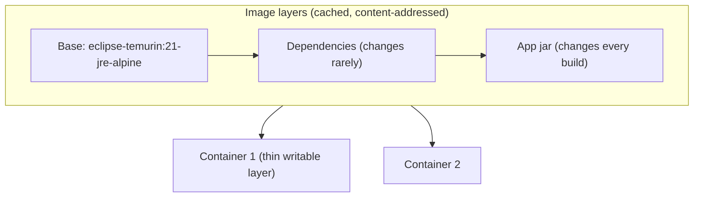

Multi-stage build for a Spring Boot app:
```dockerfile
# ---- build stage: full JDK + Maven, discarded afterwards
FROM maven:3.9-eclipse-temurin-21 AS build
WORKDIR /src
COPY pom.xml .
RUN mvn -q dependency:go-offline          # cached unless pom.xml changes
COPY src ./src
RUN mvn -q package -DskipTests

# ---- runtime stage: small JRE image, non-root
FROM eclipse-temurin:21-jre-alpine
RUN addgroup -S app && adduser -S app -G app
USER app
WORKDIR /app
COPY --from=build /src/target/app.jar app.jar
EXPOSE 8080
ENTRYPOINT ["java", "-XX:MaxRAMPercentage=75", "-jar", "app.jar"]
```

Best practices: order instructions from least to most frequently changing (cache hits), multi-stage builds, minimal bases (alpine, distroless, slim), non-root user, `.dockerignore`, pinned versions or digests, one process per container, no secrets in layers, scan images (Trivy, ECR scanning).

#### Example
An image went from 850 MB (full JDK + Maven + sources) to 180 MB with a multi-stage build and a JRE-alpine base. Pull time on new nodes dropped from 40 s to 8 s, which made autoscaling noticeably faster, and the CVE count fell from 140 to 6.

#### Trade-offs
Consistent "works everywhere" packaging and fast startup, but images must be patched regularly, and minimal bases (distroless) are harder to debug (no shell).

#### Problems & fixes
| Symptom | Cause | Fix |
|---|---|---|
| Huge images, slow pulls | build tools and sources in final image | multi-stage, slim/distroless base |
| Every build re-downloads dependencies | COPY . before dependency install | copy manifest first, install, then copy source |
| Secrets found in image history | `ENV`/`COPY` of credentials | build secrets (`--secret`), runtime injection |
| Container killed for memory | JVM ignores container limits (old JVMs) / heap too big | modern JVM, `MaxRAMPercentage` |
| Security findings | root user, outdated base | non-root, regular rebuilds, image scanning |

#### Cheat sheet
- Layers are cached. Order Dockerfile from stable to volatile.
- Multi-stage + minimal base + non-root + pinned versions.
- No secrets in images. Scan and rebuild regularly.

#### Interview questions
<details><summary>How do you make Docker builds fast and images small for a Java service?</summary>

Multi-stage build: compile in a JDK/Maven stage, then copy only the jar (or layered jar contents) into a JRE or distroless runtime image. Copy `pom.xml` and resolve dependencies before copying source so dependency layers are cached. Use Spring Boot layered jars so dependency layers rarely change. Add a `.dockerignore`, and consider jlink or GraalVM native images for even smaller images.
</details>

<details><summary>Why run containers as a non-root user?</summary>

If an attacker exploits the application, root inside the container makes container-escape vulnerabilities and host damage far more likely, and grants write access to the whole container filesystem. A non-root user (plus read-only root filesystem and dropped capabilities) limits the blast radius. Kubernetes Pod Security Standards enforce this.
</details>

#### Interview angle
> "Images are multi-stage builds on a minimal JRE or distroless base, running as non-root with pinned versions and scanning in CI. That gives about a 5× smaller image, faster pulls and far fewer CVEs."

### Container vs VM — process isolation vs full OS, millisecond vs second startup time
A **virtual machine** virtualises hardware: each VM runs a full guest OS on a hypervisor. A **container** virtualises the OS: containers are isolated processes sharing the host kernel, using Linux namespaces (isolation) and cgroups (resource limits). Containers are lighter and faster, while VMs give stronger isolation.

#### How it works
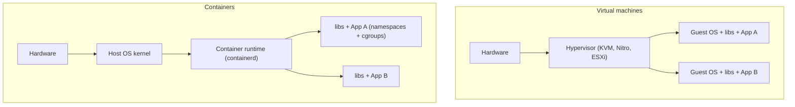

| | VM | Container |
|---|---|---|
| Isolation | hardware-level, own kernel | process-level, shared kernel |
| Startup | seconds to minutes | milliseconds to seconds |
| Size | GBs (full OS) | MBs |
| Density | tens per host | hundreds per host |
| Security boundary | strong | weaker (kernel shared): harden or sandbox |

Middle ground: **microVMs** (Firecracker, used by Lambda and Fargate) and sandboxed runtimes (gVisor, Kata Containers) give VM-like isolation at near-container speed.

#### Example
A platform runs its microservices as containers on EKS (dense, fast autoscaling). Multi-tenant customer code (plugins or untrusted scripts) runs in Firecracker microVMs or gVisor for stronger isolation. The databases run on dedicated VMs (RDS) for predictable performance.

#### Trade-offs
Containers: efficiency, speed and portability, but a shared-kernel risk and noisy neighbours. VMs: isolation and kernel flexibility, but heavier and slower.

#### Problems & fixes
| Symptom | Cause | Fix |
|---|---|---|
| Untrusted workloads on shared nodes | container isolation insufficient | gVisor/Kata/Firecracker, dedicated node pools |
| Noisy neighbour CPU/IO contention | shared kernel resources | requests/limits, QoS classes, dedicated nodes for critical workloads |
| App needs different kernel features | containers share host kernel | VM or node pool with suitable kernel |

#### Cheat sheet
- VM = virtual hardware + own OS. Container = isolated process on a shared kernel.
- Containers: fast, dense, portable. VMs: stronger isolation.
- MicroVMs (Firecracker) bridge both.

#### Interview questions
<details><summary>Why do containers start faster than VMs?</summary>

A container is just a process with namespaces and cgroups on an already-running kernel, so there's no OS boot, no hardware initialisation, and image layers are often already cached. A VM must boot a full guest kernel and init system on virtual hardware.
</details>

<details><summary>Would you run multi-tenant untrusted code in plain containers?</summary>

No. All containers share the host kernel, so a kernel exploit could let one tenant escape and access others. Use stronger isolation: microVMs (Firecracker), sandboxed runtimes (gVisor, Kata), or separate VMs/nodes per tenant, plus strict seccomp/AppArmor profiles and no privileged containers.
</details>

#### Interview angle
> "Containers give us density and second-level scaling for our own services. Untrusted or strongly isolated workloads go in microVMs or sandboxed runtimes, because containers share the host kernel."

### Kubernetes control plane — API server (gateway), scheduler (pod placement), controller manager, etcd (cluster state)
The Kubernetes control plane is the cluster's brain. You declare **desired state** (YAML objects) to the API server, it's stored in **etcd**, and **controllers** continuously reconcile actual state toward desired state, while the **scheduler** decides which node runs each pod.

#### How it works
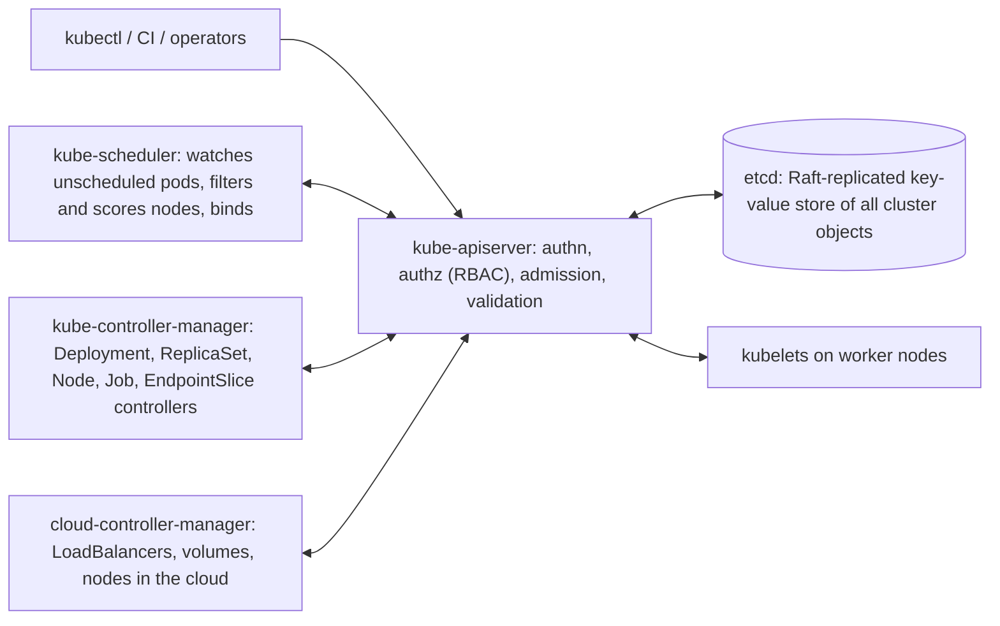

The **reconciliation loop**: a controller watches objects, compares desired vs actual, and acts (create, delete or update), forever. Deployment → ReplicaSet → Pods is a chain of controllers.

Managed control planes (EKS, GKE, AKS) run these for you, typically across 3 AZs.

#### Example
`kubectl apply -f deployment.yaml` with `replicas: 5`: the API server validates and stores it in etcd. The Deployment controller creates a ReplicaSet, and the ReplicaSet controller creates 5 Pod objects. The scheduler assigns each pod to a node (resources, affinity, taints). Kubelets on those nodes start the containers. A node dies, so the node controller marks its pods for deletion, the ReplicaSet controller sees 4 running and creates a replacement.

#### Trade-offs
Declarative, self-healing and extensible (CRDs plus operators), but complex, and etcd and the API server are critical (overloading them with huge objects or excessive watches degrades the whole cluster).

#### Problems & fixes
| Symptom | Cause | Fix |
|---|---|---|
| `kubectl` slow, controllers lagging | API server/etcd overloaded (too many objects, chatty controllers) | managed control plane scaling, reduce object churn, limit watches |
| Pods stuck Pending | scheduler can't find a node (resources, affinity, taints) | `kubectl describe pod` events, add nodes, fix constraints |
| Cluster state lost | etcd without backups (self-managed) | etcd snapshots, managed control plane |
| Unauthorised changes | weak RBAC | least-privilege RBAC, admission policies (OPA/Kyverno) |

#### Cheat sheet
- API server (front door) + etcd (state) + scheduler (placement) + controllers (reconcile).
- Declarative desired state, continuously reconciled.
- Use managed control planes. Back up etcd if self-managed.

#### Interview questions
<details><summary>What happens, step by step, when you create a Deployment?</summary>

The API server authenticates, authorises, runs admission controllers and persists the Deployment in etcd. The Deployment controller creates a ReplicaSet, and the ReplicaSet controller creates Pod objects. The scheduler binds each pending Pod to a node after filtering (resources, taints, affinity) and scoring. The kubelet on that node pulls images and starts containers via containerd, then reports status back. EndpointSlices are updated for Services once pods are ready.
</details>

<details><summary>Why is etcd so critical, and how is it made reliable?</summary>

etcd stores the entire cluster state, so if it's lost or unavailable the control plane can't function (running pods continue, but nothing changes or heals). It's run as a Raft cluster of 3 or 5 members across failure domains (quorum needed for writes), with regular snapshots, fast disks, and limits on object sizes and counts.
</details>

#### Interview angle
> "Kubernetes is reconciliation loops around a declarative store: the API server and etcd hold desired state, the scheduler places pods and controllers converge reality. I use a managed control plane so etcd isn't my operational burden."

### Kubernetes worker nodes — kubelet (runs pods), kube-proxy (network rules), container runtime (containerd)
Worker nodes run the actual workloads. Each node runs the **kubelet** (agent that starts and monitors pods), a **container runtime** (containerd/CRI-O) and **kube-proxy** (implements Service networking), plus a CNI plugin for pod networking.

#### How it works
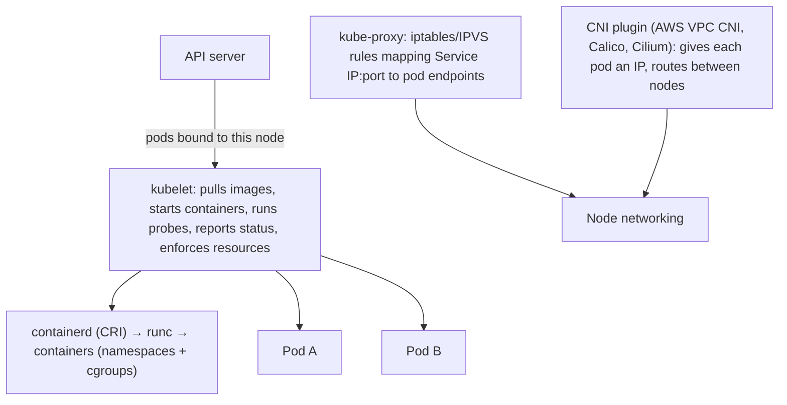

- The **kubelet** also handles node-pressure eviction (memory or disk pressure), log rotation and volume mounts.
- **kube-proxy** may be replaced by eBPF dataplanes (Cilium) for performance.
- Node problems surface as `NotReady`, `MemoryPressure`, `DiskPressure`, `PIDPressure`.

#### Example
A node's disk fills with container logs and images, so the kubelet reports DiskPressure, garbage-collects images and evicts BestEffort pods. Alerting on node conditions plus log rotation and image GC thresholds prevents surprise evictions. With the AWS VPC CNI, pods get real VPC IPs, which simplifies networking but consumes subnet IPs (plan CIDRs or enable prefix delegation).

#### Trade-offs
Nodes are cattle (replaceable), but node-level resource contention, IP exhaustion (VPC CNI) and kernel or runtime issues affect every pod on them.

#### Problems & fixes
| Symptom | Cause | Fix |
|---|---|---|
| Pods evicted unexpectedly | node memory/disk pressure | proper requests/limits, log rotation, image GC, alerts |
| Pods can't get IPs | VPC subnet exhaustion (VPC CNI) | larger subnets, prefix delegation, custom networking |
| Service routing slow at scale | iptables rule explosion | IPVS mode or eBPF (Cilium) |
| Node NotReady | kubelet/runtime crash, network loss | node auto-repair (managed node groups), monitoring |

#### Cheat sheet
- kubelet (pods) + containerd (runtime) + kube-proxy (Service rules) + CNI (pod IPs).
- Watch node conditions: memory, disk, PID pressure.
- Treat nodes as replaceable, with auto-repair.

#### Interview questions
<details><summary>How does a request to a ClusterIP Service reach a pod?</summary>

The ClusterIP is virtual. kube-proxy (iptables or IPVS) on every node programs rules that DNAT traffic destined for the Service IP:port to one of the ready pod endpoints (from EndpointSlices), selected randomly or round-robin. The CNI then routes the packet to the pod's IP, possibly on another node. With eBPF dataplanes like Cilium, the same happens in eBPF programs.
</details>

<details><summary>What does the kubelet do when a node runs low on memory?</summary>

It detects MemoryPressure from eviction thresholds and evicts pods to reclaim memory, starting with BestEffort pods, then Burstable pods using more than their requests, protecting Guaranteed pods last. Separately, the kernel OOM killer can kill containers exceeding their memory limits. Setting accurate requests and limits controls who gets evicted.
</details>

#### Interview angle
> "On each node the kubelet runs pods, containerd provides isolation, and kube-proxy or Cilium implement Services. I watch node pressure conditions and plan pod IP capacity for the VPC CNI."

### Pod, Deployment, Service (ClusterIP/NodePort/LoadBalancer), Ingress, ConfigMap, Secret, PVC
These are the core Kubernetes objects you combine to run an application: **Pods** (the running unit), **Deployments** (manage replicated pods and rollouts), **Services** (stable network endpoints), **Ingress** (HTTP routing from outside), **ConfigMaps/Secrets** (configuration) and **PVCs** (persistent storage).

#### How it works
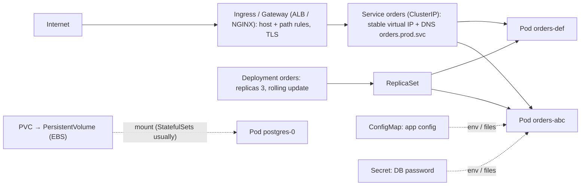

| Object | What it does |
|---|---|
| Pod | one or more containers sharing network and volumes. Ephemeral |
| Deployment | desired replicas + pod template, rolling updates, rollback |
| Service: ClusterIP | internal virtual IP + DNS name |
| Service: NodePort | opens a port on every node (rarely used directly) |
| Service: LoadBalancer | provisions a cloud LB (NLB/ALB) |
| Ingress / Gateway API | L7 routing (host, path), TLS, via a controller |
| ConfigMap / Secret | non-sensitive / sensitive config (Secrets are only base64 by default, so enable encryption at rest or use an external secret manager) |
| PVC / PV / StorageClass | request durable storage, dynamically provisioned |

#### Example
An `orders` microservice: a Deployment (3 replicas, readiness and liveness probes), a ClusterIP Service `orders`, Ingress rule `api.shop.com/orders → orders:8080`, a ConfigMap for feature flags, and an External Secrets Operator syncing the DB password from AWS Secrets Manager into a Secret. Other services call `http://orders.prod.svc.cluster.local:8080` with no IPs to manage.

#### Trade-offs
Composable, standard building blocks, but YAML sprawl (hence Helm/Kustomize), and Secrets aren't secure by default.

#### Problems & fixes
| Symptom | Cause | Fix |
|---|---|---|
| Service has no endpoints | label selector mismatch / pods not ready | match labels, fix readiness |
| Config change not picked up | env vars read at start only | rollout restart (or checksum annotation), reloadable config |
| Secrets readable in plain text | base64 ≠ encryption | etcd encryption, External Secrets/Vault, RBAC |
| Paying for many cloud LBs | one LoadBalancer Service per app | single Ingress/Gateway, shared ALB |

#### Cheat sheet
- Pod (unit) ← Deployment (replicas, rollouts). Service (stable IP/DNS) → Ingress (HTTP from outside).
- ConfigMap/Secret for config. PVC for storage.
- One Ingress/Gateway instead of many LoadBalancer Services. Secure Secrets properly.

#### Interview questions
<details><summary>Walk through how external traffic reaches a pod in Kubernetes.</summary>

DNS points the domain at a cloud load balancer created by the Ingress controller (or Gateway). The LB forwards to the Ingress controller (or directly to pod IPs with the AWS LB controller's IP mode). The controller matches host and path rules and forwards to the Service's endpoints, which are the ready pods. The response travels back the same way.
</details>

<details><summary>Are Kubernetes Secrets secure? What would you do in production?</summary>

By default they're base64-encoded, not encrypted, and anyone with read access to Secrets or etcd can see them. In production: enable encryption at rest (KMS provider), lock down RBAC, use an external secret manager (AWS Secrets Manager, Vault) synced via External Secrets Operator or the CSI driver, avoid putting secrets in env vars where they leak into logs, and rotate them.
</details>

#### Interview angle
> "Each service is a Deployment behind a ClusterIP Service, exposed through one shared Ingress or Gateway. Config comes from ConfigMaps, and secrets sync from Secrets Manager via External Secrets with encryption at rest."

### Rolling update — replace pods gradually; rollback on failure
A rolling update replaces old pods with new ones **gradually**: start some new pods, wait until they're ready, then terminate some old ones, and repeat. Capacity is maintained throughout, so deployments cause no downtime, and a bad version can be rolled back to the previous ReplicaSet.

#### How it works
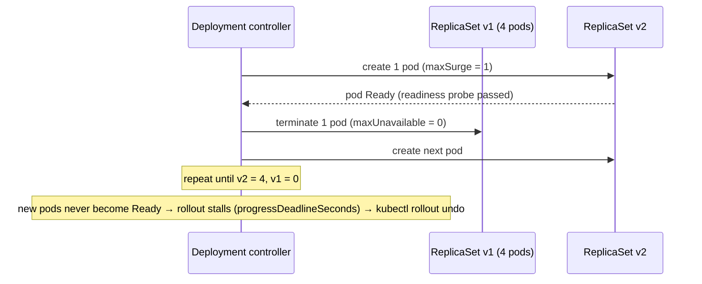

```yaml
spec:
  replicas: 4
  minReadySeconds: 10                 # pod must stay ready this long to count
  progressDeadlineSeconds: 300
  strategy:
    type: RollingUpdate
    rollingUpdate: { maxSurge: 1, maxUnavailable: 0 }
```
Rollback: `kubectl rollout undo deployment/orders` (or automated by Argo Rollouts / Flagger on metric failures).

#### Example
v2 of the orders service has a bug where it crashes on startup when a new config key is missing. The first v2 pod never becomes Ready, so with `maxUnavailable: 0` no v1 pods are terminated. The rollout stalls, the CI pipeline sees the progress deadline exceeded and runs `rollout undo`. Users never notice. Without readiness probes, Kubernetes would have marked the crashing pods "running" and replaced all v1 pods.

#### Trade-offs
Zero downtime with no extra environment, but both versions run side by side during the rollout (they must be compatible with schema, APIs and messages), and the blast radius grows gradually without metric-based automatic aborts (canary tooling adds that).

#### Problems & fixes
| Symptom | Cause | Fix |
|---|---|---|
| Bad version fully rolled out | no/weak readiness probes | real readiness checks, minReadySeconds |
| Errors during rollout | v1 and v2 incompatible (DB schema, API) | expand-contract migrations, backward-compatible APIs |
| Requests dropped as old pods terminate | no graceful shutdown | preStop + graceful shutdown + draining |
| Rollout too slow for large deployments | maxSurge 1 | percentage-based surge (25%) |

#### Cheat sheet
- maxSurge / maxUnavailable control pace. Readiness gates progress.
- Two versions coexist, so keep them backward compatible.
- `rollout undo`. Use Argo Rollouts/Flagger for metric-driven canaries.

#### Interview questions
<details><summary>How does Kubernetes prevent a broken release from replacing all healthy pods during a rolling update?</summary>

New pods must pass readiness probes (and stay ready for minReadySeconds) before they count toward progress, and with maxUnavailable: 0 old pods are only terminated after new ones are ready. If new pods never become ready, the rollout stalls, the progress deadline marks it failed, and you or the pipeline roll back to the previous ReplicaSet.
</details>

<details><summary>What compatibility concerns arise because old and new versions run simultaneously?</summary>

Database schema (the new version's migrations must not break the old version, so use expand-contract), API contracts between services (additive changes only), message formats on queues (consumers must handle both versions), cache formats, and session or cookie formats. Every release must work alongside the previous one.
</details>

#### Interview angle
> "Deploys are rolling updates gated by real readiness probes, with maxUnavailable 0 and automatic rollback on a stalled rollout. Every release stays backward compatible because two versions coexist mid-rollout."

### StatefulSet — stable network identity, ordered deployment (Kafka, Cassandra, databases)
A StatefulSet runs pods that need **stable identities and storage**: each pod gets a fixed ordinal name (`kafka-0`, `kafka-1`), a stable DNS name through a headless Service, and **its own PersistentVolume** that follows it across rescheduling. Pods are created, updated and deleted in order.

#### How it works
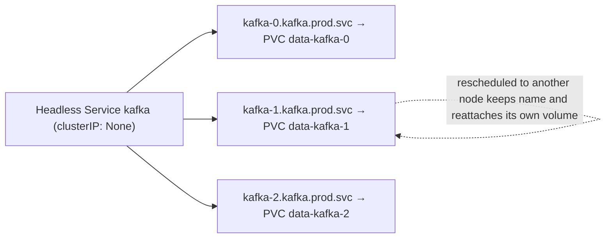

Guarantees vs Deployments:
| | Deployment | StatefulSet |
|---|---|---|
| Pod names | random suffix | ordinal (`app-0`, `app-1`) |
| DNS | via Service (random endpoints) | stable per-pod DNS |
| Storage | shared or none | one PVC per pod via `volumeClaimTemplates` |
| Ordering | parallel | ordered start, update and scale (configurable) |

#### Example
Running a 3-broker Kafka cluster with the Strimzi operator: brokers are StatefulSet pods, each with its own EBS volume holding its partitions. `kafka-1` crashing and being rescheduled keeps its broker id and data, so no full re-replication is needed. Rolling updates go one broker at a time, waiting for ISR to recover. Most teams still use managed services (MSK, RDS) rather than self-hosting stateful systems on Kubernetes, and operators make self-hosting feasible when needed.

#### Trade-offs
Enables stateful workloads on Kubernetes, but volumes are AZ-bound (EBS), operations (backups, upgrades, failover) need domain-specific operators, and mistakes risk data loss.

#### Problems & fixes
| Symptom | Cause | Fix |
|---|---|---|
| Pod stuck Pending after node failure | its EBS volume is in another AZ | topology-aware scheduling, replicas across AZs at app level |
| Data loss on scale-down | PVC deleted / misunderstood retention | PVC retention policies, backups |
| Rolling update breaks quorum | updating too many replicas at once | partitioned rolling updates, operator-managed upgrades, PDBs |
| Complex manual operations | raw StatefulSets for databases | use operators (Strimzi, CloudNativePG) or managed services |

#### Cheat sheet
- Stable names, stable DNS (headless Service), per-pod PVCs, ordered operations.
- Use for Kafka, ZooKeeper, Cassandra, Elasticsearch, databases.
- Prefer operators or managed services. Mind AZ-bound volumes.

#### Interview questions
<details><summary>Why can't you run Cassandra or Kafka as a regular Deployment?</summary>

Each node has an identity tied to its data (broker id, token ranges) and needs its own persistent volume that follows it. Peers address each other by stable names. Deployment pods are interchangeable with random names and shared or no storage, so a restarted pod would come back as a "new" empty member. StatefulSets give stable names, DNS and per-pod volumes.
</details>

<details><summary>Should you run your production PostgreSQL on Kubernetes?</summary>

It's possible with a mature operator (CloudNativePG, Crunchy, Zalando) handling replication, failover, backups and upgrades, and teams with Kubernetes and storage expertise do it. For most teams a managed service (RDS/Aurora/Cloud SQL) is safer and cheaper in engineering time. Choose based on operational maturity, compliance and cost.
</details>

#### Interview angle
> "Stateful systems need StatefulSets for stable identity and per-pod volumes, but I'd prefer managed Kafka and databases, or a mature operator, over hand-rolled StatefulSets."

### DaemonSet — one pod per node (log collectors, node-level monitoring, Istio sidecar)
A DaemonSet ensures **one copy of a pod runs on every node** (or every node matching a selector). When nodes join, the pod is added automatically, and when they leave it's removed. It's the standard way to run node-level agents.

#### How it works
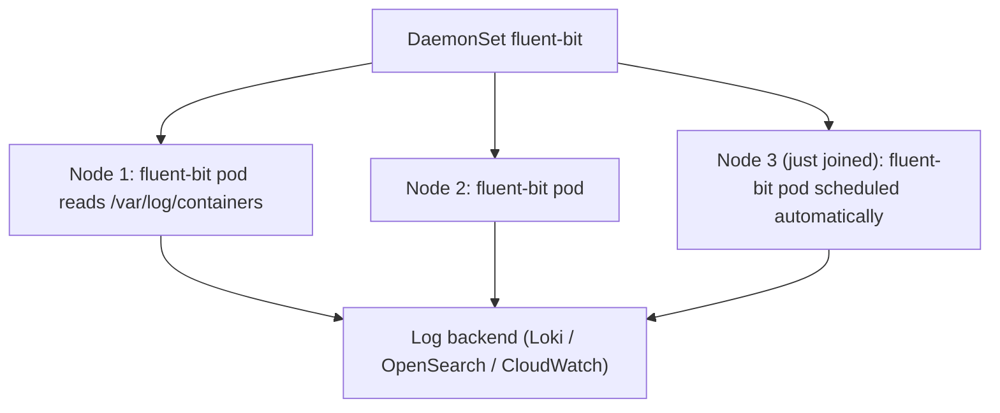

Typical DaemonSets: log shippers (Fluent Bit, Vector), metrics agents (node-exporter, Datadog agent), CNI and network plugins (aws-node, Calico, Cilium), CSI node drivers, kube-proxy, security agents (Falco), GPU device plugins, node-local DNS cache.

(Note: Istio sidecars are injected **into each application pod**, not run as a DaemonSet. Istio's newer **ambient mode** uses a per-node `ztunnel` DaemonSet instead of sidecars.)

#### Example
Logs: each app writes JSON to stdout, the container runtime writes files on the node, and a Fluent Bit DaemonSet tails them, enriches them with pod labels and ships to Loki. Adding 50 nodes during autoscaling automatically adds 50 log shippers, with no per-app configuration.

#### Trade-offs
Automatic node coverage, but each DaemonSet consumes resources on every node (multiply by node count) and a buggy agent can affect every node.

#### Problems & fixes
| Symptom | Cause | Fix |
|---|---|---|
| DaemonSet pods missing on some nodes | taints without tolerations | add tolerations (e.g. for GPU or system nodes) |
| Node resources eaten by agents | heavy agents × every node | resource requests/limits, consolidate agents |
| Logs lost during spikes | shipper buffering limits | filesystem buffering, backpressure settings |
| Agent update breaks all nodes | DaemonSet rolled out everywhere at once | rolling update with maxUnavailable, canary node pool |

#### Cheat sheet
- One pod per (matching) node, automatically.
- Logs, metrics, CNI/CSI, security agents, node-local DNS.
- Add tolerations, set resources, roll out carefully.

#### Interview questions
<details><summary>How would you collect logs from all pods in a Kubernetes cluster?</summary>

Apps log to stdout/stderr as structured JSON. The runtime writes them to node files. A Fluent Bit (or Vector) DaemonSet on every node tails those files, enriches them with Kubernetes metadata (namespace, pod, labels) and ships them to a backend (Loki, OpenSearch, CloudWatch), with buffering and retries. No per-application log agents are needed.
</details>

<details><summary>Why might a DaemonSet not run on some nodes?</summary>

Those nodes have taints the DaemonSet doesn't tolerate (control-plane nodes, GPU or dedicated pools), the DaemonSet's nodeSelector or affinity excludes them, or the node lacks resources for the pod's requests. Check the DaemonSet's desired vs current counts and the pod events.
</details>

#### Interview angle
> "Node-level agents like log shippers, metrics exporters and CNI run as DaemonSets with tolerations and modest resource requests, so every new node is covered automatically."

### Kubernetes resource requests vs limits — request = scheduling guarantee, limit = throttle ceiling
Each container declares **requests** (what it's guaranteed, used by the scheduler to place pods) and **limits** (the maximum it may use). CPU over the limit is **throttled**. Memory over the limit is **OOM-killed**. Requests and limits together determine the pod's QoS class and eviction priority.

#### How it works
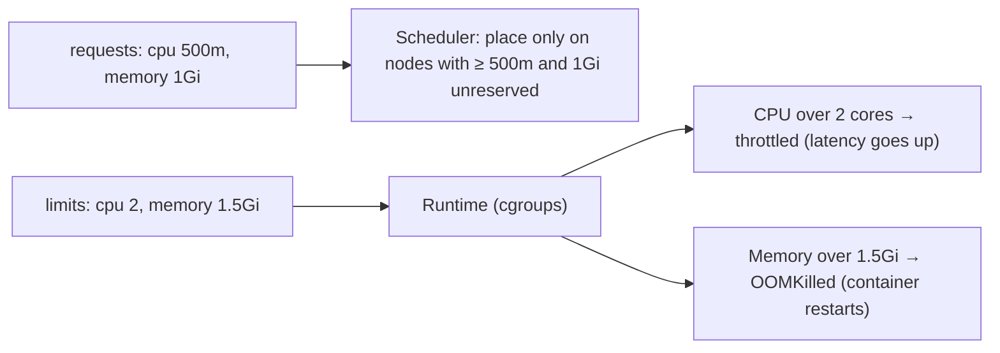

| QoS class | Condition | Eviction priority |
|---|---|---|
| Guaranteed | requests = limits for CPU and memory | evicted last |
| Burstable | requests < limits (or only requests) | middle |
| BestEffort | no requests/limits | evicted first |

Common guidance:
- **Always set memory requests and limits** (often equal) to avoid OOM surprises and noisy neighbours.
- **CPU limits are debated**: they cause throttling (CFS quota) even when the node has idle CPU. Many teams set CPU requests but no CPU limit for latency-sensitive services.
- JVM: set heap relative to the memory limit (`-XX:MaxRAMPercentage=75`) to leave room for non-heap memory.

#### Example
A Java API had `limits.cpu: 1`. Under bursts and GC, CFS throttling added 100–300 ms to p99 although nodes were 40% idle. Removing the CPU limit (keeping a 1-core request) cut p99 in half. Separately, memory limit 1 GiB with `-Xmx1g` led to OOMKills (metaspace, thread stacks and direct buffers exceed heap). Switching to `MaxRAMPercentage=70` fixed it.

#### Trade-offs
Requests drive cost (reserved capacity) and scheduling. Limits protect neighbours but can hurt latency (CPU throttling) or kill pods (memory).

#### Problems & fixes
| Symptom | Cause | Fix |
|---|---|---|
| p99 latency spikes, low node CPU | CPU limit throttling | raise or remove CPU limits, check throttling metrics |
| OOMKilled containers | memory limit too low / JVM heap = limit | right-size, MaxRAMPercentage, check leaks |
| Pods pending though nodes look idle | requests over-reserved | right-size requests (VPA recommendations) |
| Node instability, random evictions | BestEffort pods / no memory limits | set requests and limits, LimitRanges |

#### Cheat sheet
- Requests = scheduling + guarantee. Limits = ceiling.
- CPU over limit → throttling. Memory over limit → OOMKill.
- Always set memory. Be careful with CPU limits. JVM heap below the memory limit.

#### Interview questions
<details><summary>Explain what happens when a container exceeds its CPU limit vs its memory limit.</summary>

CPU is compressible: exceeding the limit means the container is throttled by the CFS quota (it waits, so latency increases), but it keeps running. Memory is incompressible: exceeding the limit makes the kernel OOM killer terminate the container (OOMKilled), and Kubernetes restarts it according to the restart policy.
</details>

<details><summary>Why might you not set CPU limits on a latency-sensitive service?</summary>

CFS quotas throttle a container once it uses its quota within each 100 ms period, even if the node has idle CPU. Bursty workloads (request spikes, GC, JIT) get throttled, which adds tail latency. Setting accurate CPU requests (for fair scheduling and shares) without hard limits lets pods burst into idle capacity. Use limits where strict isolation or cost control matters more.
</details>

#### Interview angle
> "Every container gets right-sized requests and a memory limit, with JVM heap at about 70% of it. For latency-sensitive services I skip CPU limits to avoid throttling and watch throttling metrics."

### Node affinity, taints and tolerations — control which pods run on which nodes
Kubernetes gives two complementary controls over placement. **Node affinity** (and nodeSelector) **attracts** pods to nodes with certain labels. **Taints** **repel** pods from nodes unless the pod has a matching **toleration**. Combined with pod (anti-)affinity and topology spread constraints, they shape where workloads run.

#### How it works
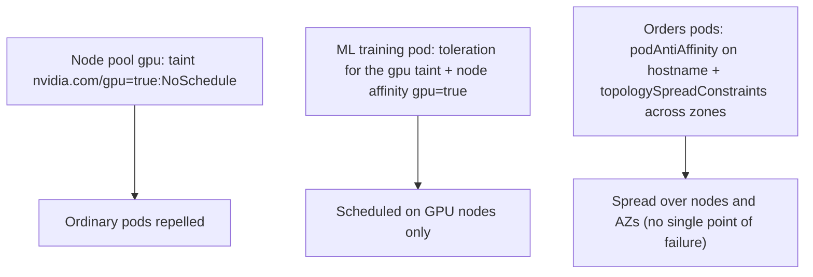

```yaml
spec:
  tolerations:
    - { key: "dedicated", operator: "Equal", value: "payments", effect: "NoSchedule" }
  affinity:
    nodeAffinity:
      requiredDuringSchedulingIgnoredDuringExecution:
        nodeSelectorTerms:
          - matchExpressions: [{ key: "pool", operator: In, values: ["payments"] }]
  topologySpreadConstraints:
    - { maxSkew: 1, topologyKey: topology.kubernetes.io/zone, whenUnsatisfiable: DoNotSchedule,
        labelSelector: { matchLabels: { app: payments-api } } }
```

Taint effects: `NoSchedule` (don't place new pods), `PreferNoSchedule` (soft), `NoExecute` (also evict running pods without a toleration).

#### Example
- **Dedicated nodes for PCI workloads**: payments pods run only on a tainted, separately hardened node pool. Other workloads can't land there.
- **GPU nodes**: tainted so only ML jobs (with tolerations) consume expensive GPUs.
- **Spot vs On-Demand**: critical pods prefer On-Demand nodes via node affinity, and batch tolerates Spot taints.
- **HA**: topology spread puts a 6-replica service at 2 pods per AZ, so an AZ outage leaves 4.

#### Trade-offs
Precise control over cost, compliance and availability, but overly strict rules leave pods Pending and fragment capacity.

#### Problems & fixes
| Symptom | Cause | Fix |
|---|---|---|
| Pods Pending with "didn't tolerate taint" | missing toleration | add toleration, or use the right pool |
| All replicas on one node/AZ | no anti-affinity/spread | topologySpreadConstraints, pod anti-affinity |
| Expensive GPU nodes running random pods | GPU nodes not tainted | taint GPU nodes, tolerate only in ML pods |
| Pods Pending due to strict required rules | over-constrained scheduling | preferred (soft) affinity, more capacity |

#### Cheat sheet
- Affinity attracts, taints repel, tolerations allow.
- Topology spread / anti-affinity for HA across nodes and AZs.
- Dedicated pools: taint + toleration + affinity together.

#### Interview questions
<details><summary>How do you dedicate a node pool to one team's workloads?</summary>

Taint the pool's nodes (`dedicated=teamA:NoSchedule`) so other pods can't schedule there, and give teamA's pods a matching toleration plus required node affinity to the pool's label, so they land only on those nodes. The taint keeps others out and the affinity keeps the team's pods in.
</details>

<details><summary>How do you make sure a Deployment survives the loss of an availability zone?</summary>

Run enough replicas and spread them across zones with `topologySpreadConstraints` (topologyKey zone, maxSkew 1) or pod anti-affinity. Ensure node groups exist in each zone, set a PodDisruptionBudget, and size replicas so the remaining zones can carry the load (or autoscale quickly) when one zone disappears.
</details>

#### Interview angle
> "I use taints and tolerations for dedicated pools like PCI or GPU, node affinity to attract pods to the right hardware, and topology spread across AZs so losing a zone never takes out a service."

### Service mesh (Istio/Linkerd) — sidecar Envoy proxy, mTLS between services, traffic management, observability
A service mesh moves cross-cutting networking concerns out of application code into the infrastructure: every pod gets a **proxy** (a sidecar like Envoy, or a per-node proxy in ambient mode) that handles **mTLS, retries, timeouts, traffic splitting, circuit breaking and telemetry**. A control plane (istiod, the Linkerd control plane) configures all the proxies.

#### How it works
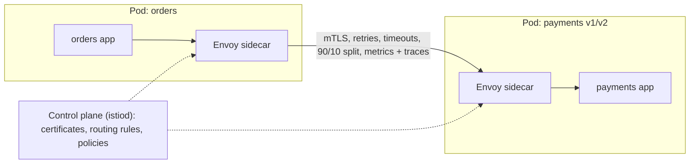

Capabilities:
- **Security**: automatic mTLS with workload identities, authorization policies (orders → payments allowed).
- **Traffic management**: canary weights, header-based routing, mirroring, fault injection.
- **Resilience**: timeouts, retries with budgets, outlier detection, circuit breaking.
- **Observability**: uniform metrics (golden signals), distributed tracing headers, access logs.

#### Example
A fintech with 80 microservices adopted Linkerd: mTLS everywhere with zero code changes (for a PCI requirement), per-route success-rate and latency dashboards for every service, retries and timeouts configured centrally, and canary releases via traffic splits. Cost: ~10–20 MB of memory and sub-millisecond latency per sidecar, plus a control plane to operate and upgrade.

#### Trade-offs
| Pros | Cons |
|---|---|
| uniform security/observability without code changes | resource overhead per pod, added latency (~0.5–2 ms) |
| centralised traffic policy | operational complexity, upgrades, debugging through proxies |
| language-agnostic | overkill for small systems (libraries may suffice) |

#### Problems & fixes
| Symptom | Cause | Fix |
|---|---|---|
| Retry storms amplifying outages | retries in mesh and app and client | retry at one layer, retry budgets |
| Startup failures: app calls out before sidecar ready | sidecar ordering | `holdApplicationUntilProxyStarts`, native sidecars (K8s 1.29+) |
| High resource cost with thousands of pods | sidecar per pod | ambient mode (ztunnel), Linkerd's lighter proxy |
| Hard-to-debug latency | extra hops, misconfigured timeouts | mesh telemetry, consistent timeout budgets |

#### Cheat sheet
- Proxy per pod (or per node in ambient mode) + control plane.
- mTLS + authz, traffic shifting, timeouts/retries, golden-signal telemetry.
- Watch overhead. One retry layer. Adopt when service count justifies it.

#### Interview questions
<details><summary>When is a service mesh worth adopting?</summary>

When you have many services (dozens or more) in multiple languages and need uniform mTLS (zero trust, compliance), consistent observability, and traffic management (canaries, retries, timeouts) without reimplementing them in every codebase. For a handful of services in one language, libraries (Resilience4j, OpenTelemetry) and an ingress may be simpler.
</details>

<details><summary>How does a mesh implement mTLS without application changes?</summary>

The control plane acts as a certificate authority and issues short-lived certificates (SPIFFE identities) to each proxy, rotating them automatically. Application traffic is transparently redirected (iptables or eBPF) through the local proxy, which establishes mTLS with the destination proxy, verifies identities and enforces authorization policies. The apps still send plain HTTP to localhost.
</details>

#### Interview angle
> "With dozens of services I'd add Linkerd or Istio for automatic mTLS, uniform golden-signal metrics and canary traffic splits, with retries configured in the mesh only, so they don't multiply."

### Helm — Kubernetes package manager, templated manifests, release management
Helm packages Kubernetes manifests into **charts**: templated YAML plus default `values.yaml`. You install a chart as a **release** with environment-specific values, and Helm tracks revisions so you can **upgrade and roll back**. It's also how most third-party software (Prometheus, NGINX ingress, cert-manager) is distributed for Kubernetes.

#### How it works
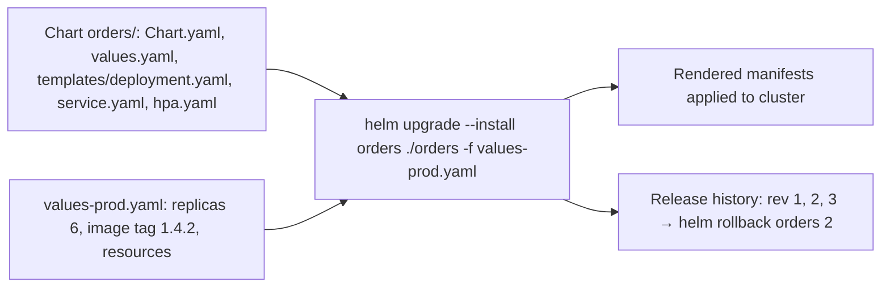

```yaml
# templates/deployment.yaml (excerpt)
spec:
  replicas: {{ .Values.replicaCount }}
  template:
    spec:
      containers:
        - name: app
          image: "{{ .Values.image.repository }}:{{ .Values.image.tag }}"
          resources: {{- toYaml .Values.resources | nindent 12 }}
```

Common setup: Helm charts rendered and applied by **GitOps** tools (Argo CD, Flux), so Git is the source of truth and the cluster continuously syncs.

#### Example
A platform team publishes a standard "microservice" chart (Deployment, Service, HPA, PDB, ServiceMonitor, probes, security context defaults). Each of 60 services has only a small `values.yaml` (image, ports, resources, env). Argo CD syncs per environment. Fixing a security default in the chart rolls it out to every service.

#### Trade-offs
Reusable, versioned and parameterised deployments, but Go templating gets hard to read, chart complexity creeps up, and Helm-managed state can drift if people `kubectl edit` resources.

#### Problems & fixes
| Symptom | Cause | Fix |
|---|---|---|
| Unreadable templates | logic-heavy charts | keep charts simple, Kustomize overlays for small tweaks |
| Drift between Git and cluster | manual kubectl edits | GitOps (Argo CD/Flux) with self-heal |
| Failed upgrade left half-applied state | partial apply | `--atomic`, `--wait`, rollback |
| Secrets in values files | plaintext secrets in Git | sealed secrets / external secrets / SOPS |

#### Cheat sheet
- Chart = templates + values. Release = installed instance with revisions.
- `helm upgrade --install --atomic`, `helm rollback`.
- Pair with GitOps. Keep secrets out of values.

#### Interview questions
<details><summary>How would you standardise deployments for 50 microservices on Kubernetes?</summary>

A shared, versioned Helm "service" chart with secure defaults (probes, resources, PDB, HPA, non-root security context, ServiceMonitor), so each service supplies only a small values file. Deploy via GitOps (Argo CD ApplicationSets per environment), with policy checks (Kyverno/OPA) enforcing standards and secrets via External Secrets. Upgrade the chart centrally to roll out improvements.
</details>

<details><summary>Helm vs Kustomize: when do you choose which?</summary>

Helm when you need parameterised, reusable packages with versioning and release history, especially for distributing software or a shared service chart. Kustomize when you prefer plain YAML with environment overlays and patches, without templating. Many teams combine them: Helm for third-party charts, Kustomize for their own overlays, both applied through GitOps.
</details>

#### Interview angle
> "Services deploy from a shared, versioned Helm chart with secure defaults, synced by Argo CD from Git. That gives us standard probes, PDBs and HPAs everywhere, and rollbacks are just a revision."
