## Core theorems & consistency models

### CAP theorem — Consistency, Availability, Partition Tolerance: only 2 guaranteed when partition occurs
The CAP theorem (Brewer, proved by Gilbert and Lynch) says that when a **network partition** splits a distributed system, it must choose between **Consistency** (every read sees the latest write, linearizability) and **Availability** (every request to a non-failed node gets a non-error response). Partitions happen in real networks, so the practical choice is **CP or AP during a partition**.

#### Intuition
Two bank branches whose phone line is cut. A customer asks one branch for their balance. The branch can refuse until the line is back (correct, but unhelpful), or answer from its own book (helpful, but possibly out of date). It cannot do both.

#### Must know
- When the network **partitions**, a distributed system must choose: **Consistency** (refuse rather than risk a stale answer) or **Availability** (always answer).
- Partitions will happen, so "pick two of three" is misleading. The real choice is **CP or AP during a partition**.
- C here means linearizability, not the C in ACID.
- The choice is made **per feature**: payments and stock reservation are CP, feeds and catalogue reads are AP.
- Many systems let you tune it per request.

#### Common mistakes
- Saying a distributed system is "CA".
- Mixing up CAP consistency with ACID consistency.
- Using CAP to explain everyday latency. It only describes behaviour during a partition.

#### How it works
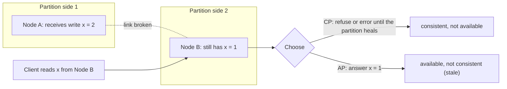

Clarifications interviewers like:
- "Pick 2 of 3" is misleading: you can't opt out of P in a distributed system. The choice applies **only during a partition**.
- C in CAP = linearizability, not ACID consistency.
- Real systems are often tunable per operation (Cassandra consistency levels, DynamoDB strongly consistent reads).

#### Example
- **Payments ledger / inventory reservation**: CP. During a partition, reject or queue the operation rather than risk double-spending. Users see "try again".
- **Social feed / product catalogue**: AP. Keep serving possibly stale data. A like count slightly off is fine.
- **Shopping cart** (Dynamo paper): AP with merge on reconciliation, because add-to-cart must never fail.

#### Trade-offs
CP gives correctness under partition but sacrifices availability on the minority side. AP keeps serving but needs conflict resolution and tolerance for stale reads. Most systems mix them per feature.

#### Problems & fixes
| Symptom | Cause | Fix |
|---|---|---|
| Oversold inventory during network blip | AP store used for reservations | CP store / single authority for reservations |
| Whole feature down during minor partition | CP choice for data that tolerates staleness | AP read path with eventual consistency |
| Confusing "we're CA" claims | misunderstanding CAP | explain: partitions are inevitable, choose behaviour during them |

#### Cheat sheet
- During a partition: Consistency (refuse) or Availability (serve stale).
- C = linearizability. P isn't optional.
- Decide per feature: money and inventory CP, feeds and catalogues AP.

#### Interview questions

Is it possible to build a CA system?

Only if there are no network partitions, meaning a single node or a perfectly reliable network, which doesn't exist across machines. A single-node database is "CA" trivially, but once data is replicated across machines, partitions can happen and you must choose consistency or availability during them. So distributed systems are CP or AP (often configurable).

For an e-commerce system, which components would you make CP and which AP?

CP: payments, order placement, inventory reservation, coupon redemption limits, anything where duplication or overselling costs money. AP: product catalogue reads, search, recommendations, reviews, view counts, shopping cart edits (merged later), notifications. Checkout re-validates AP-read data (price, stock) against the CP source of truth.

#### Interview angle
> "CAP only bites during partitions, so I choose per feature: inventory reservation and payments stay consistent and refuse when partitioned, while catalogue and feed reads stay available and may be briefly stale."

#### Sources
- [CAP twelve years later: how the "rules" have changed](https://www.infoq.com/articles/cap-twelve-years-later-how-the-rules-have-changed/) — Eric Brewer
- [Please stop calling databases CP or AP](https://martin.kleppmann.com/2015/05/11/please-stop-calling-databases-cp-or-ap.html) — Martin Kleppmann
- [CAP theorem](https://en.wikipedia.org/wiki/CAP_theorem) — Wikipedia

### CP systems — prioritize consistency over availability during partition (ZooKeeper, HBase, etcd)
CP systems guarantee that every successful read returns the latest write, even if that means **refusing requests** when a partition prevents reaching a majority (quorum). They're built on consensus (Raft, Paxos, ZAB) or single-leader designs with strict failover.

#### Intuition
A committee that only decides when more than half its members are in the room. If the group is split, the smaller room waits and decides nothing. Decisions are never contradictory, but sometimes nothing happens.

#### Must know
- A CP system **refuses requests when it cannot reach a majority**, so it never returns stale or conflicting data.
- Built on consensus (Raft, Paxos) with a **majority quorum**.
- The majority side keeps working. The minority side stops.
- Examples: etcd, ZooKeeper, Spanner, CockroachDB.
- Use it for coordination, locks, money and inventory.

#### Numbers to quote
- 3 nodes tolerate 1 failure. 5 nodes tolerate 2. An even count adds no tolerance.

#### Common mistakes
- A 2-node or 4-node cluster "for extra safety".
- Using a CP store for data that could happily be a little stale, and losing availability for nothing.
- Forgetting the brief write pause while a new leader is elected.

#### How it works
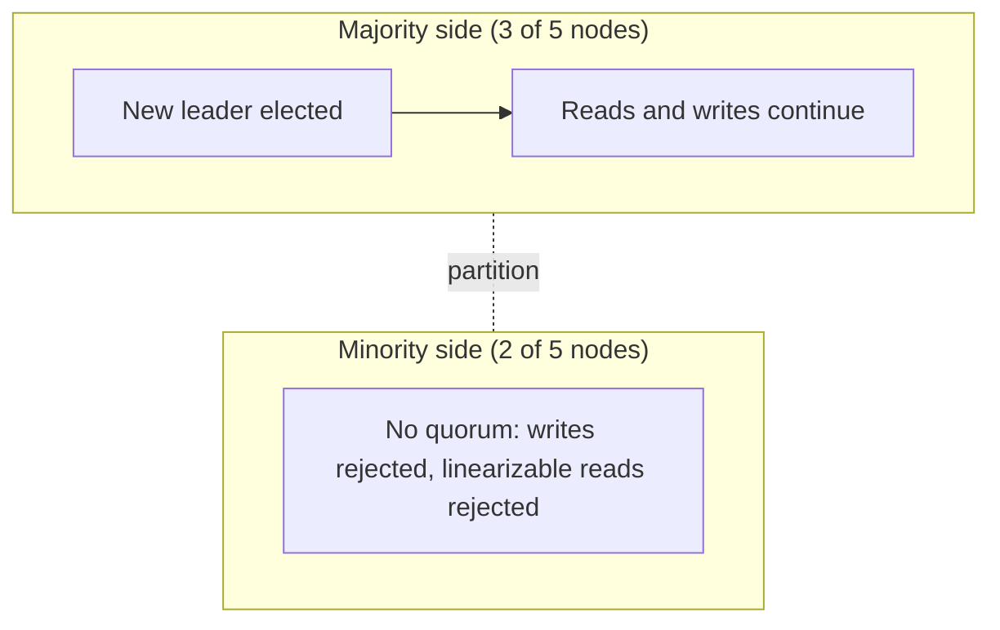

Examples: **etcd** and **ZooKeeper** (coordination, config, locks), **HBase** (a region served by one RegionServer), **Spanner / CockroachDB** (consensus per range), **MongoDB** with majority read and write concern, a relational primary with synchronous replication.

#### Example
Kubernetes stores cluster state in etcd (Raft). If a network partition isolates 2 of 5 etcd members, those 2 stop serving writes. The 3-member majority keeps working. Kubernetes keeps a single, consistent view of the cluster, which is worth more than accepting conflicting writes on both sides.

#### Trade-offs
Correctness and simple reasoning, but unavailability on the minority side, higher latency (quorum round trips), and leader elections cause brief write pauses.

#### Problems & fixes
| Symptom | Cause | Fix |
|---|---|---|
| Cluster unavailable after losing 2 of 3 nodes | quorum lost | 5 nodes for 2-failure tolerance, spread across AZs |
| Write latency high cross-region | quorum spans regions | place majority in one region, or accept latency |
| Brief write unavailability during failover | leader election | client retries with backoff, tune election timeouts |

#### Cheat sheet
- Majority quorum required. The minority side refuses.
- etcd, ZooKeeper, Spanner, CockroachDB, HBase, majority-configured MongoDB.
- Use for coordination, money and inventory, metadata.

#### Interview questions

Why would you deliberately accept unavailability in a CP system?

Because serving inconsistent data would cause worse problems: double-spending money, two leaders acting at once, overselling the last item, conflicting cluster configuration. For such data a temporary "try again" is far cheaper than repairing corrupted state.

How many nodes does a CP cluster need to survive two simultaneous failures?

Five. A majority of 5 is 3, so the cluster keeps quorum with 2 nodes down. Three nodes survive only one failure (a majority of 3 is 2). Even numbers don't add tolerance (4 nodes need 3 for quorum, which still tolerates only one failure).

#### Interview angle
> "Coordination, money and inventory go on CP systems with majority quorums, like etcd or a consensus database across three AZs. A minority partition refuses writes rather than diverging."

#### Sources
- [KV API guarantees](https://etcd.io/docs/v3.5/learning/api_guarantees/) — etcd docs
- [ZooKeeper overview](https://zookeeper.apache.org/doc/current/zookeeperOver.html) — Apache ZooKeeper docs

### AP systems — prioritize availability over consistency during partition (Cassandra, DynamoDB, CouchDB)
AP systems keep accepting reads and writes on **every reachable node** during a partition, even if replicas diverge. They reconcile later (last-write-wins, version vectors, CRDTs, read repair). They're built for always-on, globally distributed and write-heavy workloads.

#### Intuition
Two shop branches that keep selling when the phone line between them is down, each writing in its own ledger. When the line returns they compare ledgers and merge them.

#### Must know
- An AP system **keeps accepting reads and writes on every reachable node** during a partition.
- Replicas diverge and are **reconciled afterwards** (last-write-wins, version vectors, CRDTs).
- Examples: Cassandra, DynamoDB, Riak, CouchDB, DNS.
- It works best with **immutable or mergeable data**: messages, events, counters.
- It cannot enforce uniqueness or balance rules without extra coordination.

#### Common mistakes
- Storing balances or unique usernames in an AP store.
- Assuming last-write-wins loses nothing.
- Labelling a whole product AP or CP when it is tunable per query.

#### How it works
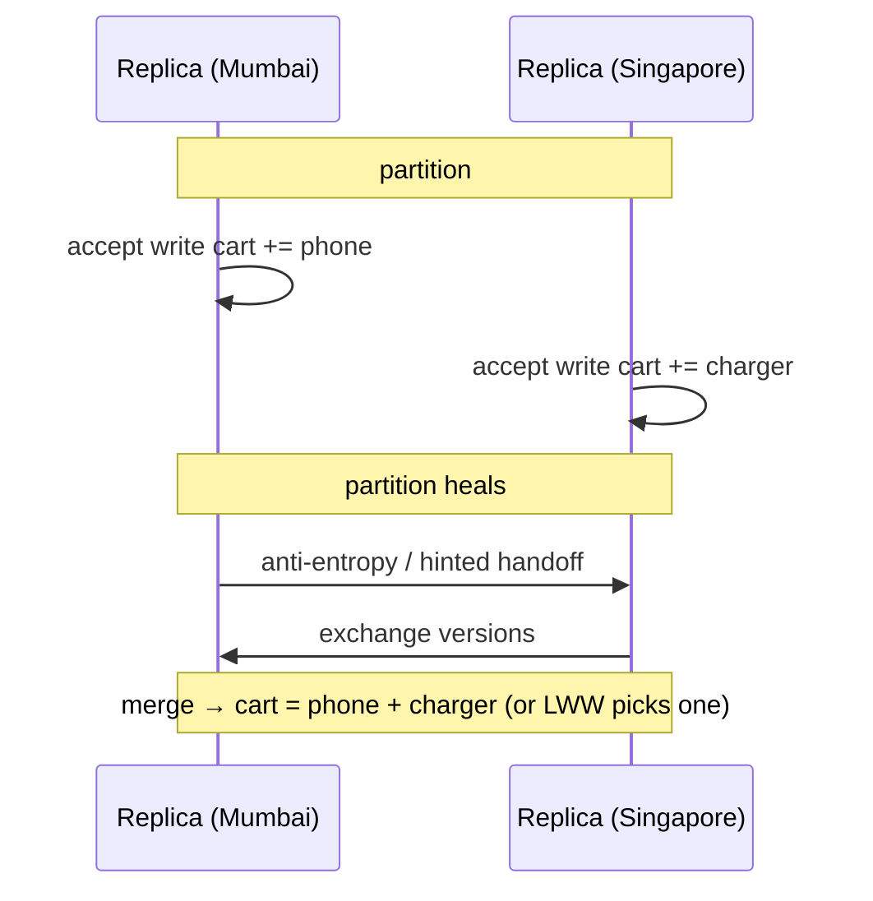

Examples: **Cassandra/ScyllaDB** (tunable CL), **DynamoDB** (eventually consistent reads by default, Global Tables multi-region), **Riak**, **CouchDB/PouchDB** (offline sync), DNS, CDNs.

#### Example
A messaging app's message store on Cassandra: during an AZ network issue, every node keeps accepting messages at `LOCAL_ONE`/`LOCAL_QUORUM` within reachable replicas. Hinted handoff and repairs converge replicas afterwards. Since messages are immutable (append-only with unique ids), there are no conflicts to resolve, which is the ideal AP data model.

#### Trade-offs
High availability and low latency everywhere, but stale reads, conflict resolution complexity, and no multi-key invariants (uniqueness, balances) without extra coordination.

#### Problems & fixes
| Symptom | Cause | Fix |
|---|---|---|
| Lost updates | LWW on concurrent edits | immutable/append-only data, CRDTs, version vectors |
| Duplicate usernames | uniqueness can't be enforced in AP | use a CP store (or LWT) for unique claims |
| Stale reads confuse users | eventual consistency | read-your-writes routing, quorum reads for critical views |

#### Cheat sheet
- Always accepts writes, converges later.
- Cassandra, DynamoDB, Riak, CouchDB, DNS, CDNs.
- Best with immutable or mergeable data. Invariants need CP.

#### Interview questions

What data modelling choices make AP systems work well?

Immutable, append-only records with unique ids (events, messages, logs), commutative operations (counters as CRDTs, set additions), per-entity ownership so concurrent writers are rare, and idempotent writes. Avoid read-modify-write on shared mutable state and global invariants.

Is DynamoDB AP or CP?

It's tunable: by default reads are eventually consistent (AP-leaning), and you can request strongly consistent reads within a region (served by the leader replica, which may fail during partitions). Global Tables replicate asynchronously across regions with last-writer-wins, which is AP across regions. Conditional writes and transactions provide stronger guarantees within a region.

#### Interview angle
> "Immutable, high-volume data like messages and events fits AP stores such as Cassandra. Nothing conflicts, so replicas just converge. Anything with uniqueness or balance invariants goes to a CP store."

#### Sources
- [Dynamo: Amazon's highly available key-value store](https://www.allthingsdistributed.com/files/amazon-dynamo-sosp2007.pdf) — DeCandia et al., SOSP 2007
- [DynamoDB read consistency](https://docs.aws.amazon.com/amazondynamodb/latest/developerguide/HowItWorks.ReadConsistency.html) — Amazon DynamoDB developer guide

### PACELC — when no Partition: tradeoff between Latency and Consistency (extends CAP)
PACELC (Abadi) extends CAP: **if Partition** → choose **Availability or Consistency**, **Else** (normal operation) → choose **Latency or Consistency**. Even without failures, waiting for replicas to agree costs latency, so every replicated system makes this trade-off all the time.

#### Intuition
Even when all the phone lines work, checking with head office before answering every customer takes time. Answering from your own book is faster and slightly riskier. You make that choice on every question, not only when a line is cut.

#### Must know
- **If Partition**: choose Availability or Consistency. **Else**: choose **Latency or Consistency**.
- Consistency costs a coordination round trip on **every** request, even on a good day.
- Cassandra and DynamoDB default to PA/EL. Spanner and etcd are PC/EC.
- Choose per operation: browsing reads from the nearest replica, checkout reads from the leader.
- It is more useful than CAP day to day, because partitions are rare and latency is constant.

#### Common mistakes
- Stopping at CAP when asked about consistency trade-offs.
- Making every read strongly consistent across regions and wondering why the product feels slow.
- Reading from async replicas at a point where a decision is made.

#### How it works
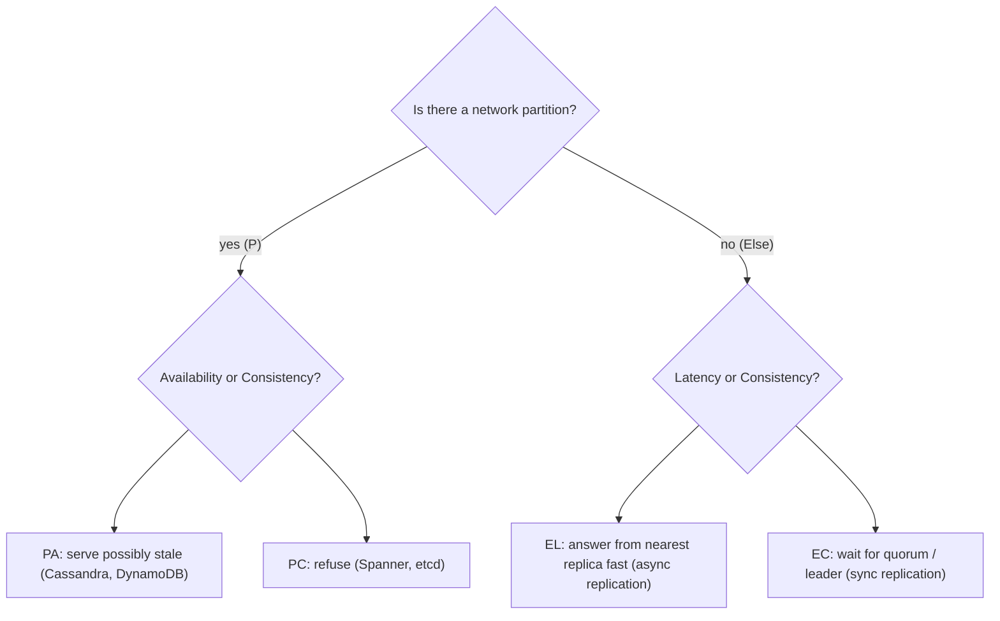

| System | Classification |
|---|---|
| Cassandra, DynamoDB (default) | PA/EL |
| MongoDB (default config) | PA/EC-ish (primary reads) |
| Spanner, CockroachDB, etcd | PC/EC |
| PostgreSQL + async replicas | PC/EL on replicas |

#### Example
A global product catalogue: reading from the nearest replica (EL) gives 20 ms responses but sometimes slightly stale prices. Reading from the leader in another region (EC) gives 150 ms responses. Choice: EL for browsing, EC (or re-validation at the source) at checkout. The same system makes different PACELC choices per operation.

#### Trade-offs
Strong consistency costs a coordination round trip on every operation, even on good days. Low latency means accepting replicas that can be behind.

#### Problems & fixes
| Symptom | Cause | Fix |
|---|---|---|
| Strongly consistent global DB feels slow | EC across regions | local reads with bounded staleness for non-critical paths |
| Stale reads in critical flows | EL replicas everywhere | route critical reads to leader / quorum |
| Team argues CAP for normal-day latency issues | CAP only covers partitions | use PACELC to frame the latency/consistency trade-off |

#### Cheat sheet
- P → A or C. Else → L or C.
- Consistency costs latency even without failures.
- Choose per operation: browse = EL, checkout = EC.

#### Interview questions

Why is PACELC more useful than CAP in day-to-day design?

Partitions are rare, but the latency cost of consistency is paid on every request. PACELC makes that everyday trade-off explicit: synchronous replication or quorum reads add round trips (worse across regions), while async replicas and local reads are fast but possibly stale. Most design decisions are about this normal-operation choice.

Classify Cassandra and Spanner under PACELC.

Cassandra is PA/EL by default: during partitions it stays available, and normally it favours low latency with tunable, often eventual, consistency (QUORUM moves it toward EC). Spanner is PC/EC: it refuses on minority partitions and always pays consensus and commit-wait latency for external consistency.

#### Interview angle
> "Beyond CAP, I think in PACELC: even with no failures, consistency costs latency. So browsing reads come from the nearest replica while checkout and money reads go to the leader or a quorum."

#### Sources
- [Consistency tradeoffs in modern distributed database system design](https://www.cs.umd.edu/~abadi/papers/abadi-pacelc.pdf) — Daniel Abadi
- [PACELC design principle](https://en.wikipedia.org/wiki/PACELC_design_principle) — Wikipedia

### BASE — Basically Available, Soft state, Eventually consistent (NoSQL philosophy)
BASE is a design philosophy contrasted with ACID: **Basically Available** (the system responds even in degraded form), **Soft state** (state may change without input as replicas converge), **Eventually consistent** (replicas converge given no new writes). It underpins most large-scale NoSQL and event-driven architectures.

#### Intuition
A group trip where everyone books their own ticket and posts it in the chat. For a few minutes the shared plan is incomplete, but nobody is blocked waiting, and it all lines up shortly after.

#### Must know
- **Basically Available**: the system answers, possibly in a degraded way.
- **Soft state**: data can change without new input, as replicas catch up.
- **Eventually consistent**: replicas converge once writes stop.
- The usual shape: **ACID inside one service, BASE between services**.
- The application carries the cost: idempotency, pending states, reconciliation.

#### Common mistakes
- Treating BASE as "no guarantees".
- Events with no outbox, so some are lost and the copies never converge.
- A UI that hides the in-between state, so users think their action failed.

#### How it works
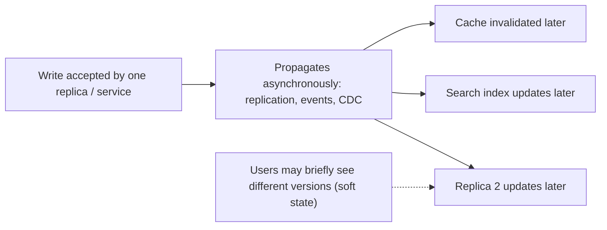

| ACID | BASE |
|---|---|
| strong consistency, isolation | eventual consistency |
| pessimistic, coordination | optimistic, asynchronous |
| availability may suffer | always (basically) available |
| simpler app reasoning | app handles staleness, retries, conflicts |

#### Example
An order placed in an event-driven e-commerce system: the order service commits locally (ACID inside the service) and emits `OrderPlaced`. Inventory, email, analytics, search and the recommendations model update asynchronously over seconds. For a moment the order history page may not show the order everywhere, so the UI shows it from the POST response (read-your-writes). The whole system is BASE, built from ACID components.

#### Trade-offs
Massive scalability and availability, at the cost of complexity pushed to the application (idempotency, ordering, compensations, user-facing staleness).

#### Problems & fixes
| Symptom | Cause | Fix |
|---|---|---|
| Users see stale or inconsistent views | eventual propagation | read-your-writes, UI optimism, "processing" states |
| Duplicates from retries | at-least-once delivery | idempotent consumers |
| Divergent data never converges | lost events | outbox, replayable logs, reconciliation jobs |

#### Cheat sheet
- Basically available, soft state, eventually consistent.
- ACID inside services, BASE between them.
- Needs idempotency, reconciliation and honest UX for in-flight states.

#### Interview questions

How do you build a correct system on eventually consistent components?

Keep invariants inside a single ACID boundary (one service's database). Communicate via durable events (outbox) with at-least-once delivery and idempotent consumers. Design explicit intermediate states (PENDING) and compensations (sagas). Give users read-your-writes for their own actions, and run reconciliation jobs that detect and fix drift.

Is BASE the opposite of ACID?

It's a different point on the spectrum. Systems usually combine them: each service or partition uses ACID transactions locally, while cross-service or cross-region state is BASE (eventually consistent). The choice is per data boundary, not per company.

#### Interview angle
> "Each service is ACID inside its own database, while the system as a whole is BASE: events via an outbox, idempotent consumers, explicit pending states and reconciliation."

#### Sources
- [What's the difference between an ACID and a BASE database?](https://aws.amazon.com/compare/the-difference-between-acid-and-base-database/) — AWS
- [Eventually consistent](https://www.allthingsdistributed.com/2008/12/eventually_consistent.html) — Werner Vogels

### Linearizability — strongest: operation appears atomic at a single point in time, most recent write always visible
Linearizability (atomic consistency) means the system behaves as if there's **a single copy of the data** and every operation takes effect atomically at some instant between its start and end. Once a write completes, **every later read, from anyone, anywhere, sees it**. It's the C in CAP.

#### Intuition
A single whiteboard in a room where one person writes at a time. As soon as someone finishes writing, everyone who looks afterwards sees it. There is never a second, older whiteboard to look at.

#### Must know
- The system behaves as if there were **one copy of the data**.
- Once a write completes, **every later read by anyone sees it**.
- It is the C in CAP.
- Needed for locks, leader election, uniqueness and balance checks.
- It requires consensus or a single leader, which costs latency and availability in a minority partition.

#### Common mistakes
- Confusing it with serializability, which is about multi-object transactions.
- Assuming quorum reads and writes (W + R > N) give it automatically.
- Reading from an async follower and expecting linearizable results.

#### How it works
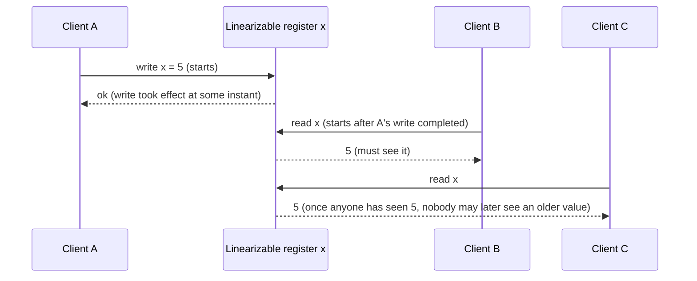

Implementations: single leader with linearizable reads (read from the leader with a lease or ReadIndex check), consensus (Raft/Paxos), Spanner's TrueTime, compare-and-set on a single primary. Async replicas, LWW multi-leader and plain quorums are **not** linearizable.

#### Example
**Leader election and locks** need linearizability: if node A acquired the lock in etcd, no other node may read "lock free" afterwards. **Uniqueness**: "is username asha taken?" must reflect the latest committed claim. **Account balance before withdrawal** must be the latest value. etcd's default reads (`--consistency=l`) are linearizable, going through the Raft leader, while serializable reads (`--consistency=s`) may be stale but faster.

#### Trade-offs
The simplest model to reason about, but it requires coordination on every operation (latency, cross-region round trips) and is unavailable in minority partitions.

#### Problems & fixes
| Symptom | Cause | Fix |
|---|---|---|
| Two workers both acquire "the" lock | lock stored on eventually consistent replicas | linearizable store (etcd/ZooKeeper) + fencing tokens |
| Stale read right after successful write | reading from async follower | leader reads / ReadIndex / sync replication |
| Global linearizable ops too slow | consensus across regions | restrict linearizability to the operations that need it |

#### Cheat sheet
- One logical copy. Completed writes visible to all later reads.
- Needed for locks, leader election, uniqueness, balances.
- Requires consensus or a single leader, which costs latency and partition availability.

#### Interview questions

Linearizability vs serializability: what's the difference?

Serializability is about transactions: concurrent multi-object transactions behave as if executed in some serial order (not necessarily matching real time). Linearizability is about single-object operations: each appears to take effect instantly at a point consistent with real-time order. "Strict serializability" combines both (Spanner provides it).

Why aren't quorum reads and writes (W + R > N) automatically linearizable?

With concurrent writes and last-write-wins resolution, sloppy quorums, or partially applied writes, a read quorum can return a newer value and a subsequent read an older one (if the write hasn't reached enough replicas and read repair hasn't run), violating real-time ordering. Linearizability needs extra mechanisms like synchronous read repair before returning, or consensus.

#### Interview angle
> "I need linearizability only for locks, leader election, uniqueness and balances, so those go through etcd or a consensus database. Everything else uses cheaper models."

#### Sources
- [Linearizability](https://jepsen.io/consistency/models/linearizable) — Jepsen
- [Linearizability](https://en.wikipedia.org/wiki/Linearizability) — Wikipedia
- [KV API guarantees](https://etcd.io/docs/v3.5/learning/api_guarantees/) — etcd docs

### Sequential consistency — operations appear in program order but no global real-time guarantee
Sequential consistency (Lamport) requires that all operations appear in **some single total order** that respects **each client's program order**, but that order doesn't have to match real time. Everyone sees the same order of events, but a write may become visible "later" than wall-clock time suggests.

#### Intuition
Everyone gets the same newspaper with stories in the same order, but some people's copies arrive an hour late. Nobody sees the stories in a different order. Some just see them later.

#### Must know
- All operations appear in **one agreed order** that respects **each client's own order**.
- That order need **not match real time**, so a read can be stale.
- Weaker than linearizability, and cheaper, because reads need no coordination.
- ZooKeeper reads work this way: possibly behind, never out of order.
- Call `sync()` before a ZooKeeper read that must be current.

#### Common mistakes
- Treating it as the same as linearizability.
- Thinking stale reads are a violation. Only reordering is.
- Spending long on it in an interview. Know the definition and the ZooKeeper example.

#### How it works
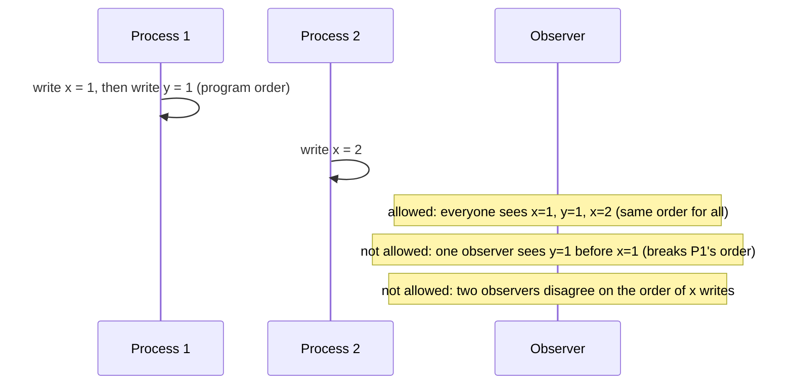

Comparison:
| Model | Single global order | Respects real time | Respects per-client order |
|---|---|---|---|
| Linearizable | ✅ | ✅ | ✅ |
| Sequential | ✅ | ❌ | ✅ |
| Causal | only for causally related ops | ❌ | ✅ |

#### Example
ZooKeeper provides **sequential consistency for reads** (updates are linearizable via ZAB, while reads served by a follower may lag but always reflect updates in the same order). A client may read a slightly old value from its follower, but never sees updates out of order. If it needs the latest, it calls `sync()` before reading. Multiprocessor memory models (and Java's guarantees for correctly synchronised programs) use the same idea.

#### Trade-offs
Cheaper than linearizability (no real-time coordination for reads) while keeping a single agreed history. Clients can still observe staleness.

#### Problems & fixes
| Symptom | Cause | Fix |
|---|---|---|
| Client reads stale value from ZooKeeper follower after another client's write | sequential (not linearizable) reads | `sync()` before read when freshness matters |
| Confusion about "consistent" guarantees | models not distinguished | name the model explicitly in designs |

#### Cheat sheet
- One total order for everyone, respecting each client's program order.
- No real-time guarantee, so stale reads are possible.
- ZooKeeper reads are sequential. Use `sync()` for latest.

#### Interview questions

What can a sequentially consistent system do that a linearizable one can't?

It can serve reads from a lagging replica (no coordination with the leader), as long as all clients observe updates in the same order and each client's own operations stay in order. That gives cheaper and more available reads at the cost of possible staleness relative to real time.

How does ZooKeeper let clients get linearizable reads when needed?

Writes are linearizable through the leader (ZAB). Reads are served locally by the connected server, which may lag. A client can call `sync()`, which makes its server catch up with the leader up to that point, then read, giving read-after-sync freshness for that client.

#### Interview angle
> "Sequential consistency gives everyone the same order of updates without real-time freshness. ZooKeeper reads work like that, and I call sync() when a read must be current."

#### Sources
- [Sequential consistency](https://jepsen.io/consistency/models/sequential) — Jepsen
- [ZooKeeper programmer's guide: consistency guarantees](https://zookeeper.apache.org/doc/current/zookeeperProgrammers.html) — Apache ZooKeeper docs

### Causal consistency — causally related operations ordered, concurrent operations may differ
Causal consistency guarantees that operations that are **causally related** (one could have influenced the other) are seen by everyone **in that order**. Concurrent, unrelated operations may be seen in different orders by different clients. It's the strongest model that stays available during partitions.

#### Intuition
In a group chat you must never see the answer before the question. Two unrelated messages from different people can show up in either order and nobody minds.

#### Must know
- If one operation could have influenced another, **everyone sees them in that order**.
- Unrelated, concurrent operations may appear in different orders to different clients.
- It is the **strongest model that stays available during a partition**.
- Implemented by tracking dependencies with vector clocks or version tokens.
- It matches what users notice in chat, comments and feeds.

#### Common mistakes
- Demanding one global order for a chat product when order per conversation is enough.
- Assuming eventual consistency gives this automatically.
- Forgetting that concurrent writes to the same item still need conflict resolution.

#### How it works
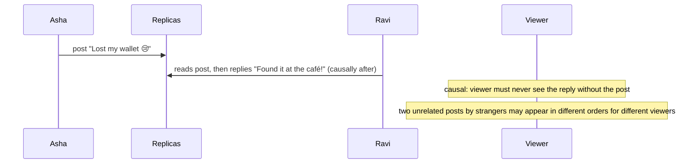

Implementation: track dependencies with **vector clocks**, version vectors or explicit dependency metadata. A replica applies an update only after its dependencies are applied. MongoDB causal sessions use cluster times (operation times) for this.

#### Example
Comment threads, chat and social feeds: showing a reply before the message it answers is confusing. With causal consistency (or per-conversation ordering), replies always appear after their parents, while posts from unrelated users can arrive in any order across regions. It's cheaper than global ordering and works during partitions.

#### Trade-offs
Captures what users perceive as correct, and remains available under partitions, but needs dependency tracking metadata, and concurrent writes to the same item still need conflict resolution.

#### Problems & fixes
| Symptom | Cause | Fix |
|---|---|---|
| Replies visible before original post | eventual consistency without causal tracking | causal metadata, per-conversation ordering |
| User sees their own action undone on another replica | session not causal | causal sessions (MongoDB), sticky routing |
| Metadata overhead grows | vector clocks with many nodes | compact dependency tracking, per-session clocks |

#### Cheat sheet
- Cause before effect, for everyone. Concurrent ops may vary.
- Implemented with vector clocks or dependency tracking.
- Strongest model that stays available under partition.

#### Interview questions

Give a real-world anomaly that causal consistency prevents but eventual consistency allows.

In a group chat, A asks "Who's coming tonight?" and B replies "Me!". Under plain eventual consistency, a third user could receive B's reply before A's question (from a faster replica). Causal consistency ensures the reply is only shown after the question it depends on.

Why is causal consistency attractive for geo-distributed systems?

It preserves the orderings users actually perceive (cause before effect) without requiring global coordination on every write, so each region can keep accepting writes during partitions and stay low-latency, unlike linearizability, which needs cross-region agreement.

#### Interview angle
> "For chat and comments, causal ordering is what users notice: a reply never shows before its parent. I get it with per-conversation ordering or causal sessions, without global coordination."

#### Sources
- [Causal consistency](https://jepsen.io/consistency/models/causal) — Jepsen
- [Causal consistency and read and write concerns](https://www.mongodb.com/docs/manual/core/causal-consistency-read-write-concerns/) — MongoDB manual

### Read-your-writes — you always see your own writes (weaker than linearizability)
Read-your-writes is a **session guarantee**: after a client writes, **that client's** later reads reflect the write. Other clients may still see older data. It's weaker than linearizability but removes the most visible anomaly in eventually consistent systems ("I saved my profile and it's gone"). (Phase 3 covers the replication-level mechanics.)

#### Intuition
You post a comment and refresh. Your comment must be there for you, even if a stranger on another continent does not see it for another second.

#### Must know
- A **session guarantee**: after I write, **my own** later reads include that write.
- Other clients may still see older data.
- Much cheaper than linearizability, and it removes the anomaly users complain about most.
- Implement with a version token the client sends back, or by reading from the leader just after a write.
- Also return the saved object in the write response.

#### Common mistakes
- Confusing it with linearizability, which constrains every client.
- Tracking it in a cookie only, so it fails across devices.
- Forgetting the cache, which can still serve the old value.

#### How it works
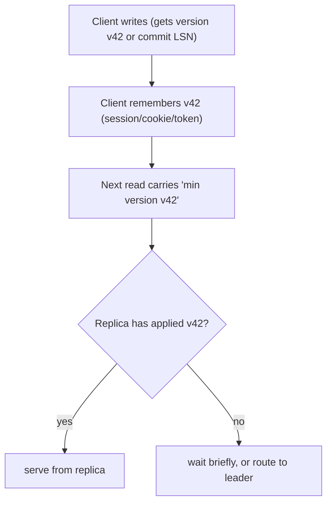

Techniques: read own data from the leader, time-based stickiness after writes, version tokens (LSN/GTID/cluster time), returning the written state in the write response, and invalidating caches before responding.

#### Example
A user updates their delivery address in a food app, then immediately places an order. With read-your-writes via version tokens, the checkout read waits for (or routes around) replicas lacking the update, so the order goes to the new address. Other users don't need this guarantee at all, so replicas still serve them freely.

#### Trade-offs
Cheap, targeted fix for user-visible staleness. Cross-device sessions need server-side tracking, and waiting for replicas adds latency to some reads.

#### Problems & fixes
| Symptom | Cause | Fix |
|---|---|---|
| "Saved but not shown" bugs | replica lag | version tokens / leader reads after write |
| Works on phone, stale on laptop | session-local tracking | per-user last-write version stored server-side |
| Cache shows old value after save | cache not invalidated before response | invalidate/update cache synchronously on write |

#### Cheat sheet
- My writes are visible to me. Others may lag.
- Version tokens, leader-after-write, return written state.
- Weaker (cheaper) than linearizability.

#### Interview questions

How is read-your-writes different from linearizability?

Read-your-writes only constrains what the writing client sees: its own subsequent reads include its writes. Linearizability constrains everyone: once any write completes, all clients' later reads see it, and everyone agrees on a real-time order. Read-your-writes can be provided with session tricks on top of async replicas, while linearizability needs coordination.

Implement read-your-writes with MySQL async replicas.

After a write, capture the GTID (or binlog position) and store it with the user's session. For subsequent reads, use a replica only if it has executed that GTID (`WAIT_FOR_EXECUTED_GTID_SET` with a short timeout), or route to the primary. ProxySQL supports GTID-consistent reads natively.

#### Interview angle
> "Users must see their own writes, so the write returns a version token and their reads only hit replicas that have caught up to it, otherwise the leader. Everyone else reads freely from replicas."

#### Sources
- [Read your writes](https://jepsen.io/consistency/models/read-your-writes) — Jepsen
- [Eventually consistent](https://www.allthingsdistributed.com/2008/12/eventually_consistent.html) — Werner Vogels

### Monotonic reads — reads never go backwards in time (you never see older data after seeing newer)
Monotonic reads is a session guarantee: once a client has read a value at some version, **its later reads never return an older version**. Without it, refreshing a page can make new data disappear and reappear as requests bounce between replicas with different lag.

#### Intuition
A like count that reads 1,204, then 1,198, then 1,210 as you refresh. No number was ever wrong, but going backwards looks broken. Monotonic reads means your view only moves forward.

#### Must know
- A **session guarantee**: once I have seen a version, I **never later see an older one**.
- It breaks when consecutive requests reach replicas with different lag.
- Fix with sticky routing per user, or with a minimum-version token.
- It is independent of read-your-writes. Either can hold without the other.
- The frontend can help by ignoring responses older than what it already shows.

#### Common mistakes
- Round-robin across replicas for a page users refresh.
- Assuming eventual consistency implies it.
- No fallback when the pinned replica fails.

#### How it works
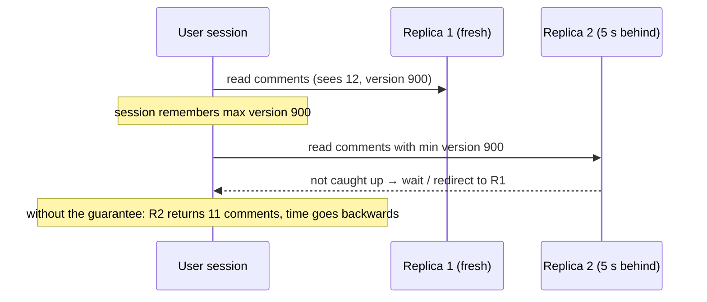

Techniques: sticky routing per user or session to one replica, or version tokens ("serve only if your applied version ≥ X"). Databases: MongoDB causal sessions, Cosmos DB session consistency.

#### Example
A news app's like counts flickered (1,204 → 1,198 → 1,210) because each refresh hit a random replica. Session stickiness (consistent hashing of user id to replica) made each user's view monotonic, so no more "unlikes" appearing out of nowhere.

#### Trade-offs
Cheap to provide with stickiness, but stickiness weakens load balancing and needs a failover fallback with version checks.

#### Problems & fixes
| Symptom | Cause | Fix |
|---|---|---|
| Data flickers on refresh | random replica per request | sticky routing / version tokens |
| Flicker after replica failover | new replica further behind | min-version check, wait or route to leader |
| Client-side regressions | out-of-order async responses in UI | ignore responses older than latest seen version |

#### Cheat sheet
- Never show a client older data than it has already seen.
- Sticky replica, or a version-token check.
- Part of the session guarantees, along with read-your-writes.

#### Interview questions

Why can monotonic reads be violated even when every replica is eventually consistent?

Replicas apply updates at different times. If a client's consecutive reads go to different replicas (round-robin load balancing), the second replica may lag behind the first, so the client sees newer data and then older data, even though both replicas will eventually converge.

How can a frontend contribute to monotonic reads?

Attach a version or timestamp to responses and keep the highest seen. Drop responses (from parallel or retried requests, or different backends) that carry an older version than what's already displayed, and pass the highest version to the backend so it can enforce freshness.

#### Interview angle
> "To stop data flickering backwards on refresh, I pin each session to a replica, or carry a min-version token so only caught-up replicas answer."

#### Sources
- [Monotonic reads](https://jepsen.io/consistency/models/monotonic-reads) — Jepsen
- [Eventually consistent](https://www.allthingsdistributed.com/2008/12/eventually_consistent.html) — Werner Vogels

### Eventual consistency — given no new writes, all replicas converge to same value eventually
Eventual consistency guarantees only that **if writes stop, all replicas will eventually hold the same value**. It says nothing about how long that takes or what reads return in the meantime. It's the default in many large-scale systems (DNS, CDNs, Cassandra at low consistency levels, async replicas, search indexes, caches).

#### Intuition
News spreading through a village. Tell one person and within a while everyone knows. Ask someone in the meantime and they may not have heard yet.

#### Must know
- The only promise: **if writes stop, all replicas end up with the same value**.
- It gives **no bound** on how long that takes or what a read returns meanwhile.
- The default in DNS, CDNs, async replicas, caches and search indexes.
- Fine for browsing, search, feeds and counts. **Not for a decision about money.**
- Measure the lag and set a target for it, so "eventual" becomes a known number.

#### Common mistakes
- Making a decision (charging a price, checking stock) on an eventually consistent copy.
- Not measuring replication or pipeline lag at all.
- Assuming convergence is certain when events can be lost.

#### How it works
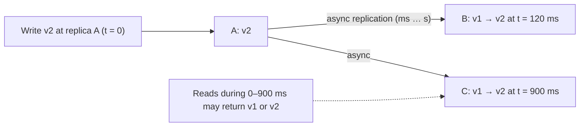

Convergence mechanisms: async replication, gossip, anti-entropy (Merkle trees), read repair, hinted handoff, plus a conflict policy (LWW, CRDT merge).

#### Example
A product's price updates in Postgres. The Elasticsearch index (via CDC) updates within ~1 s, the Redis cache (TTL + invalidation) within ms to minutes, and CDN pages within the `s-maxage` window. For a short time, search shows the old price while the product page shows the new one. Acceptable for browsing, but checkout always reads the price from Postgres.

Measure it: **replication lag** and convergence time are SLO-worthy metrics ("99% of updates visible in search within 5 s").

#### Trade-offs
Highest availability and lowest latency, at the cost of anomalies (stale reads, flicker, order inversions) that applications must tolerate or mask with session guarantees.

#### Problems & fixes
| Symptom | Cause | Fix |
|---|---|---|
| Users act on stale data (old price) | reading eventually consistent copies at decision points | validate against source of truth at commit |
| Copies never converge | lost updates/events | durable logs, replay, reconciliation |
| Unknown staleness | lag not measured | lag metrics and convergence SLOs |

#### Cheat sheet
- Converges if writes stop. No bound on staleness.
- Fine for browsing, search, feeds, counts. Not for decisions on money.
- Measure lag. Add session guarantees where users notice.

#### Interview questions

Where is eventual consistency acceptable and where is it not, in a banking app?

Acceptable: transaction history views lagging by a second, analytics dashboards, notifications, marketing data, search over past transactions. Not acceptable: the balance check before a debit, transfer execution, limits and fraud decisions, ledger entries. Those need strongly consistent reads and writes on the source of truth.

How do you know how "eventual" your eventual consistency is?

Measure it: replication lag (seconds behind, LSN difference), CDC and connector lag, consumer lag on event topics, and end-to-end probes (write a marker, measure when it appears in each downstream store). Set SLOs on these and alert, so "eventual" becomes a known bound.

#### Interview angle
> "Search, caches and feeds are eventually consistent with measured lag SLOs, but any decision involving money re-reads the source of truth."

#### Sources
- [Eventually consistent](https://www.allthingsdistributed.com/2008/12/eventually_consistent.html) — Werner Vogels
- [Eventual consistency](https://en.wikipedia.org/wiki/Eventual_consistency) — Wikipedia

### Strong eventual consistency — concurrent updates resolve deterministically without coordination (CRDTs)
Strong eventual consistency (SEC) adds a guarantee to eventual consistency: **any two replicas that have received the same set of updates are in the same state immediately**, regardless of order, with no coordination and no rollback. It's achieved with **CRDTs**, data types whose merge is commutative, associative and idempotent.

#### Intuition
Two people each tick boxes on their own copy of a checklist. When the copies are combined, a box is ticked if either person ticked it. The result is the same whoever merges first and however many times they merge.

#### Must know
- Any two replicas that have received **the same set of updates are in the same state**, in any order, with no coordination.
- Achieved with **CRDTs**: data types whose merge is commutative, associative and idempotent.
- Examples: counters (G-Counter, PN-Counter), sets (OR-Set), collaborative text.
- Works offline and through partitions.
- It cannot enforce a global rule such as balance ≥ 0.

#### Common mistakes
- Treating it as plain eventual consistency. The extra promise is deterministic convergence.
- Using a naive set union, so removed items come back.
- Proposing CRDTs for inventory or money.

#### How it works
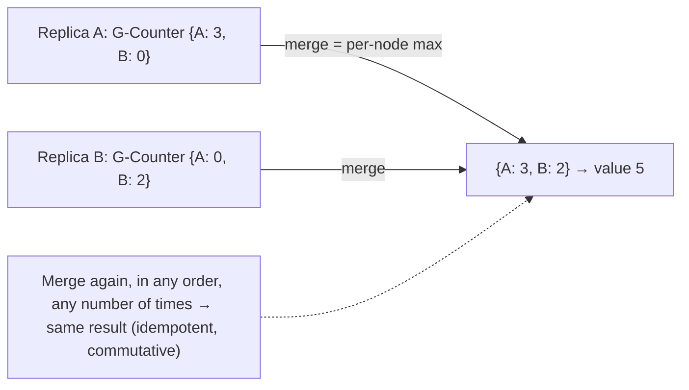

Common CRDTs:
| CRDT | Semantics |
|---|---|
| G-Counter | increment-only (per-replica counts, sum) |
| PN-Counter | increments and decrements (two G-Counters) |
| G-Set / 2P-Set | add-only / add + remove once |
| OR-Set | add and remove repeatedly (unique tags per add) |
| LWW-Register / LWW-Map | last writer wins per field |
| RGA / Yjs / Automerge sequences | collaborative text and lists |

#### Example
**Collaborative editing** (Figma-like multiplayer, Google Docs alternatives built on Yjs/Automerge): each client edits a local CRDT document offline or online and exchanges updates. All clients that have seen the same edits show identical documents, with no central lock or conflict dialog. **Redis Enterprise active-active** and **Riak** offer CRDT-based counters and sets across regions.

#### Trade-offs
Coordination-free convergence, offline-friendly, partition tolerant, but limited to operations that can be made commutative (no global invariants like "balance ≥ 0"), with metadata overhead (tombstones, per-replica vectors) and sometimes surprising merge semantics.

#### Problems & fixes
| Symptom | Cause | Fix |
|---|---|---|
| Removed items reappear | wrong set type (G-Set / naive union) | OR-Set |
| Metadata growth (tombstones) | long-lived documents | garbage collection / compaction of causal history |
| Invariant violations after merge | CRDTs can't enforce global constraints | coordinate those operations (escrow, single authority) |

#### Cheat sheet
- Same updates received means same state: no coordination, order-independent.
- CRDTs: counters, sets (OR-Set), registers, maps, sequences.
- Great for collaboration, offline-first, multi-region counters. Not for invariants.

#### Interview questions

What property must a CRDT merge function have, and why?

It must be commutative (order doesn't matter), associative (grouping doesn't matter) and idempotent (re-applying doesn't change the result), i.e. a semilattice join. Then replicas can exchange state in any order, repeatedly, over unreliable networks, and still converge to the same value without coordination.

How would you build a "likes" counter replicated across three regions without coordination?

A PN-Counter (or G-Counter for likes only): each region increments its own slot. Merge takes the per-region maximum, and the value is the sum (minus decrements). Regions accept likes locally during partitions, and exchanging state converges all regions to the same total. Deduplicate per user with an OR-Set of user ids if one-like-per-user matters.

#### Interview angle
> "For multi-region counters, carts and collaborative editing I use CRDTs: merges are commutative and idempotent, so replicas converge with no coordination. Invariants like balances still go through a single authority."

#### Sources
- [Conflict-free replicated data type](https://en.wikipedia.org/wiki/Conflict-free_replicated_data_type) — Wikipedia
- [About CRDTs](https://crdt.tech/) — crdt.tech

