## Consensus algorithms & leader election

### Raft — leader election (randomized timeout, first to get majority votes), log replication, safety
Raft is a consensus algorithm designed to be **understandable**. A cluster of (usually 3 or 5) nodes agrees on a **replicated log** of commands, so each node's state machine ends up identical. It splits the problem into **leader election**, **log replication** and **safety**. etcd, Consul, CockroachDB, TiKV, Kafka KRaft and RabbitMQ quorum queues use it.

#### Intuition
A committee keeping one shared minute book. They elect a chairperson, only the chairperson writes in the book, and an entry counts once more than half the members have copied it into their own. If the chairperson disappears, they elect another.

#### Must know
- A consensus algorithm: a small cluster agrees on one **replicated log**, so every node ends up in the same state.
- Three parts: **leader election, log replication, safety**.
- Only the **leader** accepts writes. An entry is **committed once a majority has stored it**.
- **Terms** number each leadership period. There is at most one leader per term.
- Used by etcd, Consul, CockroachDB, TiKV and Kafka KRaft.

#### Numbers to quote
- 3 nodes tolerate 1 failure, 5 tolerate 2. Clusters are usually 3 or 5.
- A new leader is typically elected in well under a second.

#### Common mistakes
- An even number of nodes. It adds cost, not fault tolerance.
- One huge Raft group. Large systems run many small groups, one per data range.
- Saying the leader replies as soon as it writes locally. It replies after the majority has the entry.

#### How it works
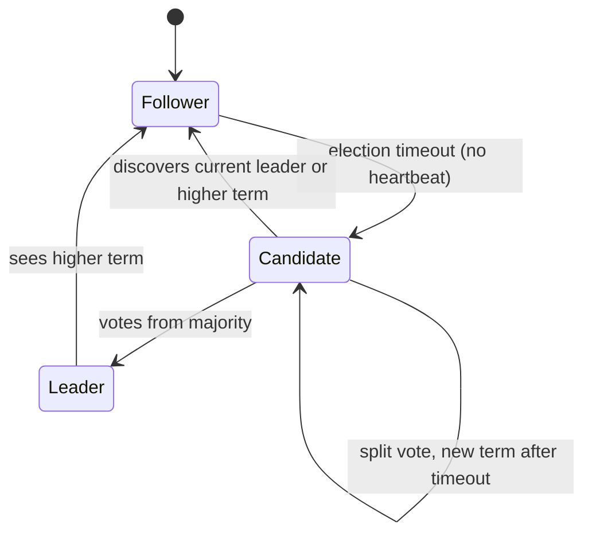

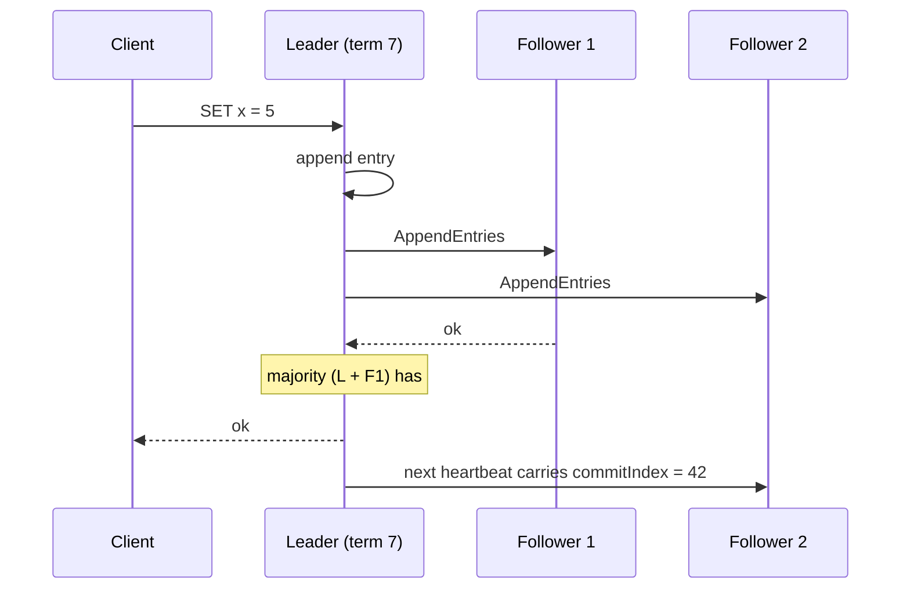

Key ideas: **terms** (logical epochs), **one leader per term**, the leader is the only writer, entries are committed once on a **majority**, and followers apply committed entries in order.

#### Example
A 3-node etcd cluster across 3 AZs: writes go to the leader and commit when one follower acknowledges (~1–2 ms cross-AZ). Losing any one node (or AZ) keeps a majority of 2, so the cluster keeps working, and a new leader is elected within a few hundred ms if the leader dies. Losing two nodes means no majority: writes stop (CP behaviour).

#### Trade-offs
Strong consistency and fault tolerance with understandable rules, but every write needs a majority round trip, throughput is bounded by the single leader, and clusters are typically small (3–7 nodes).

#### Problems & fixes
| Symptom | Cause | Fix |
|---|---|---|
| Frequent leader elections | heartbeat timeouts too tight, slow disks, GC pauses | tune election timeout, fast fsync disks, fix pauses |
| Writes slow | cross-region majority / slow disk fsync | keep majority close, NVMe, batch entries |
| Cluster stuck with 2 of 4 nodes | even-sized cluster loses majority easily | odd sizes (3, 5) |
| Log grows forever | no snapshots | periodic snapshots + log compaction |

#### Cheat sheet
- Leader election + log replication + safety. Terms = epochs.
- Commit on majority. 3 nodes tolerate 1 failure, 5 tolerate 2.
- Used by etcd, Consul, CockroachDB, TiKV, Kafka KRaft.

#### Interview questions
<details><summary>Explain how Raft handles a leader crash.</summary>

Followers stop receiving heartbeats. After a randomised election timeout, one becomes a candidate, increments the term, votes for itself and requests votes. Nodes grant one vote per term, and only to candidates whose log is at least as up to date as theirs. A candidate with a majority becomes leader, sends heartbeats, and brings followers' logs in line with its own (overwriting uncommitted conflicting entries). Committed entries survive because any majority includes a node that has them.
</details>

<details><summary>Why is a Raft cluster usually 3 or 5 nodes, not 10?</summary>

Every write waits for a majority, so more nodes mean more replication traffic and slower commits without proportional benefit. 3 nodes tolerate 1 failure and 5 tolerate 2, which covers most availability needs. Larger systems shard data into many small Raft groups (CockroachDB ranges, TiKV regions) rather than enlarging one group.
</details>

#### Interview angle
> "For metadata or coordination I rely on Raft through etcd or Consul: a 3- or 5-node cluster across AZs, writes committed on a majority, and automatic leader election in under a second."

#### Sources
- [The Raft consensus algorithm](https://raft.github.io/) — raft.github.io
- [In search of an understandable consensus algorithm](https://raft.github.io/raft.pdf) — Ongaro and Ousterhout

### Raft leader election — each node has random election timeout; first to expire sends RequestVote
Raft elects leaders using **heartbeats and randomised timeouts**. Followers expect periodic heartbeats from the leader. If none arrive within their election timeout (randomised, e.g. 150–300 ms), a follower becomes a candidate and asks for votes. Randomisation makes it unlikely that two nodes start elections at once.

#### Intuition
A class waiting for a teacher who has not turned up. Each pupil silently counts to a different random number. Whoever finishes first stands up and says "I'll lead". If most of the class agree, it is settled before anyone else has finished counting.

#### Must know
- Followers expect regular **heartbeats** from the leader.
- With no heartbeat within its **randomised election timeout**, a follower becomes a candidate, raises the term and asks for votes.
- Each node gives **one vote per term**, and only to a candidate whose log is **at least as up to date** as its own.
- A majority of votes makes a leader. Randomised timeouts make split votes rare.
- The log rule guarantees the new leader has every committed entry.

#### Numbers to quote
- The Raft paper suggests election timeouts of 150–300 ms.

#### Common mistakes
- Forgetting the "log at least as up to date" condition, which is what makes elections safe.
- Timeouts shorter than GC or disk pauses, which cause constant re-elections.
- Assuming the node that times out first always wins. It still needs a majority.

#### How it works
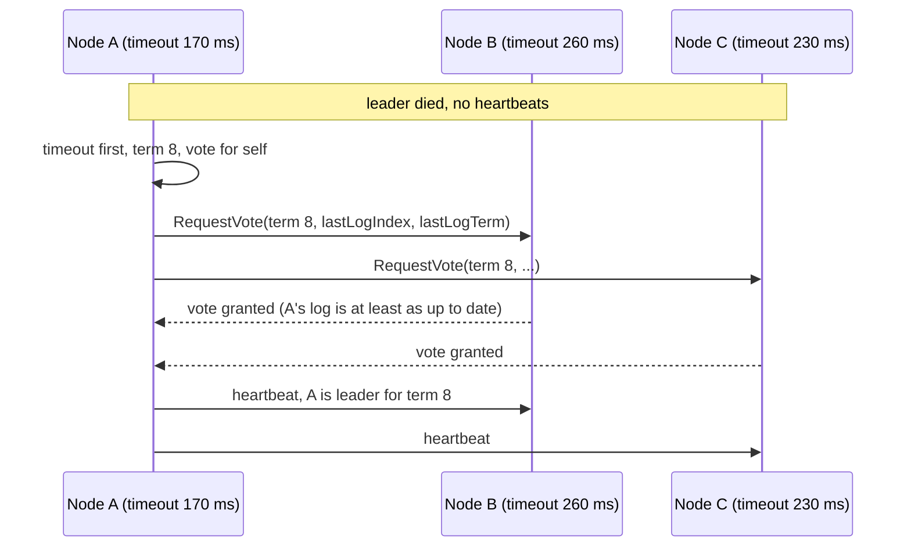

Voting rules:
- One vote per node per term (persisted to disk).
- Vote only for a candidate whose log is **at least as up to date** (compare last entry's term, then index). That guarantees the new leader has all committed entries.
- Seeing a higher term makes a node step down to follower.
- Split vote (no majority) means both time out again with new random timeouts and retry.

Extras in production: **PreVote** (a candidate checks it could win before disrupting the cluster with a higher term) and **CheckQuorum** (a leader steps down if it can't reach a majority).

#### Example
In a 5-node cluster, a network glitch isolates one follower. Without PreVote it times out repeatedly and increments its term, and when it reconnects the higher term forces the healthy leader to step down: a needless election. With PreVote, the isolated node can't get pre-votes, so it never disrupts the cluster. etcd enables PreVote by default.

#### Trade-offs
Fast, simple elections, but timeouts must balance fast failover against spurious elections caused by GC pauses and network jitter.

#### Problems & fixes
| Symptom | Cause | Fix |
|---|---|---|
| Leader flapping | election timeout shorter than worst-case pauses | longer timeouts, fix GC/disk latency |
| Rejoining node triggers elections | term inflation while isolated | PreVote |
| Old leader still serving reads after partition | no leader lease / CheckQuorum | ReadIndex/lease checks, CheckQuorum |

#### Cheat sheet
- Heartbeat timeout → candidate → RequestVote. Majority wins.
- Random timeouts avoid split votes. Vote only for up-to-date logs.
- PreVote + CheckQuorum prevent disruptive elections and stale leaders.

#### Interview questions
<details><summary>Why are Raft election timeouts randomised?</summary>

If all followers used the same timeout, they'd become candidates simultaneously after a leader failure, split the votes, and repeat forever. Random timeouts make it likely that one node times out first, wins a majority and sends heartbeats before others start their own elections.
</details>

<details><summary>How does Raft guarantee a newly elected leader has all committed entries?</summary>

A candidate needs votes from a majority, and voters refuse candidates whose log is less up to date than their own. Any committed entry exists on a majority, and any two majorities overlap, so at least one voter has every committed entry and won't vote for a candidate lacking it. Therefore the winner's log contains all committed entries.
</details>

#### Interview angle
> "Raft elections use randomised timeouts and log-freshness voting rules, so the new leader always holds every committed entry. PreVote and CheckQuorum keep flaky nodes from causing needless elections."

#### Sources
- [In search of an understandable consensus algorithm](https://raft.github.io/raft.pdf) — Ongaro and Ousterhout
- [The Raft consensus algorithm](https://raft.github.io/) — raft.github.io

### Raft log replication — leader appends entry, replicates to majority, only then commits
In Raft, the leader is the only node that accepts writes. It appends each command to its log, replicates it to followers with `AppendEntries`, and **commits** the entry once a **majority** has stored it. Only committed entries are applied to the state machine and acknowledged to clients.

#### Intuition
The chairperson writes a new line in the minute book and reads it out. Once more than half the members have written the same line in the same position, it is official, and only then is the person who asked told "done".

#### Must know
- The leader appends the command to its log and sends it to followers with `AppendEntries`.
- The entry is **committed when a majority has stored it**. Only then is it applied and the client answered.
- Each message carries the previous entry's index and term, so a follower can detect that its log differs.
- A follower with a conflicting log has its **uncommitted tail overwritten** by the leader's.
- Snapshots compact the log and bring slow followers up to date.

#### Common mistakes
- Acknowledging the client before the majority has the entry.
- Thinking committed entries can be overwritten. Only uncommitted ones can.
- No snapshots, so the log grows without bound.

#### How it works
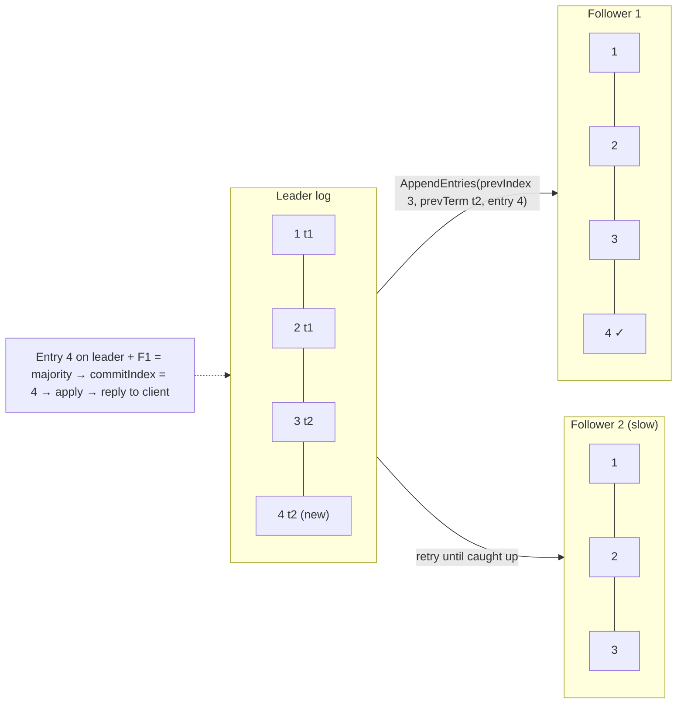

- **Consistency check**: each `AppendEntries` includes the previous entry's index and term. A follower rejects it if it doesn't match, and the leader backs up (nextIndex−−) until logs agree, then overwrites the follower's conflicting tail.
- **Log matching property**: if two logs have an entry with the same index and term, all preceding entries are identical.
- Leaders **don't commit entries from previous terms by counting replicas**. They commit them indirectly by committing an entry from their own term (the famous "Figure 8" safety subtlety).
- **Snapshots** compact the log, and lagging followers receive `InstallSnapshot`.

#### Example
A CockroachDB range's Raft group: a write is proposed to the range's leader (leaseholder), replicated to 2 followers in other AZs, committed when one acknowledges, and applied to the Pebble storage engine. The client's transaction write returns after commit, which survives losing any single node.

#### Trade-offs
Strong durability (majority) and simple ordering (single leader), but write latency includes a majority round trip plus fsync, and leader bandwidth limits throughput (mitigated by batching and pipelining).

#### Problems & fixes
| Symptom | Cause | Fix |
|---|---|---|
| High write latency | fsync per entry, cross-region followers | batch/pipeline entries, fast disks, nearby majority |
| Follower never catches up | log truncated past its position | snapshots (InstallSnapshot) |
| Memory/disk blowup | unbounded log | periodic snapshots + compaction |

#### Cheat sheet
- Leader appends → replicate → majority stored → commit → apply → reply.
- prevIndex/prevTerm check + overwrite repairs follower logs.
- Snapshots for compaction and slow followers.

#### Interview questions
<details><summary>When can a Raft leader tell the client a write succeeded?</summary>

After the entry is stored on a majority of nodes (including the leader) and is therefore committed, typically also applied to the leader's state machine. Responding earlier risks losing the write if the leader crashes before the majority has it.
</details>

<details><summary>How does Raft fix a follower whose log diverged (e.g. it was a deposed leader with uncommitted entries)?</summary>

The new leader's AppendEntries consistency check fails at the divergence point. The leader decrements nextIndex for that follower until it finds the last matching entry, then sends its own entries from there, and the follower deletes its conflicting uncommitted entries and appends the leader's. Committed entries are never affected because the leader has all of them.
</details>

#### Interview angle
> "In Raft only the leader writes, an entry commits once a majority has persisted it, and only then does the client get an ack. Followers that diverge get repaired from the leader's log or a snapshot."

#### Sources
- [In search of an understandable consensus algorithm](https://raft.github.io/raft.pdf) — Ongaro and Ousterhout
- [The Raft consensus algorithm](https://raft.github.io/) — raft.github.io

### Raft safety property — at most one leader per term, committed entries are never lost
Raft's safety guarantees are what make it trustworthy: **election safety** (at most one leader per term), **leader append-only** (leaders never overwrite their own log), **log matching**, **leader completeness** (committed entries are present in all future leaders' logs) and **state machine safety** (no two nodes apply different commands at the same index).

#### Intuition
Two rules that keep the minute book trustworthy: there is never more than one chairperson for a given meeting number, and a line that became official can never be erased or changed afterwards.

#### Must know
- **Election safety**: at most one leader per term.
- **Leader completeness**: a committed entry is present in every future leader's log.
- **State machine safety**: no two nodes apply different commands at the same position.
- A deposed leader can **briefly believe it still leads**, so its local reads may be stale.
- Linearizable reads need a leadership check (ReadIndex) or a lease. External writes need the term as a fencing token.

#### Common mistakes
- Saying two leaders can never coexist. They can for a moment, in different terms, but the old one cannot commit anything.
- Serving reads from a leader's local state with no leadership check.
- A node that lost its disk rejoining as if nothing happened. It must rejoin as a new member.

#### How it works
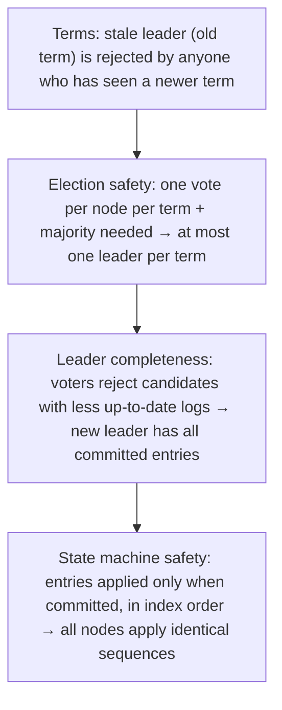

What Raft does **not** guarantee by itself:
- A **deposed leader** may briefly believe it's still leader (until it hears a higher term), so reads served by it locally can be stale. Linearizable reads need **ReadIndex** (confirm leadership with a heartbeat round) or **leader leases** (time-based, assuming bounded clock drift).
- External side effects (writing to a database outside Raft) need **fencing tokens** (term numbers) to reject stale leaders.

#### Example
A partition isolates the old leader (term 5) with one follower in a 5-node cluster. The majority side elects a term-6 leader and commits new writes. The old leader can't commit anything (no majority), so no committed data diverges. If it served a read locally without a ReadIndex check, it could return stale data, which is why etcd's linearizable reads use ReadIndex.

#### Trade-offs
Rock-solid correctness under crashes and partitions, but fsync-before-ack and quorum checks cost latency, and lease-based read optimisations depend on clock assumptions.

#### Problems & fixes
| Symptom | Cause | Fix |
|---|---|---|
| Stale reads from "leader" | deposed leader serving local reads | ReadIndex / lease-based reads |
| Safety violated after disk loss | node lost persisted votes/log and rejoined as if fresh | treat disk loss as a new member (remove + re-add) |
| External system written by two leaders | no fencing | pass term as fencing token, reject lower terms |

#### Cheat sheet
- One leader per term. Committed entries never lost. Same order everywhere.
- Linearizable reads need ReadIndex or leases.
- A node that lost its disk must rejoin as a new member.

#### Interview questions
<details><summary>Can two Raft leaders exist at the same time?</summary>

Two nodes can each believe they're leader at the same wall-clock moment, but only in different terms: an old leader that hasn't yet learned of the new term. Only one per term can exist, and the old one can't commit anything because it can't reach a majority (the majority has moved to the higher term). Its local reads may be stale unless it verifies leadership (ReadIndex or lease).
</details>

<details><summary>Why must Raft persist currentTerm and votedFor before responding?</summary>

If a node voted in term 9, crashed and forgot, it could vote again for a different candidate in term 9 after restart, enabling two leaders in the same term. Persisting the vote (and term) to disk before replying prevents double voting across crashes. The same applies to log entries before acknowledging AppendEntries.
</details>

#### Interview angle
> "Raft guarantees one leader per term and that committed entries are never lost. For linearizable reads I still need ReadIndex or leases, and the term doubles as a fencing token for external writes."

#### Sources
- [In search of an understandable consensus algorithm](https://raft.github.io/raft.pdf) — Ongaro and Ousterhout
- [KV API guarantees](https://etcd.io/docs/v3.5/learning/api_guarantees/) — etcd docs

### Paxos — prepare/promise phase → accept/accepted phase (conceptual, harder to implement than Raft)
Paxos (Lamport) is the original practical consensus algorithm for getting a set of unreliable nodes to agree on **one value**, despite crashes and message loss. Proposers run two phases with a majority of acceptors: **prepare/promise** (claim a proposal number) and **accept/accepted** (get a value chosen). It's proven correct, famously subtle, and the basis of Chubby, Spanner and many others.

#### Intuition
An auction where a bidder first asks the room "will you promise to ignore any bid lower than number 42?" and, with a majority of promises, makes the actual offer. If someone in the room has already accepted an earlier offer, the bidder must repeat that offer and not their own.

#### Must know
- The original consensus algorithm: a set of unreliable nodes agrees on **one value**.
- **Phase 1**: prepare(n) → a majority promises to ignore lower numbers and reports any value already accepted.
- **Phase 2**: accept(n, value) → the value is chosen once a majority accepts.
- The proposer must **re-propose the highest value already accepted**, which protects a value that was already chosen.
- It is proven correct and famously hard to implement. In practice, use a Raft-based system.

#### Common mistakes
- Forgetting that a proposer may not be free to propose its own value.
- Two proposers pre-empting each other forever, with no stable leader.
- Offering to implement Paxos yourself in a design.

#### How it works
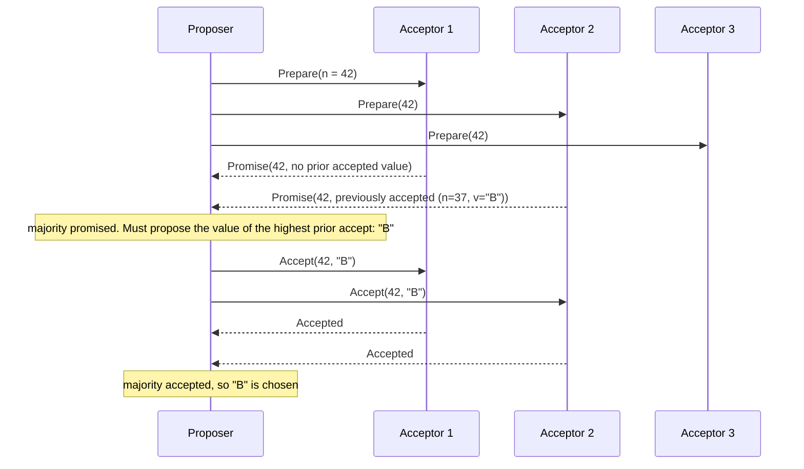

Rules:
- Acceptors **promise** not to accept proposals numbered below n, and report any value they already accepted.
- The proposer must adopt the **highest-numbered previously accepted value** if any (this preserves already-chosen values).
- A value is **chosen** once a majority accepts the same proposal number.
- Competing proposers can livelock (duelling prepares), so a distinguished proposer/leader is used in practice (Multi-Paxos).

#### Example
Google's Chubby lock service and Spanner's per-split replication use Paxos variants. Apache Cassandra's **lightweight transactions** (`INSERT … IF NOT EXISTS`) run a Paxos round per operation, which is why they cost ~4 round trips and are used sparingly (e.g. username claims).

#### Trade-offs
Minimal assumptions and proven safety, but hard to understand and to turn into a complete system (leader election, log management, membership changes aren't specified in basic Paxos). Raft was created to address this.

#### Problems & fixes
| Symptom | Cause | Fix |
|---|---|---|
| Livelock: proposals keep being pre-empted | duelling proposers | stable leader (Multi-Paxos), randomised backoff |
| High latency per decision | two round trips per value | Multi-Paxos skips phase 1 for a stable leader |
| Implementation bugs | Paxos subtleties | use proven libraries/systems (etcd, ZooKeeper, Raft impls) |

#### Cheat sheet
- Phase 1: prepare(n) → promises (+ prior accepted values). Phase 2: accept(n, v) → accepted by majority = chosen.
- Must adopt the highest previously accepted value.
- Multi-Paxos with a stable leader in practice. Cassandra LWT = Paxos per operation.

#### Interview questions
<details><summary>Why must a Paxos proposer adopt a previously accepted value?</summary>

A value might already have been chosen (accepted by a majority) in an earlier round without the proposer knowing. Any majority of promises overlaps that majority, so at least one promise reports it. Proposing the highest-numbered accepted value guarantees the proposer can't overwrite a chosen value with a different one, which preserves safety.
</details>

<details><summary>Raft vs Paxos: why do most new systems choose Raft?</summary>

They offer equivalent fault tolerance (majority quorums), but Raft specifies a complete, understandable system: strong leader, leader election, log replication, membership changes and snapshots, with clear invariants. Paxos (especially Multi-Paxos) leaves many practical details unspecified, leading to subtle, divergent implementations. Raft's clarity reduces implementation bugs.
</details>

#### Interview angle
> "Paxos agrees on a value with prepare/promise then accept/accepted on a majority, and must re-propose any value already accepted. In practice I'd use a Raft-based system like etcd rather than implement Paxos."

#### Sources
- [Paxos made simple](https://lamport.azurewebsites.net/pubs/paxos-simple.pdf) — Leslie Lamport
- [Paxos](https://en.wikipedia.org/wiki/Paxos_%28computer_science%29) — Wikipedia

### Multi-Paxos — designate stable leader to avoid repeated prepare phase
Basic Paxos decides **one** value with two round trips. Real systems need a **sequence** of values (a replicated log). Multi-Paxos elects a **stable leader** that runs Phase 1 (prepare) **once** for all future log slots, then only Phase 2 (accept) per entry, so each command takes one round trip to a majority, like Raft.

#### Intuition
If the same chairperson runs every item on the agenda, they do not need to be re-elected before each item. They are confirmed once and then simply put each item to the vote.

#### Must know
- Basic Paxos decides one value in two round trips. Real systems need a **sequence** of values.
- Multi-Paxos elects a **stable leader** that does the prepare phase **once**.
- After that, each entry needs only the accept phase: **one round trip to a majority**.
- Raft is essentially a carefully specified Multi-Paxos with a strong leader.
- Large systems run one group per data range to scale. Spanner does this.

#### Common mistakes
- Describing two round trips per write as the normal case.
- One consensus group for the whole dataset, limited by a single leader.
- Trusting leader leases without considering clock drift.

#### How it works
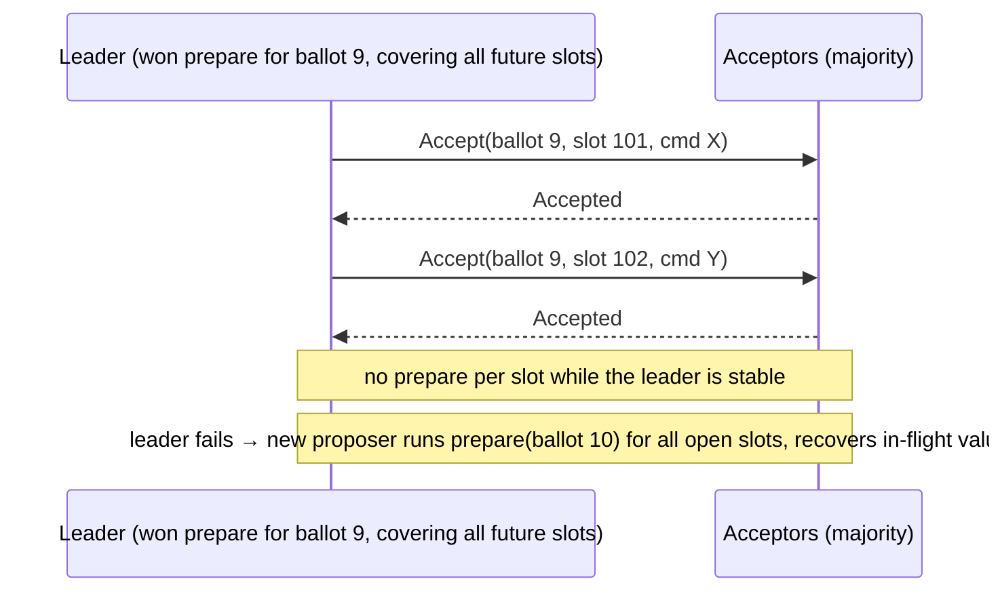

Additions in real implementations: leader leases (local reads), batching and pipelining, log compaction and snapshots, reconfiguration (membership changes), and catching up lagging replicas.

#### Example
Google Spanner replicates each data split with Multi-Paxos across zones: a long-lived Paxos leader per split, with ~10 s leases, handles writes with one round trip to a majority and serves strong reads locally under its lease. Raft is essentially a carefully specified Multi-Paxos with a strong leader and extra constraints on which nodes can become leader.

#### Trade-offs
Efficient steady state (one round trip), but leader failover requires a recovery phase, and implementation details (leases, reconfiguration) are complex and easy to get wrong.

#### Problems & fixes
| Symptom | Cause | Fix |
|---|---|---|
| Throughput bound by leader | single leader per group | shard into many groups (per range/split) |
| Long failover | lease expiry + recovery | shorter leases (more renewal traffic), fast detection |
| Stale reads from old leader | lease assumptions violated by clock skew | bounded clock drift, ReadIndex-style checks |

#### Cheat sheet
- Stable leader: prepare once, then accept per slot (one round trip).
- Failover = new prepare + recover in-flight slots.
- Raft ≈ a well-specified Multi-Paxos. Spanner uses Multi-Paxos per split.

#### Interview questions
<details><summary>How does Multi-Paxos reduce latency compared with basic Paxos?</summary>

Basic Paxos needs prepare and accept round trips for every value. Multi-Paxos lets a stable leader complete the prepare phase once for a ballot covering all future slots, so each subsequent command needs only the accept round trip to a majority, halving latency in the common case.
</details>

<details><summary>Why do systems run many independent Paxos/Raft groups instead of one big one?</summary>

A single group's throughput is limited by its leader and its majority round trips. Splitting data into ranges, each with its own consensus group and leader spread across nodes, parallelises writes and spreads leadership load, which is how Spanner, CockroachDB and TiKV scale horizontally.
</details>

#### Interview angle
> "Multi-Paxos keeps a stable leader so each write is a single majority round trip, and big systems like Spanner run one group per data range to scale."

#### Sources
- [Paxos: Multi-Paxos](https://en.wikipedia.org/wiki/Paxos_%28computer_science%29) — Wikipedia
- [Spanner: Google's globally distributed database](https://research.google/pubs/spanner-googles-globally-distributed-database-2/) — Google Research

### Zookeeper Atomic Broadcast (ZAB) — Zookeeper's proprietary consensus protocol
ZAB is ZooKeeper's consensus and broadcast protocol. A leader assigns each state change a unique, increasing **zxid** (epoch + counter) and broadcasts it to followers. A change is committed once a **quorum** acknowledges it, and all servers apply changes in **zxid order**. It's designed for primary-backup state replication with crash recovery.

#### Intuition
A head teacher announces each new rule with a serial number. Once most teachers have acknowledged it, the rule takes effect, and every class applies the rules strictly in number order.

#### Must know
- ZooKeeper's consensus protocol: one leader broadcasts changes, and a change commits once a **quorum** acknowledges it.
- Every change gets a **zxid** (an epoch plus a counter), and all servers apply changes in zxid order.
- A new leader starts a new **epoch**, which makes the old leader's proposals invalid.
- Writes are linearizable. Reads may lag unless you call `sync()`.
- It behaves much like Raft. New designs usually pick a Raft-based store.

#### Common mistakes
- Treating ZAB as a different kind of guarantee from Raft. It is the same idea with different framing.
- Using ZooKeeper as a data store. It is for small coordination data.
- Saying current Kafka depends on ZooKeeper. Kafka 4.0 removed it in favour of KRaft.

#### How it works
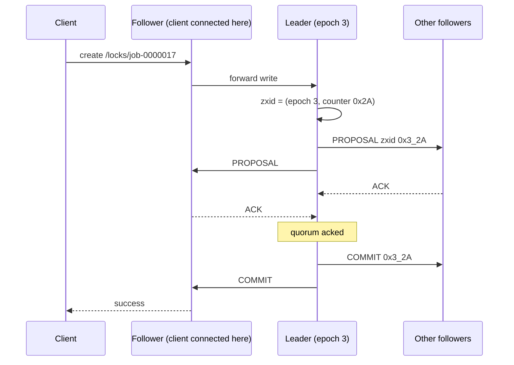

Phases: **leader election** (pick the node with the highest zxid), **discovery/synchronisation** (the new leader brings followers up to date and starts a new **epoch**), then **broadcast**. Epochs ensure an old leader's proposals are rejected after a new leader takes over.

Guarantees exposed by ZooKeeper: linearizable writes, FIFO client order, sequential consistency for reads (local reads may lag, use `sync()`), and atomic updates.

#### Example
Older Kafka clusters stored controller election, broker membership and topic metadata in ZooKeeper (a 3- or 5-node ensemble). Kafka replaced it with KRaft (Raft inside Kafka, production-ready since 3.3, with ZooKeeper removed entirely in 4.0) to drop the external dependency and scale metadata. Hadoop HDFS NameNode HA and HBase still use ZooKeeper for leader election.

#### Trade-offs
Proven and battle-tested, with strong ordering, but ZooKeeper ensembles are small (write throughput limited), need careful ops (JVM GC, disk latency, session timeouts), and are increasingly replaced by Raft-based alternatives (etcd, KRaft).

#### Problems & fixes
| Symptom | Cause | Fix |
|---|---|---|
| Sessions expiring, ephemeral nodes vanishing | GC pauses / slow disks on ZK or client | dedicated disks for txn log, GC tuning, sensible session timeouts |
| Write throughput ceiling | all writes through one leader | keep ZK for coordination only, not data |
| Stale read after write from another client | follower reads | `sync()` before read |

#### Cheat sheet
- Leader + zxid (epoch, counter) ordering + quorum ACK commit.
- Epochs fence old leaders. Reads are sequential (use sync for latest).
- Coordination only: small ensembles (3/5), fast disks.

#### Interview questions
<details><summary>How does ZAB differ from Raft conceptually?</summary>

Both use a leader, majority quorums and epochs/terms with similar safety. ZAB is designed for primary-backup replication of state changes with an explicit synchronisation phase where a new leader brings followers up to date before broadcasting, and it orders by zxid (epoch + counter). Raft frames everything as a replicated log with specific election restrictions. In practice they behave similarly, and Raft is better specified and more widely reimplemented.
</details>

<details><summary>Why did Kafka move from ZooKeeper to KRaft?</summary>

To remove an external system with its own operations, security and scaling limits. Metadata in ZooKeeper limited partition counts and slowed controller failover (reloading state). KRaft stores metadata in an internal Raft-replicated log within Kafka controllers, giving faster failover, support for millions of partitions and a single system to operate.
</details>

#### Interview angle
> "ZooKeeper's ZAB orders updates by zxid with quorum commits and epochs to fence old leaders. Today I'd generally pick etcd or KRaft-style Raft for new coordination needs."

#### Sources
- [ZooKeeper internals: atomic broadcast](https://zookeeper.apache.org/doc/current/zookeeperInternals.html) — Apache ZooKeeper docs
- [KRaft](https://kafka.apache.org/documentation/#kraft) — Apache Kafka docs

### etcd — Raft-based distributed KV store, used by Kubernetes for all cluster state
etcd is a strongly consistent, distributed **key-value store** built on Raft. It offers linearizable reads and writes, **watches** (streams of changes), **leases** (TTL-bound keys), transactions (compare-and-swap) and MVCC revisions. It's the backbone of Kubernetes and a go-to choice for configuration, service discovery, leader election and locks.

#### Intuition
The office's one official noticeboard, kept by a small committee that agrees on every change. Anything pinned there is the truth, anyone can subscribe to be told when a notice changes, and a notice can be set to fall off unless its owner keeps renewing it.

#### Must know
- A strongly consistent **key-value store built on Raft**. Kubernetes keeps all cluster state in it.
- **Watches**: a stream of changes to a key or prefix.
- **Leases**: keys that disappear unless their owner keeps renewing them, which is how liveness is detected.
- **Transactions**: atomic compare-and-set, the basis for locks and leader election.
- For **small, critical data** only: configuration, membership, locks.

#### Numbers to quote
- Default storage quota: 2 GB. Default maximum request size: 1.5 MB.

#### Common mistakes
- Using etcd as a general-purpose database.
- Running it on slow or shared disks. Every write waits for fsync on a majority.
- No compaction, so it fills its quota and stops accepting writes.

#### How it works
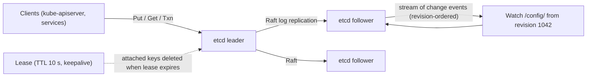

Key features:
- **MVCC revisions**: every change gets a cluster-wide revision, so watchers resume from a revision without missing events.
- **Leases**: ephemeral keys for liveness (a service registers with a lease and keeps it alive).
- **Txn**: `If(compare) Then(ops) Else(ops)` for atomic compare-and-set (locks, leader election).
- **Concurrency recipes**: `clientv3/concurrency` provides elections and mutexes with lease-based fencing (revision numbers).

#### Example
Leader election for a scheduler service: each instance runs `concurrency.NewElection(session, "/scheduler/leader").Campaign(ctx, id)`. The winner holds a key attached to its session lease (TTL 10 s). If it crashes, keepalives stop, the lease expires, the key is deleted, and the next candidate's watch fires and it becomes leader. The leader's key revision serves as a fencing token for the jobs it dispatches.

#### Trade-offs
Strong consistency, watches and leases make coordination easy, but it's meant for **small, critical data** (default 2 GB quota, ~1.5 MB per request), write throughput is limited by Raft and fsync, and large or chatty workloads destabilise it.

#### Problems & fixes
| Symptom | Cause | Fix |
|---|---|---|
| "mvcc: database space exceeded" | quota hit (history not compacted) | auto-compaction + defrag, raise quota carefully |
| Leader elections, slow apiserver | slow disk fsync (shared/network disks) | dedicated low-latency SSD, monitor `wal_fsync_duration` |
| Watchers miss events | resuming from compacted revision | handle compaction errors by re-listing |
| Used as general DB → instability | large values / high write volume | keep only coordination metadata in etcd |

#### Cheat sheet
- Raft KV with linearizable ops, watches, leases, Txn, MVCC revisions.
- Leader election and locks via leases + revisions (fencing).
- Small critical data, fast disks, compaction + defrag.

#### Interview questions
<details><summary>How would you implement service discovery with etcd?</summary>

Each service instance registers a key like `/services/orders/10.0.1.5:8080` attached to a lease with a TTL and keeps the lease alive with heartbeats. Clients list the prefix and watch it for changes, updating their endpoint lists in real time. Crashed instances stop renewing, the lease expires and their keys disappear automatically.
</details>

<details><summary>Why shouldn't you use etcd as a general-purpose database?</summary>

It's optimised for small amounts of highly consistent coordination data: every write goes through Raft with fsync on a majority, the database size is limited (default 2 GB quota), and large values or high write rates increase latency for all clients, including critical ones like Kubernetes. Use it for config, membership, locks and leader election, and keep business data elsewhere.
</details>

#### Interview angle
> "For coordination I'd use etcd: leases for liveness, watches for config and discovery, transactions and revisions for leader election with fencing. It only holds small critical data on fast disks."

#### Sources
- [etcd versus other key-value stores](https://etcd.io/docs/v3.5/learning/why/) — etcd docs
- [System limits](https://etcd.io/docs/v3.5/dev-guide/limit/) — etcd docs

### Zookeeper — Apache, used for leader election (ephemeral znodes), distributed locks, config
Apache ZooKeeper is a coordination service exposing a small, hierarchical **file-system-like namespace of znodes**, with strong ordering guarantees (ZAB). Primitives such as **ephemeral znodes** (deleted when the client session ends), **sequential znodes** (auto-incremented names) and **watches** (one-time change notifications) let you build leader election, locks, membership and configuration.

#### Intuition
A shared folder with special files. Some files vanish the moment their owner disconnects. Some get an automatic number when created. And you can ask to be told when a file changes. From those three tricks you can build locks, leader election and a membership list.

#### Must know
- A coordination service with a small tree of **znodes**.
- **Ephemeral** znode: deleted when the client's session ends. That is how a dead node is detected.
- **Sequential** znode: gets an increasing number in its name. Used for ordering and fair locks.
- **Watch**: a one-time notification that a znode changed.
- Use a library of tested recipes (Apache Curator), not the raw API.

#### Common mistakes
- Forgetting that watches fire once and must be registered again.
- A session timeout shorter than a GC pause, which makes a live node look dead.
- Assuming losing the ephemeral znode stops the old leader from acting. It may still be running.

#### How it works
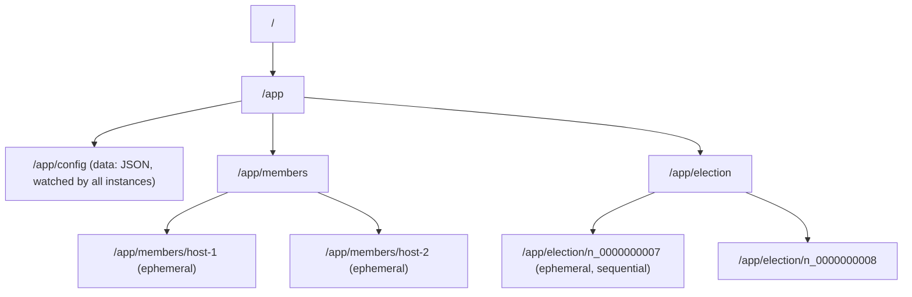

| Znode type | Behaviour | Use |
|---|---|---|
| Persistent | stays until deleted | config, metadata |
| Ephemeral | deleted when session expires | liveness, membership, locks |
| Sequential | name gets a monotonically increasing suffix | ordering, fair locks, elections |
| Container / TTL | auto-cleanup | lock parents, temporary nodes |

Sessions: clients heartbeat to keep their session. A missed timeout means the session expires and ephemeral nodes are deleted (that's how death is detected).

Use **Apache Curator** (Java) for battle-tested recipes (LeaderLatch, InterProcessMutex, PathChildrenCache) rather than raw APIs.

#### Example
A Hadoop HDFS cluster uses ZooKeeper (via ZKFC) for NameNode HA: the active NameNode holds an ephemeral lock znode. If its session expires (crash or network loss), the standby's ZKFC acquires the lock, **fences** the old active (SSH kill or storage fencing), and promotes the standby.

#### Trade-offs
Proven coordination primitives and strong ordering, but operational care (JVM, disk latency, session timeouts) and limited write throughput. Watches are one-shot (re-register after firing) and herd effects are possible with naive recipes.

#### Problems & fixes
| Symptom | Cause | Fix |
|---|---|---|
| Herd effect: all clients wake on one change | everyone watches the same znode | watch only your predecessor (sequential recipe) |
| Missed config updates | one-shot watches not re-registered | re-register on every event, or Curator caches |
| False "leader died" | session timeout too short vs GC pauses | tune timeouts, fix client GC |
| Split brain after session expiry | old leader keeps acting | fencing (tokens, STONITH) |

#### Cheat sheet
- Znodes: persistent, ephemeral, sequential. Watches are one-shot.
- Sessions + ephemeral nodes detect failures.
- Use Curator recipes. Fence old leaders.

#### Interview questions
<details><summary>How does ZooKeeper detect that a client has died?</summary>

Each client keeps a session alive with periodic heartbeats. If the server receives no heartbeat within the session timeout, it expires the session and deletes all ephemeral znodes the client created. Watchers on those znodes get notified, which is how others learn the client (lock holder, leader, member) is gone.
</details>

<details><summary>Why use Curator instead of the raw ZooKeeper API?</summary>

Correct recipes (locks, leader election, caches) are subtle: handling connection loss vs session expiry, re-registering one-shot watches, avoiding herd effects, retrying with backoff, and recovering state after reconnects. Curator implements these battle-tested recipes, reducing bugs that cause split brain or deadlocks.
</details>

#### Interview angle
> "With ZooKeeper I'd use Curator recipes: ephemeral sequential znodes for elections and locks, watching only the predecessor, with fencing so an expired leader can't keep acting."

#### Sources
- [ZooKeeper overview](https://zookeeper.apache.org/doc/current/zookeeperOver.html) — Apache ZooKeeper docs
- [ZooKeeper recipes and solutions](https://zookeeper.apache.org/doc/current/recipes.html) — Apache ZooKeeper docs

### Leader election with Zookeeper — create sequential ephemeral znode, watch predecessor
The classic ZooKeeper election recipe: each candidate creates an **ephemeral sequential** znode under an election path. The candidate with the **lowest sequence number is leader**. Every other candidate **watches only the znode just before its own**, so when a node dies only its successor wakes up. There's no herd effect, and leadership passes in order.

#### Intuition
A queue with numbered tickets. The lowest number is served, which here means it is the leader. Each person only watches the person directly ahead. When someone leaves, only the one behind them steps forward, and nobody else moves.

#### Must know
- Each candidate creates an **ephemeral sequential** znode under one path.
- The **lowest sequence number is the leader**.
- Every other candidate **watches only the znode just before its own**.
- When a node dies, only its successor wakes up, so there is no herd.
- The old leader may be paused and not dead, so its actions still need a **fencing token**.

#### Common mistakes
- Everyone watching the leader's znode, so all nodes stampede when it dies.
- Not re-checking on a watch event. Your predecessor may have died without being the leader.
- Treating the recipe alone as proof that only one leader acts.

#### How it works
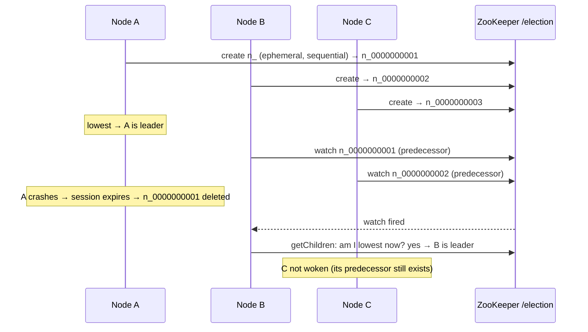

Important details:
- On a watch event, **re-check** the children (the predecessor may have died while not being leader). Only become leader if you're now the lowest.
- **Fencing**: the old leader may still be running (paused, not dead), so protect side effects with the znode's sequence or zxid as a fencing token, or use STONITH.
- Curator: `LeaderLatch` / `LeaderSelector`.

#### Example
A cluster of 5 report-scheduler instances: only the leader triggers nightly jobs. With LeaderLatch, a crash fails over in roughly the session timeout (e.g. 10 s). Each triggered job writes `(job_id, leader_epoch)` and the jobs table rejects epochs lower than the latest seen, so a paused ex-leader waking up can't double-trigger.

#### Trade-offs
Fair, ordered and herd-free, but failover time ≈ session timeout, and it relies on ZooKeeper's availability. Correctness of side effects still needs fencing.

#### Problems & fixes
| Symptom | Cause | Fix |
|---|---|---|
| Thundering herd on leader death | everyone watches the leader znode | watch predecessor only |
| Two leaders acting | old leader paused past session expiry | fencing tokens / epoch checks in downstream systems |
| Slow failover | long session timeout | tune timeout vs false positives |

#### Cheat sheet
- Ephemeral sequential znodes. Lowest = leader. Watch your predecessor.
- Re-check on events. Fence side effects with epoch or sequence.
- Curator LeaderLatch / LeaderSelector.

#### Interview questions
<details><summary>Why watch the predecessor instead of the current leader?</summary>

If all followers watch the leader's znode, its deletion wakes every follower at once and they all query ZooKeeper (a herd effect), straining the ensemble for large groups. Watching only the immediate predecessor means each deletion wakes exactly one node, which checks whether it's now lowest. Leadership passes in sequence with O(1) notifications.
</details>

<details><summary>Is the ZooKeeper recipe alone enough to guarantee only one leader acts at a time?</summary>

No. ZooKeeper guarantees at most one node holds the lowest znode, but an old leader that's paused (GC) or partitioned may not yet know its session expired and could keep performing actions. Downstream resources must check a fencing token (epoch or sequence number) and reject operations from stale leaders.
</details>

#### Interview angle
> "Leader election uses ephemeral sequential znodes where each node watches its predecessor, so there's no herd. Anything the leader does carries its epoch as a fencing token, because ZooKeeper alone can't stop a paused ex-leader."

#### Sources
- [ZooKeeper recipes: leader election](https://zookeeper.apache.org/doc/current/recipes.html) — Apache ZooKeeper docs
- [Apache Curator](https://curator.apache.org/) — Apache Curator

### Epoch numbers / terms — monotonically increasing, stale leaders reject writes with old epoch
An epoch (also called a term, generation or ballot) is a **monotonically increasing number** that identifies a leadership period. Every message and write carries it, and recipients reject anything with an **older epoch** than they've seen. That turns "who's the real leader?" into a simple numeric comparison and neutralises zombie leaders.

#### Intuition
A new edition number on each reprint of a rulebook. If two people disagree, the higher edition wins without argument, and anyone still quoting the old edition is told it is out of date.

#### Must know
- An epoch (or term, generation, ballot) is an **ever-increasing number for each leadership period**.
- Every message and write carries it.
- A receiver **rejects anything with an epoch lower than the highest it has seen**.
- This makes a "zombie" leader harmless: its old epoch is refused everywhere.
- It must be stored durably, so it never goes backwards after a restart.

#### Common mistakes
- Bumping the epoch on failover but not checking it in the storage layer.
- Using a wall-clock timestamp in place of a counter.
- Keeping the epoch only in memory.

#### How it works
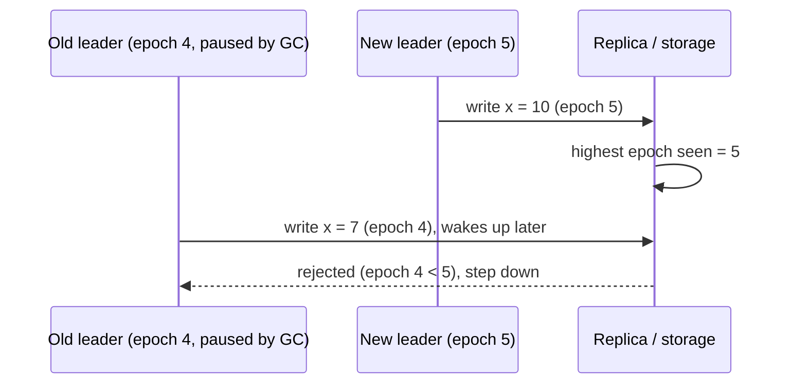

Where epochs appear: Raft **terms**, ZooKeeper **zxid epochs**, Kafka controller **epoch** and partition **leader epoch**, Kafka producer **epochs** (zombie fencing for transactional producers), Paxos **ballots**, database failover generations.

#### Example
Kafka's partition leader epoch: when a broker leading partition P loses leadership (epoch 12 → 13 on a new leader), followers and clients use the epoch to truncate divergent log entries correctly and reject fetches or produces addressed to the stale leader. For transactional producers, a restarted instance with the same `transactional.id` bumps the producer epoch, so the old (zombie) instance's writes are fenced off.

#### Trade-offs
A simple, robust protection against stale leaders, but it requires every participant (including storage) to track and check epochs, and epochs must be persisted so they never go backwards after restarts.

#### Problems & fixes
| Symptom | Cause | Fix |
|---|---|---|
| Zombie leader corrupts data after failover | downstream doesn't check epochs | include epoch in every write, reject lower |
| Epoch goes backwards after restart | not persisted durably | persist epoch before use |
| Duplicate transactional writes after producer restart | no producer epoch fencing | Kafka transactional.id (epoch bump) |

#### Cheat sheet
- Monotonic leadership number. Higher wins, lower is rejected.
- Raft terms, ZK epochs, Kafka leader/producer epochs, Paxos ballots.
- Persist it. Check it everywhere side effects happen.

#### Interview questions
<details><summary>How do epochs protect against a leader that was paused for 30 seconds by GC?</summary>

During the pause, the cluster elected a new leader with a higher epoch, and replicas or storage that served the new leader recorded it. When the paused leader resumes and sends writes tagged with its old epoch, recipients compare, see a lower epoch and reject them, and the old leader learns it must step down. No damage occurs even though it thought it was still leader.
</details>

<details><summary>How does Kafka use epochs to fence zombie producers?</summary>

Each transactional producer has a `transactional.id`. When a new instance initialises with the same id, the transaction coordinator bumps the producer epoch and aborts any open transactions from the old one. Brokers then reject writes and commits from the older epoch, so a zombie instance (after a network partition or long pause) can't produce duplicates or commit stale transactions.
</details>

#### Interview angle
> "Every leadership change bumps an epoch, every write carries it, and storage rejects lower epochs. That's what makes a paused ex-leader harmless."

#### Sources
- [Generation clock](https://martinfowler.com/articles/patterns-of-distributed-systems/generation-clock.html) — Unmesh Joshi, martinfowler.com
- [In search of an understandable consensus algorithm](https://raft.github.io/raft.pdf) — Ongaro and Ousterhout

### Fencing tokens — monotonically increasing token for storage writes, prevents stale leader writes
A fencing token is a **monotonically increasing number** handed out with each lock or lease grant. The lock holder includes it in every request to the protected resource, and the resource **rejects requests with a token lower than the highest it has accepted**. It makes distributed locks safe even when a holder pauses past its lease.

#### Intuition
Numbered wristbands at an event. Each new shift gets a higher number. The door staff remember the highest number they have let in, and turn away anyone with a lower one, even if that person insists their shift has not ended.

#### Must know
- Each lock or lease grant comes with a **number that only goes up**.
- The holder sends it with every request to the protected resource.
- The resource **rejects any request with a token lower than the highest it has accepted**.
- This is what makes a lease-based lock safe when the holder pauses past its expiry.
- Tokens come from an etcd revision, a ZooKeeper zxid or a database sequence.

#### Common mistakes
- Relying on a lock's TTL alone. The holder cannot know its lease expired during a pause.
- Checking the token in the client and not in the storage write.
- A plain Redis lock for a correctness-critical job. It gives no such token.

#### How it works
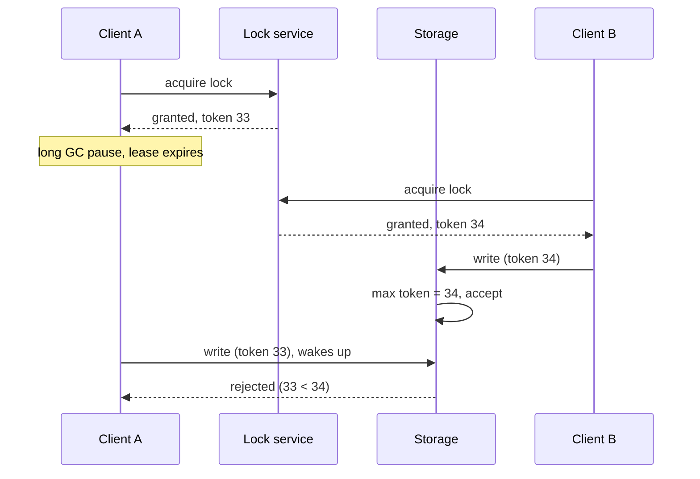

Sources of tokens: ZooKeeper (zxid / znode sequence or version), etcd (lease/key revision), a database sequence, or the leader epoch. Redis locks don't provide tokens natively (one reason Redlock is debated).

Implementing the check at the resource:
```sql
UPDATE jobs SET state = 'RUNNING', owner = :worker, fence = :token
WHERE id = :job AND fence < :token;      -- 0 rows → stale holder, abort
```

#### Example
A distributed cron where only one worker may process a daily payout batch: the worker acquires an etcd lock and gets revision 98123 as the token. Every write to the `payout_batches` table includes `fence = 98123` with a condition `fence < :token`. A previously paused worker holding revision 98001 has its writes rejected, so there's no double payout even if two workers briefly both believe they hold the lock.

#### Trade-offs
Strong safety for lock-based coordination, but the protected resource must participate (store the max token, check atomically), which isn't possible with every external system.

#### Problems & fixes
| Symptom | Cause | Fix |
|---|---|---|
| Double processing despite locks | lock expiry during pause, no fencing | fencing tokens checked by storage |
| Resource can't check tokens (third-party API) | no conditional write support | idempotency keys at the API, or a proxy that enforces tokens |
| Tokens not monotonic | generated per node / clock-based | central monotonic source (etcd revision, ZK zxid, DB sequence) |

#### Cheat sheet
- Lock grant comes with an increasing token. Resource rejects lower tokens.
- Tokens from etcd revisions, ZK zxids, DB sequences.
- Locks alone are unsafe under pauses. Fencing makes them safe.

#### Interview questions
<details><summary>Why is a lease/TTL-based lock alone not safe for protecting writes?</summary>

The holder can't tell when its lease expired: a GC pause, VM freeze or network delay can outlast the TTL, another client acquires the lock and writes, and then the first client resumes and writes too, believing it still holds the lock. Only a check at the resource (fencing token) can reject the stale holder.
</details>

<details><summary>How do you implement fencing in a SQL database?</summary>

Store the highest accepted token per protected resource (a `fence` column) and make every write conditional on it: `UPDATE … SET …, fence = :token WHERE id = :id AND fence <= :token` (or `<` for strict). If 0 rows are affected, a newer holder has written and the request is rejected. The condition and update are atomic in one statement.
</details>

#### Interview angle
> "Locks come from etcd with the key revision as a fencing token, and every protected write is conditional on that token, so a paused ex-holder's writes are rejected instead of double-processing."

#### Sources
- [How to do distributed locking](https://martin.kleppmann.com/2016/02/08/how-to-do-distributed-locking.html) — Martin Kleppmann
- [KV API guarantees](https://etcd.io/docs/v3.5/learning/api_guarantees/) — etcd docs

### Split-brain — two nodes both think they are leader; prevent with fencing tokens + quorum
Split brain happens when a partition (or a false failure detection) leads **two nodes to act as leader at the same time**, both accepting writes. The data diverges and is often impossible to merge automatically. The standard defences are **majority quorums** (only one side can have a majority) plus **fencing** (stale leaders can't write).

#### Intuition
A ship where the captain is cut off below deck and the first officer, believing the captain lost, takes command on the bridge. Now two people are giving orders to the same crew.

#### Must know
- Two nodes **both act as leader** and accept writes. The data diverges and often cannot be merged.
- Usually caused by a partition, or a pause mistaken for a failure.
- Defence 1: **majority quorum**. Only one side of a split can hold a majority.
- Defence 2: **fencing**. Storage rejects the stale leader, or the old leader is powered off (STONITH).
- Two sites need a third voter or witness to break the tie.

#### Common mistakes
- Automatic failover between exactly two nodes with no tie-breaker.
- Promoting a standby without first fencing the old primary.
- A leader that keeps serving after it has lost contact with the majority.

#### How it works
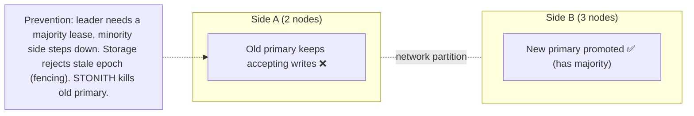

Defences:
- **Quorum-based leadership**: a leader must hold a majority-backed lease (Raft, etcd/ZooKeeper locks). The minority side can't elect or keep a leader.
- **Self-demotion**: a leader that loses contact with a quorum stops serving writes (CheckQuorum, Redis `min-replicas-to-write`).
- **Fencing**: epochs or tokens checked by storage, **STONITH** ("shoot the other node in the head": power off via the IPMI or cloud API), revoking storage access.
- **Odd-sized clusters / witness nodes** in a third location to break ties between two sites.

#### Example
A two-data-centre MySQL setup with automatic failover had no tie-breaker. A WAN link failure made each side think the other was dead, and both promoted a primary. For 20 minutes orders were written to both, and reconciliation took days. Fix: a third-site witness (etcd/consensus or an arbitrator), failover requiring quorum, and the old primary fenced (read-only, then powered off) before promotion.

#### Trade-offs
Preventing split brain means the minority side becomes unavailable (CP), and fencing mechanisms add complexity, but split brain on critical data is far costlier.

#### Problems & fixes
| Symptom | Cause | Fix |
|---|---|---|
| Two primaries after network blip | failover without quorum/tie-breaker | consensus-based leader election, witness in third site |
| Old primary still writing after failover | no fencing | STONITH, revoke credentials/storage, epoch checks |
| Redis split brain | isolated master accepting writes | `min-replicas-to-write` + `min-replicas-max-lag` |
| Two-node clusters flapping | no majority possible | 3+ voters (or a witness) |

#### Cheat sheet
- Split brain = two leaders writing at once, causing divergence.
- Majority quorum + self-demotion + fencing (epochs, STONITH).
- Two sites need a third-site witness.

#### Interview questions
<details><summary>Why can't a two-node cluster safely auto-failover?</summary>

When the nodes lose contact, each can't distinguish "the other crashed" from "the network between us broke". Without a third party there's no majority, so either both promote (split brain) or neither does (no automatic failover). Adding a third voter or witness lets the side that can reach it form a majority, and only that side acts.
</details>

<details><summary>What's STONITH and when is it used?</summary>

"Shoot The Other Node In The Head": before promoting a standby, the cluster forcibly powers off or isolates the old primary (via IPMI, a cloud API, or fencing storage access) so it can't continue writing. It's used in HA clusters (Pacemaker, HDFS NameNode HA, some database failover tools) where the old leader could otherwise keep running.
</details>

#### Interview angle
> "I prevent split brain with quorum-based leadership, an odd number of voters or a third-site witness, and fencing: storage rejects stale epochs and the old primary is killed or isolated before promotion."

#### Sources
- [Split-brain](https://en.wikipedia.org/wiki/Split-brain_%28computing%29) — Wikipedia
- [Leader and followers](https://martinfowler.com/articles/patterns-of-distributed-systems/leader-follower.html) — Unmesh Joshi, martinfowler.com

