## Clocks, ordering & time

### Physical clocks — NTP synchronization, drift up to 100ms between nodes
Every machine has a hardware clock (a quartz oscillator) that **drifts** (typically 10–100 ppm, i.e. up to ~8 s per day uncorrected). **NTP** (or Chrony, PTP, cloud time services) periodically corrects clocks against reference servers. Synchronised clocks are still only accurate to within milliseconds, and can **jump** backwards or forwards when corrected.

#### Intuition
Every wristwatch in an office shows a slightly different time, and each one runs a little fast or slow. Setting them all by the radio every morning helps, but by afternoon they have drifted apart again, and a correction can make a watch jump.

#### Must know
- Each machine's hardware clock **drifts**, and NTP corrects it periodically.
- Even when synchronised, clocks agree only to within **milliseconds**, and a correction can make time **jump** backwards or forwards.
- Use wall-clock time for display, TTLs and coarse windows.
- **Never order events across machines by wall clock** when correctness depends on it.
- Monitor clock offset, and allow a little leeway when validating token times.

#### Numbers to quote
- Typical sync accuracy: about 1 ms inside a datacenter, 10–100 ms over the internet.
- An uncorrected quartz clock can drift by seconds per day.

#### Common mistakes
- Sorting logs from several services by timestamp to work out what happened first.
- Assuming NTP makes clocks identical.
- No leeway in JWT expiry checks, so small skew rejects valid tokens.

#### How it works
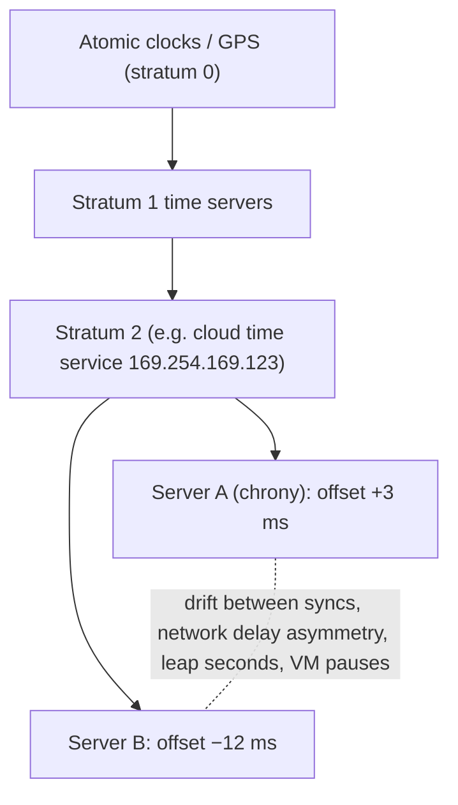

Typical accuracy: within a datacenter with a good setup ~0.1–1 ms. Over the internet, 10–100 ms. With **PTP** / hardware timestamping (AWS Time Sync with PHC, ClockBound), microseconds, with a known error bound.

Hazards: NTP **step** corrections (time jumps), leap seconds (smearing vs stepping), VM migrations and pauses, misconfigured hosts drifting by seconds or minutes.

#### Example
Two services log events with wall-clock timestamps: the payment service (clock +40 ms fast) logs "payment captured" at 10:00:00.050, and the order service (clock accurate) logs "order created" at 10:00:00.030. Reading logs by timestamp suggests payment happened **before** the order existed. For debugging, use trace ids and causal links (spans) rather than raw timestamps. For correctness, never order operations across machines by wall clock.

#### Trade-offs
Wall clocks are essential for human-readable times, TTLs and coarse ordering, but unreliable for precise cross-machine ordering or measuring durations.

#### Problems & fixes
| Symptom | Cause | Fix |
|---|---|---|
| Logs/events appear out of order across services | clock skew | trace ids/causal links, logical clocks for ordering |
| Token "not yet valid" / "expired" errors | client or server clock skew | allow clock-skew leeway (e.g. 60 s) in JWT validation, fix NTP |
| Negative durations / timeouts misfire | wall-clock jumps | monotonic clocks for durations |
| A server minutes off | NTP broken | monitor clock offset, alert (chrony tracking) |

#### Cheat sheet
- Clocks drift. NTP corrects to ms (DC) / tens of ms (internet), and may jump.
- Never order cross-machine events by wall clock for correctness.
- Monitor offsets. Allow skew leeway in tokens. Monotonic clocks for durations.

#### Interview questions

Why can't you use timestamps from different servers to decide which write came last?

Clocks on different machines differ by milliseconds or more and can jump during NTP corrections, so a later write on a machine with a slow clock can get an earlier timestamp and lose under last-write-wins. Correct ordering needs a single sequencer (one leader assigning versions), logical clocks (Lamport, vector, HLC) or bounded-uncertainty clocks with commit wait (TrueTime).

Your JWT validation intermittently fails with "token used before issued". What's happening?

The issuing server's clock is ahead of the validating server's, so `iat`/`nbf` appear to be in the future. Fix clock synchronisation (chrony against a reliable time source), monitor offsets, and allow a small leeway (30–120 s) in token validation for `nbf`, `iat` and `exp`.

#### Interview angle
> "Wall clocks drift and jump, so I use them for display, TTLs and coarse windows only. Ordering comes from a sequencer or logical clocks, and durations from a monotonic clock."

#### Sources
- [Precision clock and time synchronization on your EC2 instance](https://docs.aws.amazon.com/AWSEC2/latest/UserGuide/set-time.html) — Amazon EC2 user guide
- [Network Time Protocol](https://en.wikipedia.org/wiki/Network_Time_Protocol) — Wikipedia

### Clock skew — two machines have different wall clock times, cannot use for ordering events
Clock skew is the **difference between two machines' clocks at the same instant**. Even with NTP it's never zero, and it varies over time. Any logic that compares timestamps from different machines (last-write-wins, lease expiry, event ordering, TTL checks) silently breaks when skew exceeds the margin it assumes.

#### Intuition
Two referees timing a race with watches that differ by a tenth of a second. Each records a finish time honestly, and the official result still names the wrong winner.

#### Must know
- Skew is the **difference between two machines' clocks at the same instant**. It is never zero.
- It silently breaks anything that compares timestamps from different machines.
- **Last-write-wins loses data**: a later write from a machine with a slow clock looks older and is discarded.
- **Leases** break too: the holder and the server disagree about whether the lease has expired.
- Fix with version numbers, a single sequencer, hybrid logical clocks or fencing tokens.

#### Common mistakes
- Client-supplied timestamps deciding the winner between two writes.
- A lease with no safety margin for skew.
- Treating skew as a rare fault. It is the normal condition.

#### How it works
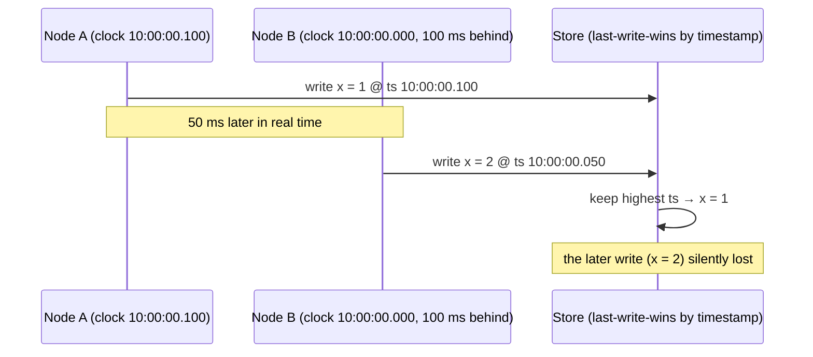

Where skew bites:
- **LWW conflict resolution** (Cassandra cell timestamps, DynamoDB Global Tables, multi-leader replication).
- **Leases/locks**: holder thinks the lease is valid while the server considers it expired.
- **Distributed snapshots / MVCC** with timestamps (needs uncertainty handling, as in CockroachDB).
- **Rate limits / windows** computed on different servers.

#### Example
Cassandra uses client- or coordinator-supplied timestamps per cell. An application server with a clock 2 seconds fast wrote user preference updates, and for the next 2 seconds of real time every other server's updates to those cells were silently discarded because their timestamps were "older". Fix: fix NTP, use server-side timestamps consistently, and redesign hot mutable fields as append-only events or use LWT for compare-and-set.

#### Trade-offs
You can reduce skew (better time sync) but not eliminate it. Designs must either tolerate a skew bound (with safety margins) or avoid relying on cross-machine timestamps.

#### Problems & fixes
| Symptom | Cause | Fix |
|---|---|---|
| Updates silently lost in LWW systems | skewed writer clocks | single sequencer/versioning, HLC, avoid LWW for contended data |
| Two lock holders | lease expiry judged by different clocks | fencing tokens, conservative lease margins |
| Snapshot reads miss recent writes | timestamp uncertainty ignored | uncertainty intervals + restarts (CockroachDB), commit wait (Spanner) |

#### Cheat sheet
- Skew = clock difference between machines. Never zero, varies.
- Breaks LWW, leases, timestamp ordering.
- Use version numbers, HLC, fencing, or bounded-uncertainty clocks.

#### Interview questions

How does clock skew cause data loss in last-write-wins systems?

LWW keeps the value with the highest timestamp. If one writer's clock is ahead, its writes carry inflated timestamps, and genuinely later writes from machines with accurate clocks look older and are discarded. No error is raised, the data is just gone. That's why contended mutable data shouldn't rely on wall-clock LWW.

How do CockroachDB and Spanner deal with clock skew differently?

Spanner bounds uncertainty with TrueTime (GPS and atomic clocks, ε of a few ms) and waits it out on commit (commit wait). CockroachDB uses hybrid logical clocks with a configured maximum clock offset (default 500 ms): reads that encounter values within the uncertainty window restart at a higher timestamp, and nodes whose clocks drift beyond the max offset shut themselves down to protect consistency.

#### Interview angle
> "I never let correctness depend on comparing two machines' clocks. Contended updates use version numbers or a single sequencer, and leases come with fencing tokens."

#### Sources
- [Clock drift](https://en.wikipedia.org/wiki/Clock_drift) — Wikipedia
- [Living without atomic clocks](https://www.cockroachlabs.com/blog/living-without-atomic-clocks/) — Cockroach Labs

### Lamport timestamps — logical clocks: increment on send, max(local,received)+1 on receive, establish happens-before
Lamport timestamps are **logical clocks**: integer counters that capture causal ordering without physical time. Each process increments its counter on every event, attaches it to messages, and on receiving sets `counter = max(local, received) + 1`. If event a happened-before b, then L(a) < L(b).

#### Intuition
Numbering letters in a correspondence. Each reply is numbered one higher than the highest number you have seen so far. A reply always has a bigger number than the letter it answers, with no clock involved.

#### Must know
- A **logical clock**: a counter per process, not a time of day.
- Increment on every local event. Attach the counter to each message.
- On receive: **counter = max(local, received) + 1**.
- If a happened before b, then L(a) < L(b). The reverse is **not** guaranteed.
- Adding the node id as a tie-breaker gives a total order, but it **cannot detect concurrent events**.

#### Common mistakes
- Concluding that a caused b because L(a) < L(b).
- Using it to detect conflicts. That needs vector clocks.
- Forgetting the tie-breaker when two nodes produce the same number.

#### How it works
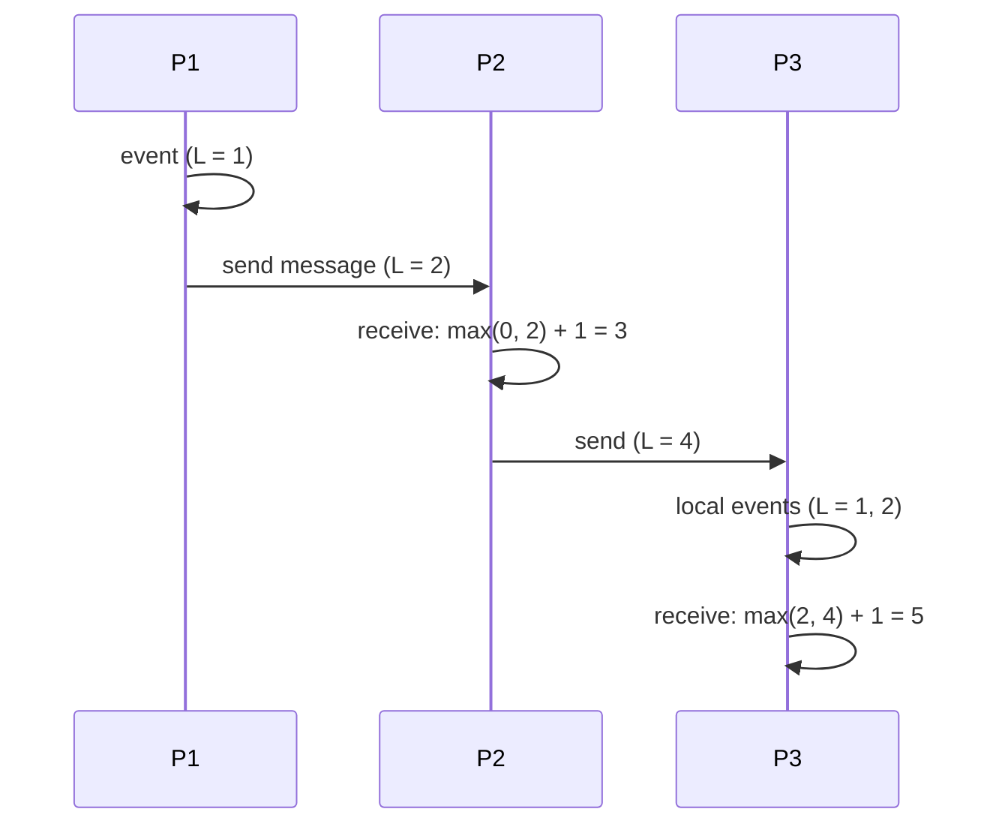

Properties:
- a → b (happened-before) ⇒ L(a) < L(b).
- The converse **doesn't** hold: L(a) < L(b) doesn't mean a caused b (they may be concurrent).
- Break ties with the process id, `(L, pid)`, to get a **total order** consistent with causality, which is useful for mutual exclusion and replicated state machines.

#### Example
A simple replicated key-value store uses `(lamport, nodeId)` as the version for each write: replicas exchange writes and keep the highest version. Unlike wall clocks, a write made after seeing another write always gets a higher version (no skew problems). It still picks an arbitrary winner among truly concurrent writes, which is fine for some data (LWW semantics) but loses one concurrent update.

#### Trade-offs
Tiny overhead (one integer) and causality-respecting total order, but it can't **detect** concurrency (you need vector clocks for that), and values are unrelated to real time.

#### Problems & fixes
| Symptom | Cause | Fix |
|---|---|---|
| Concurrent updates silently ordered and one dropped | Lamport order ≠ causality detection | vector clocks / version vectors to detect conflicts |
| Need human-meaningful time too | Lamport values unrelated to wall time | hybrid logical clocks |
| Ties between nodes | equal counters | tie-break by node id |

#### Cheat sheet
- Counter++ per event. On receive: max(local, msg) + 1.
- a → b ⇒ L(a) < L(b), but not vice versa.
- (L, nodeId) gives a total order. Can't detect concurrency.

#### Interview questions

If L(a) < L(b), can you conclude a happened before b?

No. Lamport timestamps guarantee only the forward implication: if a happened-before b, then L(a) < L(b). Two concurrent events on different processes can have any timestamp relationship. To determine whether events are causally related or concurrent, you need vector clocks.

Why are Lamport clocks better than wall clocks for ordering writes in a replicated system?

They're immune to clock skew and jumps: any write issued after observing another write is guaranteed a larger timestamp, so causal order is respected. Wall-clock timestamps can order a causally later write before an earlier one if the writer's clock is behind.

#### Interview angle
> "Lamport clocks give a cheap, skew-proof total order that respects causality. When I need to detect concurrent conflicting writes, I use vector clocks instead."

#### Sources
- [Time, clocks, and the ordering of events in a distributed system](https://lamport.azurewebsites.net/pubs/time-clocks.pdf) — Leslie Lamport
- [Lamport timestamp](https://en.wikipedia.org/wiki/Lamport_timestamp) — Wikipedia

### Vector clocks — per-node counters: detect causality and concurrency, identify conflicting writes
A vector clock is a **vector of counters, one per node**. Each node increments its own entry on local events, and merges (element-wise max) on receiving. Comparing two vectors tells you whether one event **happened before** the other or whether they're **concurrent**, so you can detect conflicting updates precisely.

#### Intuition
Each editor of a shared document keeps a scorecard: "I have seen 3 edits from Asha and 2 from Ravi". Compare two scorecards and you can tell whether one editor has seen everything the other has, or whether each has changes the other lacks.

#### Must know
- A **vector of counters, one per node**. A node increments its own entry and merges by taking the maximum of each entry.
- V1 ≤ V2 on every entry means V1 **happened before** V2.
- If neither is ≤ the other, the events are **concurrent**: a real conflict.
- This lets a system keep both versions or merge them and not silently drop one.
- The cost is size: the vector grows with the number of writers.

#### Common mistakes
- Thinking vector clocks resolve conflicts. They only detect them.
- One entry per client, which makes the vectors enormous.
- Writing without passing back the version context you read.

#### How it works
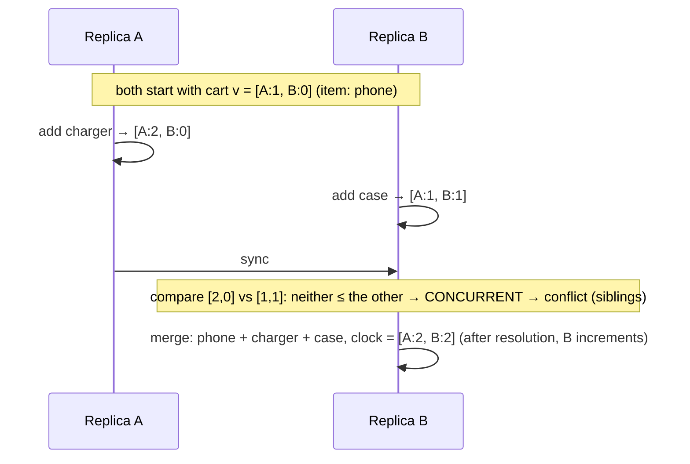

Comparison rules:
- V1 ≤ V2 if every entry of V1 ≤ the corresponding entry of V2 → V1 happened before V2 (V2 supersedes it).
- If neither V1 ≤ V2 nor V2 ≤ V1 → **concurrent**, so keep both (siblings) or merge.

#### Example
Amazon's Dynamo (and Riak) attached vector clocks to each object version. Shopping carts edited concurrently on different replicas produced sibling versions, and the client merged them on read (union of items), so no add-to-cart was ever lost. Cassandra chose LWW timestamps instead, which is simpler but loses concurrent updates.

#### Trade-offs
Precise causality and conflict detection, but vector size grows with the number of writers (needs pruning, which risks false conflicts) and resolution logic falls to the application.

#### Problems & fixes
| Symptom | Cause | Fix |
|---|---|---|
| Vectors grow huge | many clients as writers | use server/replica ids (version vectors), dotted version vectors, pruning |
| Too many siblings | concurrent writes not resolved | merge on read and write back, CRDTs |
| Lost updates despite vectors | client didn't pass context on write | always read-modify-write with the causal context |

#### Cheat sheet
- One counter per node. Increment own, merge by max.
- ≤ on all entries means happened-before. Otherwise concurrent (conflict).
- Used by Dynamo/Riak. Resolution via merge or CRDTs.

#### Interview questions

How do vector clocks detect a conflict that Lamport timestamps can't?

Lamport timestamps produce a single number, so concurrent updates still get ordered (one appears later) and one is silently overwritten. Vector clocks keep per-node knowledge. If update X has seen events update Y hasn't and vice versa (neither vector dominates), they're concurrent, and the system can keep both versions or merge them instead of arbitrarily dropping one.

What's the main practical problem with vector clocks, and how is it handled?

Their size grows with the number of distinct writers (bad if every client is a writer). Systems use version vectors keyed by server replicas rather than clients, dotted version vectors to avoid false conflicts, and pruning of old entries (with some risk of spurious conflicts).

#### Interview angle
> "When concurrent updates must not be lost, like carts in an AP store, vector clocks tell me when two versions are concurrent, and I merge them or use CRDTs instead of last-write-wins."

#### Sources
- [Vector clock](https://en.wikipedia.org/wiki/Vector_clock) — Wikipedia
- [Dynamo: Amazon's highly available key-value store](https://www.allthingsdistributed.com/files/amazon-dynamo-sosp2007.pdf) — DeCandia et al., SOSP 2007

### Version vectors — detect divergence during replica synchronization
Version vectors are vector clocks applied to **replicas of a data item** rather than to individual events: each replica keeps a counter per replica describing which updates it has seen. During sync, comparing version vectors tells you whether one replica is **strictly newer** (copy it over), **older** (skip it) or **diverged** (concurrent changes to reconcile).

#### Intuition
Two copies of a file, each with a note saying "contains 5 changes from the laptop and 3 from the phone". When the devices sync, comparing the notes shows whether one copy is simply newer or whether both were edited separately.

#### Must know
- The vector-clock idea applied to **copies of one data item**: a counter per replica that wrote it.
- If one vector **dominates**, that copy is newer. Overwrite the other.
- If **neither dominates**, the copies diverged. That is a conflict.
- They stay small because the entries are replicas, not clients.
- They detect divergence only. The merge policy is still your decision.

#### Common mistakes
- Comparing modification timestamps to decide which copy wins.
- Using "vector clock" and "version vector" interchangeably when asked the difference.
- Never removing entries for replicas that no longer exist.

#### How it works
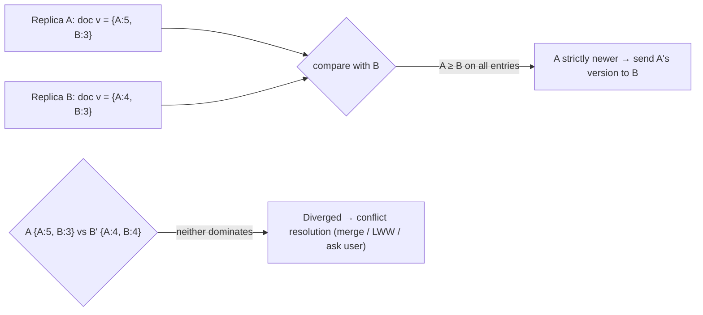

Version vectors vs vector clocks: the same structure, but version vectors track **versions of state per replica** (one entry per replica that accepted writes), so they stay small, while event vector clocks may track every process.

#### Example
File sync (Dropbox-like, or Syncthing): each device keeps a version vector per file. When a laptop and a phone both edit `notes.md` offline, their vectors diverge, and on sync the system detects the conflict and keeps both ("notes (conflicted copy from phone).md") rather than overwriting. Riak and CouchDB (revision trees) use similar ideas for document replication.

#### Trade-offs
Cheap and precise detection of divergence among replicas, but they only **detect** conflicts. Resolution policy is still yours.

#### Problems & fixes
| Symptom | Cause | Fix |
|---|---|---|
| Silent overwrite of concurrent edits | comparing timestamps instead of versions | version vectors to detect divergence |
| Too many conflict copies | frequent concurrent edits | finer-grained items, CRDTs/operational transforms for documents |
| Vector entries for retired replicas | membership churn | garbage-collect entries after all replicas acknowledge |

#### Cheat sheet
- Per-item vector: counter per replica that wrote it.
- Dominates means copy over. Neither dominates means conflict.
- Detection only. Pair with merge rules or CRDTs.

#### Interview questions

How would a file sync service decide whether to overwrite or create a conflict copy?

Keep a version vector per file (an entry per device that modified it). When syncing, compare vectors: if the incoming version dominates the local one, overwrite. If the local version dominates, ignore the incoming one. If neither dominates (concurrent edits), preserve both, by creating a conflict copy or merging if the format allows.

Why are version vectors usually smaller than general vector clocks?

They have one entry per replica that accepted writes for that item (a handful of servers or devices), not one per client process or event source. Because writes are coordinated through a small set of replicas, the vector stays small.

#### Interview angle
> "Replica sync compares version vectors: a dominating version is copied over and a concurrent one is flagged as a conflict to merge, instead of being silently overwritten by timestamp."

#### Sources
- [Version vector](https://martinfowler.com/articles/patterns-of-distributed-systems/version-vector.html) — Unmesh Joshi, martinfowler.com
- [Version vector](https://en.wikipedia.org/wiki/Version_vector) — Wikipedia

### Hybrid Logical Clocks (HLC) — combine physical + logical: max(physical, last_hlc) + 1
Hybrid Logical Clocks combine a **physical timestamp** (close to wall time, so it's human-meaningful and good for time-based snapshots) with a **logical counter** that guarantees causality even when physical clocks are skewed. HLC values never go backwards, respect happened-before, and stay within the clock-skew bound of real time.

#### Intuition
A wall clock with an extra tick counter beside it. Normally you read the clock. If a message arrives stamped later than your clock shows, you adopt that later time and use the counter to stay ahead of it, so your timestamps never go backwards.

#### Must know
- A timestamp of **(physical time, logical counter)**.
- It **never goes backwards** and it **respects causality**, even with skewed clocks.
- It stays **close to wall time**, so "read as of 10 seconds ago" still works.
- Used by CockroachDB, YugabyteDB and MongoDB.
- It assumes clock skew is bounded, and it orders events but does not detect concurrency.

#### Numbers to quote
- CockroachDB's default maximum clock offset is 500 ms. A node beyond it shuts itself down.

#### Common mistakes
- Saying HLC removes the need for clock synchronisation.
- Expecting it to detect conflicts the way vector clocks do.
- One node's clock jumping far ahead and dragging the whole cluster's timestamps forward.

#### How it works
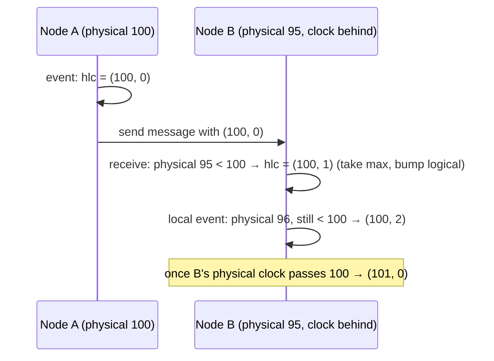

Update rules (simplified):
- **Send / local event**: `l = max(l, physical_now)`. If `l` didn't change, `c += 1`, otherwise `c = 0`.
- **Receive (l_m, c_m)**: `l = max(l, l_m, physical_now)`, and `c` is set according to which component won (incrementing to stay ahead of both).

The timestamp is `(l, c)` compared lexicographically, typically packed into 64 bits.

#### Example
CockroachDB and YugabyteDB use HLC to timestamp transactions without atomic clocks. MVCC versions are ordered by HLC, causally related transactions get increasing timestamps across nodes, and "read as of 10 seconds ago" (follower reads, `AS OF SYSTEM TIME`) works because HLC stays near wall time. MongoDB's cluster time is also a hybrid logical clock.

#### Trade-offs
Causality plus near-real-time timestamps in a compact form, but correctness still assumes a maximum clock offset (nodes beyond it must be fenced), and HLC doesn't detect concurrency the way vector clocks do.

#### Problems & fixes
| Symptom | Cause | Fix |
|---|---|---|
| HLC runs far ahead of wall time | one node's clock jumped ahead | max-offset checks, reject/ignore far-future timestamps, fix NTP |
| Uncertainty-related transaction restarts | reads near clock-uncertainty window | tighter clock sync, follower reads with staleness |
| Need conflict detection | HLC only orders | add version vectors/CRDTs where needed |

#### Cheat sheet
- (physical, logical) timestamps: monotonic, causal, near wall time.
- Used by CockroachDB, YugabyteDB, MongoDB cluster time.
- Assumes a bounded clock offset. Orders but doesn't detect concurrency.

#### Interview questions

Why not just use Lamport clocks in a distributed database?

Lamport timestamps have no relation to real time, so you can't answer "read the database as of 5 seconds ago", set TTLs, or line versions up with human time. HLC keeps causality guarantees like Lamport while staying close to wall-clock time, so it supports time-based snapshots and follower reads with bounded staleness.

What happens in an HLC system if one node's physical clock jumps far into the future?

Its HLC values jump ahead, and other nodes that receive its messages adopt those large physical components, pushing their HLCs ahead of real time too (until wall time catches up). Systems guard against this by enforcing a maximum allowed offset: nodes detecting excessive skew reject messages or shut down (CockroachDB) to preserve consistency.

#### Interview angle
> "Hybrid logical clocks give timestamps that respect causality and stay near wall time, which is how CockroachDB orders MVCC versions and serves as-of-time reads without atomic clocks, given a bounded clock offset."

#### Sources
- [Hybrid clock](https://martinfowler.com/articles/patterns-of-distributed-systems/hybrid-clock.html) — Unmesh Joshi, martinfowler.com
- [Living without atomic clocks](https://www.cockroachlabs.com/blog/living-without-atomic-clocks/) — Cockroach Labs
- [Logical physical clocks and consistent snapshots in globally distributed databases](https://cse.buffalo.edu/tech-reports/2014-04.pdf) — Kulkarni et al.

### Google TrueTime — GPS + atomic clocks, returns [earliest, latest] uncertainty interval (~7ms)
TrueTime is Google's time API: instead of a single timestamp, `TT.now()` returns an **interval [earliest, latest]** that is guaranteed to contain the true current time. GPS receivers and atomic clocks in each datacentre keep the interval narrow (ε ≈ 1–7 ms). Spanner uses it to give globally consistent timestamps. (Phase 3 covers the Spanner integration.)

#### Intuition
A clock honest enough to say "it is somewhere between 10:00:00.000 and 10:00:00.007" and to guarantee the true time is inside that range. Knowing the size of your error is worth more than a confident wrong answer.

#### Must know
- `TT.now()` returns an **interval [earliest, latest]** guaranteed to contain the true time.
- GPS receivers and atomic clocks in every datacenter keep the interval small.
- Because the uncertainty is **explicit and bounded**, a protocol can simply wait it out.
- Spanner uses it to order transactions across the world with no central sequencer.
- Without such clocks, use hybrid logical clocks or a central timestamp service.

#### Numbers to quote
- The uncertainty is typically a few milliseconds (1–7 ms in the Spanner paper).

#### Common mistakes
- Saying TrueTime gives perfectly accurate time.
- Assuming an ordinary NTP setup can stand in for it.
- Forgetting that correctness depends on the bound being honest.

#### How it works
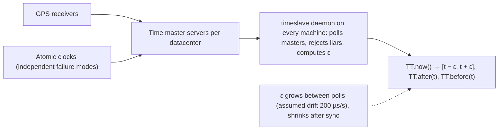

API: `TT.now()`, `TT.after(t)` (true time has definitely passed t), `TT.before(t)`.

Cloud analogues: **AWS Time Sync Service + ClockBound** (bounded error from PTP hardware clocks, microsecond-level), with similar "now with error bound" APIs available to you.

#### Example
Spanner assigns transaction T a commit timestamp s ≥ TT.now().latest and waits until TT.after(s) is true before acknowledging (commit wait ≈ 2ε). Any transaction that starts after T's acknowledgement gets a strictly larger timestamp anywhere in the world, so snapshot reads at a timestamp are globally consistent, with no cross-region coordination just to order commits.

#### Trade-offs
Global ordering without a central sequencer, but it needs specialised infrastructure, and correctness depends on the uncertainty bound being honest (hence two independent time sources and liar detection).

#### Problems & fixes
| Symptom | Cause | Fix |
|---|---|---|
| (your system) need global ordering without TrueTime | no bounded clocks | HLC + max offset, central timestamp oracle, or consensus |
| Commit latency grows | ε increases (time master issues) | redundant time sources, monitoring ε |

#### Cheat sheet
- TT.now() = interval with bounded uncertainty ε (ms).
- GPS + atomic clocks, liar detection.
- Enables Spanner commit wait and external consistency. ClockBound offers similar bounds on AWS.

#### Interview questions

Why does TrueTime return an interval instead of a timestamp?

No clock knows the exact time. Returning [earliest, latest] makes the uncertainty explicit and bounded, so protocols can reason safely (e.g. "wait until earliest > s"). A plain timestamp hides the error and leads to subtle ordering bugs when skew exceeds assumptions.

What would happen to Spanner's guarantees if TrueTime's uncertainty bound were wrong?

Commit wait relies on true time being inside the interval. If clocks were off by more than the reported ε, a transaction could receive a timestamp smaller than one that committed earlier in real time, breaking external consistency (snapshot reads could miss committed data). That's why TrueTime uses redundant GPS and atomic sources and evicts machines with misbehaving clocks.

#### Interview angle
> "TrueTime makes clock uncertainty explicit as a bounded interval, which lets Spanner order commits globally by waiting out the uncertainty. Without such clocks I'd use HLC or a timestamp oracle."

#### Sources
- [Spanner: TrueTime and external consistency](https://cloud.google.com/spanner/docs/true-time-external-consistency) — Google Cloud docs
- [Spanner: Google's globally distributed database](https://research.google/pubs/spanner-googles-globally-distributed-database-2/) — Google Research

### Commit wait (Spanner) — wait out TrueTime uncertainty before returning commit timestamp
Commit wait is Spanner's trick for external consistency: after picking a commit timestamp s (≥ TrueTime's latest bound), the leader **waits until TrueTime guarantees that s is in the past** (TT.now().earliest > s) before releasing locks and acknowledging. The wait (≈ 2ε, a few ms) ensures no later transaction anywhere can get a smaller timestamp.

#### Intuition
You stamp a letter "sent at 10:00:06", then hold it until you are certain every clock in the world has passed 10:00:06. Anyone who writes after receiving it is then guaranteed a later stamp.

#### Must know
- Spanner picks a commit timestamp at least as large as TrueTime's upper bound.
- It then **waits until that timestamp is definitely in the past everywhere** before acknowledging.
- So any transaction that starts after the acknowledgement gets a larger timestamp, anywhere in the world.
- That gives **external consistency**: timestamp order matches real-time order.
- The wait overlaps with replication, so part of its cost is hidden.

#### Numbers to quote
- The wait is about twice the clock uncertainty, a few milliseconds per write transaction.

#### Common mistakes
- Thinking read-only transactions pay the commit wait. They do not.
- Forgetting locks are held during the wait, which hurts hot rows.
- Describing it as a network round trip. It is a local wait on the clock.

#### How it works
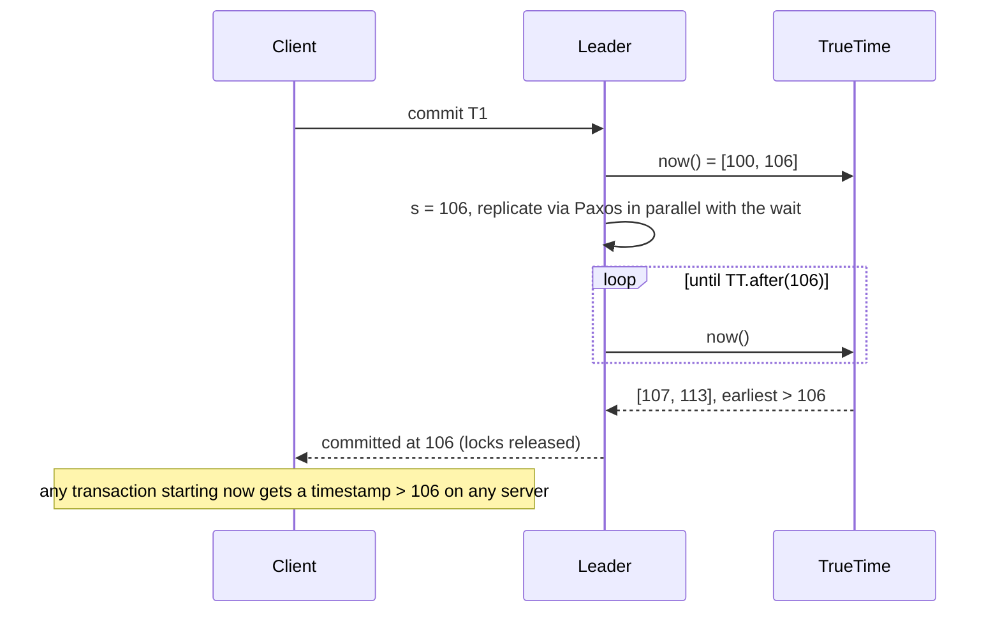

Key points:
- The wait overlaps with Paxos replication, so its cost is often partly hidden.
- Smaller ε means shorter waits, so the clock infrastructure directly drives latency.
- Read-only transactions don't commit-wait. They read at a timestamp (possibly waiting for replicas to catch up to it, via "safe time").

#### Example
T1 (update an account balance in us-east) commits at s = 106 after commit wait. The client then tells a colleague in Europe, who starts T2 reading the balance in eu-west. T2's read timestamp is ≥ TT.now().latest at its start > 106, so its snapshot includes T1. Real-time order across continents is respected without the two regions talking directly.

#### Trade-offs
Global external consistency for a small latency cost (a few ms per write transaction), but it depends on tight, trusted clock bounds.

#### Problems & fixes
| Symptom | Cause | Fix |
|---|---|---|
| Higher write latency | large ε | improve clock sync, monitor uncertainty |
| Lock hold time longer | locks held during commit wait | keep transactions short, avoid hot rows |

#### Cheat sheet
- Choose s ≥ latest. Wait until earliest > s. Then ack.
- Cost ≈ 2ε, overlapped with replication.
- Gives external consistency (real-time order) globally.

#### Interview questions

Why does Spanner wait before acknowledging a commit?

To guarantee that the commit timestamp is definitely in the past for every machine in the world before anyone learns of the commit. Then any transaction that starts after the acknowledgement, anywhere, will be assigned a larger timestamp and its snapshot will include the commit. Without the wait, clock uncertainty could give a later transaction a smaller timestamp.

How can systems without TrueTime achieve similar guarantees?

Use a centralised timestamp oracle (TiDB's PD TSO, Percolator), which costs a round trip to the oracle per transaction. Or use consensus-serialised commits within a group, or HLC with a configured maximum clock offset plus uncertainty restarts (CockroachDB), which gives serializability with some real-time caveats unless operations go through the same nodes.

#### Interview angle
> "Commit wait is Spanner's price for external consistency: a few milliseconds of waiting out clock uncertainty per write, overlapped with Paxos replication."

#### Sources
- [Spanner: TrueTime and external consistency](https://cloud.google.com/spanner/docs/true-time-external-consistency) — Google Cloud docs
- [Spanner: Google's globally distributed database](https://research.google/pubs/spanner-googles-globally-distributed-database-2/) — Google Research

### Happens-before (→) — a→b means a causally precedes b; defines partial order of events
Lamport's **happens-before** relation defines causality in a distributed system: a → b if (1) a and b are on the same process and a comes first, (2) a is sending a message and b is receiving it, or (3) transitively a → c → b. If neither a → b nor b → a, the events are **concurrent**: neither could have influenced the other.

#### Intuition
Sending a letter happens before reading it, and whatever you do after reading it comes after the sender wrote it. But what you had for breakfast and what the sender had for breakfast have no order at all. Neither could have affected the other.

#### Must know
- a → b when: both are on the same process and a is first, **or** a is the send and b the receive of one message, **or** a chain of such steps links them.
- If neither a → b nor b → a, the events are **concurrent**.
- Concurrent means "no information flowed between them", not "at the same clock time".
- It is the basis of Lamport clocks, vector clocks and causal consistency.
- In practice, preserve order **per entity**: key events by order id into one partition.

#### Common mistakes
- Treating "concurrent" as "simultaneous".
- Forcing a global order when only per-entity order is needed.
- Processing an effect before its cause because related events went to different partitions.

#### How it works
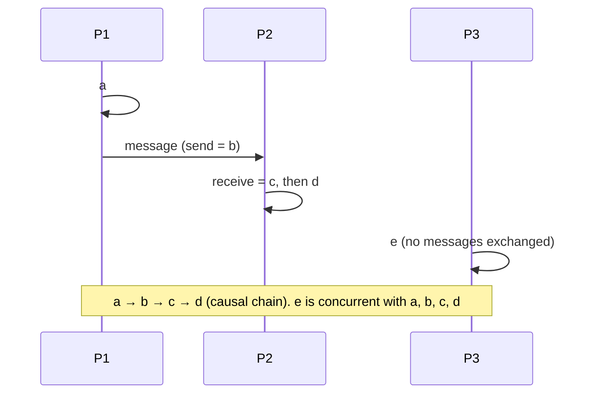

Why it matters:
- It's the foundation for **Lamport clocks** (respect →), **vector clocks** (exactly capture →), **causal consistency** and **conflict detection**.
- Concurrent events have **no inherent order**, so any order a system picks is a policy choice (LWW, merge).

#### Example
In a payments flow: "authorize payment" → "send AuthorizationSucceeded message" → "order service marks order PAID". These are causally linked, so a consumer must never apply "PAID" before seeing the order created. Meanwhile, a profile-picture update by the same user on another device is concurrent with the payment and can be applied in any order relative to it. Designing systems around which events are causally related avoids over-constraining (global ordering) and under-constraining (causal violations).

#### Trade-offs
Thinking in happens-before reveals where ordering is truly required (usually per entity or per conversation) versus where it's unnecessary and costly.

#### Problems & fixes
| Symptom | Cause | Fix |
|---|---|---|
| Effects processed before causes (e.g. "order shipped" before "order created") | no causal ordering across messages | partition by entity key (same Kafka partition), sequence numbers, causal metadata |
| Global ordering bottleneck | treating all events as causally related | order only per key / causal chain |

#### Cheat sheet
- a → b: same process order, send → receive, transitivity.
- Neither direction means concurrent (no inherent order).
- Basis for Lamport and vector clocks and causal consistency.

#### Interview questions

What does it mean for two events to be concurrent in a distributed system?

Neither happened-before the other: no chain of process order and messages connects them, so neither could have influenced the other. It's about causality, not wall-clock time. Two events seconds apart can be concurrent if no information flowed between them.

How do you preserve happens-before ordering for events of one order in an event-driven system?

Publish all events for the same order with the same key (order id) so they land in the same Kafka partition, which preserves order within a partition, and consume each partition sequentially. Add per-entity sequence numbers so consumers can detect gaps and out-of-order delivery (e.g. after retries) and buffer or reject accordingly.

#### Interview angle
> "I only preserve the ordering that causality needs, usually per entity, by keying events by order id into one partition with per-entity sequence numbers, instead of forcing an expensive global order."

#### Sources
- [Time, clocks, and the ordering of events in a distributed system](https://lamport.azurewebsites.net/pubs/time-clocks.pdf) — Leslie Lamport
- [Happened-before](https://en.wikipedia.org/wiki/Happened-before) — Wikipedia

### Total order vs partial order — total: every pair comparable; partial: concurrent events possible
A **total order** puts every pair of events in a definite sequence (a single timeline). A **partial order** only orders some pairs, while others are incomparable (concurrent). Causality (happens-before) is a partial order. Many systems impose a total order on top for simplicity, at the cost of coordination.

#### Intuition
A single queue at one counter is a total order: everyone knows exactly who is ahead of whom. Several queues at several counters is a partial order: you know the order inside each queue, but not between people in different queues.

#### Must know
- **Total order**: every pair of events has a definite order. One timeline.
- **Partial order**: only some pairs are ordered. The rest are concurrent.
- A total order needs a single sequencer or consensus, which costs coordination and caps throughput.
- A Kafka **partition** is totally ordered. A **topic** with many partitions is only partially ordered.
- Design rule: totally order **only what must be**, usually per key.

#### Common mistakes
- Assuming Kafka preserves order across a whole topic.
- Demanding a global order for all events, which reduces the system to one sequencer.
- Forgetting that replicas applying the same commands in different orders will diverge.

#### How it works
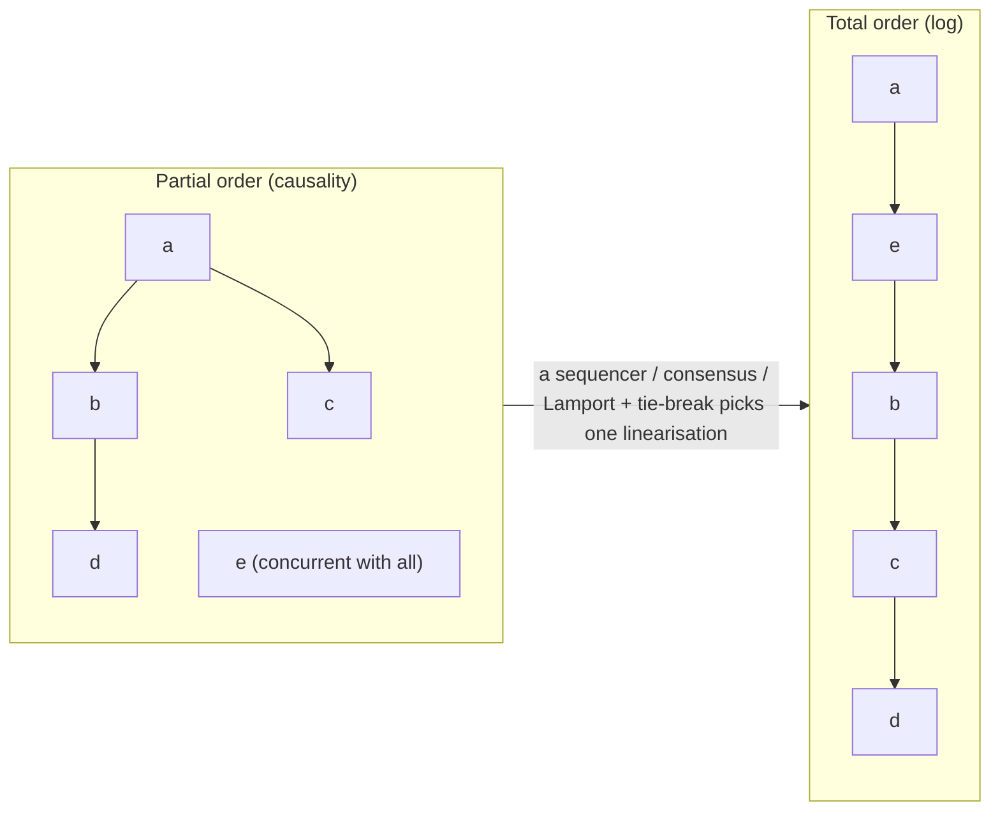

| | Total order | Partial order |
|---|---|---|
| Comparability | every pair | only causally related pairs |
| How | single leader/sequencer, consensus log, total order broadcast | vector clocks, causal tracking |
| Cost | coordination (latency, throughput limit) | metadata, conflict handling |
| Example | Raft log, Kafka partition, DB transaction log | Dynamo-style replication, CRDT replicas |

**Total order broadcast** (atomic broadcast) delivers the same messages in the same order to all nodes, and is equivalent to consensus.

#### Example
A Kafka **partition** gives a total order of its events, while a **topic** with many partitions gives only a partial order (an order per partition). Teams choose keys so that events needing a total order (all events of one account) share a partition, and everything else proceeds in parallel. A ledger needs a total order per account. A global total order across all accounts would cap throughput at one sequencer.

#### Trade-offs
A total order is simple to reason about (replay a log, state machine replication) but serialises everything through coordination. Partial orders scale and stay available but require handling concurrency.

#### Problems & fixes
| Symptom | Cause | Fix |
|---|---|---|
| Throughput capped by a single sequencer | global total order | total order per key/partition only |
| Inconsistent replicas | operations applied in different orders where order matters | total order broadcast (consensus log) for those operations |
| Unclear guarantees across partitions | assuming topic-level ordering | document per-partition ordering, design keys |

#### Cheat sheet
- Total: every pair ordered (logs, consensus). Partial: concurrency allowed (causality).
- Total order broadcast ≡ consensus.
- Totally order only what must be: per key, per partition.

#### Interview questions

Why does a replicated state machine need a total order of commands?

Replicas start from the same state and apply the same deterministic commands. They end in the same state only if they apply the commands in the same order. Different orders of non-commutative commands (e.g. "set x=1" and "set x=2") would make replicas diverge. Consensus (Raft) provides the agreed total order.

Kafka guarantees ordering per partition. How do you get ordering for all events of a customer?

Use the customer id as the message key, so all of that customer's events hash to the same partition and keep their relative order. Consume each partition with a single consumer thread (or per-key serial processing). Events of different customers can be processed in parallel across partitions.

#### Interview angle
> "I scope total ordering to where it's needed, usually per account or entity via partition keys, so the system scales while each entity's history stays a single ordered log."

#### Sources
- [Atomic broadcast](https://en.wikipedia.org/wiki/Atomic_broadcast) — Wikipedia
- [Main concepts and terminology](https://kafka.apache.org/documentation/#intro_concepts_and_terms) — Apache Kafka docs

### Monotonic clock — use for measuring elapsed time; wall clock for human-readable timestamps
Operating systems expose two kinds of clocks. The **wall clock** (time of day, `System.currentTimeMillis()`, `Instant.now()`) can jump when NTP adjusts it or an admin changes it. The **monotonic clock** (`System.nanoTime()`, `CLOCK_MONOTONIC`, Go's monotonic reading in `time.Now()`) only moves forward at a steady rate, so it's the right tool for **measuring durations, timeouts and rate limits**.

#### Intuition
A stopwatch against a wall clock. The wall clock tells you the time of day, but someone can reset it. The stopwatch only counts forward, so it is the one to use for timing a race.

#### Must know
- The **wall clock** can jump when NTP corrects it. The **monotonic clock** only moves forward at a steady rate.
- Use the monotonic clock for **durations, timeouts, backoff and rate limiting**.
- Use the wall clock, in UTC, for stored timestamps and anything shown to people.
- In Java: `System.nanoTime()` for elapsed time, `Instant.now()` for a timestamp.
- Monotonic values mean nothing across machines or restarts.

#### Common mistakes
- Measuring latency with `System.currentTimeMillis()`, which can give a negative result.
- Comparing `nanoTime()` values from two servers.
- A timeout computed from wall time that fires early when the clock jumps.

#### How it works
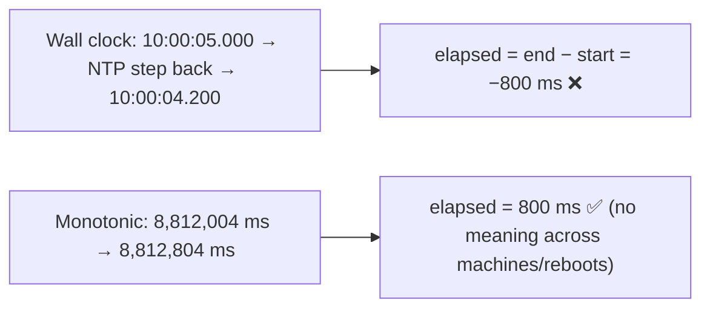

| Use | Clock |
|---|---|
| Request latency, timeouts, retry backoff, rate limiter windows (local) | monotonic |
| Log timestamps, created_at, TTL expiry dates, user display | wall clock (UTC) |
| Ordering across machines | neither: logical clocks / sequencer |

Monotonic values are meaningless across machines or reboots. Only differences on the same machine matter.

#### Example
A rate limiter computed refill using `System.currentTimeMillis()`. During an NTP correction that stepped the clock back by 2 seconds, the limiter computed negative elapsed time and stopped refilling tokens, blocking legitimate traffic. Switching to `System.nanoTime()` for elapsed calculations fixed it. Similarly, a timeout computed with wall time fired immediately when the clock jumped forward.

#### Trade-offs
Monotonic clocks are reliable for durations but can't be compared across hosts or converted to calendar time without the wall clock.

#### Problems & fixes
| Symptom | Cause | Fix |
|---|---|---|
| Negative latencies in metrics | wall-clock deltas across NTP step | monotonic clock for durations |
| Timeouts fire early or never | wall-clock jumps | monotonic deadlines |
| Comparing nanoTime across services | meaningless values | use wall time (UTC) for cross-host timestamps, trace context for ordering |

#### Cheat sheet
- Durations/timeouts: monotonic (`System.nanoTime`, `CLOCK_MONOTONIC`).
- Timestamps for humans/storage: wall clock in UTC.
- Neither orders events across machines.

#### Interview questions

Why should you measure request latency with System.nanoTime() instead of System.currentTimeMillis()?

`currentTimeMillis()` reads the wall clock, which can be adjusted backward or forward by NTP or operators, producing negative or inflated durations. `nanoTime()` is monotonic: it only moves forward at a steady rate, so differences between two readings on the same JVM accurately measure elapsed time.

Can you compare System.nanoTime() values from two different servers?

No. Monotonic clock values have an arbitrary origin (often boot time) per machine or process, so absolute values aren't comparable across hosts. Only differences measured on the same machine are meaningful. Cross-host timestamps use wall-clock UTC (with skew caveats), and causal ordering uses logical clocks or trace context.

#### Interview angle
> "Latencies, timeouts and backoff use the monotonic clock, stored timestamps are wall-clock UTC, and cross-machine ordering uses neither. It comes from logical clocks or a sequencer."

#### Sources
- [System.nanoTime](https://docs.oracle.com/en/java/javase/21/docs/api/java.base/java/lang/System.html#nanoTime%28%29) — Java SE 21 API
- [clock_gettime(2)](https://man7.org/linux/man-pages/man2/clock_gettime.2.html) — Linux manual pages

