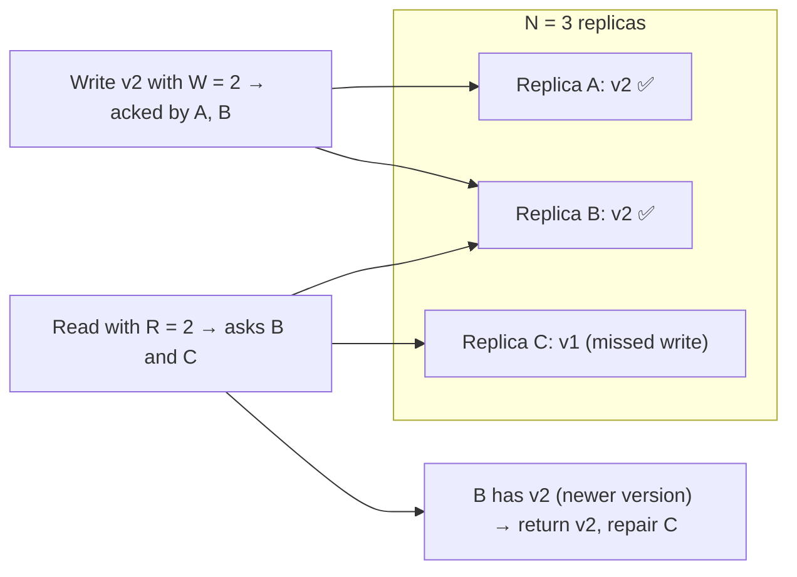
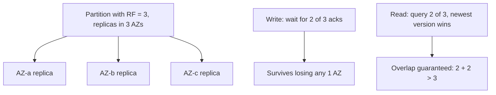
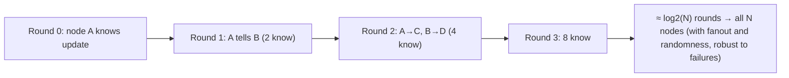
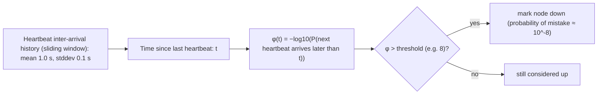
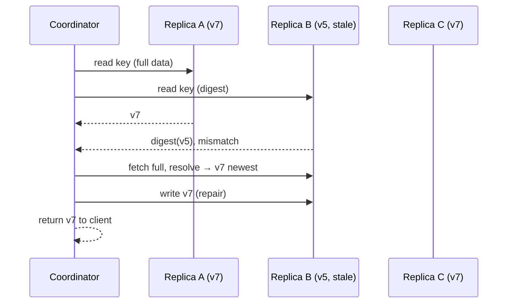
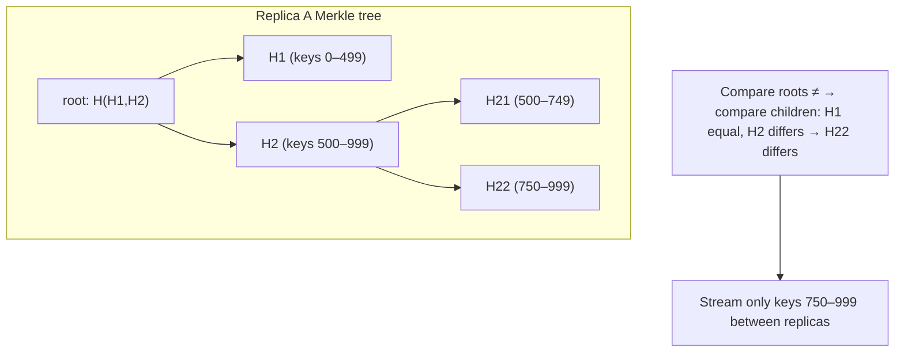
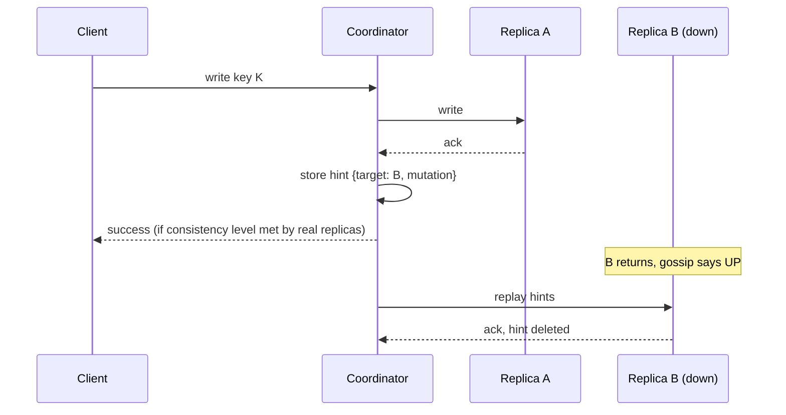
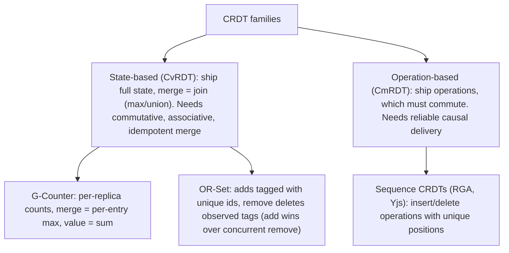
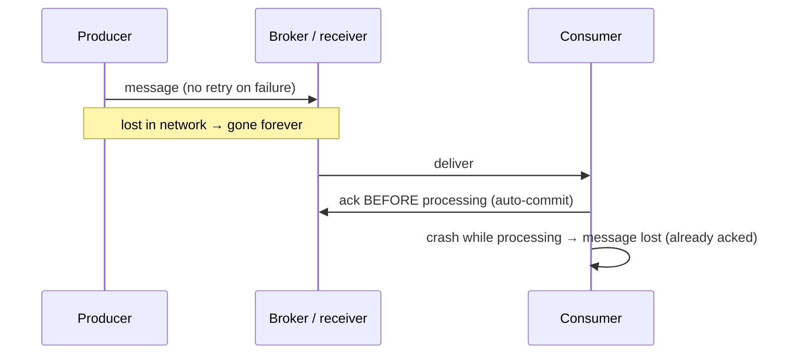
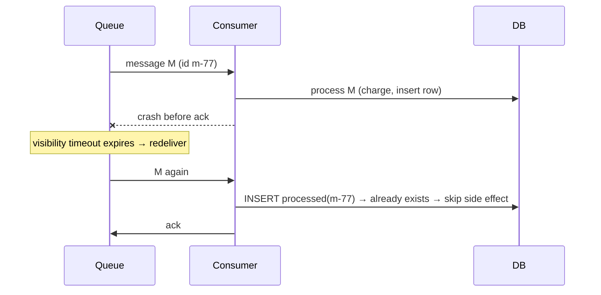

## Replication, failure detection & recovery

### Quorum reads/writes — N replicas, write to W, read from R; W+R>N ensures overlap and consistency
With N replicas, a write succeeds after **W** acknowledgements and a read consults **R** replicas. If **W + R > N**, every read set overlaps every write set in at least one replica, so a read can find the latest acknowledged write (by comparing versions). Tuning W and R trades consistency, latency and availability.

#### How it works

| Config (N=3) | Behaviour |
|---|---|
| W=3, R=1 | fast reads, writes fail if any replica is down |
| W=1, R=3 | fast writes, reads fail if any replica is down |
| **W=2, R=2** | balanced: tolerates 1 failure for both, overlapping quorums |
| W=1, R=1 | fastest, most available, eventual consistency (stale reads possible) |

Caveats: sloppy quorums (writing to substitute nodes), concurrent writes with LWW, and partially failed writes can still produce anomalies, so "W + R > N" is not linearizability.

#### Example
Cassandra RF=3 per DC with `LOCAL_QUORUM` for both reads and writes in a user-profile service: profile updates are visible to subsequent reads in the same DC, and either operation keeps working with one replica down. For analytics reads of the same table, `LOCAL_ONE` cuts latency.

#### Trade-offs
Larger W means more durable and consistent writes but more latency and less write availability. Larger R does the same for reads. Latency is set by the W-th or R-th fastest replica.

#### Problems & fixes
| Symptom | Cause | Fix |
|---|---|---|
| Stale reads | W + R ≤ N | quorum both sides, or read-your-writes routing |
| Writes fail with one node down | W = N | W = majority |
| p99 latency follows slowest replica | high W/R | speculative retries, quorum not ALL |
| Data inconsistent after failures | partial writes, sloppy quorum | read repair, anti-entropy, hinted handoff |

#### Cheat sheet
- W + R > N means overlapping quorums (read finds latest acknowledged write).
- N=3, W=2, R=2 is the balanced default.
- Not linearizable by itself. Repairs keep replicas converging.

#### Interview questions

With N = 5, what W and R would you choose for strong-ish reads that tolerate 2 failures?

W = 3 and R = 3: W + R = 6 > 5 gives overlap, and each operation needs only 3 of 5 replicas, so up to 2 replicas can be down for both reads and writes. Write-heavy workloads could use W = 2, R = 4 (still 6 > 5) at the cost of read availability (only one failure tolerated for reads).

Why does a quorum read need version metadata?

The read collects values from R replicas that may hold different versions. To return the latest acknowledged write it must determine which value is newest, via timestamps or version numbers (or vector clocks to detect concurrency). Without versions, overlap alone doesn't tell you which response is correct.

#### Interview angle
> "With three replicas I use W=2, R=2: overlapping quorums give read-your-latest, one replica can be down for either operation, and read repair plus anti-entropy keep replicas converging."

### Common quorum config — N=3, W=2, R=2: tolerates 1 failure, consistent reads
The most common quorum configuration is **3 replicas, writes acknowledged by 2, reads from 2**. It's the sweet spot: tolerates one replica failure for both reads and writes, guarantees read/write overlap (2 + 2 > 3), and keeps latency near the second-fastest replica rather than the slowest.

#### How it works

Failure scenarios with N=3, W=2, R=2:
| Replicas down | Writes | Reads |
|---|---|---|
| 0 | ✅ | ✅ |
| 1 | ✅ | ✅ |
| 2 | ❌ (can't reach 2) | ❌ |

#### Example
- **Cassandra** RF=3 + `LOCAL_QUORUM`/`LOCAL_QUORUM` per datacentre.
- **Kafka** `replication.factor=3`, `min.insync.replicas=2`, producer `acks=all` (an analogous durability quorum: a write survives one broker loss without blocking).
- **etcd / ZooKeeper** 3-node ensembles (Raft/ZAB majorities of 2).
- **MongoDB** 3-member replica set with `w: "majority"` and `readConcern: "majority"`.

#### Trade-offs
Robust and cost-efficient (3× storage), but only one failure is tolerated. Planned maintenance (taking one node down) leaves no slack for an unplanned failure at the same time, which is why some critical systems use N=5.

#### Problems & fixes
| Symptom | Cause | Fix |
|---|---|---|
| Outage during maintenance + unexpected failure | only 1 failure tolerated | N=5 for critical data, or careful maintenance windows |
| Two replicas in the same AZ | placement not AZ-aware | rack/AZ-aware placement |
| Kafka producers blocked with one broker down | min.insync = 3 | RF=3, min.insync=2 |

#### Cheat sheet
- N=3, W=2, R=2: one failure tolerated, overlapping reads.
- Place replicas in 3 different AZs.
- Need two-failure tolerance? N=5 with W=R=3.

#### Interview questions

Why is N=3, W=2, R=2 preferred over N=2, W=2, R=1?

With N=2 and W=2, any single replica failure blocks all writes, so there's no write availability under failure. N=3 with majority quorums tolerates one failure for both reads and writes while keeping overlap. Two replicas also can't form a majority after a partition, so you lose either consistency or availability immediately.

Map the N/W/R idea to Kafka's durability settings.

`replication.factor` ≈ N (copies per partition). `min.insync.replicas` + `acks=all` ≈ W: a write is acknowledged only when at least min.insync replicas in the ISR have it. Reads come from the partition leader, which only exposes messages replicated to the ISR (the high watermark), similar to reading committed data. RF=3, min.insync=2 survives one broker loss without data loss or blocking.

#### Interview angle
> "My default is three replicas across three AZs with majority writes and reads, in Cassandra, Kafka, etcd or MongoDB alike, which survives one failure with consistent reads. Five replicas only for data that must survive two."

### Gossip protocol — epidemic broadcast: each node periodically exchanges state with random peers, O(log N) convergence
Gossip (epidemic) protocols spread information the way rumours spread: periodically, each node picks a few **random peers** and exchanges state. New information reaches all N nodes in about **O(log N) rounds**, with no central coordinator and graceful tolerance of failures. It's used for membership, failure detection, metadata and anti-entropy. (Cassandra's implementation is covered in Phase 3.)

#### How it works

Variants:
- **Push**, **pull**, **push-pull** (exchange digests, then the missing data).
- **SWIM** (Scalable Weakly-consistent Infection-style Membership): ping and indirect ping for failure detection, plus piggybacked gossip for membership updates (used by Consul/Serf, HashiCorp memberlist).
- **Anti-entropy gossip**: periodically reconcile full state (Merkle trees).

#### Example
Consul agents form a SWIM gossip pool: each agent pings a random member every second. If there's no ack, it asks k other members to ping indirectly before suspecting. Suspicions and membership changes ride along on normal gossip messages. A 5,000-node cluster detects a failed node in seconds and propagates the change to all nodes in a few more seconds, with constant per-node network load.

#### Trade-offs
Scalable, decentralised and robust, but **eventually consistent** views (nodes briefly disagree), probabilistic delivery timing, and background bandwidth.

#### Problems & fixes
| Symptom | Cause | Fix |
|---|---|---|
| False failure suspicions | packet loss, CPU starvation | indirect probes (SWIM), suspicion timeouts, Lifeguard extensions |
| Slow convergence | low fanout / long intervals | tune fanout and gossip interval |
| Gossip storms in huge clusters | large state payloads | send digests/deltas, not full state |

#### Cheat sheet
- Random peer exchanges converge in O(log N) rounds.
- Membership, failure detection (SWIM), metadata, anti-entropy.
- Eventually consistent views. Constant per-node cost.

#### Interview questions

Why does gossip converge in O(log N) rounds?

Each round, every node that knows the information tells at least one random peer, so the number of informed nodes roughly doubles each round (until saturation). Reaching N nodes therefore takes about log₂N rounds, and randomness plus fanout greater than 1 make it robust to failed nodes and lost messages.

How does SWIM reduce false positives in failure detection?

If a direct ping to a member fails, the prober asks k other random members to ping the target on its behalf (indirect probes). Only if none succeed is the member marked "suspect", and it gets a suspicion period to refute it (by gossiping that it's alive with a higher incarnation number) before being declared dead. That filters out transient network issues between two specific nodes.

#### Interview angle
> "For membership and failure detection in large clusters I'd use gossip, specifically SWIM-style indirect probes and piggybacked updates as in Consul. Per-node cost stays constant and changes spread in O(log N) rounds."

### Phi accrual failure detector — adaptive: outputs suspicion value φ, not binary up/down judgment
A phi accrual failure detector replaces "no heartbeat for X seconds means dead" with a continuous **suspicion level φ**, computed from the statistical distribution of past heartbeat arrival intervals. The application picks a threshold. It adapts automatically to network jitter and load, which reduces false positives. Cassandra and Akka use it.

#### How it works

Interpretation: φ = 1 means ~10% chance the node is actually alive and just late. φ = 8 means ~0.000001%. On a jittery network the distribution widens, so the same silence produces a lower φ, and the detector naturally becomes more patient.

Cassandra setting: `phi_convict_threshold` (default 8, raise to 10–12 in noisy cloud environments).

#### Example
A Cassandra cluster in the cloud had nodes flapping DOWN/UP during brief network hiccups and GC pauses, causing unnecessary hint storage and request rerouting. Raising `phi_convict_threshold` from 8 to 12 and fixing long GC pauses stopped the flapping, while real crashes were still detected within ~10–20 s.

#### Trade-offs
Adaptive and tunable as a probability rather than a fixed timeout, but detection time still depends on history and threshold, and it can't distinguish a slow node from a dead one.

#### Problems & fixes
| Symptom | Cause | Fix |
|---|---|---|
| Nodes flapping up/down | threshold too low for environment | raise threshold, fix GC/network jitter |
| Slow detection of real failures | threshold too high | lower threshold, add active probes |
| Detector skewed after long idle periods | stale history | bounded sliding window, minimum std-dev |

#### Cheat sheet
- φ = suspicion from heartbeat timing statistics. Threshold sets the trade-off.
- Adapts to jitter automatically.
- Cassandra `phi_convict_threshold` 8 by default, higher in noisy clouds.

#### Interview questions

Why is a fixed heartbeat timeout a poor failure detector?

Networks and hosts have variable latency (GC pauses, congestion, noisy neighbours). A short fixed timeout causes false positives under jitter, and a long one makes detection slow everywhere. A fixed value can't adapt to changing conditions. Phi accrual adapts the effective timeout to observed heartbeat behaviour.

Can any failure detector be perfect in an asynchronous network?

No. In an asynchronous system you can't distinguish a crashed node from a very slow one or a slow network (the FLP impossibility context). Detectors trade completeness (eventually suspect crashed nodes) against accuracy (don't suspect live ones). Systems therefore combine detectors with safety mechanisms (quorums, fencing) so that false suspicions don't cause incorrect behaviour.

#### Interview angle
> "Failure detection is a probability, not a fact. Phi accrual adapts to jitter, and I keep correctness safe with quorums and fencing regardless of what the detector says."

### Read repair — detect stale replica during read, return latest to client, async update stale replica
Read repair fixes stale replicas **opportunistically on the read path**: when a read consults multiple replicas and their versions differ, the coordinator returns the newest value and **writes it back** to the replicas that were behind. Frequently read data converges quickly without background jobs. (Phase 3 covers Cassandra's specifics.)

#### How it works

Variants: **blocking** (repair before responding, which gives monotonic quorum reads) vs **asynchronous** (respond first, repair in the background). Used in Cassandra, Riak, Dynamo-style systems and some caches.

#### Example
After a node in a 3-replica user-profile store was briefly partitioned, it missed updates for 2% of users. Hot profiles (read thousands of times a day) were repaired within minutes via quorum reads. Rarely accessed profiles stayed stale until the weekly anti-entropy repair, which is why both mechanisms are needed.

#### Trade-offs
Free convergence for hot data, but extra latency on reads that trigger repairs, no help for cold data, and tricky with deletes (tombstones must be propagated properly).

#### Problems & fixes
| Symptom | Cause | Fix |
|---|---|---|
| Cold data stays inconsistent | never read | scheduled anti-entropy |
| Read latency spikes after outages | many blocking repairs | expected briefly, run full repair to clear backlog |
| Deleted data resurrected | stale replica + purged tombstones | repairs within gc_grace, careful tombstone handling |

#### Cheat sheet
- Compare versions on read, return newest, fix stale replicas.
- Only for data that's read (at CL > 1).
- Complement with anti-entropy and hinted handoff.

#### Interview questions

Why do Dynamo-style systems need read repair, hinted handoff and anti-entropy together?

Each covers a different gap. Hinted handoff fixes replicas that were briefly down (within the hint window). Read repair fixes inconsistencies on data that gets read. Anti-entropy (Merkle tree comparison) systematically fixes everything else, including cold data and failures beyond the hint window. Together they make eventual consistency actually converge.

Blocking vs asynchronous read repair: what's the trade-off?

Blocking repair (write back before responding) guarantees that once a quorum read returns a value, subsequent quorum reads won't return older values (monotonicity), but it adds latency to that read. Asynchronous repair responds faster but allows a subsequent read to hit a still-stale replica before the repair lands.

#### Interview angle
> "Read repair converges hot keys as a side effect of quorum reads. Anti-entropy and hinted handoff cover cold data and recovering nodes."

### Anti-entropy repair — Merkle tree comparison between nodes, repair differences in background
Anti-entropy is a background process that makes replicas identical by comparing their data and transferring differences. To avoid shipping everything, replicas build **Merkle trees** (hash trees over key ranges) and exchange hashes top-down, transferring only ranges whose hashes differ. (Phase 3 covers Cassandra repair operations.)

#### How it works

Used by: Cassandra (`nodetool repair`), Riak (active anti-entropy), DynamoDB internals, Amazon S3, Git-like sync systems, blockchain light clients (Merkle proofs).

#### Example
After a disk replacement, a Cassandra node rebuilt from peers still had subtle gaps. A scheduled Reaper repair built Merkle trees per token range on each replica, compared them, and streamed only the mismatched sub-ranges (a few hundred MB instead of 2 TB), and the replicas converged within an hour.

#### Trade-offs
Efficient, complete convergence, but building trees costs CPU and I/O, and coarse trees cause over-streaming (sending more than necessary). It must be scheduled and monitored.

#### Problems & fixes
| Symptom | Cause | Fix |
|---|---|---|
| Repairs overload cluster | full repairs of large ranges | subrange/incremental repairs, throttling |
| Over-streaming | coarse Merkle tree leaves | finer subranges |
| Repairs never complete | too large/too slow, failing mid-way | schedulers (Reaper), smaller units, monitoring |

#### Cheat sheet
- Merkle trees: compare top-down, sync only differing ranges.
- Covers all data (including cold and deleted).
- Schedule regularly. Subrange + throttle.

#### Interview questions

How do Merkle trees make replica comparison efficient?

Each leaf hashes a small key range and each parent hashes its children. Two replicas compare root hashes: if equal, all data matches and nothing is transferred. If different, they recurse only into children whose hashes differ, isolating mismatched ranges with O(log n) comparisons, and then transfer only those ranges' data.

Where else are Merkle trees used beyond database repair?

Git (content-addressed commits and trees), file sync tools and backup deduplication, certificate transparency logs, blockchains (Merkle proofs that a transaction is in a block), and storage systems verifying integrity (ZFS checksums, IPFS).

#### Interview angle
> "Background anti-entropy compares Merkle trees per range and streams only what differs, which is what guarantees eventual consistency for data that's never read."

### Hinted handoff — store writes for unavailable nodes locally, replay when node recovers
Hinted handoff keeps writes flowing when a replica is temporarily down: another node (the coordinator) accepts the write **on behalf of** the missing replica, stores it as a **hint**, and **replays** it when the replica comes back. That shortens recovery for brief outages. (Phase 3 covers Cassandra's specifics.)

#### How it works

Related: **sloppy quorum** (Dynamo), where if home replicas are unreachable the write goes to other healthy nodes temporarily (with hints), increasing availability but weakening quorum guarantees.

#### Example
During a rolling OS patch, each Cassandra node reboots for ~4 minutes. Hints accumulated on coordinators bring each node up to date immediately after it rejoins, so reads at LOCAL_QUORUM remain consistent and full repairs aren't needed after every reboot. A node down for 10 hours (beyond the 3-hour hint window) must be repaired before serving.

#### Trade-offs
Fast catch-up after short outages, but hints consume coordinator disk, replay adds load, hints expire, and with sloppy quorums a "successful" write may not be on its home replicas yet.

#### Problems & fixes
| Symptom | Cause | Fix |
|---|---|---|
| Node stale after long outage | hints expired | repair before rejoining reads |
| Coordinator disks fill | huge hint backlog | cap hints, replace/repair failed node quickly |
| Recovered node overloaded | hint replay burst | replay throttling |

#### Cheat sheet
- Store-and-forward writes for briefly down replicas.
- Window-limited (~hours). Repair after longer outages.
- Doesn't count toward consistency level (except Dynamo-style sloppy quorums / CL ANY).

#### Interview questions

What's the difference between a strict quorum and a sloppy quorum?

A strict quorum requires W acknowledgements from the key's designated home replicas, so if too many are down, writes fail. A sloppy quorum accepts writes on any W healthy nodes (including non-home nodes holding hints) to stay available, then hands data back to the home replicas later. Higher availability, but a subsequent read from home replicas might miss the write until handoff completes.

Why can't hinted handoff replace anti-entropy repair?

Hints are kept only for a limited window and only on the coordinators that handled each write. Coordinators can fail and lose hints, and replicas can diverge for reasons other than downtime (dropped mutations, bugs, disk issues). Anti-entropy systematically compares all data, so it's needed for guaranteed convergence.

#### Interview angle
> "Hinted handoff covers replicas that are down for minutes during restarts. Anything longer than the hint window requires a repair before the node serves reads again."

### CRDTs — Conflict-free Replicated Data Types: G-counter, PN-counter, LWW-Register, OR-Set, 2P-Set
CRDTs are data structures designed so that replicas can **update independently and merge automatically** into the same state, regardless of the order or number of times updates are received. They provide strong eventual consistency without coordination, ideal for multi-region, offline-first and collaborative systems.

#### How it works

| CRDT | Operations | Merge / semantics |
|---|---|---|
| G-Counter | increment | per-replica max, sum |
| PN-Counter | increment, decrement | two G-Counters (P − N) |
| G-Set | add | union |
| 2P-Set | add, remove (once) | add-set ∪, remove-set (tombstones). Removed elements can't be re-added |
| OR-Set | add, remove (repeatable) | unique tags. Remove only affects observed tags |
| LWW-Register | set | highest timestamp wins |
| MV-Register | set | keep concurrent values (siblings) |

#### Example
A multi-region "online presence" and "likes" service: likes are a PN-counter per post replicated across Mumbai, Frankfurt and Virginia, and each region increments locally while gossip merges states. Users' "followed topics" are an OR-Set, so following in one region and unfollowing in another resolve deterministically (add-wins for concurrent operations). Redis Enterprise Active-Active, Riak data types, Akka Distributed Data and Automerge/Yjs offer CRDTs off the shelf.

#### Trade-offs
Coordination-free and partition-tolerant with deterministic convergence, but metadata overhead (tags, tombstones, per-replica vectors), limited semantics (no global invariants or uniqueness), and sometimes counter-intuitive merge outcomes.

#### Problems & fixes
| Symptom | Cause | Fix |
|---|---|---|
| Removed element reappears | G-Set/2P-Set misuse or concurrent add | OR-Set (or choose add-wins/remove-wins explicitly) |
| State size grows | tombstones and per-replica entries | causal stability GC, delta-CRDTs |
| Business rule broken (stock < 0) | CRDT can't enforce invariants | bounded counters/escrow or coordination for that operation |

#### Cheat sheet
- Merge is commutative, associative and idempotent, so replicas converge without coordination.
- Counters (G/PN), sets (G, 2P, OR), registers (LWW, MV), sequences (Yjs/Automerge).
- Use for counters, presence, carts, collaboration. Not for invariants.

#### Interview questions

Explain how a PN-Counter works and why it converges.

Each replica keeps two maps: increments per replica (P) and decrements per replica (N), and only updates its own entry. Merging takes the per-replica maximum of each map (state-based), and the value is ΣP − ΣN. Because merge is a max over per-replica monotonically growing counters, it's commutative, associative and idempotent: any order of merges, repeated or not, yields the same result.

OR-Set vs 2P-Set: which would you use for a shopping cart and why?

An OR-Set: users repeatedly add and remove the same item, and a 2P-Set forbids re-adding an element once it's removed. The OR-Set tags each add uniquely, and a remove deletes only the tags it observed, so concurrent add and remove of the same item keeps the add (add-wins), which suits carts.

#### Interview angle
> "For multi-region counters, presence and carts I use CRDTs (PN-counters, OR-Sets), so every region accepts writes locally and converges deterministically. Invariants like stock or balance still need coordination."

### At-most-once delivery — fire and forget, may lose messages (UDP, basic HTTP without retry)
At-most-once delivery sends a message **zero or one times**: there are no retries, so failures cause **loss** but never duplicates. It's the cheapest delivery guarantee, appropriate when losing occasional messages is acceptable and duplicates would be harmful or pointless.

#### How it works

Ways it arises:
- UDP fire-and-forget (metrics, StatsD).
- Producer without retries (Kafka `acks=0` or `retries=0`).
- Consumer that **commits offsets before processing** (Kafka auto-commit with slow processing): a crash loses the message.

#### Example
Telemetry and metrics pipelines: StatsD counters over UDP from 2,000 servers. Losing 0.1% of samples barely changes dashboards, and retries would add load during incidents, exactly when the network is stressed. Never use at-most-once for orders, payments or notifications users rely on.

#### Trade-offs
Lowest latency and overhead with no duplicate handling, at the cost of silent loss.

#### Problems & fixes
| Symptom | Cause | Fix |
|---|---|---|
| Orders/events occasionally missing | consumer commits before processing | commit after processing (at-least-once) + idempotency |
| Lost messages on broker failure | `acks=0` / no replication | `acks=all`, replication, retries |
| Metrics gaps during incidents | UDP drops under load | accept, or use pull-based metrics (Prometheus) |

#### Cheat sheet
- 0 or 1 deliveries: loss possible, no duplicates.
- Fine for metrics, telemetry, presence pings.
- Commit-before-process accidentally creates at-most-once.

#### Interview questions

How can a Kafka consumer accidentally become at-most-once?

With auto-commit enabled (or committing manually before processing), offsets can be committed for messages that haven't finished processing. If the consumer crashes, it restarts from the committed offset and those messages are skipped. Fix: disable auto-commit and commit only after successful processing (at-least-once), with idempotent handlers.

When is at-most-once actually the right choice?

When data is high-volume, individually low-value and quickly superseded (metrics samples, location pings every few seconds, presence heartbeats, debug logs), and duplicates or retry overhead would be worse than occasional loss. The next message makes up for a lost one.

#### Interview angle
> "At-most-once is only for telemetry-style data where the next sample supersedes the last. Business events are at-least-once with idempotent consumers, and offsets are committed only after processing."

### At-least-once delivery — retry until ack; messages may be duplicated, require idempotent consumers
At-least-once delivery **retries until the message is acknowledged**, so nothing is lost, but the same message may be delivered (and processed) **more than once** (after timeouts, crashes before ack, rebalances). It's the default guarantee of most queues (SQS, Kafka consumers committing after processing, RabbitMQ with acks, webhooks), and it demands **idempotent consumers**.

#### How it works

Making consumers idempotent:
- **Dedupe table**: record processed message ids (unique constraint) in the same transaction as the side effect.
- **Naturally idempotent operations**: upserts, `SET status = 'PAID' WHERE status = 'PENDING'`, PUT-style writes.
- **Versioned updates**: apply only if the event version is greater than the stored version.
- Idempotency keys toward downstream APIs.

#### Example
A notification consumer on SQS sent duplicate SMS when processing took longer than the visibility timeout (the message reappeared and a second worker sent it again). Fixes: extend the visibility timeout (or heartbeat it), record `notification_id` in a dedupe table before sending (conditional insert), and use the SMS provider's idempotency key.

#### Trade-offs
No loss, simple to provide, at the cost of duplicates that every consumer must handle, plus dedupe storage.

#### Problems & fixes
| Symptom | Cause | Fix |
|---|---|---|
| Duplicate emails/charges | redelivery after timeout/crash | idempotent consumer (dedupe by message id), longer visibility timeout |
| Poison message retried forever | always fails | max receive count → dead-letter queue |
| Dedupe table grows forever | no cleanup | TTL/partitioned dedupe table (keep ids for retention window) |

#### Cheat sheet
- Retry until ack: no loss, duplicates possible.
- Idempotent consumers: dedupe table, upserts, versioned updates.
- DLQ for poison messages. Tune visibility timeouts.

#### Interview questions

How do you make a "send welcome email" consumer safe under at-least-once delivery?

Give each event a unique id. In the consumer, insert the id into a `processed_events` table with a unique constraint (or a conditional put in DynamoDB) before or atomically with sending. If the insert fails because the id exists, skip. Pass an idempotency key to the email provider if supported, and expire old ids after the maximum redelivery window.

Why is at-least-once usually preferred over at-most-once for business events?

Losing business events (orders, payments, state changes) silently corrupts system state and is hard to detect, while duplicates can be neutralised with idempotency, which is a well-understood, local engineering task. At-least-once plus idempotent processing gives effectively-once outcomes.

#### Interview angle
> "Business events are at-least-once: commit or ack after processing, consumers are idempotent through a dedupe table in the same transaction as the side effect, and poison messages go to a DLQ."
