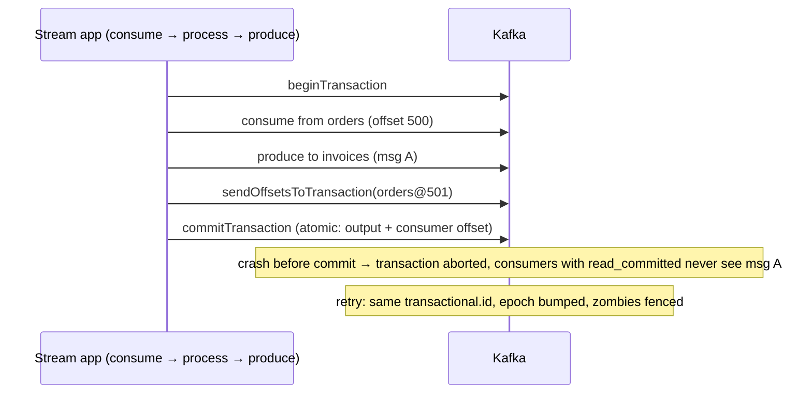
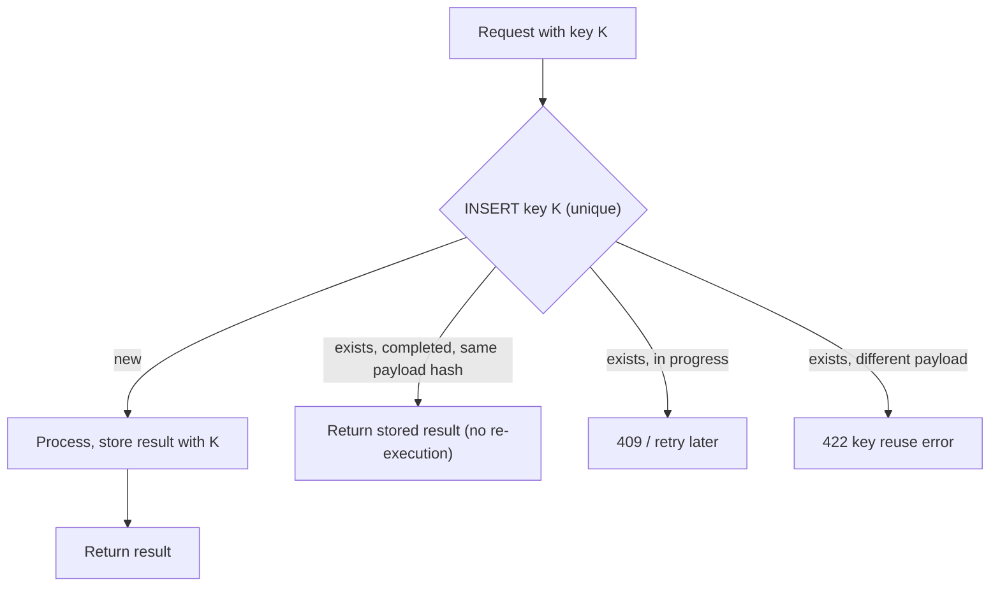
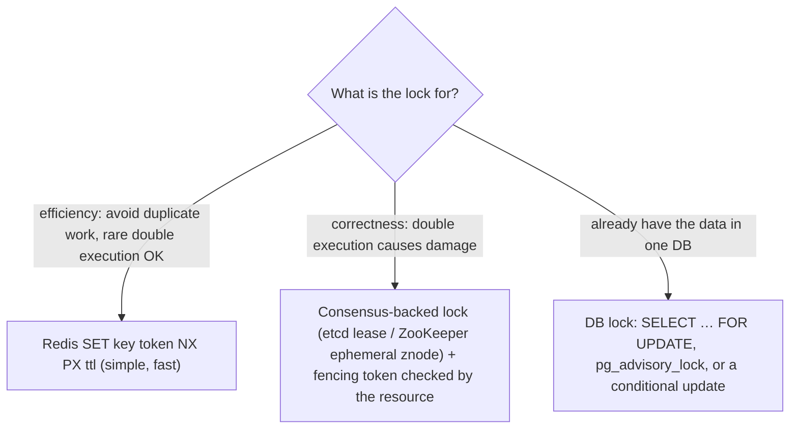
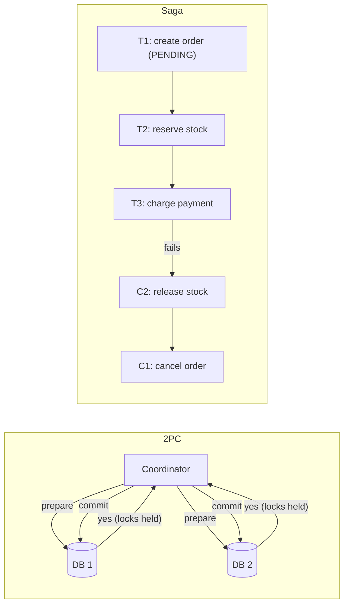
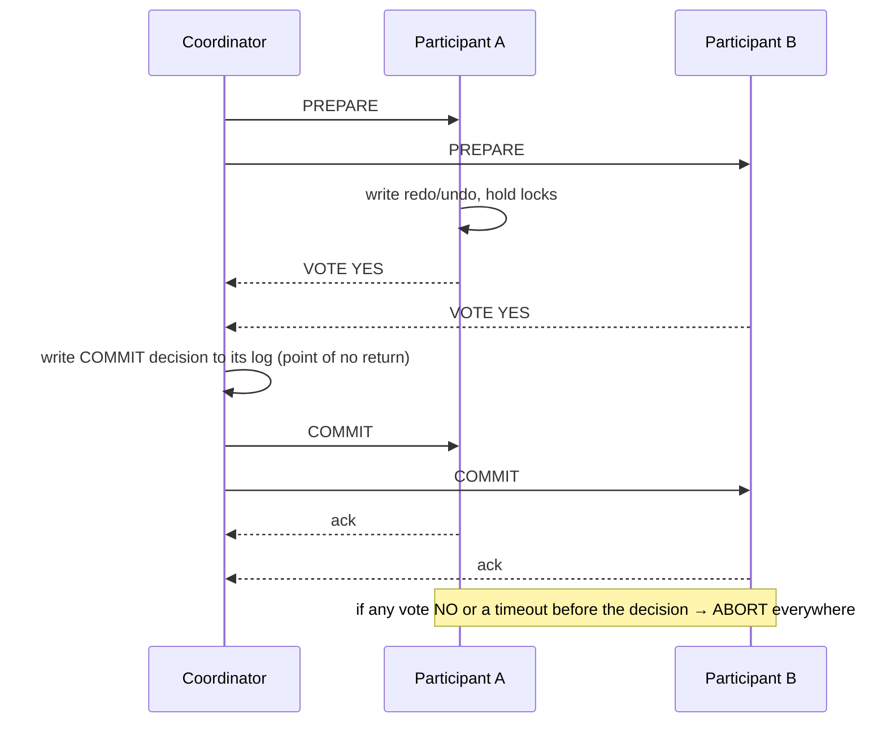
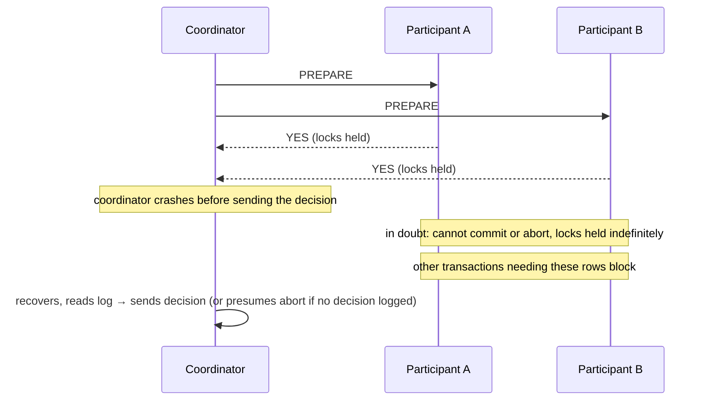
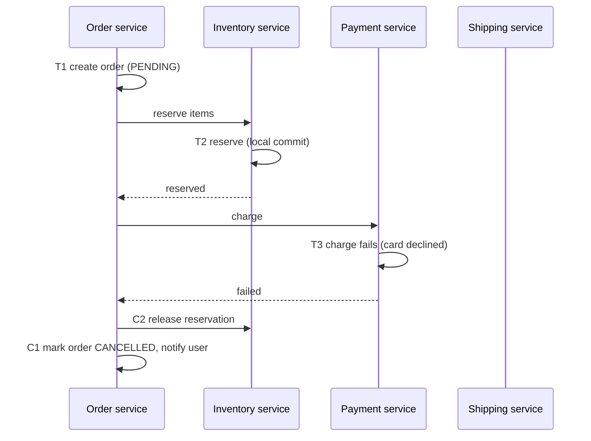
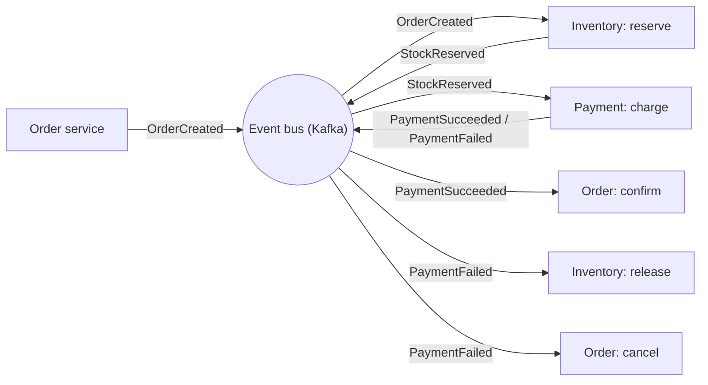
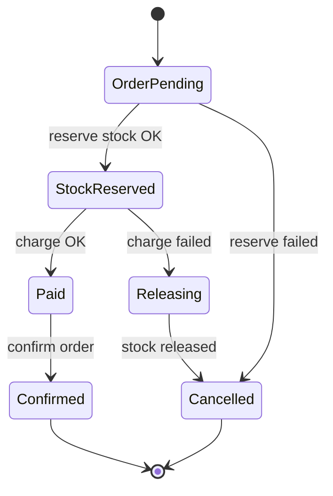
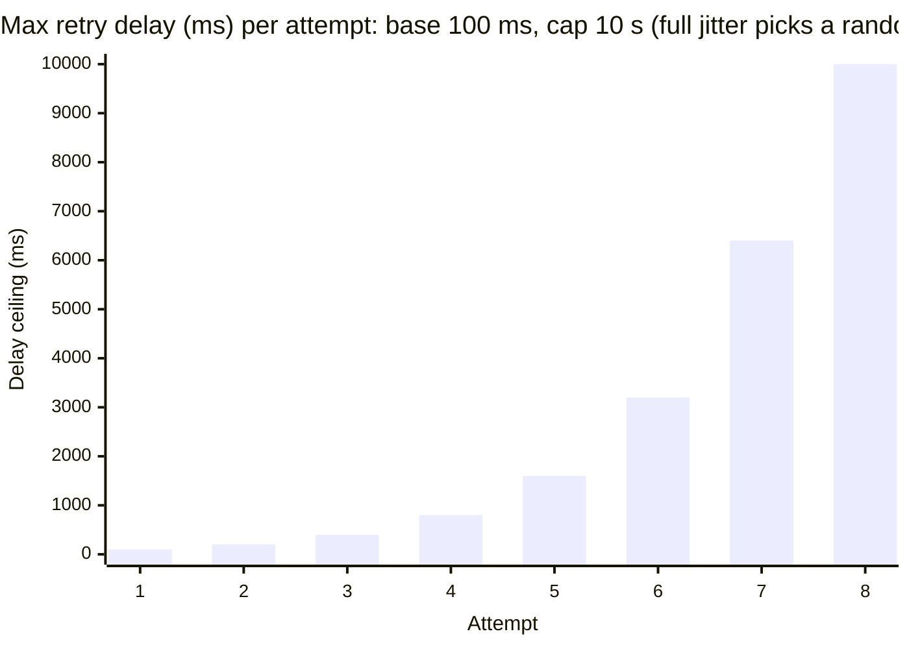

## Replication, failure detection & recovery (delivery, locks, transactions)

### Exactly-once semantics — hardest: Kafka transactions + idempotent producer + consumer isolation
"Exactly-once" means each message's **effect** happens exactly once, even with retries and failures. True exactly-once *delivery* over an unreliable network is impossible, so systems achieve **exactly-once processing** via idempotence plus atomic commits: Kafka's idempotent producer, transactions and read-committed consumers within Kafka, or at-least-once delivery plus idempotent side effects everywhere else.

#### Intuition
You cannot guarantee that a letter is delivered exactly once, because you never know whether the reply got lost. What you can guarantee is that opening the same letter twice changes nothing the second time.

#### Must know
- Exactly-once **delivery** is impossible over an unreliable network. Systems provide exactly-once **effects**.
- The recipe: **at-least-once delivery + idempotent processing + an atomic commit of output and progress**.
- Inside Kafka: idempotent producer, transactions, and consumers reading only committed data.
- A Kafka transaction writes the output messages and the consumer offset **atomically**.
- The guarantee **stops at Kafka's boundary**. An external database needs idempotent upserts, or the offset stored in the same transaction as the result.

#### Common mistakes
- Promising exactly-once delivery.
- Enabling Kafka exactly-once and assuming the write to Postgres is covered too.
- Consumers left on the default isolation level, which reads aborted messages.

#### How it works


Building blocks:
- **Idempotent producer** (`enable.idempotence=true`): the broker dedupes retries by (producer id, sequence number) per partition.
- **Transactions** (`transactional.id`): atomically write to multiple partitions **and** commit consumer offsets.
- **Consumers** with `isolation.level=read_committed` skip aborted data.
- Kafka Streams: `processing.guarantee=exactly_once_v2`.

Beyond Kafka (writing to a DB or calling an API): use **at-least-once + idempotent sinks**. Store the consumed offset and the result in the same DB transaction, upsert with keys, or use idempotency keys.

#### Example
A payments analytics pipeline in Kafka Streams aggregates transaction amounts per merchant per minute with `exactly_once_v2`, so a crash mid-processing never double-counts. The aggregates then go to Postgres via a sink that upserts on `(merchant_id, minute)`, making the external write idempotent. The whole pipeline gives exactly-once results.

#### Trade-offs
Correct results without manual dedupe inside Kafka, at the cost of latency (transaction commits, read_committed waits) and complexity. It doesn't extend automatically to external systems.

#### Problems & fixes
| Symptom | Cause | Fix |
|---|---|---|
| Duplicates in output topic after producer retries | idempotence disabled | `enable.idempotence=true` (default in newer clients) |
| Downstream sees aborted messages | consumers on read_uncommitted | `isolation.level=read_committed` |
| Duplicates in external DB despite Kafka EOS | EOS stops at Kafka boundary | idempotent upserts / offsets stored with results |
| Zombie instance writes after failover | no transactional.id fencing | stable transactional.id per instance/partition |

#### Cheat sheet
- Exactly-once delivery is impossible. Exactly-once **effects** come from idempotence plus atomic commits.
- Kafka: idempotent producer + transactions + read_committed (Streams EOS v2).
- External sinks: idempotent writes or offsets stored with results.

#### Interview questions
<details><summary>Is exactly-once delivery possible? What do systems actually provide?</summary>

Over unreliable networks a sender can't know whether a message was received when the ack is lost, so it must retry (risking duplicates) or not (risking loss), and pure exactly-once delivery is impossible. Systems provide exactly-once processing: at-least-once delivery combined with deduplication or idempotent operations and atomic commits of output plus progress (Kafka transactions, or a DB transaction storing the offset with the result).
</details>

<details><summary>How would you get exactly-once results consuming from Kafka and writing to PostgreSQL?</summary>

Within one DB transaction, apply the effect (upsert keyed by a natural or event id) and store the consumer's processed offset per partition in a table. On restart, seek to the stored offsets instead of Kafka's committed ones. Duplicated deliveries are then either skipped (offset already applied) or harmless (idempotent upserts). Alternatively, dedupe on event id with a unique constraint.
</details>

#### Interview angle
> "Exactly-once means exactly-once effects. Inside Kafka I use idempotent producers, transactions and read_committed. At external sinks I use idempotent upserts or store offsets in the same DB transaction."

#### Sources
- [Message delivery semantics](https://kafka.apache.org/documentation/#semantics) — Apache Kafka docs
- [Exactly-once semantics are possible: here's how Kafka does it](https://www.confluent.io/blog/exactly-once-semantics-are-possible-heres-how-apache-kafka-does-it/) — Confluent

### Idempotency key pattern — include unique key in request; server deduplicates and returns same result
The idempotency key pattern makes any mutating request safe to retry: the client attaches a **unique key per logical operation**, and the server records the key with the outcome. Repeats return the stored outcome instead of re-executing. It's the universal fix for duplicate side effects in HTTP APIs, message consumers and inter-service calls. (Phase 1 covers HTTP API usage in detail.)

#### Intuition
A cheque number. If the same cheque is presented twice, the bank sees the number has already been paid and does not pay again.

#### Must know
- The client attaches **one unique key per logical operation** and reuses it on every retry.
- The server stores the key with the outcome. A repeat **returns the stored outcome** and does not run again.
- Enforce it with a **unique constraint**, not a check followed by an insert.
- Handle the in-between cases: same key still in progress, and same key with a different payload.
- Derive keys for downstream calls, so the whole chain is safe to retry.

#### Numbers to quote
- Keys are typically kept for 24 hours to 7 days, long enough to cover every retry.

#### Common mistakes
- Generating a new key on each retry.
- Check-then-insert, which lets two concurrent retries both pass.
- The server generating the key, so a retried request looks new.

#### How it works


Where keys come from:
- **APIs**: client-generated UUID per user action (`Idempotency-Key` header).
- **Messages**: event id (producer-assigned, stable across retries).
- **Natural keys**: `(order_id, step)`, `(user_id, date)` for daily jobs.
- **Downstream calls**: derived keys (`K + ":charge"`) so the whole chain is idempotent.

#### Example
A saga's "reserve inventory" step is invoked via a message that may be redelivered. The inventory service uses `reservation_id = order_id + ":reserve"` as an idempotency key with a unique constraint. A redelivered message finds the existing reservation and returns success without double-reserving stock, so the saga can retry steps freely.

#### Trade-offs
Small storage and logic overhead (key store, TTL, handling in-progress keys), in exchange for safe retries everywhere.

#### Problems & fixes
| Symptom | Cause | Fix |
|---|---|---|
| Duplicates despite keys | non-atomic check-then-insert | unique constraint / conditional put |
| Keys generated per retry | client creates new key on each attempt | generate once per user action, persist client-side |
| Stuck in-progress keys after crash | process died mid-operation | lease/expiry + reconcile with downstream |
| Key store grows forever | no TTL | expire after retry window (e.g. 24 h–7 days) |

#### Cheat sheet
- One key per logical operation, reused for every retry.
- Atomic insert (unique constraint) + stored response + payload hash.
- Derive keys for downstream calls. Expire keys after the retry window.

#### Interview questions
<details><summary>Where should idempotency keys be generated, the client or the server?</summary>

By the originator of the logical operation, typically the client (or the upstream service), and before the first attempt, so all retries carry the same key. If the server generated a new key per request, a retried request would get a new key and be processed again, defeating the purpose.
</details>

<details><summary>How do you handle a second request with the same key while the first is still processing?</summary>

The unique insert marks the key IN_PROGRESS. The second request sees that state and returns 409 Conflict (or waits briefly and then returns the stored result), never executing concurrently. A lease timeout plus reconciliation resolves keys left in progress by crashed workers.
</details>

#### Interview angle
> "Every mutating operation, API or message, carries a stable idempotency key enforced by a unique constraint, with derived keys for downstream calls. Retries are safe end to end."

#### Sources
- [Idempotent requests](https://docs.stripe.com/api/idempotent_requests) — Stripe API docs
- [Making retries safe with idempotent APIs](https://aws.amazon.com/builders-library/making-retries-safe-with-idempotent-APIs/) — Amazon Builders' Library

### Distributed locks — Redis Redlock (quorum on N instances), Zookeeper ephemeral node, etcd lease
A distributed lock gives one process at a time exclusive rights to a resource across many machines. Implementations: **Redis** (`SET NX PX`, or Redlock across N instances), **ZooKeeper** (ephemeral sequential znodes), **etcd** (leases + revisions), and **databases** (row locks, advisory locks). For correctness, every lock must be combined with **fencing** or idempotent operations. (Phase 3 covers Redlock's mechanics.)

#### Intuition
A "talking stick" passed round a meeting so that only one person speaks at a time. It works while everyone can see who holds it. If someone dozes off holding it and a second stick appears, two people talk at once.

#### Must know
- A distributed lock gives **one process at a time** the right to do something, across machines.
- First ask what it is for. **Efficiency** (avoid duplicate work): a Redis `SET NX PX` is fine.
- **Correctness** (a double run does damage): use etcd or ZooKeeper **with a fencing token** that the resource checks.
- If the data is in one database, a row lock or a conditional update is simpler and safer.
- Often the best design has no lock: give each key a single owner, or make the operation idempotent.

#### Common mistakes
- A Redis lock alone guarding a payment.
- A lock with no TTL or lease, so a crashed holder blocks everyone.
- One global lock that every request must take.

#### How it works


| Option | Safety | Notes |
|---|---|---|
| Redis single node | efficiency only | lost on failover (async replication) |
| Redlock (5 masters) | debated | assumes bounded clock drift and pauses |
| ZooKeeper / etcd | strong + fencing (zxid / revision) | sessions/leases detect holder death |
| DB row/advisory lock | strong within that DB | ties lock to the data's transaction |

#### Example
- **Nightly report job across 6 instances**: ShedLock (backed by a DB table or Redis) ensures it runs once. An occasional double run is harmless.
- **Assigning a unique coupon pool to one worker**: an etcd lock with the revision as a fencing token, and the coupons table only accepts writes with `fence >= current`.
- **Per-account operations**: no global lock at all, just `SELECT … FOR UPDATE` on the account row inside the transaction.

#### Trade-offs
Locks simplify coordination but add latency, a dependency (lock service availability) and subtle failure modes (expiry during pauses). Often the better design avoids locks: partition work by key (single owner), use conditional writes, or queue operations.

#### Problems & fixes
| Symptom | Cause | Fix |
|---|---|---|
| Two holders after GC pause | lease expired, no fencing | fencing tokens / idempotent writes |
| Lock lost on Redis failover | async replication | consensus store for correctness locks |
| Lock never released | holder crashed, no TTL | TTL/lease, session-bound locks |
| Contention bottleneck | one global lock | finer-grained locks per key, partitioned ownership |

#### Cheat sheet
- Efficiency lock: Redis SET NX PX. Correctness lock: etcd/ZK + fencing.
- Prefer DB row locks or conditional writes when data lives in one DB.
- Best lock is no lock: partition ownership, idempotency.

#### Interview questions
<details><summary>How would you ensure a scheduled job runs only once across many instances?</summary>

Use a lock with a lease: ShedLock or a DB/Redis lock acquired at the scheduled time with a TTL longer than the job's runtime, held by one instance. Or run the scheduler as a single leader elected via Kubernetes leases or etcd, or use a managed scheduler (EventBridge, a Kubernetes CronJob with `concurrencyPolicy: Forbid`). Make the job idempotent anyway, because locks can fail.
</details>

<details><summary>Why do experts warn against relying on Redlock for correctness?</summary>

Its safety assumes bounded network delay, process pauses and clock drift. A client can pause (GC) past the lock's TTL, another client acquires it, and both proceed. Redis doesn't provide a monotonically increasing fencing token for resources to reject stale holders. For correctness, use consensus-based locks with fencing, or design operations to be idempotent and conditionally written.
</details>

#### Interview angle
> "For efficiency locks I'd use a Redis SET NX with a TTL. For correctness I'd use etcd leases whose revision is a fencing token the resource checks, and often avoid locks entirely by partitioning ownership by key."

#### Sources
- [How to do distributed locking](https://martin.kleppmann.com/2016/02/08/how-to-do-distributed-locking.html) — Martin Kleppmann
- [Distributed locks with Redis](https://redis.io/docs/latest/develop/clients/patterns/distributed-locks/) — Redis docs

### Distributed transactions — 2PC (coordinator blocks on failure), Saga (compensating transactions)
A distributed transaction spans multiple databases or services that must all commit or all abort. The two main approaches: **Two-Phase Commit (2PC)**, which gives atomic all-or-nothing but blocks on coordinator failure and couples availability, and **Sagas**, a sequence of local transactions with compensations, which are eventually consistent but scalable and resilient. Modern microservices overwhelmingly choose sagas.

#### Intuition
Booking a flight, a hotel and a car from three companies. Either you get all three to hold your booking until you say "confirm all" (and they wait on you), or you book one after another and cancel the earlier ones if a later one fails.

#### Must know
- One business operation spans several databases or services that must all succeed or all be undone.
- **2PC**: atomic, but participants hold locks and block if the coordinator fails.
- **Saga**: a chain of local transactions with compensating actions. Eventually consistent.
- Microservices **default to sagas**. 2PC belongs inside one database or a distributed SQL engine.
- Both need idempotent steps and durable state.

#### Common mistakes
- Proposing 2PC across independent services or external companies.
- A saga with no compensation for a step.
- Forgetting that a saga exposes intermediate states to other requests.

#### How it works


| | 2PC | Saga |
|---|---|---|
| Consistency | atomic, isolated | eventual. Intermediate states visible |
| Failure behaviour | participants block if coordinator dies after prepare | continue or compensate |
| Coupling | all participants must be up and support XA | async, loosely coupled |
| Throughput | locks held across network round trips | local transactions only |
| Use | within one DB cluster / distributed SQL, legacy XA | microservices, cross-company flows |

Distributed SQL databases (Spanner, CockroachDB) implement 2PC **over consensus groups**, so a participant is itself fault-tolerant, which removes the classic blocking problem.

#### Example
Booking a trip (flight + hotel + car, three providers): 2PC is impossible (external companies won't hold XA locks for you). A saga reserves each in turn and, if the car rental fails, cancels the hotel and flight via compensating calls. Users see "booking in progress", then confirmation or a refund.

#### Trade-offs
2PC is correct and simple to reason about but fragile and slow at scale. Sagas need explicit compensations, idempotency, and handling of non-isolated intermediate states.

#### Problems & fixes
| Symptom | Cause | Fix |
|---|---|---|
| Locks stuck, DB hanging | 2PC coordinator crashed in-doubt | avoid XA across services, coordinator HA + recovery logs |
| Partial completion after crash | saga step lost | outbox + durable orchestrator state |
| Duplicate steps on retry | non-idempotent participants | idempotency keys per step |
| Anomalies from visible intermediate state | saga lacks isolation | semantic locks (PENDING flags), commutative updates, reordering steps |

#### Cheat sheet
- 2PC = atomic but blocking and coupled. Fine inside a DB or distributed SQL.
- Saga = local transactions + compensations, eventually consistent. Default for microservices.
- Both need idempotency and durable state.

#### Interview questions
<details><summary>Why don't microservices use 2PC for cross-service transactions?</summary>

It requires every service's database to support XA and participate synchronously, holds locks across network round trips (killing throughput), blocks if the coordinator fails after prepare, and makes all services' availability multiply together. Sagas use local transactions plus asynchronous messages and compensations, which fits independent services and tolerates partial failures.
</details>

<details><summary>What does "lack of isolation" mean for sagas, and how do you mitigate it?</summary>

Intermediate states are visible to other transactions: an order may appear "reserved" and later be cancelled, or stock may be temporarily held. Others can read or act on these states (dirty reads at the business level). Mitigations: explicit PENDING statuses (semantic locks), designing commutative operations, ordering steps so the riskiest or pivot step comes before irreversible ones, and re-validating at critical points.
</details>

#### Interview angle
> "Across microservices I'd run a saga with an outbox, idempotent steps and compensations. 2PC only appears inside a distributed SQL database where participants are consensus groups."

#### Sources
- [Saga pattern](https://microservices.io/patterns/data/saga.html) — microservices.io
- [Saga distributed transactions pattern](https://learn.microsoft.com/en-us/azure/architecture/patterns/saga) — Azure Architecture Center

### Two-phase commit — Phase 1: prepare (all vote), Phase 2: commit (if all yes) / abort (if any no)
Two-Phase Commit is the classic atomic commitment protocol. In **phase 1 (prepare)** the coordinator asks every participant to make the transaction durable but uncommitted and vote yes or no. In **phase 2**, if all voted yes, the coordinator logs COMMIT and tells everyone to commit. If anyone voted no (or timed out), it tells everyone to abort.

#### Intuition
A wedding. The officiant asks each person "do you?" and only when both have said "I do" declares them married. If either says no, there is no marriage. After saying "I do", neither can change their mind while waiting for the declaration.

#### Must know
- **Phase 1 (prepare)**: the coordinator asks every participant to make the change durable and vote yes or no.
- **Phase 2**: all yes → commit everywhere. Any no or timeout → abort everywhere.
- A **yes vote is a promise**. The participant must hold its locks until it learns the outcome.
- The coordinator's logged decision is the point of no return.
- Costs: two round trips, locks held throughout, and every participant must support it.

#### Common mistakes
- Thinking a participant can time out and abort on its own after voting yes.
- Confusing two-phase commit with two-phase locking.
- Using it on a hot path and wondering where the throughput went.

#### How it works


Rules:
- A participant that voted YES **must** be able to commit later, so it persists the prepared state and holds locks, and can't change its mind.
- The coordinator's durable decision log is the source of truth for recovery.
- Implementations: XA transactions (JTA in Java across DB + JMS), PostgreSQL `PREPARE TRANSACTION`, internal 2PC in Spanner, CockroachDB and Kafka transactions (via the transaction coordinator).

#### Example
A legacy Java EE app updates an Oracle DB and sends to an IBM MQ queue atomically using XA via the application server's transaction manager. It works, but under load the prepare round trips and long-held locks reduced throughput, and coordinator crashes left "in-doubt" transactions requiring manual resolution. The modernised version uses the outbox pattern instead.

#### Trade-offs
Atomicity across resources, but the latency of two rounds, locks held during the protocol, blocking on coordinator failure, and every participant must support it.

#### Problems & fixes
| Symptom | Cause | Fix |
|---|---|---|
| In-doubt transactions holding locks | coordinator crashed after prepare | coordinator recovery from log, HA coordinator, manual heuristic resolution as last resort |
| Throughput collapse under load | locks held across prepare/commit | avoid 2PC on hot paths, outbox pattern |
| Orphaned prepared transactions in Postgres | app crashed mid-protocol | monitor `pg_prepared_xacts`, cleanup procedures |

#### Cheat sheet
- Prepare (vote, persist, hold locks) → coordinator decides → commit/abort.
- YES vote is a promise: can't back out.
- The coordinator log is critical. Avoid on hot paths and across services.

#### Interview questions
<details><summary>What's the "point of no return" in 2PC?</summary>

When the coordinator durably logs the COMMIT decision after receiving all YES votes. From then on the transaction must commit everywhere, even across crashes, and recovery replays the decision to participants. Before that point, any failure leads to abort.
</details>

<details><summary>Why must a participant hold locks after voting YES?</summary>

By voting YES it promises it can commit whatever the coordinator decides. If it released locks, other transactions could change the data, making a later commit inconsistent or impossible. So it holds locks (and the prepared state) until it learns the outcome, which is why coordinator delays directly block other work.
</details>

#### Interview angle
> "2PC is prepare and vote, then a logged commit decision. YES votes hold locks until the outcome arrives, which is why I keep it inside databases that do it over consensus and use outboxes and sagas between services."

#### Sources
- [Two-phase commit protocol](https://en.wikipedia.org/wiki/Two-phase_commit_protocol) — Wikipedia
- [Two-phase commit](https://martinfowler.com/articles/patterns-of-distributed-systems/two-phase-commit.html) — Unmesh Joshi, martinfowler.com
- [PREPARE TRANSACTION](https://www.postgresql.org/docs/current/sql-prepare-transaction.html) — PostgreSQL docs

### Two-phase commit blocking problem — if coordinator crashes after prepare, cohorts wait forever
2PC is a **blocking protocol**: if the coordinator crashes after participants voted YES but before they learn the decision, those participants are **in doubt**. They can't commit (maybe someone voted no) and can't abort (maybe the coordinator decided commit), so they hold locks and wait until the coordinator recovers. One failure stalls everything touching those rows.

#### Intuition
Both people have said "I do" and the officiant faints before pronouncing anything. Nobody knows whether they are married. Neither can walk away, and the hall stays booked until the officiant wakes up.

#### Must know
- If the coordinator crashes **after the yes votes but before announcing the decision**, participants are **in doubt**.
- They cannot commit (someone may have voted no) and cannot abort (the decision may have been commit).
- They **hold their locks** until the coordinator recovers, which blocks everything touching those rows.
- Fix 1: make the coordinator fault-tolerant by replicating its decision with consensus. Spanner and CockroachDB do this.
- Fix 2: avoid 2PC between services and use a saga.

#### Common mistakes
- Suggesting a timeout-and-abort to escape the wait. It breaks atomicity.
- Offering three-phase commit as the practical answer. It is rarely used.
- An operator manually committing in-doubt transactions by guesswork.

#### How it works


Mitigations:
- **Highly available coordinator**: replicate the coordinator's decision log via consensus (Spanner and CockroachDB make each participant and coordinator a Paxos/Raft group).
- **Cooperative termination**: participants ask each other. If any knows the decision or voted NO, they can resolve, but not if all voted YES and none knows.
- **Three-phase commit (3PC)**: non-blocking under some assumptions (no partitions, bounded delays), rarely used in practice.
- **Avoid 2PC** across independent services: sagas, outbox.

#### Example
An XA transaction spanning two databases: the transaction manager (in an app server) crashed during a deploy right after prepare. Rows on both DBs stayed locked, and checkout requests touching those products hung until an operator manually committed the in-doubt transactions (after checking logs). The redesign removed XA in favour of an outbox and idempotent consumers.

#### Trade-offs
The blocking is inherent to 2PC's guarantee. Removing it requires replicating the decision (consensus) or giving up atomic commit (sagas).

#### Problems & fixes
| Symptom | Cause | Fix |
|---|---|---|
| Rows locked for minutes/hours | in-doubt participants | HA coordinator with durable replicated log, monitoring + runbooks |
| Manual heuristic commits cause inconsistency | operators guessing outcomes | rely on coordinator logs, consensus-backed commit |
| Fragile cross-service workflows | 2PC across services | sagas + outbox |

#### Cheat sheet
- Coordinator dies after prepare → participants in doubt → locks held → blocking.
- Fix: replicate the coordinator decision (consensus), or avoid 2PC (sagas).
- 3PC is theoretical, rarely used.

#### Interview questions
<details><summary>Why can't participants just time out and abort after voting YES?</summary>

The coordinator might already have decided COMMIT and told other participants, who committed. If an in-doubt participant unilaterally aborted, some participants would have committed and others aborted, violating atomicity. Having voted YES, it must wait for the real decision.
</details>

<details><summary>How do Spanner and CockroachDB avoid 2PC's blocking problem?</summary>

Every participant (and the coordinator's transaction record) is a consensus-replicated group, not a single machine. If a leader fails, a new leader of the same group takes over with the full prepared state and decision log, so the protocol continues instead of waiting for one crashed node to come back.
</details>

#### Interview angle
> "2PC blocks when the coordinator dies after prepare. That's why I'd only accept it where participants and the coordinator are consensus-replicated, like distributed SQL, and use sagas everywhere else."

#### Sources
- [Two-phase commit protocol: disadvantages](https://en.wikipedia.org/wiki/Two-phase_commit_protocol) — Wikipedia
- [Spanner: Google's globally distributed database](https://research.google/pubs/spanner-googles-globally-distributed-database-2/) — Google Research

### Saga pattern — sequence of local transactions with compensating transactions on failure
A saga breaks a business transaction spanning several services into a **sequence of local transactions**, each committed in its own service's database and triggering the next step. If a step fails, the saga runs **compensating transactions** to semantically undo the completed steps. The result is eventual consistency without distributed locks.

#### Intuition
Planning a trip one booking at a time. If the hotel falls through after the flight is booked, you do not "un-happen" the flight. You cancel it and take the refund. Each cancellation is its own action.

#### Must know
- A business transaction becomes a **sequence of local transactions**, each committed in its own service.
- If a step fails, **compensating transactions** undo the completed steps in business terms (refund, release, cancel).
- Step types: **compensatable** → **pivot** (the go / no-go step) → **retryable** (must eventually succeed).
- Every step and every compensation must be **idempotent**.
- There is **no isolation**: other requests can see the intermediate state, so expose a PENDING status.

#### Common mistakes
- An irreversible step (sending an email, shipping) placed before the pivot.
- A compensation that can fail permanently, with no retry.
- No timeout, so a saga waits forever for a reply that was lost.

#### How it works


Design rules:
- **Compensations** are business undos (refund, release, cancel), not technical rollbacks, and must be idempotent and retryable.
- Classify steps: **compensatable** (can be undone), **pivot** (the go/no-go point, e.g. charging), and **retryable** (after the pivot, must eventually succeed, e.g. shipping notification).
- Persist saga state (orchestrator DB or event log), and use the outbox to publish steps reliably.
- Coordination styles: **choreography** (events) or **orchestration** (central coordinator).

#### Example
A food-delivery order saga: create order → authorise payment (hold) → restaurant accepts → assign rider → capture payment. If the restaurant rejects, void the authorisation and cancel the order. If no rider is found in 10 minutes, ask the restaurant to cancel, void the payment and notify the user. Each step is a local transaction with an outbox event, and a timeout scheduler drives the waiting steps.

#### Trade-offs
Scalable and resilient, with no cross-service locks, but no isolation (intermediate states visible), compensation logic for every step, and harder debugging (distributed state).

#### Problems & fixes
| Symptom | Cause | Fix |
|---|---|---|
| Saga stuck mid-way | lost message / crashed participant | outbox, retries, timeouts, orchestrator recovery |
| Double charge/refund on retry | non-idempotent steps | idempotency keys per step |
| Compensation impossible (email already sent) | irreversible step too early | place irreversible steps after the pivot, send "corrections" |
| Users see inconsistent intermediate states | lack of isolation | PENDING states in UI, semantic locks |

#### Cheat sheet
- Local transactions + events/commands + compensations.
- Compensatable → pivot → retryable step ordering.
- Idempotent steps, persisted saga state, outbox, timeouts.

#### Interview questions
<details><summary>Design the saga for "place order" with inventory and payment services.</summary>

The order service creates the order PENDING and emits OrderCreated (outbox). Inventory reserves stock and emits StockReserved, or StockFailed, which cancels the order. Payment charges the customer (pivot) and emits PaymentSucceeded, which confirms the order, or PaymentFailed, which triggers inventory releasing stock and cancelling the order. Every handler is idempotent and keyed by order id. Timeouts handle missing replies, and an orchestrator or state table tracks progress for observability.
</details>

<details><summary>What makes a good compensating transaction?</summary>

It semantically undoes the effect (refund, release, cancel) rather than deleting history, is idempotent (safe to run multiple times), always eventually succeeds (retried until done), and is recorded for audit. Some actions can't be undone (emails, shipped parcels), so design them after the pivot or compensate with a follow-up action (a correction email, a return flow).
</details>

#### Interview angle
> "Cross-service workflows are sagas: local transactions with outbox events, idempotent steps keyed by order id, compensations for everything before the pivot, and timeouts so nothing gets stuck."

#### Sources
- [Saga pattern](https://microservices.io/patterns/data/saga.html) — microservices.io
- [Saga distributed transactions pattern](https://learn.microsoft.com/en-us/azure/architecture/patterns/saga) — Azure Architecture Center

### Saga choreography — services react to events published by previous service (loose coupling)
In a choreographed saga there's **no central coordinator**: each service listens for domain events and decides what to do next, publishing its own events. The workflow emerges from these reactions. It's loosely coupled and simple for short flows, but hard to see, change and debug as it grows.

#### Intuition
A relay race with no coach on the track. Each runner starts when they see the baton arrive. It runs smoothly while the route is short, but if a baton is dropped, nobody has the overall picture of where the race stopped.

#### Must know
- **No central coordinator.** Each service reacts to events and publishes its own.
- Loosely coupled, and adding a step is just adding a subscriber.
- Good for **short, stable flows** of two to four steps.
- The workflow is spread across services, so it is hard to see, change and debug.
- Add a correlation id and a status view, so "where is this order stuck?" has an answer.

#### Common mistakes
- Using it for a long flow with branches and timeouts.
- Services reacting to each other's events in a loop.
- No way to see the overall state of one order.

#### How it works


#### Example
A 3-step order flow at a startup works nicely with choreography: services stay independent, and adding "send confirmation email" is just a new subscriber to `OrderConfirmed`. Two years later the flow has 9 steps, fraud checks, partial shipments and timeouts. Nobody can answer "where is order 981 stuck?" without reading five services' logs, and changing the order of steps touches several teams. That's the classic signal to move to orchestration (or add a saga-tracking view).

#### Trade-offs
| Pros | Cons |
|---|---|
| no single point of control/failure | workflow logic scattered across services |
| loose coupling, easy to add subscribers | hard to visualise, monitor, change |
| natural for event-driven systems | cyclic dependencies and event chains risk |

#### Problems & fixes
| Symptom | Cause | Fix |
|---|---|---|
| "Where is this order stuck?" | no central state | correlation ids, distributed tracing, saga status projection |
| Events trigger loops | services reacting to each other's events cyclically | clear event ownership, avoid bidirectional reactions |
| Changing step order needs many teams | logic spread out | switch to orchestration for complex flows |
| Missing step after a failure | lost events | outbox, at-least-once, idempotent handlers, timeouts |

#### Cheat sheet
- Services react to each other's events. No coordinator.
- Good for short, stable flows with few participants.
- Add correlation ids, tracing and a status projection. Switch to orchestration when complex.

#### Interview questions
<details><summary>When would you choose choreography over orchestration for a saga?</summary>

When the flow is short (2–4 steps), stable, and the participating services are already event-driven and owned by different teams who want loose coupling. Each service simply reacts to events. For long, branching flows with timeouts and complex compensation, orchestration is easier to understand and operate.
</details>

<details><summary>How do you monitor a choreographed saga?</summary>

Propagate a correlation id (order id, trace id) in all events, use distributed tracing across consumers, and build a saga-status projection: a service or stream job that consumes all related events and maintains the current state per order, with alerts for sagas stuck beyond a timeout in any state.
</details>

#### Interview angle
> "Short event-driven flows use choreography with correlation ids and a status projection. Once a flow branches or needs timeouts, I move it to an orchestrator so the workflow lives in one place."

#### Sources
- [Saga pattern: choreography-based saga](https://microservices.io/patterns/data/saga.html) — microservices.io
- [Choreography pattern](https://learn.microsoft.com/en-us/azure/architecture/patterns/choreography) — Azure Architecture Center

### Saga orchestration — central saga orchestrator explicitly calls each service (easier to monitor)
In an orchestrated saga a **central orchestrator** (a service or workflow engine) holds the saga's state machine and **explicitly commands** each participant ("reserve stock", "charge payment"), waits for replies, and triggers compensations on failure. Workflow logic lives in one place, so it's easy to understand, monitor and change.

#### Intuition
A conductor in front of the orchestra. The conductor knows the whole score, cues each section in turn, and knows exactly where to restart if someone misses an entry.

#### Must know
- A **central orchestrator** holds the workflow's state machine and tells each service what to do.
- The logic lives in one place, so it is easy to read, monitor and change.
- It handles retries, timeouts and compensations explicitly.
- Its state must be **durable**. Use a workflow engine (Temporal, AWS Step Functions, Camunda) or a saga table plus an outbox.
- Best for **long, branching flows with waits**, such as loans and refunds.

#### Common mistakes
- Keeping the orchestrator's state in memory.
- Moving all business rules into the orchestrator, which turns it into a new monolith.
- Participants that are not idempotent, so a retried command runs twice.

#### How it works


Implementations: a custom orchestrator with a saga table (state, step, retries) plus an outbox, or workflow engines: **Temporal**, **Camunda/Zeebe**, **AWS Step Functions**, **Netflix Conductor**. These provide durable state, retries, timers and visibility.

```java
// Temporal-style workflow: durable, retried, resumable after crashes
public void placeOrder(Order o) {
  inventory.reserve(o.id());                       // activity with retry policy
  try {
    payments.charge(o.id(), o.total());            // pivot
  } catch (ActivityFailure e) {
    inventory.release(o.id());                     // compensation
    orders.cancel(o.id());
    return;
  }
  orders.confirm(o.id());
  shipping.schedule(o.id());                       // retryable after pivot
}
```

#### Example
A loan-disbursement flow at a fintech (KYC check → credit score → approval → agreement e-sign → disbursement → ledger posting, with human approval steps and 48-hour timeouts) runs on Temporal. Ops dashboards show each application's current step, failures retry with backoff, and compensations (cancel e-sign, reverse disbursement) are explicit code paths. Auditors can see the full history per application.

#### Trade-offs
Centralised logic and visibility, with timers and retries built in, but the orchestrator is a critical component (it must be HA and durable), and there's a risk of a "god service" coupling everything and accumulating business logic that belongs in participants.

#### Problems & fixes
| Symptom | Cause | Fix |
|---|---|---|
| Orchestrator crash loses progress | in-memory state | durable state (DB/outbox, or a workflow engine) |
| Orchestrator becomes a monolith | domain logic moved into it | orchestrator decides sequence, participants own business rules |
| Long-running waits clog threads | blocking implementation | durable timers (Temporal/Step Functions) |
| Duplicate commands on retries | participants not idempotent | idempotency keys per step |

#### Cheat sheet
- A central state machine sends commands and drives compensations.
- Durable state (workflow engine or saga table + outbox). Idempotent participants.
- Best for long, branching, timeout-heavy flows. Watch for god-service creep.

#### Interview questions
<details><summary>Why use a workflow engine like Temporal instead of hand-rolling an orchestrator?</summary>

Workflow engines provide durable execution (workflow state survives crashes and deploys), automatic retries with policies, durable timers for long waits (hours or days), versioning of workflow code, and built-in visibility into each instance's history. Hand-rolled orchestrators must rebuild all of that (state tables, schedulers, retry logic, recovery), which is error-prone.
</details>

<details><summary>Orchestration vs choreography for a payment refund flow involving 6 services and manual approval: which and why?</summary>

Orchestration: the flow has many steps, a human approval wait, timeouts and compensations, and needs auditability, so one place should hold the state machine and history. Choreography would scatter that logic across six services and make tracking a refund's status painful.
</details>

#### Interview angle
> "Long, branching workflows with timeouts, like disbursements and refunds, run on an orchestrator such as Temporal or Step Functions: durable state, retries, timers and full per-instance history, while participants stay idempotent and own their business rules."

#### Sources
- [Saga pattern: orchestration-based saga](https://microservices.io/patterns/data/saga.html) — microservices.io
- [What is a Temporal workflow?](https://docs.temporal.io/workflows) — Temporal docs
- [What is Step Functions?](https://docs.aws.amazon.com/step-functions/latest/dg/welcome.html) — AWS Step Functions developer guide

### Exponential backoff + jitter — prevent retry storms: wait = min(cap, base × 2^attempt) + rand(0, base)
When a call fails transiently, retrying immediately (or at fixed intervals) from many clients creates **synchronised retry storms** that overwhelm a recovering service. **Exponential backoff** spaces retries out (doubling the wait each attempt, up to a cap), and **jitter** randomises the waits so clients don't retry in lockstep.

#### Intuition
A busy phone line. If everyone who got the engaged tone redials after exactly ten seconds, they all collide again. If each person waits a bit longer every time, and a different random amount, the calls spread out and get through.

#### Must know
- **Backoff**: double the wait after each failed attempt, up to a cap.
- **Jitter**: randomise the wait, so clients that failed together do not retry together.
- Full jitter: `sleep = random(0, min(cap, base × 2^attempt))`.
- Retry only **transient** errors, and only **idempotent** operations.
- Cap the attempts, retry at **one layer** only, and pair it with a circuit breaker.

#### Numbers to quote
- Three layers that each retry 3 times can turn one request into 27.

#### Common mistakes
- Fixed-interval retries, which arrive in synchronised waves.
- Retrying a 400-class validation error that will never succeed.
- Retrying a non-idempotent call with no idempotency key.

#### How it works


Variants (from AWS's analysis):
- **Full jitter**: `sleep = random(0, min(cap, base × 2^attempt))` (recommended default).
- **Equal jitter**: half fixed, half random.
- **Decorrelated jitter**: `sleep = min(cap, random(base, previous_sleep × 3))`.

Rules that go with it:
- Retry only **transient** errors (timeouts, 503, 429 with `Retry-After`, connection resets), never 4xx validation errors.
- Retry only **idempotent** operations (or ones with idempotency keys).
- **Cap attempts** and total time (stay within the caller's deadline).
- **Retry at one layer** (not client + gateway + mesh + SDK), and use **retry budgets** (e.g. retries ≤ 10% of requests).
- Combine with **circuit breakers** so clients stop hammering a dead dependency.

```java
RetryConfig cfg = RetryConfig.custom()
    .maxAttempts(4)
    .intervalFunction(IntervalFunction.ofExponentialRandomBackoff(Duration.ofMillis(100), 2.0, 0.5)) // backoff + jitter
    .retryOnException(e -> e instanceof TimeoutException || e instanceof ServiceUnavailable)
    .build();
```

#### Example
After a 30-second database blip, 5,000 app instances with fixed 1-second retries all hit the DB at the same moments, a "thundering herd" that kept it down for 10 more minutes. Switching to full-jitter exponential backoff (base 100 ms, cap 10 s, max 5 attempts) plus a circuit breaker let the DB recover within seconds of the blip ending.

#### Trade-offs
Backoff protects downstream services but increases latency for retried requests. Too few retries surface transient errors to users, and too many waste the caller's time budget.

#### Problems & fixes
| Symptom | Cause | Fix |
|---|---|---|
| Recovering service knocked down again | synchronised retries | exponential backoff + full jitter |
| Load multiplied 3–4× during outage | retries at every layer | retry at one layer, retry budgets |
| Users wait 30 s for an error | too many/long retries | cap attempts within request deadline |
| Duplicate side effects | retrying non-idempotent operations | idempotency keys, retry only safe operations |

#### Cheat sheet
- `sleep = random(0, min(cap, base × 2^attempt))` (full jitter).
- Retry transient errors, idempotent operations, capped attempts, one layer, honour Retry-After.
- Pair with circuit breakers and budgets.

#### Interview questions
<details><summary>Why is jitter necessary in addition to exponential backoff?</summary>

Without jitter, clients that failed at the same moment compute identical backoff schedules and retry in synchronised waves (all at 100 ms, 200 ms, 400 ms…), recreating load spikes at each step. Randomising each client's wait spreads retries evenly over time, giving the recovering service a smooth load instead of bursts.
</details>

<details><summary>Your service, its API gateway and the service mesh all retry 3 times. What's the problem?</summary>

Retries multiply: 3 × 3 × 3 = up to 27 attempts per original request against a struggling dependency, turning a partial outage into a total one (a retry storm), and stretching user-facing latency. Retry at a single layer (usually closest to the caller with context), use retry budgets, and let other layers fail fast.
</details>

#### Interview angle
> "Retries use exponential backoff with full jitter, only for transient errors on idempotent operations, capped within the deadline, at one layer, behind a circuit breaker, so recoveries aren't knocked over by synchronised retries."

#### Sources
- [Exponential backoff and jitter](https://aws.amazon.com/blogs/architecture/exponential-backoff-and-jitter/) — AWS Architecture Blog
- [Timeouts, retries, and backoff with jitter](https://aws.amazon.com/builders-library/timeouts-retries-and-backoff-with-jitter/) — Amazon Builders' Library

