## Messaging fundamentals

### Point-to-point queue — one message consumed by exactly one consumer (work queue pattern)
A point-to-point queue delivers each message to **one** consumer. Many workers can read from the same queue, but each message is processed by only one of them (barring redelivery). It's the work-queue pattern: distribute tasks (emails, image resizes, invoice generation) across a pool of workers that scales independently of producers.

#### Intuition
A pile of job tickets on a counter with several workers. Each worker takes the next ticket, and once it is taken nobody else does that job. If the counter fills up, the tickets just wait.

#### Must know
- Each message goes to **one** consumer. Many workers can share the queue.
- It is the **work queue** for background tasks: emails, image resizing, invoices.
- It decouples the API from slow work and absorbs spikes.
- Flow: receive → message hidden for a visibility timeout → process → acknowledge / delete.
- No acknowledgement means the message reappears, so delivery is **at-least-once** and workers must be idempotent.

#### Common mistakes
- A visibility timeout shorter than the processing time, so the same job runs twice.
- Scaling workers on CPU. Scale on queue depth or the age of the oldest message.
- No dead-letter queue, so one bad message loops forever.

#### How it works
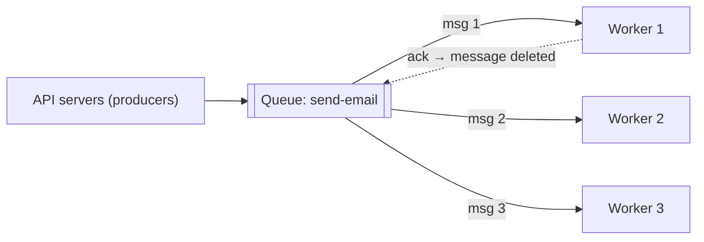

Lifecycle (SQS-style): receive → message becomes **invisible** for a visibility timeout → process → **delete/ack**. On a crash or timeout without ack, the message reappears for another worker (at-least-once).

#### Example
Signup triggers "send welcome email": the API enqueues `{userId, template}` and returns in 20 ms instead of waiting 800 ms for the email provider. Ten workers drain the queue, scaled by queue depth. During an email-provider outage, messages simply wait in the queue (buffering) and nothing is lost.

#### Trade-offs
Decouples producers from consumers, absorbs spikes and enables horizontal scaling of workers. The costs are eventual processing (asynchronous), at-least-once duplicates, and no global ordering with many workers.

#### Problems & fixes
| Symptom | Cause | Fix |
|---|---|---|
| Same task processed twice | visibility timeout shorter than processing time / crash before ack | longer timeout or heartbeat-extend, idempotent workers |
| Queue grows during spikes | not enough workers | autoscale on queue depth/age (KEDA) |
| One bad message blocks or loops | poison message | max receives → DLQ |
| Ordering lost | parallel workers | FIFO queue with message groups, or partition by key |

#### Cheat sheet
- Each message goes to one consumer. Work queue for background tasks.
- Ack after processing. Visibility timeout. At-least-once, so workers must be idempotent.
- Scale workers on depth or oldest-message age. DLQ for poison messages.

#### Interview questions

Why put a queue between the API and the email provider?

The API responds immediately without waiting on a slow or flaky third party. Spikes are absorbed by the queue instead of overloading the provider. Failures are retried without user impact. Workers can be scaled or paused independently. And if the provider is down, messages wait instead of being lost or failing user requests.

How do you size the worker pool for a queue?

From Little's law: required concurrency ≈ message arrival rate × processing time (e.g. 200 msg/s × 0.5 s = 100 concurrent workers or threads), plus headroom for spikes and a target maximum queueing delay. Autoscale on queue depth or age of the oldest message rather than CPU.

#### Interview angle
> "Slow side effects like emails go on a queue: the API enqueues and returns, idempotent workers autoscale on queue age, and poison messages land in a DLQ."

#### Sources
- [Amazon SQS visibility timeout](https://docs.aws.amazon.com/AWSSimpleQueueService/latest/SQSDeveloperGuide/sqs-visibility-timeout.html) — Amazon SQS developer guide
- [Point-to-point channel](https://www.enterpriseintegrationpatterns.com/patterns/messaging/PointToPointChannel.html) — Enterprise Integration Patterns
- [Queue-based load leveling pattern](https://learn.microsoft.com/en-us/azure/architecture/patterns/queue-based-load-leveling) — Azure Architecture Center

### Publish-subscribe topic — one message delivered to all subscribed consumers
In publish-subscribe, a producer publishes an event to a **topic**, and **every subscriber** (each subscription or consumer group) receives its own copy. Producers don't know who's listening, so new consumers can be added without changing the producer. It's the backbone of event-driven architectures.

#### Intuition
A newspaper. The publisher prints one edition and every subscriber gets their own copy. The publisher has no idea who the readers are, and a new reader can subscribe tomorrow without the publisher changing anything.

#### Must know
- A message published to a **topic** is delivered to **every subscriber**.
- The producer does not know its consumers, so a new consumer needs no producer change.
- Each subscription is itself a work queue for that service's workers.
- Use a **durable** topic (Kafka, SNS → SQS) so an offline subscriber misses nothing.
- Schema changes reach consumers you may not know about. Use a schema registry.

#### Common mistakes
- Redis pub/sub for business events. A disconnected subscriber simply misses them.
- Several services sharing one subscription, so each gets only some of the messages.
- Changing an event's shape without checking who consumes it.

#### How it works
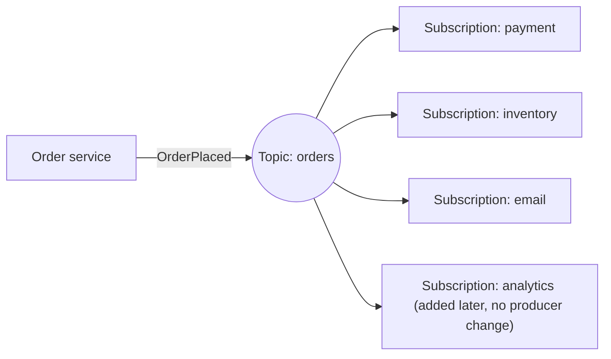

Implementations: Kafka topics with multiple consumer groups, SNS → SQS fan-out, Google Pub/Sub subscriptions, RabbitMQ fanout/topic exchanges, Redis pub/sub (no persistence).

Point-to-point vs pub/sub combined: each **subscription** is itself a work queue shared by that service's workers (Kafka consumer group, SQS queue per subscriber).

#### Example
`OrderPlaced` is consumed by payment (charge), inventory (reserve), notifications (email/SMS), analytics (warehouse) and the recommendations model (update purchase history). When the loyalty team later adds "award points", they subscribe to the topic, and the order service team doesn't need to deploy anything.

#### Trade-offs
Loose coupling and easy extension, but harder to trace end-to-end flows, schema changes affect unknown consumers, and slow subscribers need their own buffering (separate queues or consumer groups).

#### Problems & fixes
| Symptom | Cause | Fix |
|---|---|---|
| A new field breaks a consumer | uncontrolled schema change | schema registry + compatibility rules |
| One slow subscriber delays others | shared queue for subscribers | separate subscription/consumer group per subscriber |
| Messages lost when subscriber is offline | non-durable pub/sub (Redis pub/sub) | durable topics (Kafka, SNS→SQS) |
| Unknown who consumes events | no catalogue | event catalogue/AsyncAPI, ownership docs |

#### Cheat sheet
- Each subscriber gets a copy. Producers are unaware of consumers.
- Each subscription is a work queue for its own workers.
- Durable topics + schema registry + event catalogue.

#### Interview questions

How do you implement pub/sub fan-out on AWS so each subscriber can process at its own pace?

Publish to an SNS topic and subscribe one SQS queue per consuming service (SNS → SQS fan-out). Each service reads from its own queue with its own scaling, retries and DLQ, so a slow or failing subscriber doesn't affect others. Alternatively use EventBridge rules or a Kafka topic with a consumer group per service.

Redis pub/sub vs Kafka for distributing domain events?

Redis pub/sub is fire-and-forget: subscribers that are disconnected miss messages, and there's no persistence or replay, which is fine for ephemeral notifications like cache invalidation. Kafka persists events, lets each consumer group read at its own pace, supports replay and retention, and scales by partitions, so it's the right fit for durable domain events.

#### Interview angle
> "Domain events go to a durable topic, and each consuming service has its own consumer group or queue, so adding a consumer needs no change to the producer, with a schema registry guarding compatibility."

#### Sources
- [Publisher-subscriber pattern](https://learn.microsoft.com/en-us/azure/architecture/patterns/publisher-subscriber) — Azure Architecture Center
- [Publish-subscribe channel](https://www.enterpriseintegrationpatterns.com/patterns/messaging/PublishSubscribeChannel.html) — Enterprise Integration Patterns

### Pull consumer model — consumer polls for messages (Kafka, SQS); consumer controls pace
In the pull model, consumers **request** messages from the broker when they're ready (`poll()`, `ReceiveMessage`). The consumer controls its pace, which gives natural backpressure, easy batching and replay (rewind the offset). Kafka, SQS, Kinesis and Pub/Sub pull subscriptions use it.

#### Intuition
A buffet. You go up and take food when you are ready for more. Nobody piles plates on your table faster than you can eat.

#### Must know
- The consumer **asks** the broker for messages when it is ready.
- The consumer sets the pace, so **backpressure is built in**.
- A slow consumer just builds up **lag**. It is not overwhelmed.
- It batches naturally and allows replay by resetting the offset.
- Kafka, SQS and Kinesis work this way. Use long polling so idle consumers do not spin.

#### Numbers to quote
- SQS long polling waits up to 20 seconds. Kafka's `max.poll.interval.ms` defaults to 5 minutes.

#### Common mistakes
- Processing a poll's batch for longer than `max.poll.interval.ms`, which triggers endless rebalances.
- Short polling SQS in a tight loop and paying for empty responses.
- Treating growing lag as failure. It is the buffer working.

#### How it works
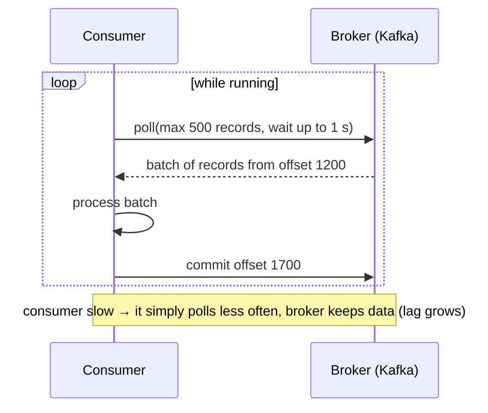

Key settings (Kafka): `max.poll.records`, `fetch.min.bytes` / `fetch.max.wait.ms` (batching vs latency), `max.poll.interval.ms` (if processing exceeds it, the consumer is considered dead and the group rebalances). SQS: **long polling** (`WaitTimeSeconds=20`) cuts empty responses and cost.

#### Example
A billing consumer processes invoices at its own rate. During month-end, producers spike to 20× normal, and the consumer keeps polling at full speed while lag grows into millions and then drains over an hour. No messages are lost, the consumer is never overwhelmed, and KEDA adds consumers based on lag.

#### Trade-offs
| Pull | Push |
|---|---|
| consumer controls rate (backpressure built in) | broker controls rate (must track consumer capacity) |
| efficient batching, replay | lower latency when idle |
| polling overhead when idle (mitigated by long polling) | simpler consumer code |

#### Problems & fixes
| Symptom | Cause | Fix |
|---|---|---|
| Endless rebalances in Kafka | processing exceeds `max.poll.interval.ms` | smaller batches, faster processing, raise interval, async processing |
| High SQS cost with empty receives | short polling | long polling (20 s) |
| Latency spikes | large `fetch.min.bytes` / wait | tune for latency vs throughput |

#### Cheat sheet
- Consumer polls when ready, so backpressure is automatic. Replay by offset.
- Kafka: `max.poll.records` / `max.poll.interval.ms`. SQS: long polling.
- Lag grows instead of the consumer falling over.

#### Interview questions

Why did Kafka choose a pull-based consumer model?

Pull lets each consumer consume at its own rate (no broker-side flow control per consumer), batch aggressively for throughput, rewind and replay from any offset, and lets the broker stay simple: it just serves log segments. Slow consumers accumulate lag rather than being overwhelmed. Long-poll style fetches avoid busy waiting.

A Kafka consumer group keeps rebalancing every few minutes. What's a likely cause?

A consumer takes longer than `max.poll.interval.ms` between polls (slow processing of a large batch, blocking downstream calls), so the coordinator assumes it died and rebalances, which then repeats. Fix: reduce `max.poll.records`, speed up or parallelise processing, raise the interval, and use cooperative-sticky assignment and static membership to reduce disruption.

#### Interview angle
> "Pull consumers control their own pace: lag absorbs spikes, batching is efficient and replay is just an offset reset. I tune poll size against max.poll.interval to avoid rebalance storms."

#### Sources
- [Kafka design: push vs. pull](https://kafka.apache.org/documentation/#design_pull) — Apache Kafka docs
- [Amazon SQS short and long polling](https://docs.aws.amazon.com/AWSSimpleQueueService/latest/SQSDeveloperGuide/sqs-short-and-long-polling.html) — Amazon SQS developer guide

### Push consumer model — broker pushes to consumer (RabbitMQ); simpler but broker must manage rate
In the push model the broker **delivers messages to consumers as they arrive** (RabbitMQ consumers, SNS → HTTP/Lambda, Pub/Sub push subscriptions, webhooks). It has low latency and simple consumers, but the broker must avoid overwhelming them, using **prefetch limits**, acknowledgements and retries.

#### Intuition
A waiter who brings dishes as soon as the kitchen finishes them. That is quick and easy for the diner, unless the waiter brings twenty dishes at once. So the diner says "no more than three on my table at a time".

#### Must know
- The broker **delivers messages as they arrive**. RabbitMQ, webhooks and Lambda triggers work this way.
- Low latency and simple consumer code.
- The broker must not flood the consumer: set a **prefetch limit** on unacknowledged messages.
- **Acknowledge manually after processing**, or a crash loses the message.
- Replay is not natural, because acknowledged messages are gone.

#### Common mistakes
- Unlimited prefetch with auto-ack, which floods the consumer until it runs out of memory.
- A push endpoint with no concurrency limit.
- Auto-acknowledging before the work is done.

#### How it works
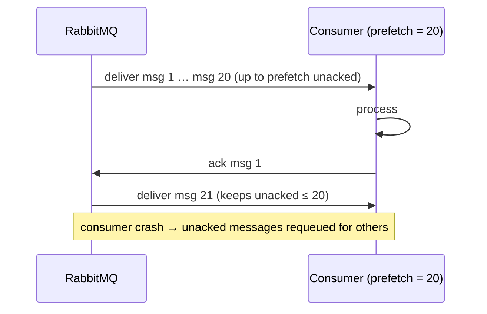

Flow control:
- **Prefetch / QoS** (`basic.qos prefetch_count`): caps unacknowledged messages per consumer (the key backpressure knob).
- **Manual acks** after processing. `nack`/reject with requeue or dead-lettering.
- Push to HTTP endpoints: retries with backoff, and the endpoint returns non-2xx to signal failure (Pub/Sub push, SNS HTTP).

#### Example
A RabbitMQ consumer had prefetch unlimited (the default with auto-ack). On restart the broker flooded it with 50,000 messages, it ran out of memory and crashed, and they were redelivered to the next consumer, which also crashed. Setting `prefetch_count=50` with manual acks bounded in-flight work, and the system stabilised.

#### Trade-offs
Lowest latency and simple consumers, but the broker must manage per-consumer flow and redelivery. Replay isn't natural (messages are deleted once acknowledged), and serverless push endpoints can be overwhelmed without concurrency limits.

#### Problems & fixes
| Symptom | Cause | Fix |
|---|---|---|
| Consumers OOM under load | unlimited prefetch / auto-ack | prefetch limit + manual ack |
| Messages lost on consumer crash | auto-ack before processing | manual ack after processing |
| HTTP endpoint overwhelmed by push | push rate > capacity | push throttling/concurrency limits, switch to pull |
| Uneven work distribution | high prefetch on slow consumers | lower prefetch for fair dispatch |

#### Cheat sheet
- Broker pushes. Prefetch limits in-flight work. Manual ack after processing.
- Low latency, simple consumers. Replay isn't natural.
- Push endpoints need concurrency limits and idempotency.

#### Interview questions

How does RabbitMQ prevent overwhelming a slow consumer?

Via the prefetch count (QoS): the broker sends at most N unacknowledged messages to a consumer and waits for acks before sending more. With manual acknowledgements after processing, slow consumers receive messages only as fast as they process them, and the rest stay queued (or go to faster consumers).

When would you prefer push over pull?

When low latency at low volume matters and consumers are simple (webhook-style integrations, Lambda triggers, RabbitMQ task consumers), or when consumers can't poll (serverless HTTP endpoints). For high-throughput streams that need replay, batching and consumer-controlled pacing, pull (Kafka/Kinesis) fits better.

#### Interview angle
> "With push brokers like RabbitMQ I always set a prefetch limit and manual acks after processing, so the broker never floods a consumer and crashes don't lose messages."

#### Sources
- [Consumer prefetch](https://www.rabbitmq.com/docs/consumer-prefetch) — RabbitMQ docs
- [Consumer acknowledgements and publisher confirms](https://www.rabbitmq.com/docs/confirms) — RabbitMQ docs

### Message durability — persisted to disk (Kafka, SQS) vs in-memory (RabbitMQ default)
Durability decides whether accepted messages survive broker crashes and restarts. Durable systems write messages to disk and replicate them **before acknowledging** the producer. In-memory or transient messages are faster but disappear on failure. You choose per use case, and settings at producer, broker and queue level must all line up.

#### Intuition
A promise written in a ledger and photocopied to a second office, compared with a promise made aloud. If the power goes out, only the written one still exists.

#### Must know
- Durable means the message is **stored and replicated before the producer is acknowledged**.
- Producer, broker and queue settings must **all** line up, or it is not durable.
- Kafka: `replication.factor=3`, `min.insync.replicas=2`, producer `acks=all`.
- RabbitMQ: quorum queues, persistent messages and publisher confirms.
- Durability costs latency. Short-lived signals such as presence can stay in memory.

#### Common mistakes
- A durable queue with non-persistent messages, or the other way round.
- Not waiting for the broker's confirmation, so a lost publish goes unnoticed.
- Kafka `acks=1`, which loses the message if the leader dies before replicating it.

#### How it works
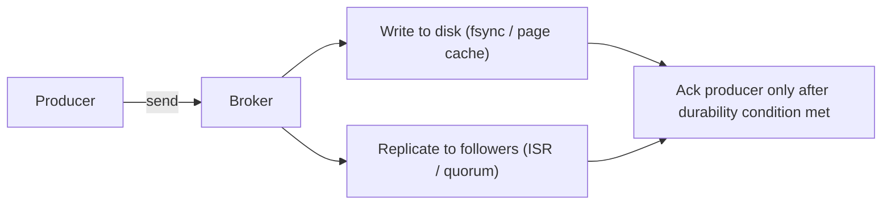

| System | Durability knobs |
|---|---|
| **Kafka** | `replication.factor=3`, `min.insync.replicas=2`, producer `acks=all`. Relies on replication more than fsync |
| **RabbitMQ** | durable queue + persistent messages (delivery_mode=2) + publisher confirms. **Quorum queues** (Raft-replicated) for HA |
| **SQS** | durable by default (replicated across AZs) |
| **Redis pub/sub** | none (fire and forget). Streams: AOF/RDB + replication |
| **NATS core** | in-memory. JetStream for persistence |

#### Example
A team used RabbitMQ classic queues without `durable=true` and published without persistence flags. A broker restart for patching dropped 40,000 pending order-confirmation messages. Fix: quorum queues, persistent messages and publisher confirms (the producer waits until the broker has safely stored the message), and the producer retries unconfirmed publishes with idempotency keys.

#### Trade-offs
Durability costs latency (disk and replication round trips) and throughput. Transient messaging is right for ephemeral data (live presence, cache invalidation) where loss is acceptable.

#### Problems & fixes
| Symptom | Cause | Fix |
|---|---|---|
| Messages lost on broker restart | transient queues/messages | durable queues + persistent messages |
| Messages lost on broker crash despite "durable" | producer didn't wait for confirm, or acks=1 | publisher confirms / acks=all + min.insync |
| Data loss on Kafka leader failure | unclean leader election | `unclean.leader.election.enable=false` |
| Slow publishing | sync confirm per message | batch confirms, async publishing |

#### Cheat sheet
- Durable = persisted + replicated before ack.
- Kafka: RF 3, min.insync 2, acks=all. RabbitMQ: quorum queues + persistent + confirms.
- Durability needs producer, broker and queue settings together.

#### Interview questions

Configure Kafka so that an acknowledged message is never lost if a broker dies.

`replication.factor=3`, `min.insync.replicas=2`, producer `acks=all` with idempotence enabled and retries, `unclean.leader.election.enable=false`, and replicas spread across AZs (rack awareness). An ack then means at least 2 in-sync replicas have the message, and only in-sync replicas can become leader.

Why does RabbitMQ need publisher confirms in addition to persistent messages?

Persistence affects how the broker stores a message once it has it. Without confirms, the producer doesn't know whether the broker actually received and persisted the message before a crash or network error. Publisher confirms acknowledge after the message is safely stored (replicated for quorum queues), so the producer can retry unconfirmed messages.

#### Interview angle
> "An event is durable only when producer, broker and queue settings agree: acks=all with min.insync 2 on RF 3 in Kafka, or quorum queues with publisher confirms in RabbitMQ. Ephemeral signals can stay in memory."

#### Sources
- [Kafka design: replication](https://kafka.apache.org/documentation/#replication) — Apache Kafka docs
- [Quorum queues](https://www.rabbitmq.com/docs/quorum-queues) — RabbitMQ docs
- [Consumer acknowledgements and publisher confirms](https://www.rabbitmq.com/docs/confirms) — RabbitMQ docs

### Message ordering — FIFO within partition (Kafka), not across partitions; SQS FIFO queues for order
Messaging systems trade ordering for parallelism. Most guarantee order only **within a unit**: a Kafka partition, an SQS FIFO message group, a Pub/Sub ordering key, a single RabbitMQ queue with one consumer. Ordering across units isn't guaranteed. The design trick is to **key messages so everything that must be ordered shares a unit**.

#### Intuition
A bank with several tellers. Each teller serves their own queue in strict order, but nobody can say whether a customer at teller 1 was served before one at teller 2. If one customer's transactions must stay in order, send that customer to the same teller every time.

#### Must know
- Order is guaranteed only **within one unit**: a Kafka partition or an SQS FIFO message group.
- There is **no order across partitions**.
- **Key messages by the entity** whose events must be ordered (order id, account id).
- One partition gives total order and no parallelism. Per-key order gives both.
- Retries, parallel processing inside a consumer and a DLQ can all reorder events, so add a version check.

#### Common mistakes
- Assuming a Kafka topic is globally ordered.
- Events for one entity published with different keys.
- Adding partitions later, which remaps keys and breaks ordering during the change.

#### How it works
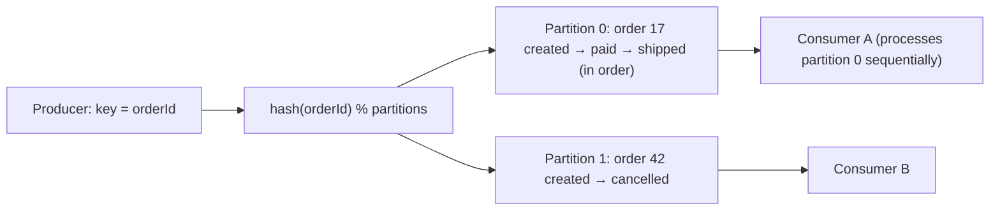

Ordering pitfalls:
- **Producer retries** can reorder unless the idempotent producer is enabled (Kafka keeps order with `enable.idempotence=true`, up to 5 in-flight requests).
- **Parallel processing within a consumer** breaks order (use per-key queues or serial processing per partition).
- **Retries/DLQ**: moving a failed message aside and processing later ones reorders events for that key.
- **Repartitioning** (adding partitions) changes key→partition mapping, so ordering for in-flight keys breaks during the transition.

#### Example
Order state events (`CREATED → PAID → SHIPPED`) keyed by `orderId` into one Kafka topic: each order's events stay in one partition in order, while 48 partitions give parallelism across orders. The consumer also stores the last applied version per order and ignores out-of-date events, which protects against rare reorderings (replays, retries).

SQS FIFO equivalent: `MessageGroupId = orderId` (ordered per group, parallel across groups).

#### Trade-offs
Strict global order = one partition = no parallelism. Per-key order gives parallelism with correct semantics, but hot keys limit throughput for that key.

#### Problems & fixes
| Symptom | Cause | Fix |
|---|---|---|
| "Shipped" processed before "paid" | different keys/partitions for same entity | key by entity id |
| Reordering after producer retries | non-idempotent producer with multiple in-flight | `enable.idempotence=true` |
| Order lost when one message fails and is skipped | DLQ for single message while later ones proceed | per-key blocking retry or park the key, version checks |
| Ordering broken after adding partitions | key remapping | plan partitions upfront, or migrate carefully (new topic) |

#### Cheat sheet
- Order is guaranteed per partition / message group / ordering key only.
- Key by the entity whose events must be ordered.
- Idempotent producer, serial per-key processing, version checks as a safety net.

#### Interview questions

How do you guarantee that all events for one bank account are processed in order while still scaling consumers?

Use the account id as the message key so all of an account's events land in the same partition (or the same SQS FIFO message group), and process each partition sequentially (or per-key serially within a consumer). Enable the idempotent producer to avoid retry reordering, and have consumers track the last applied sequence number per account to reject duplicates or out-of-order replays. Different accounts process in parallel across partitions.

Why can't Kafka give a global order across a topic?

A topic is split into partitions, each an independent log on possibly different brokers, written and consumed in parallel. There's no single sequence across partitions without funnelling everything through one partition (one leader, one consumer), which removes parallelism. Kafka chooses per-partition order to scale.

#### Interview angle
> "Ordering only matters per entity, so events are keyed by orderId or accountId into one partition, the producer is idempotent, and consumers check versions, while different entities process in parallel."

#### Sources
- [Main concepts and terminology](https://kafka.apache.org/documentation/#intro_concepts_and_terms) — Apache Kafka docs
- [Amazon SQS FIFO queues](https://docs.aws.amazon.com/AWSSimpleQueueService/latest/SQSDeveloperGuide/sqs-fifo-queues.html) — Amazon SQS developer guide

### Dead letter queue (DLQ) — messages that fail after N retries go here for inspection
A dead letter queue is where messages go when they **can't be processed successfully after a set number of attempts** (or are expired or rejected). Moving them aside keeps the main queue flowing, preserves the failed messages for inspection, and lets you **redrive** them after fixing the cause.

#### Intuition
The post office's undeliverable-mail bin. A letter that cannot be delivered after several attempts is set aside so the round can continue, and someone looks at the bin later.

#### Must know
- A message that still fails after **N attempts** is moved to a separate queue.
- The main queue keeps flowing, and the failed message is kept for inspection.
- Retry with backoff first, so short-lived failures never reach the DLQ.
- **Alert on DLQ depth.** An ignored DLQ is silent data loss.
- After fixing the cause, **redrive** the messages. Consumers must be idempotent.

#### Common mistakes
- A DLQ nobody monitors or owns.
- No error details stored with the message, so nobody knows why it failed.
- Using a DLQ on an ordered stream without considering that later events were processed first.

#### How it works
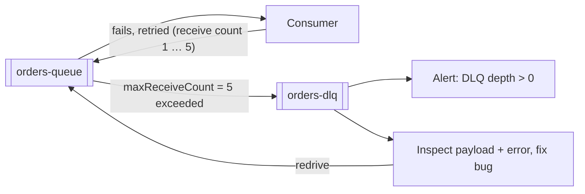

Implementations: SQS redrive policy (`maxReceiveCount`) + DLQ redrive, RabbitMQ dead-letter exchanges (`x-dead-letter-exchange`), Kafka (no built-in, so use retry topics `orders.retry.1m`, `orders.retry.10m`, then `orders.dlt`, e.g. via Spring Kafka `@RetryableTopic`), Pub/Sub dead-letter topics.

Store context with the message: the error, stack trace, attempt count, original topic, partition and offset, and a timestamp.

#### Example
A payment-events consumer fails on messages with a new currency code the code didn't support. After 5 attempts each goes to the DLQ (so the main flow continues for other messages), and an alert fires. Engineers deploy support for the new currency and redrive the DLQ: 312 messages processed successfully, nothing lost.

#### Trade-offs
Keeps systems healthy and failures visible, but DLQs need ownership (alerts, runbooks, redrive tooling). An ignored DLQ is silent data loss, and redriving may break ordering.

#### Problems & fixes
| Symptom | Cause | Fix |
|---|---|---|
| Messages pile up unnoticed in DLQ | no alerting/ownership | alert on DLQ depth/age, assign owners |
| Transient failures sent to DLQ too fast | too few retries / no backoff | retry with backoff (retry topics) before DLQ |
| Redrive causes duplicates/out-of-order effects | non-idempotent consumers, ordering assumptions | idempotency, version checks |
| DLQ messages expire before inspection | short retention | longer retention on DLQ (e.g. 14 days) |

#### Cheat sheet
- After N failed attempts, move to the DLQ. The main flow keeps moving.
- Retries with backoff first. Alert on DLQ depth. Keep error context.
- Fix, then redrive. Consumers must be idempotent.

#### Interview questions

How do you implement retries and a DLQ with Kafka, which has no built-in DLQ?

Use retry topics with increasing delays (e.g. `topic.retry.30s`, `topic.retry.5m`) consumed by consumers that wait until the message's due time, then a final `topic.dlt`. On failure, publish the message (with headers: error, attempt, original offset) to the next retry topic and commit the original offset. Spring Kafka's `@RetryableTopic` automates this. Alert on DLT activity and provide a redrive tool.

What's the risk of a DLQ for an ordered event stream?

If event 5 for an account goes to the DLQ and events 6 and 7 are processed, the account's state may be computed out of order or from incomplete data. For ordered streams, either block that key (pause processing for that entity until resolved), use version checks so later events detect the gap, or design events to carry full state so order matters less.

#### Interview angle
> "Consumers retry with backoff through retry topics, then park the message in a DLQ with full error context. DLQ depth pages someone, and fixed messages are redriven to idempotent consumers."

#### Sources
- [Using dead-letter queues in Amazon SQS](https://docs.aws.amazon.com/AWSSimpleQueueService/latest/SQSDeveloperGuide/sqs-dead-letter-queues.html) — Amazon SQS developer guide
- [Dead letter exchanges](https://www.rabbitmq.com/docs/dlx) — RabbitMQ docs
- [Non-blocking retries](https://docs.spring.io/spring-kafka/reference/retrytopic.html) — Spring for Apache Kafka docs

### Poison pill message — causes consumer to crash; detect with retry count, send to DLQ
A poison pill is a message that **always fails processing**: malformed payload, unexpected schema, data triggering a bug, or a value too large. If the consumer keeps retrying it (or crashes and restarts on it), it **blocks the partition or queue** and nothing behind it gets processed.

#### Intuition
One jammed sheet in a printer. Nothing behind it prints until someone pulls it out, however many times you press "retry".

#### Must know
- A message that **always fails** processing: malformed data, an unexpected schema, a bug it triggers.
- If the consumer keeps retrying or crashes on it, **everything behind it is blocked**.
- The signature: lag growing on **one partition** while the others are healthy.
- Defence: catch errors per message, limit retries, send to a DLQ, commit and move on.
- Validate at the producer with a schema registry, so bad messages never enter.

#### Common mistakes
- Letting an exception crash the consumer, which then restarts on the same message.
- Unlimited retries on an error that can never succeed.
- No handling for deserialisation failures, which happen before your code even runs.

#### How it works
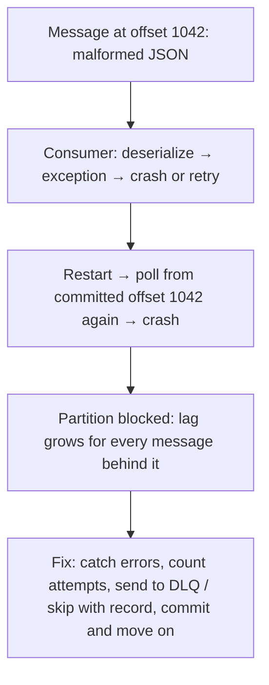

Defences:
- **Deserialisation errors**: use an error-handling deserializer (Spring `ErrorHandlingDeserializer`) so bad bytes become a handled error, not a crash loop.
- **Bounded retries** with an attempt counter, then a **DLQ** with the raw payload and the error.
- **Validation at the edge**: schema registry and producer-side validation prevent bad messages entering.
- **Alerting**: consumer lag growing on one partition while others are fine is a classic poison-pill signature.

#### Example
A producer deployed a bug that sent `amount` as a string (`"12.50"`) for 0.1% of messages. The Kafka consumer threw a `ClassCastException`, restarted and re-read the same offset, and partition 7's lag grew to 2M within an hour while the other partitions were fine. Fixes: an error-handling deserializer plus `DefaultErrorHandler` with 3 retries and then publishing to the DLT, schema-registry enforcement on the producer side, and an alert on per-partition lag skew.

#### Trade-offs
Skipping poison messages keeps the system flowing but needs a DLQ and follow-up. Blocking preserves strict ordering but halts everything behind the bad message.

#### Problems & fixes
| Symptom | Cause | Fix |
|---|---|---|
| One partition's lag explodes, others fine | poison message at head | bounded retries + DLQ, error-handling deserializer |
| Consumer crash loops | unhandled exception kills process | catch per message, never crash the consumer loop |
| Bad messages keep arriving | no producer-side validation | schema registry compatibility checks, contract tests |

#### Cheat sheet
- Poison pill = always-failing message that blocks progress.
- Catch errors per message, bound retries, DLQ with payload + error.
- Validate at the producer (schema registry). Alert on per-partition lag skew.

#### Interview questions

Kafka consumer lag is rising on only one partition. What do you suspect and how do you resolve it?

A poison pill (or a hot key with very slow processing) at the head of that partition: the consumer keeps failing on the same offset. Check consumer logs for repeated errors at one offset. Add per-message error handling with bounded retries and dead-letter publishing (or an error-handling deserializer for corrupt payloads), then commit past the message. Prevent recurrence with schema enforcement on producers.

Should a consumer ever crash on a bad message?

No. Crashing re-reads the same message after restart (crash loop) and blocks the partition. The consumer should handle failures per message: retry transient errors with backoff, route permanent failures to a DLQ with context, record metrics and alerts, and continue processing subsequent messages.

#### Interview angle
> "Consumers never crash on a bad record: an error-handling deserializer, bounded retries, then the DLQ with the payload, plus a per-partition lag-skew alert, because a single stuck partition is the poison-pill signature."

#### Sources
- [Handling exceptions](https://docs.spring.io/spring-kafka/reference/kafka/annotation-error-handling.html) — Spring for Apache Kafka docs
- [Using dead-letter queues in Amazon SQS](https://docs.aws.amazon.com/AWSSimpleQueueService/latest/SQSDeveloperGuide/sqs-dead-letter-queues.html) — Amazon SQS developer guide

### Message deduplication — use idempotency key; consumer maintains processed-IDs set (inbox table)
Because most messaging is at-least-once, consumers will occasionally receive the **same message twice** (redeliveries, producer retries, replays). Deduplication makes the second delivery a no-op: each message carries a **unique id**, and the consumer records processed ids (an **inbox** table or set) **atomically with its side effect**.

#### Intuition
A guest list with ticks. When a guest's name is called a second time, the doorman sees the tick and does not hand out a second welcome drink.

#### Must know
- At-least-once delivery means the **same message will sometimes arrive twice**.
- Every message carries a **unique id assigned once by the producer**.
- The consumer records the id in an **inbox table in the same transaction as the side effect**.
- A duplicate hits the unique constraint and is skipped.
- Broker features (SQS FIFO, Kafka's idempotent producer) cover only part of the problem.

#### Numbers to quote
- SQS FIFO deduplicates within a 5-minute window.

#### Common mistakes
- Recording the id and doing the work in two separate steps, which leaves a crash window.
- Assuming Kafka's idempotent producer stops duplicate **processing**. It only stops duplicate writes to the log.
- Never cleaning the inbox table, or cleaning it sooner than a replay could arrive.

#### How it works
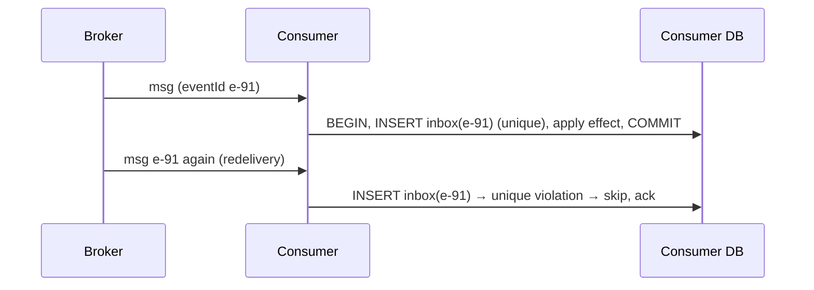

Approaches:
- **Inbox table** (`event_id` primary key) in the same transaction as the business change, which is the most robust.
- **Natural idempotency**: upserts keyed by entity, conditional state transitions, version checks.
- **Redis SET NX with TTL** for dedupe when side effects aren't in a DB (best effort: not atomic with the effect).
- **Broker-level dedupe**: SQS FIFO (5-minute dedupe window by `MessageDeduplicationId`), Kafka idempotent producer (dedupes producer retries only).

#### Example
A loyalty service awards points on `OrderPaid`. A consumer rebalance redelivered 2,000 events, and without dedupe users would get double points. With `INSERT INTO inbox(event_id) …` plus `UPDATE points …` in one transaction, the duplicates hit the unique constraint and were skipped. Inbox rows older than 7 days (beyond any redelivery or replay window) are purged nightly.

#### Trade-offs
Strong protection with small storage cost. Dedupe windows must exceed the maximum redelivery or replay horizon, and best-effort dedupe (Redis, not transactional) can still double-apply in rare crash windows.

#### Problems & fixes
| Symptom | Cause | Fix |
|---|---|---|
| Duplicates despite dedupe | check and effect not atomic | inbox insert in the same DB transaction as the effect |
| Producer generates new id on retry | id assigned per attempt | assign event id once at creation (outbox row id) |
| Inbox table huge | no cleanup | TTL/partitioning by date, retention ≥ replay window |
| Replays from weeks ago re-applied | dedupe window too short | longer retention or version-based idempotency |

#### Cheat sheet
- Unique event id from the producer. Inbox insert + effect in one transaction.
- Or naturally idempotent writes (upsert, conditional update, version check).
- Broker dedupe (SQS FIFO, Kafka idempotent producer) covers only part of it.

#### Interview questions

Why isn't Kafka's idempotent producer enough to avoid duplicate processing?

It only dedupes retries of the same produce request within a producer session (per partition sequence numbers), preventing duplicate writes to the log. Consumers can still process a message twice (crash after processing but before committing the offset, rebalances, replays), and producers can publish logically duplicate events (new producer instance, application-level retries). Consumers still need idempotency.

Design deduplication for a consumer whose side effect is calling an external API (not a DB).

Record the event id in a durable store with status (e.g. a table with a unique key) before calling, mark it COMPLETED after, and pass the event id (or a derived key) as the external API's idempotency key so the provider dedupes too. On redelivery, skip if COMPLETED. If IN_PROGRESS for too long, query the external system's status before retrying.

#### Interview angle
> "Every event has a producer-assigned id, and consumers insert it into an inbox table in the same transaction as the side effect, so redeliveries and replays are harmless. External calls get derived idempotency keys."

#### Sources
- [Idempotent consumer](https://microservices.io/patterns/communication-style/idempotent-consumer.html) — microservices.io
- [Exactly-once processing in Amazon SQS](https://docs.aws.amazon.com/AWSSimpleQueueService/latest/SQSDeveloperGuide/FIFO-queues-exactly-once-processing.html) — Amazon SQS developer guide

### Backpressure — slow consumer signals producer to slow down; Kafka: consumer controls offset commit rate
Backpressure is how a system copes when producers generate work faster than consumers can handle it: instead of unbounded queues (which exhaust memory and blow latency), the overload signal propagates **upstream** so producers slow down, buffer, shed or degrade. Without it, a slow component can take down everything in front of it.

#### Intuition
A sink with the tap running faster than the drain. Either you turn the tap down, or you use a bigger basin, or water spills over the floor. Ignoring it is not an option.

#### Must know
- Producers are generating work faster than consumers can handle it.
- **Never use an unbounded in-memory queue.** It ends in out-of-memory errors and huge latency.
- Option 1: slow the producer (flow control, a bounded queue that blocks).
- Option 2: absorb the surge in a durable log, where consumer lag grows and drains later.
- Option 3: shed load (reject with 429). Option 4: scale consumers.

#### Common mistakes
- A synchronous call chain where one slow service stalls every caller.
- Retrying immediately when a dependency is overloaded.
- Lag that grows forever, which means consumers are under-provisioned, not buffering.

#### How it works
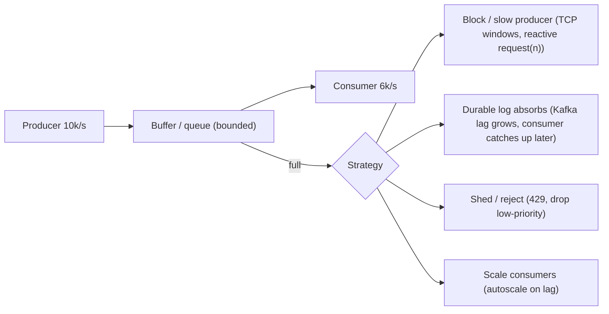

Mechanisms by layer:
- **TCP flow control**: receive windows.
- **Reactive streams** (Project Reactor, RxJava, Akka Streams): `request(n)` demand signalling.
- **gRPC/HTTP2**: per-stream flow-control windows.
- **Pull-based logs** (Kafka): consumers fetch at their own pace and lag absorbs the difference (the producer isn't slowed, the storage buffers).
- **Bounded thread pools/queues + rejection** (429/503, `CallerRunsPolicy`).
- **Rate limiting** at the edge.

#### Example
A clickstream ingestion API wrote directly to Elasticsearch. During a traffic spike, ES slowed, API threads blocked on bulk writes, the thread pool filled, and the API started timing out for all endpoints. Redesign: the API produces to Kafka (fast, durable), and an ES sink consumer indexes at whatever rate ES sustains, so lag grows during spikes and drains afterwards. The API stays fast, and ES is protected.

#### Trade-offs
Absorbing with durable queues adds delay but preserves data. Blocking producers propagates slowness. Shedding protects the system but drops work. Choose per data type.

#### Problems & fixes
| Symptom | Cause | Fix |
|---|---|---|
| OOM from in-memory queues | unbounded buffers | bounded queues + rejection or blocking |
| Upstream services time out when a downstream slows | synchronous coupling, no backpressure | async via durable queue, timeouts + bulkheads |
| Lag grows forever | consumer capacity < sustained input | scale consumers/partitions, optimise processing, shed low-value data |
| Retries amplify overload | no backoff | backoff + jitter, retry budgets |

#### Cheat sheet
- Never use unbounded queues. Overload must propagate or be absorbed deliberately.
- Durable log absorbs. Reactive `request(n)` slows producers. 429 sheds.
- Monitor lag and queue depth. Autoscale consumers.

#### Interview questions

What happens without backpressure when a downstream service slows down?

Requests pile up in in-memory queues and thread pools upstream: memory grows, latency rises, timeouts trigger retries (adding load), threads exhaust, and the upstream service fails, possibly cascading further up. Backpressure (bounded buffers, flow control, shedding, durable queues) contains the slowdown instead of letting it spread.

How does Kafka handle backpressure between producers and consumers?

It decouples them: producers write to the durable log at their rate (bounded by broker capacity and producer buffers), and consumers pull at their own pace. If consumers are slower, lag grows instead of anything failing. The log buffers the difference for up to the retention period. You handle sustained imbalance by adding consumers and partitions or shedding.

#### Interview angle
> "I never use unbounded queues. Spikes go into a durable log where lag absorbs them, synchronous paths have bounded pools that fail fast with 429, and consumers autoscale on lag."

#### Sources
- [Reactive Streams](https://www.reactive-streams.org/) — Reactive Streams initiative
- [Queue-based load leveling pattern](https://learn.microsoft.com/en-us/azure/architecture/patterns/queue-based-load-leveling) — Azure Architecture Center

### Fan-out pattern — one event triggers multiple independent consumers (order placed → payment + inventory + email)
Fan-out delivers one event to **many independent consumers**, each doing its own work in parallel: an order placed triggers payment, inventory, email, analytics and fraud scoring. Producers stay simple and consumers evolve independently. Fan-out also appears at the data level, as in social feeds (fan-out on write vs read).

#### Intuition
A fire alarm. One bell rings, and the fire crew, the security desk and the building manager each do their own job at the same time, without waiting for one another.

#### Must know
- **One event, many independent consumers**, each doing its own work in parallel.
- Each consumer has its **own queue or consumer group**, with its own pace, retries and DLQ.
- A failure in one consumer does not block the others.
- Common setups: SNS → several SQS queues, or one Kafka topic with several consumer groups.
- Use it for **independent** reactions. Steps that depend on each other belong in a saga.

#### Common mistakes
- Fanning out steps that must happen in order, such as shipping before payment is confirmed.
- All consumer types sharing one queue.
- No way to tell whether every reaction completed.

#### How it works
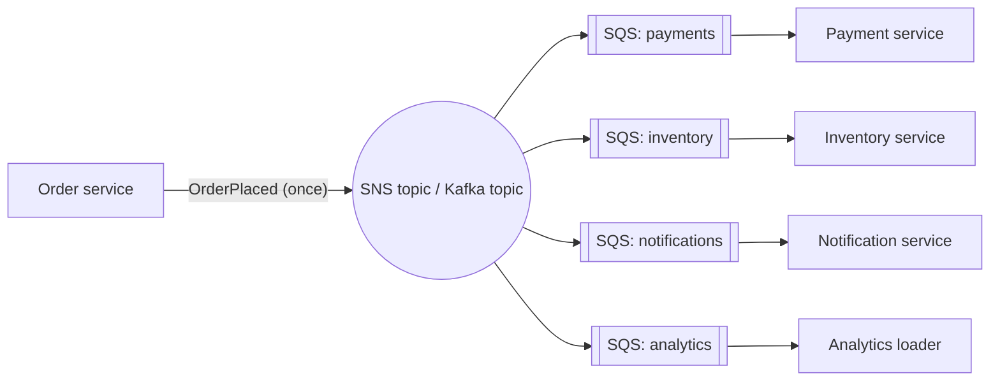

Each consumer has its own queue or consumer group, so it gets its **own copy, pace, retries and DLQ**. A failure in email doesn't block payment.

#### Example
A ride completes: `TripCompleted` fans out to fare calculation and payment capture, the driver earnings ledger, the rider receipt email, rating prompts, fraud checks, and the data lake. Each team owns its consumer and scaling. Adding a "carbon footprint report" consumer is just a new subscription.

#### Trade-offs
Parallelism and decoupling, but harder end-to-end tracking, per-consumer failure handling, and duplicated reads of the same event (cheap in Kafka, priced per delivery in SNS/SQS).

#### Problems & fixes
| Symptom | Cause | Fix |
|---|---|---|
| One slow consumer delays others | shared queue among consumer types | separate queue/consumer group per consumer |
| Inconsistent outcomes (email sent, payment failed) | independent consumers with dependencies | make dependent steps a saga (ordered), keep fan-out for independent reactions |
| Hard to know if all reactions completed | no tracking | correlation ids, tracing, status projections |

#### Cheat sheet
- One event, many independent consumers, each with its own queue, retries and DLQ.
- SNS → SQS, Kafka consumer groups, EventBridge rules.
- Use fan-out for independent reactions. Dependent sequences become sagas.

#### Interview questions

Fan-out vs saga: when is fan-out inappropriate?

When the reactions depend on each other or must be coordinated (don't ship before payment succeeds, refund if inventory fails). Fan-out runs consumers independently and in parallel, without ordering or compensation. Dependent business steps belong in a saga (orchestrated or choreographed with explicit sequencing), while fan-out suits independent side effects like email, analytics and caches.

How does fan-out on write differ from fan-out on read in a social feed?

Fan-out on write pushes each new post into every follower's precomputed timeline at post time: fast reads, expensive writes for users with many followers. Fan-out on read assembles a timeline at read time by pulling from followed users: cheap writes, slower reads. Large systems use a hybrid: push for normal users, pull for celebrities.

#### Interview angle
> "OrderPlaced fans out to independent consumers, each with its own queue, retries and DLQ. Anything that depends on another step, like shipping after payment, belongs in a saga, not fan-out."

#### Sources
- [Fanout to Amazon SQS queues](https://docs.aws.amazon.com/sns/latest/dg/sns-sqs-as-subscriber.html) — Amazon SNS developer guide
- [Publisher-subscriber pattern](https://learn.microsoft.com/en-us/azure/architecture/patterns/publisher-subscriber) — Azure Architecture Center

### Competing consumers — multiple workers on same queue share load, each message processed once
Competing consumers means running **several consumer instances on the same queue** (or consumer group): the broker distributes messages among them so throughput scales horizontally and a crashed worker's messages go to others. Each message is handled by one consumer at a time.

#### Intuition
Several checkout tills serving a single queue of shoppers. More tills means the queue moves faster, and if one till closes, its shoppers rejoin the queue.

#### Must know
- Several consumer instances read from the **same queue or consumer group**.
- Throughput scales out, and a crashed worker's messages go to the others.
- SQS and RabbitMQ balance per message.
- Kafka balances per **partition**, so the number of active consumers is capped at the partition count.
- Order across workers is lost and duplicates are possible, so workers must be idempotent.

#### Common mistakes
- More Kafka consumers than partitions. The extras sit idle.
- Expecting strict ordering with many workers on one queue.
- Ignoring the pause that a Kafka rebalance causes when scaling.

#### How it works
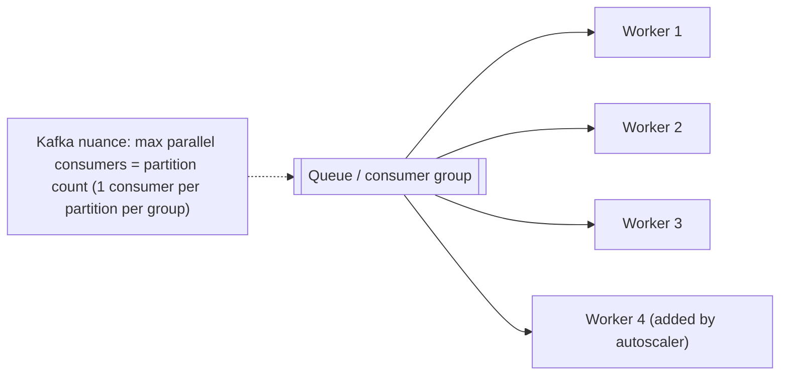

Broker behaviour:
- **SQS / RabbitMQ**: any worker can take any message (fine-grained balancing).
- **Kafka**: partitions are assigned to consumers in the group, so parallelism ≤ partitions, and per-partition order is kept. Rebalances move partitions when consumers join or leave.

#### Example
Image thumbnail generation: 20 workers on an SQS queue. During a bulk upload, KEDA scales to 200 workers by queue depth and back down after. If a worker dies mid-task, the message reappears after the visibility timeout and another worker processes it (the idempotent task overwrites the same thumbnail path).

With Kafka, a topic with 12 partitions caps the group at 12 active consumers. Scaling to 30 needs more partitions (or concurrent processing inside each consumer while preserving per-key order).

#### Trade-offs
Simple horizontal scaling and fault tolerance, but message ordering is lost across workers (unless partitioned or grouped), duplicates are possible, and Kafka rebalancing causes brief pauses.

#### Problems & fixes
| Symptom | Cause | Fix |
|---|---|---|
| Extra Kafka consumers idle | more consumers than partitions | add partitions / in-consumer parallelism |
| Processing pauses during scaling | eager rebalances | cooperative-sticky assignor, static membership |
| Ordering broken | parallel workers on one queue | FIFO groups / partition by key |
| Uneven load | hot partitions/keys | better keys, split hot keys |

#### Cheat sheet
- Many workers on one queue, each message to one worker.
- SQS/RabbitMQ: per-message balancing. Kafka: per-partition (≤ partitions).
- Idempotent workers. Cooperative rebalancing in Kafka.

#### Interview questions

You have a Kafka topic with 6 partitions and need 3× more processing throughput. What are your options?

Add partitions (e.g. 18 or more) and scale consumers to match, noting that key-to-partition mapping changes for future messages. Or keep 6 partitions but process messages concurrently inside each consumer (a worker pool keyed by message key to preserve per-key ordering, like Confluent's parallel consumer). Also optimise per-message work: batching, async I/O, fewer DB round trips.

How do competing consumers handle a crashed worker?

Messages the crashed worker received but didn't acknowledge become available again: SQS after the visibility timeout, RabbitMQ immediately on channel close, Kafka when its partitions are reassigned to other consumers, which resume from the last committed offset. That's why processing must be idempotent: some messages will be processed twice.

#### Interview angle
> "Throughput scales with competing consumers on the queue or group, autoscaled on lag. In Kafka the partition count caps parallelism, so I size partitions for peak and keep per-key order."

#### Sources
- [Competing consumers pattern](https://learn.microsoft.com/en-us/azure/architecture/patterns/competing-consumers) — Azure Architecture Center
- [Competing consumers](https://www.enterpriseintegrationpatterns.com/patterns/messaging/CompetingConsumers.html) — Enterprise Integration Patterns

### Message schema evolution — Avro/Protobuf compatibility modes: backward (reader handles old schema), forward (reader handles new schema), full
Producers and consumers of events are deployed independently and events may be stored for a long time, so message schemas must **evolve without breaking** either side. Serialisation formats with schemas (Avro, Protobuf, JSON Schema) plus a **Schema Registry** enforce **compatibility rules** whenever a new schema version is registered.

#### Intuition
Adding a new optional box to a paper form. Old forms without the box are still valid, and an office that has not been told about the box simply ignores it. Renaming or removing a box breaks everyone still using the old form.

#### Must know
- Producers and consumers deploy separately, so a message's shape must change **without breaking either side**.
- **Backward** compatible: new readers can read old data. Upgrade consumers first.
- **Forward** compatible: old readers can read new data. Upgrade producers first.
- Safe change: **add a field with a default**. Never rename, change a type or reuse a Protobuf field number.
- A **schema registry** rejects incompatible changes at build or publish time.

#### Common mistakes
- Renaming a field in place.
- Plain JSON with no schema, so drift is found in production.
- Checking only against the last version when old events may be replayed.

#### How it works
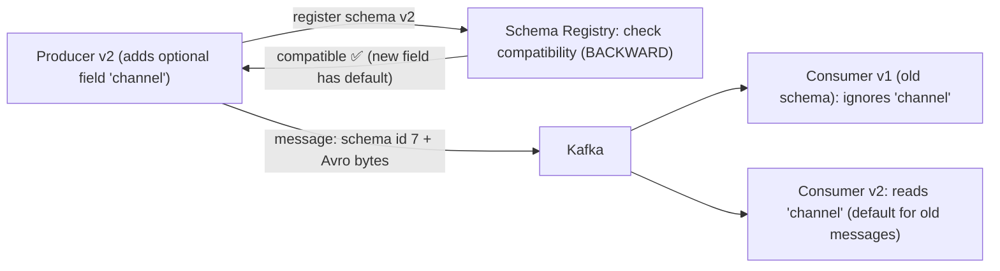

| Mode | Guarantee | Allowed changes (Avro) | Upgrade order |
|---|---|---|---|
| **BACKWARD** (default) | new schema can read data written with old schema | delete fields, add fields **with defaults** | upgrade consumers first |
| **FORWARD** | old schema can read data written with new schema | add fields, delete fields with defaults | upgrade producers first |
| **FULL** | both | add/delete only fields with defaults | any order |
| *_TRANSITIVE | against all previous versions, not just the last | | |

Protobuf rules: never reuse or renumber field tags, add new optional fields, mark removed tags `reserved`, and don't change types.

#### Example
The `PaymentCompleted` event gains `paymentMethodType`. Adding it as optional with default `"UNKNOWN"` is backward- and forward-compatible, so producers and consumers deploy in any order. Someone tries to rename `amount` to `amountMinor` → the registry rejects it (incompatible), and the team instead adds `amountMinor` alongside `amount`, migrates consumers, then later deprecates `amount` (an expand-contract approach for events).

#### Trade-offs
Safe independent deploys and compact binary payloads, but a registry dependency, tooling complexity and discipline around changes. Long-retained topics require transitive compatibility.

#### Problems & fixes
| Symptom | Cause | Fix |
|---|---|---|
| Consumers crash after producer deploy | breaking schema change (removed required field, type change) | registry compatibility checks in CI and at produce |
| Can't replay old events | new consumers can't read old schemas | BACKWARD_TRANSITIVE, upcasters |
| JSON events drift silently | no schema | JSON Schema + registry, or Avro/Protobuf |
| Protobuf decoding garbage | reused field numbers | `reserved` tags, buf breaking checks |

#### Cheat sheet
- BACKWARD: upgrade consumers first. FORWARD: producers first. FULL: any order.
- Add fields with defaults. Never rename, retype or reuse tags.
- Registry checks in CI. Transitive modes for long retention.

#### Interview questions

What does BACKWARD compatibility mean and what changes does it allow?

Consumers using the new schema can read data written with the previous schema. Allowed: adding fields with default values (old data lacks them, so defaults fill in) and removing fields (new readers ignore them). Since new readers handle old data, you upgrade consumers before producers start emitting the new version.

How would you rename a field in a widely consumed Kafka event?

Don't rename in place. Add the new field (with a default) while still populating the old one, and register as compatible. Migrate consumers to read the new field. After all consumers have moved (and retention has passed if replays matter), stop writing the old field (allowed if it has a default), and eventually remove it. That's expand-contract for event schemas.

#### Interview angle
> "Events use Avro or Protobuf with a schema registry enforcing compatibility in CI and at produce time. Fields are only added with defaults, so producers and consumers deploy independently and old events stay replayable."

#### Sources
- [Schema evolution and compatibility](https://docs.confluent.io/platform/current/schema-registry/fundamentals/schema-evolution.html) — Confluent docs
- [Updating a message type](https://protobuf.dev/programming-guides/proto3/#updating) — Protocol Buffers docs

