## Apache Kafka deep dive

### Topic — named logical stream of records
A Kafka **topic** is a named, append-only stream of records (key, value, headers, timestamp), such as `orders`, `payments.v1` or `user-clicks`. Producers write to topics and consumers read from them. Physically a topic is split into **partitions** replicated across brokers. Unlike a queue, reading doesn't remove records: they're kept for the topic's **retention** period.

#### Intuition
A named notebook that people only ever add lines to. Anyone can read it from any page, reading does not tear pages out, and old pages are removed only when they pass a set age.

#### Must know
- A topic is a **named, append-only stream of records**.
- **Reading does not delete.** Records stay until the retention period ends.
- Many consumer groups read the same topic independently, each at its own position.
- Physically it is split into **partitions**, which are replicated across brokers.
- Treat topics as contracts: a naming standard, a schema, an owner and a retention setting.

#### Numbers to quote
- Default retention is 7 days.

#### Common mistakes
- Describing a topic as a queue whose messages vanish once consumed.
- Auto-created topics with no owner or schema.
- Picking the partition count casually. It is hard to change without disturbing key order.

#### How it works
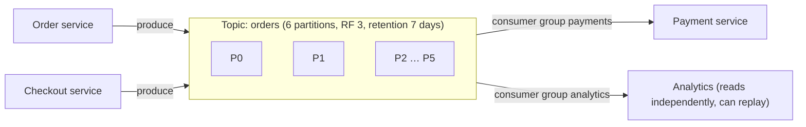

Topic-level settings: `partitions`, `replication.factor`, `retention.ms` / `retention.bytes`, `cleanup.policy` (delete or compact), `min.insync.replicas`, `max.message.bytes`, `compression.type`.

Naming conventions help governance: `<domain>.<entity>.<event>.v<n>` (e.g. `payments.transaction.completed.v1`), with the owning team documented.

#### Example
An e-commerce company defines `orders.events.v1` (12 partitions, RF 3, 7-day retention, `min.insync.replicas=2`) as the single source of order lifecycle events. Six teams consume it with separate consumer groups, and a new fraud team replays the last 7 days on day one to bootstrap their model, which is impossible with a traditional queue.

#### Trade-offs
Durable, replayable, multi-consumer streams, but topics need governance (naming, schemas, ownership, retention), and partition count is hard to change later without affecting key ordering.

#### Problems & fixes
| Symptom | Cause | Fix |
|---|---|---|
| Topic sprawl, unknown owners | auto-create enabled, no governance | disable auto-create, topic catalogue/IaC, naming standard |
| Consumers can't replay far enough | short retention | retention matched to replay needs, tiered storage |
| Breaking events | no schema enforcement | schema registry per topic |

#### Cheat sheet
- Topic = named append-only stream, split into partitions, replicated.
- Reading doesn't delete. Retention or compaction controls lifetime.
- Govern names, schemas, owners and retention as code.

#### Interview questions
<details><summary>How is a Kafka topic different from a traditional message queue?</summary>

A queue deletes messages once consumed and typically delivers each to one consumer. A Kafka topic is a durable log: records stay until retention expires, multiple consumer groups read independently at their own offsets, and consumers can replay from any retained offset. Ordering is per partition, and scaling is by partitions.
</details>

<details><summary>How would you choose the number of partitions for a new topic?</summary>

Estimate peak throughput and per-partition throughput (~10 MB/s per partition is a conservative planning figure) and the maximum consumer parallelism needed (one consumer per partition per group), then add headroom for growth, since increasing partitions later remaps keys and breaks per-key ordering for in-flight data. Avoid excessive counts (each partition costs broker memory, file handles and recovery time). Tens to low hundreds per topic is typical.
</details>

#### Interview angle
> "Each domain publishes to a governed topic with a schema, RF 3, min.insync 2 and retention sized for replay. Partition count is planned up front for peak parallelism, since changing it later breaks key ordering."

#### Sources
- [Main concepts and terminology](https://kafka.apache.org/documentation/#intro_concepts_and_terms) — Apache Kafka docs
- [Kafka design](https://kafka.apache.org/documentation/#design) — Apache Kafka docs

### Partition — unit of parallelism; messages ordered within partition, not across
A partition is an **ordered, immutable, append-only log**, the unit of storage, replication and parallelism in Kafka. Records within a partition have a strict order (offsets). Records in different partitions have no relative order. The producer chooses the partition (by key hash, explicitly, or sticky/round-robin for null keys).

#### Intuition
Lanes on a motorway. Cars within one lane stay in order. Cars in different lanes have no fixed order relative to each other. More lanes carry more traffic, and a given car always stays in its lane.

#### Must know
- A partition is an **ordered, append-only log**. It is Kafka's unit of ordering, parallelism and replication.
- Records are ordered **within** a partition, never across partitions.
- The **key decides the partition**: same key → same partition → same order.
- Within a consumer group, one partition is read by one consumer, so **partitions cap parallelism**.
- A hot key overloads one partition.

#### Common mistakes
- Increasing the partition count on a keyed topic and breaking per-key order during the switch.
- Thousands of partitions "to be safe". Each one costs broker memory and recovery time.
- Null keys on events that need ordering.

#### How it works
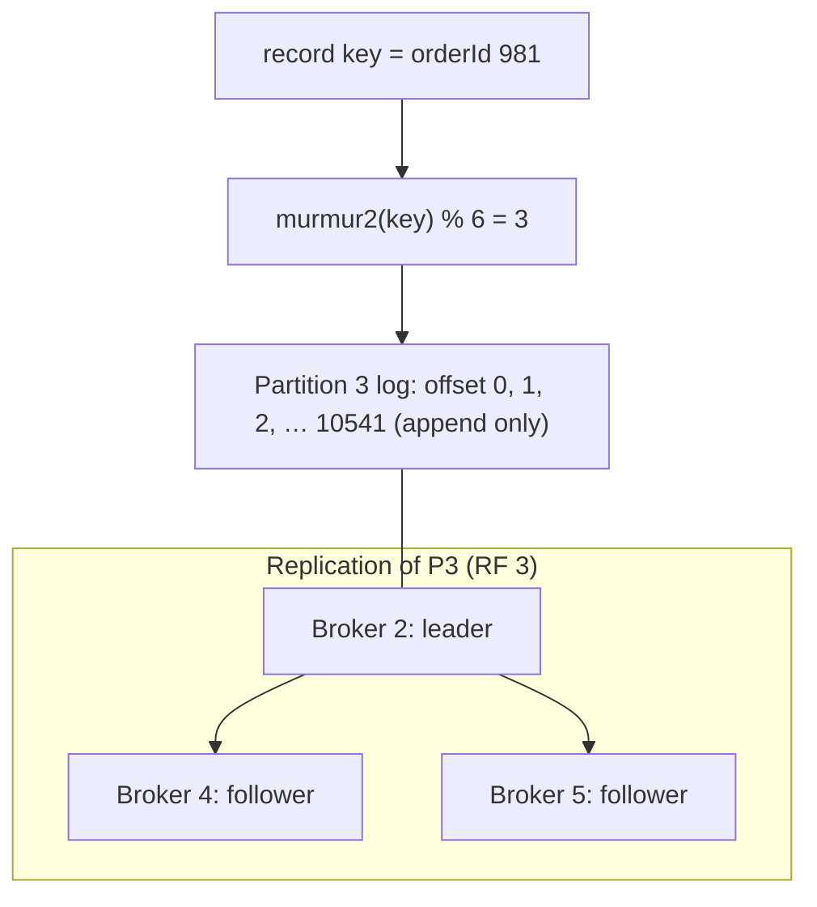

- Each partition has one **leader** broker (handles reads and writes) and **followers** that replicate it.
- Partitions are stored as **segment files** (with an index). Old segments are deleted or compacted per policy.
- Parallelism: each partition is consumed by at most one consumer per group, so partitions = max consumer parallelism per group.

#### Example
A payments topic keyed by `accountId` with 24 partitions: every account's transactions are ordered (same partition), 24 consumers process in parallel, and broker load spreads because partition leaders are distributed. One merchant producing 40% of traffic (a hot key) makes its partition a bottleneck, so they key by `merchantId + terminalId` for that merchant's events where per-terminal ordering is enough.

#### Trade-offs
More partitions mean more parallelism and throughput, but also more broker overhead (files, memory, leader elections), longer recovery and rebalances, and more open producer batches. Keys determine ordering and balance.

#### Problems & fixes
| Symptom | Cause | Fix |
|---|---|---|
| One partition much busier | hot key / skewed key distribution | better key, composite keys, split hot entities |
| Consumers can't scale beyond N | partitions = N | more partitions (plan migration), in-consumer parallelism |
| Ordering broken after adding partitions | key→partition mapping changed | create new topic and migrate, or accept transition window |
| Slow broker recovery | too many partitions per broker | sensible counts, KRaft, more brokers |

#### Cheat sheet
- Ordered log. Unit of parallelism and replication.
- Key → partition (hash). Same key, same partition, same order.
- Partitions cap consumer parallelism. Watch hot keys.

#### Interview questions
<details><summary>What happens to message ordering if you increase a topic's partitions from 6 to 12?</summary>

The default partitioner hashes keys modulo the partition count, so most keys map to different partitions afterwards. New events for a key may land in a new partition while older ones are still unconsumed in the old one, so consumers can process them out of order during the transition. Plan partition counts ahead, or migrate to a new topic, draining the old one before switching consumers.
</details>

<details><summary>What happens when a record has a null key?</summary>

The producer uses the sticky partitioner (Kafka 2.4+): it fills a batch for one partition, then switches, spreading load evenly while keeping batching efficient. Records with null keys have no ordering guarantee relative to each other across partitions.
</details>

#### Interview angle
> "Partitions are Kafka's unit of order and parallelism. I key by the entity whose events must stay ordered, size partitions for peak consumer parallelism, and watch for hot keys skewing one partition."

#### Sources
- [Main concepts and terminology](https://kafka.apache.org/documentation/#intro_concepts_and_terms) — Apache Kafka docs
- [Kafka design: replication](https://kafka.apache.org/documentation/#replication) — Apache Kafka docs

### Offset — position of message within partition; unique and monotonically increasing
An offset is the **sequential id of a record within a partition**: 0, 1, 2… Offsets never change and are unique per partition. Consumers track their position by **committing offsets** (stored in the internal `__consumer_offsets` topic), which lets them resume after restarts, and lets anyone **rewind** to replay.

#### Intuition
A bookmark. The page numbers in the book never change, and each reader keeps their own bookmark. You can move your bookmark back and read a chapter again.

#### Must know
- An offset is a record's **position within a partition**: 0, 1, 2 and so on. It never changes.
- Each consumer group stores its **committed offset** per partition, which is where it resumes.
- **When you commit decides the delivery guarantee.** Commit after processing = at-least-once.
- **Replay** = reset the group's offsets to an earlier point.
- Replays require idempotent consumers.

#### Common mistakes
- Auto-commit with slow processing, which can skip messages after a crash.
- `auto.offset.reset=latest` on a new critical consumer, which silently skips history.
- Replaying into a consumer that is not idempotent.

#### How it works
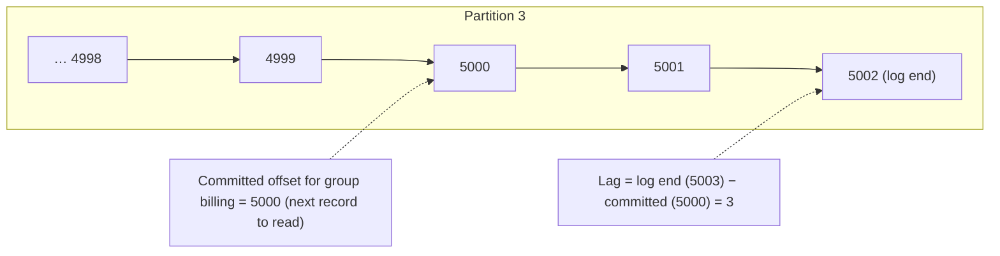

Commit strategies:
- **Auto-commit** (`enable.auto.commit=true`, every 5 s): simple but can lose or duplicate on crashes.
- **Manual commit after processing** (`commitSync`/`commitAsync`): at-least-once.
- **Transactional commit** (`sendOffsetsToTransaction`): exactly-once within Kafka.
- **External offsets**: store offsets in your DB with the results (exactly-once effects).

Rewind: `kafka-consumer-groups --reset-offsets --to-datetime 2026-11-08T00:00:00 --group billing --topic payments --execute`, or `seek()` in code.

#### Example
A bug in the invoice consumer corrupted invoices for 3 hours. After deploying the fix, the team reset the consumer group's offsets to the timestamp before the bug (consumers stopped first) and reprocessed 3 hours of events. Idempotent upserts overwrote the bad invoices, with no data lost and no need for producers to resend anything.

#### Trade-offs
Simple position tracking and replay, but commit timing decides delivery semantics, and offset resets on live groups must be coordinated.

#### Problems & fixes
| Symptom | Cause | Fix |
|---|---|---|
| Messages skipped after crash | auto-commit committed before processing | manual commit after processing |
| Duplicates after rebalance | processed but not yet committed | idempotent processing, commit on partition revoke |
| `OffsetOutOfRange` / reset to earliest unexpectedly | committed offset older than retention | longer retention, set `auto.offset.reset` deliberately, alert on lag |
| Replay harms downstream | non-idempotent consumers | idempotent writes before replays |

#### Cheat sheet
- Offset = per-partition sequential position. Committed per consumer group.
- Commit after processing (at-least-once). Transactional for exactly-once in Kafka.
- Replay by resetting offsets (by time or offset). Consumers must be idempotent.

#### Interview questions
<details><summary>How would you reprocess the last 6 hours of events after fixing a consumer bug?</summary>

Stop the consumer group, reset its offsets for the topic to the timestamp 6 hours ago (`--reset-offsets --to-datetime`), deploy the fixed consumer and start it, so it replays from there. Consumers must be idempotent (upserts keyed by event id or entity) so reprocessing doesn't double-apply effects. Alternatively, run the fix as a new consumer group that starts at that time, then switch.
</details>

<details><summary>What does auto.offset.reset do?</summary>

It decides where a consumer group starts when it has no committed offset (new group) or its committed offset no longer exists (deleted by retention): `earliest` reads from the oldest retained record, `latest` only reads new records, and `none` throws an error. Choose it deliberately: `latest` on a new critical consumer silently skips history.
</details>

#### Interview angle
> "Consumers commit offsets only after processing and are idempotent, so after a bug fix I reset the group's offsets to a timestamp and replay, with no producer involvement."

#### Sources
- [Consumer configs](https://kafka.apache.org/documentation/#consumerconfigs) — Apache Kafka docs
- [Message delivery semantics](https://kafka.apache.org/documentation/#semantics) — Apache Kafka docs

### Consumer group — each partition consumed by exactly one consumer in group; parallelism = partition count
A consumer group is a set of consumers sharing a `group.id` that **collectively consume a topic**: Kafka assigns each partition to exactly one consumer in the group, giving parallel processing with per-partition ordering. Different groups consume the same topic independently, each with its own offsets.

#### Intuition
A team splitting a stack of folders. Each folder goes to exactly one team member, so no work is duplicated. If someone leaves, their folders are shared out again. A second team can read the same folders without affecting the first.

#### Must know
- Consumers with the same `group.id` **share a topic's partitions**: each partition goes to one consumer in the group.
- **Different groups are independent.** Each sees every record and keeps its own offsets.
- Parallelism in a group is at most the partition count.
- A **rebalance** reassigns partitions when a consumer joins, leaves or stalls, and pauses consumption.
- Cooperative-sticky assignment and static membership keep those pauses short.

#### Common mistakes
- Two services sharing one group id, so each sees only part of the stream.
- More consumers than partitions.
- Slow message handling that exceeds the poll interval and causes a loop of rebalances.

#### How it works
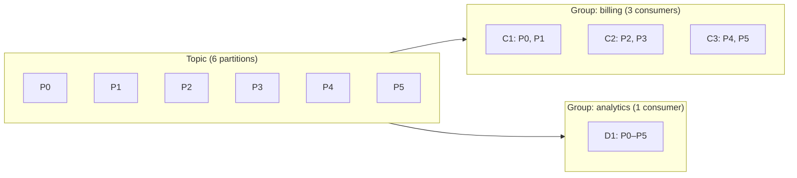

Rebalancing: when consumers join, leave or crash (missed heartbeats or `max.poll.interval.ms`), the group coordinator reassigns partitions.
- **Eager** rebalancing stops all consumers and reassigns everything (stop-the-world).
- **Cooperative-sticky** (`CooperativeStickyAssignor`) moves only the partitions that need to move.
- **Static membership** (`group.instance.id`) lets a restarting consumer rejoin without triggering a rebalance (within the session timeout).
- Kafka 4.0's **new consumer group protocol** (KIP-848, `group.protocol=consumer`) moves assignment to the broker and makes rebalances incremental, with no stop-the-world pause.

#### Example
A billing service runs 6 pods for a 6-partition topic. During a rolling deploy with eager rebalancing, each pod restart paused all consumption for ~10 s, six times. Switching to cooperative-sticky assignment with static membership (pod name as `group.instance.id`) cut the pauses to almost nothing.

#### Trade-offs
Automatic load balancing and failover, but parallelism is capped at the partition count, rebalances cause pauses and duplicates (uncommitted work), and one slow consumer slows its partitions.

#### Problems & fixes
| Symptom | Cause | Fix |
|---|---|---|
| Consumption pauses on every deploy | eager rebalances | cooperative-sticky + static membership |
| Extra consumers idle | consumers > partitions | add partitions or reduce consumers |
| Rebalance loops | slow processing exceeds max.poll.interval | smaller batches, faster processing |
| Duplicates after rebalance | uncommitted processed records | commit in `onPartitionsRevoked`, idempotency |

#### Cheat sheet
- One partition, one consumer per group. Groups are independent.
- Parallelism ≤ partitions. Rebalance on membership change.
- Cooperative-sticky + static membership to minimise disruption.

#### Interview questions
<details><summary>You have 10 partitions and 15 consumers in a group. What happens?</summary>

Only 10 consumers get partitions and the other 5 sit idle (hot standbys for failover). To use all 15 for throughput, increase partitions to at least 15 (accepting key remapping) or process concurrently within each consumer.
</details>

<details><summary>How do two services read the same topic without interfering?</summary>

They use different consumer group ids. Each group has its own committed offsets and partition assignments, so both receive every record and progress independently. One can lag or replay without affecting the other.
</details>

#### Interview angle
> "Each service is its own consumer group, so they read the same topic independently. Within a group, parallelism equals the partition count, and cooperative-sticky assignment with static membership keeps deploys from pausing consumption."

#### Sources
- [Consumer configs](https://kafka.apache.org/documentation/#consumerconfigs) — Apache Kafka docs
- [Main concepts and terminology](https://kafka.apache.org/documentation/#intro_concepts_and_terms) — Apache Kafka docs

### Producer acks — acks=0 (fire and forget), acks=1 (leader only), acks=all (all ISR must ack)
The producer's `acks` setting decides **when the broker acknowledges a write**, trading latency for durability. `acks=0` doesn't wait at all, `acks=1` waits for the partition leader to write it, and `acks=all` waits until **all in-sync replicas** have it (bounded below by `min.insync.replicas`).

#### Intuition
Sending a parcel three ways: drop it in a postbox and walk away, wait for the counter clerk to stamp a receipt, or wait until the clerk and the back office have both logged it. Each is slower and safer than the last.

#### Must know
- `acks=0`: do not wait. Fastest, and messages can be lost silently.
- `acks=1`: wait for the partition leader only. Lost if the leader dies before followers copy it.
- `acks=all`: wait for **every in-sync replica**.
- For events of record: `acks=all` + `min.insync.replicas=2` + replication factor 3 + idempotence.
- Recover throughput with batching (`linger.ms`) and compression.

#### Numbers to quote
- Since Kafka 3.0, producers default to `acks=all` with idempotence enabled.

#### Common mistakes
- `acks=all` without `min.insync.replicas`, which a lone leader can satisfy.
- `acks=1` for payments.
- Sending one tiny batch per message and blaming `acks=all` for the slowdown.

#### How it works
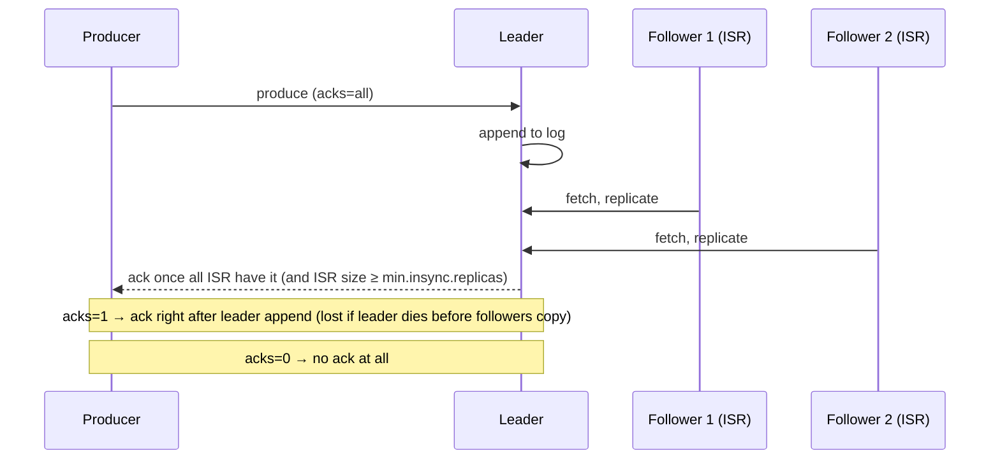

| acks | Durability | Latency | Use |
|---|---|---|---|
| 0 | may lose silently | lowest | metrics, logs you can lose |
| 1 | lost if leader fails before replication | low | moderate-value data |
| **all** (+ min.insync=2, RF=3) | survives 1 broker loss | highest | orders, payments, events of record |

Since Kafka 3.0 producers default to `acks=all` and `enable.idempotence=true`.

#### Example
A payments producer used `acks=1`. A broker hosting partition leaders crashed during a disk failure before followers fetched the last ~200 ms of writes, and those payment events vanished (an unclean loss). Switching to `acks=all`, `min.insync.replicas=2`, idempotence on and `unclean.leader.election.enable=false` added ~2–5 ms of latency, with no further loss in later broker failures.

#### Trade-offs
Durability vs latency and throughput. Batching (`linger.ms`, `batch.size`) and compression recover much of the throughput lost with `acks=all`.

#### Problems & fixes
| Symptom | Cause | Fix |
|---|---|---|
| Lost events after broker failure | acks=0/1 | acks=all + min.insync=2 + RF=3 |
| `NotEnoughReplicasException` | ISR shrank below min.insync (brokers down/lagging) | fix replicas, alert on under-replicated partitions |
| Throughput drop with acks=all | small batches | `linger.ms` 5–20, `batch.size`, compression (lz4/zstd) |

#### Cheat sheet
- acks=0 none, acks=1 leader, acks=all every in-sync replica.
- Events of record: acks=all + min.insync=2 + RF=3 + idempotence.
- Batch + compress to keep throughput.

#### Interview questions
<details><summary>Does acks=all with replication.factor=3 guarantee no data loss?</summary>

Only together with `min.insync.replicas≥2`. If the ISR shrinks to just the leader, acks=all is satisfied by the leader alone, and losing it loses data. With min.insync=2, writes are rejected when fewer than 2 replicas are in sync. Also disable unclean leader election so out-of-sync replicas can't become leader.
</details>

<details><summary>How do you keep throughput high when using acks=all?</summary>

Batch more per request (`linger.ms` of a few ms, larger `batch.size`), enable compression (lz4/zstd), use asynchronous sends with callbacks, allow multiple in-flight requests (up to 5 with idempotence, preserving order), and spread load across partitions and brokers.
</details>

#### Interview angle
> "Events of record use acks=all, min.insync 2 on RF 3, idempotence and no unclean election. Batching with linger.ms and zstd compression wins back the throughput."

#### Sources
- [Producer configs](https://kafka.apache.org/documentation/#producerconfigs) — Apache Kafka docs
- [Kafka design: replication](https://kafka.apache.org/documentation/#replication) — Apache Kafka docs

### ISR (In-Sync Replicas) — set of replicas fully caught up to leader; min.insync.replicas threshold
The **In-Sync Replica set** is the leader plus followers that are **caught up** (have fetched within `replica.lag.time.max.ms`, default 30 s). Only ISR members count for `acks=all`, and only ISR members are eligible to become leader (with clean leader election), so the ISR is what keeps acknowledged data safe.

#### Intuition
Note-takers in a meeting. Only those keeping up with the speaker count as "in sync". A decision is recorded once all the in-sync note-takers have it, and only one of them may take over if the speaker leaves.

#### Must know
- The ISR is the **leader plus the followers that are caught up**.
- `acks=all` waits for the ISR, not for every replica.
- `min.insync.replicas` is the floor. If the ISR is smaller, writes are rejected.
- Only an ISR member may become leader, unless unclean leader election is enabled.
- Consumers read only up to the **high watermark**: data that every ISR member has.

#### Numbers to quote
- A follower leaves the ISR after falling behind for `replica.lag.time.max.ms`, 30 seconds by default.

#### Common mistakes
- Thinking `acks=all` means all replicas regardless of their state.
- Enabling unclean leader election on important topics.
- No alert on under-replicated partitions until writes start failing.

#### How it works
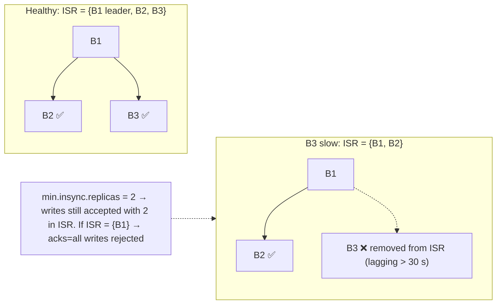

High watermark: consumers only see records up to the **high watermark**, the last offset replicated to all ISR members, so they never read data that could disappear on failover.

Key metrics: `UnderReplicatedPartitions` (ISR < RF), `UnderMinIsrPartitionCount` (writes failing), ISR shrink/expand rates.

#### Example
During a network glitch, one broker in each of several partitions fell out of the ISR, `UnderReplicatedPartitions` spiked, and alerts fired. Producers kept writing (ISR still 2 ≥ min.insync 2). When a second broker also failed for some partitions, those partitions rejected `acks=all` writes (`NotEnoughReplicas`), which is CP behaviour: availability lost instead of risking data loss, until the brokers recovered.

#### Trade-offs
The ISR gives durability without requiring every replica to keep up, but lag thresholds trade detection speed against flapping, and `min.insync` trades availability against safety.

#### Problems & fixes
| Symptom | Cause | Fix |
|---|---|---|
| ISR constantly shrinking/expanding | slow followers (disk, network, GC) | fix broker resources, tune `replica.lag.time.max.ms` |
| Writes rejected | ISR < min.insync | restore replicas, alert earlier on under-replication |
| Data loss on failover | unclean leader election (out-of-sync replica became leader) | `unclean.leader.election.enable=false` |

#### Cheat sheet
- ISR = leader + caught-up followers. acks=all waits for the ISR.
- min.insync.replicas sets the floor for accepting writes.
- High watermark = consumers read only fully replicated data. Alert on under-replication.

#### Interview questions
<details><summary>What is the high watermark in Kafka and why does it matter?</summary>

It's the highest offset replicated to all in-sync replicas. Consumers can only read up to it. If the leader fails, any ISR member promoted to leader has all records up to the high watermark, so consumers never observe data that later disappears after a failover.
</details>

<details><summary>What's the trade-off when setting unclean.leader.election.enable=true?</summary>

If all ISR members are down, an out-of-sync replica may become leader, so the partition becomes available again sooner, but records it didn't have are lost permanently (and consumers may see offsets reused). Keep it false for important data (consistency over availability). True may be acceptable for low-value data like metrics.
</details>

#### Interview angle
> "Durability rests on the ISR: acks=all waits for in-sync replicas, min.insync sets the floor, unclean election is off, and I alert on under-replicated partitions before writes start failing."

#### Sources
- [Kafka design: replication](https://kafka.apache.org/documentation/#replication) — Apache Kafka docs
- [Broker configs](https://kafka.apache.org/documentation/#brokerconfigs) — Apache Kafka docs

### Exactly-once semantics — enable.idempotence=true + transactional.id + consumer isolation=read_committed
Kafka's exactly-once semantics (EOS) make a **consume → process → produce** pipeline produce each output exactly once, even across retries and crashes, by combining three features: the **idempotent producer** (no duplicates from retries), **transactions** (atomic writes across partitions plus consumer offset commits) and **read_committed** consumers (aborted data invisible). (Phase 6 covers exactly-once as a general concept.)

#### Intuition
A bank clerk who records the incoming cheque and posts the resulting ledger entry as one action. If the clerk is interrupted halfway, neither is recorded and the whole thing is redone cleanly.

#### Must know
- For a **consume → process → produce** pipeline inside Kafka.
- Three parts: **idempotent producer** (no duplicates from retries), **transactions** (output and input offsets committed together), **`read_committed` consumers** (aborted data hidden).
- A stable `transactional.id` lets the broker fence a zombie instance.
- Kafka Streams enables it with `processing.guarantee=exactly_once_v2`.
- It does **not** cover side effects outside Kafka. Those still need idempotency.

#### Common mistakes
- Thinking the idempotent producer alone gives exactly-once processing.
- Consumers left on `read_uncommitted`.
- Expecting it to protect a database write or an email.

#### How it works
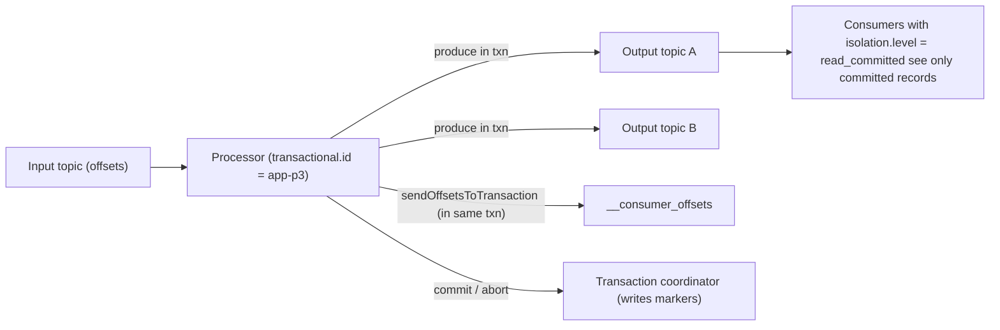

Config:
```properties
# producer
enable.idempotence=true
transactional.id=invoice-processor-0     # stable per instance/partition set → zombie fencing via epochs
acks=all
# consumer
isolation.level=read_committed
enable.auto.commit=false
# Kafka Streams shortcut
processing.guarantee=exactly_once_v2
```

#### Example
A currency-conversion stream app reads `payments` and writes `payments-inr` plus an audit topic. Without EOS, a crash after producing but before committing offsets reprocessed records and doubled converted amounts in reports. With `exactly_once_v2`, outputs and offsets commit atomically, a crash aborts the in-flight transaction, and the restarted instance (same transactional.id, bumped epoch) reprocesses cleanly.

#### Trade-offs
Correctness inside Kafka, at the cost of extra latency (commit intervals, read_committed waits for transaction markers), throughput overhead, and it **doesn't cover external side effects** (DB writes, emails), which need idempotency.

#### Problems & fixes
| Symptom | Cause | Fix |
|---|---|---|
| Downstream sees duplicates/aborted data | consumers on read_uncommitted | read_committed |
| `ProducerFencedException` | another instance with same transactional.id (zombie) | expected fencing. Ensure unique stable ids per instance |
| Long end-to-end latency | large transaction/commit intervals | tune `commit.interval.ms` |
| Duplicates in external DB | EOS doesn't extend outside Kafka | idempotent sinks / offsets stored with results |

#### Cheat sheet
- Idempotent producer + transactions (outputs + offsets) + read_committed.
- Kafka Streams: `exactly_once_v2`.
- External effects still need idempotency.

#### Interview questions
<details><summary>How does a transactional.id prevent zombie producers?</summary>

When a producer initialises with a transactional.id, the coordinator bumps that id's epoch and aborts any unfinished transaction from the previous holder. Brokers reject produce and commit requests carrying an older epoch, so a zombie instance (paused or partitioned, then resumed) can't write or commit after a replacement has started.
</details>

<details><summary>Why isn't the idempotent producer alone enough for exactly-once processing?</summary>

It only prevents duplicates caused by the producer's own retries. In a consume-process-produce loop, a crash after producing output but before committing the input offset leads to reprocessing and duplicate outputs. Transactions bind output writes and offset commits atomically, so either both happen or neither does.
</details>

#### Interview angle
> "For Kafka-to-Kafka pipelines I enable exactly_once_v2: outputs and offsets commit atomically, zombies are fenced by transactional.id, and consumers read committed only. Sinks outside Kafka stay idempotent."

#### Sources
- [Message delivery semantics](https://kafka.apache.org/documentation/#semantics) — Apache Kafka docs
- [Exactly-once semantics are possible: here's how Kafka does it](https://www.confluent.io/blog/exactly-once-semantics-are-possible-heres-how-apache-kafka-does-it/) — Confluent

### Consumer lag — latest_offset - committed_offset per partition; monitor to detect slow consumers
Consumer lag is **how far behind** a consumer group is: for each partition, `log end offset − committed offset` (in records), or better, **time lag** (age of the oldest unprocessed record). It's the single most important health metric for stream processing: rising lag means consumers can't keep up, and data is getting stale.

#### Intuition
The pile of unopened post on your desk. A small pile is normal. A pile that keeps growing means post is arriving faster than you open it.

#### Must know
- Lag = **latest offset − committed offset**, per partition.
- It is the main health signal of a consumer.
- **Time lag** (the age of the oldest unprocessed record) reflects user impact better than a record count.
- Lag on **all** partitions means too little capacity or a slow dependency.
- Lag on **one** partition means a hot key or a poison message.

#### Common mistakes
- No lag monitoring, so users report the delay first.
- Alerting on a fixed record count for a bursty topic.
- Lag approaching the retention period, after which data is lost.

#### How it works
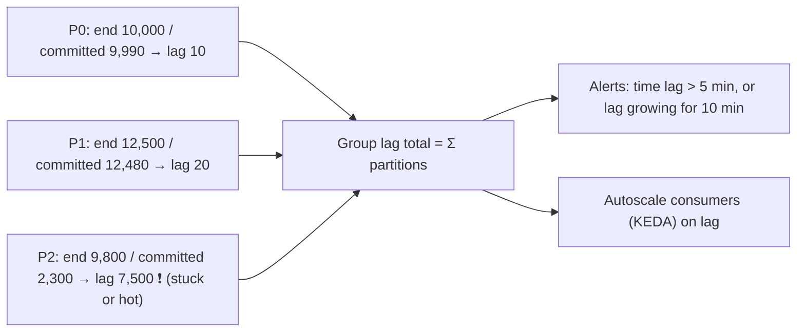

Tools: `kafka-consumer-groups --describe`, Burrow (lag evaluation with status), kafka-lag-exporter / Prometheus JMX exporters, Confluent Control Center, MSK CloudWatch metrics (`MaxOffsetLag`, `EstimatedMaxTimeLag`).

Patterns to recognise:
- **All partitions growing**: consumers under-provisioned or a downstream is slow.
- **One partition growing**: hot key or poison pill.
- **Sawtooth**: batch processing, which is normal.
- **Lag suddenly zero with no processing**: offsets reset to latest (data skipped).

#### Example
A notification pipeline's SLO: 99% of notifications sent within 30 s. Alerting on **time lag > 30 s** caught a slowdown caused by the SMS provider's latency increasing. KEDA scaled consumers from 6 to 18 (topic had 24 partitions) and lag recovered within minutes. Before they had lag alerts, users reported "OTP not received" first.

#### Trade-offs
Record-count lag is easy but misleading across topics with different rates. Time lag reflects user impact but needs timestamps.

#### Problems & fixes
| Symptom | Cause | Fix |
|---|---|---|
| Lag growing across partitions | not enough consumers / slow downstream | scale consumers (≤ partitions), optimise processing, batch |
| Lag on one partition only | hot key / poison message | key redesign, DLQ handling |
| Lag alerts noisy | count-based thresholds on bursty topics | time-based lag, trend-based alerts |
| Lag hidden | no monitoring | lag exporter + dashboards + SLO alerts |

#### Cheat sheet
- Lag = end offset − committed offset (per partition). Prefer time lag.
- Pattern tells the cause: all partitions = capacity, one = hot key or poison message.
- Alert on time lag vs SLO. Autoscale on lag.

#### Interview questions
<details><summary>How do you monitor and react to Kafka consumer lag in production?</summary>

Export per-partition lag and time lag (kafka-lag-exporter, Burrow, MSK metrics) to Prometheus/Grafana. Alert when time lag exceeds the freshness SLO or lag grows steadily. React by scaling consumers (KEDA on lag, up to the partition count), investigating slow downstream dependencies, fixing hot partitions or poison messages, and adding partitions if parallelism is maxed out.
</details>

<details><summary>Why is time-based lag better than offset-based lag for alerting?</summary>

Offset lag of 10,000 records means seconds on a high-volume topic and hours on a low-volume one, so it doesn't map to user impact. Time lag (how old the oldest unprocessed record is) directly measures data freshness against SLOs, regardless of throughput.
</details>

#### Interview angle
> "Consumer health is measured as time lag against the freshness SLO. Lag across all partitions means scale or fix the downstream, lag on one partition means a hot key or poison message, and KEDA autoscales on lag."

#### Sources
- [Checking consumer position](https://kafka.apache.org/documentation/#basic_ops_consumer_lag) — Apache Kafka docs
- [Apache Kafka scaler](https://keda.sh/docs/latest/scalers/apache-kafka/) — KEDA docs

### Compacted topics — retain only latest value per key; used for changelogs, Kafka as database
A compacted topic (`cleanup.policy=compact`) keeps **at least the latest record for each key**. Older records with the same key are eventually removed by log compaction, and a record with a `null` value (a **tombstone**) deletes the key. The topic becomes a durable, replayable **table** of current state.

#### Intuition
A contact list, not a call history. If someone's number changes ten times, you keep only the current one. Crossing out a name removes that contact.

#### Must know
- `cleanup.policy=compact` keeps **at least the latest record for each key**.
- A record with a **null value is a tombstone**: it deletes the key.
- The topic becomes a replayable table of current state.
- Uses: changelogs, the latest row per database key, reference data shared between services.
- Every record needs a key.

#### Common mistakes
- Expecting to look a key up directly. You must still consume the topic.
- Assuming old values vanish immediately. Compaction runs later.
- Tombstones retained for less time than a slow consumer needs to catch up.

#### How it works
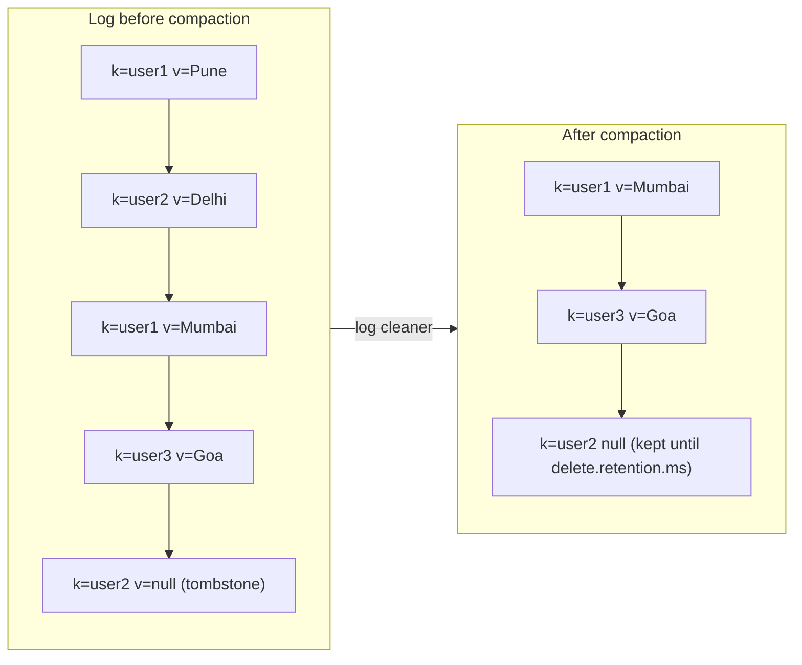

Uses:
- `__consumer_offsets` (latest offset per group/partition) is itself compacted.
- **Kafka Streams changelog** topics backing state stores (restore state after a crash).
- **CDC snapshots** of tables (latest row per primary key).
- **Reference data distribution**: every service builds a local cache by reading the compacted topic from the beginning.

Can combine: `cleanup.policy=compact,delete` (compact, plus drop very old data).

#### Example
A `product-prices` compacted topic keyed by SKU: the pricing service publishes every change, and checkout, search and cart services each read the topic from offset 0 on startup to build an in-memory price map, then keep consuming updates. Because compaction keeps only the latest price per SKU, startup reads ~2M records instead of years of history.

#### Trade-offs
State-as-a-stream with replay and bounded size, but it's not a query engine (no lookups by key without consuming), compaction lag means duplicates per key may persist for a while, and tombstones need careful retention.

#### Problems & fixes
| Symptom | Cause | Fix |
|---|---|---|
| Deleted keys reappear for new consumers | tombstones removed before slow consumers saw them | `delete.retention.ms` ≥ max consumer catch-up time |
| Topic not shrinking | compaction lag / active segment never compacted | tune `min.cleanable.dirty.ratio`, `segment.ms` |
| Records without keys rejected | compaction requires keys | always set keys |

#### Cheat sheet
- Keeps the latest value per key. Null value = tombstone (delete).
- Changelogs, CDC table snapshots, reference data, consumer offsets.
- Needs keys. Tune tombstone retention and compaction settings.

#### Interview questions
<details><summary>How can services use a compacted topic to share reference data?</summary>

The owning service publishes every change keyed by entity id to a compacted topic. Consumers read it from the beginning to build a local cache or table (only the latest value per key remains, so bootstrapping is bounded) and then keep consuming for updates. Deletions are tombstones. No synchronous calls to the owner are needed at runtime.
</details>

<details><summary>What is a tombstone in a compacted topic?</summary>

A record with a key and a null value, which signals that the key is deleted. Compaction removes older values for that key, and the tombstone itself is retained for `delete.retention.ms` so consumers catch the deletion before it disappears.
</details>

#### Interview angle
> "Reference data like prices is published to a compacted topic keyed by SKU. Each service bootstraps a local cache from offset zero and follows updates, with no runtime calls to the owner."

#### Sources
- [Log compaction](https://kafka.apache.org/documentation/#compaction) — Apache Kafka docs
- [Topic configs](https://kafka.apache.org/documentation/#topicconfigs) — Apache Kafka docs

### Kafka Streams — stream processing library: stateful transformations with RocksDB local state stores
Kafka Streams is a Java library (no separate cluster) for building **stream processing applications**: filters, maps, joins, aggregations and windowing over Kafka topics. State lives in **local RocksDB stores** backed by compacted **changelog topics**, so instances can fail over and restore state. Scaling is just running more instances.

#### Intuition
A clerk at a conveyor belt who keeps running totals in a notepad as items pass, and photocopies each notepad page to a safe. If the clerk is replaced, the new clerk rebuilds the notepad from the photocopies.

#### Must know
- A **Java library**, not a separate cluster. It runs inside your application.
- It does filters, joins, aggregations and windowing over Kafka topics.
- State lives in a **local RocksDB store**, backed up to a compacted **changelog topic**.
- Scale by running more instances, up to the partition count.
- KStream = a stream of events. KTable = the latest value per key.

#### Common mistakes
- Expecting it to read from or write to non-Kafka systems directly.
- Large state with no standby replicas, so recovery takes a long time.
- Re-keying repeatedly, which creates a repartition topic each time.

#### How it works
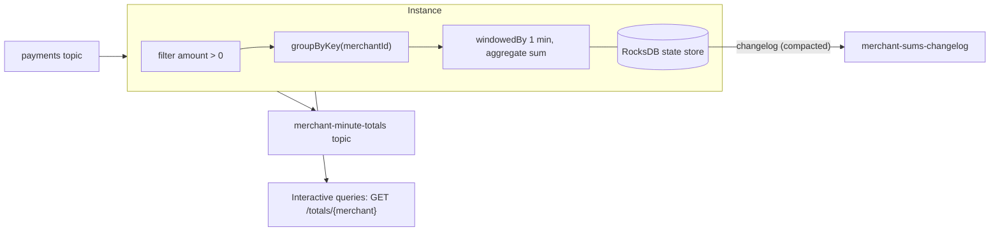

```java
StreamsBuilder b = new StreamsBuilder();
b.stream("payments", Consumed.with(Serdes.String(), paymentSerde))
 .filter((k, p) -> p.amount() > 0)
 .groupBy((k, p) -> p.merchantId(), Grouped.with(Serdes.String(), paymentSerde))
 .windowedBy(TimeWindows.ofSizeWithNoGrace(Duration.ofMinutes(1)))
 .aggregate(() -> 0L, (merchant, p, sum) -> sum + p.amountPaise(), Materialized.as("merchant-sums"))
 .toStream()
 .to("merchant-minute-totals");
```

Concepts: KStream (event stream) vs KTable (changelog/table) vs GlobalKTable (fully replicated), stream-table joins, windows (tumbling, hopping, session), punctuators, `exactly_once_v2`, standby replicas for fast failover.

#### Example
Real-time fraud features: a Streams app computes per-card counts and sums over 1-minute and 1-hour windows and joins them with a KTable of card risk profiles. It emits feature updates consumed by the fraud scoring service within ~100 ms. Scaling from 3 to 12 instances happens automatically by rebalancing tasks (partitions), and state stores restore from changelogs.

#### Trade-offs
| Kafka Streams | Flink / Spark Streaming |
|---|---|
| library, deploy as normal app | separate cluster/runtime |
| tight Kafka integration, EOS | many sources/sinks, advanced event-time features |
| JVM only | Java/Scala/Python/SQL |
| state restore can be slow for huge stores | savepoints, larger scale |

#### Problems & fixes
| Symptom | Cause | Fix |
|---|---|---|
| Long recovery after restart | restoring large state from changelog | standby replicas, persistent volumes, state store sizing |
| Wrong results for late events | window grace too small | grace period, event-time semantics |
| Repartition topics explode | many `groupBy`/`selectKey` | key data upstream, minimise re-keying |
| Hot partition | skewed keys | key salting + second-stage aggregation |

#### Cheat sheet
- Library: KStream, KTable, joins, windows, local RocksDB + changelog topics.
- Scale by instances (≤ partitions). Standby replicas for fast failover.
- `exactly_once_v2`. Plan keys to avoid repartitioning.

#### Interview questions
<details><summary>How does Kafka Streams keep state fault-tolerant?</summary>

Each stateful task writes to a local RocksDB store and every update to a compacted changelog topic in Kafka. If an instance dies, its tasks move to other instances, which rebuild the store by replaying the changelog (or take over instantly if standby replicas were already maintaining a copy). With exactly-once enabled, state updates, outputs and offsets commit atomically.
</details>

<details><summary>KStream vs KTable: what's the difference?</summary>

A KStream is an unbounded sequence of independent events (each record is a fact: "payment of ₹500"). A KTable is a changelog interpreted as a table: each record is an upsert for its key, and only the latest value per key matters ("current balance"). Aggregating a stream produces a table, and a table's updates can be viewed as a stream.
</details>

#### Interview angle
> "For real-time aggregates like per-card spend windows, I'd use Kafka Streams: RocksDB state backed by changelogs, standby replicas for fast failover, exactly_once_v2, and scaling by adding instances."

#### Sources
- [Kafka Streams](https://kafka.apache.org/documentation/streams/) — Apache Kafka docs
- [Kafka Streams core concepts](https://kafka.apache.org/documentation/streams/core-concepts) — Apache Kafka docs

### Kafka Connect — source connectors (DB → Kafka) and sink connectors (Kafka → DB/S3)
Kafka Connect is a framework and runtime for **moving data between Kafka and other systems** without writing custom producers and consumers: **source connectors** import (databases via CDC, files, SaaS) and **sink connectors** export (S3, Elasticsearch, Snowflake, JDBC). It handles scaling, offsets, retries, schema conversion and fault tolerance.

#### Intuition
Ready-made plumbing adapters. You do not solder a custom pipe for every appliance. You pick the right adapter, set a few options, and the water flows.

#### Must know
- A framework for **moving data between Kafka and other systems** by configuration, with no custom code.
- **Source connector**: into Kafka (for example Debezium reading a database's change log).
- **Sink connector**: out of Kafka (S3, Elasticsearch, a warehouse).
- It handles offsets, retries, scaling and schema conversion.
- Keep business logic out of it. Use a stream processor for real transformations.

#### Common mistakes
- Writing a custom consumer for plain data movement.
- A sink with no dead-letter queue, so one bad record stops the connector.
- Producing thousands of tiny files in S3 from flushing too often.

#### How it works
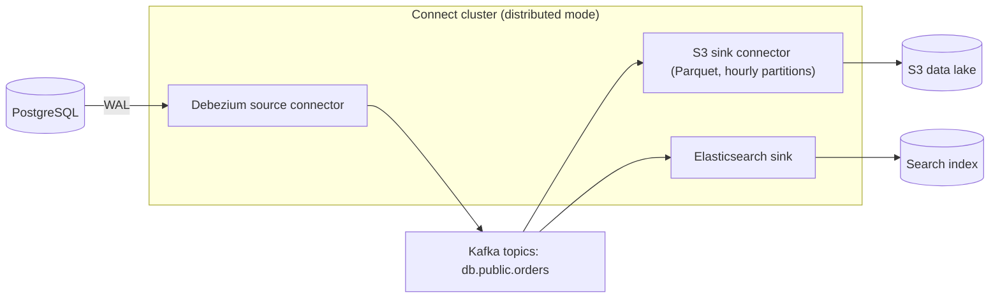

Concepts: **connectors** (config), **tasks** (parallel units), **workers** (JVMs in a cluster), **converters** (Avro/JSON/Protobuf with Schema Registry), **SMTs** (single message transforms: rename, mask, route), offsets stored in Kafka topics, and a **dead letter queue** for sink errors (`errors.deadletterqueue.topic.name`).

#### Example
Moving an e-commerce company to event-driven analytics with zero application code: Debezium streams `orders`, `payments` and `users` from Postgres into Kafka. The S3 sink writes Parquet files partitioned by date for Athena. The Elasticsearch sink keeps the order search index updated within seconds. An SMT masks customer phone numbers before they leave the database domain.

#### Trade-offs
Fast integration, reusable and scalable, but connector quality varies, operational tuning (task counts, errors, rebalances) is real work, and complex transformations belong in stream processing, not SMTs.

#### Problems & fixes
| Symptom | Cause | Fix |
|---|---|---|
| Sink task fails on bad records, connector stops | default `errors.tolerance=none` | DLQ + `errors.tolerance=all` with logging, fix data |
| Too many small files in S3 | low flush size/rotation interval | larger `flush.size`, time-based rotation |
| Schema changes break sinks | incompatible evolution | schema registry compatibility, sink auto-evolution settings |
| Connect rebalances pause everything | eager rebalances with many connectors | incremental cooperative rebalancing, separate clusters per domain |

#### Cheat sheet
- Source (into Kafka) and sink (out of Kafka) connectors, no custom code.
- Workers → connectors → tasks. Converters + Schema Registry. SMTs for light transforms.
- DLQ for sink errors. Tune file sizes and task parallelism.

#### Interview questions
<details><summary>How would you get data from an operational Postgres into a data lake in near real time?</summary>

A Debezium Postgres source connector (logical replication slot) streams row changes into Kafka topics with Avro and a schema registry, then an S3 sink connector writes Parquet partitioned by date or hour (or into Iceberg/Hudi tables for upserts). Monitor the replication slot lag, use a DLQ for sink errors, and mask PII with SMTs or a stream processor before data lands in the lake.
</details>

<details><summary>When would you write a custom consumer instead of using a sink connector?</summary>

When the sink needs complex business logic, multi-step transformations, joins, calls to other services, custom idempotency or ordering semantics, or the target isn't supported by a reliable connector. Connectors are best for straightforward, high-volume data movement.
</details>

#### Interview angle
> "Data movement uses Kafka Connect: Debezium sources and S3 or Elasticsearch sinks with Avro, a schema registry and DLQs. Business logic lives in stream processors, not connector transforms."

#### Sources
- [Kafka Connect](https://kafka.apache.org/documentation/#connect) — Apache Kafka docs
- [Debezium documentation](https://debezium.io/documentation/reference/stable/index.html) — Debezium docs

### Schema Registry — Avro/Protobuf schema storage, compatibility enforcement on produce/consume
A Schema Registry stores **versioned schemas** for topic keys and values and enforces **compatibility rules** when producers register new versions. Messages carry a small **schema id** instead of the full schema, so producers and consumers agree on structure while evolving independently. (Earlier in this phase covers the evolution rules.)

#### Intuition
A central office that keeps the approved template for every form. A form carries only its template number, and a new template is refused if old readers could no longer understand it.

#### Must know
- It stores **versioned schemas** for each topic's keys and values.
- A message carries a small **schema id**, not the whole schema.
- It **rejects a new schema version that breaks compatibility**.
- Run the compatibility check in CI, and switch off auto-registration in production.
- Clients cache schemas, so a short registry outage does not stop existing traffic.

#### Common mistakes
- JSON with no schema, where drift is discovered at runtime.
- Applications auto-registering schemas in production.
- Checking only against the latest version when old data will be replayed.

#### How it works
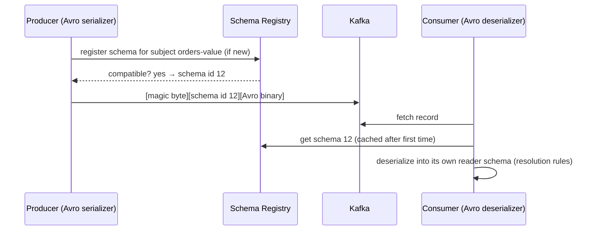

Subjects: by default `<topic>-key` and `<topic>-value` (TopicNameStrategy). Alternatives: RecordNameStrategy for multiple event types per topic. Compatibility per subject: BACKWARD (default), FORWARD, FULL, with _TRANSITIVE variants, or NONE.

Implementations: Confluent Schema Registry, Apicurio, AWS Glue Schema Registry, Redpanda's built-in registry.

#### Example
CI pipeline step: before merging a change to `OrderPlaced.avsc`, the build calls the registry's compatibility endpoint against the latest registered version (`BACKWARD_TRANSITIVE`). A change removing a field without a default fails the build, so the incompatible schema never reaches production. At runtime, producers use `auto.register.schemas=false` so only CI-approved schemas exist.

#### Trade-offs
Strong contracts, compact payloads and safe evolution, but the registry is a critical dependency (cache schemas client-side and run it HA), and there's governance overhead (who can change which subjects).

#### Problems & fixes
| Symptom | Cause | Fix |
|---|---|---|
| Producers fail when registry is down | registry dependency | HA registry, client caching, pre-registered schemas |
| Breaking changes reach prod | auto-register in apps | CI compatibility checks, `auto.register.schemas=false` |
| Consumers can't read old data on replay | non-transitive compatibility | *_TRANSITIVE modes |

#### Cheat sheet
- Versioned schemas per subject. Messages carry a schema id.
- Compatibility enforced on registration. Check in CI.
- HA registry + client caching. Disable auto-register in prod.

#### Interview questions
<details><summary>Why use a schema registry instead of embedding JSON with no schema?</summary>

It turns implicit contracts into enforced ones: incompatible changes are rejected before they break consumers, payloads are smaller (binary + schema id), consumers can deserialise historical data with the right schema, and there's a discoverable catalogue of event structures. Schemaless JSON drifts silently and breaks consumers at runtime.
</details>

<details><summary>What happens to producers if the schema registry goes down?</summary>

Serializers cache schema ids for schemas they've already registered or looked up, so existing producers and consumers usually continue. New schemas can't be registered and new clients may fail on first lookup. Run the registry highly available, keep it off the per-message hot path via caching, and pre-register schemas through CI.
</details>

#### Interview angle
> "All event schemas go through a schema registry with BACKWARD_TRANSITIVE checks in CI and auto-registration off in production, so no producer can ship a change that breaks consumers or old replays."

#### Sources
- [Schema Registry overview](https://docs.confluent.io/platform/current/schema-registry/index.html) — Confluent docs
- [Schema evolution and compatibility](https://docs.confluent.io/platform/current/schema-registry/fundamentals/schema-evolution.html) — Confluent docs

### Kafka transactions — atomic multi-partition produce + offset commit
Kafka transactions let a producer write to **multiple partitions and topics atomically**, together with **consumer offset commits**: either all records in the transaction become visible to read_committed consumers or none do. They're the core of Kafka's exactly-once processing and of atomic fan-out writes.

#### Intuition
Posting several letters and updating your "sent" log as one action. Either every letter goes out and the log is updated, or nothing leaves the building.

#### Must know
- A producer writes to **several partitions and topics atomically**, together with the consumer offset commit.
- `read_committed` consumers see either all of the transaction's records or none.
- It is a two-phase commit inside Kafka, run by a transaction coordinator.
- An open transaction **holds back `read_committed` consumers** on those partitions, so keep transactions short.
- It stops at Kafka's boundary. Database-plus-event atomicity needs the outbox pattern.

#### Common mistakes
- Trying to cover a database write with a Kafka transaction.
- A producer that hangs with a transaction open and stalls unrelated consumers.
- Two live instances sharing one `transactional.id`.

#### How it works
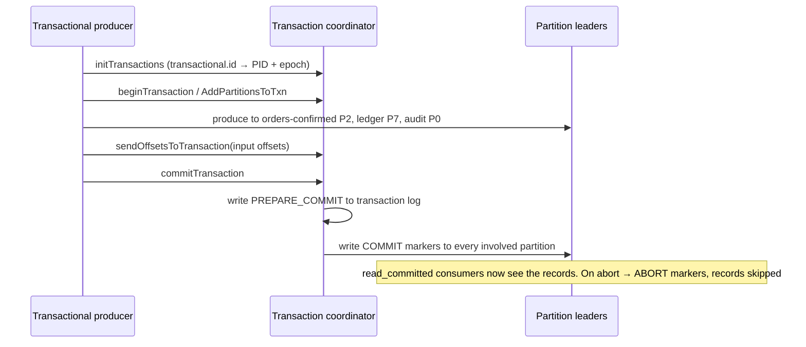

Internals: a two-phase commit coordinated by the transaction coordinator, using the internal `__transaction_state` topic, with control records (markers) written into each partition. read_committed consumers stop at the **Last Stable Offset** (LSO) while a transaction is open.

#### Example
When an order is confirmed, a processor must emit to `orders.confirmed`, `inventory.commands` and `ledger.entries` and commit its input offset, atomically. If it crashes halfway, the transaction aborts, so no partial set of downstream messages appears, and reprocessing produces the full set once.

#### Trade-offs
Atomic multi-partition writes within Kafka, but added latency (commit round trips), open transactions block read_committed consumers (LSO), long transactions hurt everyone, and there's no atomicity with external databases.

#### Problems & fixes
| Symptom | Cause | Fix |
|---|---|---|
| read_committed consumers stall | long-running/hanging open transaction | short transactions, `transaction.timeout.ms`, find hung producers |
| ProducerFencedException after restart | new instance took over id | expected. Ensure one active instance per transactional.id |
| Need atomicity with a DB too | Kafka transactions don't span DBs | outbox pattern (DB as source of truth) |

#### Cheat sheet
- Atomic writes across partitions + offset commit. Visible only on commit.
- Coordinator + transaction log + markers (2PC inside Kafka).
- Keep transactions short. read_committed stops at the LSO.

#### Interview questions
<details><summary>Can Kafka transactions make a database write and a Kafka publish atomic?</summary>

No. Kafka transactions only cover Kafka partitions and consumer offsets. For atomic DB-plus-event, use the transactional outbox: write the business change and an outbox row in one DB transaction, and have CDC or a relay publish to Kafka (at-least-once, with consumers deduplicating). Or store Kafka offsets in the DB for the consume side.
</details>

<details><summary>Why can a hanging transaction affect unrelated consumers?</summary>

read_committed consumers can't read past the Last Stable Offset, the first offset of the oldest open transaction in that partition. If a producer leaves a transaction open (crashed without abort, until timeout), all later records in those partitions, even from other producers, are held back from read_committed consumers until it commits, aborts or times out.
</details>

#### Interview angle
> "Kafka transactions give atomic multi-topic writes plus offset commits for consume-process-produce. They stop at Kafka's boundary, so database plus event atomicity uses the outbox."

#### Sources
- [Message delivery semantics](https://kafka.apache.org/documentation/#semantics) — Apache Kafka docs
- [Transactions in Apache Kafka](https://www.confluent.io/blog/transactions-apache-kafka/) — Confluent

### Retention — by time (retention.ms) or size (retention.bytes), not by consumer acknowledgement
Kafka keeps records based on **retention policy**, not on whether anyone consumed them: by **time** (`retention.ms`, default 7 days) and/or **size** (`retention.bytes` per partition), or forever with compaction or tiered storage. Consumers that fall behind beyond retention **lose** data, while consumers within retention can replay at will.

#### Intuition
A CCTV recorder that keeps the last seven days of footage and overwrites the rest. It does not care whether anyone has watched it.

#### Must know
- Kafka deletes records by **age or size**, never because they were consumed.
- That is what allows several consumers and replay.
- A consumer that falls behind **past retention loses data**. Kafka does not wait.
- Deletion happens a whole segment at a time, so data can outlive the setting slightly.
- Disk needed = ingest rate × retention × replication factor. Tiered storage moves old segments to object storage.

#### Numbers to quote
- Default `retention.ms` is 7 days.
- 20 MB/s for 7 days ≈ 12 TB per copy, about 36 TB with replication factor 3.

#### Common mistakes
- Assuming Kafka keeps a message until it is consumed.
- No alert when lag approaches the retention period.
- Forgetting to multiply by the replication factor when sizing disks.

#### How it works
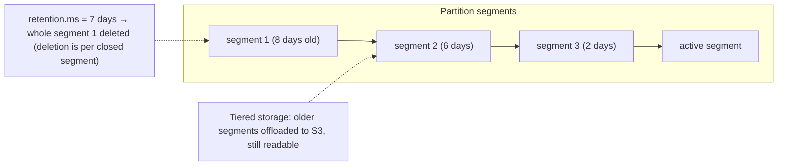

- Deletion happens **per segment** (`segment.ms`, `segment.bytes`), so data may live somewhat longer than retention.
- **Tiered storage** (KIP-405: early access in Kafka 3.6, production-ready since 3.9; also in Confluent and MSK) keeps recent data on broker disks and older data in object storage, making long retention cheap.
- Per-topic overrides let you retain critical topics longer (audit: 1 year) and noisy ones shorter (clicks: 3 days).

#### Example
A fraud model team needed 90 days of payment events to backfill features. With 7-day retention they'd need a separate archive. Enabling tiered storage with 90-day retention on `payments.events` kept broker disks small (3 days local) while the full 90 days stayed replayable from S3-backed segments, with no extra pipeline.

Storage sizing: 20 MB/s ingest × 86,400 s × 7 days ≈ 12 TB per copy, × RF 3 ≈ 36 TB of broker disk (plus headroom), which is why tiered storage matters at scale.

#### Trade-offs
Longer retention means more replay capability but more storage cost. Shorter retention means a risk of data loss for lagging consumers. Retention is independent of consumption, which is great for multi-consumer replay but means nothing guarantees a slow consumer sees everything.

#### Problems & fixes
| Symptom | Cause | Fix |
|---|---|---|
| Consumer lost data after outage | lag exceeded retention | alert on lag vs retention, longer retention for critical topics |
| Broker disks full | retention too long for volume | size retention by bytes, tiered storage, compression |
| Data kept longer than policy | segment-level deletion | tune `segment.ms` |
| Compliance requires deleting user data | immutable log retention | crypto-shredding, compaction with tombstones, shorter retention |

#### Cheat sheet
- Retention by time/size, independent of consumption. Deletion per segment.
- Size: ingest × retention × RF (+ headroom). Tiered storage for long retention.
- Alert when lag approaches retention.

#### Interview questions
<details><summary>How is Kafka retention different from a traditional queue's message lifecycle?</summary>

Queues delete messages when consumers acknowledge them. Kafka deletes by retention policy (time or size), regardless of consumption, so multiple consumer groups can read the same data independently and replay it, but a consumer that falls behind past retention silently misses records.
</details>

<details><summary>Estimate broker storage for a topic ingesting 50 MB/s with 3-day retention and RF 3.</summary>

50 MB/s × 86,400 × 3 ≈ 13 TB per copy, × 3 replicas ≈ 39 TB, plus ~30% headroom ≈ 50 TB across the cluster (before compression, which may cut it 2–5× for text payloads). Tiered storage could keep only hours locally and the rest in S3.
</details>

#### Interview angle
> "Retention is set per topic by replay needs and sized as ingest × time × RF. Tiered storage keeps long history cheap, and I alert when consumer lag approaches retention, because Kafka won't wait for slow consumers."

#### Sources
- [Topic configs](https://kafka.apache.org/documentation/#topicconfigs) — Apache Kafka docs
- [Kafka design: log compaction and retention](https://kafka.apache.org/documentation/#compaction) — Apache Kafka docs

### Log compaction — background thread merges segments, keeps latest value per key
Log compaction is the **background cleaner process** that implements compacted topics: it rewrites closed log segments, keeping only the **latest record for each key** (plus tombstones for a while), so the log stays bounded while preserving the last known state of every key. (Earlier in this phase covers compacted-topic use cases.)

#### Intuition
A caretaker who goes through old filing boxes after hours and throws out every superseded version of a document, leaving only the newest copy of each. The box in use today is left alone.

#### Must know
- A **background cleaner** rewrites closed segments, keeping the latest record per key.
- **Offsets never change.** Compaction just leaves gaps.
- The active segment is never compacted, so it must roll over periodically.
- `max.compaction.lag.ms` forces compaction within a deadline, which matters for deletion requests.
- Tombstones are kept for `delete.retention.ms`, then removed.

#### Common mistakes
- Expecting compaction to run immediately or on a fixed schedule.
- Not monitoring the cleaner thread. If it dies, the topic grows forever.
- A segment that never rolls, so the old values in it are never cleaned.

#### How it works
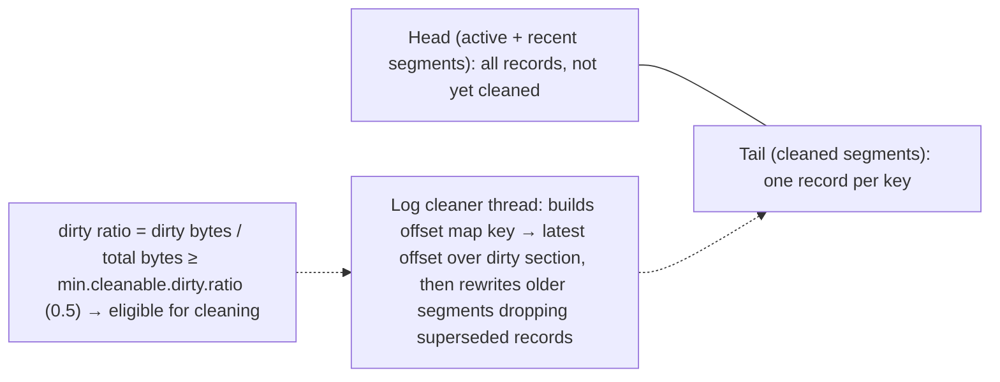

Key settings:
- `min.cleanable.dirty.ratio` (0.5): how much uncleaned data triggers compaction.
- `min.compaction.lag.ms`: guarantee records stay uncompacted for at least this long (consumers can see intermediate values).
- `max.compaction.lag.ms`: force compaction within this time (useful for GDPR deletes via tombstones).
- `delete.retention.ms`: how long tombstones are kept after compaction.
- `segment.ms`: the active segment is never compacted, so roll it periodically.

Guarantees: per-key order is preserved, offsets never change (gaps appear), and a consumer reading from the start sees at least the final value of every key.

#### Example
A user-profile changelog topic received a GDPR deletion request: the service wrote a tombstone for that user's key. With `max.compaction.lag.ms=24h`, compaction ran within a day and removed all older records for that key, and after `delete.retention.ms` the tombstone itself was removed, so the data was gone from Kafka within the compliance window.

#### Trade-offs
Bounded storage for state-like topics, but compaction uses I/O and memory (offset map), and timing is non-deterministic unless bounded by max lag. Consumers may still see multiple values per key before compaction.

#### Problems & fixes
| Symptom | Cause | Fix |
|---|---|---|
| Compacted topic still huge | active segment not rolled / dirty ratio not reached | lower `segment.ms`, lower dirty ratio |
| Log cleaner thread died (topic grows forever) | cleaner error (e.g. corrupt record) | monitor `log-cleaner` metrics, fix and restart |
| Deleted data visible too long | no max compaction lag | `max.compaction.lag.ms` |
| Consumers miss tombstones | `delete.retention.ms` too short | lengthen beyond consumer catch-up time |

#### Cheat sheet
- The cleaner rewrites closed segments, keeping the latest per key. Offsets are preserved.
- Tune the dirty ratio, segment.ms and max.compaction.lag.ms (deletion deadlines).
- Monitor the cleaner. Tombstones live for delete.retention.ms.

#### Interview questions
<details><summary>How do you guarantee that a deleted key's data is removed from a compacted topic within 7 days?</summary>

Write a tombstone (key with null value), and set `max.compaction.lag.ms` below 7 days (minus `delete.retention.ms` if the tombstone must also disappear) with `segment.ms` small enough that the segment containing old values gets rolled and becomes eligible. Monitor log cleaner health so compaction actually runs.
</details>

<details><summary>Does log compaction change offsets?</summary>

No. Records keep their original offsets, and compaction just removes superseded records, leaving gaps in the offset sequence. Consumers handle gaps transparently, and ordering per key is preserved.
</details>

#### Interview angle
> "Compaction keeps the latest record per key on closed segments. I bound it with max.compaction.lag.ms and segment.ms so tombstoned data really disappears on schedule, and I monitor the log cleaner thread."

#### Sources
- [Log compaction](https://kafka.apache.org/documentation/#compaction) — Apache Kafka docs
- [Topic configs](https://kafka.apache.org/documentation/#topicconfigs) — Apache Kafka docs

