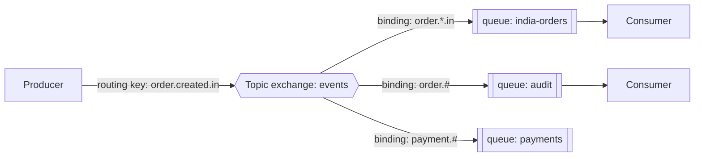
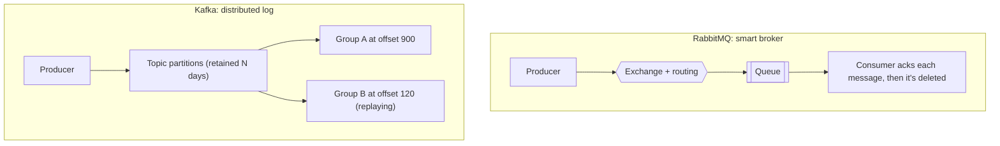
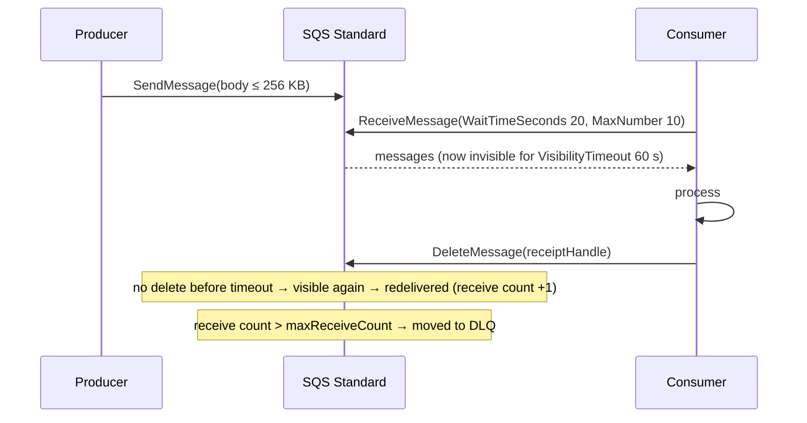
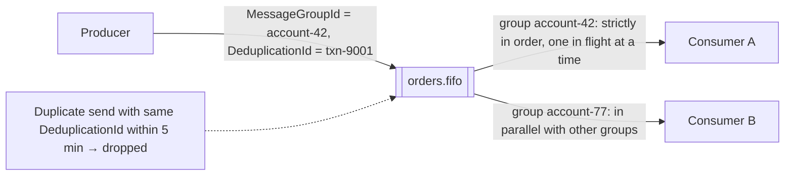
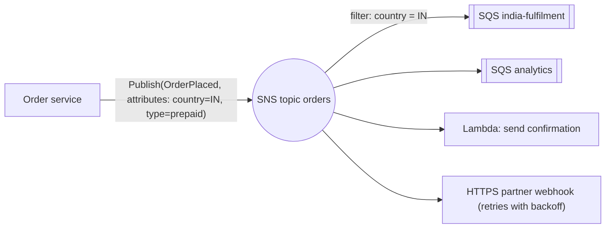
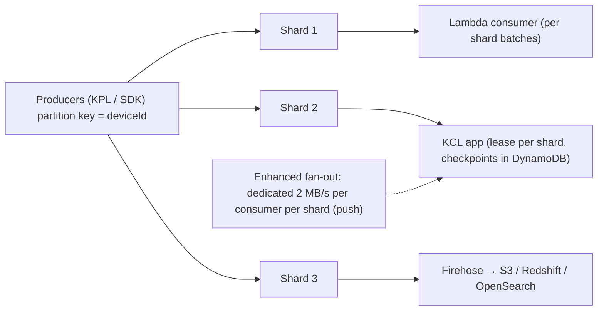
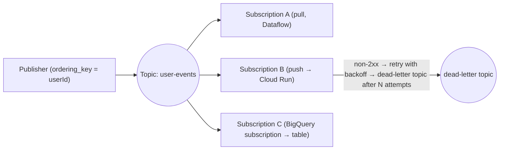
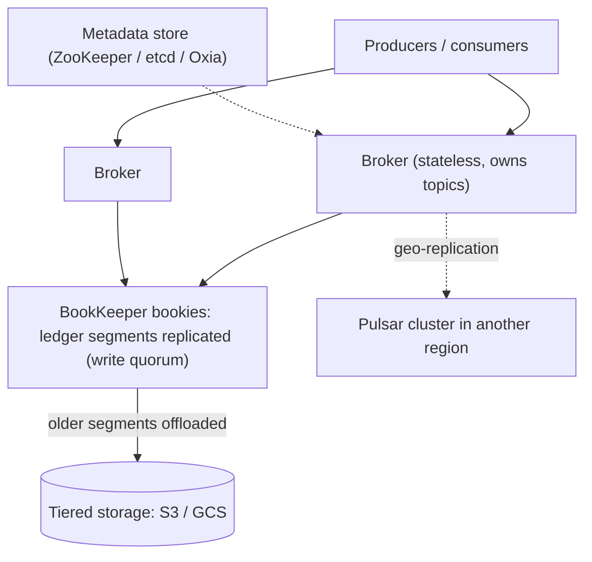
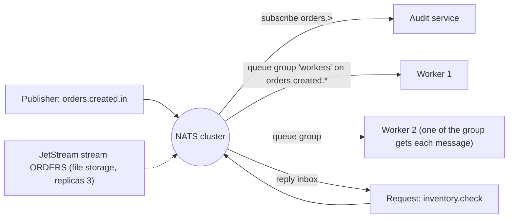

## Other messaging systems

### RabbitMQ — exchanges (direct, fanout, topic, headers), bindings, routing keys, queues
RabbitMQ is a traditional **message broker** implementing AMQP. Producers publish to an **exchange** (never directly to a queue) with a **routing key**. **Bindings** connect exchanges to **queues** with rules, and consumers read from queues with acknowledgements. Its strength is flexible routing and per-message work distribution.

#### How it works

| Exchange type | Routing rule | Use |
|---|---|---|
| direct | routing key equals binding key | task queues by type |
| fanout | every bound queue gets a copy | broadcast |
| topic | wildcard match (`*` = one word, `#` = zero or more) | event routing by pattern |
| headers | match on message headers | complex attribute routing |

Reliability features: durable queues plus persistent messages, publisher confirms, manual acks, prefetch, dead-letter exchanges, TTL and delayed retries. **Quorum queues** (Raft-replicated) are the recommended HA queue type. **Streams** add a Kafka-like replayable log.

#### Example
A notification platform: services publish `notify.email.welcome`, `notify.sms.otp` and `notify.push.promo` to a topic exchange. OTP SMS goes to a high-priority quorum queue with dedicated consumers, and promo pushes go to a low-priority queue. A dead-letter exchange collects failures after 5 retries with per-message TTL backoff queues.

#### Trade-offs
Rich routing, low latency, per-message acks and priorities. But replay is limited (messages disappear once acknowledged, except with Streams), throughput is lower than Kafka at extreme scale, and queues degrade when they get very long.

#### Problems & fixes
| Symptom | Cause | Fix |
|---|---|---|
| Broker memory alarm, publishers blocked | huge backlogs in classic queues | more consumers, lazy/quorum queues, limit queue length |
| Messages lost on node failure | classic non-replicated queues | quorum queues + publisher confirms |
| Consumer overwhelmed | no prefetch | `basic.qos` prefetch |
| Unroutable messages silently dropped | no matching binding | `mandatory` flag / alternate exchange |

#### Cheat sheet
- Producer → exchange (direct/fanout/topic/headers) → bindings → queues → consumers.
- Quorum queues + confirms + manual acks + prefetch + DLX.
- Best for task routing. Kafka is better for replayable high-volume streams.

#### Interview questions

How would you route events by region and type in RabbitMQ?

Use a topic exchange with routing keys like `order.created.in` or `payment.failed.eu`. Bind each queue with patterns: the India order processor uses `order.*.in`, the audit queue uses `#`, payment alerts use `payment.failed.*`. Producers only know the exchange and key format, and new consumers add bindings without changing producers.

Why are quorum queues preferred over classic mirrored queues?

Quorum queues replicate with Raft, which gives predictable leader election, consistency and data safety on failures. Classic mirrored queues had complex synchronisation and could lose messages or stall during network partitions, and they're deprecated. Quorum queues are designed for durability-first workloads.

#### Interview angle
> "RabbitMQ is my pick when the hard part is routing: topic exchanges, quorum queues with publisher confirms, prefetch and dead-letter exchanges. For replayable high-volume streams I'd use Kafka."

### RabbitMQ vs Kafka — traditional message broker vs distributed log; RabbitMQ: complex routing; Kafka: replay, high throughput
RabbitMQ and Kafka both move messages but with different models. **RabbitMQ** is a smart broker with simple consumers: it routes messages to queues, tracks per-message acks, and deletes messages once they're consumed. **Kafka** is a simple broker with smart consumers: it stores an append-only partitioned log and consumers track their own offsets, so data is retained and replayable.

#### How it works

| | RabbitMQ | Kafka |
|---|---|---|
| Model | queues, push, per-message ack | log, pull, offsets |
| Retention | until consumed | time/size based, replay |
| Routing | rich (exchanges, patterns, headers) | by topic/partition key |
| Ordering | per queue (single consumer) | per partition |
| Throughput | tens of thousands msg/s per node | millions msg/s per cluster |
| Priorities, delays, per-message TTL | yes | not natively |
| Typical use | task queues, RPC, complex routing | event streaming, CDC, analytics, event sourcing |

#### Example
A company uses both. **RabbitMQ** handles work jobs: PDF generation, emails, priority OTP SMS, retries with delays. **Kafka** is the event backbone: order and payment events consumed by 10 services, CDC from databases, and a data-lake feed with 30-day replay. Using Kafka for prioritised work queues, or RabbitMQ for analytics replay, would fight each tool's design.

#### Trade-offs
Pick by need: routing, priorities and simple work distribution favour RabbitMQ, while throughput, retention, replay and many independent consumers favour Kafka. Managed services (Amazon MQ, MSK, Confluent) reduce the operations burden either way.

#### Problems & fixes
| Symptom | Cause | Fix |
|---|---|---|
| Need to replay last week's events from RabbitMQ | consumed messages are gone | Kafka (or RabbitMQ Streams) for replayable data |
| Priority jobs stuck behind bulk in Kafka | no priorities, ordered partitions | separate topics per priority, or RabbitMQ |
| Kafka used for request/reply RPC | awkward fit | HTTP/gRPC or RabbitMQ direct reply-to |

#### Cheat sheet
- RabbitMQ: smart routing broker, delete on ack, push, priorities.
- Kafka: durable partitioned log, replay, huge throughput, many consumer groups.
- Use both: tasks in RabbitMQ or SQS, events in Kafka.

#### Interview questions

Which would you choose for an event-driven microservices backbone, and why?

Kafka. Events are retained and replayable (bootstrapping new services, recovering from bugs), many consumer groups read independently, throughput is high, per-key ordering comes from partitions, and it integrates with CDC and stream processing. RabbitMQ is better for task queues with complex routing, priorities and per-message TTL.

When is RabbitMQ the better choice over Kafka?

When you need flexible routing (topic/header exchanges), message priorities, per-message delays or TTL, request-reply patterns, low-latency delivery of individual tasks to competing workers, and you don't need long retention or replay. Typical examples are background job processing and notification dispatch.

#### Interview angle
> "Kafka is our event log, retained, replayable and fanned out to many groups. RabbitMQ or SQS handles task queues that need routing, priorities and delayed retries."

### AWS SQS Standard — at-least-once, best-effort ordering, up to 256KB, infinite scale
Amazon SQS Standard is a fully managed queue with **nearly unlimited throughput**, **at-least-once delivery** (occasional duplicates) and **best-effort ordering** (messages can arrive out of order). It needs zero operations and is replicated across AZs. It's the default choice for decoupling AWS workloads.

#### How it works

Key features: visibility timeout (extendable with `ChangeMessageVisibility`), long polling, batch send/receive/delete (10 per call), delay queues (up to 15 min), retention up to 14 days, DLQ via redrive policy, and Lambda event source mapping (with partial batch failure reporting). For payloads over 256 KB, store them in S3 and send a pointer (the extended client library).

#### Example
An image-processing pipeline: an S3 upload notification lands in SQS, and an ECS service autoscaled on `ApproximateAgeOfOldestMessage` resizes images. Duplicates are harmless because the output path is deterministic (`thumbs/{key}`), which makes the operation idempotent. Out-of-order processing doesn't matter. At a 10× traffic spike there's nothing to tune, SQS just absorbs it.

#### Trade-offs
Zero operations, effectively infinite scale and cheap, but duplicates and no ordering guarantee, no replay (messages are deleted after processing), a 256 KB limit, and polling-based consumption.

#### Problems & fixes
| Symptom | Cause | Fix |
|---|---|---|
| Duplicate processing | at-least-once / visibility timeout too short | idempotent consumers, timeout above processing time, heartbeat extension |
| High cost from empty receives | short polling | long polling (20 s), batching |
| Lambda retries whole batch on one failure | no partial batch response | `ReportBatchItemFailures` |
| Payload too large | > 256 KB | S3 pointer pattern |

#### Cheat sheet
- Managed, unlimited throughput, at-least-once, unordered, 14-day retention max.
- Visibility timeout + delete after processing + DLQ redrive.
- Long polling, batching, idempotent consumers. Scale on oldest message age.

#### Interview questions

How do you size the visibility timeout for an SQS consumer?

Set it above the maximum expected processing time (e.g. 6× the typical duration for Lambda, as AWS recommends), so a message isn't redelivered while still being processed. For variable or long jobs, extend it periodically with `ChangeMessageVisibility` (a heartbeat). Too long a timeout delays retry after a real crash, so balance the two.

SQS Standard vs FIFO: when would Standard be acceptable?

When consumers are idempotent and order doesn't matter (independent tasks like thumbnails, emails, webhook deliveries, analytics events), and you want unlimited throughput at lower cost. Use FIFO when per-entity order or strict deduplication matters and throughput fits its limits.

#### Interview angle
> "Independent background tasks on AWS go to SQS Standard: idempotent consumers, a long-polling batch receive, visibility timeout above processing time, a DLQ redrive policy, and scaling on the age of the oldest message."

### AWS SQS FIFO — exactly-once processing, ordered within message group, 300 TPS (3000 with batching)
SQS FIFO queues guarantee **ordering within a message group** and **deduplication** within a 5-minute window, giving exactly-once *processing* when consumers delete messages properly. Throughput is lower than Standard (300 messages/s per API action, 3,000 with batching, and much higher in **high-throughput mode**, scaling with the number of message groups).

#### How it works

- **MessageGroupId**: the ordering unit. Messages of a group are delivered in order, and the next one only after the previous is deleted (or its visibility expires).
- **MessageDeduplicationId**: explicit, or content-based (SHA-256 of the body).
- Parallelism = number of active message groups.

#### Example
Wallet transactions per user must apply in order (credit before debit). SQS FIFO with `MessageGroupId = walletId` processes each wallet's transactions sequentially, while thousands of wallets proceed in parallel. Producer retries reuse the same `MessageDeduplicationId = transactionId`, so a network-retry duplicate is dropped.

#### Trade-offs
Ordering and dedupe are built in, but throughput is limited per queue (high-throughput mode helps), a stuck message blocks its group (head-of-line blocking), dedupe only covers 5 minutes, and costs are slightly higher.

#### Problems & fixes
| Symptom | Cause | Fix |
|---|---|---|
| Throughput capped | few message groups / low TPS limits | more granular group ids, batching, high-throughput mode |
| One group stuck | failing message at head of group | DLQ after maxReceiveCount, fix and redrive |
| Duplicates after 5 minutes | dedupe window expired | consumer-side idempotency anyway |
| All messages processed serially | single MessageGroupId for everything | group by entity (user/order) |

#### Cheat sheet
- Order per MessageGroupId. Dedupe via DeduplicationId (5-minute window).
- Parallelism = number of groups. Watch per-queue TPS limits.
- Head-of-line blocking per group: DLQ + idempotency.

#### Interview questions

How do you get both ordering and parallelism with SQS FIFO?

Set `MessageGroupId` to the entity whose operations must be ordered (user, account, order). SQS keeps each group's messages in order and processes one at a time per group, while different groups are delivered to different consumers concurrently. Fine-grained group ids give more parallelism.

Does SQS FIFO's deduplication remove the need for idempotent consumers?

No. Dedup only applies to sends with the same deduplication id within 5 minutes. Duplicates can still arise from producer retries after 5 minutes, logically duplicate events with different ids, consumer crashes after side effects but before delete, or replays from a DLQ. Consumers should still be idempotent for critical effects.

#### Interview angle
> "When per-entity order matters on AWS, I use SQS FIFO with the entity as MessageGroupId and the transaction id as deduplication id, plus idempotent consumers and a DLQ so one bad message can't block a group forever."

### AWS SNS — pub/sub fan-out to SQS, Lambda, HTTP, email, SMS; no replay
Amazon SNS is a managed **pub/sub** service: publishers send a message to a **topic**, and SNS pushes copies to every subscription (SQS queues, Lambda functions, HTTP endpoints, email, SMS, mobile push). It's push-based with retries, but it **doesn't store messages for replay**, so pair it with SQS for durable per-consumer buffering.

#### How it works

Features: **message filtering** (subscription filter policies on attributes or body), FIFO topics (ordered fan-out to SQS FIFO), delivery retries and DLQs for subscriptions, raw message delivery, encryption, and cross-account subscriptions.

#### Example
The classic **SNS → SQS fan-out**: `OrderPlaced` is published once to SNS, and four SQS queues subscribe (fulfilment, billing, notifications, analytics). Each service consumes at its own pace with its own DLQ. Filter policies send only Indian prepaid orders to a COD-reconciliation queue. Adding a new consumer is one subscription.

#### Trade-offs
Simple, scalable, serverless fan-out with filtering, but no persistence or replay (if a subscriber endpoint is down beyond the retries, the message goes to that subscription's DLQ or is lost), a 256 KB message limit, and push delivery to HTTP endpoints needs those endpoints to be robust.

#### Problems & fixes
| Symptom | Cause | Fix |
|---|---|---|
| Messages lost when consumer down | direct Lambda/HTTP subscriptions without DLQ | SNS → SQS per consumer, subscription DLQs |
| Consumers receive irrelevant messages | no filtering | subscription filter policies |
| Need to replay history | SNS doesn't retain | Kafka/Kinesis/EventBridge archive, or store events |

#### Cheat sheet
- Managed pub/sub, push fan-out to SQS, Lambda, HTTP, email, SMS, mobile.
- SNS → SQS per consumer for durability. Filter policies. Subscription DLQs.
- No replay.

#### Interview questions

Why combine SNS with SQS instead of subscribing services directly to SNS?

SQS gives each consumer a durable buffer: if the service is slow or down, messages wait in its queue (up to 14 days) instead of SNS retrying a push and eventually giving up. Each service controls its own consumption rate, retries, scaling and DLQ, and failures in one consumer don't affect others.

SNS vs EventBridge vs Kafka for domain events on AWS?

SNS is simple, high-throughput fan-out with attribute filtering and no replay. EventBridge adds content-based routing rules, schema registry, SaaS and AWS-service integrations, archive and replay, at lower throughput per bus and higher latency. Kafka/MSK gives durable partitioned logs with long retention, ordering per key, stream processing and many consumer groups. Choose based on replay, ordering and throughput needs.

#### Interview angle
> "On AWS, domain events fan out through SNS to one SQS queue per consuming service, with filter policies and DLQs. If we need replay or per-key ordering, I'd move to EventBridge archives or Kafka."

### AWS Kinesis Data Streams — real-time, 1MB/s per shard, 7-day retention, replay capable
Kinesis Data Streams is AWS's managed **streaming log** (like Kafka): records go to **shards** chosen by partition key, are ordered within a shard, retained for 24 hours by default (up to 365 days), and can be read by multiple consumers and replayed. Capacity is per shard (**1 MB/s or 1,000 records/s write, 2 MB/s read**), in provisioned or on-demand mode.

#### How it works

Consumers: Lambda event source mapping, KCL (Kinesis Client Library, with checkpointing via DynamoDB leases), Kinesis Data Firehose (managed delivery), Managed Service for Apache Flink. Resharding splits or merges shards (or use on-demand mode to auto-scale).

#### Example
A ride-hailing telemetry pipeline: 200k location updates/s at ~200 bytes each is 40 MB/s, so ~50 shards provisioned (with headroom), or on-demand mode. A Flink app computes live supply per geohash, Firehose lands raw data in S3 for analytics, and Lambda triggers geofence alerts. Retention is 7 days to replay after bugs.

#### Trade-offs
| Kinesis | Kafka/MSK |
|---|---|
| fully serverless-ish, AWS-native integrations | richer ecosystem (Connect, Streams), portable |
| shard limits (1 MB/s in), resharding management (or on-demand cost) | partitions with higher per-partition throughput |
| per-shard pricing | broker-based pricing |

#### Problems & fixes
| Symptom | Cause | Fix |
|---|---|---|
| `ProvisionedThroughputExceeded` | hot shard / too few shards | better partition keys, more shards, on-demand mode, KPL aggregation |
| Consumers throttled reading | 5 reads/s and 2 MB/s per shard shared by consumers | enhanced fan-out |
| Lambda iterator age rising | consumer too slow | parallelization factor, batch size, more shards |

#### Cheat sheet
- Managed stream: shards (1 MB/s in, 2 MB/s out), ordered per shard, replay up to 365 days.
- Consumers: Lambda, KCL, Firehose, Flink. EFO for many consumers.
- Watch hot shards and iterator age.

#### Interview questions

How many Kinesis shards do you need for 30 MB/s of writes with 3 consumer applications?

Writes: 30 MB/s ÷ 1 MB/s per shard = 30 shards minimum (plus ~30% headroom, so about 40, also checking the records/s limit). Reads: 3 consumers × 30 MB/s = 90 MB/s, beyond 2 MB/s × 40 shards = 80 MB/s shared, so use enhanced fan-out (each consumer gets its own 2 MB/s per shard) or add shards. On-demand mode auto-manages capacity at a different price.

What's Lambda "iterator age" for Kinesis and why monitor it?

It's the age of the last record processed relative to the stream head, essentially consumer lag in time. Rising iterator age means the Lambda consumer can't keep up (slow processing, errors causing retries, too little parallelism), so data is getting stale and may expire beyond retention. Alert on it and scale with the parallelization factor or more shards.

#### Interview angle
> "For AWS-native real-time streams I'd use Kinesis: shards sized at 1 MB/s writes plus headroom (or on-demand), enhanced fan-out for multiple consumers, Firehose to S3, and alerts on iterator age."

### Google Cloud Pub/Sub — managed pub/sub, at-least-once, ordering per ordering-key, push or pull
Google Cloud Pub/Sub is a globally available, fully managed messaging service: publishers send to **topics**, and **subscriptions** deliver to consumers via **pull** (streaming pull) or **push** (HTTPS endpoints, Cloud Run). It auto-scales without partitions to manage, offers at-least-once delivery by default (exactly-once delivery as an option within a region), and ordering **per ordering key** when enabled.

#### How it works

Features: ack deadlines (modifiable), retry policies, dead-letter topics, filtering, seek (replay to a timestamp or snapshot within retention, up to 31 days with topic retention), BigQuery and Cloud Storage subscriptions, schemas, and exactly-once delivery (regional).

#### Example
A GCP-based fintech publishes transaction events with `ordering_key = accountId`: Dataflow computes risk features (pull), a Cloud Run push subscriber sends notifications, and a BigQuery subscription streams raw events into a table for analysts with no pipeline code. After a bug, they `seek` the notification subscription back 2 hours to resend missed messages (the handlers are idempotent).

#### Trade-offs
No capacity planning, global, rich integrations, but ordering keys reduce throughput per key and add head-of-line blocking on failures, push endpoints must handle retries and duplicates, and it's GCP-specific.

#### Problems & fixes
| Symptom | Cause | Fix |
|---|---|---|
| Messages redelivered repeatedly | ack deadline too short | extend deadline (client libraries auto-extend), process faster |
| Ordered key stuck | failing message blocks key | dead-letter policy, idempotent handling |
| Push endpoint overwhelmed | push rate | pull subscription or concurrency limits on Cloud Run |

#### Cheat sheet
- Topics + subscriptions (pull, push, BigQuery, GCS). At-least-once (exactly-once optional).
- Ordering per ordering_key. Seek/replay within retention.
- DLQ topics, ack deadlines, idempotent handlers.

#### Interview questions

How does Pub/Sub ordering work and what's the trade-off?

With message ordering enabled on the subscription and publishers setting an ordering key, messages with the same key are delivered in publish order (in the same region). The trade-off: per-key throughput is limited, a failed message must be acked or dead-lettered before later messages for that key proceed (head-of-line blocking), and publishers must handle publish failures for a key before continuing.

Push vs pull subscriptions: when to use each?

Push suits serverless HTTP consumers (Cloud Run, Functions) at moderate volume, with Pub/Sub managing delivery and retries. Pull (streaming pull) suits high-throughput or batch consumers (Dataflow, GKE workers) that control flow and concurrency, and environments without public HTTPS endpoints.

#### Interview angle
> "On GCP I'd use Pub/Sub: ordering keys per account where order matters, push to Cloud Run for light handlers, BigQuery subscriptions for analytics, and dead-letter topics with seek for replay."

### Apache Pulsar — tiered storage (offload to S3), geo-replication, multi-tenancy, unified queue+stream
Apache Pulsar is a distributed messaging and streaming platform that **separates serving from storage**: stateless **brokers** handle clients, and **Apache BookKeeper** "bookies" store data in segments. It supports both streaming (Kafka-like) and queuing (shared subscriptions) semantics, built-in **multi-tenancy**, **geo-replication** and **tiered storage** to S3.

#### How it works

Subscription types: **exclusive**, **failover**, **shared** (queue-like, messages distributed with per-message acks), **key_shared** (ordering per key across multiple consumers). Hierarchy: tenant → namespace → topic, with quotas and policies per namespace.

#### Example
A SaaS provider offering messaging to hundreds of customers uses Pulsar's tenants and namespaces for isolation and quotas, geo-replication between Mumbai and Singapore for DR, and tiered storage so customers can replay months of data cheaply from S3. Shared subscriptions give queue semantics for job processing on the same platform as event streams.

#### Trade-offs
Flexible (queue and stream), easy broker scaling (stateless brokers, no partition data movement), strong multi-tenancy and geo features. But more moving parts (brokers, bookies, metadata store), a smaller ecosystem and community than Kafka, and operational expertise is rarer.

#### Problems & fixes
| Symptom | Cause | Fix |
|---|---|---|
| Operational complexity | three components to run | managed Pulsar (StreamNative), good automation |
| Ecosystem gaps vs Kafka | fewer connectors/tools | Pulsar IO connectors, Kafka-protocol handler (KoP) |
| Noisy tenant affects others | missing quotas | namespace quotas, isolation policies |

#### Cheat sheet
- Stateless brokers + BookKeeper storage + tiered storage.
- Shared, key_shared, failover and exclusive subscriptions (queue and stream).
- Multi-tenancy, geo-replication built in. More components to operate.

#### Interview questions

How does Pulsar's architecture make scaling easier than Kafka's?

Brokers don't store partition data. They serve topics while data lives in BookKeeper segments spread across bookies. Adding brokers or moving topic ownership doesn't require copying partition data, and adding bookies increases storage capacity immediately for new segments. In Kafka, rebalancing partitions means copying their data between brokers.

When would you consider Pulsar over Kafka?

When you need strong multi-tenancy (many teams or customers with quotas and isolation), built-in geo-replication, both queue (shared subscription with per-message ack) and stream semantics in one system, or very long retention via tiered storage, and you can operate (or buy) the more complex stack. Otherwise Kafka's ecosystem usually wins.

#### Interview angle
> "I'd consider Pulsar for a multi-tenant platform needing geo-replication, tiered storage and both queue and stream semantics. For most product companies, Kafka's ecosystem and operational familiarity win."

### NATS — ultra-lightweight, sub-millisecond latency, JetStream for persistence
NATS is a lightweight, high-performance messaging system: a single small binary with **subject-based** pub/sub, request-reply and queue groups, and sub-millisecond latency. **Core NATS** is fire-and-forget (at-most-once, in-memory). **JetStream** adds persistence, at-least-once and exactly-once semantics, streams, consumers, a key-value store and an object store.

#### How it works

Subjects use tokens with wildcards (`*` one token, `>` many). Request-reply uses auto-generated inbox subjects. Leaf nodes and superclusters connect edge, cloud and multi-region deployments.

#### Example
An IoT/edge platform: thousands of devices connect to NATS leaf nodes in factories, publish telemetry on `factory.<id>.machine.<id>.temp` subjects, and control commands use request-reply with sub-millisecond latency. JetStream streams persist telemetry for 7 days, and central services consume via durable consumers. A tiny footprint fits edge gateways where Kafka would be too heavy.

#### Trade-offs
Very simple, fast, low resource use, flexible topologies (edge to cloud). Core NATS loses messages when no subscriber is connected. JetStream is younger than Kafka for massive-scale streaming, and the ecosystem (connectors, stream processing) is smaller.

#### Problems & fixes
| Symptom | Cause | Fix |
|---|---|---|
| Messages missing | core NATS has no persistence | JetStream streams + durable consumers |
| Slow consumers disconnected | NATS protects server from slow subscribers | JetStream pull consumers, faster processing |
| Subject sprawl / security | open subject space | accounts, permissions, naming conventions |

#### Cheat sheet
- Core NATS: subject pub/sub, request-reply, queue groups, at-most-once, very fast.
- JetStream: persistence, replay, at-least/exactly-once, KV/object store.
- Great for edge/IoT, service communication, lightweight eventing.

#### Interview questions

When would you choose NATS over Kafka?

For low-latency service-to-service messaging and request-reply, edge or IoT deployments needing a tiny footprint and leaf-node topologies, simple operations, and moderate persistence needs (JetStream). Kafka is better for very high-throughput durable event logs with long retention, a large connector ecosystem and stream processing.

What's the difference between core NATS and JetStream delivery guarantees?

Core NATS delivers at-most-once to currently connected subscribers, with nothing stored, so disconnected subscribers miss messages. JetStream persists messages in streams (with replication), tracks consumer acknowledgements, redelivers unacked messages (at-least-once), and supports deduplication windows and double acks for exactly-once processing.

#### Interview angle
> "NATS fits low-latency request-reply and edge or IoT messaging with a tiny footprint, using JetStream when messages must persist. For the big replayable event log, I'd still pick Kafka."
