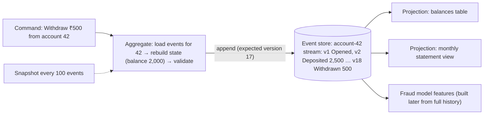
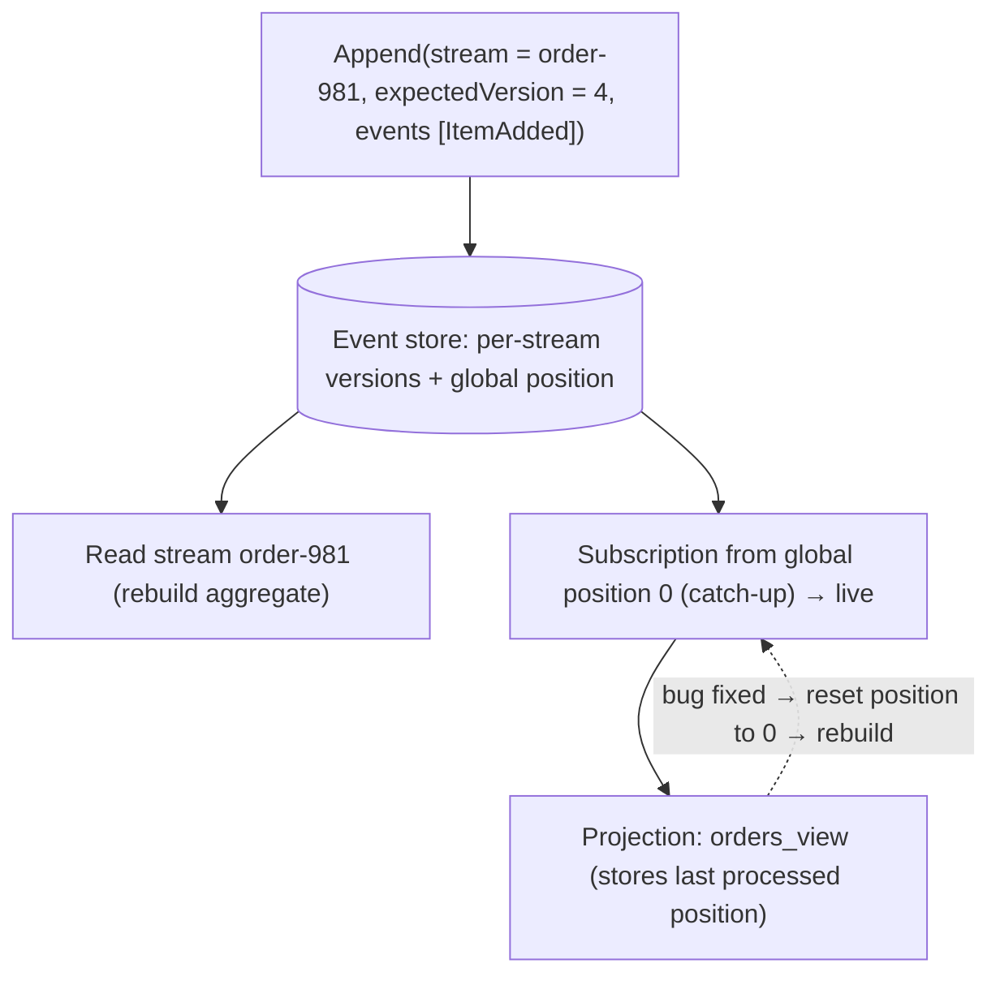
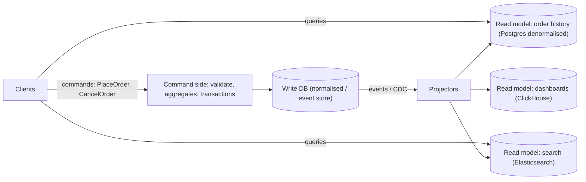
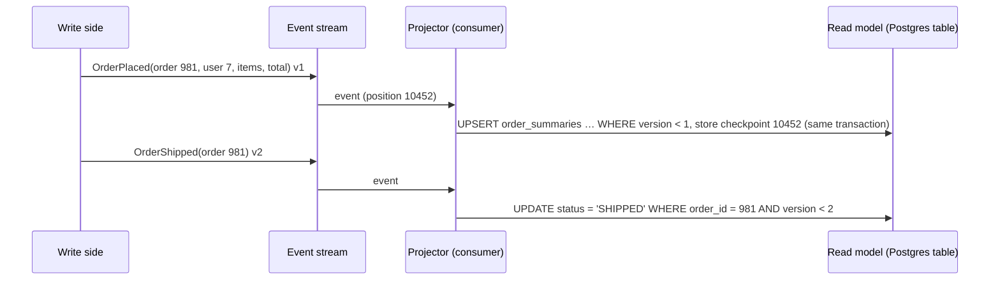
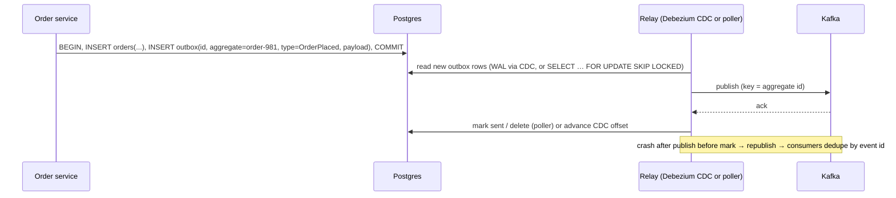
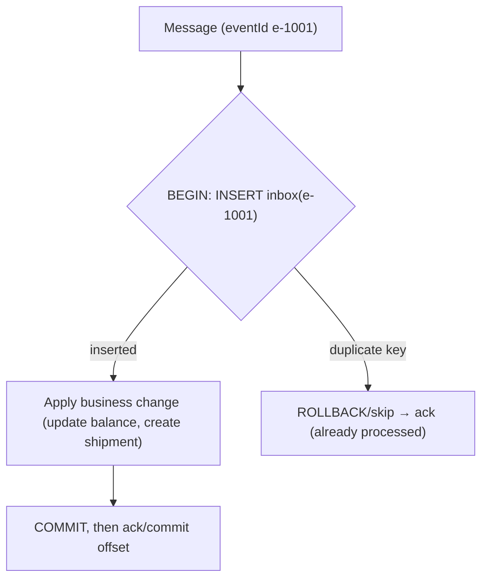
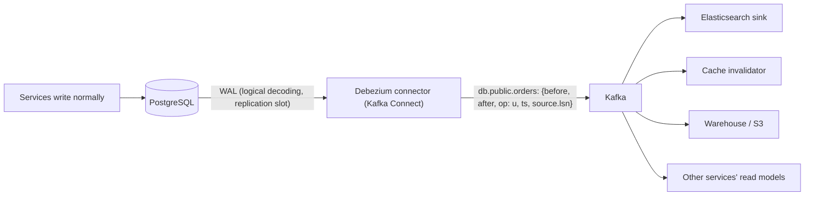
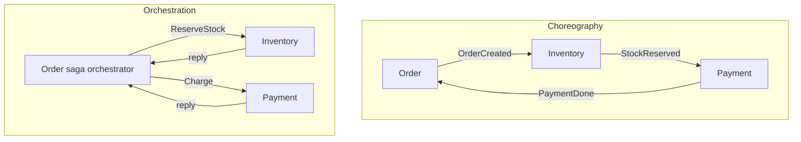
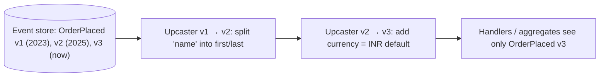
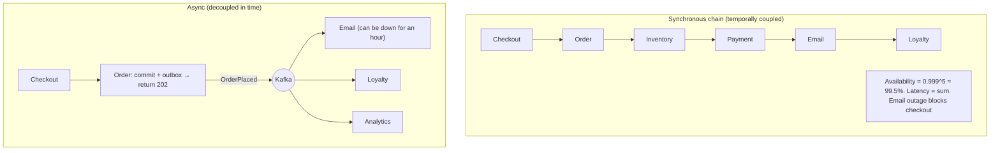

## Event-driven patterns

### Event sourcing — append-only log of domain events is source of truth; current state = replay of events
In event sourcing you store **every state change as an immutable domain event** (`AccountOpened`, `MoneyDeposited`, `MoneyWithdrawn`) instead of overwriting current state. The event log is the source of truth, and current state is derived by **replaying** events (often accelerated by snapshots). You get a perfect audit trail, time travel and the ability to build new views from history.

#### How it works


- **Optimistic concurrency**: append with an expected version, so concurrent conflicting commands fail and retry.
- **Projections** (read models) are built asynchronously from the event stream (CQRS).
- **Snapshots** avoid replaying thousands of events per command.

#### Example
A digital wallet: the ledger is naturally event-sourced (every credit and debit is an immutable entry). The balance is the sum of entries (cached in a projection). Disputes are resolved by examining the exact sequence of events. A new "cashback eligibility" feature builds its projection by replaying 2 years of wallet events, which is impossible if only current balances had been stored.

#### Trade-offs
| Pros | Cons |
|---|---|
| complete audit history, time travel, debugging | more complex: projections, eventual consistency |
| new read models from history | event schema evolution forever (old events never change) |
| natural fit for ledgers, workflows | GDPR deletion is hard (crypto-shredding) |
| append-only writes scale well | queries need projections; replay can be slow |

#### Problems & fixes
| Symptom | Cause | Fix |
|---|---|---|
| Slow command handling | replaying long streams | snapshots |
| Projections out of date / inconsistent | async projection lag or bugs | rebuild projection from log, monitor lag, read-your-writes from aggregate |
| Old events can't be read by new code | schema changes | versioned events + upcasters |
| Must delete personal data | immutable events | store PII encrypted per user and delete the key (crypto-shredding), or keep PII outside events |

#### Cheat sheet
- Events are the source of truth, state = fold(events). Append-only with expected version.
- Snapshots for speed. Projections for queries (CQRS).
- Plan event versioning and PII handling from day one.

#### Interview questions
<details><summary>When is event sourcing a good fit, and when is it overkill?</summary>

A good fit: domains where history matters intrinsically (ledgers, payments, inventory movements, order workflows, compliance and audit), where you need temporal queries or will want new projections from history, and where complex business rules benefit from explicit events. Overkill: simple CRUD (user profiles, catalogue admin) where current state is all that matters and the projection and versioning overhead brings little value.
</details>

<details><summary>How do you handle concurrent commands on the same aggregate in event sourcing?</summary>

Optimistic concurrency: the command handler loads the stream at version N, decides, and appends new events with "expected version = N". If another command appended first, the store rejects the append (version mismatch), and the handler reloads and re-evaluates (retry). This guarantees invariants per aggregate without locks.
</details>

#### Interview angle
> "For a ledger I'd use event sourcing: immutable entries appended with an expected version, balances as projections, snapshots for speed, versioned events, and crypto-shredding for PII."

### Event store — immutable, ordered, replayable; projections rebuild read models
An event store is the database for event sourcing: it stores **streams of events per aggregate** (append-only, ordered, with versions), supports **optimistic concurrency** on append, and offers **subscriptions** so projections can consume events in order and rebuild from the beginning at any time.

#### How it works


Options:
- **EventStoreDB (Kurrent)**: purpose-built, streams, subscriptions, projections.
- **PostgreSQL** table `events(stream_id, version, global_seq, type, data jsonb, metadata, created_at)` with a unique `(stream_id, version)`, which is simple and transactional (Marten, Axon with JDBC, custom).
- **Kafka**: good as an event *bus* and for projections, but not ideal as the aggregate store (no per-entity optimistic concurrency or efficient per-stream reads).
- DynamoDB with conditional writes on `(streamId, version)`.

#### Example
A Postgres-backed event store for an order-management system:
```sql
CREATE TABLE events (
  global_seq  BIGSERIAL PRIMARY KEY,
  stream_id   TEXT NOT NULL,
  version     INT  NOT NULL,
  type        TEXT NOT NULL,
  data        JSONB NOT NULL,
  metadata    JSONB NOT NULL,      -- correlation id, causation id, user, schema version
  created_at  TIMESTAMPTZ DEFAULT now(),
  UNIQUE (stream_id, version)      -- optimistic concurrency
);
```
Projections poll by `global_seq` and store their checkpoint. A CDC/outbox relay also publishes events to Kafka for other services.

#### Trade-offs
Strong guarantees and replayability, but specialised operations (or careful design on general DBs), global ordering via a sequence can become contended, and projections must be idempotent and rebuildable.

#### Problems & fixes
| Symptom | Cause | Fix |
|---|---|---|
| Gaps/out-of-order in global sequence under concurrency | sequences commit out of order | read only up to safe position / transaction-aware polling, or per-stream processing |
| Projection rebuild takes days | huge history, slow handlers | snapshots, parallel rebuild by stream, faster bulk writes |
| Concurrency conflicts frequent | hot aggregates | smaller aggregates, rethink boundaries |

#### Cheat sheet
- Streams per aggregate, versions + global position, append with expected version.
- Subscriptions/catch-up for projections with checkpoints. Rebuild anytime.
- EventStoreDB, Postgres table, DynamoDB conditional writes. Kafka as a bus.

#### Interview questions
<details><summary>Can Kafka be your event store for event sourcing?</summary>

It works for distributing events and building projections, but it's weak as the aggregate store: there's no efficient read of a single aggregate's stream (a topic holds many keys), no optimistic concurrency check on append per entity, and retention or compaction must be configured to keep everything forever. Common practice is a DB-based event store (or EventStoreDB) as the source of truth, with events published to Kafka via an outbox.
</details>

<details><summary>How do you rebuild a projection after fixing a bug in its handler?</summary>

Create a new version of the read model (a new table or index), reset its checkpoint to position 0, and replay all events through the fixed handler (in parallel per stream if possible). When it catches up to live, switch reads to the new model (blue/green), then drop the old one. Handlers must be deterministic and idempotent.
</details>

#### Interview angle
> "The event store keeps per-aggregate streams with a unique (stream, version) for optimistic concurrency, plus a global position for checkpointed projections. Every read model can be rebuilt from scratch."

### CQRS — Command Query Responsibility Segregation: separate write model (commands) from read model (queries)
CQRS separates the **write side** (commands that change state, enforcing business rules on a normalised or aggregate model) from the **read side** (queries served from models shaped for each screen or use case). Each side can use a different schema, database and scaling strategy, connected by events.

#### How it works


Levels of CQRS:
1. Separate command and query **code paths** on one DB (cheap and common).
2. Separate **read models** (tables or views) updated in the same DB.
3. Separate **databases** for reads, updated asynchronously (full CQRS, often with event sourcing).

#### Example
An e-commerce order service: commands go to a normalised Postgres schema with strict constraints. The "My Orders" page reads a denormalised `order_summaries` table (one row per order with item thumbnails and status), search uses Elasticsearch, and the seller dashboard uses ClickHouse. All of them are fed by order events. Reads scale independently (replicas, caches), and the write model stays simple and correct.

#### Trade-offs
Optimised reads and writes, independent scaling and a clean separation of business rules, but eventual consistency between the sides, more infrastructure and code, and the need for read-your-writes handling.

#### Problems & fixes
| Symptom | Cause | Fix |
|---|---|---|
| User doesn't see change right after command | async read model lag | return state from command, read-your-writes routing, UI optimism |
| Overcomplicated simple CRUD | CQRS applied everywhere | use only where read/write needs differ strongly |
| Read model diverges | missed/duplicate events | idempotent projectors, rebuild from source |

#### Cheat sheet
- Commands change state (rules, write model). Queries read optimised views.
- Connected by events/CDC, so eventually consistent.
- Apply selectively. Handle read-your-writes.

#### Interview questions
<details><summary>When does CQRS pay off?</summary>

When read and write workloads differ a lot: reads are far more frequent or need very different shapes (search, aggregates, denormalised screens), writes need strict invariants, or read scale far exceeds write scale. Also when you already use event sourcing (projections are natural). For simple CRUD with similar read and write shapes it adds needless complexity.
</details>

<details><summary>How do you handle the "I just placed an order but it's not in My Orders" problem with CQRS?</summary>

Return the created order in the command response and show it optimistically. Route that user's next reads to the write model (or wait until the read model's projection position passes the command's event position, using a version token). Display "processing" states. Keep projection lag low and monitored.
</details>

#### Interview angle
> "I apply CQRS where reads and writes diverge: commands hit a strict write model, and events feed denormalised read models in Postgres, Elasticsearch and ClickHouse, with read-your-writes handling for the user who just acted."

### CQRS read models — optimized for query patterns, updated asynchronously via events
A read model (projection, materialised view) is a **query-optimised copy of data**, shaped exactly for one screen or API, kept up to date by **consuming events** from the write side. You can have many read models over the same events, each in the best store for its query.

#### How it works


Design rules:
- **Idempotent** projector (upsert, version checks) because events may repeat.
- Store the **checkpoint** with the read model update (same transaction), for exactly-once effects.
- Handle **ordering** per entity (partition by entity id).
- Make read models **disposable**: rebuildable from the event history.

#### Example
A "customer 360" page needed data from orders, payments, support tickets and loyalty, which meant 4 service calls per page load with a p99 of 900 ms. A projection service consumes events from all four domains into one `customer_360` document per customer in MongoDB, so the page loads in a single 10 ms query. When support-ticket fields changed, the team rebuilt the projection from Kafka retention plus the archive.

#### Trade-offs
Lightning-fast queries and decoupling from source services, but staleness (projection lag), storage duplication, and rebuild procedures to maintain.

#### Problems & fixes
| Symptom | Cause | Fix |
|---|---|---|
| Duplicated or out-of-date fields | non-idempotent projector, out-of-order events | upsert with version checks, partition by key |
| Can't rebuild (events expired) | short retention | archive events (S3), compacted topics, event store |
| Lag spikes | slow projector | batching, parallel by partition, monitor lag |

#### Cheat sheet
- One read model per query pattern, fed by events.
- Idempotent + checkpoint in same transaction + per-key ordering.
- Rebuildable, so keep event history accessible.

#### Interview questions
<details><summary>How do you make a projection exactly-once on top of at-least-once event delivery?</summary>

Store the projection's last processed position (or per-entity version) in the same database transaction as the read model update, and skip events at or below it. Alternatively make every update idempotent (upsert with `WHERE version < :eventVersion`). Then duplicates or redeliveries don't change the result.
</details>

<details><summary>Why are read models good for microservice query problems like "show order with customer name"?</summary>

Instead of runtime joins across services (multiple synchronous calls, latency and coupling), the order service's read model subscribes to customer events and keeps the needed fields (customer name) locally, denormalised. Queries then hit one local store. The source services remain authoritative, and the read model is eventually consistent.
</details>

#### Interview angle
> "Screens that combine data from many services read from a projection fed by their events: an idempotent upsert, with the checkpoint stored in the same transaction, rebuildable from the event archive."

### Outbox pattern — write event to outbox table in same DB transaction as domain change; relay process publishes to MQ
The transactional outbox solves the **dual-write problem**: you can't atomically update a database and publish to Kafka or RabbitMQ. Instead, the service writes the business change **and an event row into an `outbox` table in the same DB transaction**. A separate relay (a poller or CDC) reads the outbox and publishes to the broker, retrying until it succeeds.

#### How it works


```sql
CREATE TABLE outbox (
  id            UUID PRIMARY KEY,           -- event id for consumer dedupe
  aggregate_id  TEXT NOT NULL,              -- used as Kafka key (ordering per aggregate)
  type          TEXT NOT NULL,
  payload       JSONB NOT NULL,
  created_at    TIMESTAMPTZ DEFAULT now(),
  published_at  TIMESTAMPTZ
);
CREATE INDEX outbox_unpublished ON outbox(created_at) WHERE published_at IS NULL;
```

Relay options: **Debezium Outbox Event Router** (CDC from the WAL, low latency, no polling load) or a **polling publisher** (simple, works everywhere).

#### Example
Before: `orderRepo.save(order); kafka.send(OrderPlaced)`. When Kafka was briefly unavailable, orders existed but downstream services never heard of them, so payments weren't taken and nothing shipped. After: the outbox written in the same transaction, with Debezium publishing to `orders.events`. During a 10-minute Kafka outage events accumulated in the outbox and were published when Kafka returned, and nothing was lost.

#### Trade-offs
Atomicity between state and events with no 2PC. The costs are at-least-once publication (duplicates), slight delay, outbox table maintenance, and ordering guarantees only per aggregate key.

#### Problems & fixes
| Symptom | Cause | Fix |
|---|---|---|
| Duplicate events downstream | relay retries | consumers dedupe by event id (inbox) |
| Outbox table grows | not cleaned | delete published rows / partition by day |
| Events out of order per aggregate | multiple relays / no key | key by aggregate id, single relay per partition, CDC ordering |
| CDC slot lag fills disk | relay down | monitor replication slot, alerts |

#### Cheat sheet
- Business change + outbox row in one transaction, then a relay publishes.
- CDC (Debezium) or polling with SKIP LOCKED. At-least-once, so consumers dedupe.
- Key by aggregate id. Clean up the outbox. Monitor relay lag.

#### Interview questions
<details><summary>Why can't you just publish to Kafka after committing the database transaction?</summary>

The process can crash, or Kafka can be unavailable, between commit and publish, so the state change happened but the event is lost and downstream systems never learn of it. Publishing before commit has the opposite problem (an event for a change that rolled back). The outbox makes the event part of the same atomic commit, and a relay delivers it reliably afterwards.
</details>

<details><summary>CDC-based relay vs polling relay for the outbox?</summary>

CDC (Debezium reading the WAL) gives low latency, no polling queries on the table, and preserves commit order, but needs Kafka Connect and replication-slot management. A polling relay is simpler (a scheduled `SELECT … WHERE published_at IS NULL … FOR UPDATE SKIP LOCKED`), but adds DB load and latency, and ordering needs care with concurrent pollers.
</details>

#### Interview angle
> "Every service publishes through a transactional outbox, with Debezium relaying it to Kafka keyed by aggregate id, so state and events can never disagree. Consumers dedupe by event id."

### Inbox pattern — idempotent consumer with inbox table to deduplicate duplicate deliveries
The inbox pattern is the consumer-side counterpart of the outbox: each incoming message's id is recorded in an **inbox table** within the **same transaction** as the consumer's state changes. If the message arrives again, the insert fails (unique key) and processing is skipped, which turns at-least-once delivery into **exactly-once effects**.

#### How it works


```sql
CREATE TABLE inbox (
  message_id   UUID PRIMARY KEY,
  source       TEXT NOT NULL,
  received_at  TIMESTAMPTZ DEFAULT now()
);
-- in the handler's transaction:
INSERT INTO inbox(message_id, source) VALUES (:id, 'payments') ON CONFLICT DO NOTHING;
-- if 0 rows inserted → duplicate → skip
```

Variants: store processing status for async workflows, or (for ordered streams) store the last processed offset per partition instead of ids.

#### Example
The shipping service consumes `PaymentSucceeded`. A Kafka rebalance redelivered ~500 events, and without dedupe they would have created duplicate shipments. With the inbox insert in the same transaction as `INSERT INTO shipments`, duplicates were skipped silently. Inbox rows older than 14 days (beyond Kafka retention plus the redrive window) are purged by a nightly job.

#### Trade-offs
Robust dedupe with minimal code, at the cost of an extra write per message and table growth (needs cleanup). It only works when the side effect is in the same DB (external calls need idempotency keys).

#### Problems & fixes
| Symptom | Cause | Fix |
|---|---|---|
| Duplicates still happen | inbox insert and effect in different transactions | same transaction |
| Inbox table huge, slow inserts | never purged | TTL cleanup, partition by date |
| Duplicates arriving after purge (replays) | retention shorter than replay horizon | keep ids longer or use version-based idempotency |
| External API called twice | effect outside DB | idempotency key to external API + status tracking |

#### Cheat sheet
- Insert the message id into the inbox in the same transaction as the effect. Duplicates are skipped.
- Pairs with outbox: reliable publish + idempotent consume.
- Purge after the replay window. External effects need idempotency keys.

#### Interview questions
<details><summary>Outbox + inbox: what guarantees do they give together?</summary>

The outbox guarantees every committed state change produces its event (at-least-once publication, no lost events). The inbox guarantees each event's effect is applied once at the consumer despite duplicates. Together they give effectively-once, reliable event-driven communication between services without distributed transactions.
</details>

<details><summary>How long should you keep inbox entries?</summary>

At least as long as duplicates can arrive: the broker's redelivery window, plus retention for possible replays and DLQ redrive windows (e.g. 7–30 days). If replays from older history are possible, rely on version-based idempotency (only apply if the event version is greater than the stored version) rather than unbounded inbox retention.
</details>

#### Interview angle
> "Consumers use an inbox table: the message id is inserted in the same transaction as the side effect, so redeliveries and replays are no-ops. With the outbox on the producer side, that gives effectively-once messaging."

### Change Data Capture (CDC) — Debezium reads DB write-ahead log → publishes to Kafka; zero-impact on DB
Change Data Capture streams **every committed row change** (insert, update, delete) from a database's transaction log (Postgres WAL, MySQL binlog, Mongo oplog) into an event stream, usually Kafka via **Debezium**. Downstream systems (search, caches, warehouses, other services) stay in sync without dual writes or polling queries.

#### How it works


Event payload (simplified):
```json
{ "before": {"id": 981, "status": "PAID"},
  "after":  {"id": 981, "status": "SHIPPED"},
  "op": "u", "ts_ms": 1762681200123,
  "source": {"table": "orders", "lsn": 2738495112, "txId": 88123} }
```

Features: initial **snapshot** plus streaming, ordering per primary key (key = PK), schema changes captured, the outbox event router, and filtering/masking via SMTs.

#### Example
A company needs product changes reflected in Elasticsearch, Redis caches and Snowflake. Debezium on the `products` table publishes changes, and three sinks consume them. There's no change to the 15 services that write products, no dual writes and no nightly batch: search reflects edits within ~1 s. The DB impact is small (reading the WAL), but the team monitors the replication slot closely.

#### Trade-offs
Reliable, ordered and complete capture with no app changes, but it exposes **table schemas** as contracts (coupling to internal schema, so prefer the outbox for public domain events), and replication slots can fill DB disks if consumers stop. Large transactions and schema changes need care.

#### Problems & fixes
| Symptom | Cause | Fix |
|---|---|---|
| DB disk filling with WAL | stopped connector holding slot | alert on slot lag, `max_slot_wal_keep_size`, restart/recreate connector |
| Downstream breaks on column rename | internal schema used as public contract | outbox events for cross-team contracts, CDC for owned pipelines |
| Initial snapshot overloads DB | full table scan | incremental snapshots, run on replica, off-peak |
| Out-of-order processing | consumers parallelise across keys incorrectly | key by PK, preserve per-partition order |

#### Cheat sheet
- Read WAL/binlog, emit row-change events to Kafka (Debezium).
- Use for search sync, cache invalidation, warehouses, read models, the outbox relay.
- Monitor replication slots. Prefer outbox events for public contracts.

#### Interview questions
<details><summary>Why is CDC better than application dual writes for keeping Elasticsearch in sync with Postgres?</summary>

Dual writes (DB then ES) can fail partially or race with concurrent updates, leaving ES permanently inconsistent, and every write path must remember to do it. CDC captures every committed change from the log in commit order, regardless of which code path or tool wrote it, and can replay or resnapshot to recover.
</details>

<details><summary>Should other teams consume your service's raw CDC topics?</summary>

Generally no: raw CDC exposes your internal table structure, so renaming a column or splitting a table breaks consumers, coupling them to your schema. Publish explicit domain events (via the outbox, possibly using Debezium's outbox router) as the public contract, and keep raw CDC for pipelines you own (search, cache, analytics).
</details>

#### Interview angle
> "Search, caches and the warehouse stay in sync through Debezium CDC from the WAL, with no dual writes. Replication slot lag is alerted on, and other teams consume outbox domain events, not my raw tables."

### Saga choreography vs orchestration — choreography: loose coupling, hard to trace; orchestration: central control, easier to monitor
Both implement sagas (multi-service transactions with compensations). In **choreography**, services react to each other's events with no central brain. In **orchestration**, a coordinator explicitly commands each step. Choosing between them is about **coupling, visibility and complexity**. (Phase 6 covers each in depth.)

#### How it works


| | Choreography | Orchestration |
|---|---|---|
| Coupling | services know events, not each other | orchestrator knows all participants |
| Visibility | scattered (needs tracing/projections) | central state per saga instance |
| Changing flow | touch several services | change the orchestrator |
| Failure handling | each service handles compensations | orchestrator drives compensations, timeouts |
| Best for | short, stable flows (2–4 steps) | long, branching, time-bound flows |
| Tools | Kafka/SNS events | Temporal, Step Functions, Camunda, custom state machine |

#### Example
An e-commerce company starts with choreography for "order → reserve → charge" (3 steps, simple). As returns, partial refunds, split shipments and fraud review get added (10+ steps with timeouts and human approvals), they move the order lifecycle to a Temporal orchestration while keeping choreographed events for independent side effects (emails, analytics, recommendations).

#### Trade-offs
Choreography maximises autonomy but hides the process. Orchestration makes the process explicit but centralises logic (the risk of a god service). Hybrids are common: orchestrate the core transaction, and choreograph the side reactions.

#### Problems & fixes
| Symptom | Cause | Fix |
|---|---|---|
| Nobody knows saga status | choreography without tracking | correlation ids, tracing, saga status projection, or orchestrate |
| Orchestrator accumulates domain logic | over-centralisation | orchestrator sequences, services own rules |
| Cyclic event chains | choreography between many services | orchestrate complex flows |

#### Cheat sheet
- Choreography = events, loose coupling, hard to see. Orchestration = coordinator, visible, central.
- Short/stable → choreography. Long/branching/timeouts → orchestration.
- Hybrid: orchestrate the core, choreograph side effects.

#### Interview questions
<details><summary>Your choreographed order saga has grown to 9 services and incidents are hard to debug. What do you do?</summary>

Introduce an orchestrator (Temporal or Step Functions, or a saga state machine service) for the core order lifecycle: explicit steps, timeouts, compensations and per-order history. Participants keep their business logic and expose commands. Independent side effects (notifications, analytics) stay choreographed via events. Add correlation ids and tracing throughout.
</details>

<details><summary>What's the main risk with orchestration and how do you mitigate it?</summary>

The orchestrator can become a "god service" containing business logic from every domain, coupling all teams to it. Mitigate by keeping it to sequencing, timeouts and compensation triggers, while each service owns its rules and validations behind clear commands. Consider one orchestrator per business process, owned by the team that owns that process.
</details>

#### Interview angle
> "I orchestrate the core transaction, with explicit steps, timeouts and compensations in one place, and choreograph independent side effects through events."

### Event versioning and upcasting — handle schema changes by transforming old events to new schema on read
Events are immutable and may be stored forever (event stores, long-retention topics), so their schemas will change while old events remain. **Versioning** labels each event's schema, and **upcasting** transforms old event versions into the current shape **when they're read**, so business code only handles the latest version.

#### How it works


Strategies:
| Strategy | When |
|---|---|
| Additive change with defaults (no new version) | adding optional fields |
| **Upcasting** on read | renames, splits, type changes for stored events |
| New event type (`OrderPlacedV2`) | semantic change, both handled during transition |
| Copy-transform (migrate the store into a new stream/store) | big structural changes, rarely |
| Weak schema / tolerant reader | consumers ignore unknown fields |

```java
class OrderPlacedV1toV2 implements Upcaster {
  boolean canUpcast(EventEnvelope e) { return e.type().equals("OrderPlaced") && e.version() == 1; }
  EventEnvelope upcast(EventEnvelope e) {
    ObjectNode d = (ObjectNode) e.data();
    String[] parts = d.remove("customerName").asText().split(" ", 2);
    d.put("firstName", parts[0]).put("lastName", parts.length > 1 ? parts[1] : "");
    return e.withVersion(2).withData(d);
  }
}
```

#### Example
An event-sourced ledger stored `MoneyTransferred{amount: 500.0}` (decimal rupees) in 2023. In 2025 they moved to minor units and currency (`amountMinor: 50000, currency: "INR"`). An upcaster converts v1 events on read, so aggregates and new projections handle only v2, while the immutable history stays untouched, which auditors require.

#### Trade-offs
Keeps history intact and code simple, but upcaster chains grow over time (test them thoroughly) and there's some read-time cost. Semantic changes may need new event types rather than transformations.

#### Problems & fixes
| Symptom | Cause | Fix |
|---|---|---|
| New code crashes replaying old events | no version handling | version every event, upcasters, tests replaying historic samples |
| Mutated historical events (audit violation) | "migrating" events in place | upcast on read instead |
| Upcaster chain slow/complex | many versions | periodically copy-transform into a new stream, snapshot |

#### Cheat sheet
- Version every event. Old events never change.
- Upcast old → new on read. Handlers see only the latest.
- Additive changes with defaults need no version. Semantic changes get a new event type.

#### Interview questions
<details><summary>Why not just run a migration that rewrites old events in the event store?</summary>

Events are the immutable audit record. Rewriting them destroys history, risks corruption, and breaks anything that relied on exact past data (audits, legal evidence, reproducing bugs). Upcasting transforms on read and preserves the originals. Full copy-transform into a new store is a last resort for massive restructuring, done carefully.
</details>

<details><summary>How do you test event schema evolution?</summary>

Keep a corpus of real (anonymised) historical events for each version, and in CI replay them through upcasters and handlers, asserting they deserialise and produce the expected state. Check schema compatibility in the registry for broker-based events, and contract-test consumers against producers' schemas.
</details>

#### Interview angle
> "Every event carries a version, history is never rewritten, and upcasters lift old versions on read, tested in CI against a corpus of historical events."

### Temporal coupling problem — synchronous chains; fix with async events to decouple services
Temporal coupling means a service can only complete its work if **other services are available right now**. Long chains of synchronous calls (A → B → C → D) multiply failure probability and latency: one slow or failed service fails the whole request. Async messaging decouples **in time**: A records its intent and returns, and others process when they can.

#### How it works


Availability math: five services in series, each at 99.9%, give 0.999⁵ ≈ **99.5%** overall (about 3.6 hours of downtime a month vs 43 minutes for one service).

What to keep synchronous: steps whose result the user needs **now** to proceed (price, stock check, payment authorisation). Everything else becomes async (notifications, loyalty points, analytics, search indexing).

#### Example
During a festival sale, the loyalty-points service slowed to 5 s responses. Because checkout called loyalty synchronously, every checkout took 5+ s and many timed out, and revenue dropped though payments were healthy. Refactor: checkout publishes `OrderPlaced` via outbox and loyalty consumes asynchronously. The next time loyalty degraded, points were awarded 20 minutes late and checkout was unaffected.

#### Trade-offs
Async improves resilience and latency, but introduces eventual consistency, harder flows to trace, and the need for idempotency and failure handling (DLQs, sagas).

#### Problems & fixes
| Symptom | Cause | Fix |
|---|---|---|
| Unrelated service outage breaks checkout | synchronous dependency for non-essential work | async events for non-critical steps |
| Latency = sum of all downstream calls | sequential sync chain | parallelise essentials, async the rest |
| Cascading failures | no timeouts/circuit breakers on remaining sync calls | timeouts, breakers, fallbacks |

#### Cheat sheet
- Sync chains multiply unavailability and add up latency.
- Keep sync only for what the user needs immediately. Everything else via events.
- Outbox + idempotent consumers + DLQ for the async side.

#### Interview questions
<details><summary>Calculate the availability of a request path calling 4 services synchronously, each at 99.9%.</summary>

The path succeeds only if all succeed: 0.999⁴ ≈ 0.996, about 99.6%, roughly 2.9 hours of downtime a month versus ~43 minutes for a single 99.9% service. Removing non-essential calls from the synchronous path (making them asynchronous) raises the user-facing availability back toward that of the essential services.
</details>

<details><summary>Which steps of a checkout should be synchronous and which asynchronous?</summary>

Synchronous: validate cart and price, check or reserve stock, authorise payment, create the order, because the user needs confirmation of these. Asynchronous: confirmation email and SMS, loyalty points, analytics events, recommendation updates, search or inventory display updates, invoice PDF generation, seller notifications.
</details>

#### Interview angle
> "I keep only what the user needs right now on the synchronous path, like price, stock and payment authorisation, and push the rest through outbox events, so a slow loyalty or email service can never take checkout down."
