## Service architecture & DDD

### Monolith — single deployable unit; simple to start, becomes bottleneck as team grows
A monolith is an application built and deployed as **one unit**: one codebase, one build artifact, one process (scaled by running copies), usually one database. It's the fastest way to build a product early on, and many successful companies run well-structured monoliths at large scale.

#### How it works
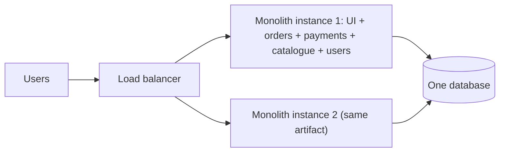

#### Example
A startup with 6 engineers builds its marketplace as a Spring Boot monolith: in-process method calls, one Postgres transaction for "place order + reserve stock + record payment intent", one deploy pipeline, simple debugging. Three years and 80 engineers later, deploys are queued behind each other, a bug in reporting can take down checkout, and the build takes 40 minutes. That's the point to modularise and extract carefully.

#### Trade-offs
| Pros | Cons (as it grows) |
|---|---|
| simple development, testing, debugging | slow builds/deploys, merge contention |
| ACID transactions across features | one bug or memory leak affects everything |
| no network calls, low latency | scale everything together (can't scale one feature) |
| easy refactoring across modules | tangled dependencies ("big ball of mud") |

#### Problems & fixes
| Symptom | Cause | Fix |
|---|---|---|
| Teams block each other on releases | single deploy pipeline | modular monolith with ownership, trunk-based dev, feature flags |
| One feature's load hurts all | shared resources | extract that hot path, or separate worker processes |
| Spaghetti dependencies | no enforced boundaries | modules with enforced dependency rules (ArchUnit, Spring Modulith) |

#### Cheat sheet
- One deployable, one DB. Simple and fast early.
- Pain comes from team scale and coupling, not from the monolith itself.
- Modularise first. Extract services only where it pays.

#### Interview questions
<details><summary>Would you start a new product with microservices or a monolith?</summary>

Usually a (modular) monolith: the domain boundaries are still unknown, the team is small, and speed of iteration matters most. Microservices add network, data consistency and operations overhead that only pays off with larger teams and clear boundaries. Design clean modules so services can be extracted later where scaling or team autonomy requires it.
</details>

<details><summary>What signs tell you a monolith should be split?</summary>

Deploy contention (teams waiting on each other, long release trains), parts of the system with very different scaling or reliability needs, slow builds and tests hurting productivity, frequent incidents where one area breaks unrelated features, and clear stable domain boundaries with separate owning teams.
</details>

#### Interview angle
> "I'd start with a modular monolith for speed and simple transactions, and extract services only where team autonomy, scaling or isolation clearly justifies the distributed-systems cost."

### Modular monolith — well-structured monolith with clear module boundaries; intermediate step
A modular monolith is a single deployable application **internally divided into well-defined modules** (bounded contexts), each with its own public API, private internals and ideally its own schema. You get most of the design benefits of microservices (boundaries, ownership) without the distributed-systems costs, and a clean path to extract services later.

#### How it works
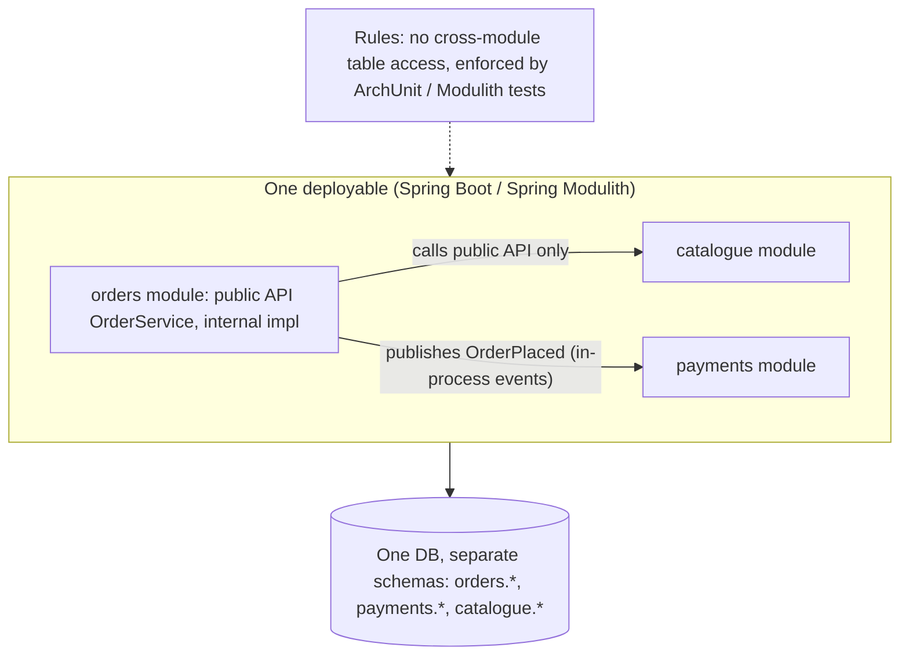

Practices: package-per-module with only an `api` package exported, module dependency rules enforced in tests, in-process domain events between modules (optionally persisted via an event publication registry), a schema per module, and team ownership per module.

#### Example
Shopify famously runs a large modular Rails monolith ("componentized") rather than hundreds of microservices. A Java team uses **Spring Modulith**: each module's internals are package-private, `@ApplicationModuleTest` verifies boundaries, and modules communicate through events persisted in an outbox-like publication log. When the payments module later needed independent scaling and PCI isolation, it was extracted as a service with minimal changes because its boundary and events already existed.

#### Trade-offs
Keeps ACID transactions and simple operations while gaining structure, but it still deploys as one unit and needs discipline (boundaries erode without enforcement).

#### Problems & fixes
| Symptom | Cause | Fix |
|---|---|---|
| Modules reach into each other's tables | no enforcement | schema per module + automated architecture tests |
| Circular dependencies between modules | unclear boundaries | events instead of calls, rethink boundaries (DDD) |
| Still slow deploys | huge test suite | test per module, parallel CI, build caching |

#### Cheat sheet
- One deployable, strict internal module boundaries, schema per module.
- Enforce with tests (ArchUnit, Spring Modulith). Talk via public APIs and events.
- A great default, and an easy stepping stone to extraction.

#### Interview questions
<details><summary>How does a modular monolith make a future migration to microservices easier?</summary>

Boundaries already exist: modules communicate only through explicit APIs and events, own their data in separate schemas, and have owners. Extracting a module means replacing in-process calls with network calls (or keeping the same events on a broker) and moving its schema to a new database, without untangling shared tables and hidden dependencies first.
</details>

<details><summary>How do you enforce module boundaries in a Java monolith?</summary>

Package structure with only API packages public, architecture tests (ArchUnit rules forbidding access to other modules' internal packages, Spring Modulith verification), separate DB schemas or table prefixes with no cross-module joins, code ownership (CODEOWNERS), and review practices. CI fails when a boundary is violated.
</details>

#### Interview angle
> "My default is a modular monolith: bounded-context modules with private internals, a schema each, events between them and boundaries enforced in CI, so extracting a service later is mechanical."

### Microservices — small, independently deployable services; each owns its data and API
Microservices structure a system as **independently deployable services**, each owning a business capability, its **own data store**, and an API (sync or async). Teams can build, deploy and scale their services autonomously. The cost is turning in-process calls into a distributed system.

#### How it works
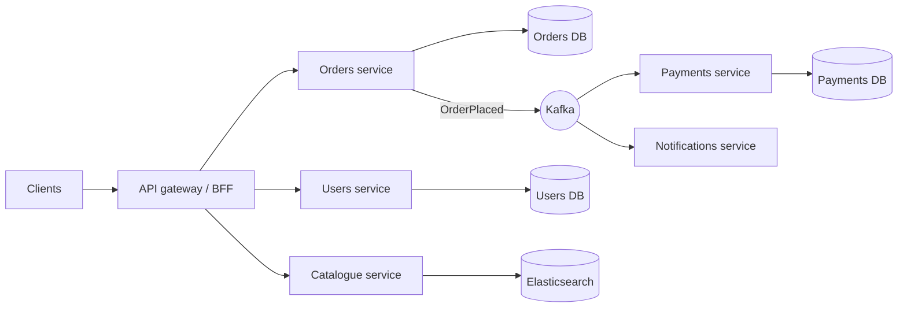

Principles: organised around business capabilities (bounded contexts), a database per service, smart endpoints and dumb pipes, decentralised governance (each team picks its tools within guardrails), infrastructure automation (CI/CD, containers), design for failure (timeouts, retries, circuit breakers), and observability built in.

#### Example
A food-delivery platform with 300 engineers: ~60 services (orders, restaurant, menu, rider dispatch, pricing, payments, notifications, search). The dispatch team deploys 20 times a day without coordinating with payments. The search service scales separately during dinner peaks. A bug in recommendations doesn't affect checkout. They also run a platform team (service template, CI/CD, mesh, observability) without which microservices would be chaos.

#### Trade-offs
Covered in the next topic in detail: autonomy and independent scaling vs network latency, data consistency challenges and heavy operational requirements.

#### Problems & fixes
| Symptom | Cause | Fix |
|---|---|---|
| "Distributed monolith": must deploy services together | shared DB / chatty sync coupling / shared libraries with logic | DB per service, async events, versioned APIs |
| Too many tiny services ("nanoservices") | over-splitting | merge services along bounded contexts |
| Debugging impossible | no tracing/correlation | OpenTelemetry tracing, correlation ids, central logs |

#### Cheat sheet
- Independently deployable, owns data, business-capability aligned.
- Needs a platform: CI/CD, containers, observability, resilience patterns.
- Avoid the distributed monolith: no shared DB, async where possible.

#### Interview questions
<details><summary>What is a "distributed monolith" and how do you avoid it?</summary>

Services that are deployed separately but are tightly coupled: they share a database, must be released together, or make long synchronous call chains so one failure takes everything down. You get the costs of distribution without the benefits. Avoid it with a database per service, async events for cross-service reactions, backward-compatible APIs and contracts, and boundaries along business capabilities.
</details>

<details><summary>How should you decide service boundaries?</summary>

Use domain-driven design: identify bounded contexts (areas with their own language and model) and align services and teams to them. Group things that change together and need transactional consistency inside one service. Minimise chatty cross-service calls, and avoid splitting by technical layer (a "database service", a "validation service").
</details>

#### Interview angle
> "Microservices pay off when boundaries follow bounded contexts, each service owns its data and deploys independently, and there's a real platform underneath: CI/CD, tracing, a mesh and resilience defaults."

### Microservices trade-offs — independent scaling, independent deploy, team autonomy vs network latency, distributed transactions, operational complexity
Microservices are a **trade**: you buy organisational scalability (team autonomy, independent deploys) and technical flexibility (independent scaling, technology choice, fault isolation), and you pay with distributed-systems complexity (network failures and latency, eventual consistency, distributed transactions, operational overhead).

#### How it works
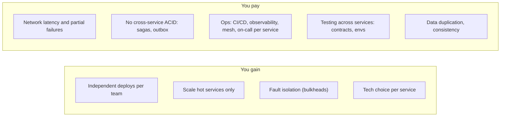

| Dimension | Monolith | Microservices |
|---|---|---|
| Deploy | one pipeline, coordinated | per service, independent |
| Scaling | whole app | per service |
| Consistency | ACID in-process | eventual across services |
| Latency | function calls (ns) | network calls (ms) |
| Failure | whole app | partial (needs resilience patterns) |
| Ops cost | low | high (platform team needed) |
| Team scale | small/medium | many teams |

#### Example
A bank's card platform split into 12 services. Wins: the fraud-scoring service scaled 10× during festive season independently and released new models daily. Costs: a "simple" card-limit change now spans limits, authorisation and notification services with a saga. A cross-service bug needed distributed tracing to find, and infrastructure spend rose 40% (mesh, observability, environments). They still judged it worth it for team autonomy across 15 squads.

#### Trade-offs
The decision is about **organisation and change rate** as much as technology: Conway's law says system structure mirrors team communication structure.

#### Problems & fixes
| Symptom | Cause | Fix |
|---|---|---|
| Latency high due to call chains | fine-grained sync calls | coarser APIs, async, caching, BFF aggregation |
| Data inconsistencies between services | dual writes, missed events | outbox/inbox, sagas, reconciliation |
| Ops overload | every team reinventing infra | platform team, golden paths, service templates |

#### Cheat sheet
- Gain: autonomy, independent deploys and scaling, isolation.
- Pay: network, eventual consistency, sagas, ops, testing complexity.
- Worth it with many teams and clear boundaries. Conway's law.

#### Interview questions
<details><summary>Give three costs of microservices that teams underestimate.</summary>

(1) Data consistency: no cross-service transactions, so you need sagas, outbox and reconciliation. (2) Operational load: per-service CI/CD, monitoring, alerting, on-call, security patching, versioning, plus a mesh and tracing. (3) Testing and debugging: integration environments, contract tests, and tracing requests across many services, along with latency budgets eaten by network hops.
</details>

<details><summary>How does Conway's law relate to microservices?</summary>

Systems tend to mirror the communication structure of the organisation that builds them. Microservices work when service boundaries align with team boundaries (each team owns a few services end-to-end). Misaligned services (one service owned by many teams, or one team juggling many unrelated services) recreate coordination problems. Use the "inverse Conway manoeuvre": shape teams to get the architecture you want.
</details>

#### Interview angle
> "Microservices buy team autonomy and independent scaling at the price of network failures, sagas and a heavy platform. I recommend them when there are many teams and stable domain boundaries."

### Domain-Driven Design (DDD) — model software around business domain
Domain-Driven Design (Eric Evans) is an approach to building complex software by **modelling the business domain explicitly** in code, in close collaboration with domain experts. **Strategic DDD** splits the domain into bounded contexts and maps their relationships. **Tactical DDD** gives building blocks (entities, value objects, aggregates, domain events, repositories) for rich models inside each context.

#### How it works
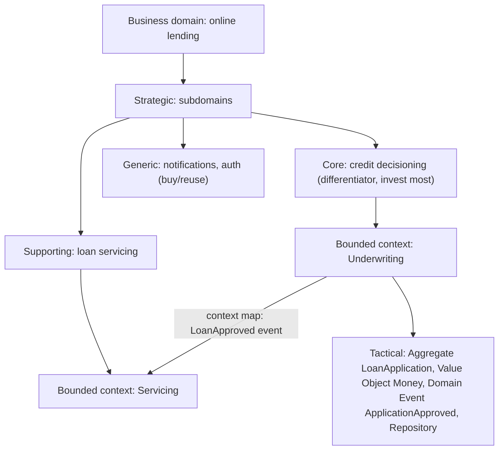

Tactical building blocks:
- **Entity**: identity over time (Customer #42).
- **Value object**: immutable, compared by value (Money, Address, DateRange).
- **Aggregate**: consistency boundary with a root.
- **Domain event**: something meaningful that happened.
- **Repository**: persistence for aggregates.
- **Domain service**: logic that doesn't belong to one entity.

#### Example
In lending, "Customer" means different things: to Underwriting it's a risk profile (income, credit score), to Servicing it's a repayment schedule and contact preferences, to Collections it's overdue amounts. DDD models them as separate bounded contexts with their own `Customer` models, rather than one 200-field shared `Customer` table everyone fights over. Code uses domain terms like `LoanApplication.approve(decision)` instead of `updateStatus(5)`.

#### Trade-offs
Excellent for complex, evolving business logic and service boundaries. Overkill for CRUD-heavy apps. It needs real access to domain experts and modelling skill.

#### Problems & fixes
| Symptom | Cause | Fix |
|---|---|---|
| Anemic domain model (logic in services, entities are getters/setters) | procedural habits | move invariants and behaviour into aggregates/value objects |
| One giant shared model | no bounded contexts | split by context, translate at boundaries |
| DDD ceremony everywhere | applied to simple CRUD | use tactical DDD only in core/complex subdomains |

#### Cheat sheet
- Strategic: subdomains (core, supporting, generic) → bounded contexts → context maps.
- Tactical: entities, value objects, aggregates, domain events, repositories.
- Invest DDD effort in the core domain. Keep generic parts simple or bought.

#### Interview questions
<details><summary>How does DDD help decide microservice boundaries?</summary>

Bounded contexts identify areas where a model and its language are consistent and changes cluster together. They make natural service boundaries: each service implements one (or part of one) bounded context, owns its data, and integrates with others via explicit contracts (events, APIs, anti-corruption layers) defined in the context map, which minimises coupling and cross-service transactions.
</details>

<details><summary>What is an anemic domain model and why is it a problem?</summary>

Entities are just data holders (getters and setters), and all business rules live in service classes manipulating them. Invariants are scattered and easily bypassed (any code can set a field), logic duplicates across services, and the model doesn't express the domain. Rich models put behaviour and rule enforcement inside aggregates (e.g. `order.cancel()` validates state).
</details>

#### Interview angle
> "I use strategic DDD to find bounded contexts, which become service and team boundaries, and tactical DDD (aggregates, value objects, domain events) inside the core domain where the business rules are complex."

### Bounded context — explicit boundary within which a domain model applies (defines service boundary)
A bounded context is an explicit boundary inside which a particular **domain model and its language are consistent**. The same word can mean different things in different contexts ("Product" in catalogue vs inventory vs pricing), and that's fine as long as each context keeps its own model and translation happens at the boundaries.

#### How it works
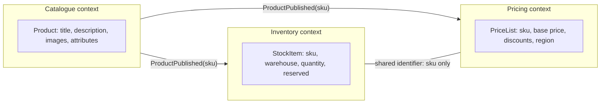

Context mapping relationships: **partnership**, **shared kernel**, **customer-supplier**, **conformist**, **anti-corruption layer**, **open host service / published language**, **separate ways**.

#### Example
An e-commerce company's original `products` table had 140 columns used by five teams: catalogue editors, warehouse, pricing, search and ads. Every change was a negotiation, and a pricing migration once broke warehouse queries. Splitting into bounded contexts (catalogue, inventory, pricing), each with its own model and data and sharing only the `sku` identifier and events, let teams evolve independently.

#### Trade-offs
Clear ownership and models that fit their purpose, at the cost of some data duplication and translation code at boundaries.

#### Problems & fixes
| Symptom | Cause | Fix |
|---|---|---|
| Endless debates on a field's meaning | one model across contexts | separate models per context, explicit translation |
| Services constantly calling each other for data | boundaries cut through a cohesive context | redraw boundaries around cohesive behaviour |
| Hidden coupling via shared tables | contexts share storage | data ownership per context |

#### Cheat sheet
- Boundary where one model and language apply. The same term can differ across contexts.
- Share identifiers and events, not models or tables.
- Context map defines relationships. Usually one service or team per context.

#### Interview questions
<details><summary>Why is having different "Customer" models in different services a good thing?</summary>

Each context needs different data and behaviour: billing needs payment methods and invoices, support needs tickets and contact history, marketing needs preferences. One shared model becomes bloated and couples all teams to each other's changes. Separate models keep each focused, and they reference the same customer by id and sync needed attributes via events.
</details>

<details><summary>How do you discover bounded contexts in practice?</summary>

Event storming with domain experts (map domain events, commands and actors on a timeline, then cluster them), listening for language shifts (the same word meaning different things), looking at organisational structure and existing team responsibilities, and finding places with different rules, lifecycles or change rates.
</details>

#### Interview angle
> "I find bounded contexts through event storming and shifts in language. Each context gets its own model and data, and contexts share only identifiers and published events."

### Aggregate root — consistency boundary: all changes go through root entity
An aggregate is a cluster of domain objects treated as **one unit for data changes**, with a single entry point, the **aggregate root**. All invariants inside the aggregate are enforced by the root within **one transaction**. Other aggregates are referenced **by id**, and consistency across aggregates is eventual.

#### How it works
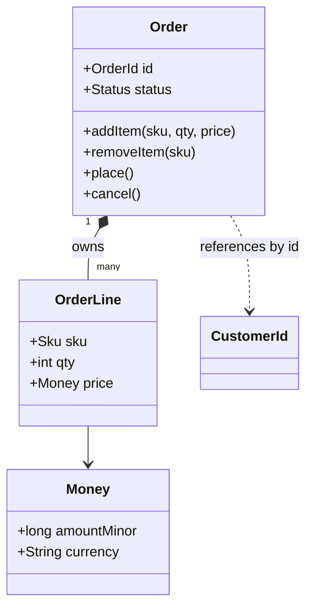

Rules (Vernon's guidelines):
1. Protect business invariants inside the aggregate boundary.
2. Design **small** aggregates.
3. Reference other aggregates **by identity** only.
4. Update other aggregates via **eventual consistency** (domain events).
5. One aggregate per transaction (ideally).

#### Example
Invariant: "an order's total can't exceed ₹2,00,000 and items can't change after placement". `Order.addItem()` checks the status and new total, and all order lines are modified only through `Order`. Stock reservation lives in a separate `InventoryItem` aggregate, updated asynchronously via an `OrderPlaced` event. That keeps the order transaction small and avoids locking inventory rows of popular products during checkout.

Concurrency: version the aggregate root (optimistic locking) so concurrent edits to the same order conflict cleanly.

#### Trade-offs
Clear consistency boundaries and simpler reasoning about invariants, but large aggregates cause contention and slow loads, while too-small aggregates push invariants into eventual consistency.

#### Problems & fixes
| Symptom | Cause | Fix |
|---|---|---|
| Lock contention / optimistic conflicts | aggregate too large (e.g. Customer with all orders) | split into smaller aggregates |
| Invariants violated | code modifies child entities directly | all changes through root methods, encapsulation |
| Transactions span many aggregates | cross-aggregate rules done synchronously | domain events + eventual consistency, or rethink boundary |
| Loading huge object graphs | unbounded collections in aggregate | keep collections bounded, reference by id |

#### Cheat sheet
- Aggregate = consistency boundary. Root is the only entry point.
- Small aggregates. Reference others by id. One aggregate per transaction.
- Cross-aggregate rules via domain events. Optimistic version on the root.

#### Interview questions
<details><summary>Should a Customer aggregate contain all of the customer's orders?</summary>

No. That makes a huge aggregate, so loading it is slow, any order change conflicts with profile edits (contention), and transactions grow. Orders are separate aggregates referencing the customer by id. Rules spanning both (e.g. a credit limit across orders) are enforced via a dedicated aggregate (`CreditAccount`) or eventual consistency with compensations.
</details>

<details><summary>How do aggregates map to microservices and transactions?</summary>

An aggregate is the unit of transactional consistency, so it always lives inside one service and one database transaction. A service owns several related aggregates. Interactions between aggregates (especially across services) use domain events and sagas, which is why good aggregate design reduces the need for distributed transactions.
</details>

#### Interview angle
> "Aggregates are my transaction boundaries: small, changed only through the root, referencing others by id, with optimistic versioning. Rules across aggregates go through domain events."

### Domain events — things that happened in the domain; trigger side effects in other bounded contexts
A domain event records **something meaningful that happened** in the business, in past tense and in domain language: `OrderPlaced`, `PaymentCaptured`, `LoanApproved`, `SeatReserved`. Raised by aggregates when state changes, domain events let other parts of the system (other aggregates, other bounded contexts) **react without tight coupling**.

#### How it works
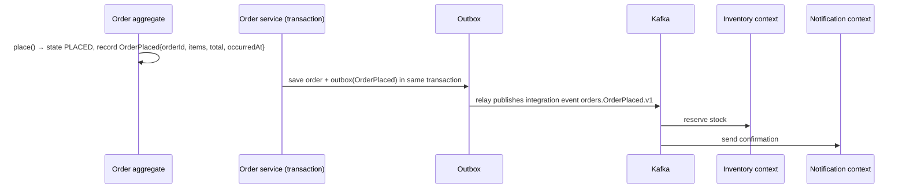

Distinguish:
- **Domain events** (internal, within a context, rich and fine-grained).
- **Integration events** (public, versioned contracts published to other contexts, minimal and stable).

Good event design: past tense, immutable, an id and timestamp, the aggregate id and version, enough data for consumers (avoiding callbacks for every field), and a schema version. Avoid leaking internal structure.

#### Example
`LoanApproved{loanId, customerId, amount, tenureMonths, rate, approvedAt}` from the Underwriting context: Servicing creates a repayment schedule, Disbursement initiates the payout, Notifications sends the SMS, Analytics records it. Underwriting knows nothing about these consumers, and adding a "cross-sell credit card" reaction later needs no change in Underwriting.

#### Trade-offs
Loose coupling and an explicit business language, but eventual consistency, event schema governance, and harder end-to-end tracing.

#### Problems & fixes
| Symptom | Cause | Fix |
|---|---|---|
| Events mirror table rows (`OrderUpdated` with all fields) | CRUD thinking | model meaningful business events |
| Consumers call back producer for details | thin events | include necessary data (event-carried state transfer) |
| Events published but DB rolled back (or vice versa) | dual write | outbox pattern |
| Breaking consumers | internal events used as public contracts | separate integration events, versioning |

#### Cheat sheet
- Past-tense business facts, raised by aggregates.
- Domain (internal) vs integration (public, versioned) events.
- Publish via outbox. Include enough data. Version schemas.

#### Interview questions
<details><summary>What's the difference between a domain event and a command?</summary>

A command is a request to do something (`PlaceOrder`), which can be rejected and targets a specific handler. An event states that something already happened (`OrderPlaced`), is immutable, and can't be rejected, and any number of interested parties may react. Commands express intent and events express facts.
</details>

<details><summary>Why is "OrderUpdated" with the whole order payload a weak event design?</summary>

It hides why something changed: consumers must diff payloads to infer business meaning (was it cancelled? an address changed? an item added?), it couples them to the full data shape, and it encourages CRUD-style integration. Specific events like `OrderCancelled` or `ShippingAddressChanged` carry intent, so consumers react precisely and schemas stay focused.
</details>

#### Interview angle
> "Aggregates raise past-tense business events like OrderPlaced or PaymentCaptured, which go out as versioned integration events via the outbox, so other contexts react without the producer knowing about them."

### Ubiquitous language — shared vocabulary between engineers and domain experts within bounded context
Ubiquitous language is the **shared, precise vocabulary** that engineers and domain experts use within a bounded context: in conversations, documents, tests and **the code itself**. When the business says "authorise a payment" and the code says `payment.authorize()`, misunderstandings drop and the model stays aligned with reality.

#### How it works
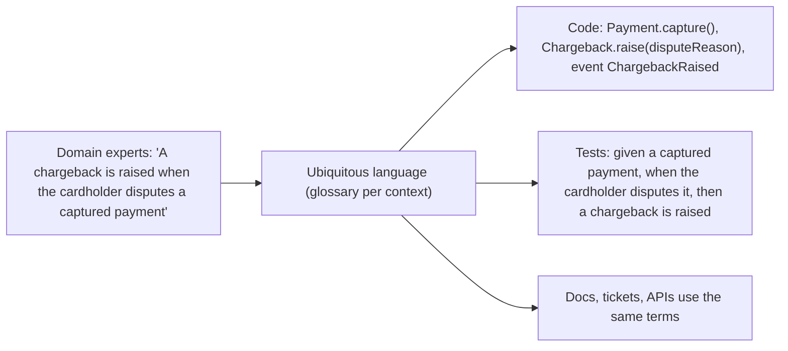

Practices: a living glossary per bounded context, code names that match domain terms (no `processData2`, `status = 7`), behaviour-style tests in domain language, and refactoring code when the language evolves. Language is **per bounded context**: "account" in a bank's ledger context differs from "account" in user identity.

#### Example
In a payments team, engineers used "refund" for both voids (cancelling an authorisation before capture, no money moved) and refunds (returning captured money). That caused a bug where voids triggered settlement reversals. Establishing the language (Authorisation, Capture, Void, Refund, Chargeback, each defined with ops and finance) and renaming code and APIs to match removed the ambiguity.

#### Trade-offs
Fewer misunderstandings and code that reads like the business, but it needs ongoing collaboration and renaming discipline as understanding deepens.

#### Problems & fixes
| Symptom | Cause | Fix |
|---|---|---|
| Bugs from "we meant different things" | ambiguous terms | glossary, explicit definitions with experts |
| Code full of technical jargon | language not reflected in code | rename to domain terms, rich domain methods |
| One term overloaded across teams | language mixed across contexts | separate bounded contexts with their own vocabulary |

#### Cheat sheet
- One precise vocabulary per bounded context, in talk, docs, tests and code.
- Rename code when the language changes.
- Overloaded terms often reveal separate bounded contexts.

#### Interview questions
<details><summary>How does ubiquitous language help when designing a payment system?</summary>

Payments have precise, often confused concepts: authorisation, capture, void, refund, chargeback, settlement, reconciliation. Agreeing exact meanings with finance and ops and using them in APIs (`/payments/{id}/capture`), events (`PaymentCaptured`) and code prevents costly bugs like treating a void as a refund, and makes audits and support conversations clear.
</details>

<details><summary>What does it mean that ubiquitous language is "bounded"?</summary>

A term's meaning is consistent within one bounded context, not across the whole company. "Order" in sales (customer purchase) and in warehouse (picking list) can differ, and each context has its own language. Trying to force one global definition creates the bloated shared models DDD avoids.
</details>

#### Interview angle
> "I agree the vocabulary with domain experts, like authorise, capture, void and refund, and use those exact words in APIs, events and code, so a support ticket, a log line and a class name all mean the same thing."

### Strangler fig pattern — incrementally migrate monolith: route traffic to new service, deprecate old endpoint
The strangler fig pattern migrates a legacy system **incrementally**: put a routing facade in front, build new functionality (or re-implement existing pieces) in new services, and **route specific paths or features to them one at a time**, until the old system is "strangled" and can be retired. No big-bang rewrite.

#### How it works
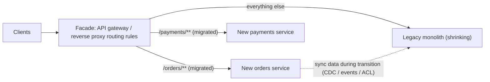

Steps per slice:
1. Pick a capability with clear boundaries and high value (or high pain).
2. Build the new service, and sync data (CDC from the legacy DB, dual-read, events).
3. Shadow traffic or compare outputs (dark launch).
4. Route a percentage of users or paths via the facade (canary).
5. Cut over fully, remove the legacy code path.
6. Repeat.

#### Example
A bank's 15-year-old Java EE monolith: the team put an API gateway in front, extracted "account statements" first (read-only, easy to verify) fed by CDC from the legacy DB, then "beneficiary management", then "fund transfers" (with careful reconciliation). After 30 months, 80% of traffic hit new services, and the remaining legacy features were rarely used and retired with business sign-off. At no point was there a risky big-bang cutover.

#### Trade-offs
Low-risk, continuous value delivery, reversible steps. But it's a long transition period running two systems, needs data synchronisation, and the facade and ACLs add temporary complexity.

#### Problems & fixes
| Symptom | Cause | Fix |
|---|---|---|
| Migration stalls at 70% forever | hardest parts left, no deadline | prioritise retirement, measure legacy traffic, kill switches |
| Data inconsistencies between old and new | dual writes | single source of truth per entity at each stage, CDC, reconciliation |
| New services coupled to legacy DB schema | reading legacy tables directly | anti-corruption layer, own data store |

#### Cheat sheet
- Facade routes slice by slice to new services. Legacy shrinks.
- Sync data (CDC/ACL), shadow/compare, canary, cut over, delete legacy code.
- Start with low-risk, high-value slices. Track legacy traffic to zero.

#### Interview questions
<details><summary>How would you migrate a monolith's checkout to a new service without downtime?</summary>

Put a gateway or proxy in front of the monolith. Build the new checkout service with its own data, synced from the monolith via CDC or events, with an anti-corruption layer for legacy models. Shadow real requests to compare results. Route a small percentage of users via feature flag or canary, monitor errors and conversions, ramp to 100%, then remove the monolith's checkout code. Keep rollback (route back) available throughout.
</details>

<details><summary>Why is a big-bang rewrite risky compared with strangler fig?</summary>

A rewrite delivers no value until it's done (often years), the old system keeps changing meanwhile (a moving target), hidden behaviours get missed, and the cutover is a single high-risk event. Strangler fig delivers incrementally, validates each slice with real traffic, and allows rollback at every step.
</details>

#### Interview angle
> "I'd migrate with a strangler fig: a gateway facade, slice-by-slice extraction with CDC-fed data and an anti-corruption layer, shadow traffic and canaries, deleting legacy code as each slice reaches 100%."

### Anti-corruption layer — translation layer between old and new domain models
An anti-corruption layer (ACL) is a **translation boundary** that protects a new or clean bounded context from the model of another system (legacy, third-party, or a different context). It converts external data and concepts into your own domain model, so the external system's quirks don't **leak into and corrupt** your design.

#### How it works
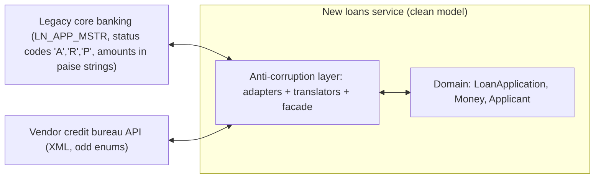

Components: **facade** (simplified interface over the external system), **adapter** (protocol and transport, e.g. SOAP/MQ to Java calls), **translator** (map models, codes and units).

```java
class CoreBankingLoanAdapter implements LoanApplicationRepository {
  public LoanApplication find(LoanId id) {
    LnAppMstr row = legacyClient.fetch(id.value());              // legacy DTO
    return new LoanApplication(
        id,
        Money.ofMinor(Long.parseLong(row.getLnAmtPaise()), "INR"),
        translateStatus(row.getStsCd()),                          // 'A' → APPROVED, 'R' → REJECTED …
        new Applicant(row.getCustNo(), row.getCustNm().trim()));
  }
}
```

#### Example
While strangling a core banking system, the new lending service needed customer and account data from the mainframe. Instead of using mainframe field names and status codes throughout the new code, an ACL service translated them into clean domain objects and events. When the mainframe was later replaced, only the ACL changed, and the lending domain was untouched.

#### Trade-offs
Protects your model and isolates change, at the cost of extra code and maintenance and possible latency (an extra hop if it's a separate service).

#### Problems & fixes
| Symptom | Cause | Fix |
|---|---|---|
| Legacy codes/fields spread across new codebase | no ACL | centralise translation in ACL |
| ACL becomes a dumping ground for business logic | unclear responsibility | ACL only translates; domain logic stays in domain |
| Translation bugs (units, timezones, enums) | implicit assumptions | explicit mapping tables, contract tests against legacy |

#### Cheat sheet
- Translate external models into your domain at the boundary (facade + adapter + translator).
- Essential for strangler migrations and third-party integrations.
- Keep business logic out of the ACL. Test the mappings.

#### Interview questions
<details><summary>When would you introduce an anti-corruption layer?</summary>

When integrating with a legacy system (during strangler migrations), a third-party API with a model that doesn't fit yours, or another bounded context whose model shouldn't dictate yours. The ACL keeps your domain clean and isolates future changes in the external system to one place.
</details>

<details><summary>Where should the ACL live: inside the new service or as a separate service?</summary>

Often inside the consuming service as adapter and translator classes (simplest, no extra hop). It becomes a separate service when several consumers need the same translation, when it must buffer or cache a fragile legacy system, or when it handles heavy protocol bridging (mainframe MQ, SOAP), effectively a shared integration facade.
</details>

#### Interview angle
> "New services talk to legacy or vendor systems only through an anti-corruption layer that maps their codes, units and DTOs into our domain model, so their quirks never leak in and replacing them later only touches the ACL."

### Shared kernel — small, carefully managed shared domain model between two contexts
A shared kernel is a **small subset of the domain model (code, schema or library) that two bounded contexts agree to share** and change only together. It reduces duplication for truly common concepts, at the cost of coupling the two teams around that shared piece.

#### How it works
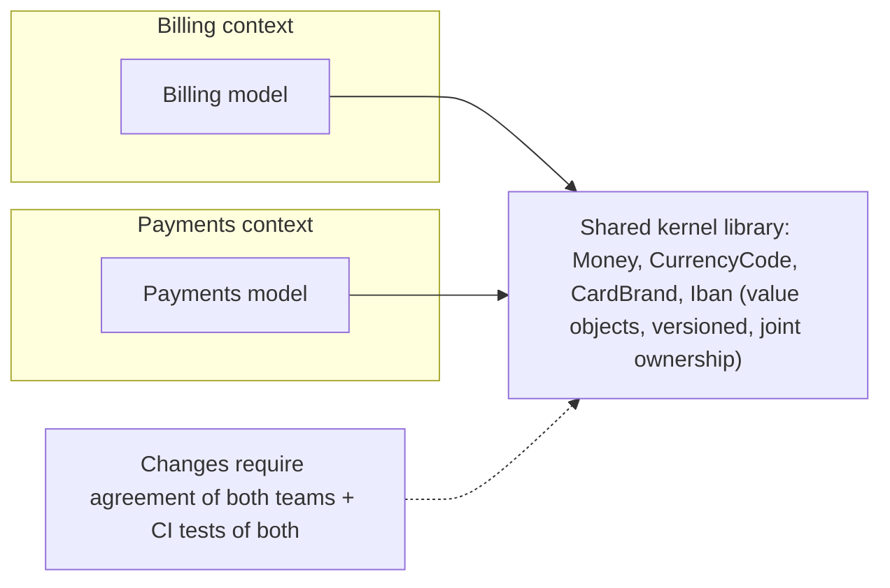

Good candidates: value objects (Money, currency, country codes), common identifiers, well-understood standards (ISO formats). Bad candidates: entities with business behaviour that evolves differently per context (Customer, Order).

#### Example
Billing and payments teams share a small `money-kernel` library: `Money` (minor units + ISO currency, with correct rounding), `CurrencyCode` and `ExchangeRate`. Bugs around rounding disappeared because both use one tested implementation. When someone proposed adding the `Customer` entity to the kernel, both teams declined, because customer means different things to each.

#### Trade-offs
Consistency and less duplication for stable core concepts, but coupled release cycles for that piece, and kernels tend to grow, so keep them tiny and stable.

#### Problems & fixes
| Symptom | Cause | Fix |
|---|---|---|
| Shared library grows into a "common" monolith | everything shared "for reuse" | strict scope: stable value objects only |
| One team blocked waiting for the other | coupled changes | versioning, small surface, clear ownership |
| Hidden business logic in shared code | convenience | keep behaviour context-specific |

#### Cheat sheet
- A tiny jointly owned shared model (usually value objects).
- Change only with both teams' agreement, tested by both.
- Avoid "common" libraries full of business logic.

#### Interview questions
<details><summary>Why are big shared "common" libraries across microservices risky?</summary>

They couple services: a change forces coordinated upgrades, a bug spreads everywhere, and business logic hidden in shared code blurs bounded contexts. Services end up deploying together (a distributed monolith). Share only small, stable technical utilities or value objects, and prefer duplication over the wrong abstraction.
</details>

<details><summary>Shared kernel vs published language: what's the difference?</summary>

A shared kernel is code or model that two contexts share and co-own, which is a tight relationship. A published language is a documented exchange format (e.g. a versioned event schema or OpenAPI) that one context publishes and others consume without sharing implementation. That's looser coupling, preferred between independent teams.
</details>

#### Interview angle
> "I only share a tiny kernel of stable value objects, like Money and currency codes, jointly owned and versioned. Everything else is integrated through published contracts, not shared code."

### Database per service — each service owns its DB; prevents tight coupling through shared schema
In a microservice architecture each service **owns its data**: its own database (or at least schema), accessible **only** through the service's API or events. No other service reads or writes its tables directly. That's what makes services independently deployable and lets each choose the right storage technology.

#### How it works
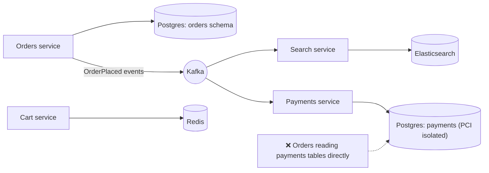

Consequences you must handle:
- **Queries across services**: API composition, CQRS read models fed by events.
- **Transactions across services**: sagas, outbox/inbox.
- **Data duplication**: services keep local copies of what they need (event-carried state transfer).
- **Reporting**: a data warehouse fed by CDC/events.

Variants: a separate database server per service (strongest isolation), or a separate schema per service on a shared server (cheaper, and logical ownership must be enforced with permissions).

#### Example
The orders service previously joined `payments.transactions` directly for order status. When the payments team changed their schema (splitting a table for PCI scope reduction), orders broke in production. After moving to database-per-service, orders keeps a local `payment_status` column updated from `PaymentCaptured` and `PaymentFailed` events, and payments can refactor freely.

#### Trade-offs
Loose coupling, independent schema evolution, polyglot persistence and isolated failures and scaling, but no cross-service joins or transactions, eventual consistency, and more infrastructure.

#### Problems & fixes
| Symptom | Cause | Fix |
|---|---|---|
| Need data from another service in a query | ownership split | local read model via events, API composition |
| Cross-service invariant | data in different DBs | saga, or redraw boundaries |
| Reporting needs joins across all services | separate DBs | CDC → warehouse/lake |
| Many DB servers to operate | one per service | shared cluster with schema-per-service + strict grants (balance) |

#### Cheat sheet
- Each service owns its data. Access only via its API or events.
- Cross-service queries: read models, composition. Transactions: sagas. Reporting: a warehouse.
- Enforce with DB credentials and permissions.

#### Interview questions
<details><summary>Orders need the customer's name, which belongs to the user service. How do you get it without sharing a database?</summary>

Options: call the user service API when needed (with caching), or better for frequent reads, keep a local copy of the needed fields in the orders service, updated from `UserRegistered` and `UserNameChanged` events. Order snapshots can also store the name at order time if historical accuracy matters. Never query the user DB directly.
</details>

<details><summary>Is "schema per service on one database server" acceptable?</summary>

Often yes, as a pragmatic step: each service has its own schema and credentials with no grants on others' schemas, which preserves logical ownership and independent schema evolution. The trade-off is shared infrastructure (a noisy neighbour, a shared failure domain, coordinated DB upgrades). Move critical or high-load services to dedicated databases as needed.
</details>

#### Interview angle
> "Each service owns its data with no cross-service table access. Other services keep event-fed copies of what they need, workflows run as sagas, and reporting goes through CDC into a warehouse."

### Shared database antipattern — multiple services sharing one DB creates deployment and schema coupling
When several services read and write the **same database tables**, they're coupled through the schema: any change requires coordinating all of them, a heavy query from one hurts all, and business rules get duplicated (and diverge) in multiple services. It turns "microservices" into a distributed monolith.

#### How it works
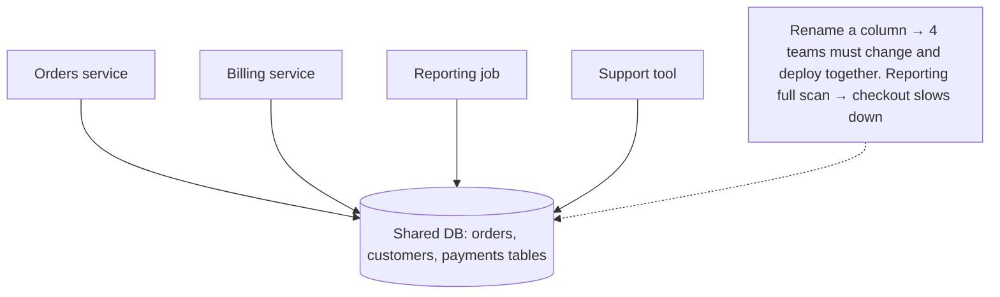

Problems it causes:
- **Schema coupling**: no team can change "its" tables safely.
- **Hidden contracts**: other teams depend on internal columns you didn't know about.
- **Duplicated logic**: two services update `orders.status` with different rules.
- **Performance interference** and shared failure (locks, connection exhaustion).
- **Security/compliance**: everyone can read sensitive data (PII, card data).

#### Example
A company's billing service wrote directly into the orders table to mark invoices paid, bypassing the order service's state machine. Orders occasionally became "PAID" while "CANCELLED", and the bug took weeks to trace because the write came from another codebase. Fix: billing publishes `InvoicePaid`, and the order service, the sole writer of orders, applies the state transition with its rules.

Migration path away from it: identify the owner of each table, route all writes through the owner (API/events), give other services read models via events, revoke direct grants, and then split physically.

#### Trade-offs
A shared DB is simple at first (joins, transactions) and acceptable inside one service or a modular monolith, but across independently deployed services it destroys autonomy.

#### Problems & fixes
| Symptom | Cause | Fix |
|---|---|---|
| Cross-team change coordination for every schema change | shared tables | assign ownership, API/events for access |
| Inconsistent states | multiple writers with different rules | single writer per table/aggregate |
| Report queries slow production | shared DB for analytics | replicas/warehouse via CDC |
| Data leakage | broad DB access | per-service credentials, least privilege |

#### Cheat sheet
- Many services, one schema, means coupling, duplicated logic and interference.
- One owner and writer per table. Others via API/events/read models.
- Migrate: ownership → route writes → read models → revoke grants → split.

#### Interview questions
<details><summary>Your company has 10 services sharing one Postgres database. How would you untangle it?</summary>

Map which service reads and writes each table and assign a single owner per table (along bounded contexts). Route all writes through the owner's API or commands. Replace other services' direct reads with event-fed read models or API calls. Lock down grants per service (schema-level permissions). Move reporting to a replica or warehouse via CDC. Finally split owners' schemas into separate databases as needed. Do it incrementally, service by service.
</details>

<details><summary>Is sharing a database ever acceptable?</summary>

Within a single service or a modular monolith, yes, since that's normal. Across services, temporarily during migrations (with clear ownership and a plan), or for read-only access to a replica owned by one team, with an explicit contract (e.g. a published view), it can be pragmatic. Multiple services writing the same tables is the real antipattern.
</details>

#### Interview angle
> "Two services writing the same tables is a distributed monolith. I untangle it by giving each table one owning writer, replacing other access with events and read models, revoking grants, and moving analytics to a warehouse."
