## Service communication & resilience

### Synchronous (REST, gRPC) — immediate response; temporal coupling: caller blocks, dependency failures cascade
Synchronous communication means the caller **sends a request and waits** for the response (REST, gRPC, GraphQL). It's simple and natural for queries and for operations whose result the caller needs right now, but it creates **temporal coupling**: the callee must be up and fast at that moment, and failures or slowness propagate back up the chain.

#### Intuition
A phone call. You ask, you wait on the line, you get the answer. It is simple, but you are stuck while the other person is slow, and if they do not pick up you get nothing.

#### Must know
- The caller **sends a request and waits** for the response.
- Right for queries and for anything whose result the user needs immediately.
- It creates **temporal coupling**: the callee must be up and fast at that moment.
- Latency adds up along a chain and availability multiplies down.
- Every call needs a timeout, safe retries, a circuit breaker and a fallback. Run independent calls in parallel.

#### Common mistakes
- A long sequential chain of calls for one page.
- No timeout, so one hung dependency blocks every thread.
- Calling a non-essential service synchronously inside a critical path.

#### How it works
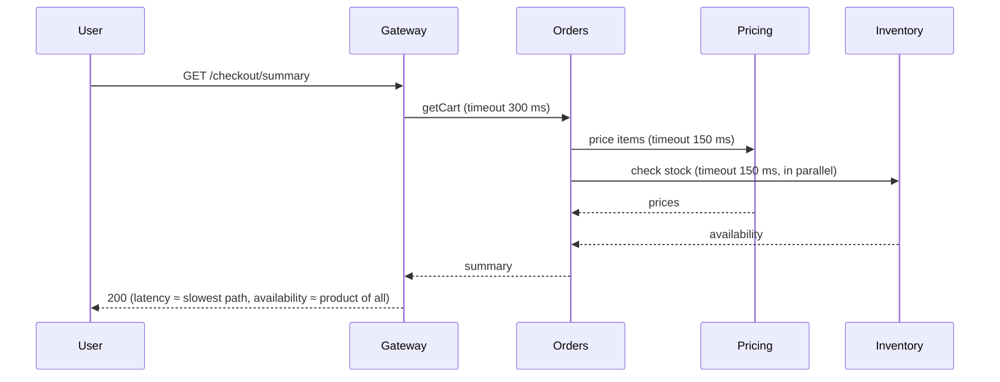

Essentials for safe synchronous calls: **timeouts** on every call (with a deadline budget propagated downstream), **retries** only for idempotent and transient errors with backoff, **circuit breakers**, **bulkheads**, **fallbacks**, **connection pooling**, and **parallelising** independent calls.

#### Example
A product page calls 6 services synchronously in sequence (≈ 30 ms each), giving a p50 of 180 ms. When reviews slowed to 2 s, the whole page took 2 s. Fixes: parallel calls (latency ≈ slowest call), a 150 ms timeout for reviews with fallback "reviews unavailable", a circuit breaker on reviews, and caching ratings. The page stayed fast during the next reviews incident.

#### Trade-offs
Simple and immediately consistent request/response, but availability multiplies across dependencies, latency adds up, and cascading failures happen without resilience patterns.

#### Problems & fixes
| Symptom | Cause | Fix |
|---|---|---|
| One slow service slows everything | no timeouts / sequential calls | timeouts, parallel calls, deadlines |
| Outage cascades | threads blocked on failing dependency | circuit breaker + bulkhead + fallback |
| Retry storms | retries at every layer | single-layer retries, backoff, budgets |

#### Cheat sheet
- Use for queries and operations that need an immediate answer.
- Always: timeouts + deadlines, safe retries, circuit breakers, bulkheads, fallbacks.
- Parallelise independent calls. Keep chains short.

#### Interview questions
<details><summary>When should service communication be synchronous rather than asynchronous?</summary>

When the caller can't proceed without the answer: reads for a user-facing response (price, stock, profile), validations, and payment authorisation during checkout. Use async for side effects and reactions (notifications, analytics, downstream updates), where waiting would only add latency and coupling.
</details>

<details><summary>How do deadlines differ from timeouts in a call chain?</summary>

A timeout is per call. A deadline is an absolute time budget for the whole request, propagated downstream (gRPC deadlines, request headers). Each service subtracts elapsed time and stops working once the deadline passes, so a 1 s user deadline isn't exceeded by stacked per-hop timeouts (300 ms + 300 ms + …), and work for already-abandoned requests is cancelled.
</details>

#### Interview angle
> "Synchronous calls are only for what the user is waiting on. Every call carries a timeout within a propagated deadline, independent calls run in parallel, and circuit breakers and fallbacks stop cascades."

#### Sources
- [Interservice communication in microservices](https://learn.microsoft.com/en-us/azure/architecture/microservices/design/interservice-communication) — Azure Architecture Center
- [Remote procedure invocation](https://microservices.io/patterns/communication-style/rpi.html) — microservices.io

### Asynchronous (events, queues) — decoupled in time; harder to trace, but more resilient
Asynchronous communication sends a message (event or command) via a broker and **doesn't wait** for processing. Producer and consumer are decoupled in time, availability and scaling, so the consumer can be down, slow or replaced without affecting the producer. The costs are eventual consistency and harder end-to-end visibility.

#### Intuition
Leaving a note on a colleague's desk. You carry on with your work, and they deal with it when they are back. If they are out for an hour, nothing breaks. You just do not get the answer on the spot.

#### Must know
- Send a message through a broker and **do not wait** for it to be processed.
- Producer and consumer are **decoupled in time**: the consumer can be slow or down.
- For long operations, return `202 Accepted` with a status resource, then poll or use a webhook.
- It needs an outbox, idempotent consumers, a DLQ and trace ids in message headers.
- The costs are eventual consistency and harder debugging.

#### Common mistakes
- Going async and forgetting to show the user a "pending" state.
- No trace context in messages, so a flow cannot be followed end to end.
- Assuming a message is processed once and in order.

#### How it works
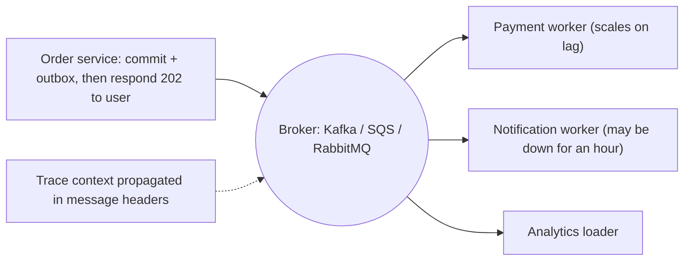

Forms: **events** (something happened, pub/sub), **commands** (do this, point-to-point queue), **async request-reply** (correlation id + reply queue, or polling a status endpoint / webhook callback).

Must-haves: outbox (reliable publish), idempotent consumers (inbox), DLQs, schema governance, correlation and trace ids in headers, lag monitoring, and explicit "pending" states for users.

#### Example
A document-verification flow (KYC): the upload API returns `202 Accepted` with `verificationId`. Workers run OCR, face match and sanctions checks asynchronously (seconds to minutes), and the client polls `GET /verifications/{id}` or receives a webhook or push notification. A third-party OCR outage only delays verifications, and nothing is lost or failed.

#### Trade-offs
Resilient, scalable and decoupled, but eventual consistency, complex debugging (traces across brokers), duplicates and ordering issues, and the UX must handle pending states.

#### Problems & fixes
| Symptom | Cause | Fix |
|---|---|---|
| Can't trace a request end-to-end | context not propagated | trace context in headers (OpenTelemetry), correlation ids |
| User confused by delayed outcome | no pending state | 202 + status resource, notifications |
| Duplicates/out-of-order | at-least-once, retries | idempotency, keys, versioning |

#### Cheat sheet
- Fire and continue: events, commands, async request-reply.
- Outbox + inbox + DLQ + schema registry + trace propagation.
- 202 Accepted + status endpoint/webhook for long operations.

#### Interview questions
<details><summary>How do you implement a long-running operation in a REST API asynchronously?</summary>

Accept the request and return `202 Accepted` with a `Location: /operations/{id}` (or a resource with status PENDING). Enqueue the work. Workers process it and update the status (and result). The client polls with backoff, or receives a webhook or push notification on completion. Make the initial POST idempotent with an idempotency key.
</details>

<details><summary>What do you lose by moving a call from sync to async?</summary>

Immediate consistency and simple error handling: the caller no longer knows the outcome at request time, so failures must be handled later (retries, DLQ, compensations, user notifications). You also need correlation and tracing for debugging, and the UI must represent in-progress states.
</details>

#### Interview angle
> "Side effects and long-running work go async: 202 plus a status resource for users, outbox and inbox for reliability, DLQs, and trace context in message headers so flows stay debuggable."

#### Sources
- [Asynchronous request-reply pattern](https://learn.microsoft.com/en-us/azure/architecture/patterns/asynchronous-request-reply) — Azure Architecture Center
- [Messaging](https://microservices.io/patterns/communication-style/messaging.html) — microservices.io

### Service discovery — how services find each other's network location dynamically
In dynamic environments (containers, autoscaling, failover), service instances come and go with changing IPs. **Service discovery** lets callers find **healthy instances of a service by name** at runtime, instead of hard-coded addresses. It combines a **registry** of instances (with health), a **registration** mechanism and a **lookup** mechanism.

#### Intuition
A phone's contact list that updates itself. You ask for "Payments" by name and get whichever number is working now, even though numbers change all day as people come and go.

#### Must know
- Instances come and go with changing IPs, so callers find a service **by name at runtime**.
- Three parts: a **registry** of healthy instances, **registration** and **lookup**.
- In Kubernetes it is built in: a Service name resolves through DNS to ready pods.
- Client-side discovery: the caller picks an instance. Server-side: a load balancer does.
- Only **healthy, ready** instances should be discoverable.

#### Common mistakes
- Hard-coded IP addresses.
- A JVM caching DNS forever, so it keeps calling instances that are gone.
- An instance registered before it is ready for traffic.

#### How it works
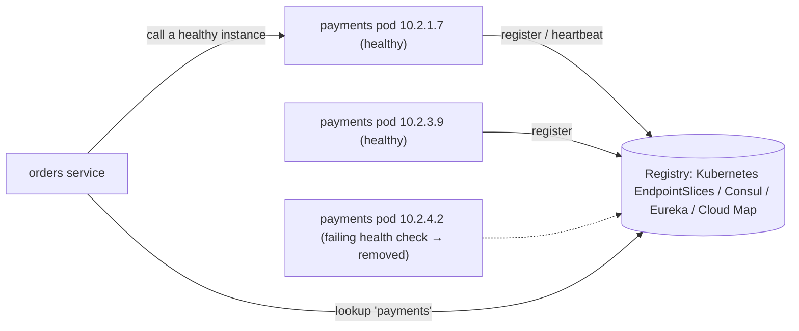

Patterns: **client-side discovery** (the client queries the registry and load-balances) vs **server-side discovery** (the client calls a stable address and a load balancer or proxy finds instances). Registration: **self-registration** (the instance registers itself) vs **third-party registration** (the platform registers it: Kubernetes, ECS).

#### Example
In Kubernetes, discovery is built in: `http://payments.prod.svc.cluster.local` resolves via CoreDNS to a ClusterIP, and kube-proxy routes to ready pods from EndpointSlices that update as pods start, stop or fail readiness. On ECS, AWS Cloud Map with service connect provides similar DNS-based discovery. Legacy VM fleets often use Consul with health checks.

#### Trade-offs
Dynamic, resilient addressing, but the registry is critical infrastructure (it must be HA), there's staleness between instance death and removal, and DNS caching can delay updates.

#### Problems & fixes
| Symptom | Cause | Fix |
|---|---|---|
| Calls to dead instances | stale registry/DNS cache | health checks, short TTLs, client retries to other instances |
| Registry outage breaks all calls | registry SPOF | HA registry, clients cache last known instances |
| Instances receive traffic before ready | registered too early | readiness gating before registration |

#### Cheat sheet
- Registry + registration + lookup, health-aware.
- Kubernetes: Services + EndpointSlices + CoreDNS. VMs: Consul/Eureka. AWS: Cloud Map.
- Client-side vs server-side discovery.

#### Interview questions
<details><summary>How does service discovery work in Kubernetes?</summary>

A Service selects pods by labels. The endpoints controller maintains EndpointSlices listing ready pod IPs (based on readiness probes). CoreDNS resolves `service.namespace.svc.cluster.local` to the Service's ClusterIP (or to pod IPs for headless Services), and kube-proxy (or an eBPF dataplane) load-balances traffic to the endpoints. Pods are registered by the platform (third-party registration).
</details>

<details><summary>Why can JVM DNS caching break service discovery?</summary>

If the JVM caches DNS results for a long time (or forever with a security manager), clients keep connecting to old IPs after instances are replaced or after DNS-based failover, causing errors. Set `networkaddress.cache.ttl` to a low value (e.g. 30 s), or use discovery through stable virtual IPs or proxies.
</details>

#### Interview angle
> "Inside Kubernetes I rely on Services, EndpointSlices and CoreDNS, with readiness controlling who's discoverable. Outside it I'd use Cloud Map or Consul with health checks, plus clients that cache the last known instances."

#### Sources
- [Service discovery in a microservices architecture](https://www.f5.com/company/blog/nginx/service-discovery-in-a-microservices-architecture) — NGINX / F5
- [DNS for services and pods](https://kubernetes.io/docs/concepts/services-networking/dns-pod-service/) — Kubernetes docs

### Client-side discovery — service queries registry (Eureka), load balances itself
With client-side discovery, the **calling service queries the registry** for available instances of the target service and **chooses one itself** using a client-side load-balancing algorithm. Netflix Eureka + Ribbon (now Spring Cloud LoadBalancer), gRPC's built-in resolvers and balancers, and Consul-aware clients follow this pattern.

#### Intuition
You look up a restaurant chain's branches yourself, pick the nearest one, and drive there. Nobody stands in the middle routing you.

#### Must know
- The **caller queries the registry** and **chooses an instance itself**.
- No extra network hop, and it balances per request.
- The discovery and balancing logic lives in **every client**, in every language.
- Examples: Eureka with Spring Cloud LoadBalancer, gRPC's built-in balancing.
- It is the usual fix for uneven gRPC load: a headless Service plus client-side balancing.

#### Common mistakes
- Several languages each with a different, inconsistent client library.
- A stale cached instance list with no health ejection.
- gRPC through a plain ClusterIP Service, expecting even load.

#### How it works
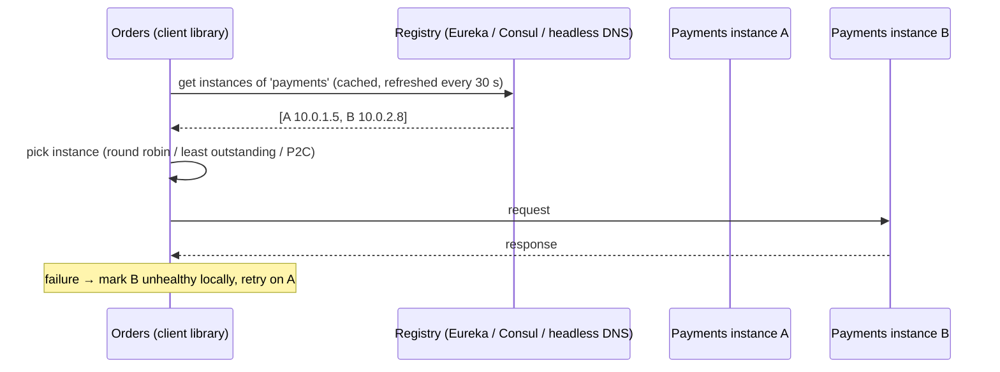

#### Example
gRPC services in Kubernetes with uneven load behind ClusterIP (connection-level balancing): switching to a **headless Service** plus gRPC's `round_robin` (or `pick_first` → xDS) client-side balancing made each client resolve all pod IPs and balance requests across them, which evened out CPU across pods. Spring Cloud apps with Eureka do the same for HTTP.

#### Trade-offs
| Pros | Cons |
|---|---|
| no extra hop, low latency | discovery logic in every client/language |
| smart, request-level balancing | clients must handle caching, health, retries |
| no central LB bottleneck | upgrades require changing all clients |

A service mesh moves this logic into a sidecar (client-side balancing without library code).

#### Problems & fixes
| Symptom | Cause | Fix |
|---|---|---|
| Clients route to stale instances | registry cache stale | shorter refresh, passive health/outlier ejection |
| Inconsistent behaviour across languages | different client libraries | standard libraries, or mesh sidecars |
| Registry overload from many clients | frequent polling | caching, watches instead of polling |

#### Cheat sheet
- The client looks up instances and balances itself (Eureka, Consul, gRPC resolvers).
- No extra hop, request-level balancing. Logic lives in each client.
- A mesh gives the same benefits without per-language libraries.

#### Interview questions
<details><summary>Why use client-side load balancing for gRPC in Kubernetes?</summary>

gRPC multiplexes requests over long-lived HTTP/2 connections, and ClusterIP Services balance at the connection level, so each client sticks to one pod. With a headless Service, the client resolves all pod IPs and balances individual requests across connections to every pod (round robin, P2C), spreading load evenly. A mesh is the alternative.
</details>

<details><summary>What are the downsides of client-side discovery in a polyglot environment?</summary>

Every language and framework needs a compatible, well-maintained discovery and load-balancing library with the same health, retry and timeout semantics, and behaviour drifts between implementations. Changes and upgrades must roll out to every client. That's why many organisations move this logic into sidecar proxies (a service mesh) or server-side load balancers.
</details>

#### Interview angle
> "For gRPC I'd use client-side balancing over a headless Service, or let the mesh sidecar do it, so each request, not each connection, is spread across pods."

#### Sources
- [Client-side service discovery](https://microservices.io/patterns/client-side-discovery.html) — microservices.io
- [gRPC load balancing](https://grpc.io/blog/grpc-load-balancing/) — gRPC blog

### Server-side discovery — load balancer queries registry (AWS ALB + ECS, Kubernetes Service)
With server-side discovery, clients call a **stable endpoint** (a load balancer, virtual IP or DNS name), and the **load balancer or router** knows the current healthy instances and forwards requests. Clients stay simple and language-agnostic, and the platform handles registration and health.

#### Intuition
You ring the chain's central number and an operator connects you to an open branch. You never need to know which branches exist.

#### Must know
- The client calls **one stable address**. A load balancer or router finds the healthy instances.
- Clients stay simple and work in any language.
- The platform handles registration, health checks and draining.
- Examples: a Kubernetes Service, an AWS ALB with ECS target groups.
- Costs: one extra hop, and the balancer becomes critical infrastructure.

#### Common mistakes
- Removing instances with no connection draining, which causes errors on every deploy.
- An L4 balancer for gRPC, which balances connections and not requests.
- A separate load balancer for every small service.

#### How it works
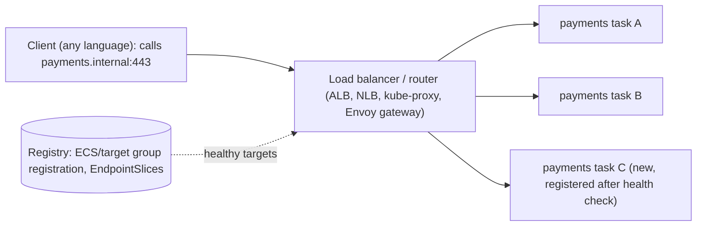

Examples: an AWS ALB/NLB with ECS (tasks auto-registered in target groups), Kubernetes ClusterIP Services (kube-proxy), internal NGINX/Envoy gateways, AWS VPC Lattice and ECS Service Connect (AWS App Mesh reached end of support in September 2026).

#### Example
A company runs services on ECS behind an internal ALB with path-based routing (`/payments/*` → the payments target group). ECS registers and deregisters tasks (with health checks and draining) automatically during deploys and scaling, and clients only know `https://internal-api.company.local/payments`. Any language works with no discovery library.

#### Trade-offs
Simple clients and centralised control, but an extra network hop, the load balancer is critical infrastructure and costs money, and balancing is less request-aware for long-lived connections at L4.

#### Problems & fixes
| Symptom | Cause | Fix |
|---|---|---|
| Errors during deploys | targets removed without draining | deregistration delay + graceful shutdown |
| Uneven load with HTTP/2/gRPC at L4 | connection-level balancing | L7 balancer (ALB gRPC, Envoy) |
| LB cost and hop latency | LB per service | shared internal L7 gateway, or mesh |

#### Cheat sheet
- Clients call a stable endpoint, and the LB finds healthy instances.
- ALB/NLB + ECS target groups, Kubernetes Services, internal gateways.
- Simple clients, extra hop. Use L7 for request-level balancing.

#### Interview questions
<details><summary>Client-side vs server-side discovery: which would you pick for a polyglot microservices platform?</summary>

Server-side (or a service mesh, which is effectively a per-pod server-side proxy): clients in any language just call a name, and routing, health and balancing live in shared infrastructure that's upgraded once. Client-side discovery makes sense for homogeneous stacks needing the lowest latency and request-level balancing without a mesh (e.g. gRPC with built-in balancing).
</details>

<details><summary>How does ECS integrate with ALB for discovery?</summary>

An ECS service is linked to an ALB target group. When tasks start and pass health checks, ECS registers their IP and port in the target group, and on stop it deregisters them (with a deregistration delay for draining). The ALB routes requests by listener rules (host or path) to healthy targets, so clients only need the ALB's DNS name.
</details>

#### Interview angle
> "In a polyglot platform I prefer server-side discovery (Kubernetes Services, ALB target groups, a mesh): clients just call a name, and the platform handles registration, health, draining and L7 balancing."

#### Sources
- [Server-side service discovery](https://microservices.io/patterns/server-side-discovery.html) — microservices.io
- [Service](https://kubernetes.io/docs/concepts/services-networking/service/) — Kubernetes docs

### Service registry — Consul (with health checks), Eureka, Kubernetes DNS (CoreDNS)
A service registry is the **database of service instances**: names, addresses, ports, metadata and **health**. Instances are registered and deregistered as they start, stop or fail, and clients or load balancers query it for discovery. Choices range from Kubernetes' built-in mechanisms to Consul, Eureka, etcd or cloud registries.

#### Intuition
The staff directory at reception: who works here, at which desk, and whether they are in today. It is only useful if someone keeps it up to date.

#### Must know
- The **database of service instances**: name, address, port and **health**.
- Instances register on start and are removed when they stop or fail health checks.
- Kubernetes has one built in. Consul and Eureka serve VM or hybrid estates.
- For discovery, a slightly stale list is usually better than no list, so availability often matters more than strict consistency.
- Run it highly available, and let clients cache the last known instances.

#### Common mistakes
- A single registry node that takes everything down with it.
- No health checks, so dead instances stay listed.
- Adding Consul or Eureka when everything already runs on Kubernetes.

#### How it works
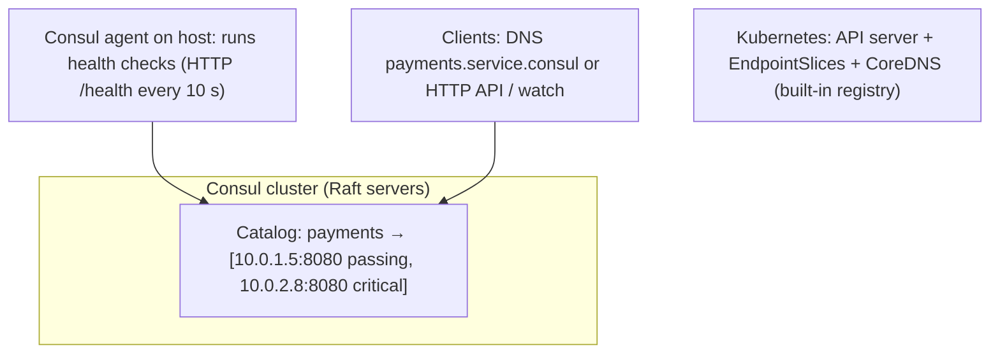

| Registry | Consistency | Health | Notes |
|---|---|---|---|
| Kubernetes (EndpointSlices + CoreDNS) | etcd-backed (CP) | readiness probes | default inside K8s |
| Consul | Raft (CP), gossip for membership | agent-run checks | multi-DC, KV, service mesh (Connect) |
| Eureka | AP (peer replication, self-preservation) | client heartbeats | Spring Cloud, legacy Netflix stack |
| AWS Cloud Map | managed | Route 53 health checks | ECS/EKS integration |
| etcd/ZooKeeper | CP | leases/ephemeral nodes | DIY registries |

#### Example
A hybrid estate (Kubernetes plus legacy VMs running payment gateways) uses Consul: VMs run Consul agents with health checks, and Kubernetes services sync into Consul via consul-k8s, so both worlds discover each other by name (`payment-gateway.service.consul`). Eureka's **self-preservation** mode (it keeps instances during network issues rather than mass-expiring them) shows the AP philosophy: better to return possibly stale instances than none.

#### Trade-offs
CP registries give accurate data but may be unavailable during partitions. AP registries stay available but may return stale instances (clients must retry or eject). Run whichever you choose highly available.

#### Problems & fixes
| Symptom | Cause | Fix |
|---|---|---|
| Registry down, nothing can find anything | registry SPOF | HA cluster, client-side caching |
| Mass deregistration during network blip | aggressive expiry | Eureka self-preservation, tuned TTLs |
| Zombie instances listed | missing health checks | active health checks, TTL-based expiry |

#### Cheat sheet
- Registry = instance catalogue + health.
- K8s built-in, Consul (multi-DC, health checks), Eureka (AP), Cloud Map.
- HA registry, caching clients, health checks.

#### Interview questions
<details><summary>Why might an AP service registry (like Eureka) be preferable to a CP one for discovery?</summary>

For discovery, returning a possibly stale list of instances is usually better than returning nothing: clients can retry another instance if one is dead. A CP registry may refuse reads during a partition, leaving clients unable to locate any service, which is worse for availability. Eureka keeps serving and protects against mass expiry with self-preservation.
</details>

<details><summary>Do you need Consul or Eureka if you run everything on Kubernetes?</summary>

Usually not: Kubernetes already provides a registry (EndpointSlices driven by readiness), DNS (CoreDNS) and load balancing (kube-proxy or a mesh). External registries matter for hybrid environments (VMs plus Kubernetes, multiple clusters or datacentres) or for features like Consul's multi-DC federation and KV.
</details>

#### Interview angle
> "Inside Kubernetes the platform is the registry. For hybrid VM-plus-Kubernetes estates I'd add Consul with agent health checks, and clients always cache instances so a registry blip doesn't break calls."

#### Sources
- [Service registry](https://microservices.io/patterns/service-registry.html) — microservices.io
- [Consul service discovery](https://developer.hashicorp.com/consul/docs/use-case/service-discovery) — HashiCorp Consul docs

### Circuit breaker pattern — closed (normal) → open (fail fast after threshold) → half-open (test recovery)
A circuit breaker wraps calls to a dependency and **stops calling it when it's failing**, failing fast (or using a fallback) instead of piling up timeouts. After a cool-down it lets a few trial requests through to test recovery. It prevents cascading failures and gives the struggling dependency room to recover.

#### Intuition
The fuse box at home. When a faulty appliance draws too much current, the fuse trips and cuts it off so the house does not burn. Later you flip it back on carefully to see whether the fault has gone.

#### Must know
- It wraps calls to a dependency and **stops calling when the dependency is failing**.
- **Closed**: calls pass. **Open**: calls fail fast. **Half-open**: a few trial calls test recovery.
- It prevents cascading failure and gives the dependency time to recover.
- Count timeouts, 5xx responses and slow calls as failures. **Not 4xx** business errors.
- It needs a **fallback** to be useful to users.

#### Common mistakes
- Counting 404 or 400 as failures, so bad input opens the breaker.
- A window so small that the breaker flaps open and closed.
- A breaker with no fallback, so users still see errors.

#### How it works
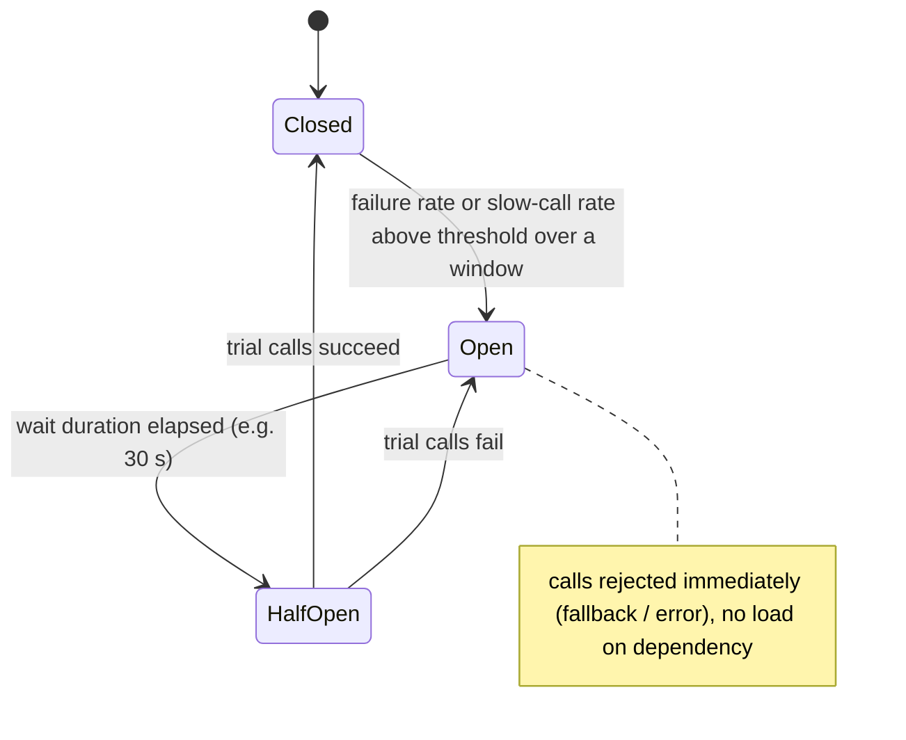

Parameters (Resilience4j names): `slidingWindowType/Size` (count or time based), `minimumNumberOfCalls`, `failureRateThreshold` (%), `slowCallDurationThreshold` + `slowCallRateThreshold`, `waitDurationInOpenState`, `permittedNumberOfCallsInHalfOpenState`, and which exceptions count as failures (not 4xx business errors).

#### Example
A recommendation service starts timing out (3 s each). Without a breaker, the product page's threads all wait 3 s, pool exhaustion follows, and the whole site slows. With a breaker (open after 50% failures or slow calls over 20 calls, wait 30 s), calls fail instantly with a fallback ("popular items" from cache), the page stays fast, and recommendations recover without being hammered.

#### Trade-offs
Contains failures and speeds degradation, but thresholds need tuning (too sensitive means flapping, too lax means slow reaction). Breakers per instance see only local traffic, and a fallback must exist for it to help users.

#### Problems & fixes
| Symptom | Cause | Fix |
|---|---|---|
| Breaker flaps open/closed | small windows, low minimum calls | larger window, minimumNumberOfCalls, slow-call thresholds |
| Breaker opens on user errors (404/400) | counting business errors as failures | record only 5xx/timeouts/connection errors |
| Breaker opens but users still see errors | no fallback | define fallback / degraded response |
| One breaker for all endpoints of a service | coarse granularity | breaker per dependency/endpoint group |

#### Cheat sheet
- Closed → (failures) → Open (fail fast) → (wait) → Half-open (trial) → Closed/Open.
- Count timeouts, 5xx and slow calls. Not 4xx.
- Pair with timeouts, bulkheads and fallbacks. Monitor breaker state.

#### Interview questions
<details><summary>Why use a circuit breaker if you already have timeouts?</summary>

Timeouts bound each call, but every request still waits the full timeout while the dependency is down, which ties up threads, adds latency to every user request, and keeps load on the failing service. A breaker detects the failure pattern and rejects calls immediately for a while, freeing resources, enabling fast fallbacks, and letting the dependency recover.
</details>

<details><summary>What should count as a failure for a circuit breaker?</summary>

Signals that the dependency is unhealthy: timeouts, connection errors, 5xx responses, and calls slower than a threshold (slow-call rate). Not client errors like 400, 404 or 409, which are valid business outcomes. Counting them would open the breaker because of bad input rather than dependency health.
</details>

#### Interview angle
> "Every remote dependency sits behind a Resilience4j circuit breaker that counts timeouts, 5xx and slow calls, with a fallback when it's open, so a failing service is cut off quickly instead of draining our threads."

#### Sources
- [Circuit breaker](https://martinfowler.com/bliki/CircuitBreaker.html) — Martin Fowler
- [Circuit breaker pattern](https://learn.microsoft.com/en-us/azure/architecture/patterns/circuit-breaker) — Azure Architecture Center
- [CircuitBreaker](https://resilience4j.readme.io/docs/circuitbreaker) — Resilience4j docs

### Hystrix (deprecated) / Resilience4j (Java) / Polly (.NET) — circuit breaker implementations
Resilience libraries implement circuit breakers and related patterns (retry, timeout, bulkhead, rate limiter, fallback) so you don't hand-roll them. **Netflix Hystrix** pioneered this but is in maintenance mode (deprecated in 2018). **Resilience4j** is the modern lightweight Java choice. **Polly** is the standard for .NET. Service meshes provide similar features at the network layer.

#### Intuition
You do not build your own fuse box. You buy a tested one and wire it in. These libraries are the ready-made fuse boxes for remote calls.

#### Must know
- Libraries that implement circuit breaker, retry, timeout, bulkhead and rate limiter.
- **Hystrix is in maintenance mode.** Do not choose it for new work.
- **Resilience4j** is the Java standard. **Polly** is the .NET standard.
- Compose them per dependency, with a business-aware fallback.
- A service mesh offers the same at network level. Do not retry in both places.

#### Common mistakes
- Naming Hystrix as your current choice.
- Retries in the library and in the mesh at once.
- A Spring annotation that silently does nothing because the method was called from inside the same class.

#### How it works
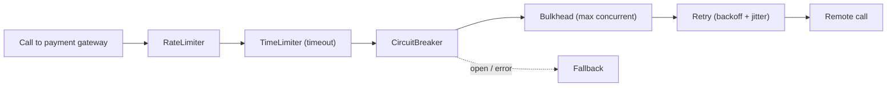

Resilience4j with Spring Boot:
```java
@CircuitBreaker(name = "paymentGateway", fallbackMethod = "queueForLater")
@Retry(name = "paymentGateway")
@Bulkhead(name = "paymentGateway")
@TimeLimiter(name = "paymentGateway")
public CompletableFuture<ChargeResult> charge(ChargeRequest req) {
  return CompletableFuture.supplyAsync(() -> gatewayClient.charge(req));
}
CompletableFuture<ChargeResult> queueForLater(ChargeRequest req, Throwable t) {
  outbox.enqueue(req);                                   // degrade: process asynchronously later
  return CompletableFuture.completedFuture(ChargeResult.pending());
}
```
```yaml
resilience4j.circuitbreaker.instances.paymentGateway:
  slidingWindowSize: 50
  minimumNumberOfCalls: 20
  failureRateThreshold: 50
  slowCallDurationThreshold: 800ms
  slowCallRateThreshold: 60
  waitDurationInOpenState: 30s
resilience4j.retry.instances.paymentGateway:
  maxAttempts: 3
  waitDuration: 200ms
  enableExponentialBackoff: true
  enableRandomizedWait: true
```

Hystrix vs Resilience4j: Hystrix used thread-pool isolation per command (heavy) and is unmaintained. Resilience4j is functional and modular, with semaphore or thread-pool bulkheads, works with reactive (Reactor/RxJava), and exports Micrometer metrics.

#### Example
A Spring Boot migration from Hystrix to Resilience4j: the same protection, fewer threads (semaphore bulkheads), metrics in Prometheus (`resilience4j_circuitbreaker_state`), and Grafana dashboards showing which dependencies trip most often.

#### Trade-offs
Library-level resilience is precise (per method, with business-aware fallbacks), but it's per language and needs consistent configuration. Mesh-level resilience is language-agnostic but less business-aware. Many teams use both, carefully avoiding double retries.

#### Problems & fixes
| Symptom | Cause | Fix |
|---|---|---|
| Retries amplify load | retries outside breaker / at multiple layers | order decorators (retry inside breaker or vice versa deliberately), one retry layer |
| Annotations not applied | self-invocation in Spring proxies | call through proxy/bean, or use functional API |
| No visibility of breaker state | metrics not exported | Micrometer + dashboards + alerts |

#### Cheat sheet
- Java: Resilience4j (Hystrix is deprecated). .NET: Polly. Network level: mesh.
- Compose: rate limiter → timeout → breaker → bulkhead → retry, with fallback.
- Export metrics. Avoid double retries with the mesh.

#### Interview questions
<details><summary>Why did the industry move from Hystrix to Resilience4j?</summary>

Hystrix went into maintenance mode in 2018. Its thread-pool-per-command isolation was heavyweight, and its design predated reactive and functional styles. Resilience4j is lightweight, modular (use only what you need), built for Java 8+ functional composition and reactive streams, supports semaphore bulkheads, and integrates with Micrometer and Spring Boot.
</details>

<details><summary>In what order would you compose retry and circuit breaker?</summary>

Commonly Retry(CircuitBreaker(call)): each attempt passes through the breaker, so once it opens, retries fail fast instead of hammering the dependency, and failed attempts count toward the breaker's statistics. Some use CircuitBreaker(Retry(call)) to count a whole retried operation as one result. Choose deliberately, keep retries few with backoff, and don't also retry at the mesh layer.
</details>

#### Interview angle
> "In Java I compose Resilience4j decorators per dependency (timeout, circuit breaker, bulkhead, retry with jittered backoff) with business-aware fallbacks and breaker metrics in Grafana. Hystrix is legacy."

#### Sources
- [Resilience4j: getting started](https://resilience4j.readme.io/docs/getting-started) — Resilience4j docs
- [Hystrix](https://github.com/Netflix/Hystrix) — Netflix, GitHub

### Retry with exponential backoff + jitter — avoid thundering herd on retry storms
Transient failures (a dropped connection, a brief 503, a leader election) often succeed on retry, but naive retries **multiply load exactly when a service is struggling**. Retrying with **exponentially increasing, randomised (jittered) delays**, only for **idempotent** operations and **transient** errors, with a **cap**, recovers from blips without causing retry storms. (Phase 6 covers the formulas in depth.)

#### Intuition
Knocking on a door. If nobody answers you wait a little, then longer, then longer still, and you do not knock in rhythm with the twenty other people waiting outside.

#### Must know
- Short-lived failures often succeed on a retry, but naive retries **multiply load on a struggling service**.
- Wait longer after each attempt (**exponential backoff**) and randomise the wait (**jitter**).
- Retry only **idempotent** calls and only **transient** errors: timeouts, 502, 503, 504, and 429 with `Retry-After`.
- Cap the attempts and stay inside the caller's deadline.
- Retry at **one layer** only, with a retry budget.

#### Numbers to quote
- Typical cap: 2–3 attempts. A common retry budget is about 10% extra requests.

#### Common mistakes
- Immediate retries with no delay.
- Retrying a POST that has no idempotency key.
- Retrying 400 or 404, which will never succeed.

#### How it works
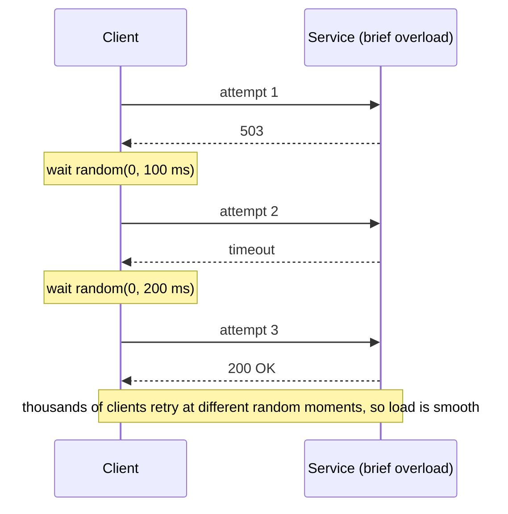

Rules: retry only idempotent requests (or ones with idempotency keys), only transient errors (timeouts, 502/503/504, 429 with `Retry-After`, connection resets), cap attempts (2–3) and total time within the deadline, retry at **one layer**, and enforce **retry budgets** (e.g. retries ≤ 10% of requests, as in Envoy and Finagle).

#### Example
An SDK used by mobile clients retried failed requests immediately, 5 times. During a 30-second backend incident, retry traffic quintupled load and turned a blip into a 20-minute outage. The SDK update added full-jitter backoff (100 ms base, 10 s cap, 3 attempts) and honoured `Retry-After`, and the next incident resolved itself in under a minute.

#### Trade-offs
Recovers transient errors invisibly, but adds latency on failures, and done badly it amplifies outages and duplicates side effects.

#### Problems & fixes
| Symptom | Cause | Fix |
|---|---|---|
| Outage worsens during recovery | synchronized/no-backoff retries | exponential backoff + full jitter |
| Load × N during incidents | retries at client, gateway, mesh, service | single retry layer, retry budgets |
| Duplicate orders | retrying non-idempotent POST | idempotency keys |
| Retrying 400 errors | no error classification | retry only transient errors |

#### Cheat sheet
- Exponential backoff + full jitter, capped attempts within the deadline.
- Idempotent operations, transient errors only. Honour Retry-After.
- One layer. Retry budgets. Pair with circuit breakers.

#### Interview questions
<details><summary>Which HTTP responses should a client retry?</summary>

Transient ones: network errors and timeouts, 502, 503, 504, and 429 (respecting `Retry-After`), and only for idempotent methods or requests with idempotency keys. Don't retry 400, 401, 403, 404, 409 or 422 (they won't succeed unchanged), and be careful with 500 (may be a deterministic bug, so retry at most once).
</details>

<details><summary>What is a retry budget?</summary>

A cap on retries as a proportion of normal traffic (e.g. retries may add at most 10–20% extra load over a time window). When failures spike, the budget runs out and further retries are skipped, which prevents retry storms from multiplying load during outages while still smoothing over occasional transient errors.
</details>

#### Interview angle
> "Retries are a single layer: jittered exponential backoff, only for transient errors on idempotent calls, capped by the deadline and a retry budget, so they smooth over blips without amplifying outages."

#### Sources
- [Timeouts, retries, and backoff with jitter](https://aws.amazon.com/builders-library/timeouts-retries-and-backoff-with-jitter/) — Amazon Builders' Library
- [Retry pattern](https://learn.microsoft.com/en-us/azure/architecture/patterns/retry) — Azure Architecture Center

### Timeout — always set explicit timeouts; cascading timeouts cause full-stack slowdowns
Every remote call needs an **explicit timeout**. Defaults are often infinite or very long (some HTTP clients default to no read timeout), and a single hung dependency then holds threads and connections forever, exhausting pools and cascading up the stack. Timeouts should fit the caller's **latency budget** and get shorter as you go deeper into the call chain.

#### Intuition
You do not hold the phone forever when put on hold. You decide in advance to wait two minutes and then hang up and do something else. Without that rule, one unanswered call swallows your afternoon.

#### Must know
- **Every remote call needs an explicit timeout.** Defaults are often infinite or far too long.
- Without one, a hung dependency holds threads and connections until the pool is empty.
- Set separate **connect** and **read / total** timeouts, plus a database statement timeout.
- **Inner timeouts must be shorter than outer ones.**
- Propagate a **deadline**, so downstream work stops once the caller has given up.

#### Common mistakes
- Relying on a client library's default timeout.
- A downstream timeout longer than the upstream caller's.
- A timeout set below normal p99 latency, which fails healthy requests.

#### How it works
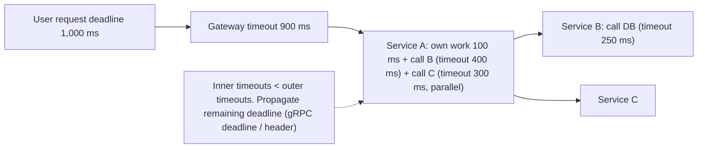

Kinds of timeouts: **connect** (establish TCP/TLS, short: 100–500 ms), **read/response** (waiting for data), **total/request**, **pool acquisition** (waiting for a free connection), **DB statement** (`statement_timeout`), and **idle/keep-alive** (align with load balancers).

```java
HttpClient client = HttpClient.newBuilder().connectTimeout(Duration.ofMillis(300)).build();
HttpRequest req = HttpRequest.newBuilder(uri).timeout(Duration.ofMillis(800)).GET().build();   // per-request timeout
// HikariCP: connectionTimeout=2000 (pool wait), Postgres: SET statement_timeout = '3s'
```

#### Example
A checkout service called a fraud API with the default OkHttp read timeout (10 s) and a pool of 50. When the fraud API hung, 50 threads blocked for 10 s, checkout requests queued, and the gateway (30 s timeout) kept clients waiting, so the site was effectively down. Fix: fraud timeout 300 ms with a fallback ("allow and review async" for low-risk orders), a circuit breaker, and gateway and service timeouts aligned to a 2 s budget.

#### Trade-offs
Short timeouts free resources fast but may cut off legitimately slow requests (set them from p99 latency plus margin). Long timeouts protect slow requests but cause pile-ups.

#### Problems & fixes
| Symptom | Cause | Fix |
|---|---|---|
| Thread pool exhaustion when a dependency hangs | no/infinite timeouts | explicit connect/read/total timeouts |
| Work continues after client gave up | no deadline propagation | propagate deadlines, cancel downstream work |
| Inner timeout longer than outer | misaligned budgets | inner < outer, budget per hop |
| Timeouts too tight → spurious failures | set below p99 | base on measured p99/p999 + margin |

#### Cheat sheet
- Every call: connect + read/total timeouts. DB: statement_timeout. Pool: acquisition timeout.
- Inner < outer. Propagate deadlines. Cancel abandoned work.
- Set from p99 latency + margin. Pair with circuit breakers and fallbacks.

#### Interview questions
<details><summary>How do you choose timeout values for a downstream call?</summary>

Start from the user-facing latency budget and allocate it across hops (leaving room for your own work and retries). Check the dependency's latency distribution and set the timeout above its normal p99 (with margin) but within the budget. Inner calls get smaller timeouts than outer ones, and deadlines are propagated so downstream services stop early.
</details>

<details><summary>Why can a missing timeout take down a service whose own code is healthy?</summary>

Calls to a hung dependency never return, so each holds a thread or connection indefinitely. As requests keep arriving, all worker threads and pool connections end up blocked (Little's law: in-flight = rate × time, and time is unbounded), and the service stops serving anything, including endpoints that don't use that dependency, so the failure cascades upstream.
</details>

#### Interview angle
> "Every remote call and DB statement has an explicit timeout derived from the request's latency budget. Inner timeouts are shorter than outer ones, and deadlines propagate so abandoned work is cancelled."

#### Sources
- [Timeouts, retries, and backoff with jitter](https://aws.amazon.com/builders-library/timeouts-retries-and-backoff-with-jitter/) — Amazon Builders' Library
- [Deadlines](https://grpc.io/docs/guides/deadlines/) — gRPC docs

### Bulkhead pattern — separate thread pools/connection pools per dependency; one slow dep can't exhaust all threads
The bulkhead pattern (named after ship compartments) **isolates resources per dependency or workload**: separate thread pools, connection pools, semaphores or even service instances. If one dependency slows or fails, it can exhaust only its own compartment, and other features keep working.

#### Intuition
A ship's hull divided into watertight compartments. A hole floods one compartment and the ship stays afloat. Without the walls, one hole sinks everything.

#### Must know
- **Isolate resources per dependency or workload**, so one failure cannot use them all.
- Forms: a concurrency limit (semaphore), a dedicated thread pool, a separate connection pool.
- At infrastructure level: separate deployments for critical and non-critical traffic.
- Extra calls are **rejected fast** when a compartment is full, and take a fallback.
- Size each compartment as request rate × latency, plus headroom.

#### Common mistakes
- One shared thread pool for every outbound call.
- Checkout sharing pods and pools with browse and search.
- Compartments so small that they reject normal traffic.

#### How it works
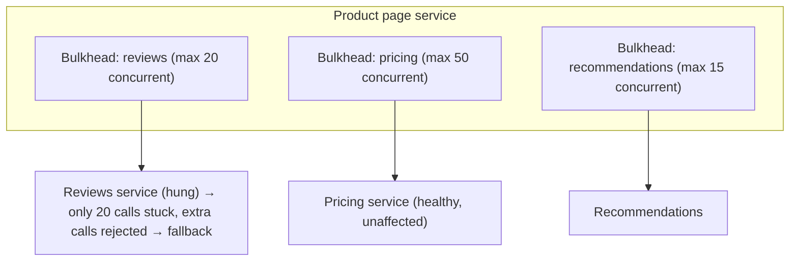

Forms:
- **Semaphore bulkhead**: limit concurrent calls (cheap, same thread).
- **Thread-pool bulkhead**: dedicated pool and queue per dependency (isolates blocking calls).
- **Connection pools** per downstream (separate HTTP client pools, separate DB pools for OLTP vs reporting).
- **Infrastructure bulkheads**: separate deployments or clusters for critical vs non-critical traffic (e.g. checkout pods separate from browse pods), cell-based architecture.

#### Example
An e-commerce API served browse, search and checkout from the same pods and thread pool. A slow search backend during a sale exhausted threads, and checkout failed too. After bulkheads (per-dependency semaphores in Resilience4j, plus checkout moved to a dedicated deployment with its own DB connection pool), a later search outage degraded search only and checkout revenue was unaffected.

#### Trade-offs
Fault isolation and predictable capacity for critical paths, but resources are partitioned (lower utilisation, needs sizing per compartment) and adds more configuration.

#### Problems & fixes
| Symptom | Cause | Fix |
|---|---|---|
| One slow dependency takes everything down | shared pools | bulkhead per dependency |
| Critical flow starved by bulk traffic | same pods/pools for all | separate deployments/pools for critical paths |
| Bulkhead rejections under normal load | compartments too small | size via Little's law (rate × latency) + headroom |

#### Cheat sheet
- Isolate pools per dependency or workload so failures stay contained.
- Semaphore / thread-pool / connection-pool / deployment-level bulkheads.
- Size with Little's law. Pair with timeouts, breakers and fallbacks.

#### Interview questions
<details><summary>How do bulkheads and circuit breakers complement each other?</summary>

Bulkheads limit how many resources a failing dependency can consume at once (only N threads can be stuck on it), which protects the rest of the service immediately. Circuit breakers detect the failure pattern and stop calling the dependency altogether for a while, giving fast failures and recovery time. Together they contain the blast radius and reduce load.
</details>

<details><summary>How would you apply the bulkhead idea at the infrastructure level for an e-commerce site?</summary>

Separate deployments (and autoscaling) for critical flows (checkout, payments) vs browse and search. Separate database connection pools or replicas for reporting vs OLTP. Dedicated queues and workers per priority. And cell-based architecture: partition customers into independent cells so an incident affects only one cell.
</details>

#### Interview angle
> "Each downstream gets its own bulkhead sized by Little's law, and checkout runs on separate pods and pools from browsing, so a slow search backend can't take payments down."

#### Sources
- [Bulkhead pattern](https://learn.microsoft.com/en-us/azure/architecture/patterns/bulkhead) — Azure Architecture Center
- [Bulkhead](https://resilience4j.readme.io/docs/bulkhead) — Resilience4j docs

### Fallback — return cached/default response when dependency fails (graceful degradation)
A fallback is the **alternative response** returned when a dependency fails, times out or its circuit is open: cached data, a default, a reduced feature, or a deferred action. It turns hard failures into **graceful degradation**, so users still get a useful (if reduced) experience.

#### Intuition
The lift is broken, so you take the stairs. It is slower and less pleasant, but you still reach your floor. The alternative is standing in the lobby all day.

#### Must know
- The **alternative response** used when a dependency fails, times out or its breaker is open.
- Options: stale cache, a default, hiding the feature, a secondary provider, deferring the action.
- It turns a hard failure into **graceful degradation**.
- **Fail closed** for security and money: authentication, fraud and balance checks must refuse.
- Test fallbacks with fault injection. They are rarely exercised and often broken.

#### Common mistakes
- A fail-open fallback on a fraud or authorisation check.
- A fallback path that has never run in production.
- Showing stale data on a screen where the user makes a decision, with no warning.

#### How it works
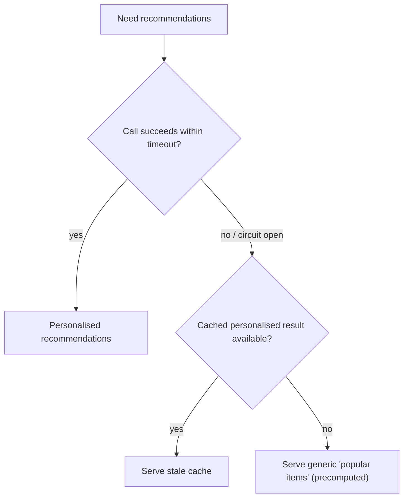

Fallback types:
| Type | Example |
|---|---|
| Stale cache | last known product price for display, exchange rates |
| Static/default | "popular items", default config, empty list |
| Reduced functionality | hide reviews widget, disable "estimated delivery" |
| Alternative provider | secondary SMS or payment gateway |
| Deferred processing | queue the action and confirm later ("we'll email your invoice") |
| Fail closed | for security or money: deny rather than allow without verification |

#### Example
During an SMS provider outage, OTP delivery failed. The fallback chain was: retry once via a secondary SMS provider, then offer voice-call OTP, then email OTP (for low-risk logins). Login success stayed above 98% during the outage. Note: for **fraud checks on large payments**, the fallback is to **decline or queue for review** (fail closed), not to approve blindly.

#### Trade-offs
Better availability and UX, but stale or incomplete data is shown, fallback paths are rarely exercised (they may themselves be broken, so test them), and wrong fallbacks for security or money can be dangerous.

#### Problems & fixes
| Symptom | Cause | Fix |
|---|---|---|
| Fallback path crashes during incident | never tested | chaos/fault-injection tests of fallbacks |
| Fraud approved during outage | fail-open fallback on risk check | fail closed / manual review for high-risk |
| Users unaware data is stale | silent degradation | indicate degraded state where relevant |

#### Cheat sheet
- Stale cache → default → reduced feature → alternate provider → defer.
- Fail closed for security and money decisions.
- Test fallbacks with fault injection. Monitor how often they're used.

#### Interview questions
<details><summary>Give fallbacks for a product page whose pricing, reviews and recommendation services might fail.</summary>

Pricing: show the cached price with a "price confirmed at checkout" note, or hide "Add to cart" if no recent price exists (never sell at an unknown price). Reviews: hide the widget or show the cached rating summary. Recommendations: show precomputed popular items for the category. Checkout re-validates prices against the source of truth.
</details>

<details><summary>When should a system fail closed rather than fall back?</summary>

When a wrong "allow" is costly or unsafe: authentication and authorisation checks, fraud or risk checks on payments, compliance checks (KYC, sanctions), and balance verification before debits. Then it's better to reject, queue for manual review or retry later than to proceed without verification.
</details>

#### Interview angle
> "Every non-critical dependency has a tested fallback (stale cache, popular items, a hidden widget, a secondary provider), while auth, fraud and balance checks fail closed."

#### Sources
- [Circuit breaker pattern](https://learn.microsoft.com/en-us/azure/architecture/patterns/circuit-breaker) — Azure Architecture Center
- [Avoiding fallback in distributed systems](https://aws.amazon.com/builders-library/avoiding-fallback-in-distributed-systems/) — Amazon Builders' Library

### Idempotent APIs — safe to retry; critical for distributed systems where retries are unavoidable
An idempotent API produces the **same result and side effects whether called once or many times** with the same input. Because timeouts, retries, redeliveries and duplicate clicks are unavoidable in distributed systems, idempotency is what makes them safe. (Phase 1 covers HTTP semantics and idempotency keys in depth.)

#### Intuition
A lift call button. Pressing it five times calls the lift once. Compare a vending machine button that dispenses a can on every press.

#### Must know
- Calling it **once or many times with the same input gives the same result and side effects**.
- Timeouts and retries are unavoidable, so idempotency is what makes them safe.
- Naturally idempotent: PUT, DELETE, setting a value, a state change that ignores repeats.
- For creates and actions, use an **idempotency key** or a client-generated id.
- Enforce with a unique constraint, and pass the key on to downstream calls.

#### Common mistakes
- A "balance += 100" endpoint with no operation id.
- An idempotent API in front of a message consumer that is not.
- Deduplicating with a read followed by an insert, which is a race.

#### How it works
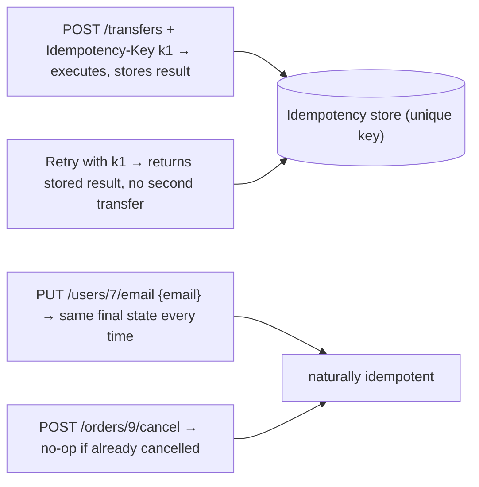

Techniques:
- Natural idempotency: PUT (full replace), DELETE, set-to-value updates, state transitions that ignore repeats.
- **Idempotency keys** for creates and actions (stored response + request hash).
- **Conditional writes**: `If-Match` ETags, `WHERE version = ?`, `INSERT … ON CONFLICT DO NOTHING`.
- Client-generated ids (UUIDv7) for resources so retries hit the same id.
- **Idempotent consumers** (inbox) for messages.

#### Example
A payout API used by merchants: `POST /payouts` requires `Idempotency-Key`, and payouts are created with a client-provided `reference` unique per merchant. When a merchant's server crashed mid-request and retried 3 times over 10 minutes, only one payout was executed, and all responses returned the same payout id. The payouts service also passes derived keys to the bank API so the bank dedupes too.

#### Trade-offs
Small extra storage and logic, but it's essential for reliability: without it, every retry mechanism becomes a duplication risk.

#### Problems & fixes
| Symptom | Cause | Fix |
|---|---|---|
| Duplicate resources on retry | POST without keys | idempotency keys / client-generated ids |
| Relative updates double-applied (`+100`) | non-idempotent PATCH | absolute values or keyed operations |
| Race between concurrent duplicates | check-then-insert | unique constraints, atomic conditional writes |

#### Cheat sheet
- Same request, same effect. Required for safe retries.
- PUT/DELETE/absolute updates, idempotency keys, conditional writes, client ids.
- Enforce atomically (unique constraints). Propagate keys downstream.

#### Interview questions
<details><summary>Make "add ₹100 to wallet" idempotent.</summary>

Model it as a uniquely identified operation: `POST /wallets/{id}/credits` with an idempotency key or client-generated `creditId`. Insert into a `wallet_credits` table with a unique constraint on that id in the same transaction as the balance update. Retries hit the unique constraint and return the existing result. Never use a bare relative "balance += 100" endpoint without an operation id.
</details>

<details><summary>Why do message consumers also need to be idempotent even if the API is?</summary>

Messages are delivered at least once: consumers may receive the same event again after crashes, rebalances or replays. If processing triggers side effects (emails, payouts, stock updates) without dedupe, duplicates cause real damage. Consumers need an inbox table, version checks or idempotent downstream calls.
</details>

#### Interview angle
> "Every write API is idempotent: absolute updates, client-generated ids or Idempotency-Keys backed by unique constraints, with keys passed downstream, so any layer can retry safely."

#### Sources
- [Making retries safe with idempotent APIs](https://aws.amazon.com/builders-library/making-retries-safe-with-idempotent-APIs/) — Amazon Builders' Library
- [Idempotent requests](https://docs.stripe.com/api/idempotent_requests) — Stripe API docs

### Sidecar pattern — inject cross-cutting concerns (proxy, logging, mTLS) as sidecar container
A sidecar is a **helper container deployed alongside the application container in the same pod**, sharing its network namespace and volumes. It handles cross-cutting concerns (proxying, mTLS, metrics, log shipping, config reloading, secrets) without changing application code, in any language.

#### Intuition
A motorbike sidecar. It is bolted to the bike and goes everywhere with it, carrying extra gear. The bike itself does not need rebuilding.

#### Must know
- A **helper container in the same pod** as the application, sharing its network and volumes.
- It handles cross-cutting concerns: proxying, mTLS, metrics, secret renewal.
- **No application code changes**, and it works for any language.
- It can be upgraded separately from the app.
- Costs: CPU and memory for every pod, an extra hop, and start-up ordering to get right.

#### Common mistakes
- The app making calls before the proxy sidecar is ready.
- A Job that never finishes because the sidecar keeps running.
- Ignoring the cost of a sidecar multiplied by thousands of pods.

#### How it works
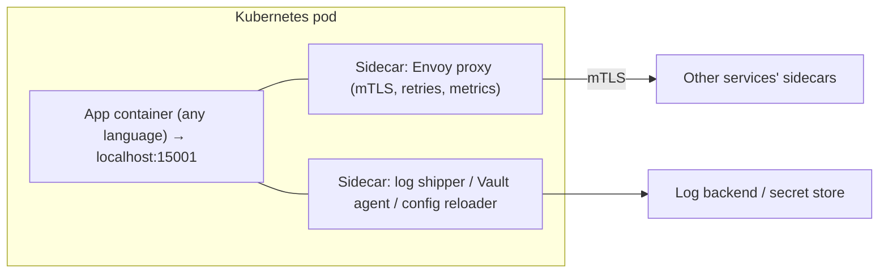

Common sidecars: Envoy/Linkerd proxy (service mesh), Vault Agent (secret injection and renewal), Fluent Bit (when per-pod log handling is needed), Cloud SQL Auth Proxy, OpenTelemetry Collector agent, config watchers. Kubernetes 1.29+ has **native sidecar containers** (init containers with `restartPolicy: Always`) to fix startup and shutdown ordering.

#### Example
A polyglot company (Java, Go, Node, Python) needed mTLS and uniform metrics for all services. Implementing it in four languages would take months, but Istio's injected Envoy sidecar delivered it with zero code changes. A Vault Agent sidecar renders DB credentials into a shared volume and renews them, so apps just read a file.

#### Trade-offs
Language-agnostic reuse and separation of concerns, but resource overhead per pod (CPU and memory × pods), extra latency per hop (proxies), lifecycle ordering issues (the app starting before the proxy is ready), and more complex debugging.

#### Problems & fixes
| Symptom | Cause | Fix |
|---|---|---|
| App fails on startup network calls | sidecar proxy not ready yet | native sidecars, `holdApplicationUntilProxyStarts` |
| Jobs never complete (sidecar keeps pod alive) | sidecar doesn't exit with main container | native sidecar containers / quit endpoint |
| Significant cluster cost | sidecar per pod × thousands | ambient/node-level proxies, right-size sidecar resources |

#### Cheat sheet
- Helper container in the same pod (shared network and volumes).
- Mesh proxies, secret agents, log and telemetry agents, config reloaders.
- Mind resource overhead and lifecycle ordering. Use native sidecars (K8s 1.29+).

#### Interview questions
<details><summary>Why implement cross-cutting concerns as sidecars instead of libraries?</summary>

Sidecars work for every language and framework without code changes, can be upgraded independently of the app (patch mTLS or proxy versions centrally), and give uniform behaviour across services. Libraries require per-language implementations and app redeploys to update, but avoid the per-pod overhead and extra hop.
</details>

<details><summary>What problems do sidecars cause with Kubernetes Jobs?</summary>

A Job's pod completes only when all containers exit. A long-running sidecar (proxy, log agent) keeps running after the main container finishes, so the Job never completes. Fixes: Kubernetes native sidecar containers (which terminate after main containers), or signalling the sidecar to exit (e.g. an Envoy quit endpoint) when the main process ends.
</details>

#### Interview angle
> "Cross-cutting concerns like mTLS proxies and secret renewal run as sidecars so every language gets them without code changes. I watch the per-pod overhead and use native sidecars for correct startup and shutdown order."

#### Sources
- [Sidecar pattern](https://learn.microsoft.com/en-us/azure/architecture/patterns/sidecar) — Azure Architecture Center
- [Sidecar containers](https://kubernetes.io/docs/concepts/workloads/pods/sidecar-containers/) — Kubernetes docs

### Ambassador pattern — outbound proxy that adds retry/timeout/circuit-breaker to legacy services
The ambassador pattern is a specialised sidecar: a **local outbound proxy** that the application calls instead of the remote service. The ambassador handles connection management, retries, timeouts, circuit breaking, TLS, routing and monitoring, which is especially useful for legacy apps you can't modify or for complex external protocols.

#### Intuition
A personal assistant who makes all your outgoing calls. They know the right numbers, redial when a line is busy and handle the formalities. You just say who you want to reach.

#### Must know
- A **local outbound proxy** that the app calls in place of the remote service.
- It adds TLS, retries, timeouts, circuit breaking and metrics to outgoing calls.
- Ideal for a **legacy app you cannot modify**.
- It is a sidecar specialised for the client side.
- An API gateway is different: it sits in front of your services for **inbound** traffic.

#### Common mistakes
- Letting the ambassador retry calls that are not idempotent.
- Hiding failures so well that nobody notices the dependency is unhealthy.
- Confusing it with an API gateway.

#### How it works
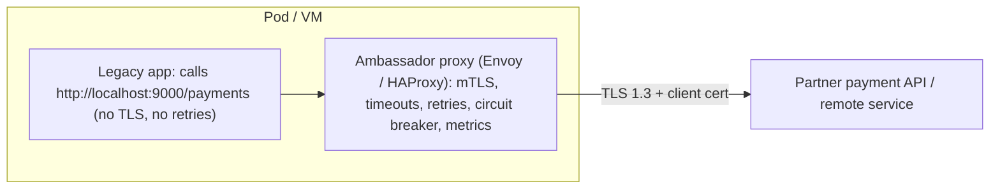

Difference from a generic sidecar: the ambassador is specifically the **client-side proxy for outbound calls** (from the app to the world), often encapsulating the specifics of a remote service (sharding, auth, protocol quirks).

#### Example
A 12-year-old Java 6 application calls a bank partner API, but the partner now requires TLS 1.3 with mutual certificates, and the old JVM can't do TLS 1.3. Instead of rewriting the app, the team deployed an Envoy ambassador: the app calls `http://localhost:9000` and Envoy originates TLS 1.3 with the client certificate, adds a 2 s timeout, 2 retries on connect failures, and circuit breaking, and exports latency metrics. Compliance was met in a week.

#### Trade-offs
Adds modern resilience and security to unmodifiable apps and centralises client-side policies, at the cost of an extra hop and process to operate, and the app is unaware of failures handled transparently (good or bad).

#### Problems & fixes
| Symptom | Cause | Fix |
|---|---|---|
| Duplicate side effects from ambassador retries | retrying non-idempotent calls | retry only idempotent routes/connect failures |
| Hidden failures | ambassador masks errors | expose metrics, propagate final errors |
| Extra latency | additional local hop | negligible locally, keep config lean |

#### Cheat sheet
- Local outbound proxy that adds TLS, retries, timeouts, breakers and metrics for the app.
- Great for legacy or unmodifiable apps and complex external protocols.
- Careful with retries on non-idempotent calls.

#### Interview questions
<details><summary>How would you add mTLS and retries to a legacy service you can't modify?</summary>

Deploy an ambassador proxy (Envoy/HAProxy) next to it (sidecar or same host). Point the app's outbound URL to the local proxy, which originates mTLS with the right certificates, applies timeouts, circuit breaking and retries (only for idempotent operations or connection failures), and emits metrics. No application code changes.
</details>

<details><summary>Ambassador vs API gateway: what's the difference?</summary>

An ambassador is a per-client (per-app instance) outbound proxy handling how that app calls external or remote services. An API gateway is a shared inbound entry point handling how external clients call your services (routing, auth, rate limits). One sits on the caller's side, the other in front of the callee.
</details>

#### Interview angle
> "For legacy apps we can't touch, I put an Envoy ambassador in front of their outbound calls to add TLS 1.3, mTLS, timeouts, breakers and metrics with zero code changes."

#### Sources
- [Ambassador pattern](https://learn.microsoft.com/en-us/azure/architecture/patterns/ambassador) — Azure Architecture Center
- [What is Envoy](https://www.envoyproxy.io/docs/envoy/latest/intro/what_is_envoy) — Envoy docs

### Health endpoints — /health (is process running?), /ready (can accept traffic?), /live (Kubernetes liveness)
Health endpoints let orchestrators and load balancers decide whether to **restart** an instance (liveness), **send it traffic** (readiness), or **wait** during startup. Designing them carefully avoids both zombie instances and cascading restarts. (Phase 5 covers the probe mechanics.)

#### Intuition
Two different questions about a shop assistant. "Are they conscious?" If not, call for help. "Are they free to serve?" If not, send customers to someone else. Mixing the two questions causes trouble.

#### Must know
- **Liveness**: is the process stuck? Failing it **restarts** the container.
- **Readiness**: can it take traffic now? Failing it **removes it from rotation** with no restart.
- **Startup**: has it finished booting? It protects slow starters from being killed.
- **Liveness must not check shared dependencies.** A database blip would restart every pod.
- Deep dependency checks belong on dashboards and in regional failover decisions.

#### Common mistakes
- A liveness endpoint that queries the database.
- Readiness reporting OK before caches and pools are warm.
- No startup probe on a slow JVM service, so it is killed in a loop.

#### How it works
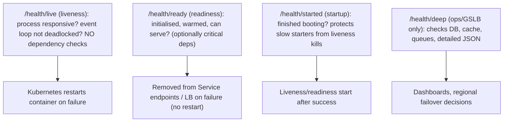

Spring Boot Actuator: `/actuator/health/liveness` and `/actuator/health/readiness` (enable `management.endpoint.health.probes.enabled=true`), with health groups to choose which indicators affect readiness.

```yaml
livenessProbe:  { httpGet: { path: /actuator/health/liveness,  port: 8080 }, periodSeconds: 10, failureThreshold: 3 }
readinessProbe: { httpGet: { path: /actuator/health/readiness, port: 8080 }, periodSeconds: 5,  failureThreshold: 2 }
startupProbe:   { httpGet: { path: /actuator/health/liveness,  port: 8080 }, periodSeconds: 5,  failureThreshold: 30 }
```

#### Example
A team's liveness endpoint checked database connectivity. During a 30 s RDS failover, every pod failed liveness and was restarted at once. Pods came back cold, causing a 6-minute outage instead of 30 s of degraded service. After the fix (liveness = process only, readiness includes DB with failure threshold tolerance), the next failover produced a brief readiness dip and automatic recovery.

#### Trade-offs
Rich readiness checks prevent traffic to broken instances, but dependency-heavy checks can remove all instances at once during shared-dependency blips (then nothing serves even cached content). Choose what readiness includes deliberately.

#### Problems & fixes
| Symptom | Cause | Fix |
|---|---|---|
| Mass restarts during dependency outage | liveness checks dependencies | liveness = process only |
| Slow-starting apps killed in a loop | liveness starts before boot completes | startupProbe |
| Traffic to instances still warming up | readiness returns OK too early | readiness after warm-up/cache load |
| Health endpoint itself slow/expensive | heavy checks on every probe | cache check results, lightweight probes |

#### Cheat sheet
- Liveness: process alive (restart). Readiness: can serve (route). Startup: finished booting.
- Never put shared dependencies in liveness.
- Deep checks for dashboards and GSLB, not for liveness.

#### Interview questions
<details><summary>Should readiness include database connectivity?</summary>

It depends. Including it stops traffic to an instance that truly can't serve. But if all instances share the database, a DB blip makes all of them unready at once, and nothing serves even requests that could succeed (cached reads, degraded responses). Many teams include only local readiness (initialised, warmed) and handle dependency failures with circuit breakers and fallbacks, reserving deep checks for global routing decisions.
</details>

<details><summary>What is a startup probe for?</summary>

For apps with long or variable startup times (large JVM apps, cache warm-up). Liveness and readiness probes don't run until the startup probe succeeds, so the app isn't killed by liveness failures while still booting. Once started, normal liveness checks with tight thresholds apply.
</details>

#### Interview angle
> "Liveness only checks the process, readiness gates traffic once the app is warm, and a startup probe protects slow boots. Dependency health goes through breakers and deep checks, never liveness, so a DB failover can't trigger mass restarts."

#### Sources
- [Liveness, readiness, and startup probes](https://kubernetes.io/docs/concepts/workloads/pods/probes/) — Kubernetes docs
- [Health endpoint monitoring pattern](https://learn.microsoft.com/en-us/azure/architecture/patterns/health-endpoint-monitoring) — Azure Architecture Center
- [Implementing health checks](https://aws.amazon.com/builders-library/implementing-health-checks/) — Amazon Builders' Library

